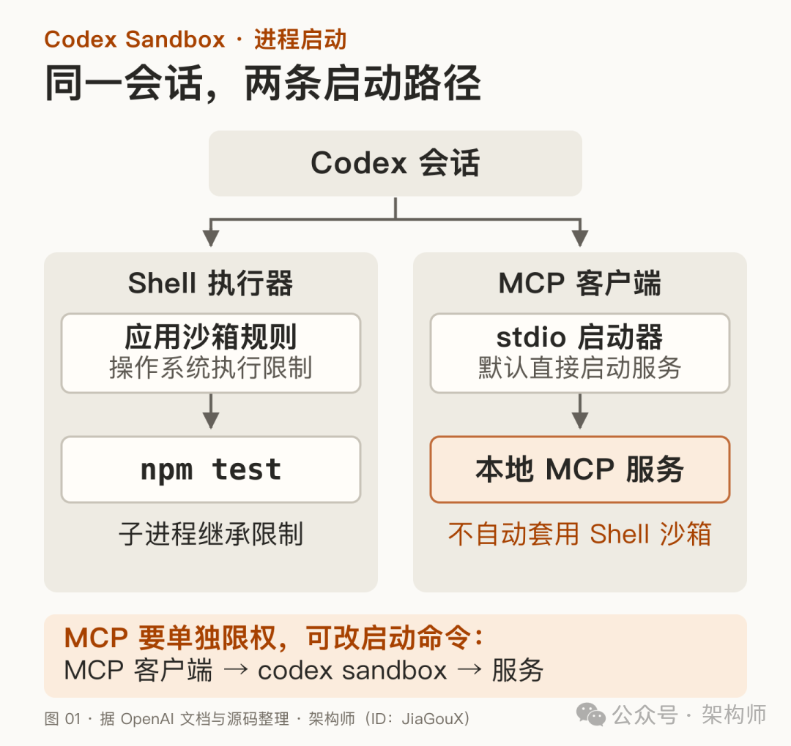
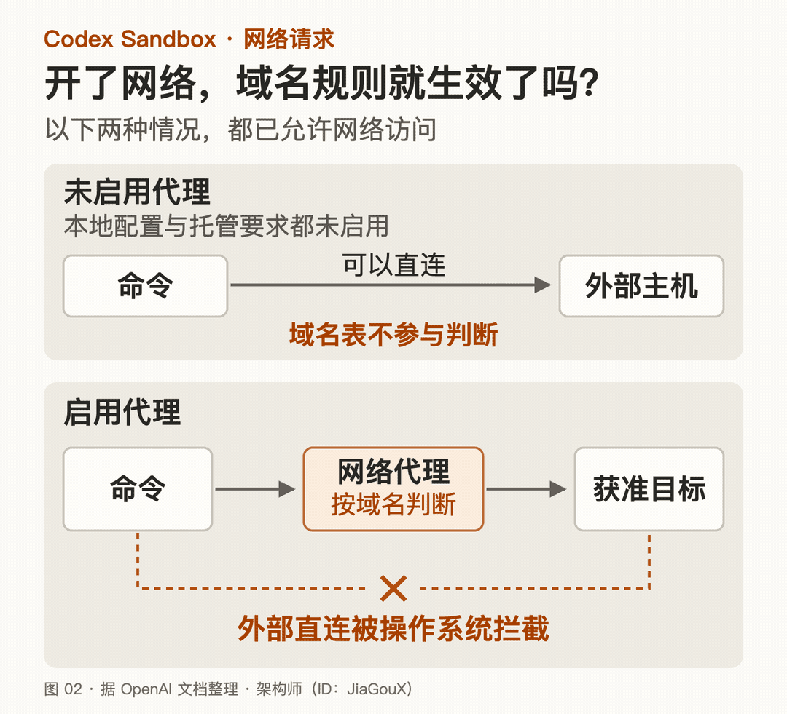
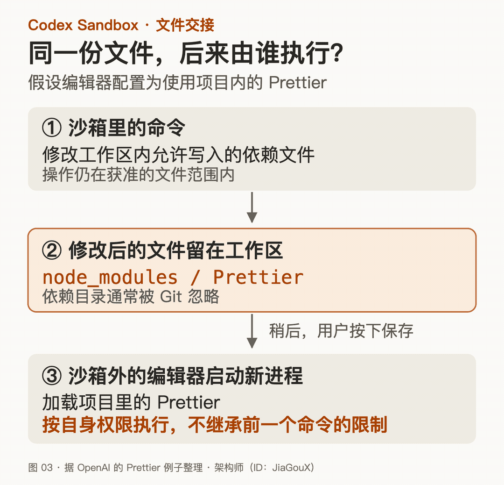

# Codex Sandbox 完整公开，OpenAI 怎么在本机给 Agent 限权？

架构师（JiaGouX）

我们都是架构师！架构未来，你来不来？

以前把一段测试报错贴给 AI，它给几条建议，接下来怎么改、要不要跑一遍，还是自己动手。现在一句「把这个测试修好」，Codex 就能找代码、改文件、跑测试。模型越来越智能，我们也越愿意把工具和权限一起交给它。

然后就有了那些「顺手」的事。修个测试，顺手整理两段代码。发现少个包，顺手跑一次安装。权限给得足够大，错误操作也可能影响到任务之外的文件和数据。

删库、误删文件，这两年已有公开案例。2025 年 7 月，Replit CEO Amjad Masad 确认，开发中的 Agent 删除了用户生产数据库里的数据。同年年底，The Register 采访的一位 Antigravity 用户报告，Agent 在清理项目缓存时误删了 D 盘内容。Google 当时回应正在调查。Replit 表示有备份可恢复，Antigravity 用户的大部分文件也另有备份。

昨天写 Codex 的改动范围时，我们让它做了两遍同一个小需求。两份补丁都通过了同样的 10 项测试，其中一份却影响了同一进程里另一段代码的输出。这样的逻辑副作用，沙箱未必拦得住。文件允许修改，操作系统就无从判断这几行代码是否符合需求。但命令能不能写到项目之外、能不能连上数据库，可以在执行时限制。

11 月 18 日，OpenAI 工程师 Michael Bolin 详细公开了 Codex Sandbox 的设计，从权限配置讲到三个操作系统上的实现，还介绍了如何把它单独用在其他程序上。这套设计要解决的，就是让 Agent 继续使用本机工具，同时限制命令能接触的文件和网络。

里面有个细节很容易被「这会话开了沙箱」一句话带过去。本地 stdio MCP 服务，默认不会自动套用 Shell 命令的沙箱配置。同一个 Agent 能跑测试，也能通过 MCP 查文档，权限却未必相同。沿着一次修测试的任务往下看，就能找到这个差别，也能知道配置该加在哪里。

## 命令启动时限权

10 月写 Agent、Harness 和 Loop 时，我们拿修测试举过例子。模型发起工具调用，Harness 执行命令，再把结果交回模型。这次再往下看一步：命令是怎样启动的？

源码里，`exec_command` 把命令、工作目录、环境变量和权限选项交给统一命令执行器。Codex 将权限配置转换成本机的沙箱规则，再启动命令，由操作系统执行限制。

npm test 再拉起测试框架和编译器，子进程也会继承约束。即使某个后代进程比原始命令活得更久，这些限制仍然跟着它。模型决定要运行什么，操作系统按启动时的规则限制它能访问什么。

拿 Git 项目里的内置 `:workspace` 配置来说，命令可以写工作区和系统临时目录，默认禁止联网。工作区根下的 `.git`、`.codex`、`.agents`、`.aws` 有额外写保护。这样可以正常改源码，同时阻止命令直接修改 Git hooks 或 `.codex`/`config.toml` 这类会影响后续执行的文件。

编译器得找仓库外的 SDK 和库，所以文件读取范围比较宽，仍受当前系统用户权限约束。放在用户目录里的配置文件，包括其中的密钥，也可能读得到。默认断网限制了直接上传，文件本身仍可能可读。如果某个目录连读取都不希望开放，就要在文件权限里单独限制。

权限配置可以按项目调。比如构建要复用工作区外的缓存，就在 `:workspace` 的基础上给缓存目录加 write。也可以用 read 把某个目录设为只读，或用 deny 把指定路径挡住。管理员可以在 `requirements.toml` 里限定可选的配置。

不过，允许写工作区，也就意味着其中未被额外保护的文件可能被覆盖或删除。删除目标在可写范围内，沙箱本身就无法区分这是必要的清理，还是一次误操作。

数据库也是一样。连接可达、凭证又有删数据的权限，就还需要数据库账户的权限来约束具体操作。Replit 在那次事故后开始推行开发库与生产库分离，原先两种用途共用一个数据库。开发任务使用什么环境、拿到哪套凭证，会直接影响一次误操作能波及哪些数据。

有时是某一条命令临时需要更多权限。Codex 会按审批策略处理请求，符合条件的请求可以交给用户或 Auto-review。批准后用什么权限跑，要看请求的是扩大沙箱内的访问范围，还是到沙箱外执行。两种请求会走不同的启动路径。

## MCP 服务另设权限

假设这个项目还配了一个本地 MCP 服务，用来查内部文档。它和 npm test 都出现在同一个 Codex 会话里，但测试是 Shell 执行器拉起来的，文档服务则由 MCP 客户端启动。沿源码往下看，客户端把 `config.toml` 里的可执行文件和参数交给本地 stdio 启动器。启动器直接创建服务进程，客户端通过标准输入和输出与它通信。



图 1：同一会话，两条启动路径（Shell 命令先应用沙箱规则；本地 stdio MCP 服务默认由另一条路径启动。图中表示 Codex 的默认启动方式，服务仍受自身运行环境的权限约束。）

Bolin 在文里解释了这个选择。一个服务可能只读本地索引，另一个启动时就得去内网拿数据。仅凭启动命令，Codex 很难判断服务需要哪些文件和网络权限。统一套上断网的工作区配置，有些服务连初始化都过不了。默认启动方式下，服务能读写什么、能不能联网，取决于它自己的运行环境。即使测试命令断网，文档服务也可能照常访问内网。

要给这个进程单独限权，可以把服务的启动命令交给 codex sandbox --permission-profile。这个入口不依赖 Agent 会话，自己的工具也能用它启动受限进程。

下面两份配置用的是这次介绍的 Permission Profiles，目前仍在 Beta，与旧的 `sandbox_mode`、`sandbox_workspace_write` 不叠加。已有配置还在用旧入口时，需要先确认使用的是哪一套。

官方拿 Memory MCP 举了一个完整例子。下面这份配置保留了关键部分，启动链变成了 Codex MCP 客户端先运行 codex sandbox，再由沙箱启动 npx 和 Memory 服务。

```toml
[permissions.memory-mcp.filesystem]
":root" = "read"
"~/.npm" = "write"
"~/mcp-data" = "write"

[permissions.memory-mcp.network]
enabled = false

[mcp_servers.memory]
command = "codex"
args = ["sandbox", "--permission-profile", "memory-mcp", "--", "npx", "--offline", "@modelcontextprotocol/server-memory@1.0.0"]

[mcp_servers.memory.env]
MEMORY_FILE_PATH = "~/mcp-data/memory.jsonl"
```

启动前需要创建数据目录，并把指定版本的包和依赖放进 npm 缓存。这里保留广泛的读取权限，让 Node.js 和 npm 能找到依赖及配置，但只开放 npm 缓存和服务数据目录的写权限。--offline 约束 npm 的取包方式，enabled = false 则限制整个服务进程的网络访问，包括服务自己的代码发起的请求。

管理员还可以在 requirements.toml 里约束哪些 MCP 服务能启用，例如匹配可执行文件和参数。不过，确认「允许启动的是这个服务」，并没有回答「这个服务启动后能访问什么」。后一个问题仍要由服务进程的运行权限来回答。这里讨论的是本地 stdio 服务，远程 MCP 服务运行在另一台机器上，其权限还要由服务端控制。

## 域名规则靠代理执行

回到那个缺了依赖的测试。假设项目只需要从 registry.npmjs.org 拉包，可以从工作区配置派生一份 project-dev，再加上这个域名的访问规则。

```toml
default_permissions = "project-dev"

[features]
network_proxy = true

[permissions.project-dev]
extends = ":workspace"

[permissions.project-dev.network]
enabled = true

[permissions.project-dev.network.domains]
"registry.npmjs.org" = "allow"
```

default_permissions 把这份配置选作默认值，按这份配置启动的其他 Shell 命令也会用同一套域名规则。这里有两个开关：network.enabled 允许命令使用网络，features.network_proxy 启用执行域名规则的代理。管理员的托管要求也可以启用代理。

容易漏掉的恰好是第二步。只打开网络，而本地配置和托管要求都没启用代理，命令就可以直接联网，域名表不会生效。

启用代理后，Codex 通过 `HTTP_PROXY`、`HTTPS_PROXY` 等环境变量把代理地址传给命令。程序如果不认这些变量、尝试直连外部主机，操作系统的沙箱会拦截。代理收到请求，再按域名规则决定是否转发。明确拒绝的规则优先，没匹配上的域名则可能被拒绝，也可能按策略进入审批。

程序可以忽略代理环境变量，所以还得由操作系统拦住直连。操作系统的这层隔离又不负责按域名判断请求，具体放行谁，要交给代理。两处限制配在一起，才能让“只访问这个包仓库”真正生效。



图 2：开了网络，域名规则就生效了吗？（两种情况都允许联网。代理未启用时，域名表不执行；代理启用后，域名由代理判断，绕过代理的外部直连由操作系统拦截。）

还有一个容易忽略的顺序。代理先判断目标是否获准，再去解析域名，避免请求在被拒绝前就把主机名发给 DNS。不过，宽泛的通配规则或获准访问的 DNS 服务，仍可能留下通过 DNS 外传数据的空间。

域名规则解决的是请求能去哪里。允许访问包仓库，并不等于审查了下载代码的行为。这套规则也只管进入对应沙箱的命令流量，不会自动接管模型请求、内置网页搜索或前面那个单独启动的 MCP 服务。

## 三套系统，三种实现

文件和网络规则最后都要落到操作系统上。OpenAI 在 X 上用 iOS 开发解释了为什么选择这条路。构建要用 Mac 上的原生工具链，模拟器也在 Mac 上。即使把 Agent 放进 Linux 容器，委托给 Mac 的构建和模拟器操作仍然需要独立限权。Codex 选择留在现有开发环境里，因此同一份权限配置，要由不同平台各自落实。

通过 `sandbox-exec` 启动命令，由内核的 Seatbelt 执行规则。工作区允许写、其中某些子目录只读，都可以写进生成的策略。启用代理时，策略允许命令访问宿主机回环地址上的指定代理端口。

用 `bubblewrap` 准备进程看到的文件系统。同一个项目可以整体挂成可写，再把其中的 `.git` 单独设为只读。启动器用 `seccomp` 约束系统调用，并设置 `no_new_privs`，防止后续执行程序时借助 setuid 等机制获得额外权限。需要走代理时，命令留在独立的网络命名空间，先连接内部的回环监听端口，再由沙箱外的中继把连接交给宿主机上的代理。

正在向 `Microsoft MXC` 迁移，适用于兼容设备。MXC 允许更具体的路径规则覆盖上层规则，例如盘符只读、其中的工作区可写、工作区里的 `.git` 再设回只读。按这次披露，MXC 的代理模式会拦住直连外部主机的请求，同时放行宿主机回环连接，本机其他监听在回环地址上的服务也可能被访问。

禁止访问的通配规则还有个时间差。比如配置里用**/*.env 禁止访问一类文件，Linux 的 `bubblewrap` 路径和 Windows 的 MXC 后端会在每次启动前把通配符展开成具体路径。命令启动后才出现的.env 文件，即使匹配，也不会被补进这次运行的拒绝规则。

## 文件不继承沙箱限制

Bolin 用前端项目里常见的配置说明了另一种可能。项目装了自己的 Prettier，编辑器配置成保存时自动调用它。如果 Agent 在沙箱里往这份依赖中写入了恶意代码，而依赖目录又允许写，单靠沙箱就拦不住。`node_modules` 通常被 Git 忽略，改动未必会出现在 `git status` 里。

等下一次按保存，加载这份代码的是编辑器启动的进程，它按自己的权限运行。测试子进程仍受原来的限制，变的是执行这份文件的程序。子进程会继承沙箱限制，文件却不会把这套限制带给下一个运行它的程序。



图 3：同一份文件，后来由谁执行？（据 Bolin 的 Prettier 例子整理。沙箱允许修改的依赖，稍后可能被沙箱外的编辑器进程加载；这里假设编辑器配置为使用项目内的 Prettier。）

Simon Willison 同一周写到另一种做法。Agent 留在桌面，执行命令时通过 API 交给单独的 Linux 环境。这样可以挑哪些目录挂进去，哪些只给读权限，代价是要另外准备运行环境和依赖。如果宿主机和沙箱仍共用一份可写目录，编辑器还是可能加载沙箱改过的文件。

## 用小场景核对权限

如果把这套配置用到项目里，我会先选几个小动作，看看限制到底在哪一步生效。文件写入只用专门准备的测试目录和无用标记文件，按当前配置判断结果，不需要拿真实资料试删除。

| 要确认的地方 | 可以怎样核对 |
| --- | --- |
| Shell 与子进程 | 让沙箱内的命令及其子进程分别尝试写入禁止写入的测试目录，核对拒绝结果。 |
| 本地 MCP 服务 | 用测试服务尝试同样的写入。默认启动与包上 `codex sandbox` 后分别观察，后者按指定 Profile 判断。 |
| 网络代理 | 启用代理，分别请求一个明确允许和一个明确拒绝的域名；再尝试绕过代理直连外部主机，检查拒绝是否生效。 |
| 编辑器接手文件 | 确认格式化器从哪里加载、依赖目录是否允许 Agent 写入；Git 忽略的目录也在这条执行链上。 |

这些是依据设计整理的核对方法，具体结果还要看本机版本和配置。核对时也要留意是否触发了扩权审批，否则前后比较的可能已是两套权限。允许的动作能完成，只说明这条路通了；明确禁止的动作确实被拦下，才能进一步确认限制在起作用。

昨天看 diff，我们追的是“这几行改动还影响了谁”。这次顺着 Sandbox 往下看，还多了两个问题：这个进程拿到了什么权限，它写出的文件接下来由谁运行。把这两处查清楚，才知道哪些事情能放心交给 Agent，哪些还需要单独设权限。

## 参考资料

Amjad Masad，Replit 生产数据库数据被删的确认与整改说明（https://x.com/amasad/status/1946986468586721478）

Replit，Introducing a safer way to Vibe Code with Replit Databases（https://blog.replit.com/introducing-a-safer-way-to-vibe-code-with-replit-databases）

The Register，Google Antigravity vibe-codes user's entire drive out of existence（https://www.theregister.com/2025/12/01/google_antigravity_wipes_d_drive/）

Michael Bolin，Inside the Codex sandbox（https://openai.com/index/inside-the-codex-sandbox/）

OpenAI Developers，Codex Sandbox 技术线程（https://x.com/OpenAIDevs/status/2123129469447880885）

OpenAI，Sandbox（https://learn.chatgpt.com/docs/sandboxing）

OpenAI，Permissions（https://learn.chatgpt.com/docs/permissions）

OpenAI，Auto-review（https://learn.chatgpt.com/docs/sandboxing/auto-review）

OpenAI，Managed configuration（https://learn.chatgpt.com/docs/enterprise/managed-configuration）

OpenAI，Codex security cookbook（https://learn.chatgpt.com/docs/enterprise/security-cookbook）

OpenAI，Model Context Protocol（https://developers.openai.com/codex/mcp）

Codex，网络代理 README（https://github.com/openai/codex/blob/60947e234156ac12bdb7fba2477d3965f166bd34/codex-rs/network-proxy/README.md）

Codex，Shell 命令入口（https://github.com/openai/codex/blob/60947e234156ac12bdb7fba2477d3965f166bd34/codex-rs/core/src/tools/handlers/unified_exec/`exec_command`.rs#L418-L441）

Codex，本地 stdio 启动器（https://github.com/openai/codex/blob/60947e234156ac12bdb7fba2477d3965f166bd34/codex-rs/rmcp-client/src/stdio_server_launcher.rs#L262-L316）

Microsoft，MXC 项目文档（https://github.com/microsoft/mxc）

Simon Willison，External sandboxes for coding agents（https://simonwillison.net/2026/Nov/17/external-sandboxes-for-coding-agents/）

·END·

版权申明：内容来源网络，仅供学习研究，版权归原创者所有。如有侵权烦请告知，我们会立即删除并表示歉意。谢谢！

投稿、合作、版权等邮箱：admin@137x.com

## 相关页面

- [[concepts/agent-sandbox-three-layer-model]]
- [[concepts/agentic-architectures]]
- [[patterns/agent-iteration-environment]]
- [[sources/ruofei-dsh-superagent-issue-to-pr]]
