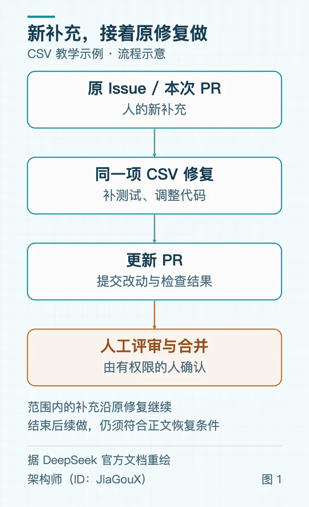

# 若飞：DeepSeek Super-agent 上手——从 GitHub Issue 到 PR

> 把一条 GitHub Issue 交给 DeepSeek 开源的 dsh-superagent-prototype，让它自己读讨论、改代码、回复并交付 PR 的完整上手记录：独立 gh 凭据的 wrapper 配置、profile 安装与 stateDir、Sources/Eval/Execution/Prompts 四步面板设置、明确 @ 委派与 off/observe/auto 三种接单模式、Ticket 状态标签怎么读、追加要求如何沿原任务继续，以及 CSV 字段转义案例的评审清单与故障恢复路径。

<!-- more -->

昨天，我们在《架构拆解：DeepSeek 刚发布的 Super-agent》里，分析了 DeepSeek 刚公开的这套设计，关注的是几项工作同时推进时，后来的消息怎样找到原来的任务。

今天看资料时，突然想到：是不是可以把一条 GitHub Issue 交给它，让它自己读 Issue、修 bug、回复信息，都沿着这项工作继续，不用每次都去看 GitHub？

刚好，官方部署文档已经给出了这套用法：在 GitHub Issue 或新评论里明确 @Agent，把修复交给它。接下后，它自己读取讨论和代码、着手修复，在原讨论里回复并交付；后续补充也能回到这项修复里继续处理。

一项修复可能要先排队，中途等人澄清，提交 PR 后再等评审；有了补充，它还得接着做。让它沿原任务继续，人就少一些搬运讨论、重讲背景和反复催进度的事，主要在需要澄清、确认改动和合并时参与。

这次用一个 CSV 导出问题来说明。假设 `acme/widgets` 仓库导出的字段带逗号或双引号时，读回来就错列，问题记在 Issue `#42`，Agent 账号叫 `@csv-fix-agent`。CSV 案例是本文设计的教学示例，仓库、账号以及后文的评论、PR 都是设定。

两个字段分别为上海，浦东和他说“你好”，期望同一行导出为：

```text
"上海,浦东","他说""你好"""
```

这次只修字段转义，补逗号、双引号和换行的回归用例，保留现有接口、分隔符与编码约定，最后由人审查和合并。下面的操作依据官方文档和源码，尚未独立部署跑通。

## 账号与环境

这次先只接 GitHub，把目标设为发生问题的仓库。公开原型目前围绕一个 github.com 仓库运行，也可选接飞书，不支持 GitHub Enterprise Server。

部署前需要准备：

Node.js 满足 `^22.19.0 || >=24.0.0`，以及 pnpm；本文所用提交的 `packageManager` 指定 `pnpm@11.7.0`。

git 2.32+、Python 3.8+、tmux、GitHub CLI 2.48+。

已为 DeepSeek Harness（DSH）配置可用的模型 provider。原型默认使用 profile 的默认模型，也可以分别指定评估与执行模型。

一个专用 GitHub 用户账号，接受目标仓库邀请并获得写权限。原型要读取这个账号的通知，因此这里用用户账号，不能用 GitHub App 代替。

先确认它用谁的身份做事。专用账号要接收 Issue 通知、推送分支、提交 PR，和日常个人账号分开会比较清楚。官方 006 Deployment 的 Accounts 给出了独立 gh 凭据的配置方法：

```bash
mkdir -p ~/.local/bin
cat > ~/.local/bin/gh-agent <<'EOF'
#!/bin/sh
GH_CONFIG_DIR="$HOME/.config/gh-agent"
exec gh "$@"
EOF
chmod +x ~/.local/bin/gh-agent
"$HOME/.local/bin/gh-agent" auth login
"$HOME/.local/bin/gh-agent" api user --jq .login
```

登录时选 Agent 账号，最后一条命令应输出它的登录名。稍后在面板中填 wrapper 的绝对路径，例如 `/home/me/.local/bin/gh-agent`；面板通过它访问 GitHub。

wrapper 分开了 GitHub 凭据，运行命令的 OS 用户仍是部署者，权限预设为 `danger-full-access`。后面创建的独立 worktree 也只分开代码目录。若还需要隔离文件读取和系统权限，可以按官方建议使用独立 OS 账号，只在该账号下保留 Agent 的凭据。

## 安装与启动

下面的安装步骤和后文设置均按官方提交 6337fc823ce20251c8de8085948165c81aaa701e 编写。

这组命令仅用于尚无 `superagent` profile 的首次安装，假定使用默认的 `~/.dsh` 目录：

```bash
npm install -g @deepseek-ai/dsh@0.2.1-rc.3
git clone https://github.com/deepseek-ai/dsh-superagent-prototype.git dsh-superagent
cd dsh-superagent
git checkout 6337fc823ce20251c8de8085948165c81aaa701e
pnpm install && pnpm build
dsh superagent --from-default-profile web --dump-config > /dev/null
dsh plugin --profile superagent add "link:$PWD"
```

已有 profile 时，不要重跑 `--from-default-profile`。这会替换已有配置，并删除其中的 `cordis.patch.yml`；已有部署应保留配置，按部署文档的升级流程处理。

Super-agent 使用单独的 profile，便于独立启停和管理配置。插件运行时会修改进程内的 PATH 和 Git 设置。

仍在原型的 checkout 目录中，为刚新建的 profile 复制配置：

```bash
cp examples/profile.cordis.patch.yml "$HOME/.dsh/profiles/superagent/cordis.patch.yml"
```

复制同样只适用于新配置，已有文件要保留。编辑这份文件，把 `stateDir` 换成实际的绝对路径。下面以 Linux 用户 me 为例；后文的 /home/me 都要换成部署账号的 home 路径，macOS 通常为 /Users/用户名。

```yaml
- id: webserver
  config:
    host: 127.0.0.1
    port: 3082
- id: dsh-superagent
  config:
    stateDir: /home/me/.dsh/state/superagent
```

`stateDir` 保存数据库、执行用的 Git 配置等持久状态，默认任务目录位于它的 work 子目录下。这里要填实际的绝对路径，不能保留模板占位符。

随后启动并查看状态：

```bash
scripts/dsh-superagent start
scripts/dsh-superagent status
```

打开 `http://127.0.0.1:3082`，点 DSH Web 侧栏的 Superagent。首次启动时，Overview 会列出缺少的配置，并提供设置入口。服务起来了，还要告诉它听谁的请求、到哪份代码里做事。

## 权限与代码

到 Settings → Sources → GitHub 启用 GitHub，仓库填实际的 owner/name，Agent CLI 填刚才 wrapper 的绝对路径。这里用的是 `acme/widgets`。`receive-all` 中接收所有 Issue、PR、评论与默认分支 CI 的开关先保持关闭，先通过明确 @ 让它做事。

再到 Settings → Eval → On each Source → GitHub，把将要发请求的人的 GitHub 登录名加入 allowed list。这里要分清两个账号：wrapper 登录的是 Agent，允许名单里填的是请它做事的人。默认名单为空时，请求不会被接下。Settings → Eval 中的 mode 先保留默认的 `observe`，允许名单里的用户仍可明确 @ 它，后面再看三种模式的区别。

账号配好以后，还需要一份能修改的项目代码。这里克隆的是要修的仓库，与前面安装原型的仓库分开。把下面的地址和路径换成自己的：

```bash
mkdir -p /home/me/src
git clone https://github.com/acme/widgets.git /home/me/src/widgets
```

如果是私有仓库，初次 clone 要有读取凭据。后续准备任务代码时，Git 会使用配置好的 Agent 身份，因此也要确认这个账号能访问仓库。

接下来到 Settings → Execution，设置代码在哪改、怎样准备。`directory root` 可填 `/home/me/.dsh/state/superagent/work`；prepare 则从刚才的本地 clone 建出修复用的分支和 worktree。一次只试这项修复，并发数可先设为 1；执行模型也在这一页选择。

在 prepare 中填入官方示例命令，替换两处本地 clone 路径：

```bash
git -C /home/me/src/widgets fetch --no-tags \
  "https://github.com/$DSH_SUPERAGENT_GITHUB_REPOSITORY.git" \
  "${DSH_SUPERAGENT_GITHUB_PR_HEAD:-HEAD}:refs/dsh-superagent/$DSH_SUPERAGENT_TICKET" &&
git -C /home/me/src/widgets worktree add \
  -b "agent/$DSH_SUPERAGENT_NAME" \
  "$DSH_SUPERAGENT_DIR" \
  "refs/dsh-superagent/$DSH_SUPERAGENT_TICKET"
```

`DSH_SUPERAGENT_*` 变量由原型在执行时提供。这段要填进面板，不要直接在终端试跑未展开的命令。这样每项任务会有独立分支和 worktree；如果不配 prepare，Agent 启动时只有空目录，找不到要改的项目。

这次修复先交 PR，由人决定是否合并，因此还要到 Settings → Prompts 设置提交和评审要求：使用 Agent 自己的提交身份，说明实际运行过的检查；按 SETUP.md 移除 Delivery requirements 中的 auto-merge 段落，也不配置另一账号的 merge CLI。

也可以请编码 Agent 协助配置。README 给出的入口是让它读取原型目录里的 SETUP.md，根据仓库、账号、允许名单、本地 clone 和提交身份收集配置，再按确认后的方案操作。账号登录和密钥输入仍在自己的终端完成。

保存后回到 Overview，并运行 `scripts/dsh-superagent status`。没有待配置项且退出码为 0，就可以发出这次修复请求；如果刚在程序外修正过 CLI 登录，点 `Check again` 重新检查。

## 发起修复

现在用刚加入 allowed list 的账号，在 Issue `#42` 下发一条新评论。将 `@csv-fix-agent` 换成前面查到的真实 Agent 登录名：

```text
@csv-fix-agent 请修复本 Issue 的 CSV 字段转义问题。

复现输入：两个字段分别是 上海,浦东 和 他说"你好"。
期望同一行导出为："上海,浦东","他说""你好"""

请先定位现有导出实现，补充包含逗号、双引号、换行的回归用例，沿用项目现有 CSV 约定或库。
保留现有接口、分隔符和编码约定，不修改 UI，不做无关重构。
完成后提交 PR，说明复现方式、改动、实际运行的检查及未完成项。等待人工审查，不自动合并。
```

这里要发新评论。仅编辑旧 Issue 正文补一个 @，不会按预期产生新通知。

前面保留的 `observe`，不会拦住这条明确请求。允许名单里的用户明确 @Agent，在 `off`、`observe` 和 `auto` 下都可以请它做事。三种 mode 区分的是：没有明确委派时，它能否自己从消息中发现并接下工作。

| mode | 对推断接单的影响 |
| --- | --- |
| `off` | 不产生推断候选 |
| `observe`（默认） | 评估候选；即使认为可接，也只记录 `would_accept`，不据此执行 |
| `auto` | 评估通过并匹配至少一条启用规则，才可接单 |

如果以后想让它从没有 @ 的新 Issue 中主动找工作，还要打开对应的 `receive-all` 开关，并配置哪些消息可以进入评估，然后再按启用的规则决定做不做。这个版本的默认主动规则只有 `copy` 和 `visual`，并不覆盖所有代码缺陷。眼前这项修复已经明确交给了它，保持 `observe` 即可。

## 查看进展

Agent 接下请求后，就会在自己的会话和代码目录里推进修复。面板里的任务记录叫 Ticket，先用它确认请求已经接到。按官方文档的预期，消息到达后一个轮询间隔内，Overview 应出现 Ticket；默认间隔为 60 秒。

在 Overview 找 CSV 修复，也可以用面板顶部搜索框搜索 Issue URL 或#42。打开 Execution 中的 Ticket 详情，能看到正在做什么、执行记录，以及需要人回答的问题。

几个常见标签可这样读：

- `Queued`：正在排队，可能是在等可用执行名额。
- `Working`：正在处理。
- `Awaiting answer`：需要人回答问题，详情里会列出问题。
- `Awaiting review`：Agent 已报告 `ready`，且有跟踪中的 PR，等人评审。

看到 `Awaiting review` 后，就到 GitHub 看 PR。`ready` 表示 Agent 认为可以评审，不等于已经合并；如果报告 `ready` 时没有 PR，Ticket 可直接以完成结束。这里要求的是提交修复 PR，接下来就看实际改动和测试。

处理中若需要澄清要求，Agent 会提出问题，回答仍可写在原 Issue。想问进度，也可以在原 Issue 新评论，例如“当前进展如何，是否有需要我补充的信息？”修复和后续回复都沿着原任务继续，不必把讨论逐条搬给它。

## 追加要求

假设初步改动已经覆盖了逗号、引号和换行，但审查时又发现：空字段尚无测试，编码兼容也没有说明。这时在原 Issue 追加：

```text
@csv-fix-agent 请在这项修复里再覆盖空字段，并检查现有编码约定是否保持兼容。
仍然只改 CSV 序列化，不扩展到导出页面。
```

最初发出请求时，原型先判断是否接下修复。接下以后的空字段补测，就交给负责修复的 Agent 继续做：在原来的修改上补测试，查清项目原有编码约定，再更新 PR。

如果 PR 已经建立，这条补充也可以直接写在这项修复自己的 PR 中。原型会跟踪 Agent 报告的 PR，也会从 GitHub 识别任务分支对应的 PR。原 Issue 和这些 PR 下，人的后续评论会先送给负责修复的 Agent，让它接着处理范围内的要求，不必再转述一遍讨论。

这时在 Trigger 中可能看到 `Delivered to Ticket`，却没有新的 Eval：评论已经送到原任务，不需要再发一次请求。



图 1｜流程示意：范围内的补充沿原修复继续，PR 更新后仍由人评审和合并。

如果补充变成“顺便重做整个导出页面”，就超出了这次转义修复。负责修复的 Agent 应把消息交回系统，重新判断是否作为新的工作处理。它可以持续读到这个 Issue 的评论，能做的事仍以原来的修复范围为限。其他仅作为背景参考而订阅的 Issue、PR，其评论也只提供上下文，不会扩大范围，或直接唤醒已结束的任务。

如果这项修复结束后才发现漏测，仍可在原 Issue 或它的 PR 下补充要求，尝试让 Agent 接着补用例。要继续原工作，原型仍须接收原讨论的消息，最初发请求的账号仍在允许名单中，而且任务没有被人手动 `Stop`。

换一种方式开始的任务，恢复前也要检查当初允许它做事的条件是否仍然成立。例如，原先由系统推断并接下的工作，还要求当前为 `auto`，原先匹配的规则仍然启用。机器人和 CI 消息不会唤醒已结束的任务。

## 评审与合并

PR 提交后，再由人对照最初的问题审查改动。PR 有没有讲清楚哪里转义错误、怎样修正、补了哪些用例，以及实际运行过哪些检查？运行失败或尚未运行的检查也应列出来，评审时才能知道还有什么没做。

回到这份 CSV，可以用下面几组输入对照实现和测试，具体写法沿用仓库已有 CSV 约定或库：

| 测试输入 | 要检查的结果 |
| --- | --- |
| 字段 ` 上海,浦东 ` | 导出为 `“上海,浦东”`，读回时仍是一个字段 |
| 字段 ` 他说“你好”` | 导出为 `“他说”“你好”“”`，读回后双引号与原文一致 |
| 字段内部含真实换行 | 字段用双引号包住；解析后仍属于同一条记录，字段内换行保留 |
| 空字符串位于首列、中间列、末列 | 读回后空字符串仍在原列，字段数不变；空字段的具体写法沿用原约定 |
| 不含特殊字符的普通字段 | 保留原有导出和读回行为，避免只修特殊字段却改坏普通数据 |

编码兼容要另查：先从原实现、文档或测试确认字符编码，以及是否带 BOM，再用含中文的固定样本核对导出字节是否符合原约定。字段转义和编码分别检查，不能只看读回后文字相同。

还要确认新测试真能抓住这次错误：保留测试，临时换回修复前的实现，它应因逗号、引号或换行处理错误而失败；恢复修复后再通过。编译错误、测试被跳过都不算复现，只编译通过也说明不了这些字段已导出正确。

同时看 diff 有没有超出 CSV 修复。如果带来了大面积 UI 改动或无关依赖升级，就需要问清原因。

测试、CI 和审读都要对应当前 PR 的提交 SHA，在 PR 中写明检查命令、结果和未运行项。Agent 根据评审又推了提交，就重新核对受影响的检查和改动，不能直接沿用旧提交上的通过结论。

还有需要调整的地方，就继续在这项 PR 下评论，Agent 会收到这些意见，继续处理范围内的修改。确认改动、回归检查和评审意见都处理好后，由有权限的人在 GitHub 合并。按前面的配置，用于 auto-merge 的另一账号 CLI 没有交给 Agent。

提示词里的“等人工批准再合并”是对 Agent 的行为要求。仓库若需要强制审批，仍由 GitHub 分支保护等规则落实。合并后回面板，可以查看任务的结束结果，对应名称之一是 `Pull request merged`。

这次补出的空字段用例，也要留在回归测试里；确认稳定的编码约定，可以补进已有项目规则，让下一次修改先读这些约束。Magpie 的 LESSONS.md 和代码规范把反复出现的问题整理为规则，这种做法可以借鉴。这里需要项目自己维护测试和规则，由人确认哪些约定值得留下。

## 故障与恢复

发了 @，却找不到 Ticket。先确认发的是新评论、作者在 allowed list 中、Settings → Sources → GitHub 已启用，Execution 的 `Pause processing` 没有暂停。然后到 Source 看凭据情况，到 Trigger 搜索评论，到 Eval 看为什么接下或没有接下请求。先分清消息是没进来，还是进来后没有开始工作，无需把 `observe` 改成 `auto`。

prepare 失败，还没开始改代码。打开 Ticket 看命令输出，检查本地 clone 的绝对路径、Agent 的仓库权限和命令。修好后点 `Retry`，也可以在原任务补充说明，让它再次尝试准备代码。prepare 失败不会像模型临时网络错误那样自动退避重试。

做到一半显示 `Blocked`、`Failed` 或 `Input undelivered`。先根据详情处理阻碍或消息投递问题。`Retry` 只用于尚未结束、处于投递失败、blocked 或 failed 状态的 Ticket。它会重新启动负责修复的 Agent，沿用原会话、目录、分支和 PR，已有改动可以接着做。如果人在 blocked / failed 任务中补充的消息已经送达，Agent 也会继续工作，或因启动失败而重新排队；此时面板不再提供 `Retry`，消息投递失败时则仍可重试。

服务中途重启。原会话和目录会保留，正在运行的 Agent 会重新启动，并收到恢复提示。它需要先检查工作目录、Git 历史和 GitHub，确认哪些动作已经完成，再决定怎样继续；尤其要查远端是否已有提交或 PR，避免重复创建。

如果重启后服务仍有问题，看 `scripts/dsh-superagent status` 的退出码：1 按输出检查服务和启动日志；2 查看部件错误；3 补齐待配置项。后两种要处理具体配置或错误，反复重启无助于修复。启动日志在原型目录的 `.artifacts/dsh-superagent-superagent-*.log`。

不打算继续这项修复。在面板点 `Stop`，会直接撤回这项工作的授权。它与失败后的 `Retry` 不同：手动停止后，评论不会直接恢复原任务，后续工作需要重新接单。在评论里写“停止”仍是一条待判断的消息；要直接停下当前 Ticket，用面板 `Stop`。

## 工作与生活

跟进的项目发了新版本，维修又来一份报价，也都有类似的麻烦：新消息隔几天才到，前面的事还没办完。顺着这次修复的用法，可以再想想下面几个场景。它们都是设计设想，公开原型现有入口仍是单 GitHub 仓库和可选飞书；接其他事件入口，可参考官方 008 Cookbook 中开发新 Source 的方法。

CI 失败跟进。一次流水线失败，可以把失败日志、关联提交和运行环境信息放进同一 Issue，让 Agent 整理失败发生在哪一步、有哪些待验证的解释。重跑结果或补充日志出来后，再追加到原讨论，让它检查先前假设是否还成立，判断下一步先查代码还是环境，并列出还缺的证据。

接口延迟排查。围绕同一次异常，先给 Agent 告警摘要、指标和脱敏日志，让它按时间整理现象与待查问题。新时段的数据或近期变更记录到来后，继续补到同一话题，对照延迟是否恢复、哪些解释可以排除，还需要哪段日志或指标。某次变更与异常同时出现，只能作为排查线索，不能据此认定根因。

这两种场景都可以先由人把材料追加到现有 Issue 或飞书话题。若要自动收集完整 CI 日志、监控数据，或访问排查环境，还要补齐相应接入和权限；生产发布、重启、回滚等操作由人决定，不能当作公开原型默认会执行的步骤。

项目版本与勘误跟踪。比如团队正在使用一个开源项目，可以先让 Agent 整理当前版本的已知问题、升级时要关注的变化，以及对应的官方说明。下一版发布或官方补了勘误，再把新材料追加到同一 Issue 或飞书话题，让它比较前后差异，看看哪些问题已经修复、哪些变化会影响现有代码，原来的升级计划要不要调整。是否升级、何时安排验证，留给团队决定。

人工贴入版本说明和勘误，可以沿用现有入口。若要自动巡查官网、定时检查新版本，或结合团队的依赖清单分析影响，还要另接采集工具和依赖数据；真正验证兼容性，也需要对应的代码与测试环境。

家庭维修。围绕同一次故障，把设备型号、照片、维修记录和第一份报价放在一个任务里。几天后拿到第二份报价，或故障出现了新现象，再补进同一话题，让 Agent 结合已有材料更新比较：两份报价各包含什么，哪些项目尚未说清，联系维修人员时还要问什么。随后可以整理预约备选，由人确认下一步。

这些信息可以先人工补入现有话题。要自动联系服务商、写日历、确认预约或付款，需要另外接通信、日历和交易工具，并分别取得相应授权；现场诊断和实际维修仍要靠人。

参考资料：

- [README](https://github.com/deepseek-ai/dsh-superagent-prototype/blob/6337fc823ce20251c8de8085948165c81aaa701e/README.md)：DeepSeek Super-agent Prototype
- [SETUP](https://github.com/deepseek-ai/dsh-superagent-prototype/blob/6337fc823ce20251c8de8085948165c81aaa701e/SETUP.md)：协助配置流程
- [006 Deployment](https://github.com/deepseek-ai/dsh-superagent-prototype/blob/6337fc823ce20251c8de8085948165c81aaa701e/docs/006-deployment.md)：Accounts、Install、Settings 与故障处理
- [005 Panel](https://github.com/deepseek-ai/dsh-superagent-prototype/blob/6337fc823ce20251c8de8085948165c81aaa701e/docs/005-panel.md)：面板页面与操作名称
- [002 Authorization](https://github.com/deepseek-ai/dsh-superagent-prototype/blob/6337fc823ce20251c8de8085948165c81aaa701e/docs/002-authorization.md)：明确委派、接单模式与恢复条件
- [003 Execution](https://github.com/deepseek-ai/dsh-superagent-prototype/blob/6337fc823ce20251c8de8085948165c81aaa701e/docs/003-execution.md)：任务状态、PR 跟进与失败恢复
- [008 Cookbook](https://github.com/deepseek-ai/dsh-superagent-prototype/blob/6337fc823ce20251c8de8085948165c81aaa701e/docs/008-cookbook.md)：扩展来源的开发示例

## 相关页面

- [[sources/wangchen-super-agent-deepseek-harness]]
- [[sources/coderleft-deepseek-super-agent-architecture-deep-dive]]
- [[sources/sujingshen-deepseek-harness-super-agent-reading]]
- [[sources/criscxuan-deepseek-super-agent-architecture-teardown]]
