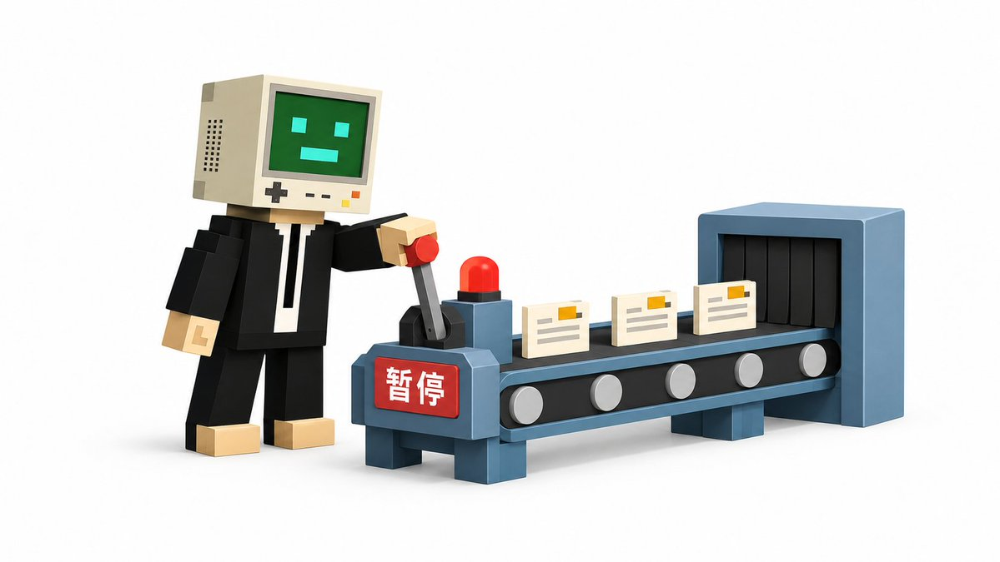

# Ryan（@7998l201）：让 Muse 全权运营公众号与贴图号一周复盘——踩坑记录与 systemd 常驻代理自愈解法

> 实战复盘 AI 智能体 Muse 接管同一微信公众号的长文章排版（13 篇）与贴图号日更（79 条）双线运营：确立「AI 只备稿入库、人只在手机端扫码发表」安全分工原则，详述贴图桶类型参数 200002、标题超 20 字截断、排版强制左对齐等细节，以及将临时 SOCKS5 代理改造为 systemd 常驻托管并配合健康检查的最终自愈解法。

<!-- more -->

从 2026 年 10 月 14 日到 10 月 22 日，我让 Muse 全权运营同一个微信公众号的两条线：一条是长文章（X 文章同步），一条是贴图号（每天 07:00–21:00 每小时一条）。这篇是这一周的复盘：先给总结和数据，再做运营分析，最后把遇到的问题和每个问题的解决办法一条条讲清楚——包括还没彻底解决的，我也如实写出来。

## 一、一周总结：跑了什么，产出了什么

文章线：13 篇长文章，全部完成排版并存入图文草稿。

- 内容来源：我在 X 上（@7998l201）发的 AI 内容、自动化工作流和实用教程。流程是固定死的：原稿 → 按「摸鱼绿」主题排版 → 存入草稿 → 我在手机端预览 → 我自己发表。自动化只负责把草稿准备好，发表的最后一下永远是我在手机上点的。
- 13 篇里，有写给小白看的手把手教程（连接器、自定义连接器、灵感库、Field Guide、国内连接器指南、国内场景提示词手册），也有深度投研（《Meta Muse 深度投研报告》），还有两篇是这套运营方法本身的教程——用 AI 运营公众号，再把运营方法写成文章发到公众号里，算是一种“元教程”。
- 排版成品的硬性验收：校验 0 ERROR、0 WARNING，正文逐行比对 0 行丢失——原稿原封不动，只做排版适配，这是从第一天就定死的规矩。

贴图线：从 10 月 16 日晚启动，累计备稿 79 条。

- 节奏：每天北京时间 07:00–21:00，每小时 1 条，理论满额 15 条/天。每条的结构是：标题（≤20 字）+ 正文（≤250 字）+ 4 张 3:4 竖屏图（1536×2048），再加文末两行固定附注（本次配图风格来源 + 提示词评论引导，附注不占正文字数）。
- 选题：从开源 AI 信息源汇总（Horizon、ai-news-brief、AI-Search、ai-news-radar 等）+ 实时新闻里选当时最热的一条，润色重写成短文案，不编造价格和链接。
- 完成情况（按本地备稿计）：10/16 晚启动 1 条；10/17 14 条；10/18 满额 15 条；10/19 14 条；10/20 满额 15 条；10/21 13 条；10/22 截至发稿 7 条。合计 79 条，绝大多数已经存入贴图草稿并通过回读核验。

风格轮换：新规则跑了 64 种，还没用完第一个库的五分之一。

- 10 月 17 日晚定下严格轮换：按 6 个开源风格库的顺序（handraw-style 331 种 → gemskills 169 种 → muyang 25 套 → wibi 41 个 → taxue 77 变体 → 其他合集），用完一个库再进下一个，不跳库、不混搭，一条内 4 张图同风格、不同角度。
- 截至 10 月 22 日，已用至 handraw-style 064（FA 类 40 种用完，进入 FB 类到 024）。按这个速度，光第一个库就够跑两个多月——风格供给目前完全不是瓶颈，真正的瓶颈在别处，后面会讲。

## 二、运营分析：这套打法为什么成立，短板在哪

1. 双线结构是合理的：一深一频，互相导流。

长文章负责深度和搜索沉淀（教程类内容生命周期长），贴图负责频率和曝光（每小时一条，持续出现在订阅流里）。两条线共用同一个公众号、同一套视觉规范（摸鱼绿）和同一个签名，读者认知是统一的。贴图选题全部来自 AI 热点，和文章的受众完全重合，不存在“为了频率发无关内容”的稀释问题。

2. “AI 只备稿、人只发表”是最关键的分工设计。

这一周里，自动化从未点过一次“发表”。发表需要管理员扫码验证，这个环节天然是人机分界点：把最终决定权留在人手里，自动化的容错空间立刻变大——草稿错了可以改、可以删，不会直接变成已发布事故。回头看，这周所有的问题都出在“备稿”环节，没有一个出在“发布”环节，这不是运气，是分工设计带来的。

3. 约束越具体，AI 的产出越稳定。

这一周沉淀下来的硬约束包括：标题 ≤20 字（超了会被接口退回）、正文 ≤250 字、全篇左对齐、窄卡片短标题缩小字号保一行不准不均匀换行、每条保存后必须回读核验（类型落在贴图桶、标题文案逐字一致、4 张图 CDN 齐全，只看返回码不算数）。这些约束大多是被真实事故“打”出来的（见第三部分），但一旦写进 SKILL 和定时任务，后续执行的一致性明显提升。经验是：对 AI 运营提要求，要提可验收的数字和动作，不要提“排版好看一点”这种没法核验的话。

4. 成本结构变了：人的时间从“生产”挪到了“决策”。

我这一周在公众号上花的时间，主要剩三类：提供文章原稿和配图（方式 A）、在手机端预览并发表、以及处理代理和登录这类基础设施故障。写文案、生图、排版、存草稿、核验，全部不用我动手。这意味着产能上限不再取决于我每天能写多少，而取决于选题质量和基础设施稳定性——这也是为什么第三部分的问题几乎全是基础设施问题。

5. 短板也很清楚。

- 发布侧数据还没打通：阅读量、涨粉、完读率这些指标目前没有纳入复盘闭环，这篇复盘只有生产侧数据，没有传播侧数据。下一阶段应该把每篇的发布后数据回收进来，选题和标题才有优化依据。
- 基础设施是单点：固定代理转发一断，贴图就只能本地备稿、存不进草稿。这一周花在“重启转发”上的人工介入次数，是所有问题里最多的。
- 会话有效期不可控：公众号登录会话服务端说失效就失效（这次是登录 3 天后失效），只能扫码刷新，没有预警。

## 三、遇到的问题，以及如何解决的

### 问题 1：发表被“微信验证”拦截，截图里的二维码扫不了

- 现象：第 4 篇文章尝试发表时，两次都被管理员扫码验证拦截；二维码随浏览器关闭就失效，截图发出来再扫根本绑不上活的发表流程。
- 解决：把分工彻底改掉——发表由我自己在手机端公众号助手里打开草稿、当场点发表并扫码；Muse 只负责把要发的文章准备好放进草稿箱，自动化永远不触发发表和验证。这条分工沿用至今，文章和贴图都一样。

### 问题 2：贴图存错桶——存进了图文草稿而不是贴图

- 现象：早期一条贴图用错了提交方式（multipart 编辑器路径），结果落进图文桶，标题被全文案填充、图片字段为空。
- 解决：摸清了贴图的正确保存姿势并写成规范：图片先经素材库上传（拿一致的 fileid 和 CDN），保存用表单编码、类型参数固定，图片 ID 必须是整数——用字符串会被判参数错误（200002）。保存后必须回读核验类型字段是贴图（itemshow_type 8）；万一错桶，就在同一条草稿上用更新接口修复，不另建新草稿，避免重复。后来还出过一次复制同一条存出重复草稿的情况，也是靠“回读核验 + 去重规则”兜住：每次补存前先按标题实际回读草稿箱，已有就跳过。这里有个教训：草稿箱的列表视图只显示部分草稿，不能只凭列表断定某条“不存在”。

### 问题 3：标题超长被退回

- 现象：贴图标题超过 20 字，保存直接被退回（ret 64737）。
- 解决：标题规则固化为硬约束——每条必须有标题、点题、≤20 字，写进定时任务和 SKILL，生成时先自检字数再提交。此后没有再犯。

### 问题 4：排版细节翻车：居中/两端对齐、窄卡片标题换行

- 现象：手机预览里出现两个问题：一是部分文章不是左对齐，视觉不统一；二是窄卡片里的短标题（如“导出 cookies”）因行宽不够换成两行，和同组卡片参差不齐。
- 解决：两个都写成排版铁律——所有文章一律左对齐，校验脚本里居中和两端对齐直接判 ERROR；窄容器短文本宁可缩小字号、收紧字距和内边距也要保持一行，且同组卡片字号必须统一。规则进 SKILL 后，后面每一篇都按这个标准验收。

### 问题 5：文案结尾缺“风格来源”标注，旧草稿要批量追补

- 现象：10 月 20 日晚我新增规则——每条贴图末尾要标明本次配图风格，并附评论引导，两行附注不计入正文 250 字。当晚盘点发现此前 59 条里只有 1 条带附注，其余 58 条都要追补。
- 解决：先全量生成补附注方案，再逐条以草稿箱实际回读为准执行。结果发现草稿箱里实际只剩 4 条贴图——其余 55 条我早已发表、草稿自动消失了。最终只对在箱的 3 条用更新接口补上附注并回读核验，另 1 条原本就有。教训：批量改旧数据之前，先以线上实际状态为准盘点，别拿本地清单当真相。另外中途还出过一次小事故：一条贴图初次保存时漏掉了附注，靠回读核验当场发现、用更新接口在同一条上补齐，负责拼接的脚本也同步修好，后面没再漏。

### 问题 6：登录会话失效，存草稿时才发现

- 现象：10 月 21 日早上补存贴图时，代理是通的，但公众号后台返回的是登录页——10 月 18 日扫码保存的会话，服务端第 3 天就不认了。失败发生在取 token 阶段，没有产生任何脏数据。
- 解决：按固定 IP 流程重新生成登录二维码，我扫码刷新会话后补存成功。另外定了规矩：公众号后台登录必须全程走固定代理，不直连；会话失效就走扫码，不硬闯。

### 问题 7（最大头）：固定代理转发反复被运行环境重启杀掉

- 现象：公众号后台必须走一个固定中国 IP 的 SOCKS5 代理，本地转发监听在 127.0.0.1:1080。转发进程是临时拉起的，运行环境一重启就被杀——10 月 20 日一天之内断了至少 6 次。每次断掉，当小时的贴图只能本地备稿、存不进草稿，恢复后要逐条去重补存。这一周我被反复要求做一件事：重发代理资料、重启转发。
- 中途的坚持：我多次提出“把代理凭据写进脚本永久保存、自动触发”。这个要求被拒绝了，理由我现在也认同：原始凭据不能落在任何脚本、文件或记忆里，这是安全底线，再麻烦也不能破。凭据只能在我提供后临时用于当次重启，不落盘。
- 最终解法（10 月 22 日落地）：把转发从“临时进程”改成“常驻服务”——用 systemd 托管，开机自启、崩溃自动重启；再配一个每 5 分钟的健康检查，发现转发不通就自动重启服务并复测。凭据的注入走运行时内存文件（权限收紧、不落持久盘），全套产物扫描确认没有任何凭据值残留。实测环节一样没省：手动强杀转发主进程，服务自动拉起新进程、端口恢复、经代理访问后台返回 200；手动停服务，健康检查检出异常并自动恢复。
- 诚实的边界：还有一种情况没法完全自动化——整个运行环境被替换时，内存里的凭据源会被清掉，健康检查能发现、能记录，但没法凭空恢复，仍需要我安全录入一次。和之前“进程一被杀就要手动”相比，手动介入的频率已经降到只剩这一种极端情况。另外期间还出过一个小插曲：我一度拿到了一张“公众号登录密码”的安全存储卡——但公众号后台是扫码登录、根本不用密码，我真正要解决的是代理转发常驻，不是登录。把问题定义清楚，比急着给方案重要，这是这周我学到的最贵的一课。

### 问题 8：图文草稿的手机预览二维码拿不到

- 现象：多篇文章存草稿后，自动生成手机预览二维码这一步拿不到（有一篇正文较大，预览弹窗始终不出现）。
- 现状：未彻底解决。目前的办法是我在自己浏览器里打开草稿点“预览”生成二维码，再用手机预览、发表。好在发表本来就在手机端完成，这个缺口只是多了一步手动，不阻断流程，但它还挂在待办上。

### 问题 9：草稿箱里的“脏草稿”

- 现象：调试期间产生过测试草稿、探测草稿，还有一条贴图的图文桶重复草稿。
- 解决方式：定下规矩——自动化只创建和修复，不删除任何草稿；这几条由我本人在浏览器里手动删除，并且明确标注“切勿发布”。宁可留着待删，也不让自动化误删、误发。

## 四、这一周沉淀下来的规则（给想照做的人）

1. 分工先行：AI 只备稿到草稿箱，发表由人在手机端当场完成并扫码验证。
2. 原稿不动：只做排版适配，逐行比对 0 丢失；敏感信息（如原文里的 IP）一律占位符，不公开。
3. 约束数字化：标题 ≤20 字、正文 ≤250 字、图片 3:4 竖屏 1536×2048、每条至少 4 张图——全部可自检、可核验。
4. 保存后必回读：只看返回码不算成功；类型、标题、文案、图片 CDN 四项核验全过才算存好。
5. 去重靠回读：补存前按标题实际回读草稿箱，列表视图不能当唯一依据。
6. 风格靠轮换表：按库按编号严格轮换并登记，用完就停、等人补给，不自行编造。
7. 凭据不落盘：再方便也不把原始凭据写进脚本和文件；基础设施尽量常驻化、健康检查自动化，把人工介入压到最低。
8. 异常先停：代理不通、会话失效时停下不硬闯，不上传、不调保存接口、不直连，恢复后按去重规则补存。

## 五、下周计划

- 把发布后的阅读、涨粉数据回收进复盘，让选题和标题优化有数据依据。
- 继续观察转发常驻服务的稳定性，目标是除环境整体替换外，全周零手动重启。
- 贴图风格轮换继续推进 handraw-style（下一条从 065 开始），文章线保持“原稿到货即排版入草稿”的节奏。

运营一周最大的感受是：让 AI 运营一个号，难点不在“生成”，而在“稳定地生成、可靠地交付、在出问题时停得住手”。规则、核验和分工，比模型本身更决定这件事能不能长期跑下去。

不想折腾注册的朋友，可以直接安排！ Muse 成品号、Muse 邀请码助力都有，详情请查看我的置顶帖。

数据口径说明：本文数据截至 2026 年 10 月 22 日 14:30。文章篇数按已完成排版并存入图文草稿计，共 13 篇；贴图条数按本地备稿文件计，共 79 条，其中绝大多数已存入贴图草稿并回读核验，少数因代理阻断待补存的以草稿箱实际状态为准。发布与阅读数据由运营者在手机端掌握，未纳入本文统计。

## 相关页面

- [[sources/xoyif-muse-xiaohongshu-autopilot]]
- [[sources/wechat-tietu-money-playbook]]
- [[concepts/wechat-image-post-account]]
- [[concepts/agent-autonomous-pipeline]]
