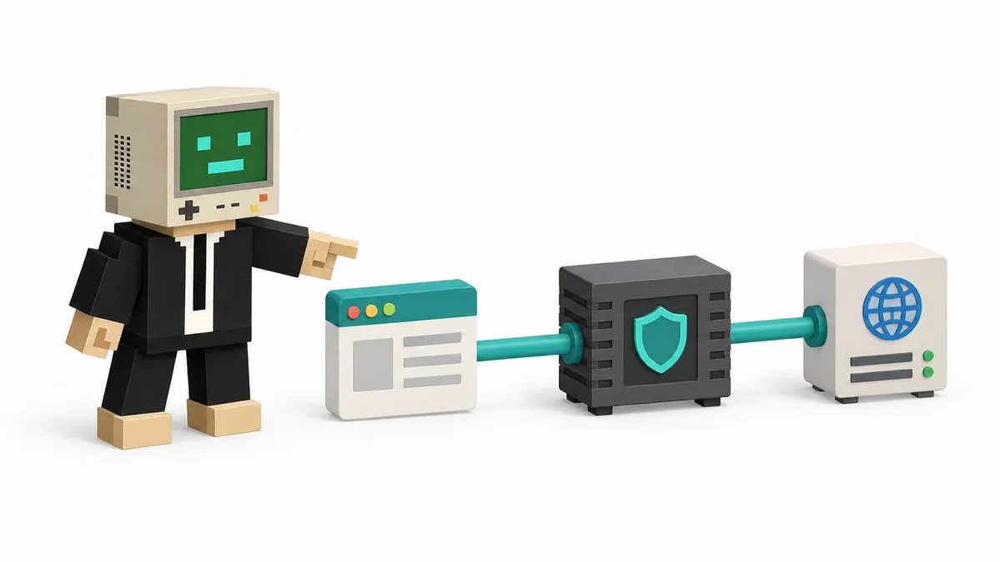
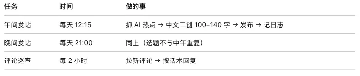
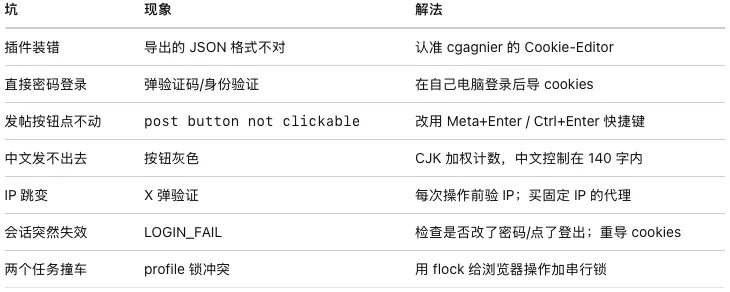

# Ryan（@7998l201）：让 Muse 全权运营 X 账号——固定代理 IP、Cookie-Editor 会话导出与 Playwright 防封教程

> 高风控环境下全自动运营 X（Twitter）账号的终极安全指南：固定 Dedicated 独享 IP 代理搭建、本地常用浏览器导出 Cookie 会话注入、无头 Linux 服务器配置 Xvfb 虚拟显示器与 Playwright Chromium 真实人类行为模拟，全程不碰密码、不触发二次验证登录。

<!-- more -->

适用人群：想用固定 IP 全自动运营 X 账号，但不想把密码交给任何人、不想折腾复杂网络的人。

读完你会得到：一台服务器（或本地电脑）上跑着的 X 机器人，所有流量固定走你买的代理 IP，用 cookie 登录，全程不碰密码。

### 0. 先讲清楚：这套方案在干什么



X 对账号风控很严，核心看两点：登录 IP 是否稳定、操作行为是否像人。

我们的方案：

```
你的操作指令
    ↓
服务器上的浏览器（Playwright）
    ↓  全部流量强制走代理
你买的固定代理 IP（例如 103.59.41.115）
    ↓
X 服务器（它看到的永远是这一个 IP）
```

关键设计：

1. IP 固定：浏览器的一切网络请求都走你买的代理，X 只能看到这一个 IP，不会因为 IP 跳来跳去触发验证。
2. 不碰密码：你在自己电脑上正常登录 X，把登录 cookies 导出来给机器人用。机器人拿的是“会话”，不是密码——你随时可以在 X 设置里一键废掉它。
3. 像人操作：用真实浏览器（Chromium）点按钮、打字，而不是调 API，行为更接近真人。

### 一、准备工作

1. 1 买一个固定 IP 的代理

要求（按重要性排序）：

- IP 固定不变：必须 static/dedicated，动态 IP 每天一变等于白搭。
- 支持 HTTP 或 SOCKS5 协议，带用户名密码认证。
- 地理位置无所谓（实测：卖家说的归属地和实际可能不一样，能稳定用就行）。

购买后你会拿到 4 样东西，记下来：

```
代理地址：103.59.41.115
代理端口：8000
用户名：xxxx
密码：xxxx
```

⚠️ 代理账号密码只保存在服务器的配置文件里（权限 600），不要发到聊天记录、不要写进教程。

1. 2 准备一台服务器

- 一台能 24 小时开机的 Linux 服务器（VPS 就行，2 核 4G 足够），或者一台不关机的本地电脑。
- 装好 Python 3.10+。

1. 3 安装浏览器自动化环境

在服务器上执行：

```
# 建独立环境（避免污染系统 Python）
python3 -m venv ~/x-ops/venv
~/x-ops/venv/bin/pip install playwright

# 下载 Chromium 浏览器（Playwright 专用版）
~/x-ops/venv/bin/python -m playwright install chromium

# 验证安装成功（看到 playwright-ok 就行）
~/x-ops/venv/bin/python -c "from playwright.sync_api import sync_playwright; print('playwright-ok')"
```

如果服务器没有图形界面，还需要装虚拟显示器（发帖截图、真人模式需要）：

```
sudo apt install xvfb
```

### 二、在自己电脑上登录 X 并导出 cookies（关键步骤）

为什么不在服务器上直接输密码登录？ 因为新 IP + 新设备直接密码登录，X 几乎一定弹验证码/身份验证，更麻烦。在你自己常用电脑上登录是最稳的，零验证。

2. 1 安装 Cookie-Editor（认准官方版）

商店里名字相近的插件很多，认准这一个：

- 名字：Cookie-Editor（带连字符）
- 开发者：cgagnier
- 用户量约 200 万，评分 4.4
- 官网：cookie-editor.com

❌ 别装 “Cookie Editor”（hotcleaner 出品）或其他评分很低的仿冒品。

2. 2 导出 cookies

1. 在 Chrome/Edge 里打开 x.com，正常登录你的 X 账号（走你自己的网络）。
2. 确认已登录（能看到首页时间线）。
3. 点浏览器工具栏的 Cookie-Editor 图标 → Export。
4. 把导出的 JSON 保存成文件（例如 x-cookies.json）。

导出的 JSON 长这样（12 个左右 cookie，关键是 auth_token 和 ct0）：

```
[
  {"domain": ".x.com", "name": "auth_token", "value": "...", ...},
  {"domain": ".x.com", "name": "ct0", "value": "...", ...},
  ...
]
```

2. 3 把 JSON 传给服务器


把文件传到服务器的 ~/x-ops/ 目录（用 scp、网盘、或任何你信任的方式）。

🔒 安全说明：cookies 是“临时会话钥匙”，不是密码。它不能改密码、改邮箱，你随时可以在 X「设置 → 应用和会话 → 会话」里一键登出废掉它。传完之后不要改密码、不要点“登出所有设备”，否则会话失效要重导。

### 三、配置代理并验证出口 IP

3. 1 写代理健康检查脚本


原理很简单：让浏览器的流量走代理，访问 api.ipify.org，看返回的 IP 是不是你买的那个。

~/x-ops/check.sh（示意）：

```
#!/bin/bash
# 通过代理访问 ipify，确认出口 IP
curl -s -m 20 -x "http://用户名:密码@103.59.41.115:8000" https://api.ipify.org
echo
```

运行后必须看到 103.59.41.115（你买的 IP）。如果不是，停下来检查代理配置，不要继续。

3. 2 （进阶，可跳过）笔者的沙箱环境多了一跳

以下内容只适用于特殊受限环境，普通 VPS 不需要看。笔者的运行环境（Muse 沙箱）强制所有出站流量走一个内部代理，所以自研了一个 chain_proxy.py 做“代理链”：本地 SOCKS5（127.0.0.1:18000）→ 沙箱内部代理 → 购买的代理 → 目标网站。普通 VPS 上 Playwright 可以直接填购买的代理，无需这一层。

### 四、导入 cookies，建立登录态

4. 1 导入脚本

把 Cookie-Editor 导出的格式转换成 Playwright 可用的格式，存为 ~/x-ops/cookies.json（权限 600）：

```
~/x-ops/venv/bin/python ~/x-ops/import_cookies.py ~/x-ops/x-cookies.json
# 看到 imported 12 cookies 且包含 auth_token、ct0 即成功
# 然后删除原始导出文件
rm ~/x-ops/x-cookies.json
chmod 600 ~/x-ops/cookies.json
```

4. 2 验证登录


```
# 启动浏览器（走代理）→ 加载 cookies → 打开 x.com/home
# 看到 LOGIN_OK 和你的用户名即成功
bash ~/x-ops/x_run.sh ~/x-ops/x_login_check.py
```

成功输出示例：

```
loaded 12 cookies
LOGIN_OK url=https://x.com/home screen_name=RyanPeng2026

```

如果显示 LOGIN_FAIL（被重定向到登录页），说明 cookies 失效或导错了，回到第二章重导。

4. 3 去 X 后台确认 IP（强烈推荐做一次）

打开 X「设置 → 安全和账号访问 → 应用和会话 → 会话」，你会看到：

- 当前活跃会话：Mac，Active now —— 这就是机器人（走你的代理 IP）。
- 下面还有你自己手机的登录。

这一步亲眼确认：X 看到的登录 IP 就是你买的代理 IP。

### 五、发帖：从手动到自动

5. 1 先手动干跑一次


```
bash ~/x-ops/x_run.sh ~/x-ops/x_post.py --dry --text "测试一下"
```

--dry 表示只排版不发送。去 ~/x-ops/logs/post-composed.png 看截图，确认文字排版正常。

5. 2 正式发送

```
bash ~/x-ops/x_run.sh ~/x-ops/x_post.py --text "你的推文内容"
```

成功会返回推文链接：

```
POST_OK https://x.com/RyanPeng2026/status/2109526663788965951
```

5. 3 踩坑①：发帖按钮点不动

现象：文字打上去了，但“发布”按钮怎么点都没反应，脚本报 post button not clickable。

原因：X 的发布按钮是 JS 控制的，直接点 DOM 元素经常被判定为不可点。

解法：用键盘快捷键发送。X 网页版支持 Meta+Enter（Mac 内核）/ Ctrl+Enter 发布，比点按钮稳得多。脚本里优先用快捷键，按钮点击只做兜底。

5. 4 踩坑②：中文字符计数

现象：明明没到 280 字，按钮却是灰的发不出去。

原因：X 对中文（CJK）是加权计数——1 个汉字算 2 个字符。所以中文推文实际只能发约 140 个汉字。

解法：发送前先算加权长度，超了直接报错别硬发：

```
weighted = sum(2 if '一' <= ch <= '鿿' else 1 for ch in text)
assert weighted <= 280, f"超限：加权 {weighted}"

```

实测建议：中文推文控制在 100–140 汉字。

### 六、评论巡查

只回复自己推文下面的评论，不碰别人的推文、不点赞、不私信。

```
# 列出新评论（JSON：id/作者/内容/链接）
bash ~/x-ops/x_run.sh ~/x-ops/x_comments.py --list

# 回复某条评论
bash ~/x-ops/x_run.sh ~/x-ops/x_comments.py --reply "评论链接" --text "回复内容"
```

已回复过的评论 id 会记在 seen_comments.json，下次自动跳过。广告、纯喷子不回。


### 七、定时任务（全自动）


用 cron（或你熟悉的任何定时工具）建三个任务。每个任务开始前必须先跑代理健康检查，IP 不对就停手不上报打扰（只记日志）。



发帖选题去重：posted.log 里记着 7 天内发过的所有题材，选新题前先查它。

### 八、日常维护铁律（背下来）

1. 不要改 X 密码，不要点“登出所有设备”——会话靠 cookies 活着，动了就断。
2. 每次操作前先验代理 IP，不对就停手。
3. 只发推文 + 回自己评论区，绝不点赞/评论他人/私信（新号最忌讳）。
4. 不编造数据，不确定的写“待确认”。
5. cookies 文件权限保持 600，不要外传。
6. 浏览器 profile 目录（browser-profile/）要持久化保存，这是登录态的家。

### 九、踩坑汇总（一页速查）



### 附录：文件清单

```
~/x-ops/
├── venv/                  # Python 独立环境 + Playwright
├── browser-profile/       # 浏览器持久 profile（登录态的家，勿删）
├── cookies.json           # 导入后的 cookies（600 权限）
├── conf/                  # 代理配置（600 权限，不外传）
├── import_cookies.py      # cookies 格式转换
├── x_login_check.py       # 登录验证
├── x_post.py              # 发帖
├── x_comments.py          # 评论巡查
├── check_x_session.py     # 查 X 后台会话 IP
├── check.sh               # 代理健康检查
├── x_run.sh               # 统一入口：xvfb + 代理链 + flock 锁
└── logs/                  # 截图与运行日志
```

教程对应实测环境：2026-10-12，账号 @RyanPeng2026，代理 103.59.41.115:8000，Playwright + Chromium headed（xvfb），首条推文发布成功。

## 相关页面

- [[sources/ryan-muse-auto-sync-x-posts-to-wechat-guide]]
- [[sources/ryan-muse-wechat-longform-and-tietu-automation-review]]
- [[concepts/agent-autonomous-pipeline]]
- [[concepts/agent-skill]]
