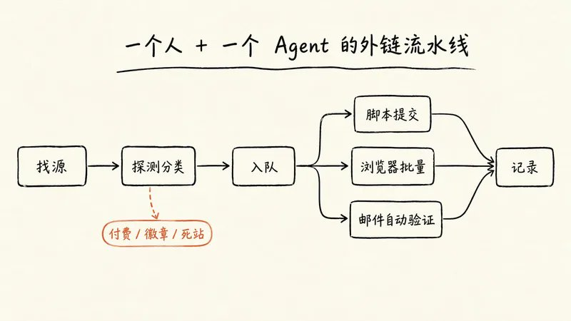
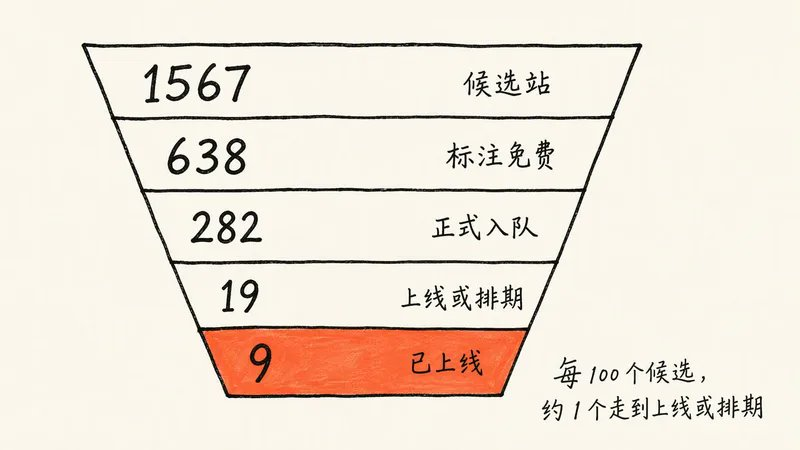
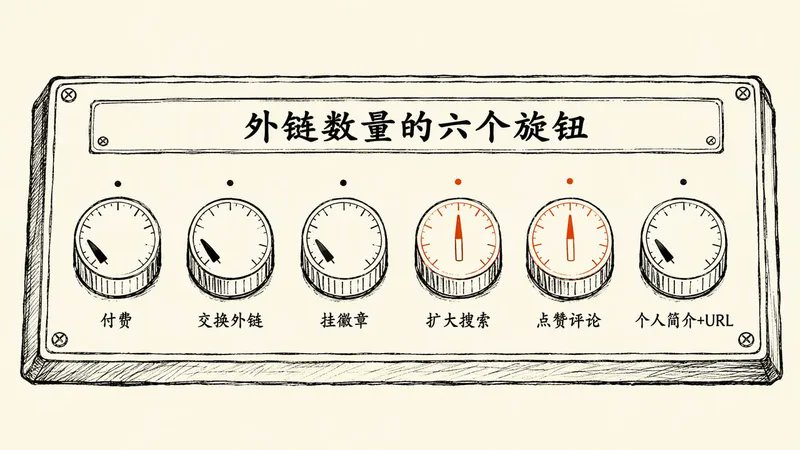

# SagaSu（@sujingshen）：用 Grok Bot 自动化提交外链——一天跑完 4000 多个站的完整流程

> 出海 SEO 外链建设的极限自动化黑客打法：利用 Grok Bot 原生网页操控与表单填写能力，配置任务队列与自动重试逻辑，单日自动化批量提交 4000+ 海外免费收录目录与导航站，大幅提升新站早期外链索引率并降低人工外链铺设的时间成本。

<!-- more -->

规则怎么写、资产怎么备、站怎么筛、表怎么交，以及想要更多外链时可以拧的六个旋钮

by Sagasu · 2026 年 10 月

给新产品做外链，最磨人的从来不是策略，是体力活：找站、注册、收验证邮件、填表、传 logo、选分类、等审核。一个人一晚上交十几个站就算高效了。

这次我把这件事整个交给了 Grok Bot。一天之内，它从 4000 多个候选站里筛出 282 个能免费提交的站，按难度分三条线自动提交，自己收验证邮件、自己点确认链接，顺手往 22 个 GitHub awesome 列表开了 PR。我做的事情只有三件：定规则、批例外、点十来封必须我本人点的验证邮件。

你问我如何注册 grok bot ？找 @app_sail 他的文章有很多这类教程

推广的产品是 DMtheFounder（[dmthefounder.com](https://dmthefounder.com/)），一个免费招聘板：把创业公司创始人在 X 和 Hacker News 上发的早期工程岗汇总到一起，工程师可以直接私信创始人。下面所有数字都来自这一天的提交队列 CSV、脚本日志和对话记录。

先说结果。当天确认上线 9 个站，另有 10 个发布平台排上了未来几个月的发布日期，还有大约 120 个站已提交、有回执、在等审核。

上线数看起来不多，原因很明确，而且都是我主动选的：

1. 不付费。 所有付费档、付费插队、「免费提交但付费才发布」的站一律跳过。
2. 没做「个人简介 + URL」这类外链。 在社区、论坛、开发者平台注册个人主页、在简介里留网址，是量最大、上线最快的一类，这次完全没碰。
3. 很多站在排队。 免费档普遍要排队，有的排几周，有的排到明年 2 月，还有一个队列约 174 天。

上线数是规则拧出来的，不是能力上限。 规则放宽一点，数字就会变。这篇文章前半部分讲我这次的完整流程，后半部分讲如果你愿意付费、交换、挂徽章、扩大搜索、点赞评论、做个人简介，分别能多拿到什么。

## 一、你会用到 Grok Bot 的哪些能力

这套流程用到的东西不多，都是 Grok Bot 自带的：

| 能力 | 在流程里干什么 |
| --- | --- |
| 原生收件箱（`xxx@mail.grokbot.com`） | Agent 自己的邮箱，用来批量注册、接收验证邮件 |
| Workspace + 脚本 | 存队列 CSV、日志、logo 和截图，跑探测和提交脚本 |
| Executor 子任务 | 负责「找站 + 筛选」，产出可提交的队列 |
| computerUse 浏览器 | 处理需要登录、上传图片、选发布日期的站 |
| Routine | 定时盯收件箱，自动点验证链接、传验证码 |
| GitHub CLI（gh） | fork 仓库、改列表、开 PR |

你不需要会写代码。脚本是 Agent 自己写的，我只看它汇报的结果。

## 二、第一步：写规则，再放权

Agent 跑起来很快，快到你来不及逐条审批。所以第一步不是找站，是写一条它能自己执行的判断规则。我的原话就一句：

付费的不管，交换的不管，就找那些能免费排队或者免费提交的外链。

展开成 Agent 能直接执行的版本：

只提交真正免费、或可以免费排队（排几个月也行）的站。遇到以下情况一律跳过，不用问我：只有付费选项；必须在我网站挂徽章或反链才能上线；互链交换；要先给 N 个产品点赞攒积分才能提交。不确定的情况单独问我。

规则写清楚之后，例外才好处理。这次出现了两个例外：FoundrList 要先给几个产品点赞并认真评论才能解锁免费发布，我同意了；Crowdstax 是同类机制，Agent 按同样方式处理。另一个关键授权是 GitHub PR：第一次它问要不要开，我回了一句「发，以后类似的 GitHub PR 都直接发」，之后它就按各个仓库的格式自己开，不再逐条问我。

还有一种情况 Agent 会主动停下来：Starter Story 的表单要填月收入和融资情况，产品没有这些数据，我回答「没有」，它就跳过了这个站，不会为了上线去编数字。

Agent 每来问你一次，都说明规则里漏了一种情况。把答案补进规则，下次它就不问了。

## 三、第二步：备好资产包和两条邮箱

### 资产包：一次备齐，所有站复用

每个目录站的表单都不一样，但翻来覆去就那十几个字段。提前写成一份产品信息模板交给 Agent，它就不会每个站临场发挥一遍描述。我准备的是：

| 字段 | 准备内容 |
| --- | --- |
| 名称、网址 | DMtheFounder / [https://dmthefounder.com/](https://dmthefounder.com/) |
| 一句话 Tagline | 短版：Early engineering jobs posted by startup founders；另备一个更有营销感的变体，给 Launch 类站用 |
| 描述 | 短、中、长三档（约 1 句 / 3 句 / 一段），书签站另备一版带联系方式的长文案 |
| 分类 | Jobs / HR / Recruiting / Business，按站选最接近的 |
| 定价、阶段 | Free;Bootstrapped / Pre-revenue / Launched |
| 地点、成立年 | London, UK;2026 |
| 创始人信息 | 姓名 + X 账号（没有领英就明确写没有，别让 Agent 去猜） |
| 图片 | Logo 多个尺寸、首页截图、三张 16:9 截图 |

这些文件全放在 workspace 里，Agent 填表时直接取。

### 邮箱：拆成两条线

第一条是 Agent 自己的邮箱。 大部分站的注册和验证都走 Grok Bot 的原生收件箱。我建了一个叫「外链邮件自动处理」的 routine 一直盯着它：收到验证邮件就自动点链接，收到短验证码就立刻传给正在填表的任务。注册密码统一存在 workspace 的一个文件里，对话里只提文件路径，不出现明文。

第二条是产品域名邮箱（[support@dmthefounder.com](mailto:support@dmthefounder.com)）。有些站要求用和网址同域名的邮箱注册，证明你是网站主人，比如 Latka、SaaSHub、StartupInspire。这类站的流程是：Agent 用域名邮箱注册，把需要我点的站列成一张短清单，我点完回一句「点了」，它再登录提交。这一天我亲手点的一共十来封，Shipboard、Entireweb、Idaho Index 都在里面。

让 Agent 处理海量邮件，你只点那几封必须证明身份的。

## 四、第三步：找站和筛选

这一步交给 Executor 子任务，它做三件事：抓、探、分。

抓。 从 GitHub 上的各种 submit 列表、SaaS 目录汇总、公开数据集里大量抓取候选站。我说了一句「扩大搜索，人家都能免费提交几千个」之后，它跑了好几轮：一轮抓取池 4266 个，另一轮 3450 个，再一轮 1996 个（各轮有重叠），一路累计排除了 523 个域名。

探。 写脚本逐个访问提交页，看 HTTP 状态、有没有表单、页面上有没有付费或徽章的文案。

分。 给每个站打一个状态标签，写进 CSV。最完整的一轮有 1567 个候选，分布如下：

| 标签 | 数量 | 含义 |
| --- | --- | --- |
| free | 545 | 看起来可以免费提交 |
| free-queue | 93 | 免费但要排队 |
| unknown | 295 | 探测不出来，需要进一步看 |
| badge-required | 283 | 必须挂徽章 |
| dead | 176 | 站已经打不开 |
| likely-paid | 175 | 大概率收费 |

标成 free 或 free-queue 的一共 638 个。再按规则二筛，分五批正式入队：60、60、62、86、14，合计 282 条。最后一批只有 14 条，因为到后期它再去搜，回报说约 3800 个源已经「几乎筛完」了。

这里有个值得提前知道的经验：网上的「免费提交」列表大多是给 AI 工具准备的。第四批里就混进了大量 AI 工具目录，而 DMtheFounder 是招聘板，交进去要么被拒，要么上了也没有对口的访客。后来我让它改搜通用目录、创业公司目录、招聘相关目录和英国本地目录，命中率明显好了很多。

列表是别人按别人的产品整理的。先按自己的品类筛一遍，再开始交。

## 五、第四步：分三条线提交

队列有了，提交按难度分流：

脚本提交。 不需要账号的简单表单、同一套模板搭出来的站（大量老式 phpLD 目录、Laravel 书签站），还有开放了 API 的站（比如 Founderhood，调接口直接返回 pending），Agent 写小脚本或用 curl 批量提交，日志落到文件里。这条线最快，适合那些长得一模一样的目录站。

浏览器批量。 需要登录、上传图片、选免费档、挑发布日期的站，交给 computerUse 操作真实浏览器。一批 10 到 12 个站，跑完汇报一次再开下一批；批次太大，出错时很难知道断在哪。登录态存在一个 cookies 目录里，这一天攒了约 49 个站的会话，之后回去查审核状态不用重新登录。

邮件自动验证。 就是上一节的 routine。它和浏览器线并行：浏览器在某个站填表时触发了验证码，routine 收到邮件后马上传回去。FoundrList、IndieLaunch、IdeaKiln 都用短时效验证码，晚几分钟就过期，所以这条线的关键是快。

给 Agent 的提交指令可以照这个写：

从 queue-vetted-3.csv 取下一批 12 个站，用 computerUse 逐个提交。统一用产品信息模板里的字段，描述用中档。注册用 bot 邮箱，验证交给邮件 routine。遇到需要域名邮箱的站，记下来最后一起列给我。每个站结束后在 CSV 里更新状态：已上线（附链接）、已提交待审、已排期（附日期）、跳过（附原因）。整批做完再汇报。

Agent 跑得快不难，难的是跑完之后你还知道它干了什么。 所以每个站都要落一个状态。

## 六、第五步：GitHub awesome 列表

这条线不用注册任何账号，只要一个 GitHub 账号。Agent 按每个仓库的 CONTRIBUTING 和列表格式，往招聘、远程工作、求职资源、创业资源、伦敦本地这些主题的 awesome 列表开 PR，说明里写清楚 DMtheFounder 和这个列表的关系。

这一天一共开了 22 个 PR，已经有 1 个合并（[Awesome-Job-Search-Resources](https://github.com/dr-mushtaq/Awesome-Job-Search-Resources/pull/9)），其余还在等维护者处理，比如 [awesome-hacker-news](https://github.com/cheeaun/awesome-hacker-news/pull/135)、[awesome-remote-job](https://github.com/lukasz-madon/awesome-remote-job/pull/1202)、[awesome-london](https://github.com/tolgaergin/awesome-london/pull/5)。

合并通常很慢，但每一条都经过真人维护者审核，又放在目标用户真的会去翻的页面上。对一个给工程师用的招聘板来说，这条线性价比很高。

目录站给你一条链接，awesome 列表给你一个被人审过的位置。

## 七、第六步：记录和跟进

很多站交完不是立刻上线，而是给你一个发布日期。这一天排上期的有 10 个：

| 站点 | 排期 | 页面现状 |
| --- | --- | --- |
| findasaas | 10 月 26 日 | 无独立链接 |
| Crowdstax | 11 月 2～8 日发布周 | 审核中 |
| [FoundrList](https://www.foundrlist.com/product/dmthefounder) | 11 月 16 日 | 目前是私密预览页，发布日才公开 |
| [LaunchRanked](https://launchranked.com/products/dmthefounder) | 11 月 23～29 日投票周 | 已有倒计时页，审核通过后给 followed link |
| [Pro Launch](https://prolaunch.net/projects/dmthefounder) | 12 月 22 日 | 产品页已可访问 |
| Toolfound | 约 12 月 29 日 | 无独立链接，域名验证可选 |
| [What Launched Today](https://whatlaunched.today/launch/dmthefounder) | 2027 年 1 月 16 日 | 审核前页面打不开 |
| [HUNT0](https://hunt0.com/products/dmthefounder) | 2027 年 2 月 8 日那一周 | 产品页已可访问，免费队列约第 67 位 |
| [Founderhood](https://founderhood.app/business/dmthefounder) | 待审 | 接口返回 pending |
| Internet Is Beautiful | 队列约 174 天 | 无独立链接 |

发布平台的发布日当天往往需要你在场：回复评论、转发拉票。所以这张表要放进日历。

我这次的记录载体是五个队列 CSV、几份提交日志和对话里的阶段汇报，没有一张「全部结果」总表，这篇文章的数字是事后汇总的。建议你第一天就让 Agent 建一张总表，每个站一行：状态、链接、排期日、到期日、是否 dofollow。之后每周让 routine 回去查一遍待审站的状态，更新这张表。

## 八、一天下来的结果

当天确认上线的 9 个站。这 9 个都是提交当天页面就已发布、外链当天就在，不用等。表里的「约 90 天」说的是有效期：这类书签站和目录站的免费收录大约保留 90 天，到期可能下线，需要续期或重新提交。

| 站点 | 类型 | 当天状态 | 有效期 |
| --- | --- | --- | --- |
| [Web Directory Listing](https://webdirectorylisting.com/listings/dmthefounder-early-engineering-jobs-posted-by-startup-founders/) | 目录站 | 已发布 | 免费收录约 90 天，nofollow |
| [Bookmarks Club](https://bookmarksclub.com/backlink/dmthefounder-early-engineering-jobs-posted-by-startup-founders-4/) | 书签站 | 已发布 | 约 90 天 |
| [Bookmark Spot](https://www.bookmarkspot.com/bookmark/dmthefounder-early-engineering-jobs-posted-by-startup-founders-6/) | 书签站 | 已发布 | 约 90 天 |
| [B3 Directory](https://b3directory.com/listing/dmthefounder-early-engineering-jobs-posted-by-startup-founders-4/) | 目录站 | 已发布 | 约 90 天 |
| [BookmarkWhirl](https://bookmarkwhirl.com/listing/dmthefounder-early-engineering-jobs-posted-by-startup-founders-2/) | 书签站 | 已发布 | 约 90 天 |
| [Choice Bookmarks](https://www.choicebookmarks.com/listing/dmthefounder-early-engineering-jobs-posted-by-startup-founders/) | 书签站 | 已发布 | 约 90 天 |
| [TourBR](https://www.tourbr.com/backlink/dmthefounder-early-engineering-jobs-posted-by-startup-founders/) | 书签站 | 已发布 | 约 90 天 |
| [Startup Europe](https://startupeurope.net/startup?id=21695) | 创业公司目录 | 已发布 | 未注明期限 |
| Sundir | 目录站 | 记录显示已列出，未单独存链接 | 未注明期限 |

所以，7 个书签站和目录站大约到明年 1 月中旬会集体到期。建议提交当天就让 Agent 把到期日写进总表，到期前提醒你决定续不续。

加上已排期的 10 个，整个漏斗是这样：

| 阶段 | 数量 | 占候选比例 |
| --- | --- | --- |
| 候选站 | 1567 | 100% |
| 标注免费或免费排队 | 638 | 40.7% |
| 正式入队 | 282 | 18.0% |
| 已上线或已排期 | 19 | 1.2% |
| 已上线 | 9 | 0.57% |

读这张表要注意两点。第一，各层不是严格的子集：282 条入队里有一部分来自这 1567 个之外的研究表，比例只能看量级。第二，这是跑完当天的快照。还有约 120 个站在审核中，接下来几周会陆续出结果，再加上 22 个 PR，最终数字会比现在高。

回到开头说的三个原因，这个漏斗里每一层的流失都能对上：likely-paid 的 175 个和付费插队的站，是「不付费」挡掉的；badge-required 的 283 个，是「不挂徽章」挡掉的；个人简介类外链根本没进候选池；而已排期的 10 个和待审的约 120 个，就是「在排队」。

## 九、想要更多外链：六个可以拧的旋钮

这一节是这篇教程里最值得挖的部分。我的规则把大部分旋钮都拧到了最低，你可以按自己的预算和底线调。

| 旋钮 | 这次的设置 | 拧开后能多拿到什么 |
| --- | --- | --- |
| 付费 | 关 | 只有付费档的站、付费插队、付费才发布的站 |
| 交换外链 | 关 | 要求互链的目录和合作伙伴页 |
| 挂徽章 | 关 | 第三轮候选里 283 个强制徽章站，加上「挂徽章才给 dofollow」的站 |
| 扩大搜索 | 开 | 更多候选，但边际收益递减 |
| 点赞评论 | 部分开 | 「先点赞 N 个才能提交」的 launch 平台 |
| 个人简介 + URL | 关 | 社区、论坛、开发者平台的个人主页外链 |

付费。 这是最直接的一个旋钮。这次跳过的付费站里有 Tiny Startups（69 英镑）、aitoolly（29.99 美元）、BetaList、Microlaunch 等，第三轮候选里标成 likely-paid 的有 175 个。很多 launch 平台的付费档买的其实是时间：免费排几个月，付费下周上线。如果你的产品有明确的发布节点，付费插队是合理的选择。给 Agent 的规则可以写成：「单站 30 美元以内可以付，先列清单给我批，不要自己下单。」把付款这一步留在自己手里。

交换外链。 很多目录站要求你在网站上放一个指向它们的链接。可以接受的话，建一个独立的 /links 或 partners 页面集中放，不影响首页。要注意的是，Google 的[垃圾内容政策](https://developers.google.com/search/docs/essentials/spam-policies)把「过度的链接交换」列在链接垃圾的例子里，所以量要克制，只换和你品类相关的站。

挂徽章。 这是这次挡掉最多站的一条规则：283 个强制徽章站，还有 Smol Launch、SaaSFame、ToolFame、Supa Launch、LetsLaunch 这类「挂徽章才上线或才给 dofollow」的。如果你愿意，可以做一个 /featured 或 /launches 页面，把所有徽章集中放在那里。规则写成：「需要徽章的站可以交，徽章统一放到 /launches 页面，交完把徽章代码汇总给我。」

扩大搜索。 这个旋钮我拧到了最大，4266、3450、1996 三轮抓取池，最后一轮只多出 14 条可用的。说明同一类关键词的源很快会被筛完。继续拧的方法是换方向：按品类找（招聘、远程工作、开发者工具），按地区找（英国、欧洲、你产品所在的城市），按语言找（非英语的本地目录），而不是在同一批 submit 列表里反复刷。

点赞评论。 很多 launch 平台要求先给别的产品点赞或评论攒积分，才能提交自己的。这次只开了 FoundrList 和 Crowdstax 两个例外，FoundrList 已经排到 11 月 16 日发布。如果放开这条，launch 平台的数量会多一截。关键是评论要真实，Agent 先读懂对方产品再写一两句具体的话，不要群发模板。规则可以写成：「点赞类站可以做，每个站最多点赞 5 个，评论必须针对对方产品的具体功能，交前给我看一眼。」

个人简介 + URL。 在开发者社区、问答网站、论坛、作品集平台注册个人主页，在简介和网站字段里留产品网址。这类外链量大、通常不用审核、注册完就在线，这次完全没做。它和产品目录是两套候选池，可以让 Executor 单独抓一份清单。要注意，这类平台对批量注册往往更敏感，建议慢一点，每个资料都认真填，用一个你真的会继续维护的身份。

还有一个不算旋钮的变量：耐心。 这次已排期的最晚排到明年 2 月。免费的代价就是排队，接受了这一点，「上线数」会随着时间自己往上走。

旋钮怎么拧，取决于你愿意用什么换：钱、页面空间、时间，还是一点社区参与。

## 十、踩坑表

这一天实际撞上的问题和处理办法，照着做大概率会遇到同样的：

| 坑 | 现象 | 处理 |
| --- | --- | --- |
| 验证码 / Cloudflare | 脚本过不去 | 改用浏览器；浏览器也过不去就跳过 |
| 短验证码过期 | 邮件到了，表单那边已超时 | routine 即时接力；不行就重发 |
| routine 和浏览器抢桌面 | 两个任务同时控制一个浏览器，整批中断 | 只开一个浏览器实例，routine 用独立标签页，错开调度 |
| 两个浏览器任务撞车 | 同一批 12 个站被两个任务同时抢 | 一次只跑一个浏览器任务，跑完再开下一批 |
| 品类不符 | 招聘板交进 AI 工具目录 | 筛选阶段就按品类过滤 |
| 「免费」实为付费 | In Links We Trust 交完才说要付费才上线 | 不算收录，按规则跳过 |
| 免费队列已满 | Firsto 未来约半年的免费名额满了 | 记下来以后再试 |
| 老目录服务器 bug | phpLD 站报 `IPADDRESS Data too long` | 对方的问题，直接换站 |
| 重复提交 | Made with React.js 被交了两次；Toolfound 返回 409 已在队列 | 对方一般会去重，用同一邮箱查状态 |
| 字段校验 | BestJobBoards 不认 2026 年成立 | 改填 2025 |
| 禁止 AI 提交 | JobSearchDB 政策明确禁止 AI Agent | 尊重对方规则，留给人工或跳过 |
| 站已死 | Canadian Directory 域名在卖、BizIndexer 返回 522 | 标记 dead，522 的可以过几天重试 |

## 十一、动手前的三个检查

这是哪种免费？ 「免费」至少有五种：立即免费上线、免费但要排队、免费提交但付费才发布、免费但 nofollow（挂徽章才给 dofollow）、交完才告诉你要付费。让 Agent 在探测阶段就把「排队时长」和「上线条件」记进 CSV。

上线后能活多久？ 书签站大多是 90 天左右，发布平台的首页曝光是一天或一周，awesome 列表只要不被删就一直在。先看它能给你留下什么，再决定花多少力气。

品类对不对？ 最好的站，是你的目标用户本来就会去逛的站。

提交交给 AI，判断留给自己。

## 常见问题

需要会写代码吗？ 不需要。探测脚本、提交脚本都是 Agent 自己写、自己跑的。你要做的是写清楚规则，看它的汇报。

我要花多少时间？ 这一天我做的是：写规则、批两个例外、回答一次 Starter Story 的问题、点十来封域名邮箱的验证邮件。其余都在后台跑。

自动提交会不会被 Google 当成垃圾外链？ Google 的垃圾内容政策确实把「用自动化程序创建链接」和「低质量的目录或书签站链接」列为链接垃圾的例子，而且从 2019 年起，Google 把 nofollow 当作一种「提示」，自行决定计不计入排名（[Google 搜索中心博客](https://developers.google.com/search/blog/2019/09/evolving-nofollow-new-ways-to-identify)）。我自己的做法是：只交主动开放提交入口的站，每站只交一次，资料如实填写，重心放在发布平台、垂直目录和 awesome 列表上，书签站当作顺手的一层，不指望它们带排名。

为什么不直接付钱买外链？ 可以付，见第九节的付费旋钮。不过按 Google 的政策，付费获得的链接如果传递排名，需要标注 sponsored 或 nofollow。花钱更适合买「时间」，比如 launch 平台的插队，而不是买链接本身。

## 写在最后

开工前我对 Agent 说的是「扩大搜索，人家都能免费提交几千个」。一天跑下来，我对这件事的理解变成了：Agent 能把几千个站的体力活一天做完，最后能拿到多少外链，取决于你把那六个旋钮拧到哪里。

我这次选了最保守的设置：不付费、不交换、不挂徽章、不做个人简介。得到的是 9 个当天上线、10 个排期、约 120 个待审和 22 个 PR。如果你的预算和底线不一样，同一套流水线可以跑出完全不同的数字。

等 FoundrList 和 LaunchRanked 的发布周过去，我再来看看这些外链实际带来了多少访问。你会把哪个旋钮拧开？欢迎在评论区说说。

参考资料

- [Google 搜索中心：Google 网页搜索的垃圾内容政策（Link spam 一节）](https://developers.google.com/search/docs/essentials/spam-policies)
- [Google 搜索中心博客：Evolving “nofollow” – new ways to identify the nature of links（2019 年 9 月）](https://developers.google.com/search/blog/2019/09/evolving-nofollow-new-ways-to-identify)
- [Google 搜索中心：Qualify outbound links（rel 属性说明）](https://developers.google.com/search/docs/crawling-indexing/qualify-outbound-links)
- 其余数字来自作者自己的提交队列 CSV、脚本日志与 Agent 对话记录，上线和排期页面链接见第七、八节表格

## 相关页面

- [[sources/fanshifu-grok-bot-800-new-sites-monitoring-workflow]]
- [[sources/zhongjian-10-curated-seo-backlinks-trading-platforms]]
- [[concepts/open-source-seo-tooling]]
- [[concepts/gefei-seo-keywords]]
