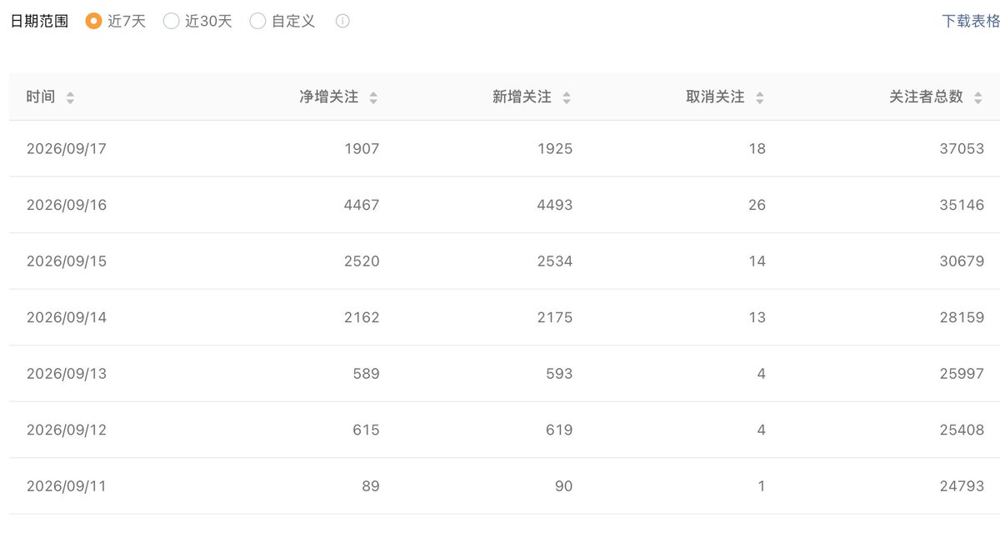
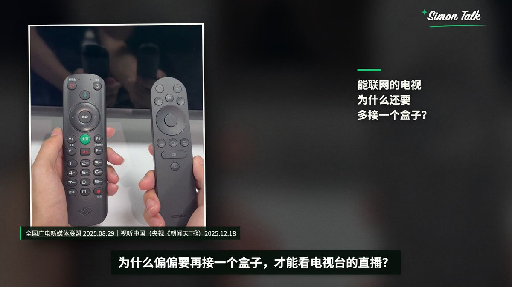
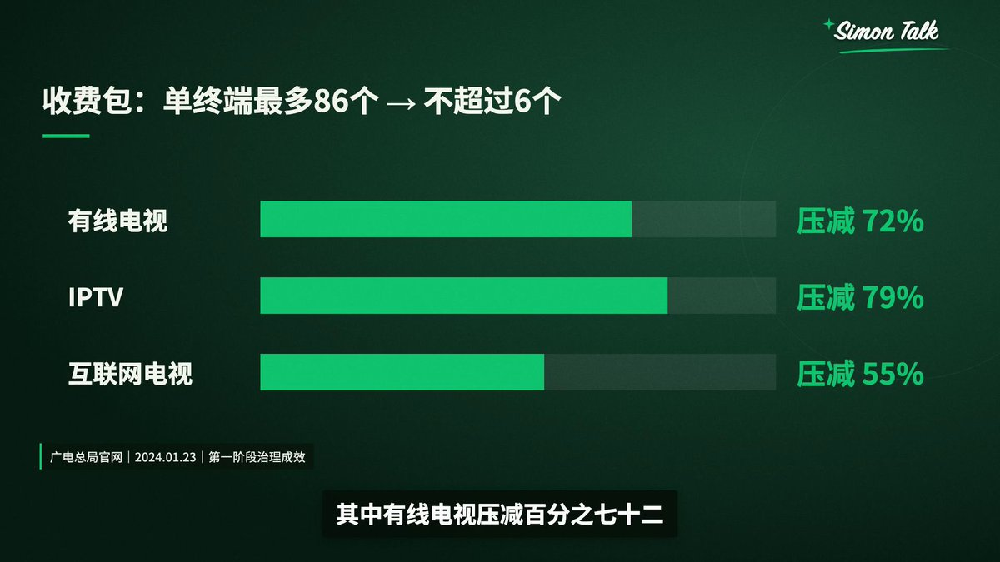
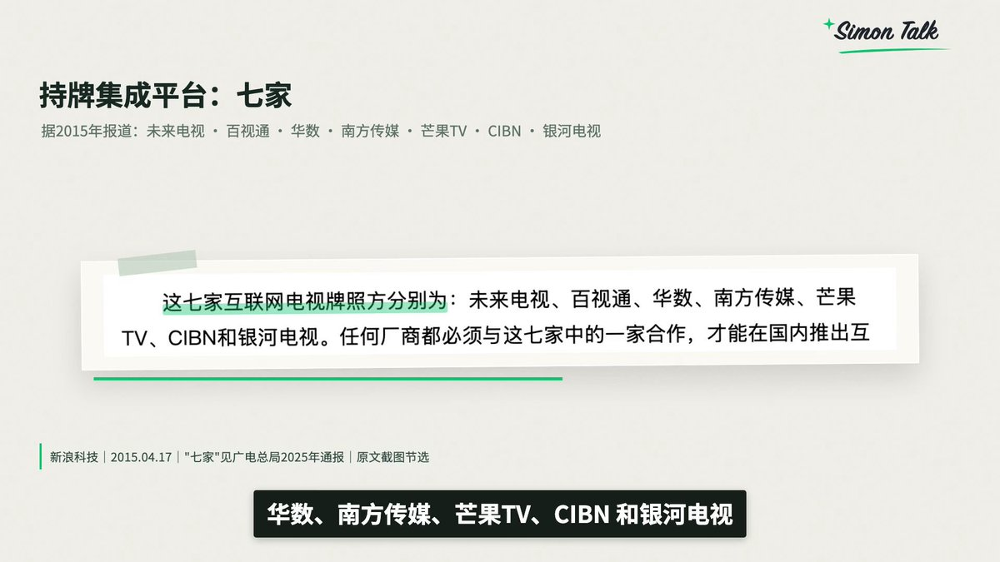
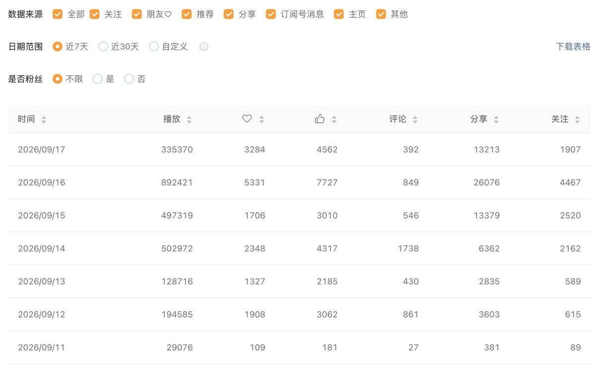

# Simon 聊 AI（@HanZhang415188）：用 AI 做热点长视频——单条 108 万播放，3 天涨粉近万的实操复盘

> 以单条 108 万播放、3 天涨粉近万的真实数据复盘 AI 热点长视频全流程：热点选题的捕捉与判断标准、AI 在脚本撰写、分镜设计、配音与画面生成各环节的接管程度、长视频的节奏设计与完播率优化，以及从热点流量到长期账号资产沉淀的转化路径。

<!-- more -->

9 月 14 日到 16 日，我的视频号后台在 3 天内净增关注 9149，几乎是一眨眼摸到了破万的门槛。

这几天里，我用一套自己调试的 AI 智能体工作流，保持每天 3 条、单条 10 分钟以上的深度长视频输出频率。多条视频拿到了几十万的播放，其中深度拆解“尸皮针”的那期，累计播放量冲到了 108 万。

不卖关子，先把这几天后台最真实的数据账单摆在最前面。

## 1. 近期核心视频播放表现（截至截图时累计值）

发布日期 | 选题 | 截图时累计播放 |

| --- | --- | --- |
| 9 月 11 日 | 校园订奶 | 16.4 万 |
| 9 月 11 日 | 锁屏广告争议 | 29.2 万 |
| 9 月 14 日 | 野人先生冰淇淋 | 45.7 万 |
| 9 月 15 日 | “尸皮针” | 108 万 |
| 9 月 16 日 | 月付与金融营销新规 | 49 万

从 9 月 11 日到 17 日，整整 7 天，后台总播放量跑出 258 万，净增关注约 1.2 万。其中爆发最猛的，就是 14 到 16 日这三天，涨粉 9,149

这些视频，没有出镜，没有棚拍，也没有团队。具体的资料挖掘、脚本文案和音画合成全由 AI 跑完，快则 20 分钟出一期，慢则 1 小时。我做的事情其实很明确：做选题的把关者，在关键节点拍板，确认无误后分发。

先看一段实际制作效果。下面截取《电视机顶盒》本地制作版的开场 28 秒，展示素材与旁白怎样衔接。

[video](https://video.twimg.com/amplify_video/2100857302811299840/vid/avc1/1280x720/ByNSrDQTVuivfelO.mp4?tag=29)

但我不想给你营造“一键躺赚”的幻想。换个账号、换批选题，数据可能完全不一样。这篇复盘里真正有价值的，是如何把一个热点挖出信息厚度做成长视频，以及全流程中哪些核心环节必须由真人死守。

上篇我会毫无保留地聊聊账号初期的弯路、重启时的技术断舍离，以及这套选题 SOP。下篇会把整套制作的 Skill 开源，把技术配置与脚本细节掰开讲透。

## 一、踩坑与波折：从初尝甜头到差点放弃

在这个账号跑通之前，我也经历过很长一段时间的自我怀疑。

### 1. 模仿大号做宏大叙事，叫好不叫座

刚开始用 AI 做视频时，我把赛道定在商业财经。对标的是小 Lin 说、巫师财经那种风格，心气很高，总想把一个万亿行业或复杂的商业底层逻辑一次性讲明白。

我做了很多大体量的深度拆解，评论区反馈也不错，但数据就是不温不火。能感觉到方向是对的，可就是缺少一把能引爆流量的引信。

### 2. 第一条 60 万爆款：抓准“大家关心的身边事”

转机出现在我涉足车企相关内容的时候。当时做了一期解读“小蓝灯法规”的视频，播放量直接冲到了 60 万。

那一刻我第一次直观感受到：国内大众对汽车与出行政策的关注度极其敏感。这虽然只是单次爆款带来的直觉判断，但确实给了我信心，顺着这个方向又连续做了几家车企，数据反馈普遍在线。一个题做通了，接着做相邻题，确实是最自然的打法。

### 3. 热点一过断崖下跌：我甚至想过注销不干了

然而，好光景没持续多久。车企这波舆论风头过去后，流量迅速回落，接连好几周后台一片死寂。

那种落差感很磨人：你见识过一条片子 60 万播放的热度，回头再面对无论怎么发都没人看的冷清，很容易陷入“这套东西到底行不行”的怀疑里。

自媒体的流量往往是一阵一阵的，单靠某个垂直热点跑出的几期数据，根本无法支撑长久的生产。所以在这次彻底跑顺之前，我是真真切切动过“不做了”的念头的。

## 二、关键转折：把旧经验扔掉，让新模型自由跑一次

停摆了一阵子后，在烤妹 @CrazyKaomei 的鼓励下，我决定回过头死磕自己的工作流，重新激活这个账号。

### 1. 旧流程的致命伤：画面与文案“各说各话”

之前制作长视频，最大的硬伤在素材匹配上。

我过去主要依赖 Pexels 等公开版权库找空镜素材来铺满底轨。这些画面的质感很好，但与旁白核心信息严重脱节。旁白在条分缕析某个具体的法律法规或技术事件，画面却在放一个路人喝咖啡或者空旷的街道。对于深度长视频来说，观众看着看着就会疲惫，因为眼睛接收到的全是无关信息，只能被迫纯靠耳朵听，完播率自然上不去。

### 2. 扔掉固有 Skill：GPT-6-Astra 的解题惊喜

当 GPT-6-Astra 推出时，我冒出一个念头：如果我不给它套以前那些条条框框的 Skill，让它彻底从零自由发挥，它会怎么做？

结果完全出乎意料。在没有旧规则约束的情况下，它检索并匹配出来的画面，与口播内容的贴合度极高，很多以前我认为需要极高人工干预才能卡准的具象素材，它自己抓取并编排得非常自然。

画面示例：《电视机顶盒》制作版 00:22。相关素材与旁白一起解释“为什么还需要一个盒子”，画面同时保留素材出处。此图用于展示当前画面组织方式，不是旧版与新版的对照实验。

这狠狠敲醒了我：之前用 Pexels 铺底轨，只是我在算力和早期模型限制下妥协出来的折中方案。我把它写进了死板的 Skill 里，以至于换了更聪明的模型后，它依然在机械执行我给的旧指令。

模型本有能力交付 90 分的结果，却被我用旧规矩按在了 60 分。

### 3. 做 AI 流水线的心得：经验要沉淀，更要敢于“格式化”

旧 Skill 固化的操作范式，往往就是新模型发挥潜力的天花板。

这给我带来了极其深刻的工作流升级原则：

- 定期做“无约束实验”：挑一个熟悉的经典题目，只给成片交付标准（画面相关度、出处严谨度），剥离原有的步骤预设，看新模型会用什么路径解题。
- 留结果，不留死板路径：事实要有出处、声画必须同步是硬指标，至于中间模型用什么爬虫、调什么接口、抓什么形式的画面，保持开放。
- 警惕经验主义的局限：不要只在原有流程上打补丁，那只会让流程越来越臃肿；给 AI 重新洗牌的机会，往往会有降维打击般的惊喜。

这次画面匹配度的质变，加上后续对选题逻辑的重构，共同构成了我现在的出片底盘。

## 三、底层逻辑：为什么我坚持做“热点实时深度”？

做了大半年视频，我最看好的方向始终是：深度内容 + 实时热点。

- 热点：负责给大众抛出一个天然带有情绪和讨论度的“初始疑问”。
- 深度：负责把大家知其然不知其所以然的内幕，逻辑严密地“解释清楚”。

一个消费事件引爆热搜，大家早就通过 15 秒短视频知道“发生了什么”。如果你的长视频只是把通稿新闻慢条斯理地念一遍，观众看 10 秒就会划走。大家留下来看长视频，是因为心存疑虑：“这东西我买过，我中招了吗？”、“官方的回应到底有没有漏洞？”

比如聊“物业费”：

- 停在表层的短资讯只会说：“XX 小区业主与物业爆发冲突。”
- 但深度长视频应该挖的是：“物业费明细里到底包含了哪几项隐性支出？业主手把手查验台账与合同履约的法律依据是什么？”

前者是制造情绪，后者是提供解药。

AI 的真正价值，就在于把查原始卷宗、核对数据、做画面的周期从几天压缩到几十分钟，让个人创作者能在热度正盛的窗口期，把这份具有“硬核增量”的长视频递到观众面前。

但千万别误会：不是把视频凑到 10 分钟就会自动获得系统流量推荐。 如果 3 分钟的材料硬注水到 10 分钟，只有车轱辘话和说教，完播率会让你很难看。我做长视频，纯粹是因为有些事实和因果链条，不花 10 分钟根本拆不透。

## 四、指令工程：如何把交付标准写进全局 Skill？

我平时启动制作时，给 AI 的 Prompt 往往非常简练：“帮我做一个关于 XXX 的深度解读视频。”

我能这么省事，是因为所有的红线和规范早已内嵌在底层的全局 Skill 之中。

你可以把 Skill 看作是给 AI 员工签的《长期岗位职责书》：

1. 分清“质量标准”与“执行手段”：把“结论必须具备官方出处”、“字幕必须适配移动端可读性”作为死卡标准；把“具体怎么检索网页、怎么剪切片段”留给模型发挥。
2. 切忌一口吞成胖子：新手刚搭建工作流，不要试图让 AI 一键吐出成片。最稳妥的做法是分步交付：
   - 第一步：只要《选题卡》与《信源列表》；
   - 第二步：核准无误后，生成逐字口播稿；
   - 第三步：脚本逻辑顺畅后，调用配音与合成渲染。 等整条链条打通后，再串联成自动化流水线。
1. 建立合理的生产预期：我提到的“20 分钟至 1 小时出片”，是指这套环境和风格磨合稳定后的常规节奏。新手第一次配环境、测 Prompt、调剪辑模版，一定要预留充裕的试错时间。

## 五、日常落地：从选题到发布的四步流水线

我的日常生产标准流程严格遵循这四步：

[步骤 1: 抓热点] ──> [步骤 2: 审选题] ──> [步骤 3: 跑生产] ──> [步骤 4: 细核对]

  AI 交付候选表 人工卡死材料厚度 Skill 全自动跑通 逐帧对齐关键信源

### 1. 抓热点：让 AI 交付具备判断价值的候选表

我不看满大街的标题党榜单，我要求 AI 查热搜和行业动态时，必须交出一份带参数的研判表。你可以直接参考我使用的检索提示词：

“查找最近一周与日常消费有关的热点，给我 5 个适合做深度解读的候选。每个题目附原始来源和日期，说明现在为什么值得做。先概括现有讨论，再提出一个可以继续调查的问题。写出这个问题与谁有关，以及还缺哪份关键材料。无法核实的热度不要编数字，只有转述的消息单独标明。”

只有这样筛出来的题目，才具备操作可能性。如果 AI 连可供验证的数据源都给不出，只会空谈“全网都在热议”，这个题直接 pass。

### 2. 审选题：人工研判现有材料能否支撑立论

这是我最耗费脑力的环节。我会拿着选题卡反问自己：现有的公开凭证，真的能撑起整套推论吗？

比如做“某网红雪糕为什么卖这么贵”，如果手里只有终端售价，连克重成本、代工模式、冷链扣点等账目都核实不清，就贸然做“暴利内幕拆解”，这是非常业余且高危的。

此时要么把切角收缩为“不同克重与乳脂含量的规格差价分析”，要么继续补充一手财报和行业研报。我的生死及格线是：看完大纲，我能不能用一句大白话向普通人讲明白“看完这个视频你能彻底懂什么”。 如果得到的只有一句“你会觉得这事很离谱”，这种纯情绪题目我坚决不做。

选题案例：野人先生冰淇淋。9 月 14 日发布，截图时累计播放 45.7 万。

### 3. 跑生产：圈定问题与边界，释放 AI 算力

题目定好后，给 AI 的生产指令务必极其聚焦。还是以物业费为例：

“围绕这次物业纠纷做一条深度解读，重点解释收费项目与实际服务怎么核对。先检查现有材料能否支持这个角度，再按制作 Skill 执行。个案材料只用于说明这个小区的情况。需要扩展到其他地方时，补相应依据。缺少关键材料的判断先列出来，不要为了达到目标时长补写结论。”

框死边界，AI 智能体就会调用浏览器查原始文档、跑语音合成、卡着视觉轴渲染视频。每一步的产物必须扎实承接上一阶段——信源一旦有假，文案全盘皆输；文案讲不通，画面做再炫也是工业垃圾。

图解示例：《电视机顶盒》制作版 06:22。把需要比较的数据放在同一画面，配合旁白呈现，并保留来源标注。

### 4. 审片与发布：像新闻事实核查员一样排查风险

机器生成完毕后，进入人工审校。这个流程通常耗费我 10 到 15 分钟（首次操作或争议性较强的话题需更久）。

我的排查清单极其机械化：

- 核心自洽：成片有没有真正回答开头的设问？
- 声画对齐：当解说说“这家代工厂”时，画面贴的是不是该企业的实景或企查查信息，绝不能张冠李戴。
- 字符校对：字幕里的金额、单位、法规条例条款号是否完全正确。

修改指令切忌抽象。 不要对 AI 说“这里节奏改轻快点”或“显得更高级些”。必须精确定位：“03:15 处的配图与旁白主体不符，保留现有配音，把画面替换为该品牌招股书第 42 页截图。”

## 六、选题内审法：开工前的 5 道严密安全阀

为了避免做出半生不熟的废品，我在选定一个题目前，必须通过这五道审核检验：

[1. 热点时效] ──> [2. 痛点圈层] ──> [3. 增量核查] ──> [4. 脱水测试] ──> [5. 叙事匹配]

 必须有新进展 能否普适大众 有没有一手硬料 去情绪看剩多少 拒绝同类连打

### 1. 热点窗口期检验：是新事件，还是“旧闻翻炒”？

必须交代清楚这件事情在过去 72 小时内发生了什么新变动。

很多在短视频平台突然火起来的内容，追溯源头其实是几年前的旧案。如果是旧事新提，必须点明为什么今天被再次审视，绝不能把三年前的事情当作今天刚发生的社会新闻来解说。

热点选题案例：月付与金融营销新规。9 月 16 日发布，截图时累计播放 49 万。

### 2. 覆盖人群普适度：从“个案特例”提炼出“普适经验”

“A 市某小区物业跑路”只能吸引这一个社区的人；但“买房后这 4 笔物业暗扣，你每年多交了多少冤枉钱”就能击穿所有租房和买房群体。

但请记住：视野放得越大，论据必须抓得越稳。 一个小区的特例绝不能草率推论为全行业的潜规则，不要通篇空话连篇。

生活消费选题案例：校园订奶。9 月 11 日发布，截图时累计播放 16.4 万。

### 3. 增量材料硬度：去信息茧房里抢一手材料

当全网十万个博主都在转述同一个“二手热搜数据”时，你有没有能力顺藤摸瓜翻到那份公开判决书、质检报告或上市招股书的原件？

很多自媒体搜了一百篇文章，其实全在洗稿同一家通稿，这叫“无效信息循环”。真正的深度，是把被所有人忽略的附件和备注翻出来给观众看。 如果查证到底发现事实证据链断裂，请大方承认“目前公开资料无法断定”，切忌为了耸人听闻去脑补内幕。

证据呈现示例：《电视机顶盒》制作版 02:37。原文节选放大后高亮对应信息，画面保留报道日期与出处，方便观众区分原文和解说。

### 4. 情绪脱水测试：拿掉形容词，骨架还立得住吗？

我经常会做这个测试：把脚本初稿里的“令人发指”、“套路深”、“惊天内幕”这些情绪宣泄词通通删掉，看看剩下的事实逻辑能不能站得住脚。

如果删掉这些词后，文案只剩空洞的“这事很有争议”，那就说明内容厚度根本不合格。长视频可以有态度，但推动进度条前进的必须是事实密度，而不是骂街的语调。

### 5. 叙事类型轮换：按物理模型换讲法，禁止审美疲劳

我把解题模型归纳为 6 种叙事模式（如：顺藤摸瓜查账本、按时间轴复盘蝴蝶效应等）。

我给自己定了一个死规矩：连续两期视频，绝不能套用同一种叙事类型。 如果上期在抽丝剥茧查资金流水，这期就去抓多方当事人立场博弈，绝不能让账号变成千篇一律的八股文流水线（下篇会详细展开这 6 种类型）。

## 七、全网分发体感：8 个平台的真实生态反馈

我的工作流是单次成片，同步向 8 个主流渠道分发，各平台的生态偏好差异巨大：

- 视频号：熟人与同温层裂变，涨粉与爆发最显著（主力盘）。
- 小红书：版权维权最敏感，标题、封面需去品牌化处理。
- 抖音：流量起伏剧烈，目前仍在观察稳定模型。
- B 站：长尾搜索价值高，越硬核越经得起长期沉淀。
- YouTube：海外长长尾沉淀，看重时间线索引与结构化信息。

### 1. 微信视频号：目前的确定性主阵地

目前给我正反馈最强烈的平台。9 月 11 日到 17 日，258 万播放直接带来了 1.2 万净增关注，9 月 16 日单日甚至狂揽 4467 个新粉。

账号每日表现明细，可对应查看播放、分享与关注数据。

在视频号上，我也遭遇过两次品牌侵权恶意投诉，但因为前置准备的事实清单足够硬，平台经过严格复核后均裁定不违规。对创作者而言，这种只要你讲事实就保护你的环境，让我愿意把主力精力放在这里。

### 2. 小红书：标题做品类降级，但正文坚守事实

小红书对品牌公关维权非常敏感，被投诉后限流和申诉的链路极长。

我的应对策略是：在标题和封面上做“品类泛化”。 比如不要直接点名“XX 品牌”，而是换成“这类网红雪糕”或“这种新型锁屏广告”。这只是降低前置摩擦，不意味着在内文能信口雌黄，片中的核心事实依然需要有坚固的来源支撑。

### 3. 抖音：大开大合，不过度推演单次成败

抖音上的数据起伏非常剧烈，有的几千，有的十几万，但总粉丝量一直在稳步上升。我目前的态度是保持稳定发布，不因为单条片子扑了就患得患失地乱改底层模型。

### 4. B 站与 YouTube：沉下心看“长尾搜索”

这两个平台我不指望吃突发热点的第一波流量。优质的深度解释型内容，在热点过去三个月甚至半年后，依然会因为用户的精准长尾搜索持续产出播放量，适合作为长期数字资产来对待。

### 5. 跨平台多维复盘方法

建议大家把同一条片子在各平台的首日、次日、7 日数据拉在同一张表格里对照。但归因时要克制：播放差异可能受平台人群画像影响，也可能只是发布时段不同，不要草率地得出唯一归因。

## 八、合规与风控：品牌投诉、律师函与事实防线

做深度舆论拆解，品牌公关投诉几乎是不可避免的。像荣耀锁屏广告和学生牛奶这两期高播放视频，上线后就都收到了品牌方投诉。

锁屏广告争议选题的发布记录，截图时累计播放 29.2 万。此图展示播放数据，不是投诉处理凭证。

能让我全身而退的，只有严格的前置合规动作：

[写稿前] 建立信源清单卡 ──> [撰写时] 剥离“质疑”与“定论” ──> [渲染前] 二次检索当事人最新发声

### 1. 撰写即归档：随手建立《核心事实卡》

千万别等收到投诉才慌慌张张回去翻浏览器记录！

我要求自己在生成文案时，为每个核心判断单独立项：

- 原文官方报道是哪篇？
- 发布于哪一天？
- 原文链接是什么？ 成片出来后，还要把这句话对应到视频的第几分第几秒。一旦遭遇下架投诉，直接把完整的证据链打包甩过去，申诉成功率会高很多。

### 2. 严苛界定表述强度：“质疑”绝不写成“坐实”

- 如果信源写的是“有消费者质疑”，旁白就必须明确是“涉嫌”或“引发质疑”，绝不能偷换概念成“官方已认定其存在欺诈”。
- 没有真实出处的谣言，即便在前面加上“据多方报道称”，它依然是谣言。 找不到白纸黑字依据的，直接一刀切删掉。

### 3. 发布前五分钟的“生死复查”

我曾吃过一个血亏教训：下午 15:50 视频渲染完毕发布，结果当事品牌在下午两点多已经召开了新闻发布会公开澄清，导致我发出的视频基于已经作废的旧事实，直接造成被动。

因此，只要涉及点名具体品牌或当事人，在点下“发布”按钮前的最后 5 分钟，务必在全网搜一下对方的最新回应。 即使视频已经全渲染完了，一旦事实出现重大逆转，宁可延后甚至推倒重来，也绝不能抱着侥幸心理硬发。

## 九、Token 账单：做 AI 视频到底要花多少钱？

我日常的主力生产工具是 Claude Code。抛开玄学，给你算一笔我真实的软硬件成本明细：

AI 模型订阅 · Claude (Pro/Max)

实际费用参考：$20 / $100 每月起

核心说明：视使用频率而定，深度研究重度消耗建议上 Max

语音合成 (TTS) · 火山引擎语音合成

实际费用参考：几十元人民币 / 月

核心说明：视字数计费，改稿重配会产生额外 token 消耗

剪辑合成框架 · Remotion

实际费用参考：个人/小微符合条件通常免费

核心说明：商用及企业团队务必遵守官方 License 许可规定

以一个月 $100 的主力模型预算为例：

- 如果你月产出 60 条合格成片，单条视频的 AI 算力成本仅为 $1.67（约合人民币 12 元）；
- 如果一个月拖拖拉拉只产出 10 条，单条的分摊成本就陡增到 $10（约合人民币 70 元）。

AI 生产力工具的边际成本，完全取决于你的执行力与出片密度。

## 十、写在最后：新人该如何跨出第一步？

这套工作流最吸引人的地方，在于它把烦琐的代码构建、素材检索和时间线渲染全都交给了 AI，你不需要先去学几个月剪映或 PR 才能动手。

但技术再先进，它永远替代不了人类的“真实判断力”。

数字算得对不对？信源究竟可不可靠？画面有没有指鹿为马？这些锅最后全都是由你的账号来背。

如果你也想跑通这套模式，我的建议是：

1. 不要从宏大叙事开始：第一期先选一个你原本就非常熟悉的小领域。只有你自己足够懂，你才能一眼看出 AI 在哪里瞎编、哪里逻辑断层，你才知道如何给它下达精准的修改指令。
2. 完整死磕出一期 demo：把从抓题、出大纲、做卡片、对音画到最终审片的闭环完完整整走通一次。
3. 沉淀属于你自己的规范：把这次踩过的坑，提炼成一两条硬核验收标准，写回你的底层 Skill 里。

下集内容里，我会把这套打磨成熟的制作 Skill 源码完整开源，并结合一条真实视频的生产工程文件，把“调查材料如何一步步注入口播稿、配音字幕怎样零误差同步、合成参数如何调优”彻彻底底拆给你看。

### 立即落地执行清单（Actionable Checklist）

1. 清理环境预设：准备一个纯净的交互会话，避免旧提示词限制新模型的理解能力。
2. 验证首期选题：用“五项内审法”（时效性、普适性、一手材料、脱水测试、叙事类型）过一遍你手头的选题。
3. 建立风控卡片：在生成首篇脚本的同时，同步建好对应观点的原始信源链接表格备查。

## 相关页面

- [[sources/xilo-codex-knowledge-video-editing-ab-roll-method]]
- [[sources/aiwarts-awesome-seedance-463-ai-video-skills]]
- [[concepts/ai-content-pipeline]]
- [[concepts/selfmedia-compound-model]]
