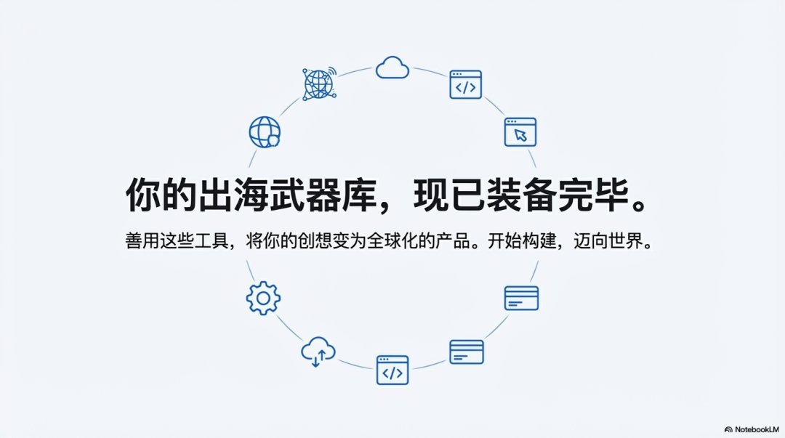

# 一个人独立跑完出海项目的完整工具链

> 从需求、原型、开发、部署，到数据分析、收款——一套覆盖全流程的工具清单。sitin 的结论：「这一套工具用熟了，从 0 到上线收款，不需要再求人。**出海的门槛，其实比想象中低。**」

<!-- more -->



*图 1：出海工具链整理图。*

---

## 工具清单

### 网站分析

| 工具 | 用途 |
|---|---|
| **GA4** | 看整体流量 |
| **Search Console** | 看关键词和收录 |
| **Plausible** | 轻量统计 |
| **Clarity** | 直接录屏分析用户行为 |

### 趋势和关键词

| 工具 | 用途 |
|---|---|
| **Google Trends** | 看方向热度 |
| **Keyword Tool** | 找长尾词 |
| **Keyword Planner** | 判断搜索量和商业价值 |

### 竞品分析

**Ahrefs、SimilarWeb、SEMrush**——能看流量结构、关键词、广告竞争。

### 开发与部署

| 环节 | 工具 |
|---|---|
| 代码 | GitHub |
| 前端部署 | Vercel |
| 后端 | Supabase 或 Railway |

### 设计与原型

**Figma** 画界面，配合三个快速原型工具做产品原型。

### API 与模型调用

**OpenRouter、Aigocode、Replicate、Together AI**——都能统一接入不同模型服务。

### 灵感与需求挖掘

**Product Hunt、Toolify、Reddit、GitHub Trending、Twitter**——每天刷一刷，都能看到新机会。

### 域名与 DNS

**Cloudflare + Namecheap**——稳定好用。

### 支付与订阅

**Stripe、LemonSqueezy、Paddle、Creem**——收款和订阅都能搞定。

---

## 这套工具链的结构解读

按「出海项目生命周期」重新排列，六个阶段各有主力工具：

```text
① 找机会  → Product Hunt / Toolify / Reddit / GitHub Trending / Twitter
② 找词    → Google Trends + Keyword Tool + Keyword Planner
③ 看对手  → Ahrefs / SimilarWeb / SEMrush
④ 做产品  → Figma + 原型工具 + OpenRouter / Replicate / Together AI
⑤ 上线    → GitHub + Vercel + Supabase / Railway + Cloudflare + Namecheap
⑥ 收钱看数 → Stripe / LemonSqueezy / Paddle / Creem + GA4 + Search Console + Plausible + Clarity
```

> **与本批其他文章的衔接**：
> - 「灵感与需求挖掘」五个源，正好是 [[sources/yaohongan-keyword-radar-workflow]] 中 Grok Bot 抓帖找词法的**同类替代方案**——不必依赖 AI 抓取，Product Hunt 与 Toolify 本身就是需求信号池；
> - 「趋势和关键词」三件套，与 [[sources/wavborn-keyword-screening-playbook]] 的 **Trends 比值法**是同一套思路的完整版：Keyword Tool 补长尾量级，Keyword Planner 判断商业价值；
> - 「支付与订阅」四个平台，与 [[sources/vinsin-hu-four-sites-four-roles]] 的主站角色直接对应——主站要赚钱，就得先选定收款通道。

---

## 相关页面

- [[sources/yaohongan-keyword-radar-workflow]] — 虹安：找词雷达工作流，2 天从买域名到出单
- [[sources/wavborn-keyword-screening-playbook]] — wavborn：选词三板斧与 72 组词验证率
- [[sources/vinsin-hu-four-sites-four-roles]] — 子正：4 个站不是 4 份工作，是 4 种角色
- [[sources/bozhou-overseas-path-warning]] — 泊舟：出海路径警示公告与变现门槛
- [[concepts/overseas-tool-stack]] — 出海工具栈全景：56 个实战工具按 7 大方向分类
- [[patterns/competitor-research-four-step]] — 竞品调研四步法
- [[patterns/analytics-four-piece-set]] — 数据分析四件套：GSC + GA4 + PostHog + Clarity
- [[patterns/payment-platform-selection]] — 支付三档选择：Lemon Squeezy vs Paddle vs Stripe
