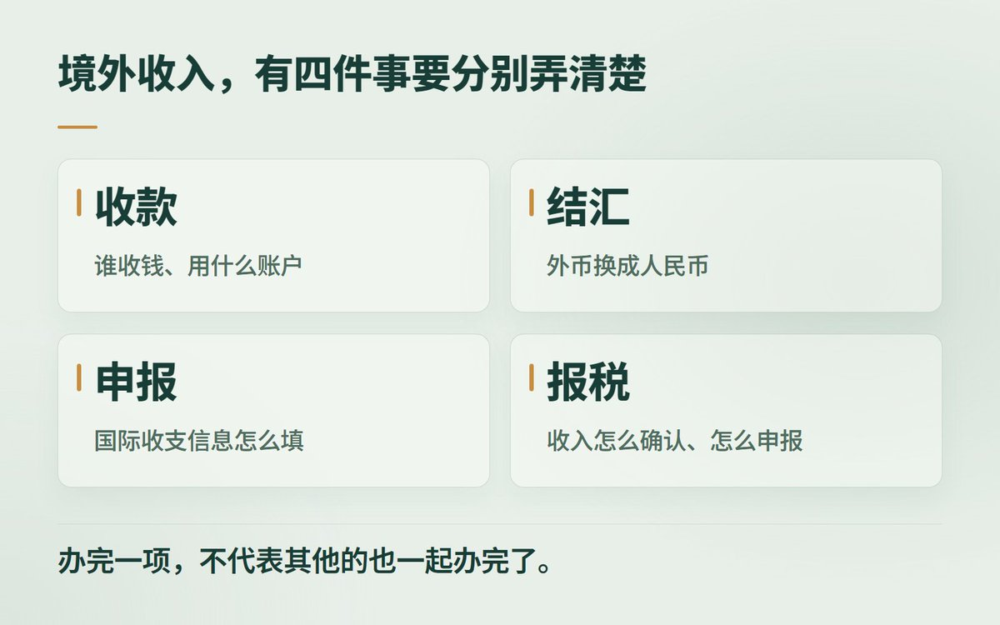
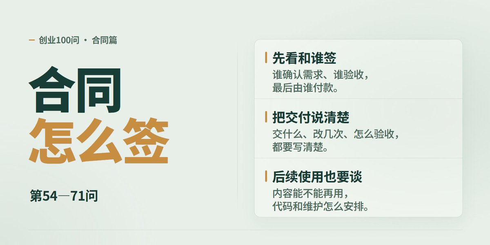
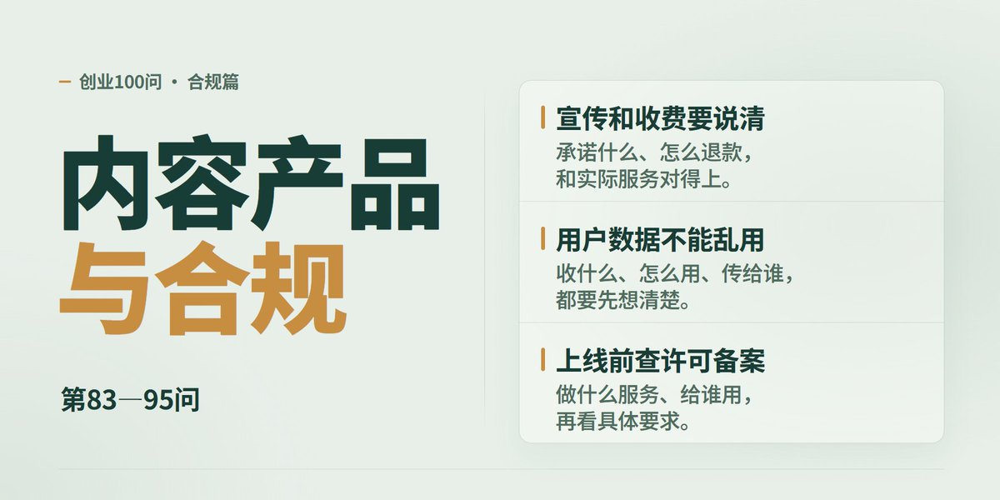
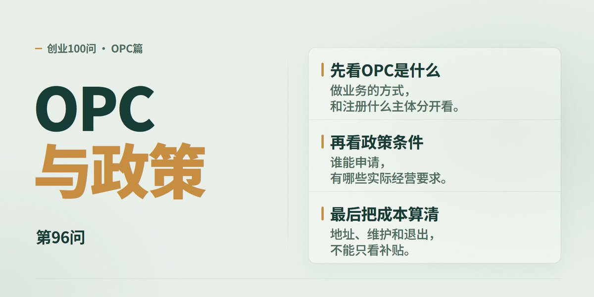
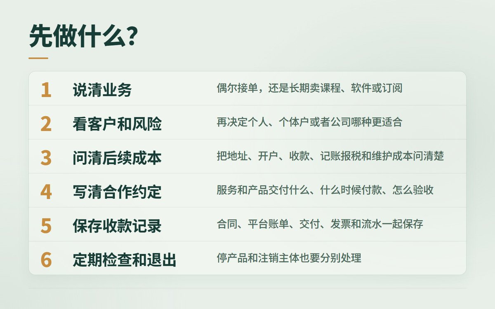

# 司徒 K（@situking）：创业百问百答——写给自媒体人和个人创业者（2.3 万字长文实战心法）

> 自媒体创作者与超级个体商业化实战 2.3 万字经验总结：系统回答个人创业 100 个核心高频问题，涵盖从主业副业权衡、最小可行性产品（MVP）验证、高客单价交付设计、私域流量池沉淀，到团队扩张阻碍与心力管理，提供全景认知与可落地的行动框架。

<!-- more -->

我创业十几年了，一直都是围绕企业服务来做业务，对公司创办、前期的一些流程，还有知识产权方面的问题都比较了解。

今年在推特上认识了很多优秀的自媒体人，有的是全职，有的是副业，大家都非常努力。推特上也有很多优秀的个人开发者，有的在做 AI 工具，有的在做软件、插件和自己的产品。

在私底下聊天的时候，我发现很多自媒体人对创业初期的一些问题还不是很了解。比如什么时候需要注册公司，收到钱以后怎么报税，和客户签合同要注意什么，自己的内容和产品又该怎么保护。这些问题，个人开发者在接项目、卖产品的时候也会遇到，我于是就写了这篇《百问百答》，希望能帮到在推特上做自媒体、做产品的朋友们。

这篇主要写给人在中国大陆开展业务的朋友。推特是大家认识和交流的地方，但真正要处理的，还是自己的业务、收款、财税、合同和知识产权，不是为了做推特就先办一堆证。

我把问题按创业的先后顺序分成了十类，大家可以结合自己现在的情况，先看需要的部分。有些事情要看当地要求，有些要看合同和实际业务，不能只看一个答案就直接照搬。

## 一、要不要注册公司（1—5）

## Q1. 做自媒体或者个人开发，刚开始就要注册公司吗？

这个要结合自己的业务情况来看，如果只是偶尔接一些商单、开发项目，收入还不稳定，可以先不用急着注册有限公司。但是还要看这类业务本身需不需要登记、办许可，以及客户有没有签合同、开票和对公付款的要求，不能只用收入多少来判断。如果准备长期做，就要把主体选择、后面的收款、记账报税和维护成本一起考虑进去，也不一定上来就注册有限公司，个体户是否够用也可以先了解一下。这里值得说一下，个体户的责任风险一定要考虑清楚，不能只看它注册和维护方便。

## Q2. 出现哪些情况，就应该认真考虑办一个公司了？

如果已经开始长期接单，有固定的报价、持续收费的课程或软件，或者准备招人，就要把注册和后面的维护一起考虑了。还有就是客户要求和公司签合同、走对公付款，或者收款平台要求提供经营主体资料，这些都会影响你怎么选。到底是不是已经需要办理登记，还得看你实际做的业务和这类业务的规定，不能觉得收入不稳定就一直不用办。决定之前，把客户要求、自己要承担的风险和后面的维护费用列出来，通常就比较容易判断了。

## Q3. 偶尔接一笔商单、咨询或开发项目，可以先用个人身份吗？

这类业务允许个人做，双方也接受的话，可以先用个人身份签合同，但做什么、多少钱、交付什么、什么时候付款，也一定要写清楚。如果境内付款方需要依法预扣个税，要提前问清楚怎么扣，客户需要发票的话，再了解当地自然人代开的流程。合同、交付记录、聊天和收款凭证都要保存好，不能觉得个人接单就不用留这些材料。客户没有扣税，或者钱是海外客户付的，也不代表这笔收入就不用管税的事。

## Q4. 注册个体户或者公司，是不是就能少交税？

这个不一定，要把收入、真实成本、要交哪些税，还有维护费用一起算。个人收入、个体户经营所得和公司利润，交税的方式不一样，公司赚了钱再分给个人，也还要算分给个人这一步的税。符合条件的小型微利企业，到 2027 年底有企业所得税实际负担 5% 的优惠，但行业、应纳税所得额、人数和资产这些条件要同时满足，这个 5% 也不是直接乘营业收入。业务规模不大时，注册和维护的费用，可能比你原来想省下的税还多。不能为了少交税，就把没有真实经营的个人收入硬放进个体户或者公司里，合同和实际业务还是要对得上。

## Q5. 有工作单位，业余做内容或者开发产品，要先注意什么？

首先看一下劳动合同和单位制度，重点看看兼职、保密、利益冲突，还有知识产权归谁这些要求。自己下班以后做的内容或代码，也不能因为“是在家做的”就觉得和单位没关系，还要看是不是工作任务、有没有用到单位的资源。如果是公务员、事业单位人员等，还要另外查清楚自己的身份有哪些限制。拿不准的，先和单位相关人员或者专业人士沟通清楚，不能换一个亲友的名字就觉得没有风险了。

## 二、个体户还是公司，怎么选（6—10）

## Q6. 个人、个体户、个人独资企业和有限公司，应该怎么选？

这个要从业务规模、客户要求和后续风险三个方面来考虑。如果就是一个人做业务，业务也比较简单，客户没有必须和公司签合同的要求，可以先了解个体户，但责任风险一定要考虑清楚。如果合作金额比较大，客户又要求公司主体，或者后面想招人、扩大业务、引入合伙人，就可以考虑有限公司。个人独资企业并不是只有一个股东的有限公司，投资人也要承担无限责任。后面的记账、报税和维护成本都要算进去，不能只看注册的时候哪个便宜。

## Q7. 个体户的无限责任，和有限公司的有限责任，具体差在哪里？

个体户如果是个人经营，债务一般要用个人财产来承担；如果是家庭经营，或者分不清是个人经营还是家庭经营，就要考虑用家庭财产承担责任的问题。有限公司通常由公司用自己的全部财产承担债务，股东以认缴的出资额为限承担责任。但也不是说注册了有限公司，个人就一定没有风险，没有履行出资义务、滥用公司独立地位，或者自己另外做了担保，都可能要承担额外责任。只有一个股东的公司，还要特别注意，公司财产和个人财产是分开的，这件事要能拿出证据来证明。

## Q8. 公司只有我一个股东，可以吗？是不是还要找人挂名？

有限公司可以只有一个股东，没有必要为了凑人数找别人挂名。只有一个股东时，需要由股东作出的决定，也要按要求留下书面记录，董事、监事怎么安排，要把公司法的要求了解清楚。规模较小或者股东人数较少的公司，可以依法简化这些安排，符合条件、全体股东也一致同意的，可以不设监事。财务工作可以依法交给代账公司，但不能交出去就没人管了，印章、银行和办税账号由谁使用、有什么权限，自己也要掌握。

## Q9. 先做个体户，以后业务大了，可以再转公司吗？

可以考虑，符合条件的个体户目前可以申请直接变更为企业，不一定都要先注销再重新注册。你当地能不能办、要准备什么材料，先向登记部门问清楚，税务、债权债务、年报，还有哪些情况会影响办理，也要一起查清楚。还有就是，转成公司，不代表原来个体户欠的债就自动变成有限责任，或者不用自己承担了。转成公司以后，记账、出资、公司财产怎么管、利润怎么分，这些都要一起考虑。原来的客户合同、发票、收款账户、商标和软件权利怎么转过去，也要一项一项处理，不能只换一张营业执照。

## Q10. 只有一个股东的公司，怎么证明公私财产分开？年度审计要做吗？

首先，公司账户、个人账户、账本和资产要分开，工资、报销、分红和借款都要有对应的手续和凭证。只有一个股东的公司，如果股东不能证明公司财产和自己的财产是分开的，就可能要对公司债务承担连带责任。公司每个会计年度末要编制财务会计报告，并依法请会计师事务所审计，这件事要提前安排，不能等发生纠纷了才想起来做。但有了审计报告，也不代表一定能免责，平时的账目、资金往来和实际经营记录都要做好。

## 三、公司注册与开户（11—17）

## Q11. 没有办公室，可以用住宅或者园区地址注册吗？

这个要看当地的登记要求，以及这个房子能不能用来做你的业务，各地不一定一样。住宅涉及改变用途、征得利害关系人同意这些问题时，要先把手续办好，不能直接拿自己的住址就去填。使用园区或者集中登记地址，要问清楚能不能收信、能不能配合银行和有关部门查验，以及续费、迁出和注销怎么收费。这个地址能办营业执照，不代表银行开户就一定没问题，定下来之前最好先和准备开户的银行沟通清楚。还有就是，对方有没有权把这个地址提供给你用，也要查清楚，不能只看第一年便宜。

## Q12. 我主要在推特上接业务，可以用 X 主页当注册地址吗？

不能直接把一个 X 主页当成注册地址，用网络经营场所登记也有条件，还要提供材料。只有账号截图、域名或者主页链接，登记部门不一定接受。目前没有查到全国统一接受 X 主页作为登记材料的官方依据，准备在哪里注册，就先问哪里的登记部门。最好同时了解一个真实、能使用也能联系到你的地址，避免业务已经开始了，地址却办不下来。

## Q13. 注册地址会有人核查吗？以后地址不能用了怎么办？

登记部门、税务部门和银行都有可能来查地址，是打电话、寄信还是上门，要看具体情况。地址不能用了，或者长期收不到信、联系不上人，就要及时办变更，不能一直放着不管。如果已经被列入经营异常，先了解是什么原因，补齐材料或者办好变更以后，再按流程申请移出。地址改完了，也要检查银行、税务和重要合同里的地址需不需要一起更新。

## Q14. 做内容、咨询、软件和 AI 工具，经营范围应该怎么写？

首先把自己准备做的业务列出来，再到登记系统里选对应的规范名称。商单、内容制作、技术咨询、软件开发和在线服务，可能要选不同的项目，不能因为都和 AI 有关，就全部写成同一种业务。结合近期的业务需要来填就可以，没有必要把不准备做的项目都加进去。还有就是，经营范围里写了这个项目，不代表需要的许可和备案就已经办好了。

## Q15. 代账公司说免费注册，应该先问清楚哪些事？

首先，你要多聊几家代账公司，对整体市场价格有一个了解，低于市场价太多的，大概率会有坑。免费注册包含哪些服务，是不是必须绑定代理记账，绑定多久、能不能提前解除，这些都要问清楚。涉及地址的话，要问清楚地址怎么收费，以及代理记账包括哪些工作，开票、年报、社保有没有额外费用。如果以后不合作了，账本、凭证和账号怎么交接，变更、注销需要多少费用，也要提前了解。还有开户银行怎么核验地址、账户有什么限额、境外收款有什么要求，这些最好都提前问明白，收费和服务承诺要写进合同，不能只听口头承诺。

## Q16. 注册资本填多少合适？认缴以后是不是就不用管了？

注册资本现在是认缴制，但不是认缴以后就不用实缴了，2024 年 7 月 1 日起新设的有限公司，一般需要在成立之日起五年内缴足。填写的时候，可以结合自己的业务需要和出资能力来定，没有必要上来就填得很高。如果公司不能清偿到期债务，还没到约定缴款时间的认缴出资，也可能被要求提前缴纳。以前成立的公司，还要另外了解过渡期怎么安排，特定行业也可能有另外的规定，不能全部照着新公司的五年期限来算。

## Q17. 第一次注册，从准备材料到能收款开票，怎么安排？

先确定主体类型、名称、经营范围和能使用的地址，注册公司还要确定股东、章程、注册资本，以及什么时候、怎么出资。材料准备好以后，通过当地企业开办平台办理登记，再把需要的刻章、办税、开户这些事办好。准备开票的，要先做好实名、权限和开票设置，记账报税从什么时候开始、由谁来做，也要安排清楚。各地有些环节可以一起办，最好先了解当地的流程，拿到营业执照以后，后面的事情也要接着办。

## 四、财税、记账和开票（18—37）

## Q18. 商单、咨询、课程、软件订阅这些收入，税务上都是一样的吗？

不一样，首先要看这笔钱是什么业务赚来的，以及是谁在提供服务。个人取得的收入，可能属于劳务报酬、稿酬、特许权使用费或者经营所得，不能只看到“平台分成”几个字，就决定按哪一种来交税。个体户和公司也各有各的记账、报税要求，软件开发、软件许可和在线订阅，不一定都按同一种方式处理。还有就是，符合条件的技术开发可以免增值税，有些软件产品也有先交税、再按规定退还一部分的优惠，但不是做开发、卖软件就一定能享受。把合同、交付内容和结算方式一起给会计看清楚，在报价之前就确认怎么处理，不要只按付款备注来判断。

## Q19. 客户已经扣过个人所得税了，我还要自己处理吗？

先看客户扣的是什么税、按什么项目扣的，预扣的钱不一定就是你最后要交的税。居民个人的工资、劳务报酬、稿酬和特许权使用费，属于综合所得的，要按规定合并计算，需要办理年度汇算的，一般在次年 3 月 1 日至 6 月 30 日办理。普通劳务和符合规定的平台从业人员，预扣方法还可能不一样，不能只记住一个“扣 20%”，就拿来算所有收入。平时把收入和扣税记录核对好，有疑问及时找付款方或者税务机关问清楚。

## Q20. 平台已经报送收入信息，是不是就不用我报税了？

平台报送了收入信息，不代表它已经替你扣税、报税，要看平台实际帮你办了哪些事。你还是要把平台结算单、银行流水和税务记录对一下，看看有没有漏报、重复，或者收入项目不对的情况。海外平台没有扣税，也不能直接理解成这笔钱在国内就不用管税了。至于 X 有没有实际向中国税务机关报送特定用户的信息，目前没有查到能据此下结论的官方公开材料，报不报税不能靠猜这个来决定。

## Q21. 没开发票，或者钱还在个人卡、平台钱包里，需要报税吗？

这笔钱要不要确认收入、什么时候申报，要看实际交易和税法的要求，不能只看有没有开发票、钱有没有提现。属于个体户或者公司的经营收入，要按规定记到账上；涉及增值税的，就算没开票，也要按纳税义务发生的时间来处理。平台钱包的余额、退款、手续费和到账情况都要留记录，避免后面只看到银行实际收到的钱，把前面的交易漏了。已经有实际收入，却为了省事一直零申报，这个不能做。

## Q22. 合同、收款账户和发票，应该怎么对应？

合同里是谁提供服务，实际是谁经营和交付，最后由谁收款、谁开票，这些之间的关系要能说清楚。公司业务尽量通过公司账户收款，个体户也要把经营收支和家庭日常开支分开管。客户委托第三方付款，或者平台统一结算，不一定有问题，但委托付款说明、结算单这些材料要保存好，把来龙去脉说明白。不能随便借朋友的主体开票，也不要为了收款方便，把自己的账户和营业执照借给别人。

## Q23. 没有注册主体，客户又要发票，怎么办？

可以先了解自己能不能申请自然人代开发票，通过电子税务局或者办税服务厅，按真实交易来办。购买方、金额和服务项目都要如实填写，不能为了少交税，把开发、咨询或者制作服务改成别的业务。2026—2027 年，按次纳税的增值税起征点是每次（日）不含税销售额 1000 元，有没有达到起征点、能不能享受优惠、怎么代开，都要结合自己的情况问清楚。还有就是，代开了发票，不代表个人所得税已经全部结清，最好在报价、签合同之前，就把这些事了解清楚。

## Q24. 公司或者个体户开数电发票，要另外付费吗？

通过电子税务局等官方渠道开数电发票，不需要另外向第三方购买开票服务。先把税费信息确认、实名和权限设置这些该办的办好，再按系统提示操作，有问题可以找主管税务机关问清楚。代账公司帮你开票，或者你另外买了开票软件，对方收的是这部分服务费，要看合同怎么约定。能开多少额度，也和实际经营、信用以及税务风险管理有关，不是有了账号就可以随便开。

## Q25. 发票上的项目，可以按客户要求随便填吗？

开票的项目不能乱填，它需要和实际提供的服务对应，也要和合同里约定的业务对得上。做内容制作、广告发布、技术咨询、软件开发、软件许可和在线订阅，不能全部为了方便开成一个项目。这里说的一致，是实际业务一致，不是要求发票上的规范名称和合同每一个字都一样。如果客户要求开一个和实际业务不符的项目，先把情况和会计沟通清楚，不能为了收款就直接照着开。

## Q26. 普票、专票有什么区别？客户要 6% 的专票怎么办？

普票和专票是两种发票类型，不能只看开哪种票，就决定交多少税，专票能不能抵扣，也要看客户是否符合条件。6% 是一般纳税人部分服务适用的税率，不是客户要 6%，小规模纳税人就能按 6% 开。一般纳税人和小规模纳税人怎么区分，还要注意年应税销售额 500 万元这个标准，它按连续不超过 12 个月或者四个季度的经营期来算，不是只看自然年，单位和个体户超过标准时通常要登记为一般纳税人。客户有明确的发票要求，最好在报价之前说清楚，再把业务、能抵扣的进项和维护成本算一下，看看需不需要调整纳税人身份。

## Q27. 小规模纳税人的增值税优惠，主要看什么？

2026 年 1 月 1 日至 2027 年 12 月 31 日，按月纳税的起征点是月销售额 10 万元，按季纳税的是季度销售额 30 万元，按次纳税的是每次（日）1000 元，这些金额都不含增值税。按次纳税时，一天有多笔应税业务，要按日合计；达到起征点后，原则上要按全部应税销售额算税，不是只算超出的部分。符合规定、本来适用 3% 征收率的业务，这段时间可以减按 1% 交，但销售或者出租不动产、转让土地使用权等，不能直接套这个优惠。如果客户要专票，你选择对这笔业务放弃免税，开专票的这部分也要按规定交税，不能觉得没到起征点就一定不用交。附加税费和“六税两费”减半这些优惠也要分别看，不能只看到一个 1%，就觉得这笔业务的税已经全部算完了。

## Q28. 给海外客户做内容或者开发软件，是不是不用交增值税？

客户在境外、用外币付款，不代表这笔服务就自动免税。能不能享受跨境服务零税率或者免税，要看具体做的是什么服务、实际在哪里消费，以及需要留哪些材料。境外客户不要中国发票，你也还是要按规定确认收入、记账和申报。合同、交付记录、结算单和收款凭证都要保存好，先和会计确认自己符不符合条件，再决定怎么处理。

## Q29. 个体户的经营所得税怎么算？成本能不能扣？

个体户的经营所得，一般用全年收入扣掉允许扣除的成本、费用和损失以后来算，适用 5%—35% 的超额累进税率。到 2027 年 12 月 31 日，个体工商户年应纳税所得额不超过 200 万元的部分，可以按规定享受减半征收个人所得税的优惠。这里说的是应纳税所得额，不是营业收入，这个优惠也不能直接套给所有个人独资企业。经营支出要真实、合理、和业务有关，合同、付款记录和凭证都要留好，不能拿个人消费来凑成本。

## Q30. 公司是自己的，公司的钱可以直接转给自己用吗？

公司的钱和个人的钱一定要分开，公司是自己的，但是钱也不能随便转出来用。常见的有工资、报销、分红，还有借款，不同情况的处理方式不一样，手续、凭证和涉及的税也都不一样。工资要有真实任职和合理依据，报销要对应真实经营支出，公司处理企业所得税以后，还要看有没有可分配的利润，向自然人股东分红通常还涉及 20% 的个税。借款也要写清楚用途、期限和归还安排，个人股东的借款到纳税年度终了后还没有归还，又没有用于企业生产经营的，还可能按红利分配计征个税。如果自己不懂，一定要先和会计沟通，不能等钱转完了再想怎么做账。

## Q31. 买 AI 模型、海外软件和云服务，能不能算经营成本？

如果确实用于经营，可以按记账和税务的规定处理，但不能只留一张扣款截图。订阅协议、订单、境外发票或者收据、付款流水，还有这些服务具体用在了什么业务上，最好放在一起保存。个人先替公司垫付的，也要按真实业务办理报销，不能把自己的日常订阅都放进公司。买境外服务还可能涉及代扣代缴等税务问题，长期购买或者金额比较大的，最好让会计提前确认。

## Q32. 电脑、相机、房租，还有在家办公的费用，怎么处理？

首先要分清哪些是做业务花的钱，哪些是个人生活支出，混在一起用的费用，要有合理的分摊依据。电脑、相机这些设备，做账时可能需要作为固定资产，算税时能不能一次性扣除，还要看你的主体和优惠条件。比如符合条件的企业，在 2024—2027 年新购进单位价值不超过 500 万元的设备、器具，有企业所得税一次性税前扣除政策，但不能理解成谁买了设备，都能一次报销完。房租、水电和网络费也要留下合同、账单和分摊说明，不能只要拿到一张发票，就全部算成经营成本。

## Q33. 公司注册以后一直没收入，还需要记账报税吗？

公司注册下来以后，就算持续没有收入，也没有开过发票，记账、报税这些工作也一定要正常做。没有收入不代表没有费用，日常经营的支出和凭证也都要保存好。能不能零申报，要结合具体税种和实际情况来看，不能觉得没有收入就直接全部填零。如果自己不懂，一定要找靠谱的代账公司；当然，有了代账公司，也不能什么都不管，要定期向他们了解申报情况。

## Q34. 找代账公司，除了价格，还要看什么？

在财务方面和税务方面，不该省的千万不要省，要先看对方有没有依法取得代理记账资格，以及有没有做过你这类业务。涉及海外收款、软件订阅或者平台结算的，要问清楚对方能不能看懂这些合同和账单，不能只会每个月帮你填零。申报、汇算、年报、凭证整理和交接分别由谁负责，哪些另外收费，都要写清楚。遇到“包核定”“固定极低税率”“返税一定拿到”这些承诺，要问清楚依据是什么、你的业务符不符合条件，不能只听销售怎么说。

## Q35. 拆成几个主体收款，或者以前漏报了收入，会有什么风险？

有多个真实做业务的主体，不一定有问题，但不能用没有实际业务的空壳来拆收入，也不能互相开没有真实交易的发票。发现以前有收入漏报了，先把合同、流水、平台结算和申报记录核对清楚，再找专业人员沟通需不需要更正。涉及欠税时，可能要补税和缴纳滞纳金，被认定为偷税等违法行为的，还可能被处罚，严重的也可能涉及刑事责任。已经收到税务通知的，要按要求配合并保存沟通记录，不能删账单、补造合同或者继续隐瞒。

## Q36. 全职做自媒体或者个人开发，社保怎么安排？

这个要结合你现在有没有劳动关系、是否雇人，以及长期在哪个城市生活来看。符合条件的个人，可以了解当地的灵活就业养老和医疗保险怎么交；公司真正雇用了员工，也要依法给员工办理社保。自己只是股东或者法定代表人，不代表所有情况下都自动有了劳动关系，还要看实际怎么任职、怎么用工。各地的缴费基数、待遇和要求不一样，先把能选的方式和费用问清楚，不要直接照搬网上一个固定比例。

## Q37. 应用商店、插件市场或者代售平台，只打来扣费后的钱，怎么记账？

首先要把订单收入、退款、平台佣金、代扣税费和实际到账分开核对，不能只拿银行最后到账的数字当全部收入。收入按总额还是净额来记，要看你和平台、客户之间是什么交易关系，以及你在业务中承担什么责任，不是平台扣了费用就一定按净额。应用商店、普通支付通道和代售平台的合同不一样，要把对应的结算规则给会计看清楚。平台账单、当时用的协议版本、结算期间，以及汇率按什么来算，这些都要保存好，退款跨月或者跨年时，也要能对得上。

## 五、境外收款和结汇（38—53）

## Q38. 收到 X 分成、海外商单或者软件销售款，先弄清楚什么？

首先，你要确定这笔钱对应的是什么业务，是平台分成、内容合作、咨询，还是软件许可或者订阅。再看是以个人名义还是公司名义签的合同，收款金额和频率怎么样，是偶尔合作，还是准备长期做。是否已经有海外账户或者海外主体，也需要一起了解，但不是有了这些就一定能直接收。合同、交付记录和收款凭证都要保存好，后面的结汇和报税也要考虑，不能只想着把钱收进来。

## Q39. 海外平台让我填税务资料或者 W-8 表格，应该怎么填？

首先要确认真正收款的是谁、属于什么税务身份，不能为了开通账户或者少扣税，就填一个和实际情况不符的身份。非美国自然人常见的是 W-8BEN，非美国实体常见的是 W-8BEN-E，但具体填哪张，还是要看自己的主体和税务分类。表格一般交给要求你填写的付款方或者平台，能不能申请税收协定待遇，也要看收入类型和自己是否符合条件。看不懂的地方，先找懂跨境税务的人问清楚，别照着别人的截图，把国家、地址和税号直接抄过去。

## Q40. 海外平台已经扣税了，国内还能抵免吗？

先看平台扣的是什么税，再看这笔收入按中国税法算境内所得还是境外所得，不能因为钱是海外付来的，就直接当成境外所得。符合规定的境外所得税，才可以按中国的抵免规则和限额处理，符合条件的超限额部分可以留到以后五个纳税年度内结转。平台手续费、支付费和销售税，不能直接当成已经交过的所得税来抵免。税单、付款明细和完税证明都要保存好，尤其是人在大陆提供服务、境外又扣了税的，先把具体情况和懂跨境税务的人说清楚，再确认怎么处理。

## Q41. 海外客户付款，应该收进个人账户，还是个体户、公司账户？

这个要看以谁的名义签合同、实际是谁提供服务、做的是什么业务，还有银行接受哪种收款方式，不能只挑收款最方便的账户。属于公司的业务，原则上就用公司的交易资料和账户来安排，不要长期把公司款项收进自己的私人账户。个人或者个体户收款，也要拿真实合同和业务情况问银行，不能只说一句“这是咨询费”，就认为肯定能收。签约以前把客户怎么付、银行要哪些材料、后面怎么结汇问清楚，省得钱到了，又解释不清这是什么款。

## Q42. 大陆主体收境外服务费，一般要准备哪些材料？

常见的有合同、订单或者平台结算单、交付和验收记录、付款通知，以及银行要求填写的申报信息。服务贸易单笔等值 5 万美元以下、含 5 万美元的收付款，原则上银行可以不审核交易单证，但资金性质不清楚等情况下，仍可能让你补材料，所以小额收款也要留好凭证。合同里写的业务、实际交付的内容和收到的款项要能对得上，有代理结算或者第三方付款的，也要把谁替谁付、为什么这样付说明白。第一次收款前就把资料和银行沟通好，不要等银行要求补充审核了，才临时到处找合同。

## Q43. 每年 5 万美元额度，是不是境外收款的上限？

不是，个人每年等值 5 万美元的便利化额度，主要涉及个人结汇和购汇，不是合法收入的收款上限，也不是免税额度。真实、合法的经常项目收入超过额度，可以按规定提交材料，让银行审核办理。还有国际收支申报，这和结汇额度是两回事。按现行规则，符合条件的境内居民个人，单笔涉外收付款不超过等值 1 万美元时，可以不用填写这笔款的申报信息，但银行仍要报送基础信息。收款、申报、结汇和报税这几件事要分别弄清楚，办完一项，不代表其他的也一起办完了。

## Q44. 海外工资、咨询费和产品收入，可以都收进同一张个人卡吗？

先把每笔钱是什么收入分清楚，再和银行确认用什么账户、要准备哪些材料，不能把所有海外收入都写成工资。也不是一听到咨询费，就一定要走某一种经营账户，外汇业务怎么分类，还是要看实际情况。属于经营性外汇的，要按规定通过经营账户等合适方式办理，公司款项也不能随便混进个人收入里。已经收在一起的，就按合同和结算记录逐笔整理清楚，不能为了好收款，出一份和实际业务不符的收入说明。

## Q45. 选择 PayPal、Stripe 这类收款通道，要比较哪些东西？

除了收款费，还要问清楚跨境附加费、换汇成本、提现费，以及退款、拒付和平台暂扣资金这些怎么处理。平台支持哪些开户地区、什么主体、哪些业务，身份核验需要什么材料，也要和自己的真实情况对得上。不同产品、地区和结算方式，收费可能都不一样，不能只看首页上写的一个费率。准备长期做的话，就拿一笔真实订单，从客户付款到自己提现，把全部费用算一遍，再看遇到退款或者审核时，自己能不能处理。

## Q46. 没有海外公司，可以直接开 Stripe 吗？

这个要先看平台当前支持哪些地区和主体，目前 Stripe 公开的直接开户支持地区中没有中国大陆，不能把大陆个人或者大陆公司直接开户当成通用办法。有香港账户，也不等于 Stripe 香港地区开户需要的条件就都满足了，其他地区同样要审核真实身份和经营情况。是否需要海外公司，要把银行、税务和后面的维护成本一起算进去，不能只为了收款就马上注册。借身份、填假地址或者买现成账户，这些不要做，后面资金出了问题，连申诉都可能很麻烦。

## Q47. 卖软件或者数字产品，用 MoR 代售平台有什么不同？

MoR 可以理解为平台在约定的交易里充当卖方，不是简单帮你收一下钱，具体负责什么，要看协议怎么写。它通常会处理付款、部分消费税、买家票据和退款等事情，但产品交付、知识产权、数据和售后，不一定都替你承担。选之前，把自己收款和平台代售的费用、支持地区、退款规则、结算时间比较一下，也要问清楚以后不用这家平台了，客户关系和数据能不能带走。还有就是，用了代售平台，国内主体的记账报税这些也还是要正常处理。

## Q48. 收款通道被冻结、留存资金或者遇到拒付，提前怎么准备？

从第一笔订单开始，合同、订单、交付、退款和客户沟通记录就要保存好，平台要材料的时候，你能拿得出来。业务类型、网站说明、开户资料和实际收款要对得上，业务规模变化比较大时，也要看看平台是否要求补资料。退款和暂时不能提现都会影响手里的资金，不要把所有待提现款都当成马上能用的钱。已经受限的，就走正式渠道申诉、补材料，不要换身份或者借别人的账户绕过审核。

## Q49. 自己的结汇额度不够，可以借家人朋友的额度吗？

不能为了绕过额度和真实性审核，把自己的收入拆给家人朋友再结汇。账户、收款码和身份资料也不要随便借出去，资金性质说不清楚，可能导致账户受限、接受调查，还可能有其他法律风险。真实收入超过便利化额度，就带上合同、收入证明和结算记录，问银行应该怎么办。别人说“大家都这么操作”，不代表你和家人的账户就没有风险。

## Q50. 海外客户想用 USDT 付费，能不能当普通外汇收？

我的建议是先让客户换成银行转账、跨境人民币或者符合条件的支付渠道，不要把 USDT 当成普通外汇收款。USDT 等虚拟货币没有法定货币地位，不能作为货币在市场流通使用，在境内开展相关兑换等业务也受到严格禁止，所以不能拿它当合规支付工具来安排收款。找陌生人换人民币、代收代付，或者用所谓的卡片提现，还可能碰到涉诈等问题，不能只看钱能不能到账。合同怎么写、收入怎么证明、账和税怎么处理，这些也都要考虑，不是换一种支付方式就不用管了。

## Q51. 钱已经在香港个人账户里，怎么汇回内地？

首先要说清楚这笔钱是怎么来的，是工资、服务收入、投资收益，还是其他合法资金，不同情况需要的材料和处理办法不一样。如果原本是公司业务，就要先弄清楚为什么收进了个人账户，不能直接当成自己的生活费汇回来。个人便利化额度不是所有收款的上限，真实经常项目超过额度，可以按要求提交材料办理。不要为了汇回来，把经营收入写成亲友赠与，也不要找陌生人对敲或者拆分转账。

## Q52. 什么情况下，才有必要考虑香港公司或者美国公司？

这个还是要结合业务需要来看，比如客户、合作伙伴或者平台有明确要求，而且现有主体确实满足不了。注册之前，把开户、会计、报税、年费、当地要求，还有以后退出的成本都问清楚，不要只看第一年的代办价。海外公司即使没有收入，也可能还有申报和维护的事情要做，它和自己个人、和大陆业务之间的关系，也要理清楚。如果只是偶尔接海外订单，可以先问清楚，用现有个人身份或者大陆主体能不能合规收款，再决定有没有必要另外设公司。

## Q53. 海外公司注册好以后，国内的税务就不用考虑了吗？

不能这么理解，你个人的税务居民身份、公司实际在哪里管理、国内外分别做了什么业务，都可能影响中国的税务处理。公司的销售款、付给个人的工资和分红，也要分清楚，不能都当成自己的钱混在一起。比如符合特定条件的、由外国人持有的美国单成员有限责任公司（LLC），可能仍有 Form 5472 等申报义务，不是没有美国所得税就什么都不用报。海外账户信息交换，也不是所有国家、所有账户都一样。设立之前，最好让国内和注册地的专业人员分别列清楚要办什么，再放到一起核对。

## 六、接单、卖产品，合同怎么签（54—71）

## Q54. 第一次和客户合作，怎么确认对方是谁、谁来付款？

首先看清楚和你签合同的是谁，境内企业可以通过国家企业信用信息公示系统等渠道，查一下登记信息和经营状态。通过代理商、MCN 或者中间人合作的，还要问清楚谁有权确认需求、谁验收、谁付款，出了问题找谁。付款方和签约方不一样时，要有说得清楚的原因，也要留下证明材料，不能只有一句“我们都是一起的”。金额比较大，或者需要你提前投入很多时间的，预付款和分阶段付款最好也一起谈好。

## Q55. 接商单、咨询或者开发项目，合同里最重要的是什么？

首先，你要看清楚签约主体是谁，合同里约定的服务和实际做的事情是不是一致。交付什么内容、什么时候交付、可以修改几次、怎么验收，这些都要写清楚，开发项目还要把功能范围和交付版本说明白。还有就是付款时间，是否有预付款，尾款什么时候到账，报价是否含税。内容发布以后品牌能不能二次修改、投流或者在其他平台使用，软件的使用权、源代码和后续维护怎么安排，也要提前约定。最后看一下保密、违约责任、解除合同的条件和争议处理，不能只看合作金额就直接签了。

## Q56. 报价的时候，哪些费用最好分开说清楚？

自媒体合作里的内容制作、账号发布、后续授权和付费投放，不一定是同一项服务，报价时最好分别说明。开发项目也一样，开发费、部署费、第三方接口费、维护费，还有新增需求的费用，都要结合实际情况说清楚。报价是否含税、开什么发票、后面增加服务怎么收费，也最好写进报价单或者合同里。哪些包含在这个价格里、哪些不包含，双方先说明白，不一定每一项都要单独收费。

## Q57. 预付款、尾款和源文件，应该怎么安排？

可以结合项目金额、合作情况和自己的前期投入，约定预付款和分阶段付款，不必全部做完了才收钱。内容项目可以按初稿、定稿和发布来安排，开发项目可以按需求确认、阶段交付和验收来安排。源文件、源代码、部署权限和完整授权什么时候交，也要提前写进合同，不能到了最后才临时增加条件。对方逾期付款能不能暂停，已经做的部分怎么算钱，取消合作怎么处理，这些最好一起说清楚。

## Q58. 客户一直改需求，怎么避免越做越多？

首先把要交付的东西写具体，内容的数量、格式和修改次数，软件的功能、接口和运行环境，都尽量说清楚。修正原有错误，和临时增加新需求，不是一回事，费用和工期也要分开考虑。怎么验收、多久给反馈、有争议怎么处理，提前约定好，不能只写一句“做到满意为止”。后面确实需要调整，就把要改的内容、新增的工作、价格和时间重新写清楚，让双方确认以后再往下做。

## Q59. 客户要求保证播放量、销售额或者 AI 效果，可以答应吗？

首先看这个结果是不是你能控制的，内容传播、客户销售和 AI 输出，都可能受到很多外部因素影响。如果实际只能保证按要求制作、按时发布或者交付约定功能，就把自己能做到的这些写清楚。确实要约定效果指标的，怎么统计、在什么条件下测试、预算多少、客户需要怎么配合，还有不达标怎么处理，都要提前说好。不能为了签下合同，先把自己控制不了的结果答应下来，后面再拿“平台问题”或者“模型问题”去解释。

## Q60. 品牌想二次修改、投流或者长期使用内容，怎么约定？

在第一次和品牌合作的时候，就要把后续怎么使用内容一起考虑进去。是否能二次修改、在哪些平台使用、能用多久、能不能投流或者转给第三方，都要提前说清楚，涉及你的肖像和声音也要单独注意。报价可以根据实际使用范围来定，没有一个适合所有合作的统一加价比例。原来只约定了一次发布，后面又增加其他用途，就应该重新确认授权和费用，不能默认所有权利都已经送给对方了。

## Q61. 做咨询、AI 方案或者技术服务，可以约定不保证结果吗？

可以先把服务范围、判断前提和不承诺的事情写清楚，比如你只是提供建议、方案，还是也负责实际执行。客户要提供哪些资料、最后由谁拍板、需要用到哪些第三方工具，也要提前确认。责任上限和免责条款，不是写上就一定有效，涉及故意、重大过失或者法律不允许免除的责任，不能靠一句声明全部免掉。过程中的资料、版本、会议纪要和客户确认都要保存好，只在最后写一句“仅供参考”是不够的。

## Q62. 只在微信或者邮件里谈合作，没有纸质合同，可以吗？

聊天、邮件和电子签约都可能成为证据，但要能证明是谁确认的，双方到底同意了什么。谁来签约、价格多少、交付什么、怎么验收、什么时候付款、怎么授权，这些重要的事情，最好放在一起让对方确认一次，不要散在几百条聊天里。完整的聊天上下文、附件、原始邮件和付款记录都要保存好，不能只留对自己有利的几张截图。金额大、周期长或者责任比较重的合作，还是建议把合同写完整，再用可靠的方式签署确认。

## Q63. 客户要求删稿、退款，或者说效果不好就不付尾款，怎么办？

先看合同里当时怎么约定的，内容要保留多久、怎么验收、有没有承诺效果、什么情况下能解除合同。原来只约定制作和发布，客户后来又要求达到某个销售结果才付款，就要把原来的约定拿出来核对，不用直接接受这个新条件。已经做好的内容、开发版本、发布记录、客户反馈和修改过程都要保存好，再谈是否退款、退多少，还有剩下的工作怎么办。金额比较大或者双方分歧很明显的，先找专业的人看一下合同，不要自己随口答应，后面反而更被动。

## Q64. 国内客户拖欠尾款，应该怎么追？

先把合同、交付、验收、对账、发票和付款记录整理齐，再正式催款，把欠多少、要求什么时候付写清楚。能谈分期的，也要重新确认每期金额、付款日期和违约怎么处理，不能一直等对方说“过几天再说”。申请支付令、仲裁还是起诉，要看手里的证据、双方有没有争议，以及合同怎么约定，不是所有欠款都能用同一种办法追。金额比较大、对方经营不好或者可能转移财产的，尽早和律师沟通，时效和后面的执行成本也要一起考虑。

## Q65. 海外客户约定 Net30，到了时间还不付，怎么办？

Net30 通常是从约定的起算点开始，30 天内付款，但从开票、收到发票还是验收开始算，要在合同里写清楚。签约前就要查清境外主体，约定适用哪国法律、有争议去哪解决、通知怎么送达，还有分阶段怎么付款，不能欠款了才想起来不知道去哪追。逾期以后先正式催款，能不能暂停后续服务，要看合同和适用法律，不能自己想停就停。后面追不追、怎么追，还要比较欠款金额、对方资产和跨境诉讼或者仲裁的成本，所以预付款和付款节点，最好在前面就谈清楚。

## Q66. 卖咨询、课程、会员和软件订阅，可以用同一份服务说明吗？

这些业务交付的东西不一样，不能只换个产品名称，就用同一份说明。咨询主要看服务范围和时间，课程、数字文件要说清内容和交付，会员和软件订阅还要考虑持续服务、使用期限和更新安排。付款前，就要让用户知道买到了什么、什么时候能用、哪些服务不包含，以及出了问题怎么处理。准备长期收费的产品，订单页面、服务协议和实际交付要一起检查，前面怎么宣传的，后面也要能对得上。

## Q67. 课程、数字文件或者软件账号，怎么证明已经交付？

订单、付款、开通通知、交付邮件、版本号和用户确认，可以结合自己的业务保存。课程可以留必要的观看或者参加记录，软件可以留账号开通、授权发放、版本交付和合理范围内的使用日志。但开通了权限，是不是就算完成了约定的服务，还要看合同，不能拿一张“已发货”截图就说全部交付完了。记录也不是越多越好，只留合理必要的内容，保存多久也要考虑清楚。

## Q68. 遇到退款、拒付或者投诉，应该怎么处理？

首先分清楚，用户是在向你申请退款，还是已经向支付机构发起拒付，两种情况的处理流程和期限可能不一样。收到通知后，把订单、协议确认、交付记录、使用情况和售后沟通准备好，在要求的时间内回应。确实没有按约定交付、产品有问题，或者依法应该退款的，就正常处理，不能把所有投诉都当成用户恶意找事。确实有伪造证据或者恶意拒付的，再走平台申诉或者法律途径，也不要公开用户的个人信息来施压。

## Q69. 找人外包剪辑、设计或者开发，合同要注意什么？

首先把工作范围、交付时间、怎么验收、费用多少、怎么修改这些写清楚，不能只约定一个总价。源文件、源代码、第三方素材怎么处理，成果权利归谁，也要提前明确，不是付了钱就一定取得全部权利。涉及客户资料、账号或者系统的，要写清保密要求和数据能怎么用，权限也只给完成工作需要的部分。最后把交接、收回权限和后续修复这些说好，不能合作结束了，重要文件和账号还都在外包人员手里。

## Q70. 软件说“买断”或者“终身版”，到底应该承诺什么？

首先把“买断”说明白，是一次付费取得某个版本的使用许可，还是也包含后续更新和持续服务，不能让用户各自理解。能用几个账号、几台设备，能不能商用、转让或者再分发，都要结合实际产品约定好。写“终身使用”之前，先把服务器、接口和维护成本算进去，自己到底提供哪些服务要说清楚，不能收完钱又单方面改成按年收费。产品依赖第三方服务的，也要提前讲清限制，以及服务中断后怎么处理，宣传页面和协议要一致。

## Q71. 软件交付以后，修 bug、维护和接口费用，怎么划分？

先说好交付时怎么验收，再把原有问题的修复、日常维护和新增功能分开，不能全部混在一起。维护多久、什么时间响应，包不包括部署和数据恢复，费用由谁承担，这些都要写清楚。用到了第三方模型、云服务或者接口的，调用额度多少、涨价怎么办、停服以后用什么替换，也要一起考虑。如果后面不继续维护，提前多久通知、怎么交接，还有哪些事情必须继续做，也要在合作的时候说好。

## 七、商标、版权和软件权利（72—82）

## Q72. 文章、课程或者产品里，能直接引用别人的图片、论文和代码吗？

首先，你要看清楚这些材料是从哪里来的、允许怎么用，不能觉得标了出处就什么都能用了。为了说明问题，做一些必要、适当的引用，和把整篇文章、整套课程或者大段素材放进自己的收费产品里，情况是不一样的。代码、图片、字体、音乐和数据集也要分开看，能不能商用、修改，要不要署名，能不能再提供给别人，这些都要问清楚。拿不准的，就先取得明确授权，或者换成自己制作的内容，不能觉得网上能下载就可以随便用。

## Q73. 用 AI 生成的文章、图片或者代码，一定有著作权吗？

这个要看具体做出了什么，还有你在里面做了哪些创作、选择和修改。用了 AI，不代表一定没有著作权，但也不能只因为自己输入了一段提示词，就觉得所有输出都受保护。提示词、修改过程、版本和源文件都可以保存好，以后需要说明自己的创作过程时，这些能用得上。还有就是，模型允许你使用输出，不代表它已经保证这些内容不侵犯别人的权利，准备商用的时候还是要检查。

## Q74. 用 AI 改写或者仿写别人的作品，是不是就不侵权了？

不能这么理解，换了表达方式，或者让 AI 处理了一遍，原来的权利问题也不一定就解决了。要看最后的内容有没有使用别人受保护的具体表达，不能只算重复了多少字，也不能只因为风格相似就直接认定侵权。事实、想法和具体表达要分开看，文章、图片、音乐和代码的情况也不完全一样。如果本来就是拿某个具体作品来改编、复制或者给客户做交付，最好先把授权问题解决，再往下做。

## Q75. 免费素材、字体、音乐和数据集，怎么确认可以商用？

先找到原始发布方，把完整的授权条件看清楚，不能只看下载网站写了一个“免费”。能不能商用、能不能改、要不要署名、能不能放进软件或者交给客户，这些都要确认。授权版本、下载记录和购买凭证也要保存好，以后页面变了，自己还能说明当时为什么可以用。来源不清楚，或者授权条件看不懂的，先不要放进客户交付和收费产品里，重新找一个授权清楚的，通常更省事。

## Q76. 用真人的照片、脸或者声音做 AI 内容，需要征得同意吗？

如果能认出具体是谁，尤其是用来做广告、商业推广，或者合成一段像是对方在说话的内容，通常要先把授权拿到。用在哪里、用多久、通过哪些渠道发布、会不会用于 AI 合成，这些都要说清楚，不能拿到一份普通的拍摄同意，就觉得后面怎么用都可以。别人公开发过的照片、网上能找到的声音，也不代表你就可以随便拿来做商业内容。还有个人信息、名誉以及一些特殊使用情况要另外考虑，拿不准的，先不要用。

## Q77. 自己训练或者微调模型，可以直接抓网上的内容吗？

公开能看到，不代表就可以随便抓取、保存，再拿去训练模型。文章、图片、代码和对话里，可能涉及别人的著作权、个人信息或者商业秘密，网站和数据提供方也可能规定了使用条件。尽量用自己有权处理、已经取得授权，或者明确允许用于这类训练的数据，并把来源和授权记录保存好。如果后面准备收费，或者给客户交付，数据来源说不清楚的部分一定要先处理，不能等产品上线以后再补。

## Q78. 产品里用了开源代码、模型或者第三方 API，要检查什么？

首先，把产品里用了哪些代码组件、模型和服务列清楚，版本也一起记下来，再逐个看授权或者服务协议。能不能商用、要不要署名或保留声明、什么情况下需要提供源代码、能不能再分发，都要结合具体的授权条件和你的用法来看。第三方 API 还要问清楚调用限制、数据怎么用、能不能转售，以及停止服务以后怎么办，这些和下载一份开源代码是不一样的。这些记录要跟着项目一起保存，不能只听说“这是开源的”，后面就什么都不管了。

## Q79. 自己的文章、课程、提示词或者代码被搬运了，怎么办？

先把原稿、源文件、创作记录、发布时间，还有对方使用的页面保存好，比较重要的情况，可以考虑用更可靠的方式保全证据。然后看对方用了什么，是受保护的具体表达、软件代码，还是不一定能由你独占的方法和想法，这些情况的处理方式不一样。结合实际损失，可以先考虑平台投诉、联系对方停止使用，也可以找律师发函或者起诉，不用每次都走到最重的一步。对于没有公开的提示词、流程和技术资料，平时也可以通过保密协议、限制访问权限等方式来保护，不一定只靠著作权。

## Q80. 账号名、课程名和产品名，什么时候考虑商标保护？

首先，你要查一下准备使用的名字有没有相同或者近似的商标，但查不到也不代表后面一定能够注册成功。真正准备长期使用的账号名、课程名或者产品名，要结合自己的业务，把需要保护的类别提前考虑好，没有必要不分情况全类都报。还有就是，自己写的文章、做的课程和开发的产品，要保存好原稿、创作记录、版本和发布记录，有需要时再通过登记等方式补充保护。域名、邮箱和重要账号放在谁的名下、由谁掌握，也要一起安排好，不能业务做起来以后才发现关键的东西都在别人手里。

## Q81. 委托别人开发，或者两个人一起做产品，源代码和成果归谁？

这个最好在开始之前就写清楚，不能觉得谁出钱，或者谁写代码，全部权利就一定归谁。委托别人开发软件，如果没有书面合同，或者合同里没有明确约定，著作权通常归受托开发方；两个人合作开发，则要看合同怎么约定、实际怎么共同开发，不能随便认定全部权利都归自己。项目里新写的代码、原来就有的代码、通用组件和第三方开源部分，要分开说清楚，各自以后还能不能继续使用，也要约定。还有就是，交付了源代码，不代表全部著作权就自动转让了，能不能使用、修改、许可别人使用、再分发，以及退出以后怎么办，都要一起确认。

## Q82. 做软件必须先办软著，才能收费吗？

不是所有软件都必须先办软件著作权登记，才能开始收费，而且办了软著，也不能代替该办的经营许可、备案或者其他手续。登记可以作为证明权利和申请项目的材料，有些客户合作、平台入驻或者政策申请，也会要求提供。要不要现在就办，可以结合产品是否稳定、权利归谁有没有说清楚，还有自己的业务需要来定。申请之前，先把代码来源、合作开发约定和版本材料整理好，不能觉得登记在自己名下，第三方代码的权利问题就都解决了。

## 八、内容、软件和用户数据的合规（83—95）

## Q83. 课程、数字文件和软件，能不能写“售出概不退款”？

不能靠这一句话处理所有情况，首先要看卖的是什么、卖给谁，还有实际怎么交付。部分在线下载的数字化商品，可能属于法律规定的不适用七日无理由退货的情况，但这不代表虚假宣传、产品有质量问题，或者根本没有交付，也可以一律不退。咨询、训练营、会员和持续提供的软件服务，还要看已经做了多少、合同怎么约定，以及这类业务具体有哪些规定。付款之前，把交付内容、使用期限、退款条件和联系方式说清楚，也不能通过不合理的格式条款，把用户的主要权利都排除掉。

## Q84. 宣传课程或者工具时，能说保证赚钱、保证学会吗？

你宣传的内容，一定要和实际能提供的功能和服务一致，不能为了成交，就把自己控制不了的收入和效果也保证了。用户反馈和测试数据都要真实，该取得授权的也要先取得；如果属于教育培训广告，不能保证培训效果，也不能拿学员等受益者的名义或者形象来做推荐、证明。金融、医疗等业务还有更具体的广告和资质限制，要单独问清楚。前面把效果说得很满，后面再加一句“效果因人而异”，也不一定就能解决误导的问题。

## Q85. 软件订阅、会员和自动续费，哪些地方要提前说清楚？

用户付款之前，就要能看清多少钱、用多久、包含哪些服务、怎么续费，还有怎么取消，自动续费也要由用户自己选择，不能默认勾选。开通自动续费之前和扣费日期之前，要按规定明显提醒用户；App 服务还要看自己是否需要提前五日提醒，这些具体要求不能漏掉。取消入口也要方便找到、方便操作，不能开通很容易，取消却要绕很多不相关的步骤。以后准备涨价、减少权益或者停止服务，也要先看合同约定和这类服务的规定，不能先把钱扣了，再通知用户。

## Q86. 在推特上发 AI 生成内容，是不是都必须按国内规则打标签？

这个要先看你只是发布内容，还是自己在做一个提供 AI 生成服务的产品，再看服务给谁用、平台有什么要求，以及涉及哪些地区的规定。国内的 AI 生成合成内容标识规则有具体的适用范围，不能只因为人住在大陆，就直接套到每一次推特发布上。推特现行的内容规则也要另外看，国内要求和平台要求不是一回事。还有就是，涉及合成真人、虚构事件，或者容易让人误认的内容，该说明的要说明，该取得授权的也要处理好，不能故意让别人以为是真实记录。

## Q87. AI 写错事实、做了虚假测评，责任能推给模型吗？

自己发布或者交付的内容，不能只说一句“这是 AI 写的”，就把责任全部推给模型。涉及具体的人、企业、产品，尤其是负面评价，一定要核对事实、保存依据，不能拿模型编出来的内容当成已经发生的事情。发现写错了，要及时更正，再根据影响决定是不是需要下架、通知相关的人。客户和模型服务商分别负责什么，可以在合同里进一步说清楚，但自己该核对、该注意的事情也还是要做。

## Q88. 客户的合同、代码和内部资料，能直接丢给 AI 吗？

首先，你要看客户有没有授权、保密条款怎么写，涉及个人信息的，还要确认有没有合法的处理依据，不能觉得是为了给客户干活，就什么都能上传。工具会不会保存输入、会不会拿去训练、数据在哪里处理、哪些人能看到，这些都要了解清楚。能去掉身份信息、少传几个字段，或者只提供必要片段的，就不要把整份资料传上去，但也不能觉得删掉名字就已经完成了匿名化。客户明确不允许外传，或者风险确实控制不了的，就用客户认可的环境或者其他合适的方案，不能为了方便先传了再说。

## Q89. 做财经、医疗、法律内容，或者相应的 AI 工具，要特别注意什么？

首先要分清楚，你只是介绍一般知识，还是已经在提供需要资质、许可，或者承担专业责任的具体服务。不能让 AI 编造结论，也不要把没有核实的输出，包装成专业诊断、投资建议，或者针对具体案件的确定意见。如果会影响用户的重要决定，就要把工具能做什么、不能做什么，还有自己的服务范围讲清楚，该请专业人员复核的也要安排。不能觉得最后加了一句“不构成建议”，前面实际做了超出范围的业务，就没有责任了。

## Q90. 收品牌费或者返佣做推荐，哪些地方要核查？

首先，你要了解清楚合作方和产品，宣传材料里的效果数字、用户案例、对比结论，都要核实，不能客户给什么就照着发。收了推广费、佣金等利益，就要按这项业务涉及的广告规定和平台要求，把商业关系说明白，不能故意装成没有利益关系的独立推荐。如果适用国内互联网广告规则，测评、体验分享这类内容又附了购买链接，还要按要求显著标明“广告”，只写一句模糊的合作说明是不够的。金融、医疗、保健等业务，还可能涉及资质、广告审查或者推广限制，也要单独问清楚。拿不准的合作先不要接，不能只看这一单给多少钱。

## Q91. 收集邮箱、手机号和客户名单，需要注意什么？

业务真正需要哪些信息，就收哪些，并且提前告诉用户为什么收、怎么用、保存多久，还有想行使查询、删除等权利时怎么联系你。以后想把咨询名单拿去发广告、交给合作方，或者用在新的产品里，也要重新看是否符合要求，不能觉得对方以前给过一次，就什么用途都可以。谁能查看、谁能导出，也要管好，外包人员不需要知道的内容，就不要整份发给对方。名单不是收得越多越好，已经不需要，或者按规定应该删除的，也要及时安排处理。

## Q92. 用海外 CRM、邮件工具或者 AI 服务，会不会涉及数据出境？

如果在境内收集和产生的个人信息传到了境外，或者允许境外的机构、个人查询和调用，就可能涉及数据出境，不能只看自己有没有手动上传文件。先弄清楚传的是什么数据、涉及多少人、有没有敏感信息、在哪里处理，还有服务商能看到和使用哪些内容。告知用户、取得单独同意、做个人信息保护影响评估这些要求，要先结合自己的情况问清楚。至于要不要做数据出境安全评估、订立标准合同或者办理认证，再单独看适用条件和豁免，不能统一说都不用，也不能一上来就认为全部都要办。还有就是，对客户承担的保密义务也要单独考虑，不能觉得自己是小团队或者个人开发者，就没有这些责任。

## Q93. 做网站、App、插件或者 SaaS，是不是都要办许可证？

这个要看实际提供什么服务、部署在哪里、给谁用，以及怎么收费，不是叫网站、App、插件或者 SaaS，就都对应同一张许可证。用境内服务器提供互联网信息服务，要注意网站备案等要求，App 也有备案制度，但备案和经营许可不是一回事。收费软件不等于一律需要 ICP 许可证，如果做的是经营性互联网信息服务、特定电信业务，或者其他有专门监管要求的内容，也不能只办个备案就开始经营。上线之前，把产品功能、收费方式、部署地点和用户范围列清楚，再找主管部门或者专业人员确认，不能觉得服务器放到海外，这些事情就都不用管了。

## Q94. 我的 AI 产品只是调用别人的 API，还需要做合规吗？

用了已经备案的模型，不代表自己的应用就什么手续都不用办了，但也不能直接认定自己必须和底层模型办同一套手续。要看产品是不是面向境内公众、具体提供什么功能，还有是否涉及舆论属性或者社会动员能力等条件，再确认该办哪些备案、登记。属于规定范围、直接调用已备案模型能力的应用或者功能，还要向属地网信部门确认登记要求，不能拿底层模型的备案号当成自己的登记。内容安全、生成内容标识、用户数据和第三方服务条款，也要一项项看，不能只检查接口能不能调通。做陪伴、医疗或者其他特殊场景，还可能有额外要求，最好在上线和收费之前就问清楚。

## Q95. 产品会保存用户的提示词、文件和日志，应该怎么管理？

先把哪些数据必须保存、哪些可以不收、哪些用完就能删除想清楚，不能因为技术上方便，就一直留着。用户协议和隐私说明一定要和实际做法一致，包括会不会传给第三方模型、保存多久、会不会拿去训练，以及用户怎么删除或者导出。账号权限、备份、故障排查，还有万一泄露以后怎么处理，都要提前安排，日志里面也可能有个人信息和客户秘密。如果符合小型个人信息处理者的条件，可以了解有没有能适用的简化措施，但手续简化，也不代表用户数据可以不保护。

## 九、OPC 和政策怎么判断（96）

## Q96. OPC 是一种新的公司类型吗？园区和补贴值得为了它专门注册吗？

现在大家说的 OPC，更多是在讲一个人借助 AI、工具和外包来做业务的方式，大陆并没有因此新增一种统一的登记主体，也不能直接等同于法律上只有一个股东的有限公司。真要注册，还是要结合自己的业务，看看个体户、个人独资企业或者有限公司，哪种更合适。看到园区、社区或者补贴政策，先找正式文件，把谁能申请、有效期到什么时候、对实际经营有什么要求、补贴什么条件下能拿到问清楚，再把地址、迁入、维护和退出的成本一起算进去。不能只听“入驻就有补贴”，也没有必要为了 OPC 这个名字就先注册公司，承诺找不到明确依据的，先不要当成肯定能拿到的好处。

## 十、暂停、退出和后续维护（97—100）

## Q97. 一个人做业务，哪些资料和账号需要一直掌握在自己手里？

合同、发票、账本、付款记录、素材授权、源文件和开发版本，最好按项目整理好，并且定期备份。域名、邮箱、收款账户、商标和重要系统权限，也要弄清楚是放在自己还是经营主体名下，不能全部放在代办或者合作人员的个人名下。需要让别人操作的，可以给他必要的权限，但以后怎么找回账号、怎么交接、怎么收回权限，自己一定要能处理。换代账、换外包、转让产品或者注销的时候，这些资料都可能用得上，不能等到要交接了才到处找。

## Q98. 注册以后，每月、每季度和每年主要检查什么？

平时要核对合同、收款、开票、成本和往来款，按自己的申报周期正常申报，凭证也都要保存好。每年还要看自己注册的是什么主体，把所得税年度事项、公司财务报告和审计，以及市场监管年报这些安排好，上一年度的市场监管年报通常要注意在次年 1 月 1 日至 6 月 30 日报送。地址、银行账户、联系电话、社保，还有商标和域名什么时候到期，也要定期检查。可以和会计一起做一张维护日历，哪些办完了、哪些还缺材料，自己要看得到，不能完全等别人来提醒。

## Q99. 软件或者课程不继续卖了，直接下架就可以吗？

下架只是停止新的销售，之前收过的钱、答应过的服务，还是要处理好。先看还有多少订阅、预付款、长期授权和没交付完的内容，再按合同约定和这类业务的规定，安排通知、退款或者继续服务。用户数据怎么导出、保存和删除，如果产品转给别人，后面谁继续履行原来的承诺，也要一起说清楚。服务器、域名、接口和支付通道不要一上来就全部关掉，至少先把售后、退款和必要的交接处理好，再结束这些服务。

## Q100. 公司暂时没业务，和以后都不做了，分别怎么办？

如果后续确定不用这家公司了，那就尽早把注销安排起来，但也不能觉得营业执照注销了，之前的问题就都没有了。如果只是暂时没有业务，记账、报税和年报这些也需要正常做，其他该做的维护也不能漏，是否符合歇业条件可以另行了解，但不能把歇业理解成所有义务都暂停了。退出之前，一定要对公司的债权、债务、税务、员工事项、客户预付款，还有没有履行完的合同，做一个全面的了解，产品下线和用户数据怎么处理也要一起考虑。后面的账户、印章怎么处理，资料怎么保管，也要按要求做好，不要直接失联，或者把执照和账户卖给别人。如果自己不懂，还是建议先找专业的会计、律师或者靠谱的代办机构沟通。

## 先做什么：简版决策流程

1. 先把业务说清楚。 你是偶尔接商单、做咨询和开发项目，还是准备长期卖课程、软件或者订阅；客户在境内还是境外，有没有登记、许可和平台要求。
2. 再看客户和风险。 客户要不要主体签约、发票和对公付款，合作金额有多大，出了问题可能承担什么责任，再决定个人、个体户或者公司哪种更适合。
3. 注册前先问后续。 把地址、开户、收款、记账报税和维护成本问清楚，再确定主体和注册资本，不要只看能不能免费注册。
4. 第一笔合作就把约定写清。 服务和产品交付什么、什么时候付款、怎么验收、能不能退款，以及内容、代码和后续使用权怎么安排，都要提前说好。
5. 收款以后把记录跟上。 合同、平台账单、交付、发票和流水一起保存，境外收入还要分别考虑收款、结汇和税务，不能只看到钱已经到账。
6. 长期做就定期检查，不做了就处理退出。 财税申报、年报、账号、商标和用户服务不能一直放着不管，停产品和注销主体也要分别处理。

## 最后再提醒几句

我觉得最容易踩的坑，就是前期只想把业务做起来，财税、合同还有商标保护这些以后再说，等出了问题的时候再去补，一般都很被动。

所以在最开始接单、准备卖产品的时候，一定要把主体、收款、开票、合同和知识产权保护这些一起考虑好。前期可能几百、几千块钱解决的问题，后面可能会用几倍甚至几十倍的资金去弥补。

不用一开始就把所有事情都办完，但哪些现在要办，哪些可以后面再做，自己心里一定要清楚。拿不准的，提前找专业的人沟通，通常比出了问题以后再补救更容易处理。

## 关于我

我是司徒 K，创业十几年了，目前在经营技术营销公司、传媒公司和知识产权公司，业务一直围绕企业服务来做。

公司创办、创业初期的一些流程，还有知识产权方面的问题，都是我比较熟悉的。写这篇百问百答，也是希望把这些年积累的一些经验分享出来，帮助做自媒体和个人开发的朋友，少走一些弯路。

如果你在公司注册、财税、合同或者知识产权这些方面有疑问，可以在评论区提出来，也可以私信我。对这些内容感兴趣的朋友，也欢迎关注我。

## 相关页面

- [[sources/svwang-wealthy-entrepreneurs-path-dependency-and-waiting]]
- [[sources/xiaoniaoziming-lie-down-income-system-20-to-now]]
- [[concepts/selfmedia-compound-model]]
- [[concepts/b2c-conversion]]
