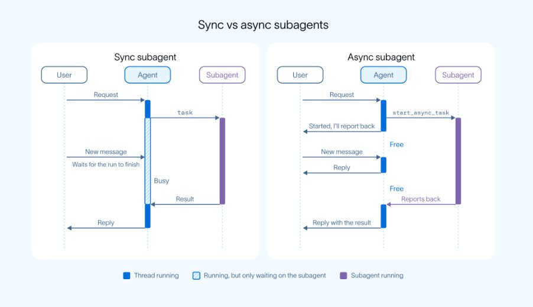

# Smartpig（@Smartpigai）：LangChain 提出未来强 Agent 必须学会异步工作

> 解读 LangChain 的新观点：未来真正强大的 AI Agent 必须学会异步工作，这可能是被低估的转折点。指出传统交互范式（提出任务 → 等待结果 → 再提下一个）的结构性缺陷——AI 执行复杂任务时无法及时响应新需求（如分析 100 份报告要 20 分钟，期间想补充要求或并行整理竞品数据就只能干等）；并给出异步 Agent 的设计要点与工程实现路径。

<!-- more -->

LangChain 最新提出一个观点：未来真正强大的 AI Agent，必须学会异步工作。

这可能是 AI Agent 发展中一个被低估的转折点。

过去，我们与 AI 的交互基本都是这样的：

提出一个任务 → AI 开始执行 → 等待结果 → 再提出下一个任务。

即使背后的模型再聪明，这种工作方式依然存在一个明显的问题：

当 AI 正在执行复杂任务时，它往往无法及时响应你的新需求。

比如，你让一个 AI Agent 分析 100 份行业报告。

它可能需要 20 分钟才能完成。

但在这 20 分钟里，如果你突然想补充一个要求，或者希望它同时整理竞争对手的数据，怎么办？

在传统的同步执行架构中，主 Agent 可能被长时间运行的工具调用或子 Agent 阻塞。

新任务只能等待。

这显然不是一个理想的智能助手。

而 LangChain 正在尝试改变这种工作方式。

01｜从同步执行到异步 Agent

LangChain 在文章《Agents Are Going Async》中介绍了 Deep Agents 的异步子 Agent 架构。

核心思路其实很简单：

让一个主 Agent 负责沟通和协调，让多个子 Agent 在后台独立执行任务。

主 Agent 不需要等待每个子任务完成，就可以继续与你交流、接受新指令，甚至启动更多任务。

例如，你让 AI 完成一个软件开发项目：

① Agent A：研究技术方案

② Agent B：编写后端代码

③ Agent C：设计前端界面

④ Agent D：运行测试并检查问题

这些任务可以在适当条件下并行推进。

与此同时，主 Agent 仍然能够回答你的问题、查看执行状态，并根据新要求调整任务。

这与传统的「AI 接到任务后一直运行，直到返回结果」有很大区别。

它更像一个项目经理，负责协调多个专业成员。

02｜Agent 不再只是执行任务，还要能够被实时管理

这次更新中，LangChain 提供了五个关键操作：

① start_async_task：启动后台任务

② check_async_task：查看任务状态和结果

③ update_async_task：向运行中的 Agent 发送新指令

④ cancel_async_task：取消正在执行的任务

⑤ list_async_tasks：查看所有任务及状态

最值得关注的是 update_async_task。

因为现实工作中的需求，经常会在执行过程中发生变化。

比如你原本让 Agent 使用 MySQL 开发项目。

任务执行到一半，你决定改用 PostgreSQL。

传统工作流可能需要等待当前任务结束，或者重新启动整个流程。

异步 Agent 则允许主 Agent 在任务运行时下发修改指令。

LangChain 提供两种处理策略：

① Interrupt： 中断当前执行，并根据新要求重新开始。

② Enqueue： 先完成当前任务，再处理新指令。

这意味着 AI Agent 不只是能够接收任务，还开始具备持续接受管理和调整的能力。

03｜后台任务完成后，AI 可以主动继续工作

另一个重要变化，是异步任务通知机制。

过去，很多 Agent 系统需要不断轮询任务状态，才能知道某项工作是否完成。

LangChain 的方案允许后台子 Agent 在完成后主动通知主 Agent。

根据主 Agent 的当前状态，系统可以采取不同方式处理：

① 如果主 Agent 正在执行其他任务，可以在后续步骤中接收结果。

② 如果主 Agent 处于空闲状态，后台任务完成后可以触发它继续运行。

③ 如果流程正等待人工审批，系统会保留审批状态，避免后台结果打乱当前交互。

这使得 Agent 更适合处理持续时间较长、存在多个依赖关系的复杂工作。

例如深度研究、代码开发、数据分析和多步骤业务流程。

04｜为什么这可能比模型能力升级更重要？

我认为，过去几年 AI Agent 的发展，过度关注了一个指标：

单个 Agent 能完成多复杂的任务？

但在真实工作环境中，另一个指标可能同样重要：

一个 AI 系统能同时推进多少任务，并且让用户始终保持控制权？

想象一下未来的工作方式。

早上，你让 AI 开始分析市场数据。

随后，它在后台整理报告、编写代码、运行测试。

你可以随时查看进度，追加要求，取消不必要的任务。

等某个阶段完成后，AI 再主动汇报结果，等待你确认下一步。

这不再是传统意义上的聊天机器人。

而是一个可以持续协调工作的智能系统。

当然，异步执行不意味着无限并行。

多个 Agent 之间仍然可能存在资源竞争、上下文不一致、任务依赖、权限冲突和成本增加等问题。

后台运行得越久，对状态管理、可观测性、任务恢复和人工审批的要求也越高。

异步架构解决的是任务阻塞问题，不代表 Agent 的可靠性问题已经全部解决。

05｜AI Agent 的竞争正在进入新阶段

我认为，AI Agent 正在经历三个阶段：

① 第一阶段：AI 回答问题

用户提问，模型生成答案。

② 第二阶段：AI 执行任务

模型调用工具、修改代码、搜索资料，完成指定工作。

③ 第三阶段：AI 协调任务

主 Agent 负责理解目标、分配工作、跟踪进度和处理异常，多个子 Agent 并行执行不同任务。

LangChain 的异步子 Agent 架构，正是第三阶段的一种实现方式。

而且，这并不是 LangChain 独有的方向。

Claude Code 等 Agent 产品也在探索后台任务和多 Agent 协作。

这背后有一个共同趋势：

AI 正从被动响应指令的工具，逐渐变成能够持续工作的任务执行系统。

06｜我的判断：下一代 Agent 的竞争，不只是模型智力

未来最有价值的 Agent，未必是单次回答最聪明的那个。

而可能是那个能够：

① 持续推进复杂目标。

② 同时处理多个独立任务。

③ 接受人类随时调整方向。

④ 清楚地报告任务状态。

⑤ 在出现问题时安全地暂停、恢复或交还控制权。

过去，我们关注 AI 能不能替我们完成一件事。

未来，我们可能更关注：

AI 能不能同时管理十件事，而我们只需要负责关键决策？

从 Synchronous Agent 到 Asynchronous Agent。

这看起来只是执行架构的变化。

但它可能正在改变人类与 AI 协作的基本方式。

过去的 AI 更像一个执行者。

你给它任务，它完成后返回结果。

未来的 AI 则可能更像一个项目负责人。

它能够拆解复杂目标、协调多个执行者、跟踪任务状态，并在必要时主动请求人类决策。

真正重要的变化，不是让一个 Agent 同时打开更多工具。

而是让 AI 系统具备持续协作、动态调整和可靠交付的能力。

AI Agent 的下一阶段，不只是更聪明，而是更会工作。

LangChain 官方文章：

https://t.co/3x9RFhB4lq

Deep Agents 异步功能介绍：

https://t.co/GkW7wNZNFq

#AI #AIAgent #LangChain #DeepAgents #AgentEngineering

## 相关页面

- [[sources/langchain-five-components-company-harness]]
- [[sources/barret-super-agent-prompt-proactive-perception-inbox-outbox-l5]]
- [[concepts/agent-autonomous-pipeline]]
- [[concepts/agentic-architectures]]
