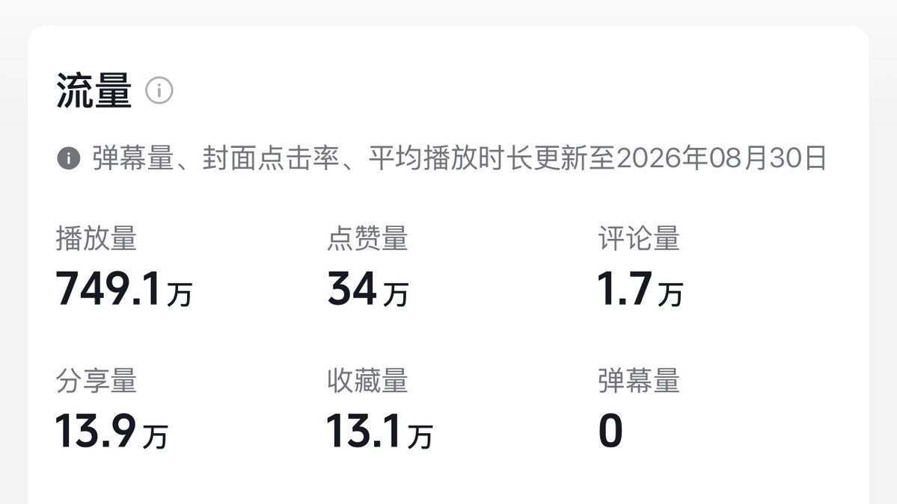
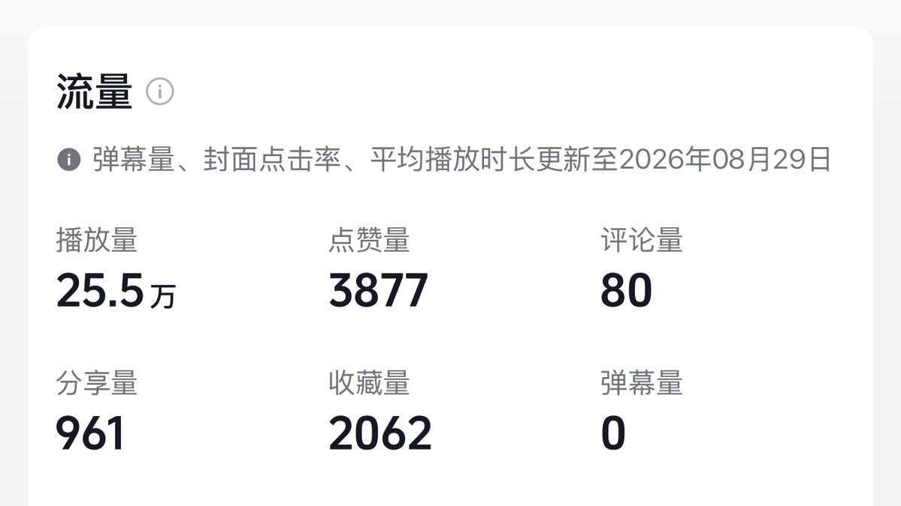
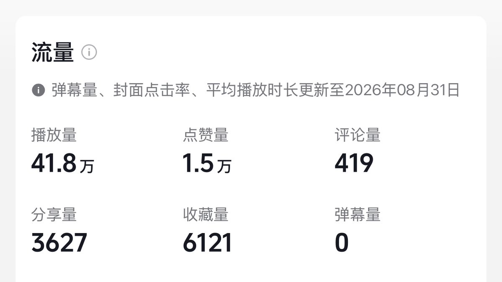
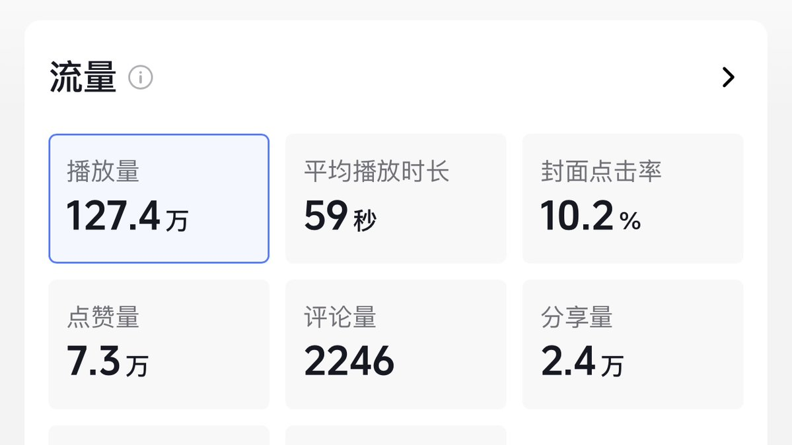
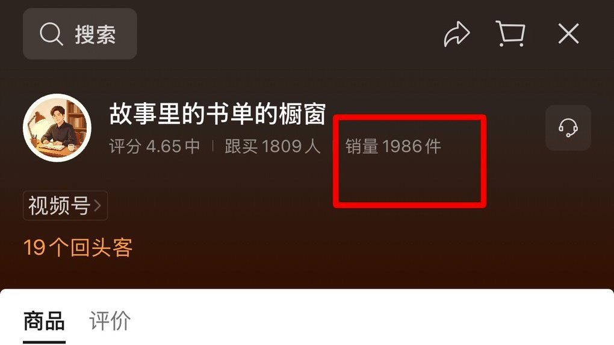
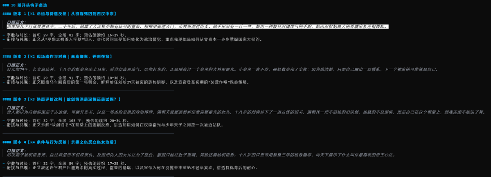
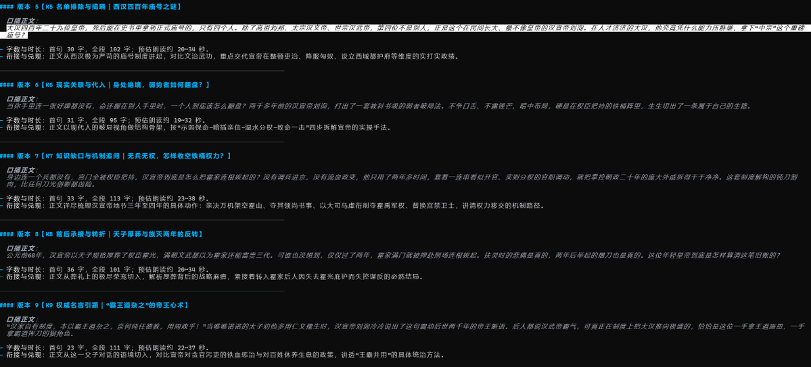
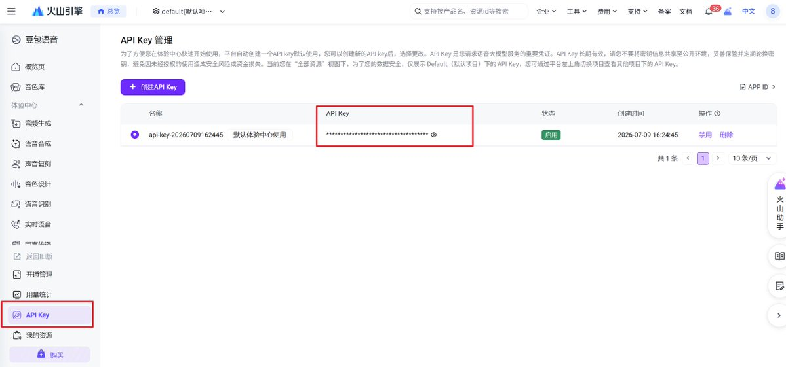
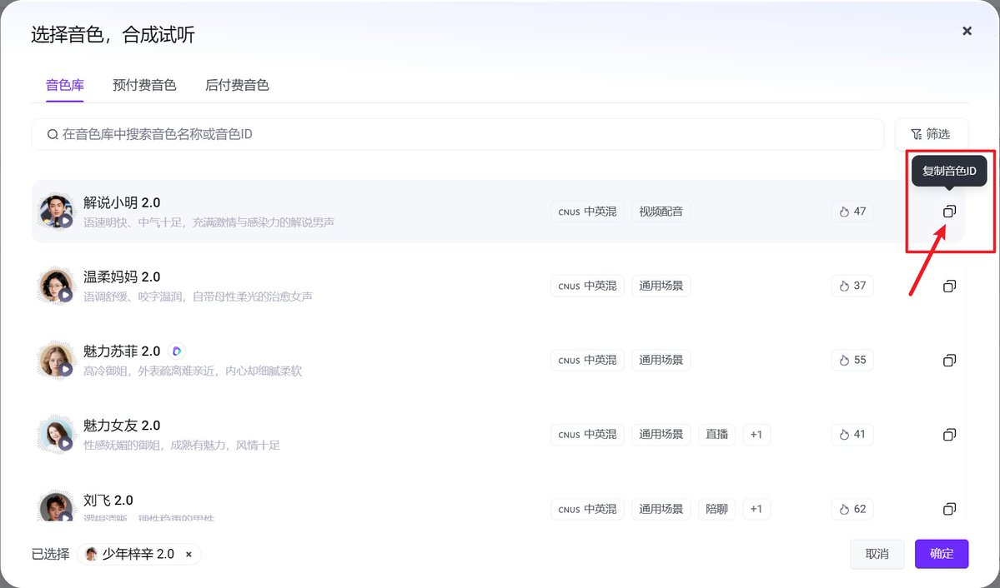

# 夏木 GROW：Story Studio 开源 Skill——全自动跑视频号带货流水线

> 把做一条爆款历史/人物故事短视频的全部流水线，打包成了一个给 AI Agent 使用的开源 Skill——Story Studio（故事工坊）。
>
> 一句话触发：选题策划 → 3 秒黄金钩子 → 爆款正文 → 豆包大模型配音 → 本地毫秒级字音对齐 → 3 套画风分镜生图 → 自动导出带推拉运镜的剪映专业版草稿。
>
> 源码：https://github.com/konlu/story-studio

<!-- more -->
省流速览：

> 我把做一条爆款历史/人物故事短视频的全部流水线，打包成了一个给 AI Agent 使用的开源 Skill —— Story Studio（故事工坊）。
> 你只要在终端或聊天窗口给 Agent 发一句话：
> 选题策划 → 3 秒黄金钩子 → 爆款正文 → 豆包大模型配音 → 本地毫秒级字音对齐 → 3 套画风分镜生图 → 自动导出带推拉运镜的剪映专业版草稿，全链路自动化搞定。

>

> 源码全部开源：[https://github.com/konlu/story-studio](https://github.com/konlu/story-studio)

## 一：拿结果说话 — 播放量、涨粉与带货实战成绩

在聊工具和技术之前，先亮数据。做自媒体不讲虚的，数据是检验内容和生产力最客观的指标。

这套内容生产流水线，并不是纸上谈兵的理论推演，而是我自己一期期跑通、持续放大拿到正反馈的实战结果。

### 1. 播放量与涨粉数据表现

在视频号平台，依靠这套标准化制作流程产出的历史与真实人物故事内容，持续跑出了稳定的播放量曲线与爆款概率：

- 单条爆款播放量稳定突破 100W+，50W 左右播放的爆款频繁出现，平均完播率始终稳定在 35% 以上的高位线；
- 账号单月精准涨粉数万，且粉丝画像高度集中在 35 岁至 55 岁以上的高净值、强信任中老年群体；
- 单条视频在抖音/微信生态内的转发、点赞、在看常常突破数万。









### 2. 带货出单与真实收益金额

历史叙事和人物故事赛道看似传统，但在视频号上的带货转化率极其惊人。视频下方挂图书和滋补健康品链接，以及评论区引导橱窗，一条视频热门起来之后，收益相当可观：

- 单期视频带货出单数百甚至数千单，主推的人物传记与社科图书客单在 49 元至 88 元之间，佣金比例在 30% 到 50%；
- 月度带货流水与佣金收益持续稳定，爆款爆发期单周佣金到账就能覆盖过去几个月的人力成本；





### 3. 完全免费开源：不收一分钱，只要坚持做你也能拿结果

很多人可能会好奇：既然这套工作流跑通了、能稳定赚钱，为什么还要把它做成开源工具分享出来？

我的答案很简单：

开源 开源 还是他妈的开源！

这个 Skill 完全免费开源，不收一分钱，没有任何付费套路，也不会搞什么高价收费群割韭菜。

互联网的内容生态从来不是零和博弈。一个人的精力有限，每天顶多做几条视频，而全网对于优质历史文化、真实人物故事的需求是无穷无尽的。

AI Agent 时代最大的技术红利，就是让原本需要“文案+配音+剪辑+运营”一个团队才能完成的重度工作，变成普通创作者一个人、一台电脑就能驾驭的自动化流水线。

底层最脏、最累、最繁琐的脏活累活（查资料、写钩子、对音频、控画风、做推拉剪辑），这套工具已经全部帮你标准化沉淀好了。

剩下的唯一变量，就是你的执行力。只要你愿意沉下心、照着这套标准化流程坚持去做，每天产出、持续复盘，你同样能拿到实打实的播放量与商业结果。

## 二：为什么要做这个工具？普通创作者的痛点

做自媒体口播视频的朋友，一定经历过这种折磨：

1. 写稿痛：找选题 2 小时，查史料 2 小时，好不容易憋出来一段文案，发给普通大模型润色，吐出来的全是干瘪油腻的“AI 味大纲”。
2. 磨钩子痛：短视频前 3 秒定生死，开头平铺直叙，完播率惨不忍睹。
3. 音画对不齐：配好音后，手动听录音、敲字、找时间戳，拆 20 个镜头需要一条条对齐秒数。
4. AI 生图画风漂移：同一个人物，第 1 镜是国风厚涂，第 3 镜变成日漫，第 5 镜直接换了张脸，年代服饰频繁穿帮。
5. 剪辑拉满工时：把 20 张图导入剪映，手动给每一张图加慢推拉、打关键帧、调整切点节奏……手指都要点抽筋。

做一条 2 分钟的高质量视频，大半天甚至一整天就没了。

为了解决这个流程卡点，我做了一套专为 AI Agent（Codex / Claude Code / Cursor 等）设计的全流程工具 —— Story Studio。

## 三：Story Studio 实操全流程拆解


在你的 codex 里装好 Skill 后，直接开启自动化工作流。

### Step 1：文案创作 — 拒绝 AI 味，370+ 篇爆款语料蒸馏

普通提示词写故事最大的问题是没有人味、没有冲突、缺乏史实依据。

Story Studio 内部集成了两大专业级 Writing-DNA 体系，基于 370+ 篇顶级爆款逐字稿深度蒸馏：

- 历史叙事风：问题驱动，以具体历史行动与制度因果推进，结尾严密兑现承诺，拒绝空洞升华。
- 真实人物故事风：经典爆款叙事节奏：钩子先行 → 巅峰数字 → 可谁也没想到 → 磨难场景 → 金句收尾。

#### 实操指令演示：

你只需要对 Agent 说：

> “使用 $story-studio，只写一篇关于医学先驱林巧稚的人物故事口播稿。采用人物故事风，单集约 1500 字。先核实生平关键时间点与数字，给我提供 3 版不同的黄金开头钩子让我选。”

Agent 会自动调取内置的 A/B/C/D/E 五大类开头钩子库：

- A 型（数字连排）：“5 岁丧母，18 岁拒绝婚姻，从医 60 年，亲手接生 5 万多个婴儿……”
- B 型（宿命定格）：“她一辈子没有自己的孩子，却成了全中国几万个母亲心底最信任的依靠……”
- C 型（反常画面）：“深夜 11 点的协和病房，一位满头银发的老人，手里紧紧握着一把被摩挲得发亮的产钳……”

选定钩子后，Agent 会严格按照事实核查表与字数约束（误差控制在 ±5%）输出完整口播稿，绝不凭空编造违背史实的引语或经历。

> 这里插一句：虽然每一个 agent 都可以帮你写文案，但是不同的 agent 哪怕遵循同一套 skill，写出来的文案也是不同的。
> 就我实测下来：claude opus 4.6 与 gemini 3.8 flash 写出来的文案，我最喜欢，AI 味最少，写作水平最好。
>  skill 里面有开头钩子以及完整的创作流程，但是大家可以自行测试用不同的模型，每次写文案让 agent 给你十版以上的开头钩子，自己测试数据。
> 你觉得哪一个写的文案好，你就去用哪一个，文案的话需要自己潜心打磨，不是说给了你一个 skill 你生成一个东西你跑出来一条视频，随便发就能火的。

- 就我测试下来，我非常喜欢 gemini 3.8 写出来的文案，非常有人味！
- 搭配上我调好的开头的钩子，非常非常吸引人！





### Step 2：配音与时间戳 —— 毫秒级字音对齐

有了文案，接下来的核心是取得带真实时间戳的配音。这里支持两条极度丝滑的路径：

#### 路径 A：接入「豆包语音大模型」（推荐）

- 采用火山引擎 V3 双向流式 WebSocket 协议，支持 seed-tts-2.0 与声音复刻音色。
- Agent 自动调度合成，并在本地用 ffprobe 校验完整性，防止缺字漏字，同时对文本做哈希防重复扣费。
- 敏感 Key 走系统底层 DPAPI 加密存储，绝不泄露在明文项目中。





> 这里我建议自己准备好克隆的音色，找好一个流量好的对标账号之后，把他的音频下载下来，然后到豆包语音里面进行克隆音色保存，发送给你的 agent，让它帮你配置好豆包语音大模型，后续把你的文案发给 agent 之后，它就能帮你调用语音合成 API，直接生成 mp3 音频了。

#### 路径 B：自备配音 MP3（真人录音 / 剪映克隆）

- 如果你喜欢自己录音，或用自己熟悉的音色软件，直接把录好的 voice.mp3 丢进文件夹。
- 对 Agent 说：“配音我已放进文件夹，直接读取并做后续对齐。”

#### 本地离线高精度转录（Coli）

无论哪种音频，Agent 都会自动调用本地离线语音识别工具 Coli（基于 sherpa-onnx），毫秒级提取每一句台词的起止时间戳，并对照原文自动纠偏人名、专有名词。

从这一步开始，你的分镜就不再是按字数瞎猜，而是有了完全真实的秒数基准。

### Step 3：分镜与配图 —— 三套画风 + 参考图锚定防穿帮

> 这里生图我强烈建议使用 codex，使用 6 luna low 就可以，实测下来 codex 生图最好，codex 会根据你的文案然后按照 skill 里面的规则进行配图。当然如果你有开通别的生图 api，可以让你的 agent 帮你配置生图。

配图最忌讳什么？画面和台词脱节、镜头画风各画各的。

Story Studio 采用了 Audio-First（先音频后分镜）机制：

1. 真实节奏切镜：以转录出的音频时间戳为基准，默认按约 8 秒/图规划，确保从第 0 帧就有图，且每一镜的画面与此时此刻正在口播的情节严丝合缝。
2. 逐镜时代考据：自动识别该镜头人物所处的年龄阶段（青年/中年/晚年）、时代服饰、发式与建筑形制。

#### 内置三大成熟视觉画风：

- 厚涂历史漫画风 (`historical-comic`)：强烈戏剧张力，赭金与焦褐块面，电影镜头感拉满（自带 3:4 与 4:3 金箔榜书标题封面）。


- 黑白纪实叙事风 (`monochrome-narrative`)：克制冷峻，细腻的胶片感与人物面部年龄质感，适合近现代与深度传记。


- 历史写实风 (`historical-realism`)：柔和自然的光照与写实笔触。


#### 为什么不会画风突变？

Skill 内置了正文基准参考图库（Reference Images）。实际生图时，Agent 会自动将同组的高水准参考图注入生成工具，首张核验笔触与明暗对比后再批量出图，把跨镜头画风漂移降到最低。

(注：如果你习惯用 Midjourney、即梦或 ComfyUI，也可以让它“只输出带时间戳的分镜表和每镜独立提示词”，不实际生图。)

### Step 4：剪映草稿一键生成 — 带缓入缓出推拉与切点冲击缩放

这是整个流水线最省心的一步：你不再需要手动剪辑，Agent 会直接为你生成可编辑的剪映专业版（JianYing Pro）草稿箱工程。

- 基于 pyJianYingDraft 底层能力，全自动写入轨道。
- 平滑慢推拉（拒绝死板静帧）：每张图片根据停留时长，智能计算缓入缓出推拉比例（默认约 16~20 秒走完 12% 幅度），画面始终处于流动呼吸状态。
- 切点冲击缩放（Cut Punch）：在镜头切换点自动写入出镜微推近（1.28x）与进镜拉回（1.50x）关键帧，既有电影硬切的视觉冲击，又彻底避免了剪映自带转场可能带来的闪黑帧问题。
- 防丢保护：图片与音频自动复制进剪映草稿目录，打开剪映即可直接播放、微调、导出 4K/1080P 成片。

### Step 5：剪映微调 — 导出成片

- skill 里面我并没有配置带字幕的功能，这里的话我强烈建议在剪映里面识别字幕，因为首先第一个是省心，第二个是可控。
- 根据自己习惯添加一些落叶或者飘雪特效即可。

## 四：高转化实操 —— 历史/人物故事短视频在视频号怎么变现？

做内容不仅是为了播放量，更是为了商业变现闭环。

在所有平台中，微信视频号是历史叙事、人物故事类短视频最容易爆发、且客单转化极高的阵地。

为什么？因为视频号的核心活跃受众集中在 35 岁~ 55 岁以上的高净值人群。他们有充裕的闲暇时间、强烈的家国情怀、对人物命运极易产生共鸣，并且付费信任度极高、退货率远低于年轻人电商。

结合我们在开发 Skill 过程中对数百篇高转化文案的拆解，分享 4 条跑通的变现路径：

### 1. 挂车图书带货（最高频、最稳定的变现路径）

在我们分析的爆款语料样本中，带货文案里 78% 都是图书推荐。一本定价 49~88 元的人物传记或社科历史书，达人佣金普遍在 30% ~ 50%。单条几万几十万点赞的爆款视频，往往能直接带出几千甚至上万册图书。

#### 3 种高转化带货话术时机（来自 Skill 内置带货 DNA）：

- 时机一：结尾自然转化型（占比 65%，最推荐）
- 逻辑：故事讲到情绪巅峰，用一句话过渡到书籍，不破坏前半段的故事沉浸感。
- 话术模板：

> “这个女人的一生，完整记录在《XX 传》里。这本书不仅写尽了她的隐忍与荣光，更写出了那个动荡时代中国女性的骨气。很适合买一本放在案头，读懂什么叫真正的活法。点击左下角链接，把它带回家。”

- 时机二：中段情节借物引出型（占比 22%）
- 逻辑：讲到人物生平的关键挫折或转折时刻，顺势借时代背景或道具引出相关读物，再继续推进故事。
- 时机三：全文主题贯穿型（占比 13%）
- 逻辑：整期视频的主题本身就是这本书的核心观点（如《人间值得》、《上野千鹤子的晚年生活》），“故事是医嘱，书是解药”。

### 2. 传统滋补与银发健康产品（高客单爆款）

除了卖书，35+ 岁中老年群体对健康滋补、气血调理有着天然的需求。

- 典型产品：五黑糕、人参茶、阿胶糕、非遗草本茶饮。
- 切入方式：结合人物故事中的“中年劳累”、“守家奉献”等场景，引出对长辈身体、女性气血的关怀。
- 转化优势：相比年轻人的服饰美妆，高龄人群一旦认同某种滋补理念，复购周期极短、黏性极强。

### 3. 视频号“创作者分成计划”（睡后流量收益）

如果你暂时不想挂车带货，只要内容产生评论与互动，开通视频号的创作者分成计划，即可在评论区顶部自动展现广告。

- 历史人物故事类内容，由于天然具备“争议性、启发性、情感共鸣”，极容易在评论区引发数千条长篇留言讨论。
- 收益表现：万次有效播放的广告收益普遍在 20 元 ~ 50 元 之间，单条几十万播放的爆款，仅靠分成就有大几百到上千元被动收益。

### 4. 微信私域导流与高客单转化

这是很多自媒体大操盘手最核心的玩法：

- 前台视频号做公域流量放大器：通过人物命运的厚重感树立极高的专业度和信任感；
- 后台引导进入企业微信/社群：链接读书会、家庭家风传承圈子、文创周边，甚至国学文化知识付费，客单价直接从几十元跃升到几百上千元。

## 极速上手：3 种方式一键使用 Story Studio

这个工具已经完全开源，欢迎大家取用交流。

你可以通过以下 3 种极简方式一键安装：

#### 方式 1：对话框一句话让 AI Agent 帮你自动安装（最推荐）

如果你用的是 Codex / Claude Code / Cursor 等支持终端的 Agent，直接在聊天窗口发：

```text
请帮我把这个 GitHub 仓库克隆安装到你的 skills 目录，并完成依赖检查：https://github.com/konlu/story-studio 

```

Agent 会自动寻路安装，连黑窗口都不用开。

#### 方式 2：终端一行命令直达

- Windows (PowerShell)：

```powershell
  git clone https://github.com/konlu/story-studio.git "$HOME\.codex\skills\story-studio"
  
```

- macOS / Linux：

```bash
  git clone https://github.com/konlu/story-studio.git ~/.codex/skills/story-studio
  
```

#### 方式 3：下载压缩包双击安装

从 GitHub 下载 Release 的 .zip 压缩包，解压后直接双击运行 install.bat（Linux/macOS 运行 ./install.sh），脚本会自动部署到对应的 skills 目录中。

## 结语与开源地址

> 本文章内容聚焦于 skill 的具体使用上，关于变现细节后续会单独成文。

作者：夏木 GROW（@Tanghulu188）。

如果你也在做短视频创作、或者对 Agent 工作流实战感兴趣，欢迎 Star 这个项目：

> GitHub 仓库：[https://github.com/konlu/story-studio](https://github.com/konlu/story-studio)

流程中的任何细节有疑问，可在 GitHub 提 Issue。
