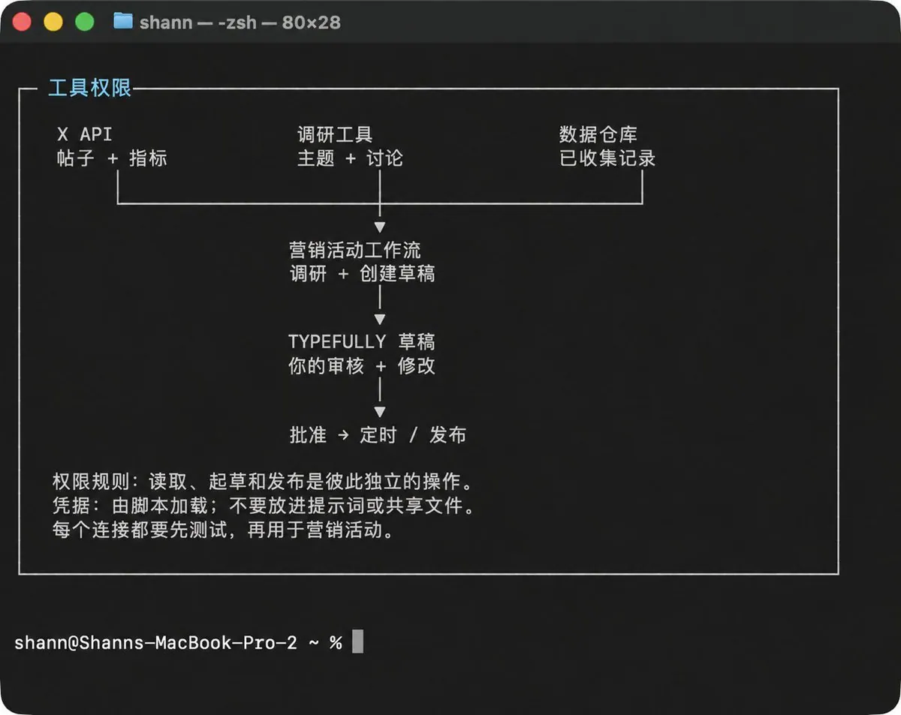
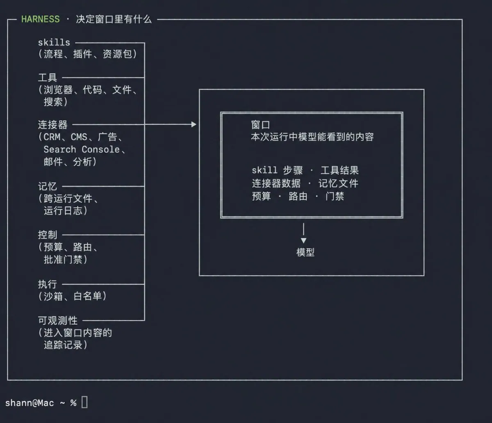
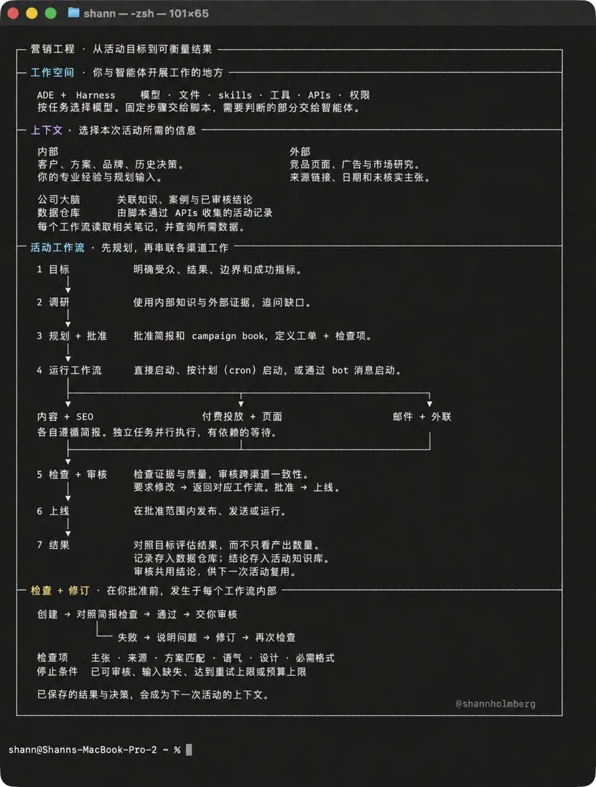
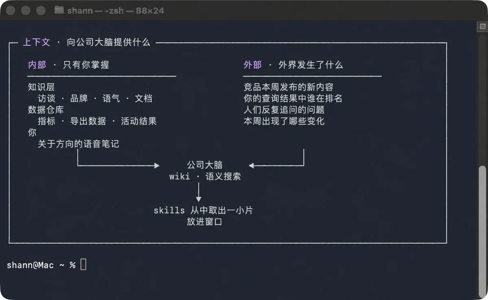
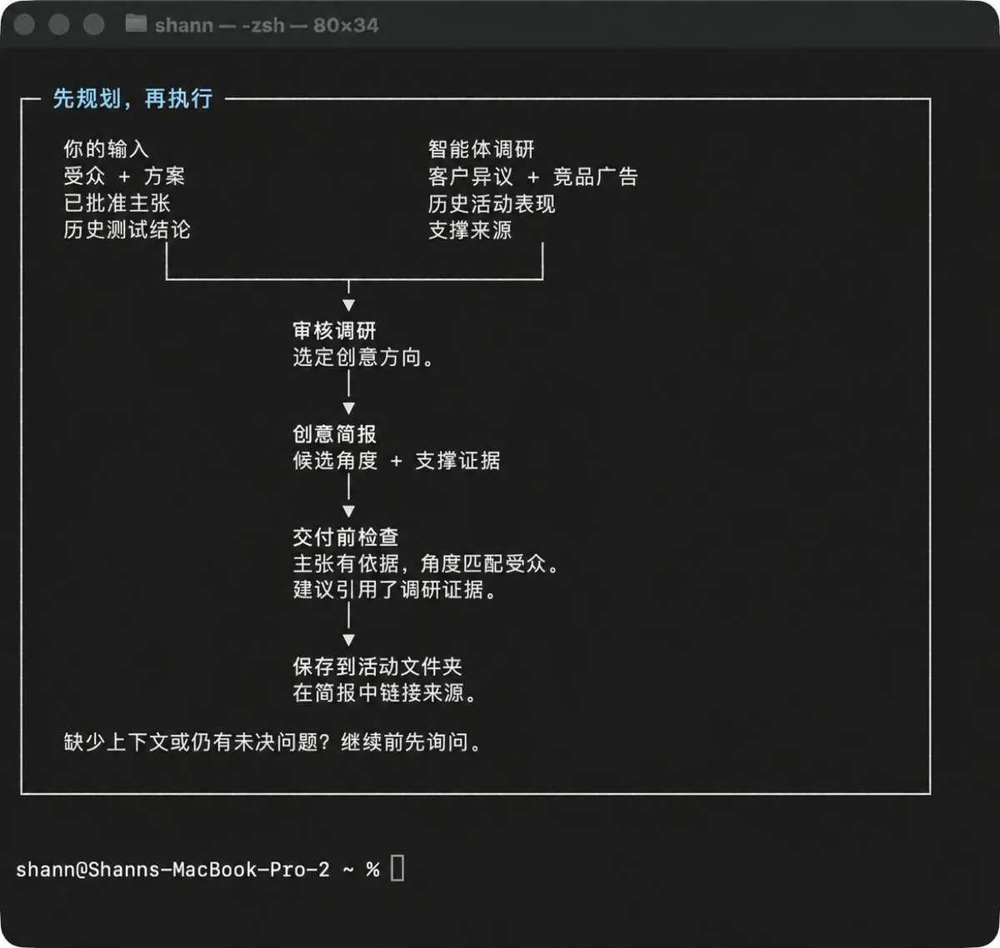
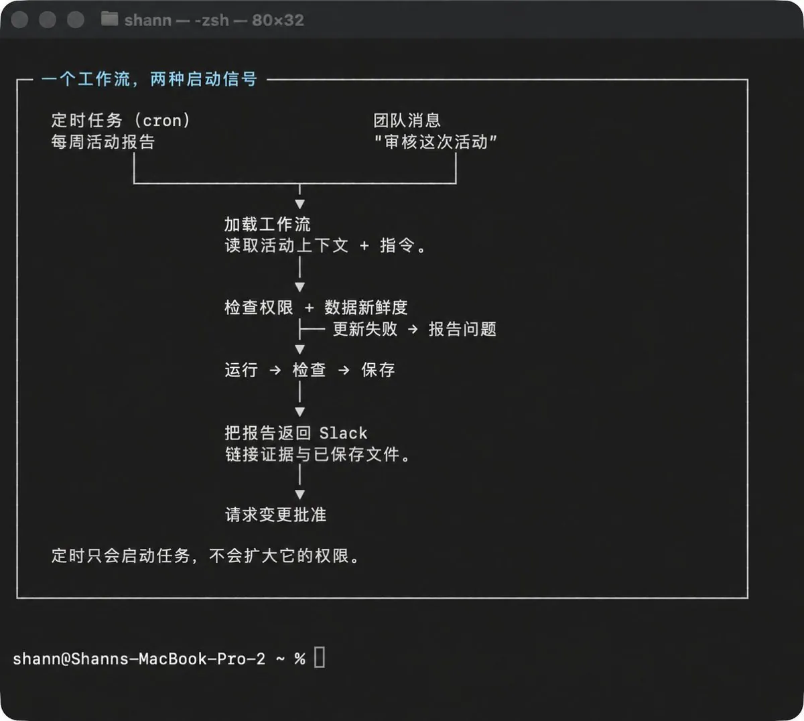
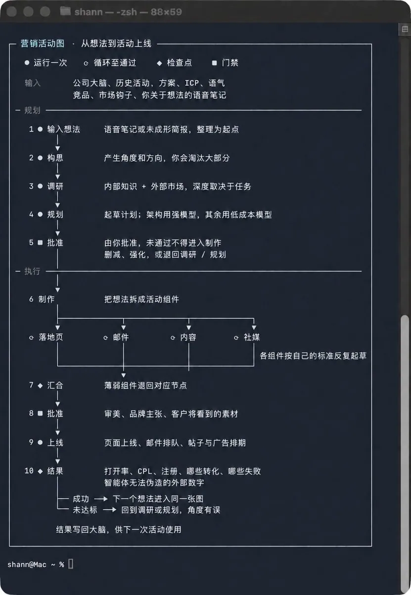
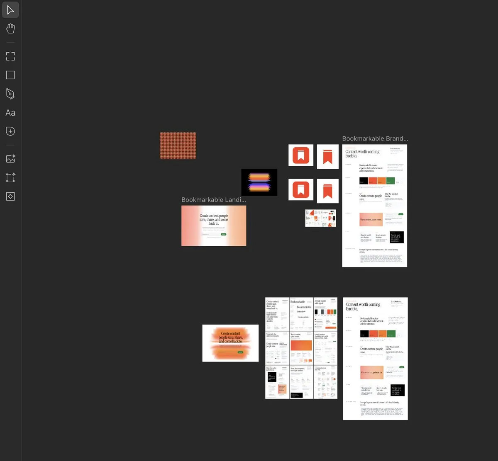

# Su（@Sukiea1008）：【全文中译】Vibe Marketing 如何成为营销工程师

> 完整中译 Vibe Marketing 概念文：随着 Vibe Coding 让产品开发成本趋近于零，营销职能必须同步完成范式迁移——从「按职能分工的营销人员」转向「懂 AI 工具链的营销工程师」，以提示词工程、自动化投放与实时数据闭环替代传统的创意总监 + 媒介购买组合。

<!-- more -->

原作者：[Shann³（@shannholmberg）](https://x.com/shannholmberg)

原文：[How to Become a Marketing Engineer](https://x.com/shannholmberg/status/2098004743536750869)

营销工程师负责搭建营销背后的系统。你要学会把知识、数据和智能体连接成工作流，让它们能够完成调研、规划和营销活动执行。

我开始把越来越多营销工作放进智能体工作空间：

市场调研、活动规划、内容写作和落地页搭建。

这些项目需要的很多信息其实是相同的：我们的目标受众是谁、卖的是什么、过去试过什么，以及结果告诉了我们什么。

于是，我开始连接知识与数据，针对不同营销任务搭建工作流，并判断智能体在哪些地方需要我的输入。

慢慢地，营销活动的更多环节被串了起来：调研进入简报，简报指导制作，结果再决定下一步尝试什么。

这就是我理解的营销工程。本文会从你自己工作中的一个任务出发，讲清楚如何搭建这样的系统。

## 什么是营销工程师

营销工程师使用智能体、相互连接的数据和业务上下文，搭建能够真正执行营销工作的系统。

比如，一个内容系统可以先调研选题、提出营销活动角度，再结合你的客户研究、产品方案和语气指南制作内容资产。

内容发布前由你审核。之后，相连的工作流继续跟踪表现，把结果写回知识库，为下一次营销活动提供依据。

你的营销知识，决定这套系统如何运转。

你要判断智能体需要知道什么、应该使用哪些来源、怎样检查产出，以及工作走到哪里必须由你介入。

以一次产品发布为例。目标是调研你所在细分领域里的 20 次发布，再用这些发现设计自己的营销活动。

调研工作流会收集发布帖、产品方案、落地页和能取得的表现数据。你给出的标准决定哪些公司值得研究、智能体应该查什么；指令还要明确要求它区分证据与推断。

这些调研结果再与你自己的上下文合并：受众、产品、定位、预算和过去的活动结果。

接下来，智能体可以提出营销活动角度，并解释每个建议依据了什么。你审核方向并给出反馈后，相连的工作流再协助制作获批的营销活动。

如果建议很泛，就说明有问题值得继续查：调研范围是不是太宽？有用的客户信息是不是缺失？指令有没有漏掉重要约束？

改进这些输入和指令，本身也是搭建系统的一部分。

这个角色融合了营销与工程多个领域的能力：

| 能力来源 | 对系统搭建的帮助 |
| --- | --- |
| 产品营销 | 为智能体提供客户、定位和产品方案上下文 |
| 内容与创意 | 定义语气、提供案例并审核产出的内容资产 |
| 增长与效果营销 | 围绕营销实验和可衡量结果搭建工作流 |
| 营销运营与自动化 | 连接工具，定义工作如何在各环节之间流转 |
| 数据分析 | 为智能体提供可靠数据，并检查它对数据的解读 |
| 工程 | 连接 API，借助智能体编写代码并测试工作流 |

你不必覆盖营销的每一个职能。

从你熟悉的工作开始。

如果你懂内容营销，就先从这里开始。这些经验能帮助你选择有用的来源、给智能体更准确的方向，也能让你看出一份草稿究竟哪里没说到点上。

从自己工作中选一个任务，为它搭一条工作流。实际用起来，再根据返回的结果持续改进上下文与指令。

延伸阅读：[原始 X 帖子](https://x.com/i/web/status/2070153493747495170)

## 直接与智能体协作

我大约 70% 的营销工作都在智能体开发环境（Agent Development Environment，简称 ADE）里完成。我的主要工作空间是 Orca。

调研、营销活动规划、制作内容资产、运行子智能体，以及审核它们返回的结果，全都在这里进行。

继续之前，先理解三个术语：

| 术语 | 含义 |
| --- | --- |
| 模型 | 你为某项任务选择的 AI，例如用于调研、规划或写作 |
| Harness | 包裹在模型外的软件层：它让模型能够访问文件、工具和代码执行环境，同时控制模型可以做什么 |
| ADE | Agent Development Environment，即智能体开发环境：你直接与智能体协作、审核它的动作并指导工作的界面 |

下图展示了模型、Harness 与 ADE 之间的关系。

配置方式很重要。

针对一次营销活动，我希望智能体读取项目文件，使用相关来源开展调研，并把发现保存到我可以审核的位置。

接下来，我们可以一起完善计划、制作资产并检查产出。我可以给反馈、调整方向，也可以让其他智能体分别处理独立任务。

简报、调研和产出都留在工作空间里，活动推进时随时可以回看。

这里也包含最终会上线的制作工作。我并不只用 ADE 做原型。

我也会用 Hermes 这类自主智能体做原型，不过开放式任务可能消耗更多 Token。通常，给它一个具体任务去执行，更容易产生价值。

后文会继续讲这类 Bot，包括直接在 Slack 里支持团队的智能体。

不过在那之前，先看看营销工作空间该如何组织。

延伸阅读：[原始 X 帖子](https://x.com/i/web/status/2094704183345922356)

## 搭建营销智能体工作空间

每个项目都需要一个地方来保存上下文、运行工作流，并存放最终产出。

我按营销职能来组织工作空间：内容有自己的区域，SEO 有另一个区域。共享知识放在这些区域旁边，让每个职能都能调用同一套公司信息。

一个基础结构可以是这样：

marketing/

├── shared-knowledge/

├── content/

│ ├── knowledge/

│ ├── work/

│ ├── workflows/

│ ├── skills/

│ ├── agents/

│ ├── scripts-and-code/

│ ├── outputs/

│ └── results-and-learnings/

├── seo-aeo/

├── outbound/

├── paid-and-creative/

└── lifecycle-and-cro/

先从一个营销职能开始。

在做出任何有用成果之前，你不需要先把整套目录全部建好。如果你正在搭建内容工作流，就先创建 `content/` 文件夹，再按需要逐步补齐。

| 区域 | 适合存放的内容 |
| --- | --- |
| 共享知识 | 各营销职能都会使用的公司信息：产品、受众、定位和品牌规范 |
| 职能知识 | 与该职能相关的研究、案例和指南，例如语气指南或 SEO 调研 |
| 工作区 | 正在推进的营销活动、简报、计划和进行中的工作 |
| 工作流 | 把一个任务从输入带到最终产出的步骤与连接 |
| Skills、智能体与代码 | 工作流调用的可复用指令、智能体定义和脚本 |
| 产出 | 制作完成的资产与交付物 |
| 结果与经验 | 表现报告、反馈和以后值得复用的发现 |

以产品发布活动为例，内容工作流可能从共享知识里读取产品方案，从内容知识里读取语气指南，再从当前活动文件夹读取简报。

调研和草稿保存在该活动的工作区里，获批资产进入 `outputs/`。发布之后，表现数据与你的复盘进入 `results-and-learnings/`。

只有文件夹名称，还不足以告诉智能体该怎么工作。

再添加一份简短的 Markdown 文件，说明去哪里找资料、应该使用哪些来源，以及产出保存到哪里。每条工作流随后只需引用自己需要的文件。

共享知识 营销活动上下文

受众 + 产品方案 简报 + 调研
        │ │
        └───────────┬───────────┘
                    ↓
                工作流运行
                    ↓
                草稿 + 审核
                    ↓
                已批准交付物
                    ↓
                营销活动结果
                    ↓
              结论 + 你的反馈
                    ↓
             下一次活动的上下文

后文还会继续讲 Skills、智能体和工作流。现在的目标，是先给你的第一个项目搭好一套你和智能体都能使用的结构。

文件夹让工作有了安放之处。下一步，是连接工作流要使用的工具与数据。

## 连接工具与数据

我的内容工作流要正常运转，就必须能访问 X 和 Typefully。

连接 X 后，它可以抓取帖子和可用的表现数据，用于调研与分析。连接 Typefully 后，它可以创建草稿，供我审核、编辑和排期。

这些连接通过 API 工作。API 是软件向另一个工具请求信息或执行操作的方式。

先从工作流需要完成什么开始：

| 连接 | 可以完成什么 |
| --- | --- |
| X API | 调研帖子并获取可用的表现数据 |
| Typefully API | 创建草稿，并为获批内容安排发布时间 |
| 调研工具与 Skills | 调查你自有账号之外的选题、竞品和讨论 |
| 你的数据仓库 | 查询从各类营销来源收集的数据 |

每条 API 连接都需要一个集成或脚本来处理请求。智能体还需要明确的指令，知道何时调用它、它又能做什么。

你不需要自己搭建每一条连接。

我也会用 `/last30days` 调研某个主题最近的讨论和进展。

它通过底层 API 与工具，把 X、Reddit、YouTube 和网页等多个来源的调研合并起来。具体能使用哪些来源，取决于你的配置与凭据。这里是它的 [Skill 文档](https://github.com/mvanhorn/last30days-skill)。

做内容营销活动时，我可能用它调查过去一个月里细分领域的人都在讨论什么：哪些问题反复出现？大家在为什么事情烦恼？哪些话题正在获得关注？

有价值的发现会保存到当前活动的调研文件中，与客户知识和历史结果放在一起。

Skill 提供调研流程，它的连接则提供来源访问能力。我们仍然要检查结果，并判断哪些信息真正相关。

API Key 应该放在哪里？

有些连接需要 API Key 或其他形式的身份验证。

在本地环境中，凭据可以从 `.env` 文件加载，由脚本读取。要把它排除在 Git 之外，也不要放进共享文件夹；更不要把 Key 写进提示词、营销活动简报或知识文件。

工作空间指令可以说明某项集成该如何使用，但不应包含凭据本身。

延伸阅读：[原始 X 帖子](https://x.com/i/web/status/2068816251229794671)

访问权限也要有边界。

调研帖子需要读取数据的权限；创建草稿与公开发布，则是两种彼此独立的操作。

在我的内容工作流里，任何内容上线前都必须由我审核。这个批准步骤要写进工作流；工具支持权限拆分时，发布权限也应受到限制。

先用一个小任务测试连接：抓取几条帖子，或创建一份草稿。确认它确实成功，再把它接进营销活动的其他环节。

后文会继续讲这些来源的数据如何被收集、更新，并保存进营销数据层（Marketing Data Layer）。

## 搭建知识层

一条工作流需要理解目标受众、产品方案、你想达成的目标，以及过去已经试过什么。

我把这些上下文分成内部知识与外部知识。

| 内部上下文 | 外部上下文 |
| --- | --- |
| 产品细节、产品方案与定位 | 竞品、竞品方案与营销活动 |
| 客户访谈、CRM 记录与客服对话 | 公开讨论、评价与客户问题 |
| 你的专业经验、案例和规划输入 | 行业研究与市场动态 |
| 历史活动、数据仓库记录与结果 | 搜索需求与关键词研究 |

把企业已知的信息，与外部正在发生的事连接起来。

假设你正在策划一次营销活动。

客户访谈也许会暴露一个买家在购买前反复询问的问题。外部调研可以进一步查清：人们如何讨论这个问题、会搜索什么、竞品又是怎样回应的。

把这些发现与你的产品信息和历史活动结果结合起来，智能体才有足够扎实的材料去提出营销活动角度。

延伸阅读：[原始 X 帖子](https://x.com/i/web/status/2085714361222369608)

工作流需要明确：要调查什么、使用哪些来源、发现保存到哪里。`/last30days` 可以支持讨论调研；搜索数据 API 则可以提供关键词数据。

你的专业经验，也必须进入上下文。

以一次付费投放为例。智能体可以研究竞品广告并提出创意方向，但它还需要你的产品方案、客户异议、历史测试结果，以及你确实有证据支撑的主张。

你在规划阶段的输入非常重要。一段语音笔记如果讲清楚了上次活动为什么吸引来错误的买家，就能直接影响下一份简报。

审核新广告概念时，也要保存反馈背后的理由。比如「这个概念承诺了我们的产品无法提供的结果」，就给下一次运行留下了一个可以明确检查的条件。

一个基础知识结构可以是这样：

shared-knowledge/

├── audience.md

├── product-and-offer.md

└── positioning.md

paid-and-creative/knowledge/

├── customer-objections.md

├── approved-claims.md

└── creative-test-learnings.md

`.md` 文件是你和智能体都能读写的纯文本文件。

竞品广告和落地页提供外部上下文；客户知识、活动结果和你的反馈提供内部上下文。

工作流把相关材料汇总进创意简报。表现数字可以继续留在数据仓库里，知识文件中的结论则指向支撑它的数据。

只与某次营销活动相关的调研，就留在该活动下面。如果某项发现不只适用于当前项目，再把它移入共享知识或对应职能的知识文件。

┌───────────────────────────────────────────────┐

│ 调研 │

│ 保存发现、来源与日期。 │

│ 标记尚未核实的主张。 │

└───────────────────────┬───────────────────────┘
                        │
                        ▼
┌───────────────────────────────────────────────┐

│ 你的审核 │

│ 检查证据及其与营销活动的相关性。 │

│ 记录你的决定与理由。 │

└───────────────────────┬───────────────────────┘
                        │
            ┌───────────┴─────────────┐
            ▼ ▼
┌───────────────────────┐ ┌───────────────────────┐

│ 营销活动知识 │ │ 共享知识 │

│ 本次活动的发现。 │ │ 已审核、可跨活动 │

│ │ │ 复用的发现。 │

└───────────────────────┘ └───────────────────────┘

每条工作流都应引用自己需要的材料。调研智能体可能需要受众、产品方案和调研简报；制作智能体还需要获批方向、campaign book 和案例。

调研材料要附上来源与日期，并标记尚未核实的假设或想法。智能体必须能够区分一项已经批准的定位决策，与某个人在会议上随口提出的建议。

延伸阅读：[原始 X 帖子](https://x.com/i/web/status/2091804800757494169)

## 搭建营销数据层

假设你正在用智能体规划下一轮广告创意。

它需要知道上一轮发生了什么：哪些广告带来了访客，哪些访客完成了转化，以及这些转化最终有没有成为客户。

这些信息通常分散在不同工具里：

| 来源 | 可以提供什么 |
| --- | --- |
| 广告平台 | 营销活动、广告、花费、展示和点击 |
| 网站分析 | 访问、落地页行为和被追踪的转化 |
| CRM | 线索质量、销售结果和营收 |
| 实验记录 | 测试过的受众、产品方案和创意角度 |

数据仓库把这些记录汇集到一个地方，让工作流可以统一查询。起步时，它可以只是一座很小的数据库。

脚本负责抓取并保存活动数据；智能体则可以使用这些数据调查表现，并起草建议。

┌────────────────────┐ ┌────────────────────┐ ┌────────────────────┐ ┌────────────────────┐ ┌────────────────────┐

│ 渠道数据 │ │ 脚本 │ │ 数据仓库 │ │ 智能体分析 │ │ 你的审核 │

│ │ │ │ │ │ │ │ │ │

│ 广告、分析 + CRM ├─▶│ 抓取 + 检查记录 ├─▶│ 关联活动数据 ├─▶│ 读取数据 + 上下文 ├─▶│ 检查证据 │

│ 动态 + 结果 │ │ 更新已存数据 │ │ 可查询的历史 │ │ 提议下一轮测试 │ │ 选择下一轮测试 │

└─────────┬──────────┘ └────────────────────┘ └────────────────────┘ └────────────────────┘ └─────────┬──────────┘
          ▲ │
          │ ▼
┌─────────┴──────────┐ ┌────────────────────┐ ┌─────────┴──────────┐

│ 营销活动执行 │ │ 下一份活动简报 │ │ 保存 │

│ 运行获批测试 │◀─────────────────────────│ 使用已存结论 │◀─────────────────────────│ 记录决策 │

│ 产生新结果 │ │ 规划 + 批准测试 │ │ 链接证据 │

└────────────────────┘ └────────────────────┘ └────────────────────┘

只有 API 连接，并不会让数据自动保持更新。

脚本或集成需要收集新记录，并刷新已有记录。定时任务可以按计划运行这些更新，常见方式是使用 cron job，在设定时间启动任务。

广告平台 + 网站分析 + CRM
                    ↓
            定时收集与更新
                    ↓
                数据仓库
                    ↓
          营销活动分析与创意简报

这些记录还需要一种彼此关联的方式。

Campaign ID 和 Ad ID 用来识别具体运行了什么；链接上的追踪参数帮助判断网站访问来自哪里。如果这些信息一路传进 CRM，就可以把线索和销售结果追溯到对应的营销活动。

但这种关联不会永远完整。面对追踪缺失或无法取得的数据，工作流应该明确标记，而不是自信地把每一笔销售都归因到某个渠道。

先从一个你想回答的问题开始。

上个月，哪些创意角度带来了合格线索？下一步应该测试什么？

回答这个问题不能只看点击量。工作流还需要营销活动花费、线索结果，以及每条广告具体测试了哪个角度的记录。

这些记录连接起来之后，智能体就可以结合活动简报和客户上下文比较结果，并准备建议。

你的审核也许会补充数字解释不了的信息：销售跟进得太晚，活动进行到一半时产品方案变了，或者某条广告做出了错误承诺，吸引来了不合适的买家。

把这些发现与营销活动放在一起，并附上支撑数据。下一次规划工作流就能同时使用结果，以及你对结果的解释。

## 搭建第一条工作流

选择一个你经常做、也足够熟悉，能够判断结果好坏的任务。

对于付费投放，这个任务可以是：把客户研究与历史活动结果，整理成下一轮创意的简报。

这已经足够成为第一条工作流。广告发布和预算调整，可以以后再接进来。

先规划，再运行。

我通常会先用转写工具讲 5–10 分钟，把自己需要什么说出来。

目标是什么、营销活动有哪些上下文、我已经试过什么、哪里还没有把握。表达不必井井有条，规划环节本来就是用来整理这些信息的。

接着，我会和智能体一起梳理它，使用 [Matt Pocock](https://x.com/mattpocockuk) 的规划 Skills 追问简报，并把计划补完整。

这是我集中回答问题、补充上下文的地方。如果智能体问「什么样的线索才算合格」，答案会影响它应该使用哪些活动结果；如果我们还没有确定产品方案，就不该围绕它生成创意。

最终计划应该说清楚几件事：

计划与上下文文件就绪后，可以从下面这条指令开始：

- /goal 准备下一轮付费广告的创意简报。
   使用 audience.md、approved-claims.md、campaign-book/
   和 previous-test-results.md 作为上下文。
   调研并提出 3 个角度。说明每个角度面向谁、依据是什么，
   以及它与历史测试有什么不同。
   链接支撑来源，并标记假设。
   根据受众与 approved-claims.md 检查每个角度。
   把简报保存到活动文件夹里的 creative-brief.md。
   当简报已经可以交给我审核时停止。
   不要制作或发布广告。缺少必要上下文时先询问。
   延伸阅读：[原始 X 帖子](https://x.com/i/web/status/2094145545824829841)

先在你的参与下运行。

让智能体按照计划推进，并在过程中保存调研和决策。

审核它返回的内容。如果竞品调研不相关，先修正筛选标准，再让结果进入简报；如果提议的角度忽略了某项客户异议，就检查这条信息是否已经提供，以及指令是否要求智能体使用它。

随着流程逐渐成形，把步骤保存为可复用工作流。明确它需要哪些文件、工具与检查项，也要说明不同营销活动之间，哪些输入会发生变化。

第一版一定需要调整。先把它用于一次活动，保留真正改善结果的修改，再用下一份简报继续测试。

## 让工作流贯穿整场营销活动

我曾把早期的一版内容系统做得太复杂：明明只有三个制作步骤和一个反馈循环，我却用了四个智能体。事实证明，改善提供给写作智能体的上下文，比继续增加智能体更重要。

你可以预先规划整场营销活动，根据需要产出的内容搭建工作流，再判断哪些地方值得交给独立智能体。

下面的多渠道案例展示了这些工作流如何连接。在开始之前，你不需要先为每个营销职能都配一只 Bot。

假设你准备发布一款产品。整场营销活动需要落地页、付费创意、发布内容、邮件序列和外联。

每个职能都有自己的工作流，但它们必须基于同一套产品方案、受众和发布计划协同工作。

一起规划整场营销活动，再按职能分别制作。

我会先使用 Matt 的 Skills 开一场活动规划会，逐项梳理目标、调研、渠道、交付物，以及必须由我做出的决策。

延伸阅读：[原始 X 帖子](https://x.com/i/web/status/2087539757052285200)

结果会成为一份共享的活动简报。每个职能再各自创建更具体的简报，并引用这份共享简报。

campaign/

├── brief.md ← 受众、产品方案、目标

├── campaign-book/ ← 已批准的视觉方向

├── research/ ← 跨渠道共享

├── tickets/ ← 任务与依赖关系

├── landing-page/

├── paid/

├── email/

└── results/ ← 为下一次活动提供依据

为整场营销活动提供一套共享的视觉参考。

针对一场具体活动，我喜欢用 Paper 或 Figma 制作视觉情绪板和 campaign book，让每个营销职能都能引用。

情绪板用来探索方向：图像、字体、颜色和布局。Campaign book 则记录最终获批的内容，并提供广告、落地页、社交帖子和邮件的示例。

连接合适的工具后，智能体可以依据这套方向，用代码搭建布局和视觉资产，再针对不同格式与渠道制作变体。我可以审核设计、给出反馈，并让修改同步应用到整套资产。

同一本 campaign book 也能为图像生成模型提供参考。制作产品图时，它可以包含获批的产品图片、光线、背景和构图，并明确哪些细节必须保持准确。

随后，把生成的图片放进代码化布局，就得到了营销活动资产。

已批准的 CAMPAIGN BOOK

参考 + 布局 + 产品图片
                 │
         ┌───────┴────────┐
         ↓ ↓
      代码化布局 图像生成
    页面 / 广告 / 邮件 产品 / 场景
         │ │
         └───────┬────────┘
                 ↓
          组装营销活动设计
                 ↓
            你的视觉审核
                 ↓
              获批变体

一旦有了可靠的方向和模板，就可以在不逐个重新写 Brief 的情况下制作更多变体。产出仍然需要审核，尤其要检查产品细节、文字，以及它与获批设计是否一致。

| 营销职能 | 工作流产出 | 所需上下文 |
| --- | --- | --- |
| 落地页 / CRO | 页面文案、页面搭建和追踪设置 | 产品方案、受众、已批准主张和转化目标 |
| 付费投放与创意 | 广告概念、资产和测试计划 | 活动信息、预算、历史测试和落地页 |
| 内容 | 发布帖及配套资产 | 活动角度、产品细节和渠道案例 |
| 生命周期 / 邮件 | 发布与后续跟进序列 | 产品方案、受众分组、时间和注册事件 |
| 外联 | 潜在客户调研与外联草稿 | 账号标准、购买信号和获批话术 |

同一份调研可以服务多条工作流。客户异议既可能影响落地页，也可能影响广告概念和邮件序列。

把调研统一保存在活动文件夹里，再让相关工作流分别引用。各自的产出仍放在对应职能的工作区中，由营销活动计划链接过去。

哪些工作可以并行？

竞品调研、历史活动复盘和潜在客户调研，可以同时进行。

但最终文案需要已经确定的产品方案；广告需要一个目的地；跟进邮件也必须与用户实际注册的内容一致。

用工单追踪整场营销活动。

规划期间，我们把营销活动拆成智能体可以逐项处理的工单。

每张工单描述交付物，引用相关上下文，并列出进入审核前必须通过的检查。它还会记录依赖关系、由谁或哪只智能体负责，以及产出链接。

| 工单 | 依赖 | 状态 |
| --- | --- | --- |
| 批准活动产品方案 | 客户与竞品调研 | 需要我的输入 |
| 搭建落地页 | 已批准的产品方案与 campaign book | 等待中 |
| 制作付费创意 | 已批准的产品方案与 campaign book | 等待中 |
| 检查广告与页面一致性 | 落地页与付费创意 | 等待中 |

一张制作工单可以这样写：

# 制作付费创意素材套装

assigned to: 付费创意智能体

status: 等待产品方案与 campaign book 批准

## 开始前

确认产品方案与 campaign book 已经批准。

使用 creative-brief.md 确认角度、格式与交付物。

使用 approved-claims.md 确认广告可以做出哪些主张。

## 制作

- 按 campaign book 制作可编辑设计
- 导出简报要求的每一种格式
- 提供一份审核报告，把每条广告与对应角度及检查结果链接起来
## 满足以下条件后，交给我审核

- [ ] 简报要求的每项交付物都已完成
- [ ] 所有主张符合 approved-claims.md
- [ ] 格式和尺寸符合简报
- [ ] 导出图片文字清晰，产品细节准确
- [ ] 设计、导出文件和审核报告均已链接到本工单
## 更新本工单

如果受阻，写明缺失的输入或决定。

否则，将状态标记为可以审核。不要发布。

协调智能体读取工单，识别哪些任务已经就绪，再把它们分配给专业智能体。专业智能体运行自己的工作流和审核循环，然后把产出、检查结果和待确认问题写回工单。

如果某项任务需要我做决定，工单就记录那个具体问题；其他不依赖它的工作可以继续。

我也可以通过同一个看板审核整场营销活动：哪些正在运行、哪些需要我处理、哪些已经可以批准。

每只专业智能体都会获得相关活动上下文、所属职能的指令，以及清晰的交付物要求。工作完成或决策变化后，共享计划也随之更新。

如果我在审核中修改了产品方案，就会影响多个渠道。协调智能体需要找出受影响的资产，并在上线前把它们退回修改。

还要把营销活动作为一个整体来审核。

单项资产即使都通过检查，彼此之间仍可能互相矛盾。

广告承诺的，是不是落地页真正提供的？邮件使用的是不是同一个产品方案？日期、链接和主张是否一致？

上线后，各渠道的结果都进入活动复盘。值得复用的发现再回到相应知识文件，供未来工作流使用。

延伸阅读：[原始 X 帖子](https://x.com/i/web/status/2089089731980406984)

## 用循环持续逼近目标

当一条工作流已经具备清晰的步骤和检查标准，你就可以让智能体反复执行其中一部分，直到产出符合要求。

这就是循环。

以我们刚刚规划的营销活动为例。智能体依据已批准的简报和 campaign book 制作一组付费创意素材，然后检查导出结果。

尺寸是否正确？有没有文字被裁切？产品方案是否与落地页一致？产品细节是否准确？

没有通过的检查会连同具体反馈一起退回。智能体修改受影响的素材，再次检查。

就绪工单
   ↓
制作或修改 ←────────────────┐
   ↓ │
运行检查 │
   ├── 未通过 → 明确修改项 ─┘
   │ 在重试额度内
   ├── 受阻 / 达到额度 → 请求输入
   │
   └── 通过 → 可以交给你审核
                     │
            ┌────────┴────────┐
            ↓ ↓
         要求修改 批准
         → 再次修改 → 下一项任务

先定义“完成”是什么样子。

“把创意做得更好”几乎没有给智能体提供可执行的信息。

一个有用的目标，应该说清交付物、指出应遵循的计划，并定义何时停止。例如：

- /goal 制作 campaign-plan.md 中列出的付费创意素材套装。
   使用 campaign-book.md 和 approved-claims.md。
   运行 creative-checklist.md 中的检查。
   修复未通过的检查，并将导出文件与审核报告一并保存。
   当所有检查通过、素材套装可以交给我审核时停止。
   不要发布。如果存在无法解决、会阻碍推进的决定，请向我询问。

我会用 `/goal` 来处理这类工作。提示词可以保持简短，而规划阶段积累的调研、要求和决策，都放在配套文件里。

循环本身也需要边界：时间或 token 预算、重试次数上限，以及何时求助的指令。

如果它反复卡在同一项检查上，我希望知道原因。也许是缺少产品参考资料、需要换一种工具，或者必须由我做决定。

通过检查，不代表我一定会喜欢这套创意。

有些检查很适合自动化，比如尺寸或文件是否缺失；另一些则需要视觉审核和营销判断。

独立的审核智能体可以帮助发现问题，但创意方向仍由我审核，最终上线什么也由我决定。这些反馈可以成为下一轮运行指令的一部分。

在更大的营销活动里，多条工作流可以同时运行各自的循环。付费创意反复修改时，邮件工作流可以检查发送序列，落地页工作流也可以测试页面。

智能体领取一张已经就绪的工单，按对应工作流推进。循环负责检查产出，再把未通过的部分退回修改。

所有检查通过后，智能体把产出和审核报告添加到工单，并将状态标记为可以交给我审核。

## 定时任务与自治机器人

有些营销工作需要定期发生：刷新活动数据、检查竞品动态，或者准备每周效果报告。

当一条工作流已经能够可靠地处理这项任务，你就可以把它变成定时任务。

cron job 会按计划启动任务，可能是每天早上，也可能是每周一次。任务启动后做什么，则由工作流定义。

| 定时任务 | 做什么 | 结果写到哪里 |
| --- | --- | --- |
| 每日数据更新 | 收集新的活动记录，刷新效果指标 | 数据仓库 |
| 每周竞品复盘 | 调研相关产品方案、广告和落地页发生的变化 | 调研文件与团队摘要 |
| 每周活动报告 | 对照活动目标比较表现，并标出待确认问题 | 活动工单与 Slack |
| 上线前检查 | 检查排期素材的日期、链接与产品方案是否一致 | 审核报告 |

定时运行，救不了一条没做完的工作流。

先把任务跑通。定义它能访问什么、应该产出什么、如何检查结果，以及失败后怎么办。

如果数据更新失败，报告任务应该明确报错；它不应该悄悄拿上周的数据，写出一份语气笃定的报告。

对于会修改内容或向外发送信息的工作，要提前决定哪些步骤必须获得批准。准备报告、创建草稿和修改广告预算，需要的权限并不相同。

你的团队也可以给智能体派活。

机器人是一只专门承接团队任务的智能体，拥有自己的指令、工具，以及访问相关上下文的权限。它既可以响应消息，也可以按计划运行任务。

Slack 里的 Hermes agent 就是一个例子。团队成员可以这样对它说：

复盘上周的付费活动效果，与前一周比较，并为下一轮测试准备一份创意简报。

机器人需要访问相关数据、活动上下文和工作流。它可以把报告与简报发回对话，同时附上已保存文件的链接，以及需要决策的问题。

同一只机器人还可以回答公司知识相关的问题，或者运行定时报告。消息会触发一种任务，时间表会触发另一种任务。

工作流可以留在主工作区里，也可以作为定时任务运行，或者成为专用机器人的一部分。如何选择，取决于这项工作需要以什么方式发生，以及需要你提供多少输入。

## 你可以搭建的营销工作流

下面这些任务都适合搭建工作流。选择一个符合你当前工作量、也能获得所需数据的任务开始。

| 工作流 | 如何运作 |
| --- | --- |
| 竞品网站监控 | 定时收集竞品页面 → 检测变化 → 让智能体解释改了什么 → 发送附有来源链接的简报 |
| 竞品创意素材库 | 收集竞品新广告 → 转写视频并分析图片 → 保存为可搜索的参考资料 → 设计活动角度时，与客户调研一起使用 |
| 播客转团队内容 | 收集选定行业播客的转写稿 → 提取相关洞察 → 与每位团队成员的专业经验结合 → 起草帖子供审核 → 排期发布已批准的内容 |
| SEO 内容生产 | 调研关键词与竞品页面 → 在你的参与下确定切入角度 → 制作大纲、初稿与视觉素材 → 运行文字和视觉检查 → 准备发布 |
| 付费广告创意与测试 | 复盘历史活动结果、客户异议与竞品广告 → 提出测试角度 → 使用 campaign book 制作素材 → 批准并上线 → 将结果输入下一份简报 |
| 内容再利用 | 获取一篇已批准的文章、网络研讨会或访谈 → 识别值得改编的观点 → 制作适配各渠道的帖子、邮件和短片 → 检查准确性与格式 → 审核并排期 |
| 邮件活动制作 | 整合产品方案、受众分组和客户问题 → 规划发送序列 → 起草文案与版式 → 检查链接、时间和分组规则 → 批准发送 → 复盘结果 |
| 落地页制作与测试 | 整合活动简报、引流广告信息和客户异议 → 搭建页面 → 检查设计、表单和追踪 → 批准上线 → 根据结果提出下一轮测试 |
| 创作者营销活动调研 | 调研相关创作者 → 比较受众匹配度、历史效果与报价 → 准备候选名单和简报 → 批准合作 → 追踪交付与效果 |

创作者营销活动调研还可以结合 `@creator_wire` 这样的工具；这是我们目前正在搭建的工具之一。

## 为你已经在做的任务搭一条工作流

选择一项你足够熟悉、能够判断产出好坏的任务。

它可以是为即将上线的活动调研竞品、准备付费创意简报，或者分析潜在客户在邮件序列的哪个环节流失。

最好直接从当前工作中挑选，这样你已经有明确的截止日期、具体要求，也知道谁会使用产出。

先让第一条工作流真正有用。

给它完成任务所需的上下文和访问权限。先与智能体一起梳理计划，再在你的参与下运行。

记录你在哪些地方需要介入。这些时刻会告诉你，工作流还需要改进什么：

| 发生了什么 | 应该排查什么 |
| --- | --- |
| 调研覆盖了不相关的公司 | 筛选标准与调研指令 |
| 建议漏掉了一个重要的客户异议 | 当前可用的客户上下文 |
| 报告使用了旧数据 | 数据更新与新鲜度检查 |
| 产出看起来正确，却没有实际用途 | 简报，以及你如何定义“好结果” |

修复发现的问题，再把工作流用于下一场营销活动或下一个报告周期。这样你才能判断它是否真的可以复用，还是只靠上一轮对话里零散的临时指令才能工作。

当它已经有用，就接上下一步。调研工作流可以为简报提供输入；批准后的简报可以进入制作；活动结果又可以进入下一轮规划。

在重复检查能提高质量的地方加入循环；需要定期执行的任务使用定时作业；当某项工作已经定义清楚、可以由它为你或团队承接时，再创建机器人。

保留你所搭建系统的证据。

保存简报、工作流、示例产出和结果。记录哪些地方仍需要你输入、哪些步骤失败过，以及你改了什么。

这样，你既有具体的东西可以继续改进，也有东西可以展示给团队成员。

你不需要先把这篇文章里的所有环节都跑起来，才能开始做营销工程。

从手头的工作里挑一项任务，打开一个工作区，搭建你的第一条工作流。

— Shann

## 相关页面

- [[sources/pengpai-wanghou-psychological-accounts-to-b-monetization]]
- [[sources/wangdachui-codex-content-production-solo-primer]]
- [[concepts/prompt-engineering]]
- [[concepts/selfmedia-compound-model]]
