# SagaSu：细读 DeepSeek Harness Super-agent 设计——不是更聪明，是不用你盯着

> 逐条解读 DeepSeek Harness《Exploring Super-agent Design》论文（Yujia Qiao 原作，X 上机翻英文版）。五个核心判断：①瓶颈从模型转向人注意力（3-5 个活跃 session 上限）②结构>prompt（Fast Path/Slow Path）③session 是实现细节④上下文是缓存不是仓库（Inline&Spill+Chain of Recall）⑤说话分场合。附 chat model 可复用技巧。

<!-- more -->

原文：DeepSeek Harness《Exploring Super-agent Design: Towards a More Autonomous Agent System》（[X 原帖](https://x.com/DeepSeekHarness/status/2116857257245987236)，2026-11-01）。原文是中文，X 上是机翻英文版，作者 Yujia Qiao。文章开头就说了：这是在讨论架构思路，不是在介绍 DeepSeek Harness 的现有功能。下文是我的解读，引用的数据都来自原文。

读法提示：每个机制我都配了一张线稿图。以 💡 开头的引用段落是我从这个机制里提炼出来、普通人用 ChatGPT / Claude / DeepSeek 等模型时就能直接用上的技巧。这些技巧是我的引申，不是原文内容。

## 一、先说结论：瓶颈从模型换到了人

这篇文章最值得记住的是第一节里的一句判断：单个任务受限于模型能力，多任务受限于人的注意力。

作者给了一个经验数字：一个人同时能跟住的活跃 session，通常只有 3 到 5 个。我自己用 AI 做 Skill、写文章，开四五个对话窗口来回切，切到第六个就开始忘：哪个窗口里讲过需求变更，哪个窗口已经跑完测试，哪个还在等我回话。模型每天都在变强，可我还是那一个人，能同时盯的窗口就这么几个。

所以这篇文章不讨论怎么让模型更聪明。它讨论的是：模型已经够用了，怎么让它不再需要人一个窗口一个窗口地喂。

作者也点破了一个常见的偷懒方案：给本地单 session 的 Agent 接上 CLI、MCP 或各种连接器，让它能收到外部消息。这只是加了几只耳朵，底层限制一个都没解决：它仍然是一个同步 session，遇到长操作就卡住；不同任务的上下文搅在一起；电脑一合盖，全部停摆。维持这样一套东西，要花大量人工。

出路是把 Agent 从「某一个手动驱动的 session」里解耦出来，变成一个持续存在的实体：跨 session 保留上下文，同时推进多个复杂任务，任务之间互不干扰。他们把这种 Agent 和它背后的系统架构叫作 Super-agent。

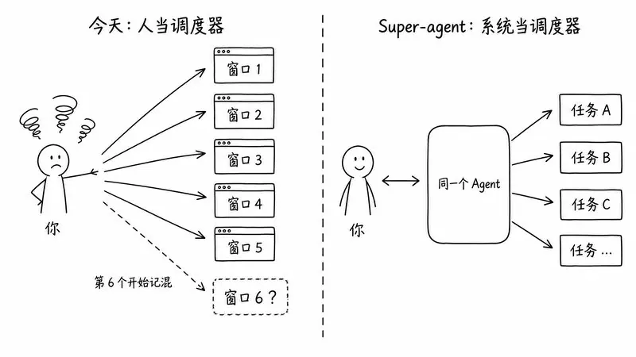

💡 用模型的技巧：先承认自己只能盯 3～5 个窗口。 同时开的对话别超过这个数。每个窗口第一句话写清「这个窗口只做 X」；隔了一段时间再切回去，先让它用三句话复述目标、已完成的部分和下一步，再继续。这样就不用靠自己的记性去记每个窗口里聊到哪了。

他们内部跑在 DeepSeek Harness 上的实例已经能做到：同一个开发任务在 IM 和 GitHub 之间接着做；在公开群里监听反馈，即使没人 @ 它，也会自己定位根因、提 Pull Request 修掉。

## 二、四个特征：连续、高产、主动、常驻

文章给 Super-agent 定了四个基本特征，我用大白话翻一遍：

| 特征 | 原文 | 用户感受到的是什么 |
| --- | --- | --- |
| 连续（Continuous） | 在用户本来就工作的地方（IM、GitHub 评论）交互，始终像同一个 Agent | 我不用琢磨「X 窗口里有没有 Y 这条信息」。在 IM 里说要方案 A，后来在 PR 评论里改成方案 B，它能理解并调整 |
| 高产（Productive） | 响应快，并行完成多个复杂任务，且每个都达标 | 上一个任务没做完，我就能下一个指令 |
| 主动（Proactive） | 不等逐步指令，监听环境事件，值得处理的就处理，不值得就安静 | 它会自己找活干，也知道什么时候闭嘴 |
| 常驻（Persistent） | 永远在线，连着真实工作环境，长期运行中能从异常里自动恢复 | 我关机睡觉，它还在干活，出错了自己爬起来 |

紧接着一句很关键：没有任何一个 ReAct 循环能同时提供这四个特征，它们只能来自围绕循环搭起来的系统架构。

这话把战场从 prompt 挪到了架构。很多人（包括以前的我）的思路是写更好的 prompt，让单个 Agent「更懂事」。DeepSeek 的意思是：这几种能力本身相互拉扯，单靠 prompt 调不出来，要靠结构来保证。

作者还有一个判断：相似的设计约束会催生相似的架构。只要目标是「一直在线、并发响应环境事件」，个人助理类 Agent 和软件开发类 Agent 最后会长得很像。而且搭这种系统遇到的问题，和计算机系统领域研究了几十年的问题高度相似，很多经典设计可以直接搬。这篇文章通篇就在做这件事：把操作系统、编译器、分布式系统的老办法，一个个套到 Agent 上。

四个特征对应五个模块：

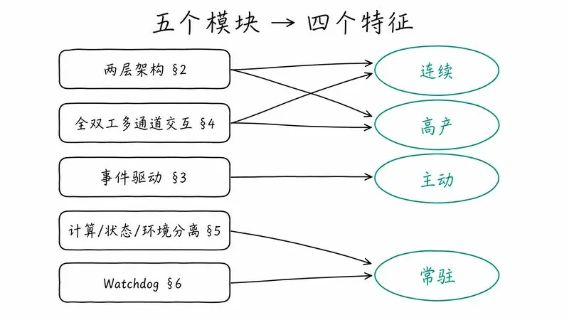

下面一个个拆。

## 三、两层架构：把「连续」和「吞吐」拆给两个人干

### 两难在哪

系统怎么组织 session，绕不开一个根本取舍：连续性 vs 吞吐量。

- 所有事件都塞进一个 session：上下文最连续，它什么都看得见。但 ReAct 循环一步一步走，单 session 速度有上限，任务慢、吞吐低；不同任务的中间细节还会混在同一个上下文里，把结果搞坏。
- 每个事件新开一个 session：并发吞吐拉满，但任务之间只要不是完全独立，缺少共享的全局上下文，结果就会各说各话。好几个 session 分别回复用户，交互也一团乱。

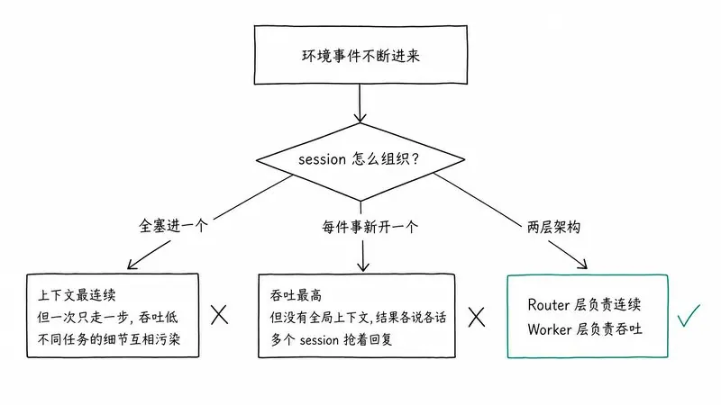

### 解法：Router + Worker

把活分给两层：

- Router 层：长期存在，负责所有和人的交互、全局协调。它是整个系统的全局顺序点、协调点和记忆。
- Worker 层：上下文隔离，高并发执行具体任务。

这样一来，上下文管理和并发执行都由系统接手，用户几乎不用再想 session 这回事，面对的始终是同一个 Super-agent。

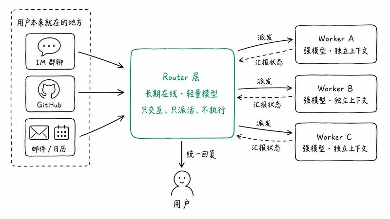

文章里有句话我很喜欢：让用户手动管理 session，很大程度上是从底层 LLM API 沿袭下来的设计习惯。Session 应该是系统的实现细节，不该是用户的心智负担。

它还指出，现在的 session 身兼两职：既管模型的上下文，又是用户做项目管理的单位。一旦产品和底层 session 解耦，项目管理就不必再沿着 session 的边界走了。给用户提供什么样的交互和任务管理，变成一个独立的产品问题。作为做产品的人，我觉得这是全文最有产品含量的一个点，后面「开放问题」里还会回来。

注意，两层只是逻辑上的职责划分，每一层内部都可以有自己的结构，不必各自只是一个 session。

### Router 层：只派活，不干活

为了不让这个唯一的全局节点变成性能瓶颈，Router 层被设计成自己不执行任务，只和人交互、派发任务，甚至可以完全不给它 Bash 工具。

这时候你会觉得：这不就是 Agent Team 吗？一个 Lead 带一群成员。文章专门做了区分：

- Agent Team 通常是把一个复杂任务拆成步骤，协调不同角色去做。步骤之间耦合紧，Team Lead 得深入理解任务、规划子任务、频繁协调，推理负担很重。
- Super-agent 的 Router 只派发任务、在高层追踪任务之间的关系，不拆解单个任务。

反过来，Agent Team 也能当两层架构用，前提是用 prompt 卡住主 session：不许自己执行，只负责对外交互，把独立任务派给成员各自去做。

两个反直觉的经验：

1. Router 的活往往比想象中简单，用轻量模型通常就能兼顾速度和质量。
2. 他们选了最直接的实现：一个长期存在的 LLM session。结果它没有想象中那么容易成为瓶颈。

原因是批处理。Router 在做一轮推理时，新进来的事件（Trigger）会排队，下一轮一起处理。事件平稳到达时，一个一个进、很快回；事件扎堆时，上一轮积压的 Trigger 自动合并，塞进同一次 LLM 调用。因为 Router 只做轻量的交互和派发，每一步通常是「长输入、短输出」，合并后的多个 Trigger 在 Prefill 阶段并行计算，单次请求耗时的增长远慢于批大小的增长。在一定范围内，积压越多，每个决策摊下来的推理时间反而越短。上限取决于上下文长度，以及模型一轮能准确处理多少个 Trigger。

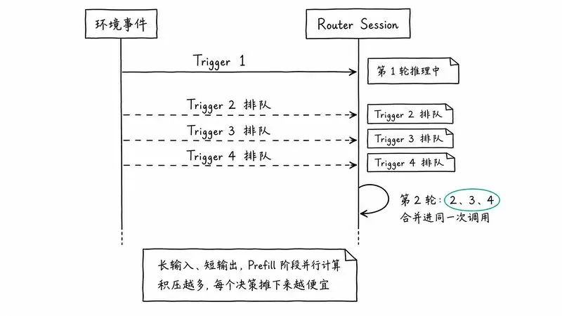

💡 用模型的技巧：小判断攒一批再问。 给邮件分类、判断哪条评论需要回、给标题打分这类「输入长、输出短」的小活，一次丢给模型十几条，让它按编号逐条给结论，比一条条问快得多。但批量要有上限，原文也说了，上限取决于模型一轮能准确处理多少条。数量太多时分几批，并抽查几条结果。

配合后面要讲的订阅直通和 Chain of Recall，单个长期 Router session 对他们目前的团队规模已经够用。真扛不住了，可以在内部做多级过滤，或者横向分片成多个 session。但分片又回到同一个取舍：分得越细，吞吐越高，各分片之间共享的记忆和上下文就越少。文章的原话是，这个取舍会一直存在，直到全局记忆问题被解决。

### Worker 层：用最强的模型，但不许对外说话

每个 Worker 有隔离的上下文和全套执行工具，专做一个任务。任务结果和代码质量直接由它决定，所以 Worker 通常需要最强的模型。

于是形成一个很合理的配置：前台轻、后台重。前台 Router 用轻模型保证响应速度，后台 Worker 用重模型保证产出质量。

Worker 有一条硬约束：不直接和人交互。它的推理过程和工具调用不进入外部渠道，只向 Router 汇报状态，所有对用户的回复由 Router 统一发出。并发和质量都保住了，也不会出现几个 session 抢着回复的混乱。

并发的 Worker 之间通常不需要直接通信。冲突一般出现在共享的工作环境里，比如同一个 PR。只要相关 Worker 都订阅了那个环境的 Thread，就会收到同样的事件通知，有机会自己发现、自己解决冲突。少数需要跨任务协调的情况，由 Router 转达。

Worker 内部同样可以再开 subagent，或者本身就是一个 Agent Team，这对上层 Router 透明。

这套结构对个人助理也成立。个人助理通常只有一个聊天页面，用户在里面同时聊好几个话题：前台页面保持对话连续，后台给每个话题派一个 Worker，并行干活、并行起草回复。

💡 用模型的技巧：自己搭一个「手动版两层架构」。 开一个主对话当项目经理，只负责记需求、拆任务、记录决策，不在里面写正文、改代码。具体的活各开一个新对话，用最强的模型干。执行窗口干完，只把结论（三五行）贴回主对话。主对话可以用便宜、快的模型，执行窗口才用贵的模型，也就是前台轻、后台重。

## 四、事件驱动：Agent 的输入不再是你打的字

要让 Agent 主动，首先得换掉驱动系统的东西。Agent 的主要输入不再是人一条条敲进 session 的 prompt，而是环境里的半结构化事件：群聊消息、邮件、日历提醒、代码评审意见、CI 结果。文章把它们统称为 Trigger。

一个事件从到达到被处理，要走四步，每一步都在前一步的基础上。

### 1. 事件过滤：快路径 + 慢路径

接上真实群聊和代码平台之后，系统面对的是一条噪音大、触发率低的事件流，绝大多数日常消息根本不需要 Agent 动手。每条都让大模型从头判断，延迟和算力都扛不住。

他们借了计算机系统里的 Fast Path / Slow Path：

- 程序化策略（Fast Path）：代码基于确定性条件做快速准入，比如事件来源、群组、用户或 bot 白名单。每个来源可以设成「只响应明确请求」「视为候选事件」或「忽略」。大部分无关消息在调用模型之前就被筛掉了。
- 语义策略（Slow Path）：通过程序检查的候选事件交给 LLM，结合上下文和写成 prompt 的策略，判断要不要行动。

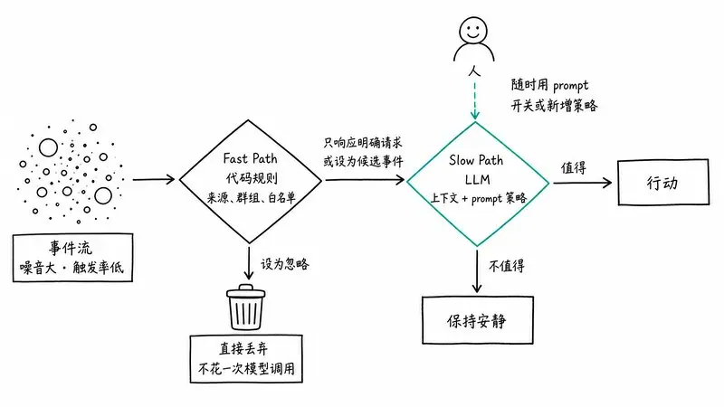

我觉得这里有个很漂亮的设计：语义层同时是一个自然语言扩展点。人随时可以用 prompt 开关策略、加新策略，不用改代码。

原则可以概括成一句：频繁、明确、稳定的判断沉淀成代码；需要理解语义的才交给模型。 我自己做 Skill 也该这么想：能写成规则的就别让模型每次重新判断。

💡 用模型的技巧：先用规则筛，再交给模型判断。 把一大堆材料丢给模型之前，先用确定的条件筛一遍：时间范围、来源、关键词、表格里能直接筛的列。只把剩下需要「理解」的部分交给它。写 prompt 时也一样：能写成明确条件的（「只看过去 7 天」「忽略机器人发的消息」），就别写成「你看着办」。

### 2. 事件路由：订阅直通

如果已分派任务的每条后续事件都得先经过 Router，这个全局节点负载就太重了。所以路由也分快慢：

同一个 GitHub PR、同一个 IM 话题、同一条邮件链上的连续事件，构成一条事件流，叫作 Thread。Router 为某个 Thread 的第一条事件创建 Worker 时，这个 Worker 就直接订阅这个 Thread。之后：

- 已订阅（Fast Path）：代码把后续事件直接透传给订阅的 Worker，Router 不用再调一次工具去转发。如果新事件超出当前任务范围，Worker 可以退订，或者把事件交还 Router 重新派发。
- 未订阅（Slow Path）：Router 依然能看到所有事件，用于追踪全局状态，但只对没有订阅者的新事件做判断和派发。

Thread 和 Worker 是多对多订阅：一个 Worker 可以订阅多个相关 Thread，一个 Thread 也可以有多个 Worker 订阅。几个 Worker 在同一个工作环境里撞上时，共享 Thread 的新事件会同时推给所有订阅者，它们借此了解彼此在做什么，自己化解冲突，不需要点对点通信。输出端不变：Worker 把关键结论报给 Router，由 Router 统一回复用户、同步全局记忆。

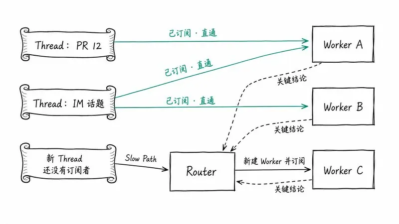

💡 用模型的技巧：一条线索对应一个对话。 同一件事的后续反馈（改稿意见、报错、新要求）都回到原来那个对话里说，不要换个窗口重新讲；真正的新事再开新对话。两个对话碰到同一份材料时，把对方的结论贴过去，让它们「订阅」同一份事实，不用你在中间传话。

### 3. 上下文组织：把上下文窗口当缓存

事件路由到目标 session 之后，下一个问题是：往模型的上下文里放多少东西？

塞多了，窗口被占满，模型注意力被稀释；塞少了，模型得反复调工具去读，执行步骤变多。原文一句话：浪费上下文窗口，就是浪费模型的智能。

所以他们把有限的上下文窗口当成缓存，借编译器优化的术语，归结为两个基本操作：

- Inline（内联）：把很可能马上要用的信息直接放进当前窗口，省掉额外的工具调用往返。
- Spill（溢出）：信息超出预算或很少用时，完整内容放在窗口外，窗口里只留引用或摘要，模型需要时再按图索骥去读。

再结合计算机系统里的经典概念局部性（locality），事件注入和工具调用可以一步步优化：

1. 从最少信息开始：一开始只给当前对象的 ID 和内容摘要。
2. 按局部性逐步内联：先内联紧密相关对象的 ID，再加上空间或时间上相邻的内容，比如内容的前 50 个字符、一条 IM 消息前后的消息和它回复的那条、同一个代码评审讨论里相邻的评论。
3. 超限内容溢出：长内容设一个较小的长度上限，超出部分截断，留一个指针告诉模型后面还有、在哪，需要时调工具读剩下的。

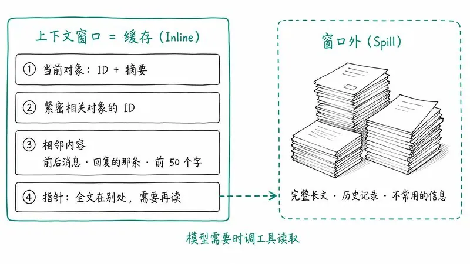

💡 用模型的技巧：喂资料别一次全倒进去。 先给目录、摘要和每段材料在哪，让模型说它需要看哪几部分，再把那几部分贴给它。长文按章节分段给，每段开头标上编号。窗口里留的是马上要用的内容，加上指向其余内容的「指针」。塞太多，模型注意力被稀释；给太少，它只能瞎猜。

Router 层自己也有上下文难题。大量后续事件直接透传给了 Worker，长期运行中历史任务越积越多，Router 不可能把每个任务的完整历史都放在窗口里。可用户在另一个渠道提起一个老任务时，Router 还得把它的上下文找回来。

把 Inline & Spill 一致地应用到系统里所有对象上，就得到一个按需、多跳的检索机制：Chain of Recall。

- Trigger、Thread、Worker Session 等对象都有唯一 ID;
- 注入一个对象时，顺带内联与它紧密相关对象的 ID，这些 ID 把对象连成一张引用图；
- 通过工具调用召回的每个对象也遵循 Inline & Spill，返回结果里又内联了下一跳对象的摘要和 ID。

于是模型可以从当前事件出发，顺着引用一跳一跳往回找，需要多远就找多远。比如：从当前消息所在的 Thread，顺着内联的 ID 找到相关的 Worker Session，再从这个 Worker 找到另一个与之关联的代码评审 Thread。

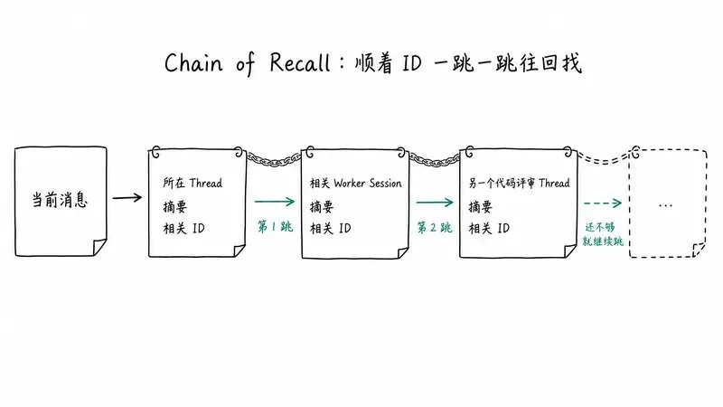

我很喜欢这个设计，因为它不依赖什么复杂的向量记忆，靠的是结构化的 ID 和摘要。思路很朴素：别想着把所有东西都记住，记住去哪儿找就行。

💡 用模型的技巧：给东西起编号，再维护一份索引。 长期项目里，给任务、文档、版本起固定的名字或编号（比如「v2.0 草案」「测试报告-03」），再维护一份索引文档，每条一句摘要加一个链接。开新对话时先把索引给模型，让它按编号去找需要的那份。这就是一个手动版的 Chain of Recall。

### 4. 提前行动：推测执行

最后一步借了 CPU 的推测执行（speculative execution）：根据环境信号，在还不确定结果会不会被用到时，就先在后台开工。用额外的后台算力，换人少等、少插手。有用的结果交付，没用的丢掉。

- 个人助理场景：收到会议邀请邮件或待办消息，Agent 在后台先查日历冲突、收集背景资料、起草回复，用户只需要看一眼草稿再发。
- 研发协作场景：他们在内部 DeepSeek Harness 用户群里配置了一条「静默复现并修复」的策略。有人报问题或讨论改动时，Agent 先尝试复现问题……

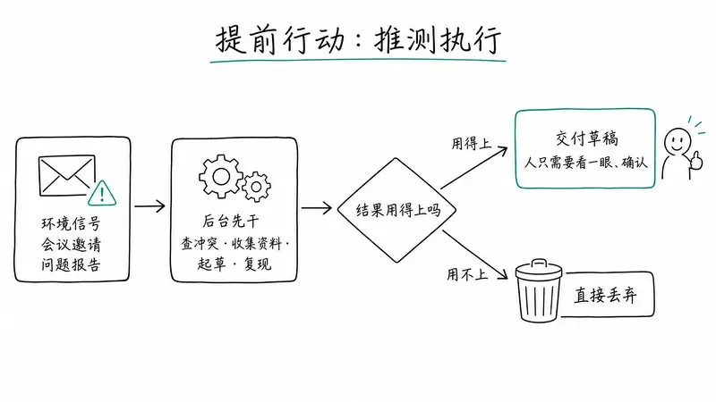

💡 用模型的技巧：让它先给草稿，别先回答一堆问题。 布置任务时加一句：「先按你的理解给我一版能用的草稿，不确定的地方用【待确认】标出来。」改一份草稿，比先回答十个澄清问题省力得多。用不上就扔掉，模型的时间比你的时间便宜。

（说明：我抓到的原文在这一处之后有一段缺失，3.4 节剩下的部分和第 4 节开头没能读到，下面第 4 节只根据能读到的部分来写。）

## 五、全双工多通道交互：不同渠道，不同说话方式

从能读到的部分看，第 4 节的核心是：人在群聊、邮件和 GitHub 讨论里说话的方式不一样，Agent 也得按渠道调整详略和回应方式。详细的推理过程和工具调用日志放在单人终端里也许合适，原样贴进群聊只会把人淹死。

两层架构已经解决了一部分：每个任务啰嗦的推理和频繁的工具调用都关在 Worker Session 里，不会直接流到外部渠道，对外交互全部由 Router 负责。在此之上，系统还需要接入用户每天用的工作环境，并用 prompt 给每个渠道定交互规范：

- IM 等即时渠道：轻量沟通，尽量少打扰。像一个人类同事那样，只在需要决策或签字时才通知，只问直接的问题，只给简短的结论。他们验证过一条简单有效的硬规则：每条回复不超过 100 个词。
- GitHub、邮件、文档等异步渠道：给结构化、信息密度高的输出。比如创建或更新 PR 时，按项目规范写清完整的问题背景、改动说明和验证结果。个人助理场景里，直接起草结构化的邮件和文档摘要。

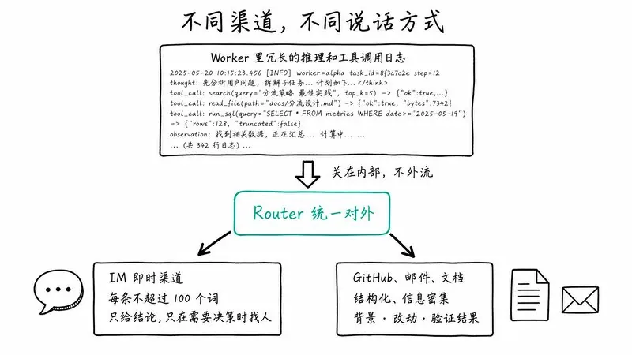

再结合第一节「高产」那条（上一个任务没完成就能接下一条指令），所谓「全双工」，我的理解是：人和 Agent 不再是你说一句、它干完、再轮到你的半双工对讲机，两边可以同时说、同时做。

100 词这条规则，我觉得每个做 Agent 产品的人都该抄。很多 Agent 在 IM 里的体验差，不是它笨，是它话太多。

💡 用模型的技巧：在 prompt 里写明「发到哪」和「多长」。 要发到群里的，写「这是群消息，100 字以内，只说结论，以及需要谁决定什么」；要写进文档的，写「按背景、方案、验证结果三段写」。不说渠道，模型默认会用它最习惯的长篇格式。

## 六、计算、状态、环境三者分离

本地 Agent 默认把三样东西绑在一台设备上：

1. 跑 Agent Loop 的计算；
2. 需要持久化的 session 状态；
3. 执行环境，比如代码仓库和本地工具链。

设备一睡眠或断网，Agent 就停了，而且它碰不到其他设备上的环境。

他们借了存算分离的思路，分两步解耦。

### 第一步：计算和状态分离

跑 Agent Loop 的计算本身可以是无状态的，只有 session 状态需要持久化。所以计算放进无状态、可弹性伸缩的云端容器，session 等持久状态存数据库。容器可以扩容、重启、替换，持久存储保证 session 和任务的连续性。本地设备睡了，Agent 在云上照常在线。

### 第二步：计算和执行环境分离

Agent 上云了，可它要干活的环境（代码仓库、本地文件、依赖服务）怎么办？模型用到的很多上下文来自对这些环境的工具调用，所以广义上讲，执行环境本身就是上下文的一部分。

常见做法有两种，都不理想：

- 在云端起沙箱、拉代码、尝试重建并同步环境。但真实环境里常有未提交的本地改动、私有凭证、对内网服务的依赖、特定的硬件或工具链，同步代价高，还容易漏。
- 让用户放弃本地环境，把工作整体搬上云。对很多用户来说迁移成本太高。

他们的思路是：既然难复制、难同步的恰恰是环境本身，那就别把它跟着 Agent Loop 一起搬上云。Agent Loop 在云上，重状态的执行环境原地不动，每个端点只装一个轻量 daemon：不存任何 session 状态，只负责执行命令、返回结果。Agent 需要时去环境里读上下文。

文章提到 Anthropic 的「Decoupling the brain from the hands」走的是同一条路：harness 无状态，session 日志存在外面，执行环境通过统一接口按需接入。区别在场景：Anthropic 那篇讲的是托管服务，主要讨论按需创建的沙箱和客户 VPC 里的资源；DeepSeek 要先接的是人们每天在用的个人电脑，上面有未提交的改动和本地凭证，而且可能时在线时不在线。

所以他们支持 BYOM（Bring Your Own Machine）：把用户自己的开发机或个人电脑接到云端 Agent 上，同时也支持云主机和按需创建的计算环境。结果是 Agent 不再绑死在一台机器上，可以在任务需要的任何环境里执行命令、读取上下文；甚至能配合间歇在线的设备：个人电脑重新连上时，云端 Agent 自动开始并完成那些必须在这台设备上跑的任务。

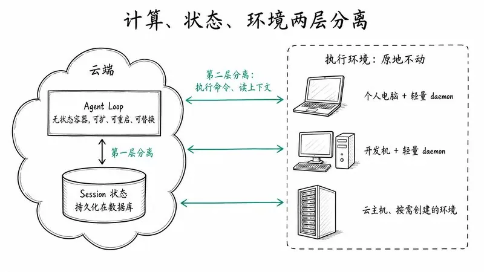

💡 用模型的技巧：把状态存在对话外面。 需求、已做的决策、待办和当前进度，写进一份文档，不要只留在聊天记录里。聊天窗口相当于可以随时替换的「计算」，文档才是持久的「状态」。这样换窗口、换模型、隔一周再回来，都能从文档接上。

## 七、Watchdog：给 Agent 配一个外部监工

光有存算分离还不够常驻，系统还得在长期运行中自己从异常里恢复。文章的判断是：一个长期在线的分布式系统，只靠内部逻辑很难长期可靠，需要主系统之外一个独立的控制回路（Control Loop）。

而且 Agent 系统需要的不只是传统的进程存活探针或监控脚本。很多异常不是崩溃：进程还活着，但模型卡在了无效循环里，或者已经偏离了目标。所以长期运行的 Agent 系统既要监控基础设施是否存活，也要监控任务有没有实际进展。

他们的做法是一个独立的 Watchdog Session，运行在主系统之外，由定时消息驱动：

- 处理基础设施故障，比如 API 报错、状态恢复失败；
- 用模型判断每个 Worker 是否在实质推进，还是已经偏离总体目标；
- 及时修复异常，对暂时性的外部故障持续复查，直到解决。

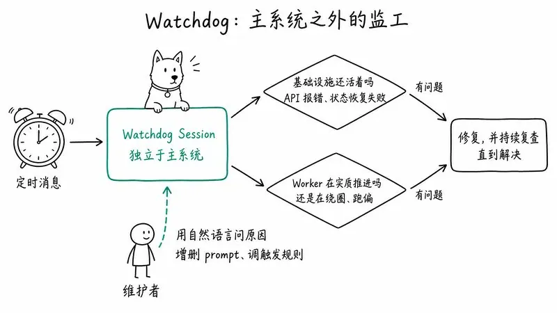

更妙的是，Watchdog 本身就是一个带全套工具的 Agent session，维护者可以用自然语言问它为什么出错，也可以让它在系统运行中纠正主系统的行为，比如增删 prompt、调整触发规则。

监控系统本身也是一个能对话的 Agent。这一点对我这种不会写代码的人特别友好：出了问题不用看日志，直接问它。

💡 用模型的技巧：另开一个「检查员」窗口。 长任务做了一段之后，把最初的目标和当前产出贴进一个全新的对话，只让它判断两件事：有没有实质进展，有没有偏离目标。原来那个对话陷在自己的上下文里，很难发现自己在绕圈。如果发现它在绕圈，别在原窗口里继续催，让它写一份进度总结，带着总结换个新窗口重来。

## 八、实验：数字说明了什么

文章做了两组初步实验，并且自己说得很清楚：用的是合成负载和简化环境，部分设置还可以更严谨，结果仅供参考。

### 实验一：消融对比

四种端到端设计同时跑，用群聊和 GitHub CI 消息流驱动。每轮约 300 条消息，其中约 20 条是真正的工作请求，其余是闲聊、追问、取消和 CI 消息。编码工作用一个「只消耗时间」的工具模拟，所以测的是调度和协调能力，不是单个任务的执行能力。每种设计跑 5 次。

四种设计：

1. Super-agent
2. Super-agent 去掉订阅直通（without Pass-through）
3. 单 session + subagent 工具，中性 prompt：「Use a subagent for a piece of work when appropriate...」
4. 单 session + subagent 工具，优先委派 prompt：大意是「每条群聊消息都会到你这里，你自己做的活会被新消息不停打断，尽量把每块工作交给单独的 subagent，自己只做小事……」

结果：

| 设计 | 结果 |
| --- | --- |
| Super-agent | 任务完成时间 p50 **12.4 分钟**，p95 **15.7 分钟**，明显快于单 session 方案 |
| 单 session + 中性 prompt | 5 次里**一次都没调用 subagent**，所有活都在主 session 里干，被新消息不停打断，p95 达到 **29.5 分钟** |
| 单 session + 优先委派 prompt | 5 次里有 4 次委派了，完成时间有所下降，但整体仍比 Super-agent 长；剩下那次模型觉得活「很小」就自己干了，拖出一条长尾 |
| Super-agent 去掉直通 | 完成时间和 Super-agent 差不多，但 Router 每轮多做约 **30%** 的决策，总 cache-read token 从 **23.2M 涨到 31.8M**，多了约 **37%** |

我读出来的三个结论：

第一，靠 prompt 让模型「自觉委派」不可靠。 单 session 方案要不要委派，全看 prompt 怎么写和模型当场怎么判断。中性 prompt 下它压根不委派；就算你苦口婆心劝它委派，它还是会偶尔觉得「这活小，我自己来」。两层架构在系统层面解决了这个问题：Router 本来就不干活，Worker 只收到自己订阅的 Thread 的消息。用结构约束行为，比用 prompt 劝说行为稳定得多。 这条我想刻在做 Skill 的桌子上。

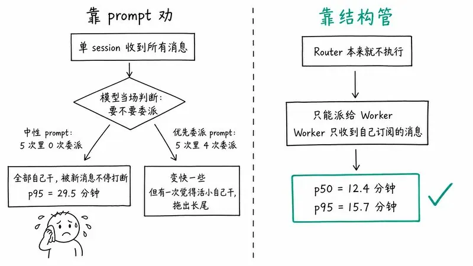

💡 用模型的技巧：不想让它做的事，就别给它做的条件。 想让模型只出大纲、先别写正文，与其在 prompt 里反复强调「不要写正文」，不如把流程拆成两步：这一轮只要大纲，你确认后再开下一轮写正文。想让它只审稿不改稿，就只让它输出问题清单。能用流程卡住的，就别只靠叮嘱。

第二，Super-agent 是拿 token 换时间。 它维护多个独立 session，每轮的 cache-read token 比单 session 方案多，换来的是更短、更稳定的完成时间。文章没回避这个代价。

第三，订阅直通不提速，但省钱。 在这个负载下，直通没有让任务完成得更快或更好，但大幅降低了 Router 的 token 消耗和推理开销。

### 实验二：Router 的批处理

单独给 Router 层做压测：Router 调真实模型，Worker 用 mock 模型。把需要决策的 Trigger 到达速率从每分钟约 1 个逐步提到约 40 个。

| 指标 | 约 1 个/分钟 | 约 40 个/分钟 |
| --- | --- | --- |
| 平均批大小 | 1.0 | 2.8 |
| 单次请求耗时 | 2.5 秒 | 3.9 秒 |
| 每个决策的摊销推理时间 | 6.4 秒 | 1.6 秒 |

（一个决策可能包含好几次 LLM 请求，因为 Router 派发前可能要多步推理或调工具召回上下文，所以每个决策的时间可以大于单次请求时间。）

请求耗时的增长慢于批大小的增长，于是事件越扎堆，单个决策越便宜。这也解释了实验一：去掉直通后 Router 峰值负载上去了，但单个 Router 依然没到吞吐上限。所以在他们当前的团队规模下，没必要为了吞吐提前把 Router 分片、牺牲全局上下文的连续性。

这是很工程师的克制：先用最简单的结构，有数据证明扛不住了再拆。

## 九、还没解决的四个问题

文章坦白，系统之所以能保持相对简单，很大程度是因为现阶段他们简化了工程设计，也收窄了支持的场景。开放问题有四个：

1. 两层架构怎么扩展。 目前「单个长期 Router + 订阅直通 + Worker 之间不直接通信」这个简单组合，以很低的工程成本覆盖了他们大部分日常任务。但任务更大、耦合更紧，超出一个 Router 能处理的范围之后，每一层该是什么结构还没定：Router 什么时候分片、分多细，Worker 什么时候该直接通信、用什么协作拓扑，都要更多场景来验证。另一个方向是系统和模型协同设计：专门为 Router 的工作（判断事件、批量派发、召回上下文）训练模型。还有记忆：Chain of Recall 主要解决近期任务和会话历史的按需检索，系统跑上几个月以后，长期记忆会成为主要瓶颈。

2. 没有 session 之后，人怎么和 Agent 一起工作。 底层执行 session 不再和界面上的对话一一对应时，新问题来了：怎么把任务呈现给用户？什么样的交互和项目管理才自然？作者认为聊天窗口成为交互中心，部分是路径依赖，更多交互可能会搬进领域专属界面，比如他们的实例就直接在 GitHub Issue 和 PR 里工作。界面上也可以继续保留「会话」，因为用户习惯了，但用户看到的一个对话，不必对应底层的一个 session。另外，在模型快速进步的过渡期，很多任务中途仍需要人。怎么让用户在关键细节上逐步介入、随时插手、接管或和 Agent 实时协作，同时不损失后台自主工作的效率，值得探索。最终的项目管理和交互形态高度取决于工作领域和个人风格，很可能是高度定制的。

3. 上下文边界和 A2A 协作。 前面都假设一个实例范围内的信息都汇集在一个全局上下文里。从个人、小团队走向更大的组织时，怎么部署 Super-agent，本质上就是决定哪些上下文共享、哪些隔离：需要共享的部门共用一个实例，需要隔离的各自一个。隔离的实例之间协作就是 A2A（agent-to-agent，泛指，不是某个特定协议），比如每个成员的个人 Agent 和团队共享的 Super-agent 之间。没有共享上下文、各自代表不同权限边界的 Agent 之间，怎么安全可靠地沟通协作，还没解决。

4. 安全与隐私。 事件驱动让更多环境能驱动 Agent，也让它暴露在更多不可信输入之下。第 5 节的设计隐含了一个前提：云端和端点互相信任。但云端 Agent Loop 不停吞入外部事件，端点设备上放着私有代码、敏感数据和本地凭证，两者一连，风险很大：服务端被入侵或者遭到 prompt 注入，所有连着的端点设备都可能被接管。即使云端没被攻破，只要端点上的凭证能进入模型上下文，正常执行也可能把它泄露出去。所以 Agent 需要一种用凭证却看不到凭证的方式。这个问题不解决，Super-agent 只能在很小的可信范围内工作。

## 十、我的几点读后感

原文结尾说得很谦虚：这套设计没有提出新理论，只是把计算机系统领域的经典工程思想用到 Agent 系统上。具体实现会随技术发展而变，但背后的系统设计思想会更持久。

我同意，也正因如此，这篇文章对我这种不写代码的产品人反而更有用。它给的不是某个框架的用法，而是一套判断框架：

一、先问瓶颈在哪。 模型越来越不需要人插手单个任务，生产力的瓶颈正在转向人的注意力。那么所有设计都应该围绕一个目标：让人从执行细节往上走，走到更高层的决策和签字。 衡量一个 Agent 产品好不好，不只看它能不能做对一件事，还要看它需要我盯多少眼。

二、用结构，别只用 prompt。 实验一里那个「被劝了还是自己干」的模型，我在自己的 Skill 测试里见过无数次。prompt 是建议，结构才是约束。能写成规则的写成规则（Fast Path），只把真正需要理解的交给模型（Slow Path）。

三、session 是实现细节。 这句话会长期影响我对产品的想法。我们习惯了「一个对话框 = 一个任务」，但这只是 LLM API 留下的形状。用户真正想管的是任务和项目，不是上下文窗口。

四、上下文是缓存，不是仓库。 Inline & Spill 和 Chain of Recall 给了一个非常朴素、可落地的思路：窗口里只放马上要用的和指向其余内容的「指针」，需要时一跳一跳去找。

五、说话要分场合。 群里不超过 100 词，PR 里写清楚背景、改动和验证。这是做 Agent 的规矩，也是做同事的规矩。

最后，把全文的技巧收成一张图，方便截图存着：

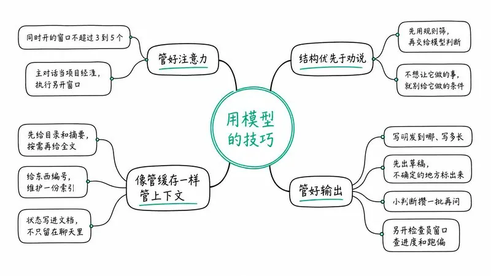

文章里描述的部分设计已经在 dsh-superagent-prototype 中实现。官方特别强调，这个插件只是验证技术路线的原型，不是 DeepSeek 的正式产品。他们内部基于这些思路和 DeepSeek Harness 搭的 Super-agent 实例已经在持续运行，每天帮着复现和修复问题、回应代码评审，以及开发 DeepSeek Harness 本身。

用原文最后的话收尾：这样搭出来的 Agent，不再只是一个等指令的聊天窗口，而是一个常驻在人们所用的数字环境里的自主协作者。对个人，它可以是跨设备帮你处理日常事务的个人助理；对团队，它会成为研发流程的一部分，接任务、推进任务。

## 相关页面

- [[sources/khazix-agent-automation-system]]
- [[concepts/deepseek-harness-agent-formula]]
- [[concepts/durable-execution]]
