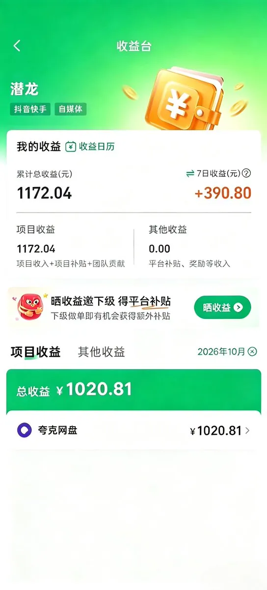
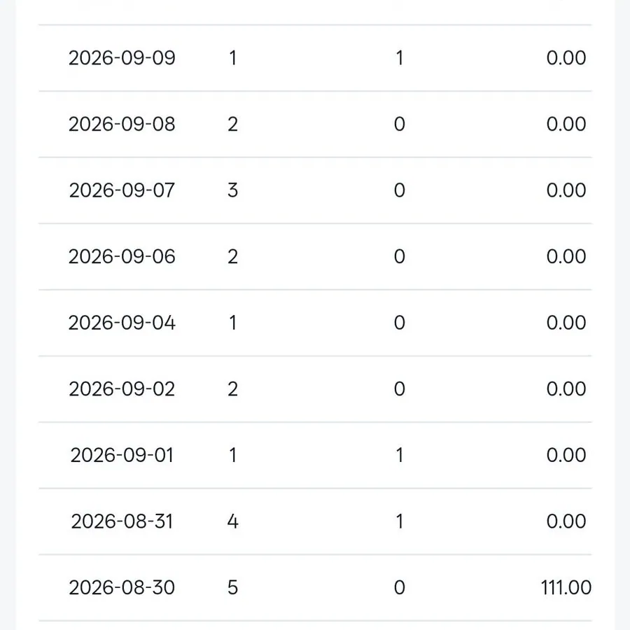
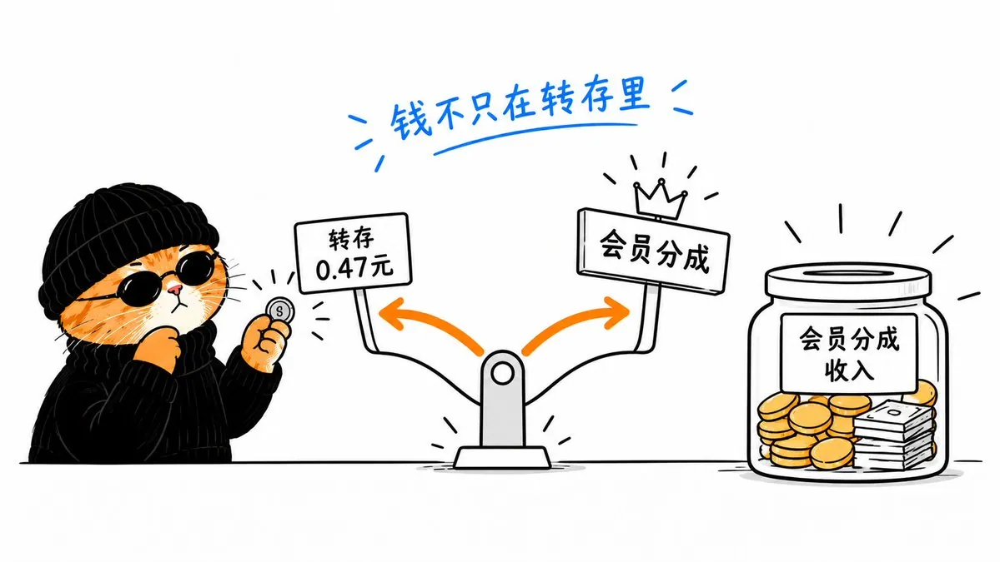
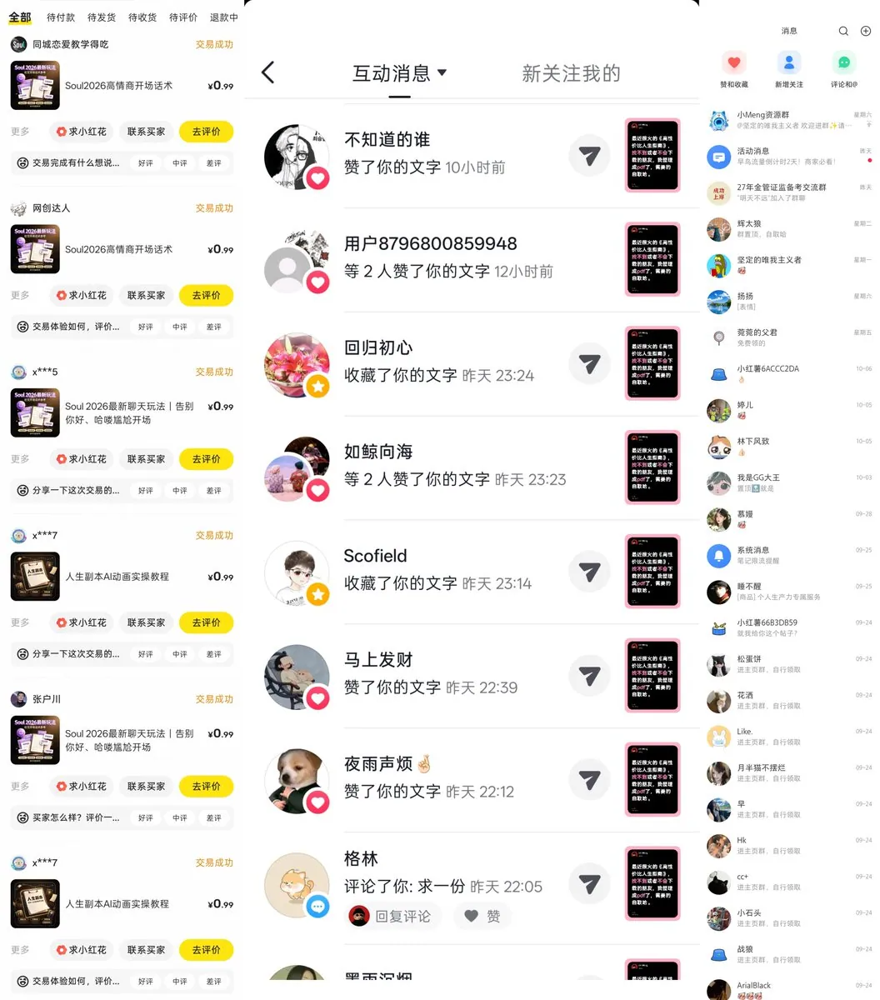
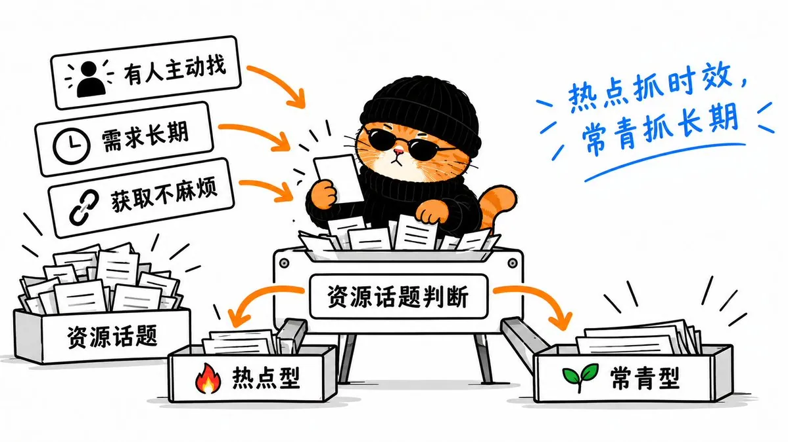
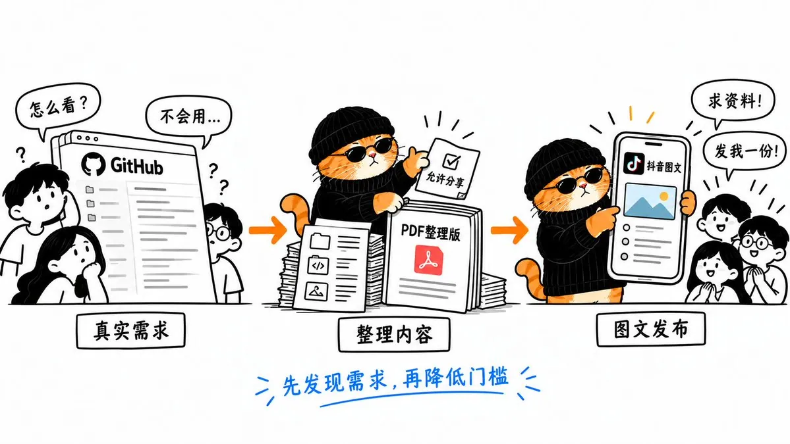
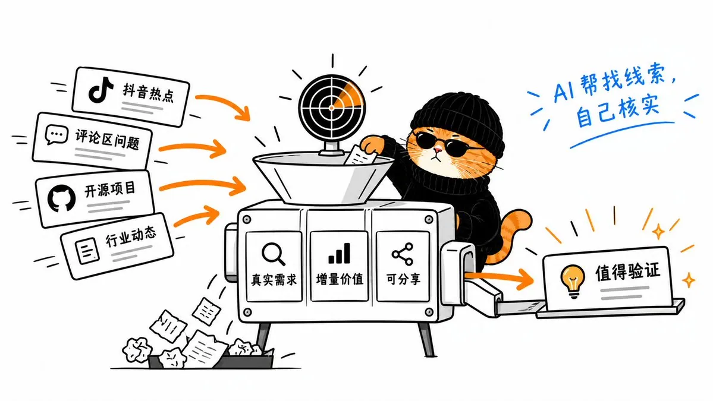
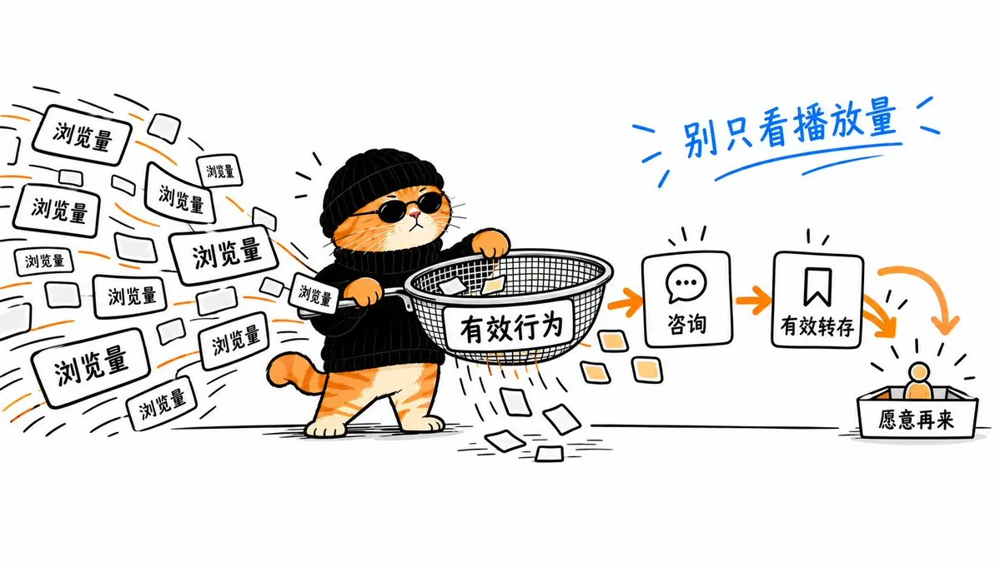
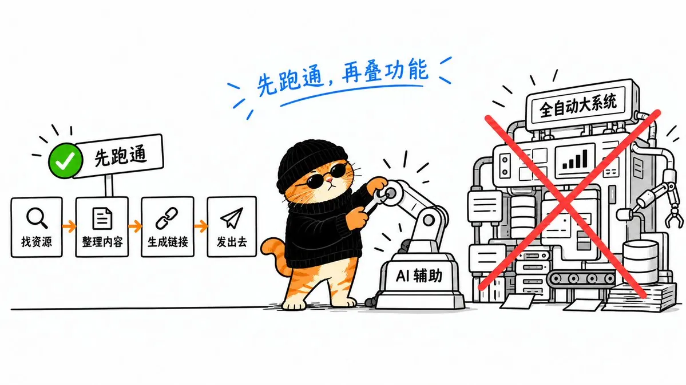
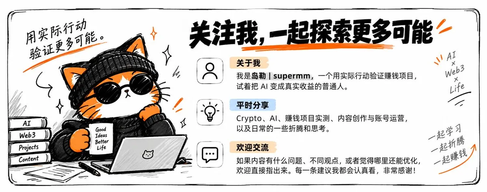

# 岛勒（@supermm518）：网盘拉新——9 月忙一个月赚 100 多，10 月一条抖音赚了近 1000 块

> 网盘拉新项目的完整实操复盘：从每天发资料只赚几毛钱的坚持期，到靠一条《高性价比人生指南》抖音图文爆量带来近 1000 元收益的转折；讲透如何找热门资源、如何判断选题值不值得跟、如何用 AI 做推广图文，以及抖音、小红书、闲鱼、微博、X 各平台的实际差异；并记录 X 账号从零粉涨到 500 多却突然被封、后台单日多出 100 多元才意识到会员分成的重要性等教训——结论是赚钱真正难的不是找资料而是找用户。

<!-- more -->

9 月份，我做网盘拉新整整一个月，才赚了一百多块钱。

那时候基本每天都在发资料，可后台一天也就几毛钱，多的时候几块钱。账号没粉丝，资源没人看，偶尔有人转存一下，都觉得今天没白忙。

结果到了 10 月，情况突然变了。

我在抖音发了一条《高性价比人生指南》的图文帖，没想到直接爆了。连续几天都有人来问我要资料，这一波带来的网盘推广收益，我估算接近 1000 块钱。

截至当时的后台记录，我的累计收益已经到了 1172.04 元，近 7 日 390.80 元。



说实话，这个数字在很多人眼里不算什么。但对我来说，从一天几毛钱做到现在，中间有不少东西值得拿出来聊聊。

这篇文章，我主要分享自己怎么找到热门资源、怎么判断一个选题值不值得跟、怎么用 AI 做推广图文，以及抖音、小红书、闲鱼、微博和 X 这些平台，我实际做下来有什么不一样。

另外，还有几件事挺有意思：一个 X 账号从几乎零粉涨到 500 多却突然被封；某天后台突然多出 100 多块钱，我才发现会员分成这么重要；以及为什么我做了一圈下来，发现赚钱真正难的不是找资料，而是找用户。

不只是讲我怎么赚到了钱，也会把具体做法、踩过的坑，以及如果重新做一遍我会怎么安排，尽量讲清楚。

文章比较长，如果你也在研究副业、内容创作或者自媒体起号，可以慢慢看，里面有些思路以后做别的项目也能用上。

我是岛勒，平时主要折腾 AI、Crypto，也会自己下场验证各种能不能真正落地的赚钱项目。

对了，这篇是网盘拉新系列的第二篇。

如果你连网盘拉新怎么注册、怎么申请推广权限、怎么转存生成链接都还不知道，我在上一篇已经从头到尾讲过一次了。

引用推文：岛勒｜Supermm (@supermm518)

https://t.co/ChFLMjdSJk

https://x.com/supermm518/status/2110723386133614603

这篇就不重复那些基础操作了。

直接聊聊我这一千多块钱，到底是怎么折腾出来的。

## 一、一天赚几毛钱，我却坚持了一个月

其实这个项目，我 4 月份就看到了。

当时没做，主要是手里还在折腾其他项目。那时候特别沉迷 AI 写代码，前端页面让 AI 写得漂漂亮亮的，看着挺像那么回事。

但后来才发现，页面好看有什么用？

部署不会，数据库不懂，真正的业务流程也跑不通。折腾半天，基本属于自己和 AI 玩得挺开心，项目却没真正落地。

所以网盘拉新这件事，就这么被我搁置了。

直到 8 月下旬，我才重新捡起来研究。

当时也没什么经验，就是一点点摸索，研究人家怎么分享资源、怎么申请推广、怎么做内容。

最开始，我主要在 X 和微博上发。

说白了，就是冷启动。拿着几乎没有粉丝的账号去发资料，根本没几个人看。

一天通常只有一两个人转存，好一点两三个人。

你想想，当时移动端转存一次才 0.47 元。一天两个人，也就是不到一块钱。

这点钱，估计很多人看不上。

但我当时为什么还愿意做呢？

原因特别简单：操作成本确实不高。

最开始完全靠手动，一天找找资源、整理一下、发出去，熟练以后，十分钟左右就能完成一轮简单操作。

不需要天天守着，也不用投入什么大成本。哪怕白天上班，晚上抽点时间也能试试。

当然，如果认真研究热点、制作内容、维护账号，十分钟肯定不够。我说的是最早期那套很简单的手动流程。

所以我就一直坚持发。

当时我的想法是，反正投入的时间不多，先做着呗。

谁知道后面有一天，我打开后台，突然发现多了一百多块钱。

我当时都愣了。

不是，这每天才四毛七，哪来的 100 多块钱？

## 二、突然多了 100 块，我才发现钱不只在转存里

我赶紧去看收益明细。

一看才知道，原来是会员分成。

之前我虽然知道网盘拉新有拉新、转存、会员分成这几种收益，但刚开始做的时候，注意力基本都放在转存上。

因为每天最直观能看到的，就是今天又有几个人转存了资料。

至于拉新，我做了挺长一段时间，实际上也没拉到多少新用户。

后来我想明白了，现在夸克、百度网盘这些产品已经有很多老用户了。至少从我自己的推广经历看，找到符合活动条件的全新用户并不容易。

所以拉新单价虽然高，我反而不会把主要希望都放在这里。

但会员分成就不一样了。

用户原本只是想保存一份资料，后续如果因为容量、下载等实际需要购买会员，而且符合对应推广规则，就可能产生会员分成。

那次突然多出 100 多元，让我第一次真正感受到：做网盘推广，不能只盯着那 0.47 元的转存佣金。



当然，会员分成不是每个转存用户都会带来，更不是什么稳定被动收入。最终还要看用户需求和平台规则。

但这次经历确实改变了我对这个项目的看法。

以前看到拉新 10 元、转存 0.47 元，我下意识就觉得拉新更值钱。后来才发现，单价高，不等于自己就容易拿到。

如果你也刚开始做，我建议不要只看推广报价，最好把后台的有效拉新、有效转存和会员分成分开记录。

这样做一段时间以后，你才知道自己的收入主要来自哪一部分。



那段时间，虽然佣金没赚多少，我的 X 账号反倒做起来了。

发资源分享，粉丝涨得还挺快，没过多久就到了 500 多。

我一看，原来分享资源不仅有机会获得推广收益，还能帮一个几乎没粉丝的账号起步。

正准备继续做下去，结果另一件事来了。

账号被封了。

## 三、500 多粉的账号，说没就没了

那是我一个之前一直拿来潜水的 X 老号。

原本没怎么发过内容，后来想着账号闲着也是闲着，就拿来做网盘资料分享。

没想到粉丝涨得挺快，做到了 500 多。

结果大概 9 月中旬，有一天突然就不能正常用了。

平台把账号判定为机器人相关异常。我尝试申诉，折腾来折腾去，最终也没恢复。

当时是真郁闷。

好不容易把账号做起来了，结果说没就没。


后来我专门研究了一下 X 的相关规则，才发现有些地方确实值得提前注意。

比如，大量发布重复或高度相似的内容、反复发没有实质说明的链接、批量发送未经请求的私信，以及不符合平台规定的自动化操作，都可能受到限制。

但我没有证据证明自己当时具体触发了哪条规则，所以封号原因这里不乱猜。

对做网盘拉新的人来说，这次经历至少让我明白：不能把「每天复制资源链接、发出去」当成完整的内容运营方法。

如果你准备通过 X 长期做资源分享，我现在更建议这样操作。

首先，想清楚你准备服务哪类人。

比如专门整理 AI 工具教程，就持续围绕 AI 工具、GitHub 开源项目、实用操作方法去做；如果是求职资料，就围绕简历、面试和求职技巧展开。

其次，别让每条帖子都只剩一个下载链接。

同样分享一份 AI 工具教程，你可以告诉别人这个工具解决什么问题、适合哪些人、有什么使用门槛，再配上自己的体验和截图。

别人看完以后，哪怕不打开网盘，也能获得一点有价值的信息。

最后，认真区分正常内容发布和刷屏。

我现在仍然会研究定时发布、自动化这些东西，但定时发不等于可以把同一段内容复制几十次，更不能靠批量私信和重复账号制造流量。

这里还有个容易被忽略的问题：账号涨了 500 粉，不代表这 500 个人就是你的目标用户。

如果别人关注你，只是为了拿一份资料，之后你突然开始发完全不相关的内容，人家未必感兴趣。

所以我更建议大家把资源分享和自己想做的账号方向结合起来，而不是为了涨粉什么资源都往上发。

比如你想长期做 AI 账号，分享 AI 工具、使用教程和开源项目，本身就能吸引相关用户，也不耽误你做网盘推广。

当然，这些都是我后来复盘总结的经验，不是什么能够保证不封号、保证涨粉的秘诀。

扯远了，还是说回网盘拉新。

X 号没了，我当时最需要解决的问题不是账号定位，而是一个特别现实的问题：

接下来去哪儿找用户？

于是我开始换平台，试小红书、试闲鱼，想看看同样是分享资料，换一个地方效果会怎么样。

结果发现，平台一换，很多东西就不一样了。

## 四、我开始明白：资料不怕小众，就怕没人需要

那段时间，我试了小红书，也试了闲鱼。

先说小红书。

我当时关注到剪映相关工具和资料，因为做短视频剪辑的人确实不少，评论区也经常有人在找相关资源。

我发过一份剪映修改版相关资源。这个做法涉及软件版权和安全风险，现在回头看，我不建议大家照着做。更稳妥的方向，是分享官方允许分发的素材、模板和教程。

不过，这次尝试确实让我看到了一个现象：

只要资料对应的是用户真实、持续存在的需求，发布几天以后，依然可能有人主动过来问。

那份内容就属于这种情况，隔几天看一下，还是会有人询问。

另一边，我也开始研究闲鱼。

闲鱼给我的感受更直接。

我当时也没上多少商品，大概就是四五份、五六份资料的样子，定价非常低，基本就是 0.99 元。

我的主要目的也不是靠一份资料卖 0.99 元发财，而是想测试资料到底有没有人愿意主动来获取，以及是否能产生符合规则的网盘推广行为。

结果没想到，部分商品上架不到一周，就开始陆续有订单。

其中有一份《得吃大全》相关资料，需求特别明显。



这件事给我的感受是：你不一定需要准备几百份资料才能开始验证。

有时候只要选对一个主题，哪怕商品数量很少，也能从实际询单和成交中看出有没有人需要。

当然，闲鱼的商品收入和网盘推广佣金是两笔账，不能混在一起算。平台是否允许销售、交付某类数字资料，也得单独判断。

那时候我还试过一些不太合适的推广方式，包括伪装身份去交友平台获取关注免费赠送资料。后来觉得不对，就停掉了。现在回头看，这种方法即使短时间能吸引咨询，也不值得推荐。

更郁闷的是，后来我的闲鱼账号也被永久封禁了。

我尝试过申诉，但没有恢复。具体原因至今没有弄清楚，所以也不打算在这里瞎猜。

不过，说回这几次资源测试，我后来总结出了一个很实用的方法。

判断一份资料值不值得做，先看三个信号

第一，有没有人在主动找。

比如评论区有人反复问「在哪下载」「有没有整理好的」「能不能发我一份」，这比单纯看到很多点赞更值得关注。

第二，这个需求是一阵子的，还是长期存在的。

像某个突然爆火的热点，短时间可能会有很多人找，但热度过后就下去了。

而剪辑教程、求职模板这类资料，需求可能没那么集中，却可能隔一段时间就有人搜索。

第三，获取这份资料到底麻不麻烦。

有些内容虽然公开，但普通人不一定知道去哪里找，也不知道怎么使用。

如果你能在授权范围内整理目录、制作教程、降低理解和获取的难度，就可能比单纯转发原链接更有价值。

所以我后来会把资源分成两类：

热点型，抓时效；常青型，抓长期需求。

热点型适合及时跟进，常青型更适合持续维护和更新。

这两类都值得研究，但不要混成同一套打法。



到 10 月的时候，我终于碰到一个特别典型的热点型案例。

就是《高性价比人生指南》。

## 五、一条抖音图文，让我看到了完全不一样的流量

到了 10 月，我刷抖音的时候，接连看到好几个视频都在讨论《高性价比人生指南》。

这个东西我其实之前就接触过，它在 GitHub 上有对应的开源项目。

但我当时突然想到一个问题。

GitHub 对于经常接触 AI、编程的人来说不算陌生，可对于很多普通人来说，可能连 GitHub 是什么都不知道。

就算找到了项目页面，也未必知道怎么看、怎么保存。

而抖音上已经有那么多人在讨论它，说明相关话题正在吸引大量注意。

我当时就想：既然大家感兴趣，能不能把其中允许分享的内容整理成一份更容易阅读的 PDF，让普通人不用研究 GitHub 也能直接看懂？

于是，我把相关内容整理成了 PDF，保存到网盘，再围绕这个话题做了一条抖音图文帖。

注意，是图文帖，不是短视频。

发出去以后，效果完全超出了我的预期。

来问资料的人越来越多，连续几天都有用户来询问。那段时间，我每天都要处理不少资源分享请求。

而这波流量也开始反映在推广后台上。

按照我当时的估算，这次热点相关的推广行为，通过转存、拉新和会员分成等方式，合起来给我带来了接近 1000 元的收益。

但这件事让我突然明白，前面 9 月份为什么做得那么慢。

因为我那时候大部分时间是在找资料，然后想着怎么把它发出去。

到了 10 月，这套顺序变了。

先看到别人正在大量讨论什么，再想自己能不能提供一份更方便、更实用的内容。

《高性价比人生指南》恰好就符合这个特点。

它有话题热度，也有一部分用户不知道怎么从 GitHub 获取和阅读。把具备相应分享权限的内容整理得更容易理解，本身就有价值。

当然，GitHub 项目标注为开源，不代表其中所有内容都可以无限制转载或商业推广。正式分享前，还需要核查具体许可证和作者的分发要求。

这条内容为什么值得复盘？

我觉得可以拆成三个环节。

先看需求。 抖音上已经有多条相关视频，话题正在被讨论。

再解决一个实际麻烦。 有人感兴趣，却不知道 GitHub 怎么用。把内容整理成方便阅读的版本，降低了使用门槛。

最后才是发布。 围绕真实需求制作图文，再根据用户的询问，按照平台规则提供资料。

这不是说只要找个热门项目转成 PDF，就一定能火。

这次的热度、发布时间、内容本身的吸引力，都可能影响最终结果。不能因为爆过一次，就把所有因素都归到某一个操作上。

但这至少给了我一个值得继续测试的方向：

别人已经在讨论的需求，比自己凭空想象出来的需求，更值得优先验证。



不过，问题又来了。

总不能天天靠自己刷抖音碰运气吧？

如果今天没刷到这个热点，是不是就错过去了？

于是我开始琢磨，能不能让 AI 每天帮我找。

## 六、别等着碰运气，给自己装一个热点雷达

其实你仔细想想，很多资料型热点都有一个共同点。

突然之间，好多人在讨论同一件事情。

评论区有人问哪里能看、怎么获取、有没有整理好的版本，甚至有人连这个工具怎么使用都不知道。

这时候，机会不一定在资料本身，而是在于你能不能看见这些需求，并且提供真正有用的内容。

一个我建议新手试试的热点筛选办法

不用一开始就买什么付费监控软件，先用最简单的办法。

每天花一点时间，按下面的顺序看。

第一步：找最近有人集中讨论的话题。

打开抖音搜索、相关热点榜或者自己长期关注的内容领域，看看最近什么工具、教程、学习方法正在被反复提到。

尽量关注最近一两天出现的新内容，不要只盯着已经火了很久的话题。

第二步：看评论区究竟在问什么。

不要只看播放量。

如果评论区大量是在夸视频拍得好，未必代表对资料有需求。

但如果有人持续询问使用方法、资料来源、教程地址，就说明存在值得进一步验证的实际需求。

第三步：看自己能提供什么增量价值。

能不能做一份更适合新手的操作教程？

能不能把零散的公开信息整理成清晰的索引？

能不能给出别人看完就能照着完成的使用说明？

只有找到这个增量价值，才值得继续花时间制作内容。

第四步：查清楚能不能分享。

尤其是 GitHub 项目、电子书、软件、影视和课程资料，要看清楚许可证、版权及对应平台的规则。

别把网上能够访问，直接当成自己可以随意转存推广。

你会发现，这套操作其实不复杂。

真正麻烦的是，每天都得找、每天都得判断。

所以我后来就开始研究能不能用 AI 辅助。

我现在还会尝试让豆包帮忙找热点

我比较喜欢豆包的一点，是它和抖音同属字节跳动的产品生态，用它辅助做中文图文内容比较顺手。

但这不代表使用豆包就天然能获得抖音推荐，最后还是得看选题、内容和实际反馈。

如果你的豆包版本支持定时任务及相应的信息检索功能，可以试着让它每天帮你整理一次近期热点。

下面这段提示词，我也直接放出来：

```plaintext
本次请求是由「每日虚拟资料简报」定时任务到时触发的。
任务目标：每晚20:00检索抖音及全网当前最火、大量网友正在求的虚拟资料/电子资料/AI Skill/软件工具，整理成一份简报推送给用户。
执行要求：(1) 使用general_search搜索全网、video_search搜索抖音，检索当前热度高、评论区大量网友求链接/求资源的虚拟资料，包括AI提示词Skill、自媒体SOP/教程、电子文档、教程类资源、工具软件等；
(2) 重点挑选"搜索热度最高、大量网友求资源"的条目，冷门资料不推；
(3) 每条简报需包含：资源名称、为什么现在火(哪里在刷屏+目标人群)、适合发抖音/小红书的卖点一句话、相关求资源链接或讨论入口；
(4) 附加版权与合规风险提示，不提供违规资源、盗版源码、不搬运侵权内容；
(5) 输出为简洁条目式简报，不写长篇大论，每条控制在要点式呈现。
产出后以列表形式清晰交付给用户。
```

如果当前版本不能定时推送，那就每天手动运行一次，也完全可以。

另外，我还建议做一个简单的判断：这个热点是「正在升温」，还是「已经到处有人发」？

如果一个话题已经火了很久，别人也把各种教程和资料整理得很完整，你再做一份几乎一样的东西，未必还有多少机会。

反过来，如果话题刚开始被讨论，评论区已经出现明确需求，而你恰好能提供实用内容，就值得尽快验证。

这里不要把 AI 给出的热度判断当成事实，最好回到原平台核查发布时间、内容和评论区。

说到底，AI 帮你减少的是收集信息的时间，不是替你决定什么东西一定能赚钱。



找到热点以后，图文怎么做？

这一块我觉得也没必要搞得太复杂。

你不一定需要自己会设计，也不用每次都研究特别复杂的软件。

先把资料内容看明白，再让 AI 帮忙想标题、整理正文、制作封面。

比如你可以这样告诉豆包：

```plaintext
我准备做一条抖音图文，主题是【填写主题】。
面向第一次接触这个话题的普通用户，请根据我提供的真实资料，整理出内容的主要价值、适合人群和使用方式。
帮我策划一组适合手机阅读的图文：
第一张图突出真实价值和用户最关心的问题；
中间的图片介绍核心内容或操作步骤；
最后一张图总结适合谁使用、有哪些注意事项。
请保持文案自然，不夸大、不编造，也不要把不存在的资源写进标题。
```

图片比例按抖音当前发布界面的实际要求来，竖版内容可以先尝试 3:4，发布前检查文字有没有被裁切。适合横向阅读的内容，也不用强行改成竖版。

我觉得还有一个细节，比图片好不好看更重要。

封面写的内容，必须和网盘里实际提供的内容一致。

如果你写着「完整实操教程」，结果用户进去只看到几张截图，后面就很难建立信任。

另外，免费工具能完成的事情，就先别急着花钱。刚开始最重要的是把完整流程跑通，再根据反馈迭代。

不过话说回来，热点找到了，图片也做好了，是不是就等于能赚钱？

还真不是。

因为后面还有一个问题：同样的内容，发在哪个平台，获得的用户可能完全不同。

## 七、流量很热闹，真正有效的有多少？

做了这么多平台以后，我对各个渠道也慢慢有了自己的感受。

抖音的流量池确实让我印象很深。这次《高性价比人生指南》的爆发，就发生在抖音。

小红书的体验是，有些实用资料会持续被人搜索和询问，不一定发完当天就结束。

闲鱼更偏向直接需求，用户本来就是来找东西、看商品的，所以我之前上架少量资料，就比较快地得到了订单反馈。但账号风险也让我意识到，平台规则绝不能忽略。

微博和 X 的话，我反而觉得适合长期坚持。

我那个微博账号粉丝也不多，一百多个粉丝，但我会持续发内容，尝试每天定时发布几条。

除了资源分享，我还会分享一些 GitHub 开源项目和 AI 工具。有几条内容，我印象中浏览量基本都到了五六万。

X 也是一样。

如果你平时就研究 AI、Crypto，那些真正有价值的开源工具、学习内容和个人实践经验，都可以成为账号内容。

想做推特账号的朋友，我强烈建议把蓝 V 开上！价格不贵，我这边渠道算下来摊到每个月也就几十块，性价比很高。 有蓝 V 标识，账号信任度会高很多，发内容更容易获得别人信任、愿意停留关注；没有蓝 V 的账号，同等内容下涨粉难度会大不少，大家可以自己对比感受下。 我自己连着开了三个月，体验下来很值。有需要开通的，可以点我链接去安排。

[https://xiaomeng.ink/](https://xiaomeng.ink/)

除了蓝 V，像内容定位、原创价值、受众需求、互动质量和平台规则，都值得认真研究。

如果刚开始做，我建议你别只比较播放量

比如抖音一条内容有很多人看，微博一条内容浏览量没那么高，到底哪个对网盘拉新更有价值？

不能只看播放量。

你还得看有多少人真的想获取资料、有没有完成有效转存，最后带来了多少经过平台核算的收益。

如果要认真复盘，我建议用一个最简单的表格记录：

日期平台资源主题咨询人数有效数据确认收益 10 月 X 日抖音资料 A 后台或人工统计以推广后台为准结算后填写 10 月 X 日微博资料 B 后台或人工统计以推广后台为准结算后填写


这张表只是模板，不是我实际的历史收益明细。

如果不同平台使用相同推广链接，后台又没有单独的渠道归因，那么某一天出现的转存或佣金，就不一定能精确归到某一条帖子。

这种情况下，先记录发布时间、询问情况、平台互动和收益变化，再把无法确认的归因标注出来。

不要为了证明自己某个平台做得好，就把整个项目当天的收益全部算到它头上。

这个思路不只适用于网盘推广。

以后做自媒体带货、软件推荐、社群服务，也可以参考：不能只看有多少人看见你，还得看多少人真正完成了你希望发生的有效行为。

还有一个容易被忽略的地方：用户留存

假设你某一条帖子突然爆了，一下子来了很多人问你要资料。

你把链接发给他们，他们转存完就走了。

然后呢？

这些人下次还会回来找你吗？

如果每次发内容都得重新找一批陌生人，你其实一直在从零开始获客。

这才是我现在越来越看重的一件事。

比如用户因为一份有价值的教程关注了你，以后你继续分享同类内容，他可能会再回来。

如果平台允许，也可以建立主题社群，定期整理实用资源，让真正有兴趣的人自愿加入。

不管是抖音群、QQ 群、微信群，还是其他社群工具，关键不在于人数有多少，而在于里面的人是不是真的需要你分享的内容。

不要为了把人拉进群，就到处骚扰或者违规导流。社群能不能留住人，最后还是看你能提供什么价值。

我也在考虑把历史资源逐步归集起来。

因为有些资料你很早以前发过，后来又有人想要。让他翻几十条旧帖子找链接，对谁来说都挺麻烦。

所以我后面还想做一个可以搜索资源的网站。

用户只要输入关键词，就能找到对应的合法可分享资料，按规则直接查看或保存。

目前这还只是后续计划，资源网站并没有正式做成。自动化工作台也仍在测试，不能把规划当成已经实现的功能。

但这个方向是我想继续尝试的。

因为做网盘拉新这段时间，我越来越觉得：

真正值得积累的，不只是一次转存，而是愿意持续回来找你的用户。



你能持续给人家提供价值，人家才会慢慢信任你。

有了信任，以后无论继续做资料分享，还是做其他符合规则的产品和服务，都不需要每次从完全陌生的用户开始。

当然，讲到这里已经有点超出网盘拉新本身了。

还是回到这篇文章最开始的问题：如果让我重新从零做一次，我到底会怎么干？

## 八、如果让我重来，我会把力气花在这五件事上

经过这一轮折腾，如果现在重新开始做网盘拉新，我不会一上来就研究怎么做几十个账号，更不会先开发一套特别复杂的工具。

我会先把最基础的一条推广链路跑通，然后重点做下面五件事。

1. 先找需求，再找资源

不要因为自己手里有一份资料，就想办法硬推给别人。

先看看大家正在找什么，有哪些问题没人解决，再判断自己能不能提供有价值、允许分享的内容。

这也是我从小红书、闲鱼，到后来抖音热点里学到的经验。

2. 同时准备热点型和常青型内容

热点型内容，重点看时效。

常青型内容，重点看持续需求和更新维护。

两种可以互相补充，但不要把每份资料都当成可能爆发的热点，也不要以为一条爆款能带来长期稳定收益。

3. 先选一个主平台，跑出真实反馈

我这次抖音效果不错，不代表所有人都一定要先做抖音。

你熟悉哪个平台，清楚哪个平台用户在找什么，就可以先从那里测试。

先认真做十来条有实际价值的内容，观察真实反馈，再决定要不要扩展渠道。

数量只是安排测试的参考，不是发够多少条就一定能有收益。

4. 把数据记下来，别靠感觉复盘

至少记住：哪天发的、发在哪、讲的是什么、用户有没有咨询、是否出现有效推广数据，以及最终确认收益。

你做完之后，才知道自己是真的找到了有效方法，还是恰好碰到一波流量。

特别是会员分成、拉新和转存，最好分开观察。

我那次突然发现 100 多元会员分成，就是一个很好的提醒。

5. 已经证明有效的重复动作，再考虑自动化

比如辅助监控热点、整理资料信息、生成初稿和配图、汇总数据。

这些事情有机会交给 AI 处理，减少重复劳动。

但涉及具体平台发布、互动和私信的操作，必须考虑平台当前规则，不能因为能自动执行，就代表适合大规模运行。

我现在就在做网盘拉新自动化工作台，有些环节已经跑通，但完整流程还在测试，没有实现稳定的全自动闭环。



后面我会专门写一篇，复盘这套工作台怎么开发、踩了哪些坑、哪些功能真正有用。

最后，再说两句我自己的感受

其实从 4 月份第一次看到这个项目，到 8 月底真正开始，再到 10 月份出现这波收益，我最大的变化，不只是赚到了 1172 元。

而是慢慢改变了自己看待项目的方式。

以前我特别喜欢研究工具。

看到一个新模型、新玩法，总觉得马上就能做成什么东西。

但现在越来越觉得，工具再好，如果没人需要、没有用户，也很难真正落地。

网盘拉新这个项目不大，一开始一天才几毛钱。我也不是没踩过坑，X 账号被封过，闲鱼也被封过，9 月份整整一个月才赚一百多。

但它至少让我亲自经历了一次：从寻找资源、发布内容，到接触真实用户，再到后台产生实际收益。

也让我意识到，真正难的不是会不会转存资料、会不会用 AI 写文案，而是能不能持续找到有需求的人。

这也是为什么我现在越来越看重那些已经有真实需求、能够验证收益的小项目。

我不是说网盘拉新一定能让人赚多少钱，更不是说跟着我做就能复制这次近千元的热点收益。

但如果你现在不知道从哪里开始做副业，或者一直在收藏项目，却迟迟没有下场，我觉得可以先试着跑通一个低成本、真实合规的项目。

先拿到反馈，再考虑怎么优化、怎么扩大、怎么自动化。

有时候我们很容易高不成低不就。

小项目看不上，大项目又做不了。

但我现在越来越觉得，有些看起来不起眼的机会，只要真的有人需要，也值得认真研究。

送大家一句我挺喜欢的话：

走暗路，耕瘦田，进窄门。

不用所有人都去挤那些看起来特别暴利的赛道。找到自己能够提供价值、愿意长期做的事情，先把最小的一步跑通。

最后，文章里讲到的热点筛选、AI 图文制作和数据记录方法，大家可以挑适合自己的试试。如果有什么问题，或者你正在做其他值得实测的项目，也欢迎在评论区交流。

后面会继续分享真实项目、AI 工具和自己下场的实测复盘。



## 相关页面

- [[sources/dongqing-rebate-cps-bot-passive-income]]
- [[sources/yhslgg-jianying-baidunetdisk-svip-short-video-and-live-ecommerce-sop]]
- [[concepts/selfmedia-compound-model]]
- [[concepts/digital-products-side-income]]
