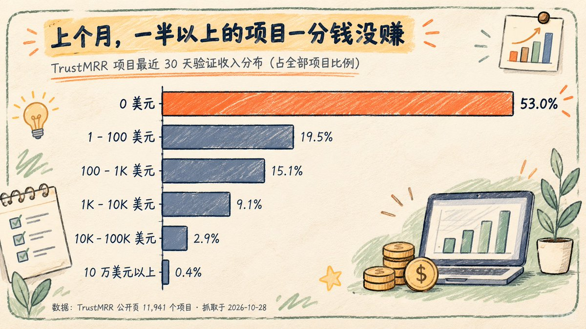
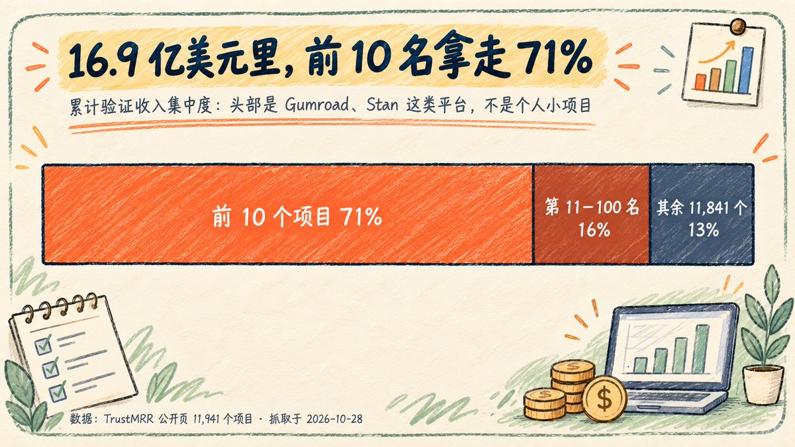
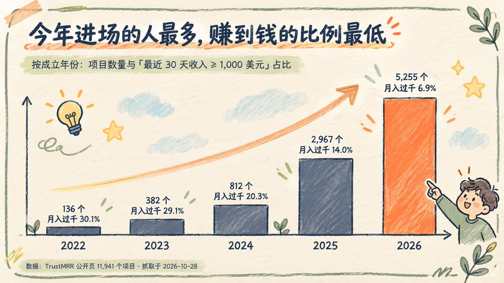
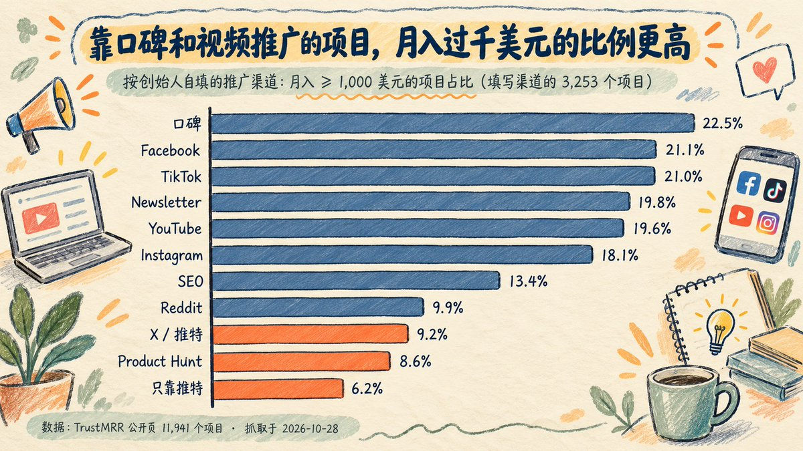
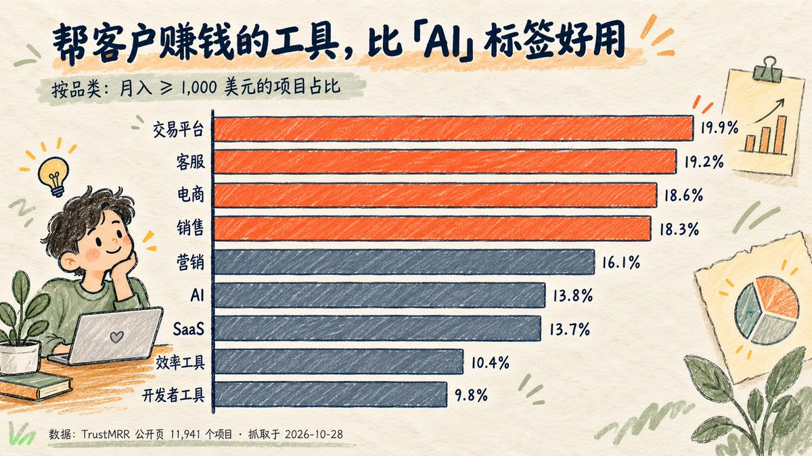

# 希希 AI 实验室：拆解 12,068 个 TrustMRR 出海项目真实大盘与反直觉规律

> 拉取 TrustMRR 平台 12,068 个接入真实 Stripe 流水的产品数据进行穷尽分析，破除出海独立开发者的幸存者偏差。揭示月入中位数、生命周期分布、获客渠道有效性与定价陷阱，为打算做产品出海的独立开发者提供最真实、客观的数据底座。

<!-- more -->

前两天刷推，看到一条挺让人高兴的消息：一个帮人「长高」的小 App，上个月赚了 2,800 美元，挂牌 163 天，最后以 1.8 万美元卖掉了。评论区里大家都在恭喜。

最近在 X 上，经常能刷到独立开发者晒成绩。有人做到了月入 1 万美元，有人几个月就把项目顺利出手。这些做出成绩的朋友确实厉害，赚到的钱是实打实的，很让人佩服。

不过刷多了，难免会有一种错觉：怎么好像人人都在赚钱，就自己还在摸索？

为了弄清楚真实的大盘到底长什么样，我把发这条推的网站 TrustMRR 整个拉了下来，一共 12,068 个项目，一个一个算了一遍。

在看数字之前，先说明一下口径：这篇文章只是根据 TrustMRR 这一个网站的公开数据做的统计，不带任何个人情绪。网站外面肯定还有很多闷声发财、赚到钱但没来挂榜的开发者，那些不在统计范围内，我们不排除也不做评价。今天只看这一个公开样本里的数据事实。

算完这批数据，结论非常直接：平时能刷到的，只是跑出来的极少数头部；而在大部分项目的真实数据里，藏着几条跟平时直觉完全相反的规律。

## 先花 30 秒说清楚 TrustMRR 是什么

它是独立开发者 Marc Lou 做的一个产品收入公开榜。

它最大的特点是收入数字不能自己填，也不能只放张截图。开发者得把 Stripe 这类收款后台接进去，由系统自动拉取流水。所以它是目前公开能拿到的、比较接近真实情况的一份小产品收入样本。

站上一共有 12,068 个项目，我拿到了其中 11,941 个的完整数据（剩下的已经下架或抓不到）。每个项目都能看到上个月赚了多少、历史总共赚了多少、主要靠什么渠道推广、创始人有多少粉丝、有没有在挂牌出售以及要价多少。

下面这些结论，全是从这 11,941 个项目里算出来的。

## 1. 榜上一半多的项目零收入，月入过万的只有 3.2%

53% 的项目，最近 30 天收入是 0。

如果把一个月收入不到 100 美元的也算上，占比直接到了七成多。

在这个榜上，一个月能赚过 1,000 美元的项目，100 个里只有 12 个。能过 1 万美元的，一共 386 个，占全部项目的 3.2%。

而且愿意来这个榜接支付后台的，多半是对自己产品还有点信心的开发者，大量没跑通的项目根本不会来登记。平时在时间线上刷到的月入过万案例，基本全属于那 3% 的尖子生。

一半项目一分钱没赚到，月入过万的只有 3.2%。

## 2. 16.9 亿美元总收入里前 10 名拿走七成，跟个人小工具没关系

榜上 16.9 亿美元的历史总收入，绝大多数被几家大平台分走了。

拆开看真实分布：

- 排名前 10 的项目，拿走了总额的 71%
- 排名前 100 的项目，拿走了 87%
- 剩下的一万一千多个项目，加起来分最后的 13%

排在最前面的，是 Gumroad、Stan 这种已经做成基础设施的平台型公司，跟个人开发者周末写出来的小工具完全是两码事。看这类榜单别被十几亿美元的总数晃了眼，大盘是巨头撑起来的。

十几亿美元大盘是巨头撑起来的，跟个人小工具无关。

## 3. 今年新项目扎堆上线，做出来不难，卖出去才难

今年上线的新项目最多，但赚钱的比例掉到了最低。

按项目成立年份分组，看现在月入过千的比例：

- 2023 年成立：共 382 个项目，月入过千的占 29.1%
- 2024 年成立：共 812 个项目，月入过千的占 20.3%
- 2025 年成立：共 2,967 个项目，月入过千的占 14.0%
- 2026 年成立：共 5,255 个项目，月入过千的占 6.9%

榜上快一半的项目都是今年刚做出来的，其中六成上个月还是零收入。除了新项目还在攒用户、老项目经过了时间筛选之外，核心原因是 AI 写代码让开发门槛大降，很多人一个周末就能上线一个网站。供给暴增之后，瓶颈早就变了。

现在把产品做出来不难，难的是怎么把它卖出去。

## 4. 在这份数据里，推特和 Product Hunt 是最差的推广渠道

靠发推和打榜推广的项目，月入过千的比例在所有渠道里垫底。

榜上有 3,253 个项目填了主要获客渠道，各个渠道里项目月入过千的比例差距极大：

- 靠口碑传播：22.5%
- 靠 Facebook、TikTok：21% 左右
- 靠 Newsletter、YouTube：20% 左右
- 靠 SEO：13.4%
- 靠 X（推特）：9.2%
- 靠 Product Hunt：8.6%
- 只填了推特一个渠道的 144 个项目：月入过千的只有 6.2%，三分之二上个月是零收入

口碑、TikTok、Facebook、YouTube 的月入过千比例，全是推特和 Product Hunt 的两倍多。原因很简单：推特上给你点赞互动的多是同行，不是客户。真正的消费者和传统行业老板，平时都在刷短视频、看 YouTube 或听朋友推荐。

想靠发推找到付费客户，数据告诉你：很难。

## 5. 粉丝多少不是门槛，找对付钱的人才是

没有社交账号粉丝，照样能做出近百万美元收入的产品。

从整体统计看，粉丝多确实有加成：

- 粉丝不到 1,000 的创始人，项目月入过千的占 11%
- 粉丝在 1,000 到 1 万之间的，占 18%
- 粉丝 1 万以上的，占 30%

但看具体案例，没粉丝根本拦不住赚钱：

GoTall 也是一个帮人长高的 App，榜上没挂创始人推特账号，粉丝数记为 0，累计收入做到了 91 万美元，上个月单月就有 2.6 万美元。

Marky 是一个帮自出版作者打理社交账号的工具，创始人推特只有 67 个粉丝，累计收入已经超过 100 万美元。

文章开头提到以 1.8 万美元卖掉的 HeightMax，跟 GoTall 做的其实是同一件事：帮人长高。同样的需求，一个卖了 1.8 万美元，一个收了 91 万美元。决定生死的从来不是开发者有多少粉丝，而是能不能把产品送到愿意掏钱的人眼前。

粉丝多少不是门槛，找准愿意掏钱的人才是关键。

## 6. AI 标签不值钱，离客户钱包近才值钱

给产品贴上 AI 标签并不能帮你多赚钱，选对离交易近的品类才可以。

榜上有 4,294 个项目打了 AI 标签。算下来，打 AI 标签的项目月入过千比例是 13.8%，没打的是 11.6%，两边几乎没差别。

真正拉开差距的是产品品类，也就是你离客户的钱包和生意有多近：

- 交易平台、客服、电商、销售类工具：月入过千的比例在 18% 到 20% 之间
- 效率工具、开发者工具：月入过千的只有 10% 左右，偏偏扎堆做这两类的人最多

能直接帮商家多卖货、多接单、省下客服成本的工具，老板付钱最痛快；只让人「工作顺手一点」的效率工具，用户最难掏腰包。

AI 标签不值钱，离客户钱包越近才越值钱。

## 7. 闷声赚钱的小项目，切入点全都具体到人

真正跑通的小产品，没有一个是宏大平台，全在解决具体人群的具体麻烦。

我按三个硬条件筛出了最值得普通开发者参考的一批项目：2025 年 6 月以后上线、上个月收入在 3,000 到 3 万美元之间、创始人推特粉丝不到 1,000。

符合条件的一共有 221 个，挑几个出来看画风：

- 给教会做实时翻译，把牧师讲道翻成 100 多种语言：月入约 2.2 万美元
- 给旅行社做客户管理系统：月入约 2 万美元
- 帮结婚新人做婚礼网站：月入约 2.1 万美元
- 朋友线下聚会玩的派对游戏 App：月入约 2 万美元
- 把手写笔记拍照变成小测验的学习 App：月入约 2.2 万美元
- 吃饭前拍照算卡路里的 App：月入约 1.9 万美元

这批项目的共同点一清二楚：人群极其具体，痛点极其明确，而且这群人本来就有为这件事花钱的习惯。

闷声赚钱的小产品，都在解决具体人群的具体麻烦。

## 8. 成熟开发者也是靠多次尝试，Marc Lou 19 个项目里 6 个过千

哪怕是经验丰富的头部开发者，也是靠多次出手才试出主力产品的。

我专门看了 TrustMRR 创始人 Marc Lou 自己的数据。他在榜上把自己的 19 个项目全挂了出来，其中上个月收入过 1,000 美元的有 6 个。

19 个里跑成 6 个，已经是相当高的命中率。平时看到别人的爆款，背后其实是一次次动手试出来的，指望做一个就成一个本来就不现实。

成熟开发者也是靠多次尝试，才跑出几个赚钱产品。

## 9. 没有稳定客源就不值钱，挂牌也卖不出好价

小项目想卖个好价钱，买方只看有没有稳定的留存和客源。

榜上现在有 2,300 个项目挂牌出售。在月入 500 美元以上的待售项目里，卖家要价的中位数是一年收入的 2.4 倍。

而开头提到的 HeightMax，最终实际成交价只有一年收入的 0.5 倍，还挂了 163 天才卖掉。二级市场的买家算账非常精明，如果小项目没有稳定的获客渠道，就算眼下每月有几千块流水，买家也会大砍一刀。

没有稳定客源和留存，项目挂牌也卖不出好价钱。

## 10. 榜上中国项目只有 18 个，直接做全球收款还有大把空间

在英文独立开发和小微 SaaS 榜单上，华人开发者几乎缺席。

在 11,941 个项目里，国家填中国的只有 18 个，其中月入过 1,000 美元的只有 4 个（另有 3,000 个项目没填国家）。对比来看，填美国的有 2,119 个，印度 1,057 个，法国 806 个。

一方面，国内和海外华人圈有很多团队闷声赚钱，只是习惯上不往这类英文榜单挂；另一方面，直接用英文做具体的小产品、向全球用户收款，真正下场的华人确实还不多。

英文小产品圈子里华人极少，出海收款还有很大空间。

## 算完这一万多个项目，最核心的三条结论

第一，别被高收入晒单带偏，100 个项目里只有 12 个月入过千。刷到的月入过万案例只是那 3.2% 的头部。动手前先看同赛道大多数项目的真实处境，别拿极少数个例当常态。

第二，先搞清楚谁会掏钱，再动手写代码。真正跑通的小项目，都能一句话说清是谁在用、帮他多赚了什么钱或省了什么事。离交易越近越容易收钱，纯效率工具最难变现。

第三，别守着推特等客户，去付费用户真正待的地方推。推特和 Product Hunt 上多是同行互动，月入过千的比例垫底。去做短视频、发 YouTube、做 Facebook 或钻进具体行业的圈子，客户在哪就把产品放到哪。

## 附：如果你想自己动手算一遍，可以照着这个步骤来

这次统计完全用的是公开数据，不用登录，也不涉及任何特殊权限。TrustMRR 站方非常开放，专门把数据做成了方便读取的格式：

1. 打开 trustmrr.com/robots.txt，可以看到全站允许抓取，里面直接给出了页面列表文件的地址。
2. 在 trustmrr.com/startup-sitemap.xml 里，列着全部 12,068 个项目的页面链接。
3. 在任何一个项目链接后面加上 .md，就能直接拿到一份整理好的纯文本档案，比如 trustmrr.com/startup/gotall.md。
4. 让 AI 帮忙写个简单的脚本，一页一页慢慢读取（抓的时候把间隔调慢一点，别给站方服务器添麻烦），大概两个小时就能把公开数据整理成一张表格。

拿到表格以后，别光盯着收入最高的那几个大平台看。去筛那些已经有几千美元稳定月收入、但同类型产品还不多的细分方向，最容易找到能落地的切入点。

看完这组数据，你觉得哪一条最出乎意料？或者你还想看哪个维度的统计？欢迎在评论区聊聊。

数据说明：文中的收入数字来自 TrustMRR 通过收款接口验证的公开数据，于 2026 年 10 月 28 日整理。项目品类和推广渠道由创始人自行填写，仅供参考。我统计到的历史总收入（16.9 亿美元）比网站统计页显示的（19.5 亿美元）略低，差额主要来自已下架项目、匿名项目以及快照时间差。

## 相关页面

- [[patterns/ai-business-seven-layers]]
- [[concepts/ai-oneperson-company]]
- [[sources/solo-cream-1m-ai-site-case]]
