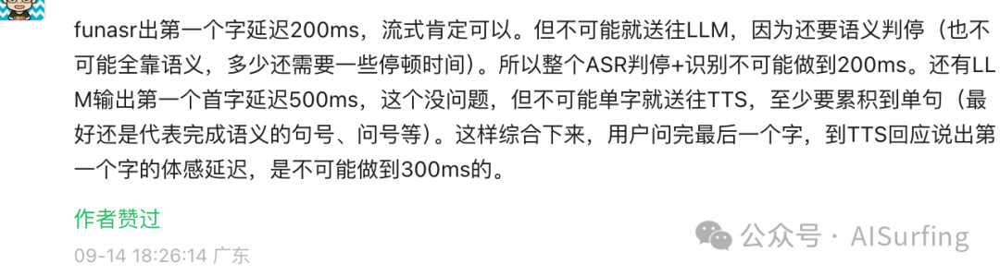
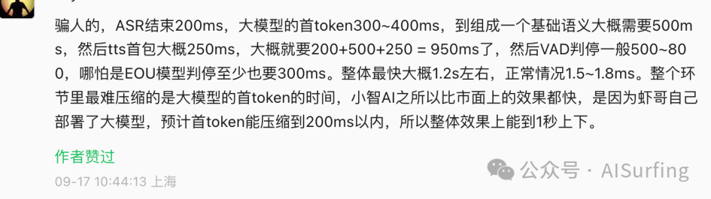
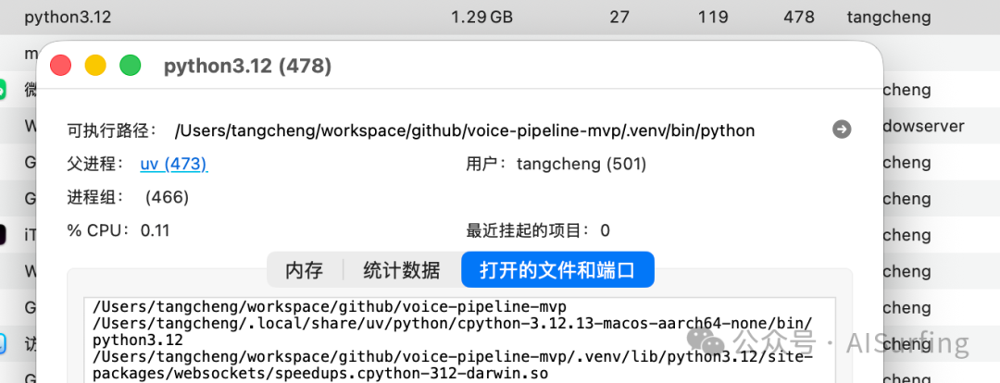
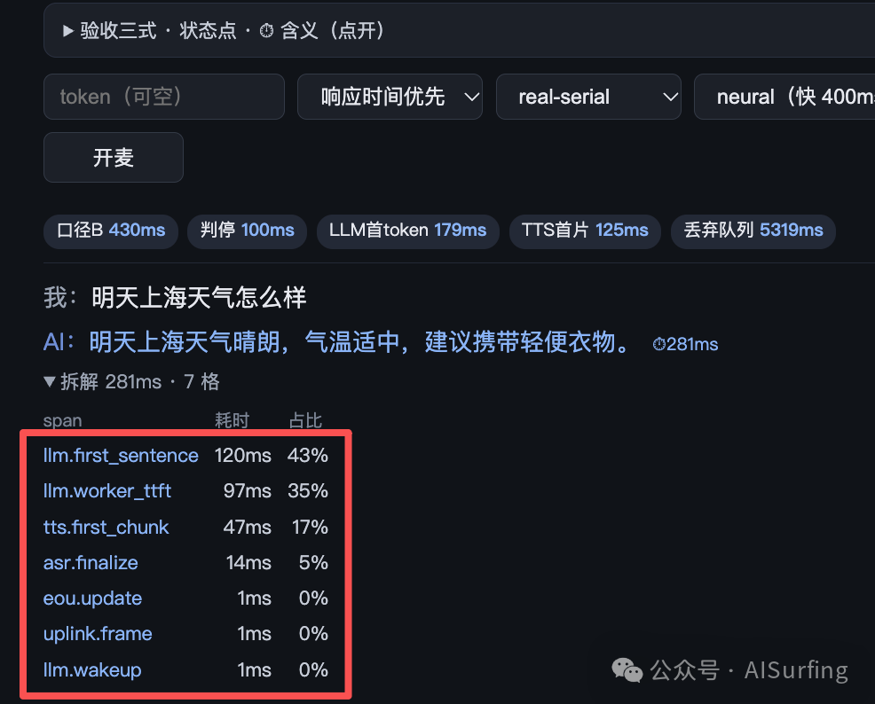
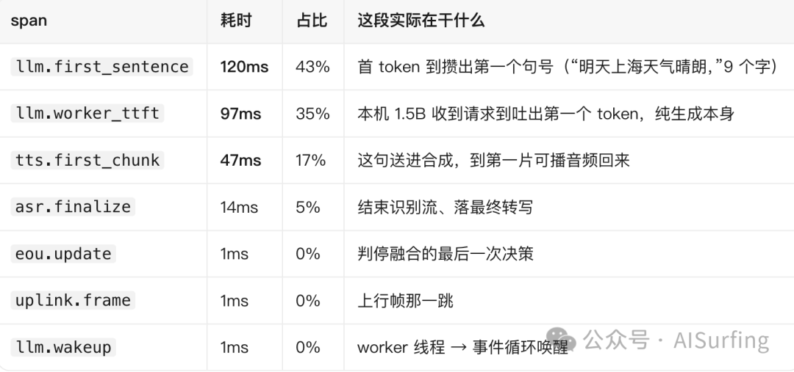
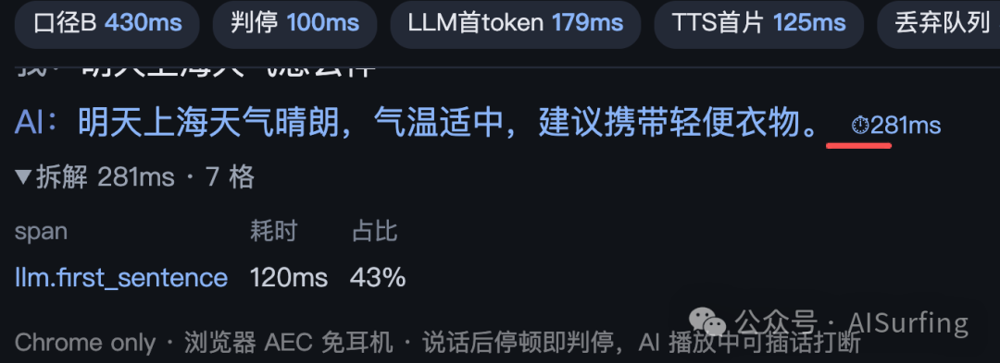

# 评论区说「ASR+TTS 接入 300ms 不可能」——实测与源码回应

给 AI 产品接上嘴——ASR+TTS 接入实战，延迟从 2 秒压到 300 毫秒讲的是：把语音对话从「说完等两秒」压到 300ms 这个区间。发出去之后，评论区很热闹。

监听 500～800 + 听写 200 + 大模型 300～500 + 合成 250 = 1.2～1.9 秒，串起来不可能。

单个环节我信，串起来不信。

放个 demo 看看。

用文字说服不了不信数字的人。所以我打开麦克风，把整条链路录下来：本机、真麦克风、无剪辑、未加速，10 轮对话。每一轮回复后面都挂着一个毫秒数，点开能看到它拆成了哪几段。

为了方便各位小伙伴复现，下面再把一些关键的地方梳理一下：那 300ms 花在哪、几个技术怎么选、以及它离能上线还有哪些工作需要做。

## “ASR + TTS”并不是所有场景都需要跑在云上

这一点必须先讲，否则后面全是误读。

在本示例中也并不是所有环节都是使用云服务，具体情况如下：

环节

视频里用的

为什么

转文字

本机 sherpa-onnx，Paraformer 中文

不出本机，没有网络往返

判断你说完没有

本机四层：音量→人声→语气→文字，取最稳一档

宁可多等 0.5 秒，也不抢话

想回答

（4bit）

第一句快，代价是答案笼统

变声音

第一片声音约 137ms

屏幕右上角写着real-serial · latency——我给这套配置起的名字，响应时间优先那一档。它是拿"答案笼统一点"换"快"，不是随手搭的。

所以 300ms 有前提：在这台M5、这套配置下测的。

应用跑起来占用资源也并不多，1.29G。

等后面代码push到github后，很期望各位小伙伴的实测数据。

## 二、那 300ms 花在哪

以实测的数据为例，时间消耗如下：

① LLM 占用了 217ms，即 77%。 但真正可调的是那 120ms，97ms 本身并不慢。9 个字花了 120ms，约合 13ms/字。这就是那条判据的现场证据：语音里决定首音的是「首 token + 首句字数 ÷ 出字速度」，首 token 只占三分之一。合成等的是句号，不是第一个字。

② TTS 只花 47ms，因为这次没有为建连付费。 表里根本没有 tts.connect 这一格（低于 0.5ms 会被滤掉，走预热连接时也不埋点），冷启动时它会是单独一格 257ms。这是 P0.5 那个预热池在起作用。另外，它不随句子变长，这才是它能承担 300ms 目标的原因。

视频里每轮行尾那个 ⏱ 数，如下所示：

这是时间是指，从它听出你说完，到它把第一片声音发出去。

前后各有一段没算进去。

前面约 0.5 秒：听出你说完。这是问得最狠的地方——"你怎么知道用户说完了？"

判断模型只有 8MB，CPU 跑一次12ms，推理不是瓶颈。真正的成本是确认窗：你愿不愿意在对方闭嘴 100 毫秒后就下结论。

"我要一个大披萨……"和"……再来份蒜香面包"，停顿那一瞬间转成文字一模一样，区别只在语气——升调没说完，降调说完了。只靠文字分不出来，就得等。

所以这是同一个旋钮的两头：一闭嘴就接，就会在你换气的半秒里抢话；绝不抢话，就得老实等。我选后者，代价 0.5 秒。这不是技术极限，是产品取舍。

中间这 300ms，切成三段：

这一段

多久

在干什么

把这句话定稿

30～60ms

边听边出的草稿落成最终一句

想出第一句话

约 100ms

写到第一个句号就交给合成

出第一片声音

约 137ms

第一片可播音频回来

10 轮实测 238～429ms，中位数 298

后面约 55ms：送到你耳朵。浏览器缓冲播放。所以从你闭嘴到 AI 出声，全摊开是0.85 秒上下。这个数我也给。

这里没有魔法，只有一件事：每一段都不想等前一段结束。

## 三、一个我没答好的追问

转写是边听边出的，会被后文纠正——"这个星星"后面被纠成"新型"。已经交给大模型的那份怎么办？我的做法是取当下转写直接送，后面纠正不回滚：重开一轮的损失大于一次错答。但这个判断没有量化数据，算欠账。

## 四、三个决定成败的地方

1）把建连接挪到本来就在空等的窗口里。

合成要先建连接，230～260ms，比大模型想出第一句话还久。按直觉写：等大模型答完 → 建连 → 合成，这 260ms 就原封不动加进用户等待里。

做法是：一判出你说完，就在后台去连合成，同时把话送给大模型。等它吐出第一句，连接已经在那儿了。实测 257ms → 38ms。

省下的 220ms 不是"把建连优化快了"，是"把它挪进本来就空着的窗口"。前者要跟服务端较劲，后者只要改顺序。大多数人只盯模型快不快，没人看连接是什么时候建的。

2）第一片声音要跟字数无关。

本机合成 70ms 一个字，听着快，但 22 个字就是 1.5 秒——用户等的是整句。换流式后第一片固定约 600ms，不随句子变长。关键不在绝对值，在它不再是个变量。

3）静音帧别往听写里塞。

说完之后麦克风还在送静音，送进听写是纯烧 CPU，还跟下行音频抢线程。加一道能量门：静音帧不送听写，但判断"你说完没有"那一路照收。省 97～113ms，几乎白捡。

顺手交代一个坑：一小段"嗯"。判出说完先播一段预录音，体感第一声从 300ms 掉到 6ms；但第一版做太长反而把真回答挤后 400ms（播放是排队的），所以它必须比第一片真声音短。这只是止痒，不改真实等待。

## 五、为什么是这几个，不是别的

先说判据：别比"首 token"。大家爱比首 token，这在语音链路上基本没用——合成要攒到一个句号才肯开工，首 token 早到 200ms，第一句话没写完，合成那端一动不动。

真正的判据是：首 token 时间 + 第一句话的字数 ÷ 吐字速度。

这条还能解释一个怪事：同一个 1.5B，我在两处量到 119ms 和 247ms，都是真的——区别只是第一句多长：十个字一百三，三十一个字二百五。没写清第一句多长的"首句 xxx ms"，不能横比。

云上四档（实测，5 轮中位数）：

模型

首 token

首完整句

思考链

qwen-flash

367ms

0 字

qwen-turbo

462ms

524ms

0 字

qwen-plus

561ms

747ms

0 字

qwen3.8-flash

705ms

92 字

① flash 和 turbo 首 token 差 95ms，首句几乎一样（522 对 524）——按首 token 选会选错。② plus 多花 225ms，买不到对应的体验。③名字带 flash 不等于不思考：qwen3.8-flash 先吐 92 字思考链，第一个可播句子 2771ms，出局。

本机三档（同机热态，各 3 轮）：

模型

首 token

第一句话

它答的天气

Qwen3.5-0.8B

34ms

"天气晴好"，没温度

Qwen2.5-1.5B（用的这个）

55ms

247ms

"气温较低"，没温度

Qwen3.5-2B

63ms

357ms

"25 到 28 度"，具体了

所以多一条判据：候选模型必须先确认"能不能关掉思考"。关不掉的推理模型在语音里没有位置——那段思考要么被念给用户听，要么让合成干等。

关掉之后取舍才清楚：模型大一档，第一句话是超线性涨的（0.8B 到 2B 涨 5.7 倍），答案质量一档一档跳。没有免费的那一档，只有这笔钱花在哪。

### TTS 的判据是两条，顺序不能反。

- 本机 melo：70ms/字，22 个字就是 1.5 秒，随字数线性增长
- 本机 kokoro：单字地板 812ms，没法用
- 云 DashScope 流式：约 600ms，不随长度变，但绝对值太高
- 讯飞流式：约 137ms，不随长度变

- 本机 melo：70ms/字，22 个字就是 1.5 秒，随字数线性增长

- 本机 kokoro：单字地板 812ms，没法用

- 云 DashScope 流式：约 600ms，不随长度变，但绝对值太高

- 讯飞流式：约 137ms，不随长度变

先看首包能不能进 150ms——不过，300ms 算术上就不成立；再看会不会随句子变长——不过，短句能用、长句崩。

另外三个环节各一条：

听写用 sherpa-onnx Paraformer int8 本机跑，FunASR 在 Mac 上有硬伤，降备选。

判断说完用 Smart Turn v3.2 音频路（8MB，CPU 12ms），文本语义那一路没接——纯音频够用，加了只是多一样要维护的。

框架自研 FastAPI + WS，不二开：我要能逐行解释的延迟账，二开会把账藏进框架里。

简单地说，每项权衡问的不是"哪个更强"，而是"会不会把时间加到用户等的那一段里"。建连接会加，所以挪走；思考链会加，所以关掉；首包 600ms 会加，所以换一家。选型在语音里不是选能力，是选时间花在哪。

## 六、这个循环不能是一条直线

直觉写法是：收一帧 → 转文字 → 想 → 合成 → 发出去 → 再收下一帧。好懂，但有个致命问题：AI 说话那几秒，程序不读新帧。用户插一句"等等，不对"，这条直线根本听不见——打断永远检测不到。而能不能被打断，正是语音对话和语音播报的分界线。

所以拆成三条腿同时跑：一条只管收（读帧、判人声），一条只管想（说完 → 大模型 → 切句 → 合成），一条只管发（按 200ms 一片推）。之间用队列传，谁也不直接调谁。

一个必须单独说的坑：关连接前要等发送队列排空。不等的话，负责发的那条腿可能被取消时还没把"本轮结束"发出去，客户端就一直等——不报错，只是超时，长得像"网络慢"。

状态机五个：空闲 / 在听 / 在想 / 在说 / 被打断。打断三层：先用音量判断有人插话（连续几帧才算），再掐掉在飞的大模型和合成，最后本轮作废、回"在听"，等你把插话说完再答。第三层的关键是不重开一轮、不一刀切静音——插话是正常对话，不是错误。

## 七、为什么这些数字你可以不信，但能自己算

回应"我不信"最有效的办法不是重说一遍数字，是让它可被复算。

每轮落一行日志，钉一条恒等式：各段加起来 + 没归因的残差 = 整轮耗时。残差不为零，就说明还有东西没埋点。它抓到过真 bug：一个字段每轮写 -1，同一行另一个字段却写着 100ms，两个数自相矛盾——没这条恒等式，这种错会一直躺着。

视频里点开"拆解"看到的就是这棵树。你不用信我，把格子加一遍就行。

仓库里probe_trace.py（每轮拆解树）、bench_schedulers.py（同机只换调度策略）、pytest（恒等式自检）都能复跑。

## 八、它算不算生产级

我敢说的：全链路真模型真麦克风、每轮可对账、打断三层、并发测过不互相拖慢、默认档取最稳的一档。

上线会出事的三个缺口：

1.没有 TLS、域名、鉴权。只能本机或 SSH 隧道。缺的不是代码，是一个证书和一套登录——这是"没做"，不是"做不到"。2.没有回声消除。靠戴入耳式耳机物理隔离。外放会自激：AI 的声音被听回去，系统以为你在说话，然后它对着自己的声音回答。加了一道门（转写为空就不起一轮）能拦最坏情况，但那是止血，不是治。3.真人长时验收没跑干净。4.6% 的抢话率是合成语音测的，只是乐观下界。真人半句停顿那次，快档连抢三次，所以默认档退回了最稳的。一个只在合成语音上验过的判断，不算验过。

1.没有 TLS、域名、鉴权。只能本机或 SSH 隧道。缺的不是代码，是一个证书和一套登录——这是"没做"，不是"做不到"。

2.没有回声消除。靠戴入耳式耳机物理隔离。外放会自激：AI 的声音被听回去，系统以为你在说话，然后它对着自己的声音回答。加了一道门（转写为空就不起一轮）能拦最坏情况，但那是止血，不是治。

3.真人长时验收没跑干净。4.6% 的抢话率是合成语音测的，只是乐观下界。真人半句停顿那次，快档连抢三次，所以默认档退回了最稳的。一个只在合成语音上验过的判断，不算验过。

三句判断。

生产级的分水岭不是延迟，是可对账。数字能被人自己复算叫工程，只能被相信叫演示——那条恒等式一个毫秒都没省，但它决定了别人能不能验证我。

"快"和"不抢话"是同一个旋钮。调快一档，抢话率一定上去。所以延迟是产品问题：你愿意为少等 0.4 秒付出偶尔被打断吗？我不愿意，0.5 秒就是这么来的。

并发不是加速。我给每一路独占资源、又不把推理搬出主线程，结果每路反而慢 190ms。它是稳定性指标，不是速度指标。

## 所以它现在是什么

一个能被人挑错的参考实现，还不是产品。差的三件事——安全、回声、真人验收——都不性感，但一件都不能跳。

最后留个问题：你手上那条链路，那个「很快」的数字，是从哪一刻算到哪一刻的？如果它把「等你说完」和「建连接」都划在了账外，用户等的时间一秒没少，只是没被记下来。

> 配套开源实现：[helloworldtang/voice-pipeline-mvp](https://github.com/helloworldtang/voice-pipeline-mvp)

---

*收工。*
