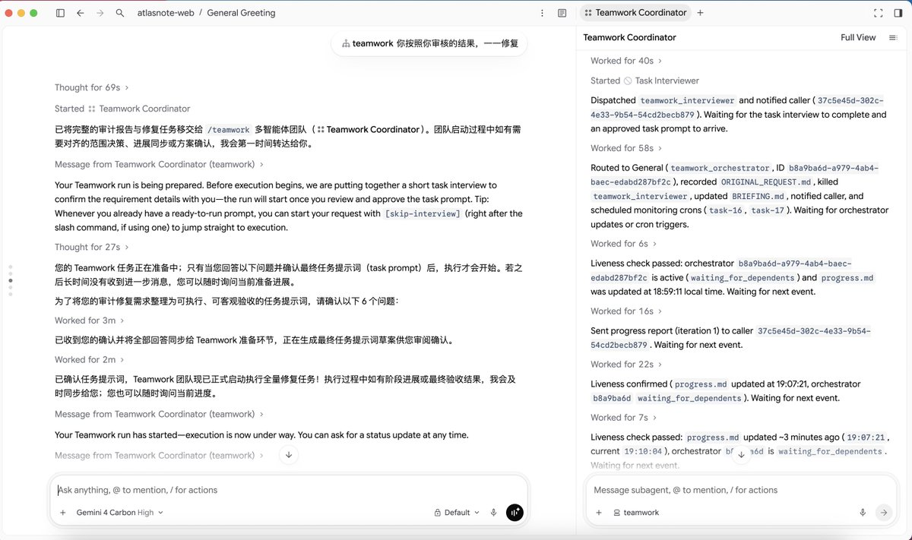

# 陶：/teamwork——Antigravity 的多智能体协作团队命令

> Antigravity 的 `/teamwork` 把「单个 Agent 串行推进」升级为「一支分工协作、可并行开发、互相校验的自主 Agent 团队」：① 总协调者（你输入命令的主对话 Agent）负责拆解目标、派发任务书 brief、跟进汇总；② Workers 在各自独立仓库副本（类似 Git worktree）并行干活，互不踩文件，完成后合并；③ 专门安排验证/审查成员跑测试、看 diff、对抗性挑错，避免「自己写自己验」。Workers 默认用主对话同款模型，也可按角色指定不同模型（轻量模型扫代码、强模型改架构），成员碰到配额/并发上限可保留上下文切模型续干。建议主对话选高推理模型做协调者。

<!-- more -->

- /teamwork 属实令人惊艳！！

这是 Antigravity 的多智能体协作团队斜杠命令，把“单个 Agent 串行推进”升级为“一支分工协作、可并行开发与互相校验的自主 Agent 团队”。

- 有总协调者（Coordinator）负责统筹：负责拆解大型目标、给成员派发明确的任务书（brief）、跟进进度并汇总交付。
- 独立隔离工作区并行干活：负责写代码或构建的成员可以分配到各自独立的仓库副本（类似 Git worktree），多条线同时推进、互不踩文件，完成后再合并回主工作区
- 独立验证与互审闭环：除了开发/调研成员，还可以安排专门的验证/审查成员去跑测试、看 diff、做对抗性挑错，避免单个 Agent“自己写自己验”的盲区。

这里总协调者就是你输入 /teamwork 的当前主对话 Agent，运行在你此刻选中的模型上。它负责拆解目标、派发任务书（brief）、管理成员与工作区，以及汇总最终交付。

独立干活的成员（Workers）默认模型是当前主对话所选的同一个模型。但是可以指定，如果你明确要求（例如“用轻量模型扫代码，强模型改架构”），协调者可以在创建成员时为不同角色指定不同模型；如果某个成员跑一半碰到配额或并发上限，也可以保留上下文直接切换模型继续干活，而不用推倒重来。

使用/teamwork 的时候，最好是在主对话中选用相对比较高推理能力的模型做总协调者，根据任务分配你的其他模型。

在输入框里直接输入 /teamwork 加上你的项目目标即可启动。

查看进程：

- 打开右侧 teamwork subagent 视图，这是/teamwork 拉起来的总协调子代理（Subagent）的独立对话/运行日志视图
- 在左侧主对话里直接问当前进度即可；也可以在右侧底部直接给 Teamwork Coordinator 发消息。

Antigravity 在一些 UI 的交互细节上体验感挺差的，这个是 google 所有功能的通病，但是 Antigravity 在大方向确实在走一条主动/蜂群/协调/ 的方向，有点儿向 AGI 前进的意味了。

## 相关页面

- [[patterns/agent-team-handoff-model]]
- [[sources/chasen-liao-swarm-blackboard-agent-swarm]]
