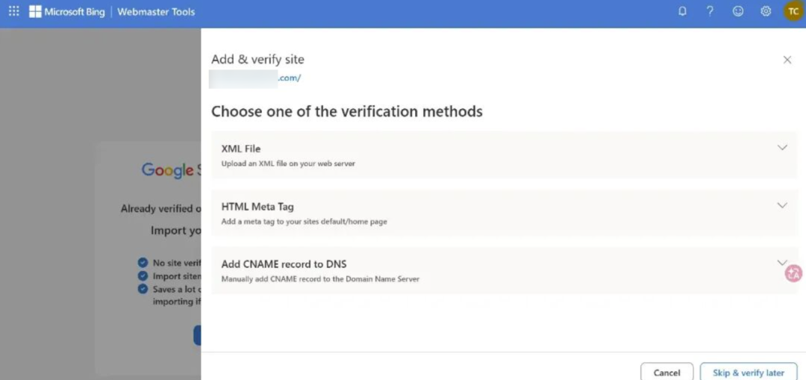
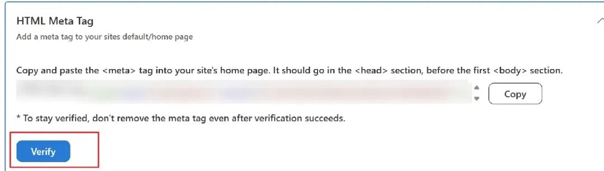
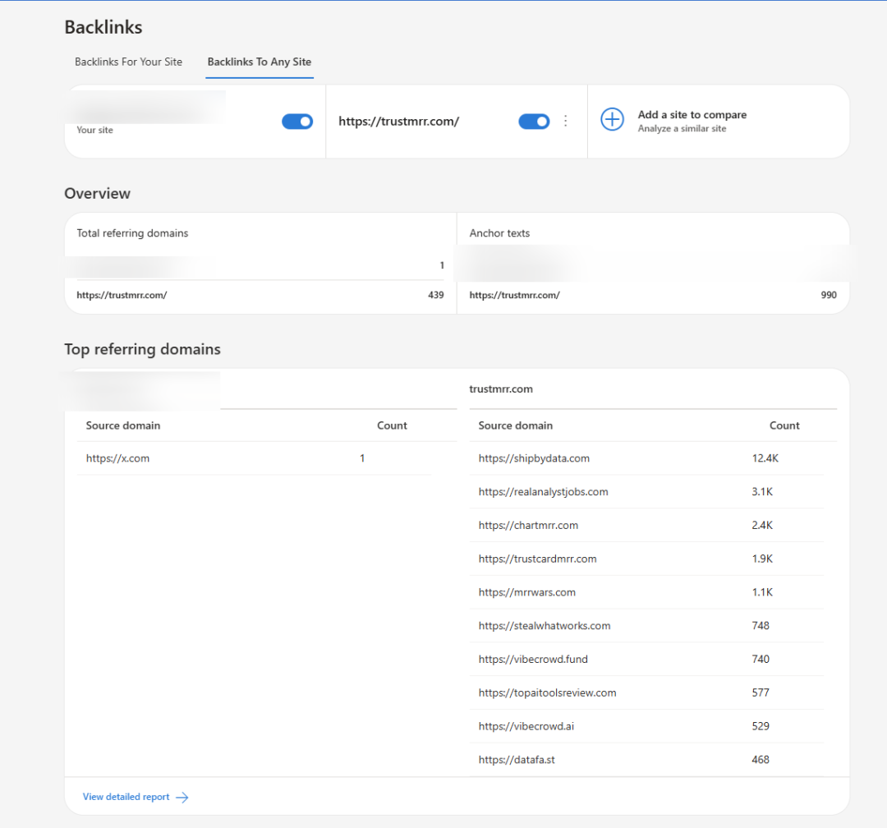
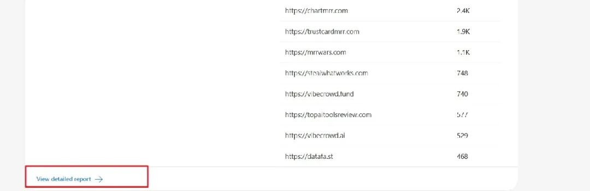
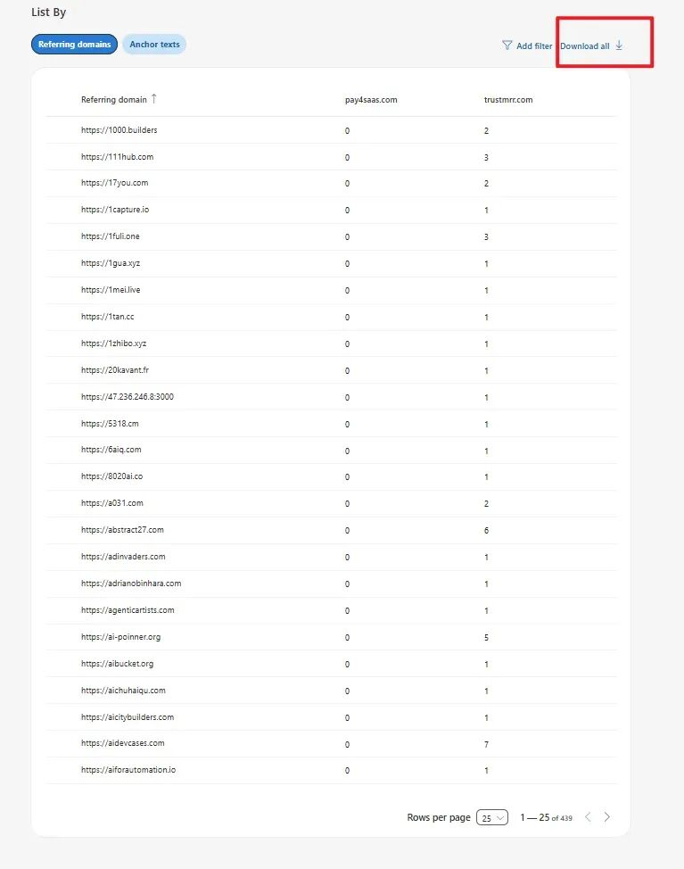
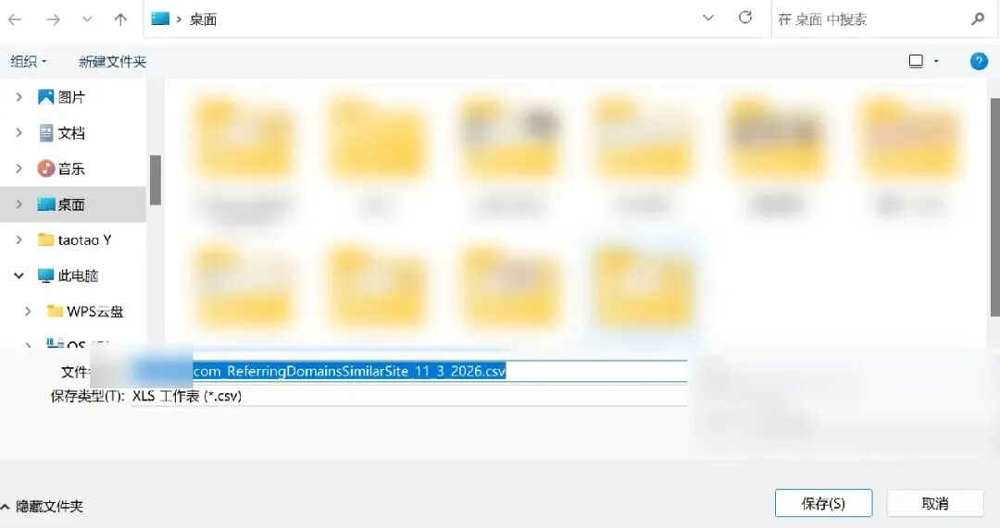

# taoWithSaaS：免费导出竞品所有外链的一种方法——利用 Bing 站长工具 Backlinks 功能

> Ahrefs 的官方 SEO 教程提到：如果你想让自己的页面在 Google 搜索结果中超越竞争对手，通常需要获得比它更多的优质反向链接。但常规的 Similarweb、Semrush 或 Ahrefs 导出竞品外链都需要高昂的点数或月费。本文拆解一种完全免费、官方合规的竞品外链批量导出技巧：利用微软必应站长工具（Bing Webmaster Tools）自带的 Backlinks（反向链接）分析功能。

<!-- more -->

## 01. 为什么需要获取竞品外链？

Ahrefs 的 SEO 官方教学明确提到过：如果你想让自己的页面超越竞争对手，通常需要获得比它更多、更权威的外部链接。

因此，**如何完整、低成本地获取对手的外链清单**就变得至关重要。

市面上常用的 SEO 分析工具（如 Similarweb、Semrush、Ahrefs）查询与导出外链都需要购买额度或按月订阅，价格对独立开发者而言往往偏高。而本文介绍的方法由 droidHZ 前辈在出海分享中提及，其核心机制是借助微软必应官方提供的站长工具，完全免费且支持一键批量导出。

---

## 02. 实操步骤详解

### 第一步：注册并绑定自己的网站

1. 打开 Bing 站长工具官网：`bing.com/webmasters`。
2. 还没有账号的先用微软账号免费注册一个。
3. 登录后点击「添加网站」，按照页面指引完成所有权验证（通常可以通过 DNS 解析 TXT 记录、上传 HTML 验证文件，或者直接通过 Google Search Console 一键快捷导入关联）。

4. 添加并部署验证代码后，点击页面下方的「验证」按钮。

---

### 第二步：进入反向链接工具输入竞品

网站验证通过后：

1. 在左侧菜单找到或直接访问反向链接专属入口：`https://www.bing.com/webmasters/backlinks`。
2. 在页面中选择「竞争对手反向链接（Similar Sites / Competitor Backlinks）」模块。
3. 点击「Add / 添加」，输入你想分析的竞品网址（例如 `TrustMRR.com` 等目标站点）。

系统会立即检索并列出 Bing 爬虫索引到的该域名所有外部反向链接、引用域名以及锚文本。

---

### 第三步：查看详情并导出全部外链

1. 点击对应竞品行的「详情（View Details）」。

2. 进入详情页后，能看到完整的 Source URL（来源网页）、Target URL（目标落地页）与 Anchor Text（锚文本）。

3. 点击列表右上角的「导出所有（Export All）」按钮，即可直接将全部反向链接数据下载为 CSV / Excel 电子表格。

拿到导出的外链清单后，就可以按域名权重与类型过滤，逐个拆解对方的外链构成（如导航站收录、媒体报道、博客测评、论坛外链等），并为自己的出海网站制定对应的外链建设（Link Building）计划。

---

## 相关页面

- [[columns/indie-hub/seo/webcafe-seo-backlink/index]]
- [[sources/sopilot-400-directories-submission-platform]]
- [[sources/bainian-grey-niche-sites-traffic-teardown]]
- [[concepts/open-source-seo-tooling]]
