# 一个新站，首月访问量就破 10w+，原来是这么做到的

> 调研 4 个月月访问量破百万的图片工具站 ezmaker.ai，发现它在域名注册当月就做到了 10w+ 访问。通过 Similarweb 热门外链和 Google 高级搜索指令反查，揭秘其背后「强站带小站」的导流真相：研究成功案例，不仅要看它做对了什么，还要看它已经拥有什么。

<!-- more -->

## 01 四个月月访问量破百万的图片工具站

继续看这个 4 个月，月访问量就突破百万的图片工具站https://ezmaker.ai。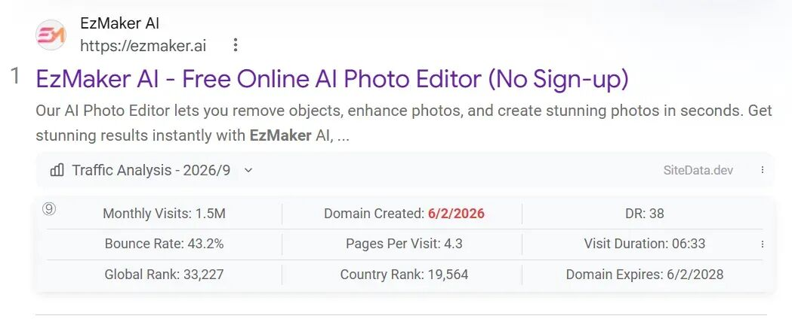我注意到，它域名注册当月就做到了 10w+ 。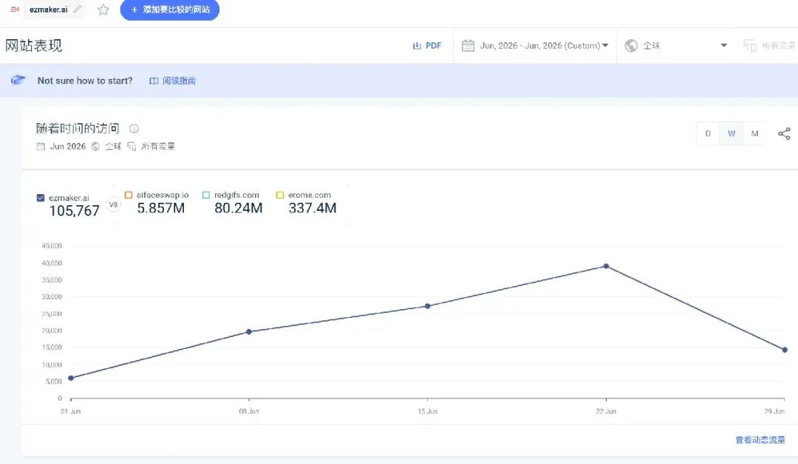挺好奇的，来看看，是靠什么做到的。

## 02 顺藤摸瓜：流量来源与强站带小站

看它的流量来源渠道，占比最高的，是外链访问。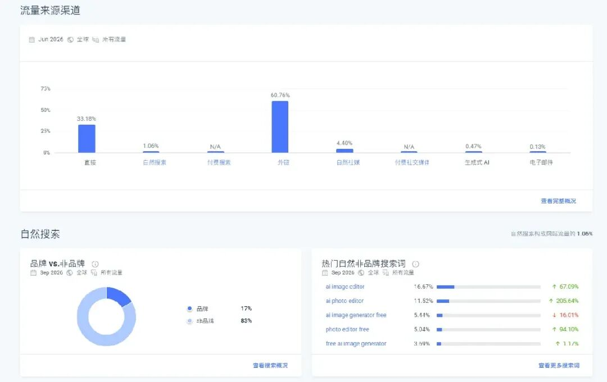那到底有哪些网站的外链呢？往下滑，看热门外链网站，aifaceswap.io 占比最多。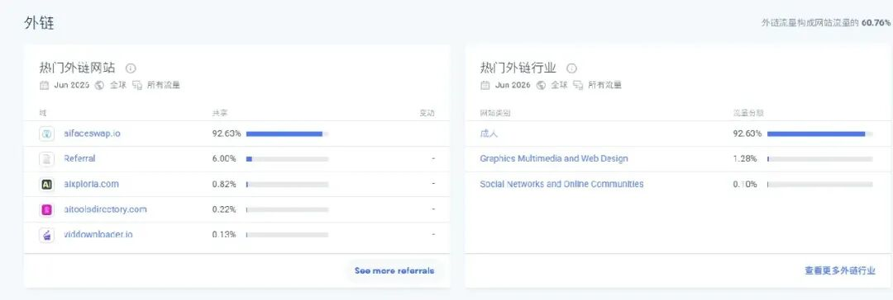这是网站的数据，很强。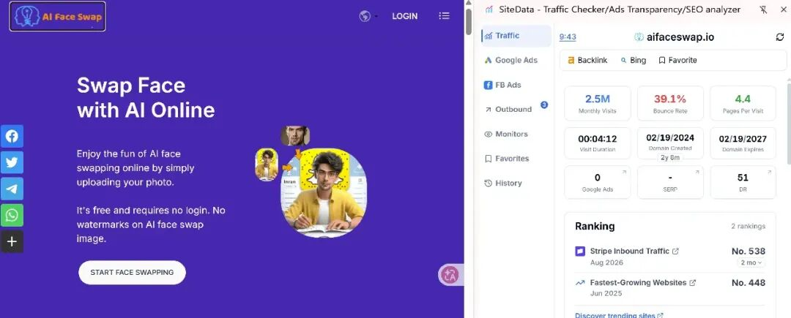点开看看，这些就是导入流量，是用户从其他网站点击链接，进入目标网站所产生的访问量。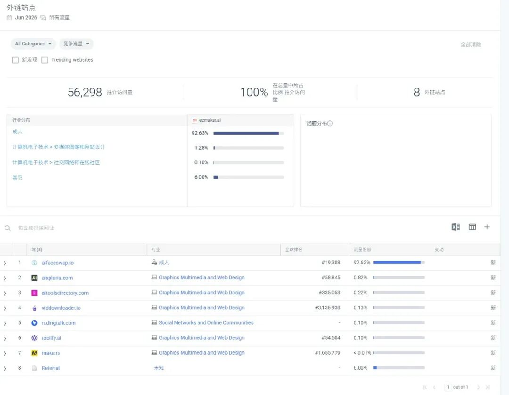展开 aifaceswap.io，提示时间段太短了。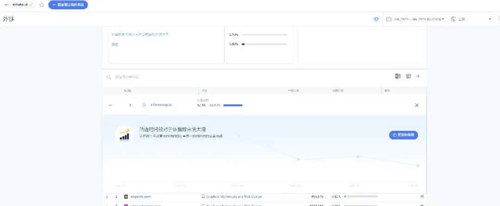那就调整到 8 月试试，可以看出来，一直在导流。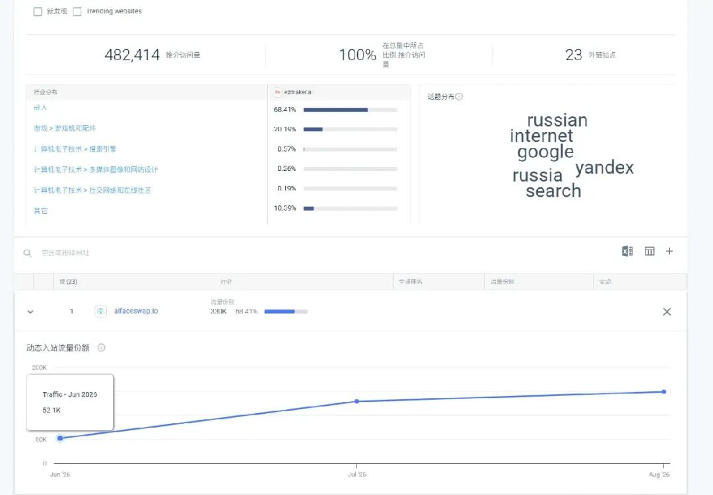是怎么导流的呢？

一个 Google 高级搜索指令 site:aifaceswap.io “ezmaker.ai”，意思是，只在 aifaceswap.io 网站已被 Google 收录的页面中，搜索包含 ezmaker.ai 的内容，假设 AIFaceSwap 的某篇文章中写着「Try ezmaker.ai for AI image editing」，那么这条搜索指令就有可能找到该文章了。

但是，是空的，外链已经被删除了。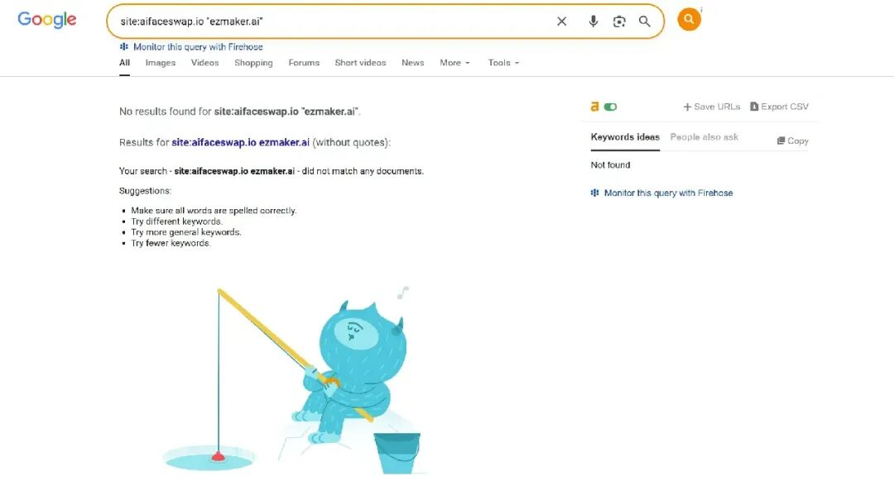

再通过“aifaceswap.io” “ezmaker.ai”，这种 Google 精确匹配组合搜索看看，它的意思是，在整个 Google 搜索范围内，寻找同时包含「aifaceswap.io」和「ezmaker.ai」这两个字符串的网页，来看这 2 个网站是不是有关系的。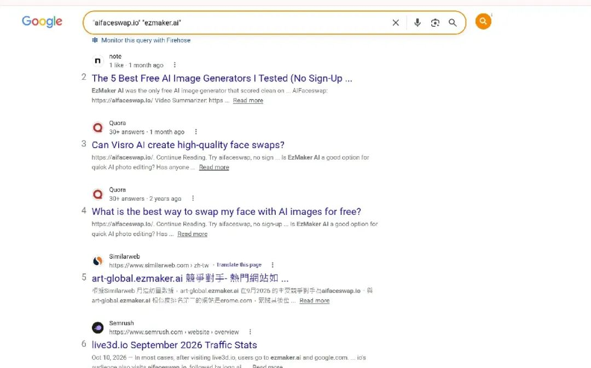发现一共有 3 页，同时提到的，嗯，有强关系。

再继续看，网站源码，搜索 ezmaker……2 处匹配，无需多言了至于第二大渠道直接访问，我猜测站长也是积累有分发渠道的，也就是，有资源。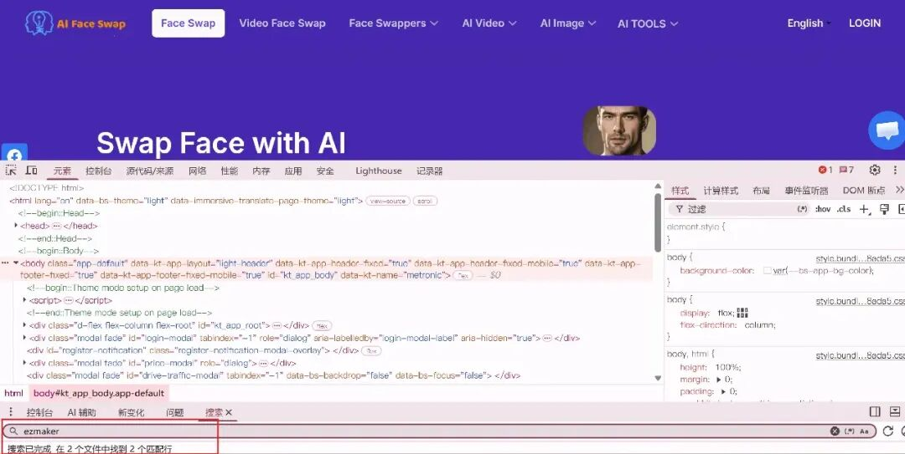

## 03 启示：不仅看做对了什么，还要看已经拥有什么

所以回头看，这是一个怎么原地起飞的网站？靠强站带小站。

如果我们没有强站，能复制么？不能。

这让我想起来，上次在虾友群里，有开发者分享的一个公众号，8 月中旬开号，才发表 10 来篇，篇篇阅读过万，几篇付费文章篇篇付费上万人，这也是强号带小号，而且推测大概率是同一个博主在运营，没有强号的，不可复制。

所以，研究成功案例，不仅要看它做对了什么，还要看它，已经拥有什么。

---

## 相关页面

- [[sources/ai-chuhai-46-small-sites-real-revenue]]
- [[sources/hezhiyan7-new-word-site-recap-roundup]]
- [[sources/victor-adsense-publisher-id-site-cluster-discovery]]
