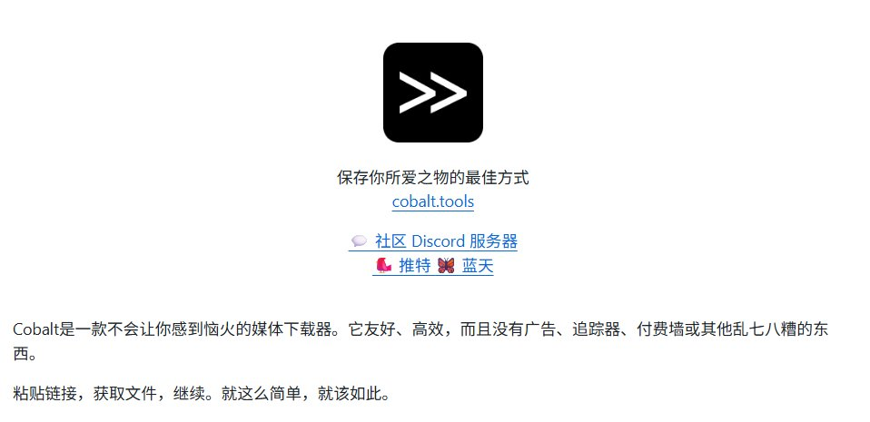

# 桃子：Cobalt 素材库工作流——工具找素材、AI 拆解、人判断

> 为什么有些人做 AI 自媒体每条视频都能爆？不是灵感多，而是根本不缺素材。GitHub 开源工具 Cobalt（4.6 万+ Star）可直接下载 YouTube、TikTok、X、Instagram、B 站等平台的公开视频，完全开源、免费、不用注册会员。做法：刷到爆款先收集进自己的素材库 → 交给 AI 分析（选题为什么引起兴趣、开头怎么抓人、脚本如何推进、镜头怎样安排、为什么容易转发）→ 结合自己账号定位重新创作。分工很清晰：**工具负责找素材，AI 负责拆解，人负责判断和创造**。

<!-- more -->

终于知道，为什么有些人做 AI 自媒体，每条视频都能爆了。

不是因为他们每天坐在电脑前，灵感多到用不完，而是因为他们根本不缺素材。

今天发现一个 GitHub 上的开源工具，叫 Cobalt，目前已经有 4.6 万多个 Star。

它可以直接下载 YouTube、TikTok、X、Instagram、B 站等平台的公开视频，而且完全开源，不用付费，也不用注册会员。

平时刷到爆款内容，可以先收集下来，建立自己的素材库。

然后交给 AI 分析：

选题为什么能引起兴趣，开头怎么抓人，脚本如何推进，镜头怎样安排，内容为什么容易获得转发。

分析完以后，再结合自己的账号定位重新创作。

真正厉害的自媒体人，早就不靠每天苦想选题了。

工具负责找素材，AI 负责拆解，人负责判断和创造。

项目地址：

GitHub：https://github.com/imputnet/cobalt

官网：https://cobalt.tools/

做 AI 自媒体的，建议先收藏起来。

## 相关页面

- [[patterns/content-arbitrage-pattern]]
- [[sources/danta-video-account-group-precise-traffic]]
