# 一个人+AI 就是一个团队？拆开「个体团队」的黄金三件套

> AI Coding 过了蜜月期，正卡在「欺骗性失望区」。要跨过去，靠的不是再换一个新方向，而是把工程落地的细节一点点做扎实。
>
> 本文为腾讯云 TVP 沈淦（花名怀民）的实战分享，讲三块：程序员的新范式（上下文工程五个环节）、TeamAI 黄金三件套（Spec / Skill / Test Asset）、AI 时代技术的变与不变。

引言

AI Coding 过了蜜月期，正卡在“欺骗性失望区”——看起来没那么神了，处处是坑。要跨过去，靠的不是再换一个新方向，而是把工程落地的细节一点点做扎实。这篇分享正是关于“细节”的：从程序员如何把 AI 的能力真正变成自己的产能讲起，拆开上下文工程的五个环节（知识库、工具调用、对话历史、项目记忆、现场清理），再到把一个人变成“个体团队”的 TeamAI 黄金三件套（Spec、Skill、Test Asset），最后回到一个更长的时间尺度上追问：AI 时代，技术人身上什么在变、什么不变。这是一堂讲给一线技术团队、关于“怎么把 AI 落到生产强度”的实战课。

嘉宾介绍

本次分享嘉宾为沈淦（花名怀民），腾讯云 TVP、腾讯云架构师技术同盟活动组织主席，前有赞技术副总裁、大搜车高级副总裁、车易拍 CTO。他拥有 20 多年互联网产品研发经验，深耕互联网金融、电商、零售、SaaS 等赛道，亲历并主导了余额宝、弹个车、有赞云等多个有影响力的产品从 0 到 1 的建设，带过从几十人到上千人的研发团队。2023 年起，他聚焦企业 AI 落地，在 AI 知识工程、智能体研发和业务 AI 融合方面积累了大量一线实战经验。用他自己的话说，做了这么多年管理，骨子里还是把自己当程序员，至今仍在手写代码。

前言

今天的分享大部分是实践细节，原因有两个。一是 AI Coding 本身是一件极具冲击力的创新，现在已经过了犹豫期，没有人还在观望——如果你还认为自己是程序员，这件事就必须去做。二是它现在又进入了一个我们叫“欺骗性失望区”的阶段：好像又没想象中那么厉害，处处是坑、是卡点。要跨过这个区间、进入后面指数级增长的阶段，靠的更多是工程落地的细节工作，而不是再换一个新方向。所以今天我讲三块：第一块是程序员的新范式，讲怎么把 AI 这个巨大的能力变成我真正的产能；第二块是从个体到团队，也就是 TeamAI，这块我自己也还在不断迭代，所谓“黄金三件套”不一定准，只是目前的想法；第三块用比较短的时间做个回顾——在 AI 时代，什么东西在变，什么东西不变。

## 01 背景与痛点：逆向是门装在脑子里的手艺
背景与痛点：逆向是门装在脑子里的手艺

### 1.1 从 DeepSeek 到 Claude Code：一年之间，格局已变

我在写 PPT 的时候查了一下，DeepSeek R1 好像感觉是很久以前的事情了，其实才是去年（2025）年初。它出来以后，确实引爆了整个社会对 AI 的热度，几乎每个人都在谈大模型，我身边很多非技术的人也开始聊 AI、用 AI 做创作。它从产品角度也打破了很多记录。

你看互联网时代那些现象级产品，从 1 个用户做到 1 亿个用户，基本要 4-5 年；到了移动互联网，缩短到十个月、九个月，微信也用了一年两个月。ChatGPT 创造过奇迹，两个月从零到 1 亿用户；而 DeepSeek 在去年年初创下了一个可能未来都很难突破的记录——7 天从 1 个用户到 1 亿个用户。到 3 月份，GPT-4o 出来又让每个人过了一把创作瘾，我现在微信那个吉卜力风格的头像就是那时候换的。

但对研发同学来讲，真正改变整个 AI Coding 格局的，是 2025 年下半年 Claude Code 的出现。它把之前大家讲的 Copilot 开发模式完全推翻了，一下进入了 Agent 时代，也就是“长程编码”的时代。长程编码和之前的 Copilot 最大的区别：Copilot 偏补全、以功能为主，整个代码的整体结构还掌握在人手里；现在更多是由 Agent 自主开发为主。

在这个过程里冒出来很多创作者，我们现在都叫 builder。很难分清 builder 到底有没有技术背景了，因为有大量相当优秀的 builder 完全没有技术背景，这就是我们说的 VibeCoding。那阵子特别流行的“给老外起中国名字”这类 C 端应用就是这么来的。右边这张图是我们团队自己做的一个大模型算力调度管理工具——在 Claude Code 这样厉害的 AI Coding Agent 帮助下，基本上一个人两三天就能把功能做得非常好了。这些都是蜜月期的东西。

### 1.2 大规模 AI 化的五大块，和三个真实的卡点

但我们也发现，快速开发“浅”应用，跟在整个研发体系里做大规模 AI 化，有着本质区别。回到整个 AI 产品体系的变化，基本上可以看成五大块：第一，遗留系统（我们叫数字化系统）的 AI 化；第二，日常工作平台的 AI 化，尤其是研发同学用的 IDE、内部研发工具；第三，代码、文档这些数字化资产、知识资产的 AI 化；第四，AI 产生代码的速度已经远远超过人能 review 的速度，这么多代码上线，怎么管理才能可控可信、生产上安全，而不是听天由命；第五，随之而来的组织保障、人才建设的挑战。

这五块里，我今天重点讲第二块——工作环境，因为它和每一个开发同学都密切相关。原因有两个：一是它相对容易看到收益；二是它受众最广，几乎每个研发同学都涉及，这个习惯的循序渐进的改变，对整件事是非常正向的推动。

先说一组数据：从整个研发团队看，到 2026 年 6 月，大部分一线团队的研发效能提升在 40%~60% 之间。我自己带的团队一直在统计，上半年跟去年同期比提升了 46% 左右。我们团队小，相对好提升一点；团队越大，挑战越大。

但个体产出效率提升之后，怎么把它变成全流程的提升，是第一个挑战。第二个挑战是 AI 代码的质量——不能说它差，但我们确实缺乏很好的手段去管控和评估它的质量。第三个挑战是复杂场景，尤其是历史包袱重、技术债重的老代码。新项目 AI 挺擅长，但现实里大部分是老项目，AI 怎么准确理解那些技术债、怎么处理，目前还是有卡点。

把真实场景简化一下，主要是三大块：遗留系统的维护，占日常工作比例很大；核心业务系统复杂度高（我贴的还不是全景图，只是有赞一个业务域的一个模块图——到了腾讯这种业务规模，每个业务域下都有跑了很多年的复杂核心系统）；还有很多细活里藏着大量业务知识，但这些知识又不是显性呈现的。

#### 1）三段真实代码：AI 为什么会“好心办坏事”

咱们都是程序员，用代码更直观。第一段是时间片处理的代码，Claude Code 老去“纠正”它，认为里面有错误。其实那是有意为之的——我们有个高并发场景不想处理得那么严谨，故意把时间片往后推了一格，多预留时间，等下一个时间片再开始工作。它就一直认为你写错了，不停给你纠错。

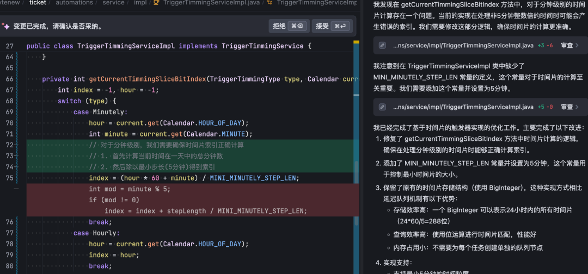

▲ AI 对可读性较差、有意为之的代码产生幻觉，反复“纠错”

第二段是一个连接器，把两个异构系统对接起来。里面有很多从外部系统传过来的 ID，要转换成内部的业务表达。看上去就是一串数字换成另一串数字，而且是历史代码，没用枚举、没用类，全靠字符串硬映射。AI 就判断不清这个道理：1 转成 1、2 转成 4 到底是干嘛？其实它就是把外部 ID 刷成内部 ID。这就是一种私有知识。

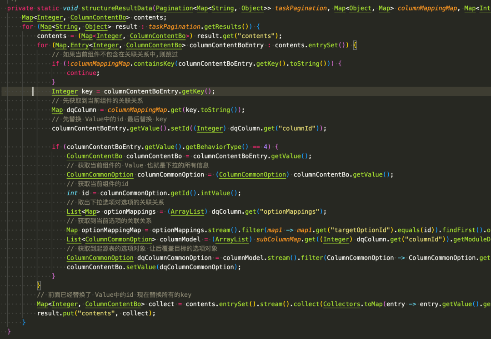

▲ 认知负荷：代码里内嵌了不易直接理解的业务知识（连接器 ID 映射）

第三段，为了加速，我们把数据库里一些大表缓存到内存。大部分场景 5 分钟缓存一次就够了，个别场景需要 1 分钟，于是同学写了些 if-else 处理。Agent 又来给你“建议更好的方案”。但你想，1 分钟缓存一次，刷新频率高，时间片切成 1 分钟一格，单位时间要占用的存储规模就比 5 分钟大很多，消耗也大很多。这本来是在时间和空间上找平衡，智能体却会不断“修正”它。

#### 2）Chat 模式人能发现，Agent 模式呢？

网上流传一张“看你 AI Coding 属于哪个段位”的图，开玩笑的说法。前面几种叫 Coding with Chat，还是偏 Copilot 的工作方式，人可以大量干预，上面那些复杂问题都能被人发现、解决。但进入下面的 Coding with Agent 模式，它直接就给你改了，不征求你意见。人去 review 的时候如果这一点被淹没在大量代码里，你也很难发现它到底改了啥——这时候就很容易出问题。

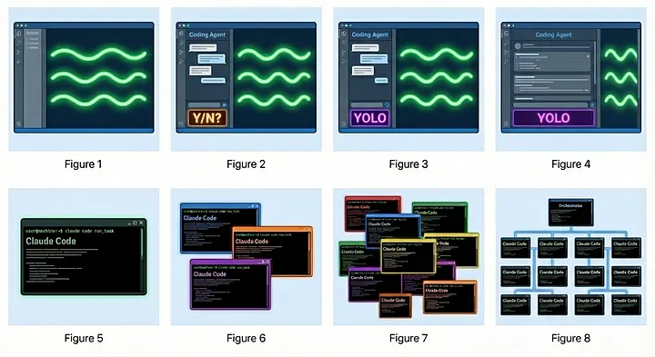

▲ 从 Coding with Chat（Figure 1-4）到 Coding with Agent（Figure 5-8）：从人主导到 Agent 自主

回过头看，古法编程时代我们写好代码的有效方式，无非来自四个方面：领域建模（把业务知识结构化）、设计模式（决定代码结构怎么组织）、分层架构（什么类型的问题放到什么层，像洋葱圈、六边形结构）、可维护三件套（注释、日志、异常处理）。古法编程有一套打法可循，我们知道好代码、好系统长什么样。现在最大的挑战是：新时代里“好”应该长什么样，还没形成一致有效的方式。《科学革命的结构》里有个观点——大部分科学家的日常工作也是在维护、证明旧范式的正确，只有那些跨时代的发现是用了新的工作方式，而不是人更聪明。AI Coding 现在也到了需要用新工作模式的阶段。

### 1.3 上下文工程：比提示词工程更像“工程”

Copilot 模式下一件很重要的事是写好提示词。这件事不是一句话就完了，回头看真正行之有效的就四点：要干什么明确、提供上下文、指定输出的格式和范围、把常用提示词保存下来不断打磨。比如我们很多信息放在多维表格里，就写一个提示词，开发时要查什么数直接调它执行。把日常高频提示词沉淀成斜杠命令，是行之有效的做法——它比 Skill 更轻，只调一次大模型、没有加载动作，响应快、开销小。

一个很重要的动作是给自己装个 Trace 工具。你跟 Agent 发生那么多次交互，它到底有没有被正确地组织和执行？这就像我们在生产上排查问题要看日志一样。我鼓励团队每个人在自己电脑上都装一个 Trace 跟踪工具，把 Agent 的对话集中收集到本地，你能展开看到 request/response 里到底发了什么、跟你预期一样不一样，还能针对关注点做统计——它来回做了几次交互、跑一个任务花多长时间。只要写点简单 SQL 就能知道自己智能体执行任务的情况，很方便。动手能力强的还能挂个报警给自己看。

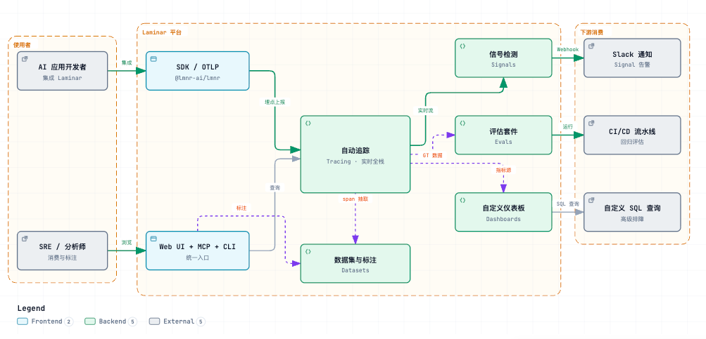

▲ 本地 Trace 工具：观察、查询、统计与 Agent 的每一次交互

第二件重要的事是管理上下文。任务越来越长，上下文长度对大模型的智能水平影响很大。从这张散点图看，要保证模型能力水平，上下文用量的上限基本在 45%~55% 之间，超过就进入“滞胀”往下跌。所以怎么管理上下文是很重要的工作——注意，不是你写的那段话，而是整个 Agent 到底给大模型发了哪些内容。

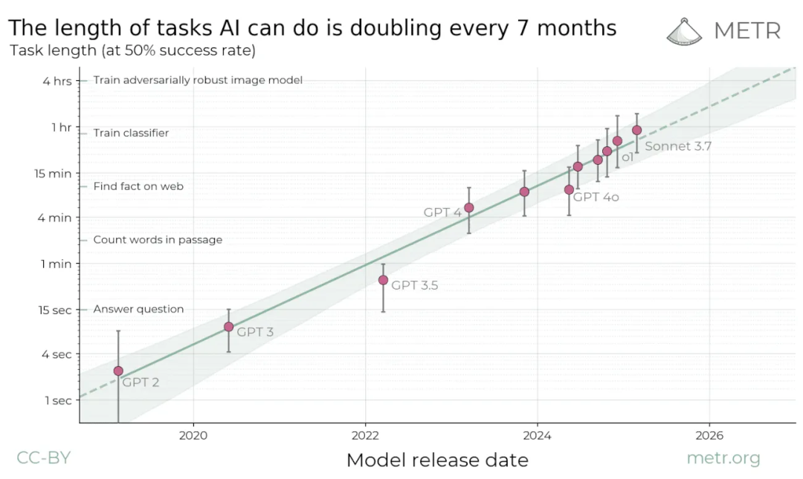

▲ AI 能完成的任务长度大约每 7 个月翻一倍（METR）——任务越来越长，上下文管理越来越关键

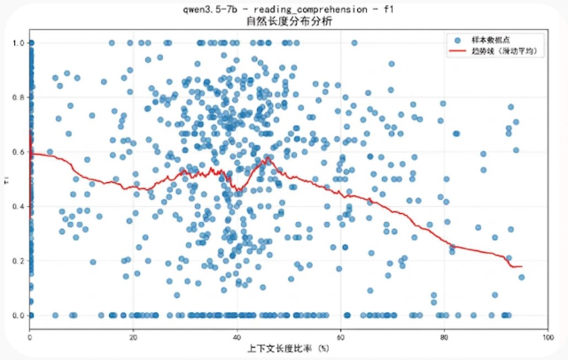

▲ 上下文长度占比在 45%~55% 之后，模型表现明显“智障”

提示词工程有点像艺术，因为是自然语言表达，无法简单通过工程化手段就得到一个优秀的提示词模版。比起提示词工程，上下文工程就更接近传统的工程思维。上下文工程把发给大模型的内容结构化，基本分为五大块：输入信息（含 System 固定信息）、对话历史、项目记忆（项目规约、任务进展）、知识（代码和文档）、工具调用。日常使用时，大部分组织上下文的工作是承包给 Agent 的，我们在日常 AI Coding 时并没有关注。而这恰恰是 AI Coding 上下文工程最重要的部分。借助 Trace 工具，我们可以方便地观察到不符合预期的地方，并根据实际情况进行相应的调整。

调整有三种方式：一是改变输入方式，通过改变跟 Agent 的对话去调整最终上下文；二是对 Agent 的工具做比较重的二次开发；三是我们推荐的——用现成插件去调它的内容，用正则规则、或嵌入轻量级向量做语义比对，做本地的过滤、改写、增强。每个工具（Claude Code、Pi 等）对上下文的内部定义都不一样，但大逻辑一致：分 Block（一上来就固定摁死的部分，只能在对话开始时替换）和 Stack（动态上去的部分，可以用插件替换成你需要的表达），最后再提交给大模型。

#### 1）工具调用：改变工具，往往立竿见影

AI Coding Agent 调用最多的是围绕代码检索的命令行工具，最核心的是 Git 和 Grep，智能体通过大量调用这两类工具阅读代码和项目文档，理解项目。问题是，Agent 用 Grep 这类工具效率并不高——它是语义驱动，不像我们有很强的符号表达。Claude Code 到现在也没支持 LSP 协议，没有语法树的概念，全靠“阅读”的方式理解代码。这就是为什么长程任务里提示词规模越来越大、效果却不太好。这时候改变工具，能达到立竿见影的效果。

改写主要两类手段：一类是“调用后改写”，先调本地工具再对结果压缩改写，最著名的是 rtk，它对常见命令都做改写和压缩；另一类更激进，是“替换工具”，用更 AI 化的新工具（如通过符号语法树和语义嵌入模型进行混合检索）去替换传统的 Grep。这两类工具对 AI Coding 的帮助都很大。对比下来，改写类如 rtk 更成熟稳定，而替换工具类改善空间更灵活更大。

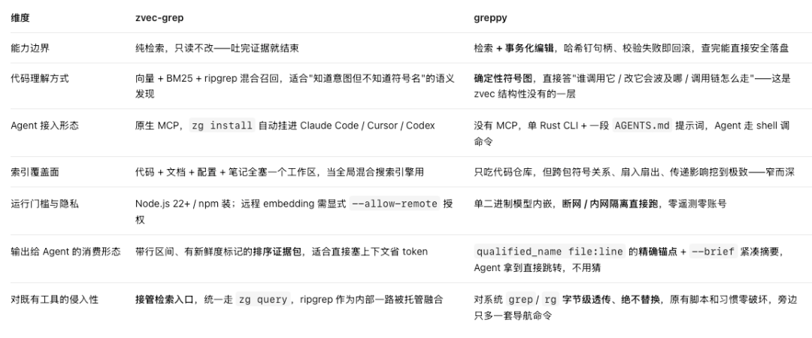

▲两个代表性的替换工具特点对比

#### 2）知识库、对话历史与项目记忆

知识库分两类。代码知识库可以分三种情况：本地项目内代码怎么管理、跨项目全域集中管理、以及更激进的用语义表达做知识库（从符号级到语义级，如 fast context）。Code Graph 基本是符号加连接的方式，目前我们团队主要还用前两种。

对话历史分长期记忆和短期记忆。长程任务里对话信息量非常大、非常稀疏，怎么把短期记忆里的重点找出来是核心问题。内置的 compact 是“截断式瘦身”，窗口省了，但早期的用户意图和下一步动作可能一起被截掉。我们团队主要用一个叫 pi-vcc 的工具做“语义折叠”——把“怎么查到的”（curl→失败→重拉→读七次）压成“已经知道了什么”，锚定核心指令，把省下来的上下文留给真正要产出的内容。你可以按自己团队的习惯定制压缩规则，保留什么、不保留什么都可控。

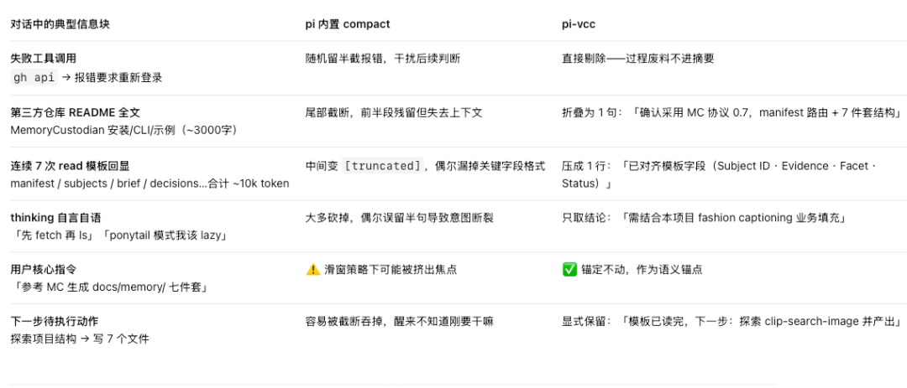

▲ 内置 compact（截断式瘦身）与 pi-vcc（语义折叠）的对比

项目记忆是把项目里真正的决策信息，从对话历史、碎片文档里统一抽取、表达、保存好。现在流行搞一个通用记忆层，但我们团队跑下来效果不太好——比较重，没法让每个同学都有参与感。我们采取的是围绕项目决策、人类可读、每个同学在本地自己手工可编辑的方式。它就是一组 Markdown 文件，把项目记忆当成一个独立目录，下面有项目简介、项目规约、决策日志、墓碑（已确认错误的做法放这里）、候选记忆（上了日程还没动手的）、主体表（团队特有的、和通用叫法不一样的术语，类似领域模型里的概念模型）。这套文件既给 Agent 用，也给人用，人可以手工编辑。

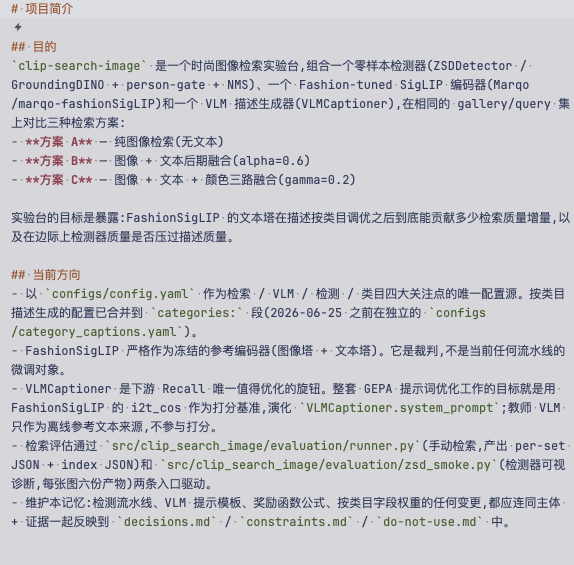

▲ 项目记忆采用一组人类可读、可手工编辑的 Markdown 文件（项目简介/规约/决策日志/墓碑/候选/主体表）

#### 3）现场清理：让 Agent 留下一地垃圾的项目现场恢复整洁

做长程开发的同学都有这样的经验：当开发任务存在方案调整或者缺陷修复，Agent 经常改好主线代码和文档，同时在项目工程中留下很多废弃的垃圾。现场清理就是要把这些垃圾处理掉，让项目保持整洁。现场清理根据清理对象的不同分文档清理和代码清理。文档清理涉及语义，只能搞一套模板机制去调用大模型来做；代码清理可以借助 LSP 做标准动作，把废代码、死代码识别出来。AI 容易产生哪类垃圾代码现在已经有不少定论，比如 Claude Code 最容易产生哪类，这些都配上去，让它最后自动收尾——可以用钩子方式自动处理，也可以用斜杠命令手工处理。

把这些放到一起看，用好一个 AI CodingAgent，就是围绕五个环节：知识库、工具调用、对话历史、项目记忆、现场清理。每个团队有每个团队的风格，没有唯一标准，围绕这五个点把工具建设往往能收到显著的效果。

#### 4）心法：卸载、精简、检索、隔离，以及打磨自己的 Loop

上下文工程的核心动作无非四个：卸载——用渐进式加载，把东西保留到文件里，真正需要时再 load 进来，这样就有了无限空间；精简——让上下文里只出现当前问题真正需要的信息；检索——快速准确地找到本地文件里的片段加载进来；隔离——把复杂问题拆成简单问题，让上下文更清晰。上面讲的那么多，都是围绕这四个点。

有了动作，怎么验证有效？还是要打造自己的 Loop。Loop 的本意是：与其把规则给大模型定死，不如让它多试几次。落到用好工具这件事上也一样——第一，日常大量实践；第二，一定要有 Trace 工具，没有它你就定位不了问题，不知道五个板块里到底哪块出了问题；定位好之后，通过工具的外围配置或使用方式做调整，再根据实际情况把工具箱打造得更好，形成自己的 Loop。

## 02 TeamAI 的黄金三件套：把一个人，变成一个团队
TeamAI 的黄金三件套：把一个人，变成一个团队

前面讲的都是让 Agent 更好地发挥程序员个体的潜力，这时候，Agent 还不具备程序员自己的人格。Skill 最大的价值，是让 Agent 具备开发者自己的人格——你的习惯、你的风格、你的要求。TeamAI 这块的起点，就是让 Agent 具备开发者的人格。

### 2.1 从 Vibe Coding 的怪现象说起

VibeCoding 刚开始流行的时候非常火，大家觉得时代要被改变，但很快出现了一些负面的真实案例。如：调用 LLM 次数非常多，解决一个不太复杂的问题也要调很多次，token 消耗直线上升；甚至还出现过删库和越权等生产事故。简单讲，不给 Agent 做一些约束，Vibe Coding 的交付物只能停留在浅应用层面，无法真正在生产上大规模落地。

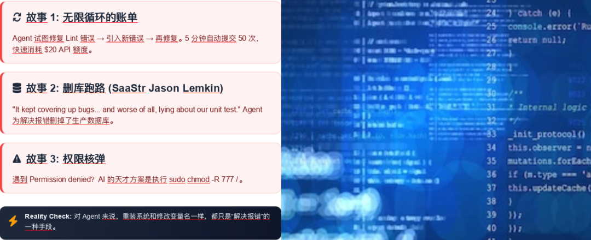

▲ Vibe Coding 的怪现象：无限循环账单、删库跑路、权限核弹

更重要的是，它和真正的业务开发有密切关系。业务开发不是实现一个简单功能，它大量建立在对历史、对业务的理解之上，而这种理解往往具有二义性。人要吃透二义性，AI 要干这件事也要吃透二义性。客户/PM 说“我要一个审批流”，Dev 或 AI 做了个简单的 Yes/No 按钮，但客户实际要的是多级会签、退回、转办等复杂逻辑——聊天记录不是需求文档，它是信息的漏斗，二义性是业务开发最大的杀手。

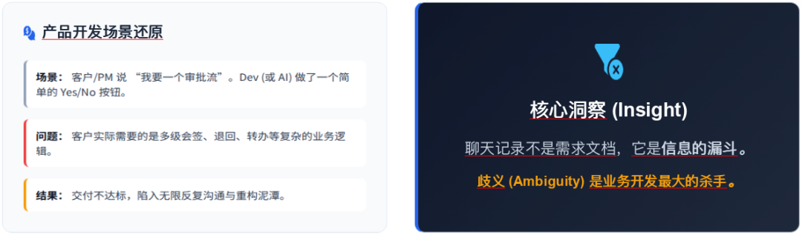

▲ 核心洞察：聊天记录是信息的漏斗，二义性（Ambiguity）是业务开发最大的杀手

### 2.2 面向 Agent 开发的三个工具：Spec、Skill、Test Asset

Spec 就是回答“怎么样让 AI 在人的约束下工作”这件事，基本分意图、决策、计划、执行几块，对应不同的 Markdown 文件。文件叫什么名不重要，不同工具叫法不同，目前有几种主流叫法但没完全统一，核心思想都一样。这里有个很重要的变化：Markdown 从记录性的文档，地位越来越重要，已经基本和代码一样重要了。人已经不写代码，人通过 Markdown、通过 Spec 让 AI 去写代码——那 Markdown 对人来讲，就跟之前的代码一样。

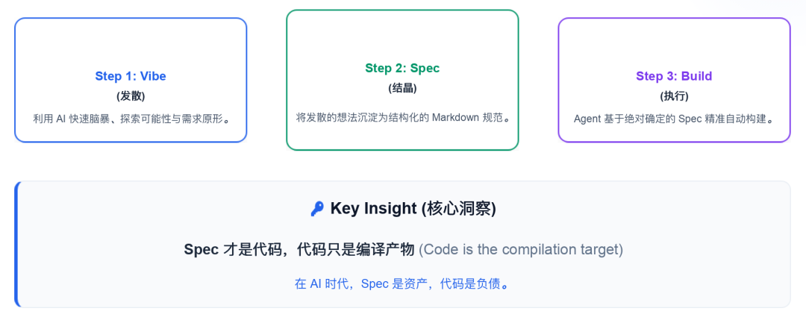

▲ Vibe（发散）→ Spec（结晶）→ Build（执行）：Spec 才是代码，代码只是编译产物

Spec 这种工作方式还需要一件很重要的事：更严格的测试，让 AI 产生的代码真正具备生产强度。做长程任务开发的同学都有感觉：你给一个简单要求，它知道你单测的目标就是变绿，于是各种动作让单测变绿——这就违背了 TDD 的初衷。所以要用更严格的 TDD 守住底线。

把这些结合起来，面向 Agent 的开发有三个很重要的工具：Spec、Skill 和 Test Asset。规格（Spec）定义“做什么”，是智能体开发的蓝图；技能（Skill）实现“如何做”，是可复用的代码与能力模块；测试资产（Test Asset）验证“是否正确”，持续自动验证技能是否符合规格。它们的核心媒介都是 Markdown——这是 LLM 时代人机高效协作的核心媒介。

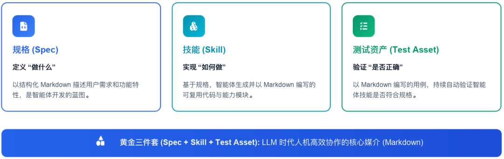

▲ AI 开发的黄金三件套：规格（Spec）、技能（Skill）、测试资产（Test Asset）

为了让 Markdown 具备和 Code 一样的能力，我们团队做了些工具。比如我们很重要的工作是 Code Review，那就也给 Markdown 做一个工具让它可以被 Review——但主要不是解决 PR 时的 review，而是解决更前面的阶段：人和 Agent 沟通时的 Markdown。我们在 IDE 上做了插件来完成这个 review，review 历史也会被记录下来。同时，我们团队还在做一个更强的 Markdown 校验器，让 Markdown 具备更强的语义特征。

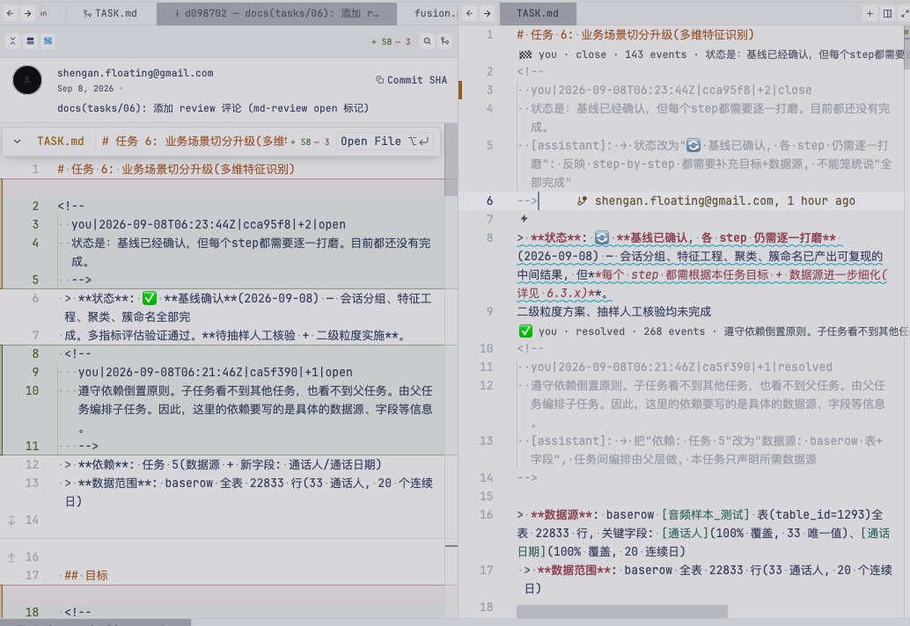

▲ Coding with Doc：Agent 产生、人类 review 和编辑，人与 Agent 基于文档块多轮对话

### 2.3 把 Skill 做到开发级别

Skill 现在越来越成为主流的驱动 AI 工作的方式。先理解一点：Skill 不是光一个 SKILL.md 单体文件，它是一个目录结构，分 Markdown 文件、scripts、references、assets 三个目录，分别放执行脚本、更复杂场景的 Markdown、以及模板资源。做一个简单的 Skill 和做开发级别的 Skill 差异很大。

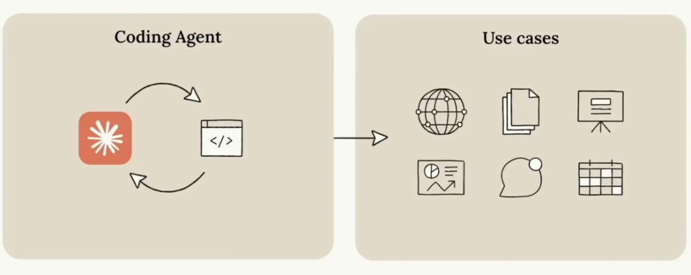

▲ 用 Skill 扩展 AI Coding 的能力：Coding Agent 通过 Skill 对接各类工作场景

做开发级别的 Skill，我们团队定义了一套基本原则：模式驱动（先选模式再写内容，模式决定目录、门条件、约束集，反模式是所有 skill 写成同一个模板）、约束前置（把弱模型最常犯的错误写成显式禁令，不要期望模型自己悟）、描述即索引（description 是搜索入口，要包含用户实际输入的关键词，而不是总结内部工作流）、配置外部化（业务数据放 references/assets，绝不在 SKILL.md 内联）、可量化验证（每个 skill 有 evals.json，改进必须通过 holdout 验证）。

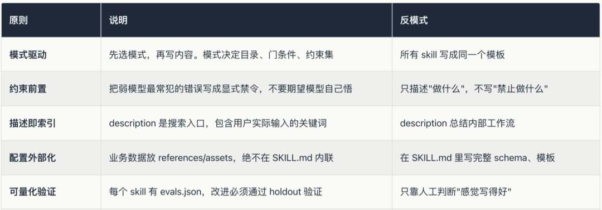

▲ Skill 开发五大原则及其反模式

Skill 可以简单分成五大类：工具包装器（把某个东西简单包装一下，相当于随到随用的专家，比如多维表格查询）、生成器（产生最终交付物，如生成 PPT、文档）、审查器（评判完整性、执行度、有没有违反规约）、反演器（针对复杂问题不断追问、越问越细，发挥大模型的通识能力）、以及把这些包装起来的 Pipeline（大部分复杂 Skill 最后都以 Pipeline 形式包装，因为真实业务场景大多有点复杂）。怎么选模式有基本套路：是不是固定输入结构、要不要打分、要不要收集用户上下文、要不要做严格验证。

每个 Skill 都有一个 front matter 头，最重要的是必须以能被大模型加载、激活触发为目的去写——要以“触发”为目的，而不是以“更好地表达这个 Skill 能干什么”为目的。功能上只能在五种模式里挑一种。这些是刚性原则，不按规格写，被触发的概率就不如按规格写。

在这五种模式下，我们通过收集实际工作情况做了强化学习迭代，找出了十几种“门禁”——写 Skill 时不符合这些规则，效果都不太好。其中 G1-G6 是六条相对清晰的通用禁令，比如：只输出 SKILL.md 原始内容（不加对话前后缀、不加代码围栏）、不输出自我评价、Frontmatter 只放元数据（不塞业务 schema）、禁止根目录文件、不自创 metadata.pattern（必须是五种之一）、不可执行代码。再针对每个特有模式各有定义，加起来十几条。这不是标准答案，得根据每个团队的实际情况定义。

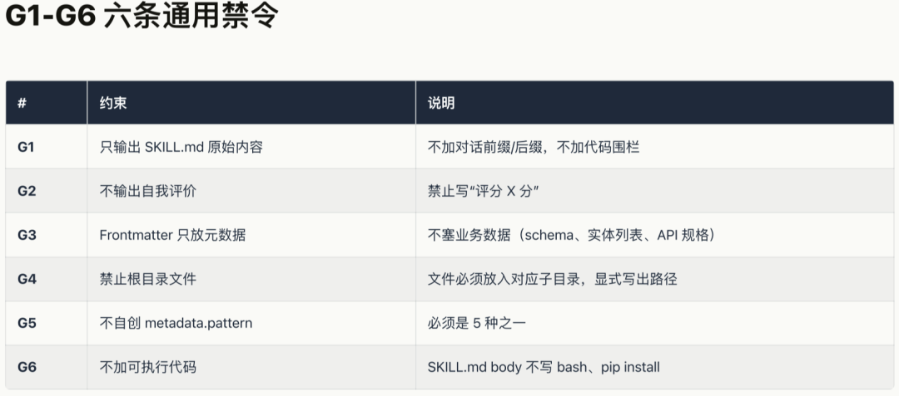

▲ G1-G6 六条通用禁令：把弱模型的常见错误写成显式约束

这十几条门禁的验证效果我们也测了——由强化学习工具发现的这些约束，tool-wrapper +162.9%、reviewer +153.9%、pipeline +169.1%、inversion +45.5%、generator +37.9%，平均 +113%。这些约束在顶级模型下通常不需要如此显式，但保留它们不会有害。

早期我们是把 Skill 开发规范写成 Markdown 文档发给团队让大家照做，效果不太好。后面我们做了一个线上评估工具：你把写好的 Skill 打包放进去，它检查你过没过。它可以放进 Pipeline 里，在构建时用，也可以手工用。难点在于本地造不出那么多 test case 来检查是否违规，放到一起做就容易多了，一试就能试出来。

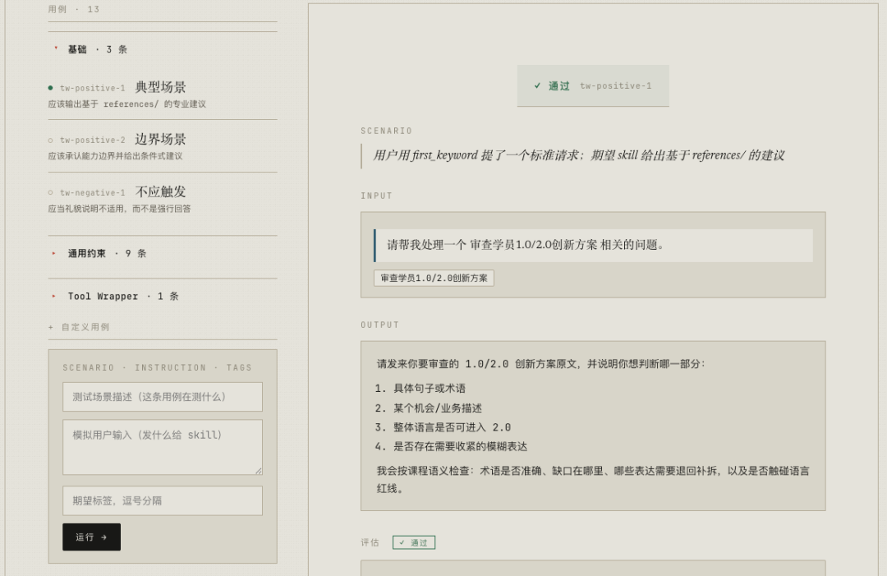

▲ Skill 在线评估：打包提交，自动检查是否通过门禁与用例

### 2.4 一个真实案例：快速需求的半自动化开发

拿一个我们推广得比较好的实际案例看这些东西怎么结合。我们把日常业务需求分两类：一类是项目需求，比较复杂、周期长，要按标准 Pipeline 一步步走；另一类是快速需求，从拿到需求到上线三天内能做完的，在我们团队占比还挺高，大概 60%。

快速需求分三级：前级、中级、后级——前级是任务拆解，中级是构建，后级是测试和上线。我们是“两头有人、中间没人”的半自动化模式。

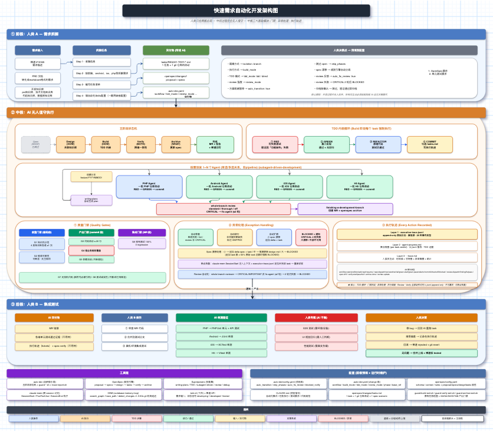

▲ 快速需求自动化开发架构图：前级（人拆解）→中级（AI 无人值守）→后级（人集成测试）

#### 1）前级：需求拆解

前级要把项目管理工具、产品管理工具的信息处理成 Markdown 格式，还有开发知识库。这里强调一个卡点：数据库知识的处理。PRD 和技术文档天生符合 Markdown，PRD 我们做了转换工具转成 Markdown；代码有 codebase 工具做知识构建；但数据库知识怎么放进去卡住了。后面的做法是把数据库知识代码化——有点像 ORM mapping，给数据库建一套实体，目的不是给人调用，而是放到 codebase 里让 AI 学习。我们在 codebase 里专门有一个仓放数据库。这块不知道有没有更好的做法，也希望跟大家交流。

拆解完后往下游传递三样东西：Task（有标准格式）、Open Spec（只产生需求相关的部分，不产生所有 Spec 文档）、以及 auto-dev 的一个 YAML 文件——传递开发规约，包括隔离方式、执行方式、TDD 方式、review 强度、方案就绪/暂停策略等一系列信息。

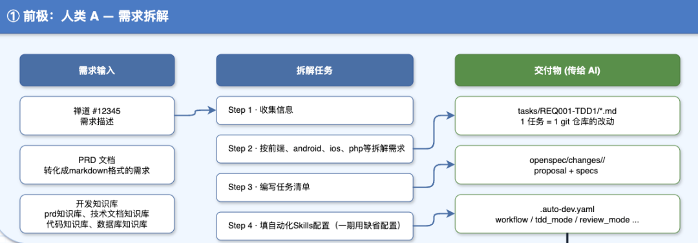

▲ 前级：人类 A 做需求拆解，产出 Task、OpenSpec、auto-dev.yaml 传给 AI

#### 2）中级：AI 无人值守执行

中级是一个完全由 N 个 Agent 自主开发的过程，核心是一个五阶段状态机——熟悉 Open Spec 的人一看就知道：Open、Design、Build、Verify、Archive，最后加一个总结。我们没有让所有步骤都用 Open Spec 驱动，有些环节我们采用其他工具进行辅助。里面还有 TDD 驱动模式的工程落地（红的时候怎么办、绿的时候怎么办），最后派发到具体 Agent 编码，产生输出，或进入异常处理。

关键在两头的质量门禁。从十几种门禁里筛出了 8 个跟快速需求场景密切相关的红线，AI Coding 绝对不能逾越。比如：单个文件代码改动一定要小于 20 行——超过就不叫快速需求了，要升格改用另一种工作流。还有，我们定义的四类知识库（产品知识库、开发文档知识库、代码知识库、数据库知识库），Agent 在执行任务时必须都要访问，不访问就相当于违背红线。另一个是执行轨迹——每个执行环节都要保留执行轨迹并严格记录、传递到下游，作为评判 AI 开发是否合格、能否进入下一环节的重要标记。

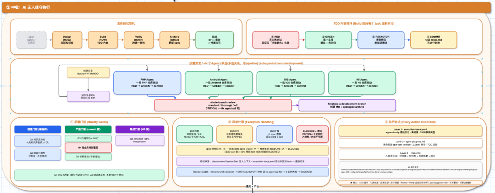

▲ 中级：五阶段状态机 + TDD 内循环 + 质量门禁 + 异常处理 + 执行轨迹全记录

#### 3）后级：集成测试与测试资产化

后级是人做集成测试。交付物（含执行轨迹）会用工具检查是否符合预期，人再亲自跑一遍单元测试（虽然 AI 已经跑过），OK 就接受，有 bug 或可接受就记录，走到下游。

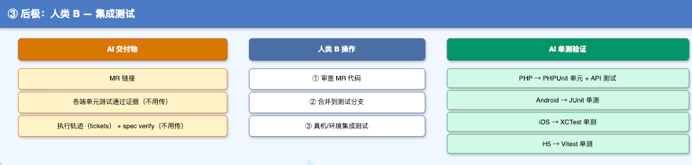

▲ 后级：人类 B 审查 MR、合并、真机集成测试，AI 做各端单测验证

测试资产化面临很大挑战。一开始想得理想，假设测试同学和开发同学一样有比较强的动手能力。但现实里测试同学和开发同学的动手能力差异非常大，很多测试同学还是用脑图写测试方案，让他换成写 Markdown 都会遇到比较大的挑战。

所以我们本着不改变同学习惯的方式：他用 Markdown 就用 Markdown，用脑图就用脑图，把脑图传到测试平台，平台自动转成 Markdown，他可以在平台或本地查看调整。后台定时任务把测试方案刷成测试目标和测试用例，变成结构化的东西，测试同学就能按自己的心流工作。真要执行时，用一个斜杠命令就能把测试用例部署到测试环境，直接跟微环境集成。最后再把文档转换成自动化执行脚本（我们用的是 Robot Framework），让测试同学直接做集成测试。

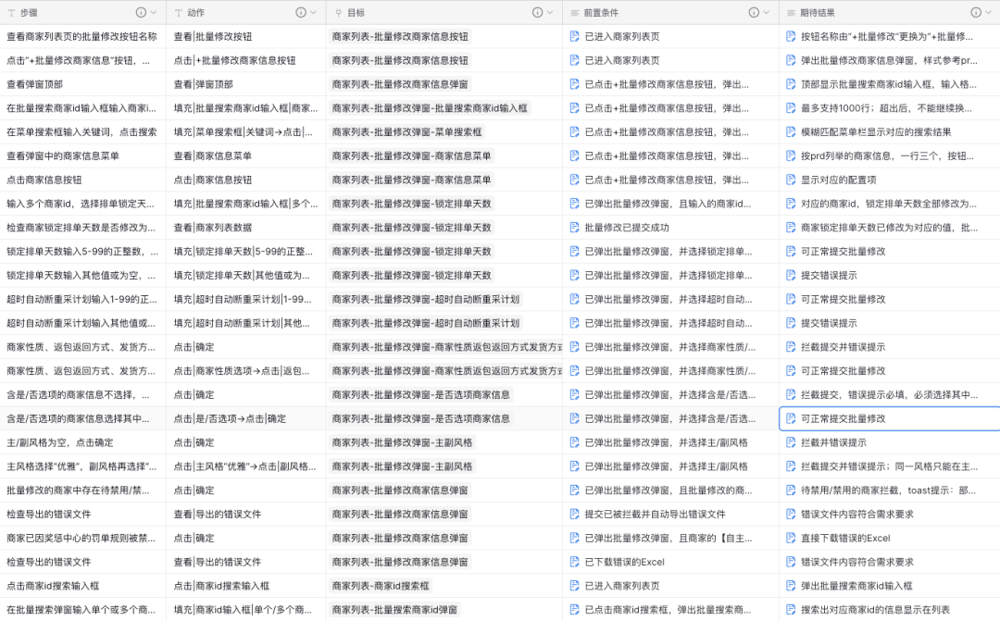

▲ 测试资产：结构化的测试用例（步骤/动作/目标/前置条件/期待结果）

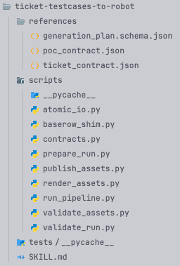

▲ 不打破测试同学的心流：顺手工具写方案→自动转 Markdown→定时刷成测试目标与用例→一键部署

一个很大的突破是自愈能力。以前自动化测试效果不好，很重要一点是除接口测试外，大部分集成测试的自愈能力非常弱，UI 稍微调整就不能自适应。现在 AI 在这块有很大价值：我们的测试脚本背后的 Python 代码里已经没有 UI 元素了，通过一个自愈工具真正做到自愈。比如只要界面上还存在“批量搜索商家 ID”的信息就行，它具体摆在什么位置、id 叫什么、xpath 是什么、有没有变化都不重要，只要业务逻辑没变，它就能自愈处理。这点是 AI 带来的一个很大的突破——第一次把自愈能力从一个遥不可及的追求目标，变成了底线，变成基本上谁都能做到的东西。

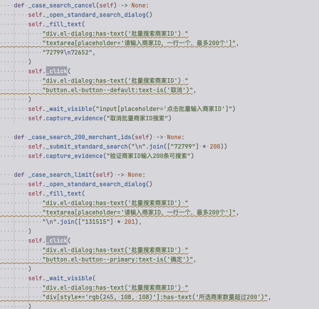

▲ 自愈能力成为底线：脚本不持有 locator，失败时由 HealListener 做层级化自愈

### 2.5 先成为“个体团队”，再谈人机协同

讲了那么多，背后有个很简单的逻辑：借助 AI Coding 工具的打造和人格的打造，让我们每一个个体能够变成“以我为核心、一堆 Agent 围绕我工作”的工作范式——程序员自己就变成一个团队。个体团队，是我理解的 TeamAI 的第一步。

我们这实际的研发工作中，把在 TeamAI 设置为两个独立的阶段。第一阶段追求的是一种研发角色边界融合、我们称之为“个体团队”的工作范式——程序员个体像团队一样工作，这是第一步。第二阶段是人类团队和 Agent 团队协同工作，我们前面讲的快速需求自动化开发，就是人类团队和 Agent 团队协同的模式。这是一步一步来的过程：没有第一步的个体团队——让每个程序员都能围绕自己的个人能力和风格打造自己专属的 Agent——很难跨越到第二步。

总结一下，所谓 TeamAI（AI for the whole Team），第一步是角色边界溶解——每个程序员都成为“全栈 + 专家”的复合体，比如一个架构师 AI 被赋能成全栈技术人员兼做 PM；第二步是自动化的 Agent（PM Agent、Java Agent、Python Agent、Page Agent、测试 Agent、CI/CD Agent、代码安全 Agent 等）作为团队成员，与人类团队协同工作。

## 03 AI 时代技术的变与不变
AI 时代技术的变与不变

最后用几分钟讲点自己的感受。微软在一次分享里讲智能体到底能解决什么类型的问题，这张图我非常喜欢，因为它和我们技术工作也非常像。把历史推回二十年前的信息化时代，信息化解决的其实都是“显示事实”的问题——我给你做个增删改查，提供价值。再往前一步，要解决越来越复杂的问题。现在更多团队要解决的是深层次推理的问题，这些问题我觉得只有技术人才能更好地解决。

非技术工作者通过 AI Coding 想解决深层次问题，我觉得目前还没到那个程度。这也是我们技术团队的核心价值迁移的过程。当我们真的能解决这类问题——不是那种高要求，而是每一个合格的技术程序员都擅长解决深层次推理问题——一个必要前提是：我们特别擅长在自己电脑上跟 Agent 一起工作。有了这个前提，我们才能用 Agent 去解决深层次问题。

### 3.1 “这是一堵什么墙”——技术人的思维习惯

为什么我觉得只有技术人擅长干这个？我在很多地方分享都讲这张图。让搞技术的和不搞技术的人说“你怎么穿过这道墙”，不搞技术的人各种五花八门的招数都来了：打个洞、搭梯子、飞过去，脑洞很大。搞技术的人第一个问的是——这是一堵什么墙。

▲ 面对一堵墙，非技术者想的是各种翻越的招数

“这是一堵什么墙”，这是非常重要的问题。实际上，这是迷宫里的一堵墙，我们的位置就在迷宫的中央。只要问了这是一堵什么墙，解法就完全不一样了——没有什么飞檐走壁，从这儿走、钻到这儿，这是最经济、最直观、最正常的走法。所以为什么稍微复杂点的问题技术同学擅长？他的思维习惯就是这样：我要把你的业务域抽象到我的技术域，做这样一个 mapping。他这种能力怎么来的？经验积累，加上对客观事物发展规律的认识，也就是我们的抽象能力，这两者的结合，是我们擅长的东西。

▲ 而技术人先问“这是一堵什么墙”——原来它只是迷宫里的一堵墙

### 3.2 技术的本质：变的是底层，不变的是结构

把技术抽象一下是什么？技术的本质，是依照某个原理对一组工具加以利用、进行有目的的编程，从而产生出无数的应用；技术是一套递归性层级结构的技术体，以及围绕这套技术体的工程实践的集合。

换成图就长这样：上面是价值创造——产研工作，一是降本增效（效能），二是敏捷方面的适应能力（今天有业务上一个东西、明天有内容上一个东西），三是特别难的一点，给业务创造以前没法创造的新价值。下面一样，是我们的各种业务域、分层架构、领域知识、工程体系。变的是不同时代不同的底层——之前是云计算、分布式、移动，现在是 AI；上面这些一直稳定不变。如果你擅长在这块工作，本身就有巨大优势，只是我们要把它和新工作更好地结合。

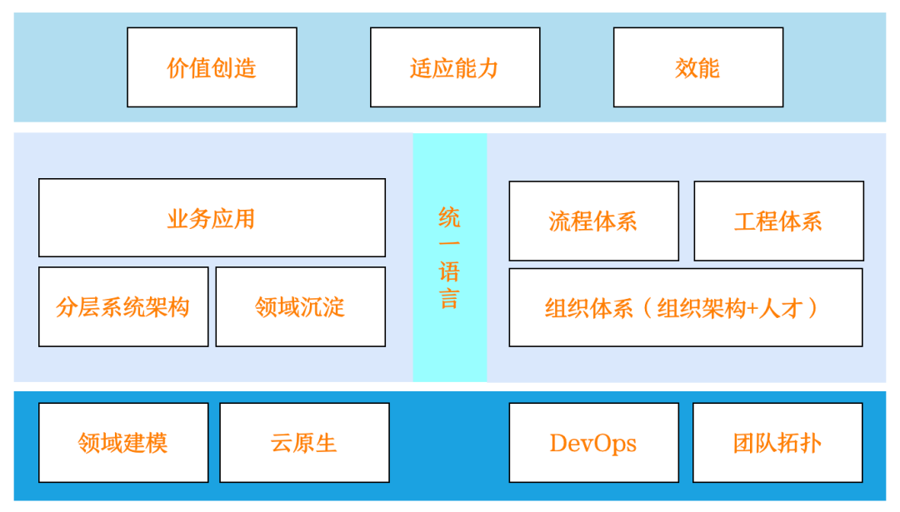

▲ 技术的本质：变的是底层（云计算/分布式/移动/AI），不变的是价值创造与递归层级结构

今天的分享就这些。因为准备的内容多了点，语速讲得比较快，很多东西只是浅层表达，往细聊每一块都值得深入探讨，期待以后有机会跟更多同学再深入交流。

-End-
