> 医疗业务研发团队 OPT（One Person Team）平台给代码生成补上后端验收 Agent：AI 真实调用接口、结合返回结果/业务状态/日志/DB 逐层验证需求是否真正实现——从「看代码」走向「看结果」；含 api-acceptance 主流程拆解与 OPT 小队落地实践（CodeBuddy 运行时）。

<!-- more -->

当 AI 大幅提升代码生成效率后，一个新的问题也慢慢浮现：代码写得更快了，却更难判断它是否真的能用。光靠静态 Review 很难确认 AI 生成的代码是否满足需求。于是，我们在代码生成之后再向后多做一步：让 AI 真实调用接口，并结合接口返回、业务状态、日志、DB 等信息，逐层验证代码是否真正实现了需求。本文将介绍如何通过真实执行和多层证据，让代码验收从“看代码”走向“看结果”，也让我们对 AI 生成的代码多一些信心。

## 01 业务背景与痛点

在医疗相关业务的研发过程中，我们一直在探索 AI 如何参与研发全流程，减少需求开发中的重复工作和人工介入。围绕这个方向，我们自建了一个 OPT（One Person Team）平台。OPT 平台是以 CodeBuddy 等 CLI 为底层运行时打造的人与 Agent 协同工作的平台，通过多个 Agent 组成的小队，可以协同完成需求分析、规划、开发等工作，让 AI 从辅助编码参与到完整的需求交付中。随着 AI 参与得越来越深，后端需求开发的节奏也发生了明显变化。现在，很多需求分析、方案设计和编码的工作都可以交给 AI 完成，“把代码生产出来”正在变得越来越容易。但另一个问题也变得更加突出：代码写得更快了，却更难快速判断它是否真的能用。

后端代码的采纳和验收并不等于“代码已生成”，也不等于“接口能调通”，往往涉及复杂的业务规则和上下游流程。一个接口返回 200，只能说明它在当前参数下完成了一次调用；但需求逻辑是否正确、边界条件是否覆盖、老数据是否兼容、异步任务是否生效，以及日志和数据库状态是否符合预期，仍然需要进一步验证。也就是说，AI 可以很快把代码写出来，但开发仍然需要花大量时间人工确认改了什么、影响了什么、应该怎么验，并最终判断这次修改是否确实满足了需求。

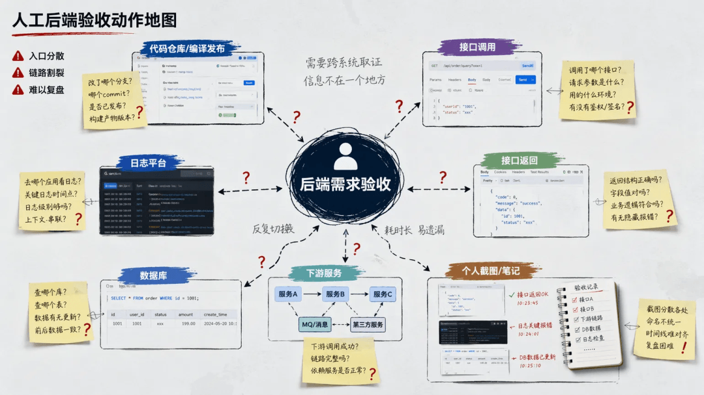

这就形成了一个速度差：AI 代码生成速度 >>> 人工需求验收速度。

随着 AI 生成代码的比例越来越高，验收逐渐成为需求交付中的新瓶颈。因此，我们要解决的不是“如何让 AI 再多写一点代码”，而是：当 AI 已经把代码生成速度提上来之后，如何帮助开发更快、更稳地判断这段代码是否真的可用。

这也是这次实践的出发点：我们在 OPT 的需求交付小队中补上了一个后端验收 Agent，让 AI 在完成需求分析、规划和开发后继续向后走一步，参与代码发布、测试执行和结果分析，并通过接口、业务状态、日志、数据库等实际证据完成验收判断，进一步补齐 OPT 需求交付链路。

## 02 解决方案与案例详解

接下来，将结合实际案例，拆解后端验收的完整工作过程，具体看看这套方案是如何工作的。

### 2.1 核心能力 Skill 拆解

api-acceptance 是这套后端服务预验收能力的核心工具。接下来围绕 api-acceptance 的主流程，拆解它如何完成一次后端需求预验收。其主流程可以拆成五个阶段：

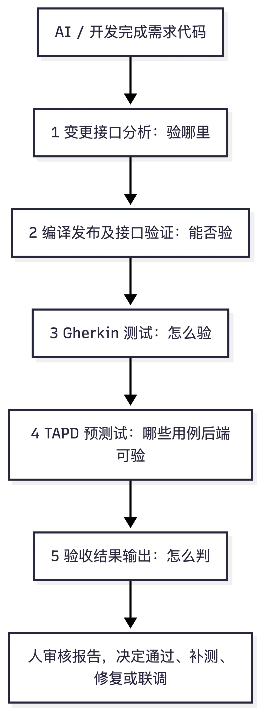

在拆解五个阶段之前，先说明一个贯穿全流程的底层设计：api-acceptance 并不是遇到任何异常都立刻失败，也不会把所有受限项都包装成成功，而是把异常分成“硬阻塞”和“软失败”两类处理。

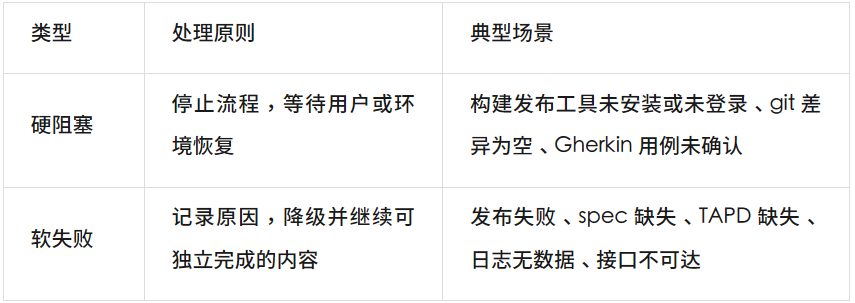

硬阻塞保证 Agent 不越过必要的人机确认和环境前提；软失败则让 Agent 在发布失败、spec 缺失、日志暂不可用等受限情况下，继续完成变更分析、场景生成、静态 Review 或风险标注。核心原则就是：能验证的尽量验证，不能验证的诚实标注，不要把受限项伪装成通过。

### 2.1.1 第一阶段：变更接口分析，先确定“验哪里”

传统人工自测通常会先凭经验列几个接口：这个需求改了某个 handler，就验这个 handler；改了某个 service，就找调用它的接口。但这种方式的问题是，需求影响并不总是停留在改动文件本身。一个字段类型变化、一个枚举范围收紧、一个错误码语义调整，都可能影响已有调用方和边界场景。

所以第一阶段要做的事情，是从代码变更反推验收范围。

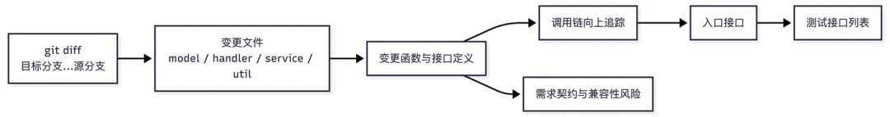

Agent 会基于 git diff、需求描述、分支信息和接口定义，识别变更文件、变更函数、调用链和入口接口，最后形成测试接口列表。

同时，它会标注需求契约与兼容性风险。兼容性风险可以分成三类：

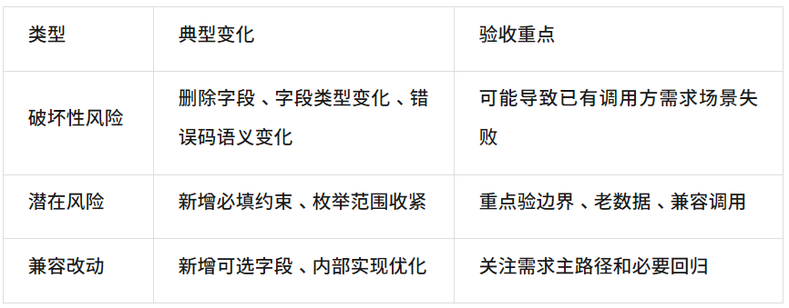

变更接口分析越准，后面的 Gherkin 场景和验收报告越不容易跑偏。它决定的不是执行速度，而是验收方向。

以下是案例输出的变更接口分析报告：

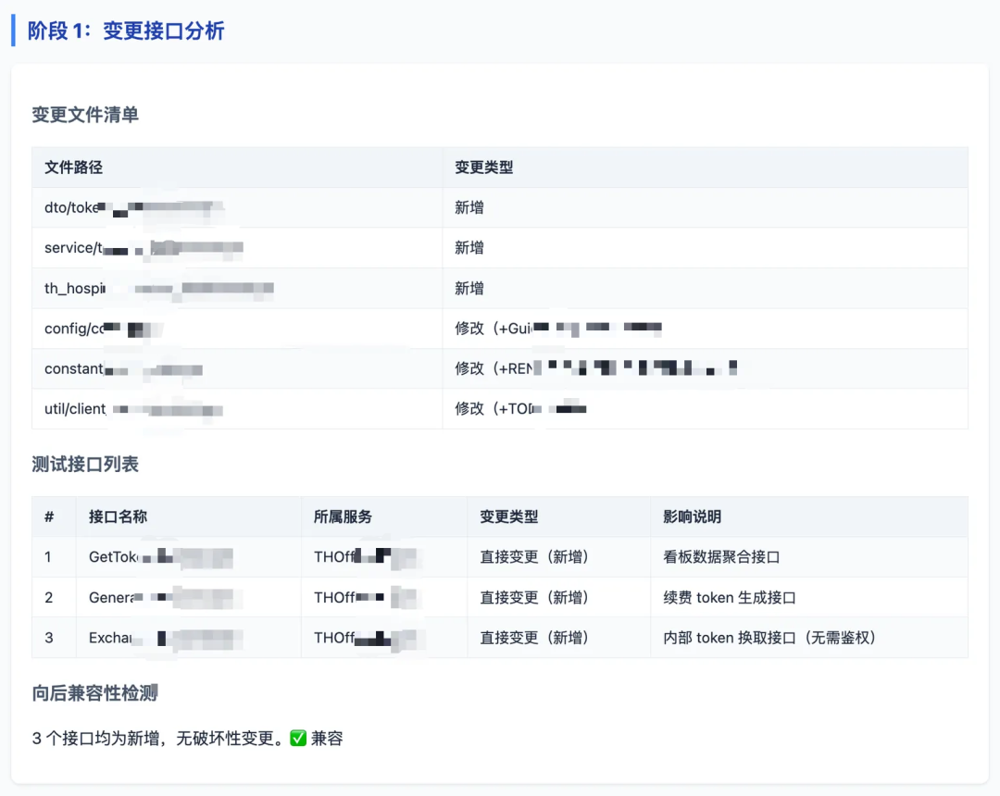

### 2.1.2 第二阶段：编译发布及接口验证，确认“能否验”

确定验收范围之后，下一步不是马上判断需求对不对，而是先确认接口具备实际验证条件：服务能不能编译？能不能发布？目标环境能不能访问？接口能不能用最小参数调通？接口契约是否与定义一致？

在我们的实践中，医疗业务通过内部研发平台支撑应用的构建、部署等运维全生命周期管理。我们在此之上封装了命令行工具，验收 Skill 通过它对接平台，完成服务的编译并发布到目标环境。

环境选择上，优先使用 Agent 任务专用的隔离环境，其次是个人开发环境，最后才考虑公共测试环境。这样可以减少环境污染，也便于复现问题。

当环境、配置和依赖都就绪时，发布及接口验证可以顺利完成。

以下业务案例中，Agent 查询到可用的个人开发环境后，编译并发布服务，随后逐一验证了变更涉及的接口连通性和契约一致性。全部接口均返回正常，顺利进入后续 Gherkin 测试阶段。

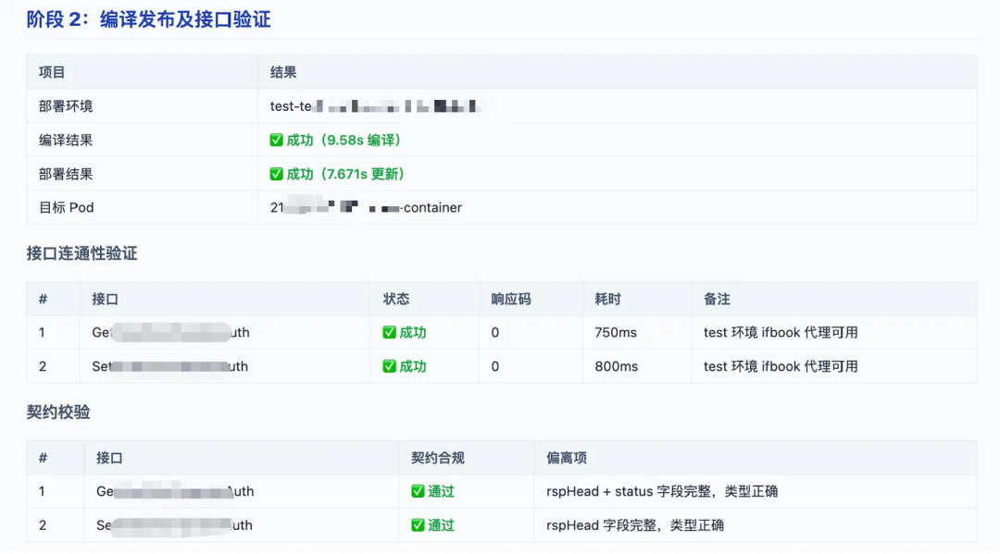

接口连通性验证通过，并不代表需求逻辑已验证通过，但它标志着验收从“准备阶段”正式进入“业务验证阶段”。后续 Gherkin 场景的真实执行，才真正开始检验需求逻辑是否被正确实现。

### 2.1.3 第三阶段：Gherkin 测试，设计并执行“怎么验”

当接口具备验证条件后，最关键的问题变成：到底怎么验？

如果只让 Agent 根据接口定义自行执行，很容易出现两类问题：它可能漏掉需求里的业务预期，也可能按错误预期跑出一份看似完整的报告。因此引入 Gherkin 和校正流程，用 Given-When-Then 把需求拆成可读、可确认、可执行的接口场景。

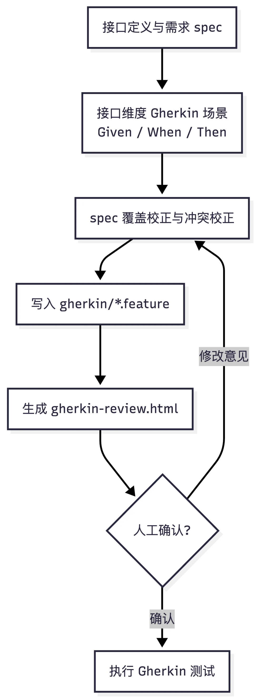

Gherkin 场景主要覆盖三类：

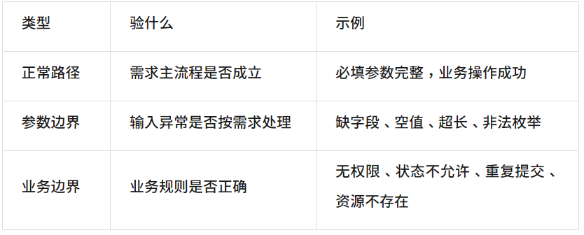

这里有一个关键硬阻塞点：Gherkin 场景确认报告必须人工确认后，才能进入真实执行。因为 Gherkin 承载的是“需求预期”，预期一旦错了，后续报告反而更有迷惑性。确认时重点看前置条件、接口选择、关键参数和 Then 预期；有问题就先让 Agent 修正场景。

以下是案例输出的 Gherkin 场景确认报告：

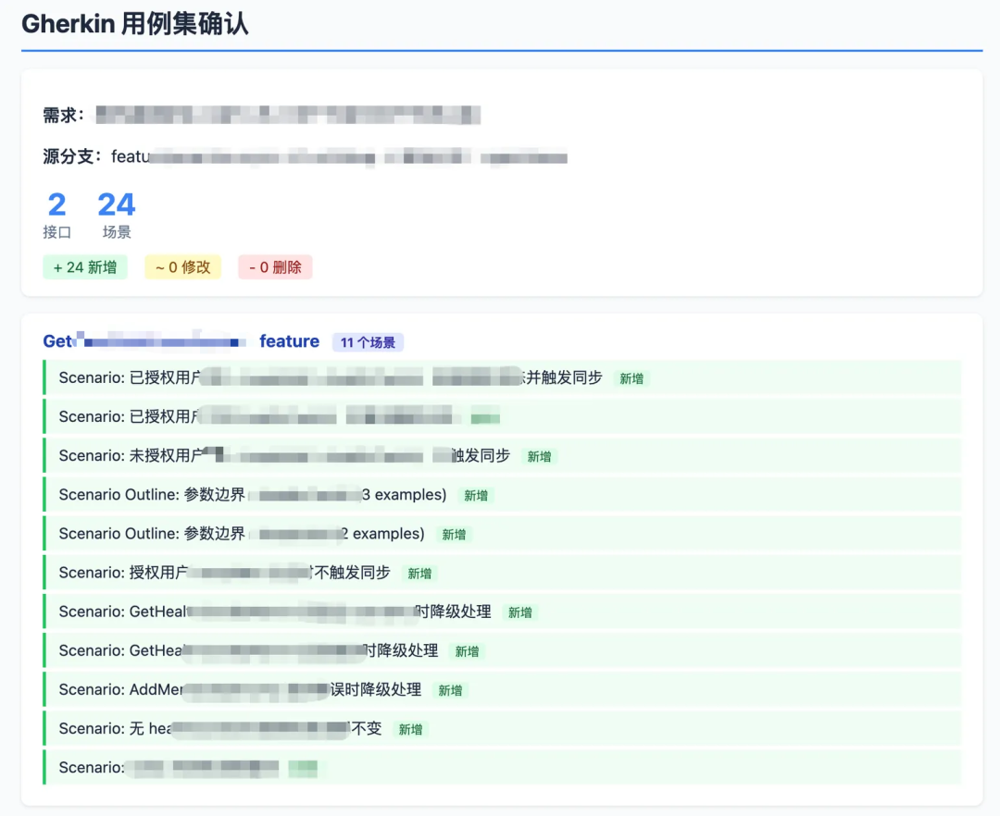

确认完成后，Agent 会把每个 Scenario 映射成接口调用序列，构造业务参数和鉴权参数，再执行接口请求并记录结果。

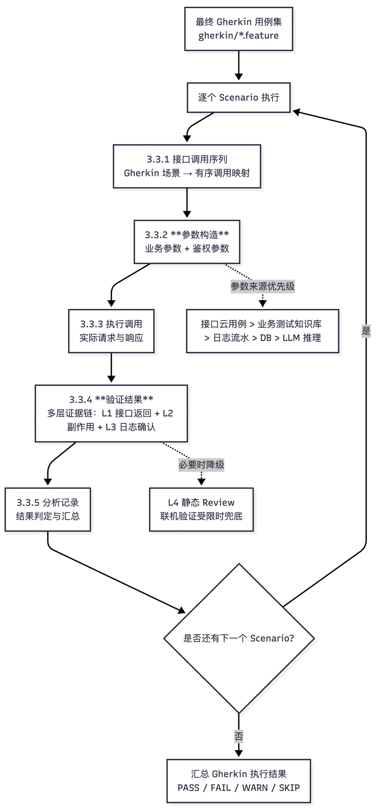

参数构造最容易卡住，所以要先明确来源优先级：真实数据优先，LLM 推理只做兜底。为了让这一阶段跑得更稳，需要重点建设业务测试知识库，提供鉴权说明、常用测试账号、测试数据构造方法、数据获取方式，以及必要的业务字段知识等。对 Agent 来说，缺少这些上下文时，它不是不能继续，而是容易进入 WARN、SKIP 或无法判定。

### 2.1.4 第四阶段：TAPD 预测试，判断哪些用例后端可验

TAPD（Tencent Agile Product Development，腾讯敏捷产品研发平台）是腾讯自主研发的一站式敏捷研发协作与项目管理平台。TAPD 关联用例通常由测试同学确认，能补充 Gherkin 之外的需求路径和边界场景。但不是所有 TAPD 用例都适合由后端接口独立完成，所以 api-acceptance 在读取 TAPD 关联用例后，需要先做范围分类：

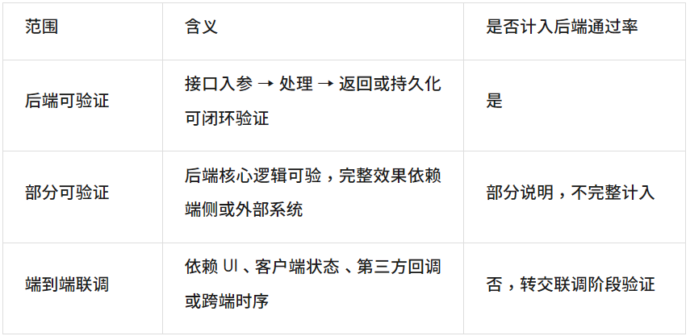

这一阶段主要是增加用例来源，作为一种补充验证手段，将测试阶段可能保留的问题前置在开发验证阶段。

### 2.1.5 第五阶段：验收结果输出，用证据链回答“怎么判”

最后一步是输出验收结论。这里最需要避免的误区是：接口返回 code=0 就写通过。

后端需求验收里，“表面成功”很常见：

接口返回成功，但字段含义不符合需求；

写接口返回成功，但 DB 状态没有正确变化；

主接口成功，但下游服务失败；

异步消息没有消费，或者日志链路显示副作用没有发生。

因此，api-acceptance 使用 L1-L4 多层证据链：

L4静态 Review（最后兜底）无法联机验证时，阅读 handler / service / 调用链─────────────────────────────L3 链路与异步确认下游调用 / 消息 / 异步消费 / 日志─────────────────────────────L2 业务状态验证配对查询接口 / 数据库查询 / 日志确认─────────────────────────────L1 接口返回验证响应码 / 字段 / 契约 / 直接接口行为

以下是一个结合 L1 与 L3 证据进行判断的验证案例：

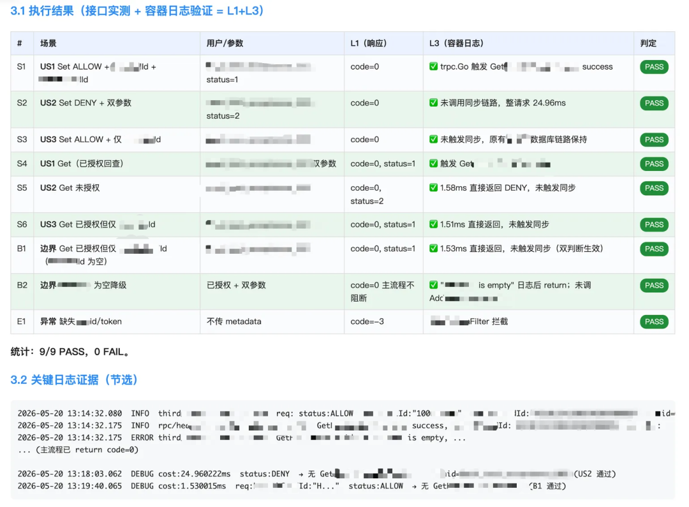

场景结果也必须分层表达，最终结论则分成四档：

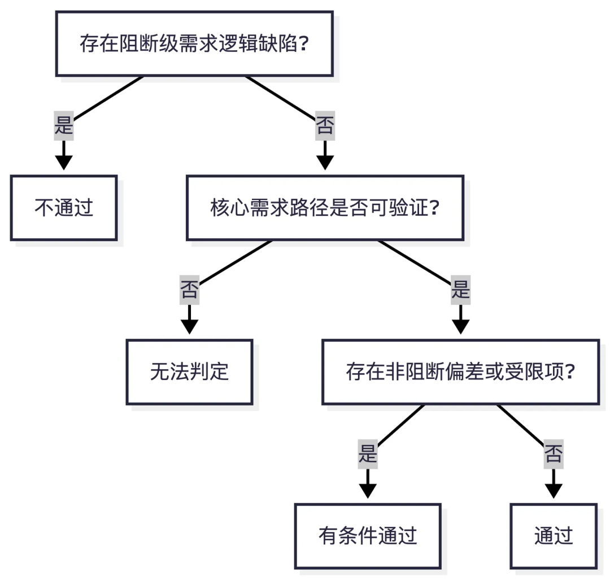

最终验收报告会以 HTML 形式呈现，方便人直接阅读、查看证据，以及决策。

### 2.2 从单点验收走向完整交付

前面介绍的 api-acceptance Skill，解决的是一次后端预验收具体怎么做。但在日常需求开发中，它并不是一个独立存在的工具，而是作为后端验收 Agent 的执行内核，被编排到 OPT 的需求交付小队中，成为完整交付链路中的一环。OPT 平台中的一个需求交付小队成员如下图所示：

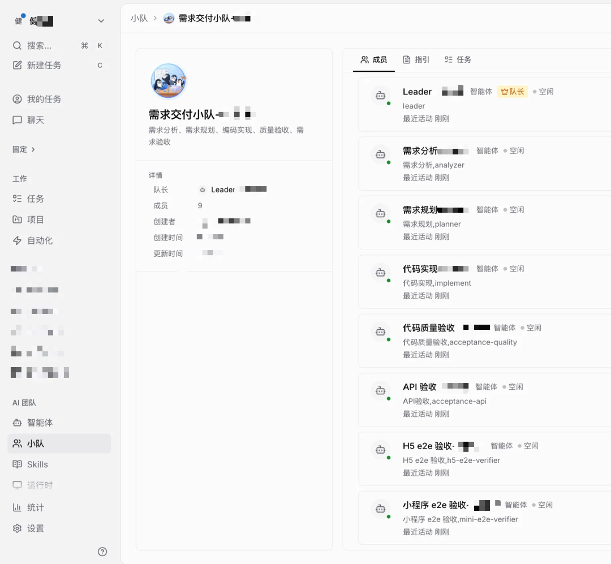

需求交付小队按照“需求分析 → 方案规划 → 编码实现 → 代码验收”协同工作。Leader 负责整体调度，各环节由对应的 Agent 执行，人负责确认需求预期、方案和最终交付结论。需求交付小队编排流程如下图所示：

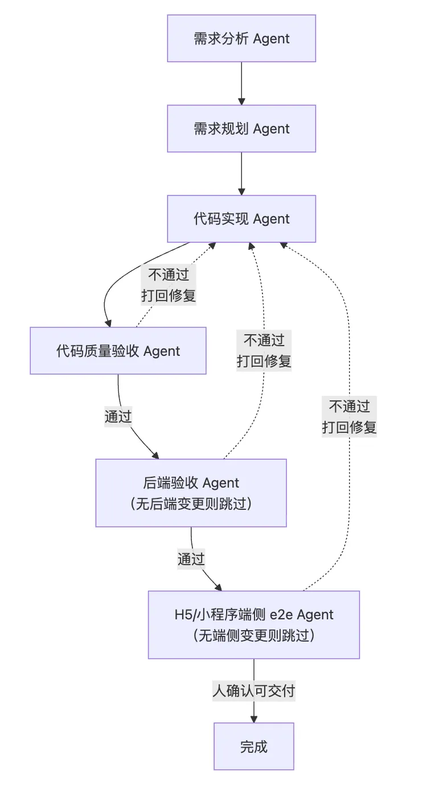

后端验收 Agent 位于代码实现和代码质量验收之后。只有涉及后端变更时才进入后端验收；验收不通过则将问题打回代码实现，修复后重新验收，通过后输出验收报告。

对开发来说，只需要负责确认验收预期、查看验收报告并做最终判断。

在完成后端验收 Agent 能力建设后，我们还持续进行了端侧 E2E 验收 Agent 的探索，包括 H5 和小程序，进一步完善了 OPT 平台上的需求开发交付链路。

## 03 实践效果

我们将后端代码验收的经验总结沉淀为 api-acceptance Skill，并通过新增后端验收 Agent，补齐了需求交付 Agent 小队的验收能力。至此，OPT 平台上的需求交付小队已打通从“需求分析 → 方案规划 → 功能开发 → 后端验收”的全流程，实现从需求理解到开发验收的完整交付链路。

作为首个落地业务，目前后端验收 Agent 已运行 160+ 次，覆盖 30+ 个需求、80+ 个入口接口和 800+ 个 Gherkin 场景，其中 20+ 条问题被发现并触发打回修复。按典型后端需求测算，单次验收人工投入预计从 2 小时降至约 20 分钟。从实际落地来看，这套验收能力主要带来了三个变化：验收效率提升、问题发现前置、验收能力复用。

### 3.1 提效：人工投入减少 80%

过去，后端验收会占用较多研发人力，主要消耗在大量琐碎、重复的工作上：准备环境、梳理测试场景、反复调接口、查询日志和 DB、整理测试结果等。单项工作看似简单，但叠加到一个完整需求上，往往需要投入数小时。

现在，后端验收 Agent 将接管这些重复性工作，研发人员的角色也从“亲自执行验收”转向“确认测试计划 + 审核最终结果”，减少在验收执行环节的投入。以典型中等复杂度后端需求测算，人工验收从约 2 小时降至 20 分钟，单个需求减少约 1.6 小时人工投入，验收环节人工投入预计下降 80%+。

### 3.2 提质：问题发现前置到开发阶段

AI 生成代码涉及多层调用链，仅靠人工 Review 容易遗漏受影响的接口和边界场景。验收 Agent 会结合接口结果、业务状态、日志、DB 等信息进行验证。

在本业务已完成验收的 30+ 个需求中，共有 10+ 次验收未通过，发现 20+ 条待修复问题并打回修复。修复后再由 Agent 复验，将部分原本可能在联调、测试阶段才发现的问题，提前到开发阶段暴露出来。

### 3.3 规模化：验收能力复用

过去验收方式比较依赖个人经验，验了什么、怎么看结果往往难以复盘。我们将相对固定的验收步骤沉淀为 api-acceptance Skill，由验收 Agent 按统一方式执行并输出报告。

本业务已完成首轮业务验证，覆盖 30+ 个需求、80+ 个入口接口和 800+ 个 Gherkin 场景。现在，这套验收方法已经推广到其他医疗相关业务中使用，减少每个业务重复摸索验收方法的成本。

## 04 一些体会

AI 编码提升了“生成代码”的效率，但代码是否能够采纳，仍需要通过更清晰的验收过程来建立信任。

4.1 确定性先于自动化

自动化执行前，仍需要先校准业务预期。Gherkin 场景确认不是为了削弱自动化，而是希望让后续执行更可控、更可靠：先明确“要验什么、怎么算对”，再让 Agent 承担重复执行工作。

4.2 事实密度影响可靠性

实践中发现，验收效果很大程度取决于真实上下文是否充分，例如接口用例、测试账号、日志、DB、业务知识库等。上下文越完整，Agent 越容易成为工程助手；上下文不足时，就更容易依赖推理和猜测。因此，业务知识库的建设至关重要。

4.3 尽量用证据链支撑结论

接口返回成功只是一个基础信号，不能直接等同于需求正确。更稳妥的方式，是结合接口返回、业务状态、链路日志、异步结果和静态 Review 等多层证据，再给出验收判断。

4.4 边界标注提升可信度

环境不可用、日志缺失、DB 无权限等问题，在实际验收中很常见。对不可验证的部分清楚标注 WARN、SKIP 或无法判定，比追求表面的“全绿”更有价值。报告边界越清楚，后续协作和补测越有依据。

4.5 人机协同支撑最终判断

Agent 可以帮助完成初验、收集证据、暴露风险和提出修复建议，但最终是否可交付，仍需要结合业务优先级和发布风险判断。AI 的价值不是替人承担责任，而是帮助人基于更充分的证据做决策。

当 AI 既能生成代码，也能辅助证明代码为何可信，提效才更有机会走向稳定的交付质量，让 AI 在研发全流程中，从“能生成”走向“敢采纳”。

-End-

原创作者｜吴思
