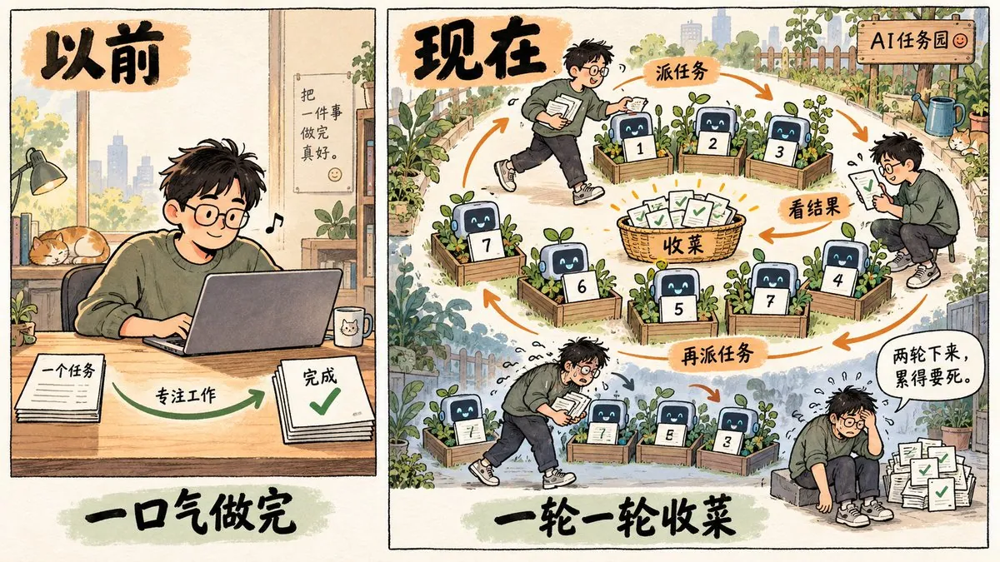
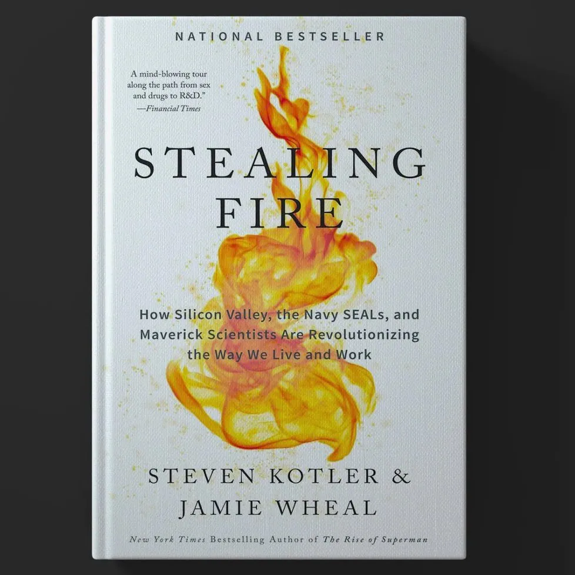
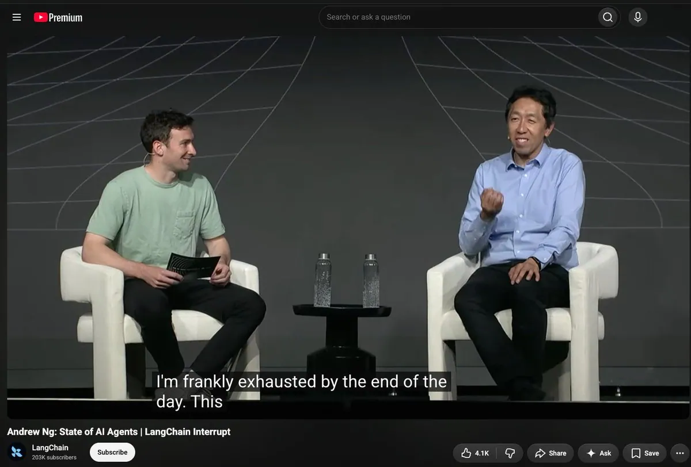
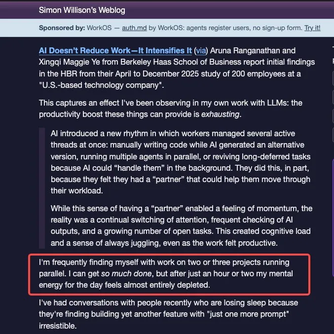
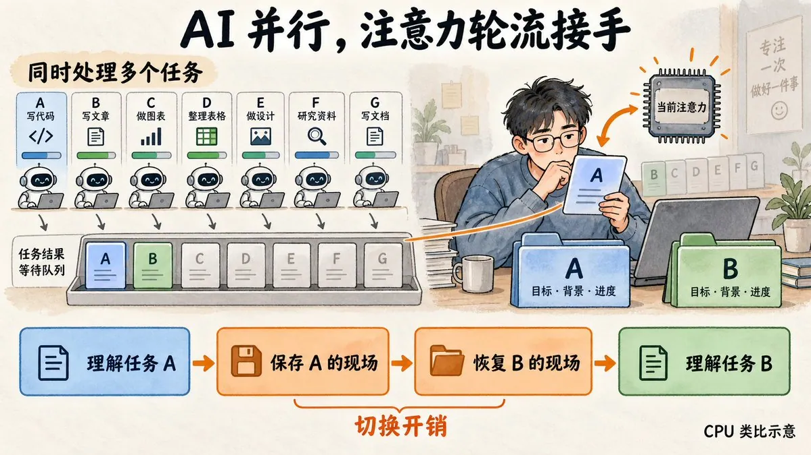
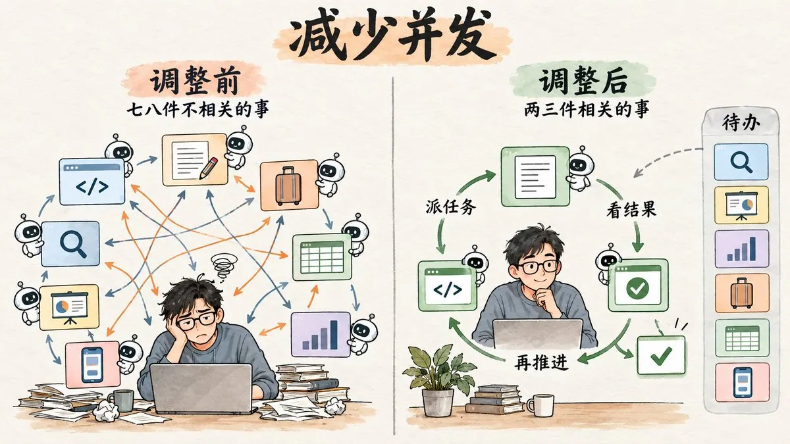

# Thomas Zhou（@thomaszhou_）：心流已死

> 对 AI 时代深度工作状态的思辨：当 AI 把大量原本需要心流才能完成的执行工作接管，人类原本依赖心流进入的深度思考与创造过程如何被重塑；当产出速度不再稀缺，稀缺的是判断力、问题定义与品味，作者对「心流已死」这一判断给出冷静的再审视。

<!-- more -->

我在和 AI 协同工作中经常遇到两个让我很不爽的场景：

一种是，给 AI 交代完一个任务，我就拿起手机开始刷。AI 已经做完了，我还放不下手机。

另一种是，同时开七八个任务，给 AI 交代一轮，再像曾经 QQ 空间 “收菜” （暴露年龄了）一样，挨个看结果。一轮收完，又发出去七八个任务。就这样收一轮、发一轮，两轮下来，我累得要死。

## 我找不到心流了

今天我突然意识到，我已经想不起上一次进入心流是什么时候了。

从 2020 年第一次读史蒂芬·科特勒的《盗火》开始，心流就一直是我做事情时最向往的状态。书名借用了普罗米修斯为人类盗来火种的典故。书里最吸引我的，是关于心流的那部分：探索人自身的潜能，全情投入一件事，做事本身就能获得满足。

然而现在和 AI 协作，产出和效率可能都提高了。对于能够快速实现自己想法我也感到非常嗨，但那种沉浸在一件事里、在心流中把它做完的满足感，我却找不到了。

而且我发现，心流给我带来的满足感是持续的，但是用 AI 快速实现自己的想法的兴奋感会越来越淡。

## 和 AI 协同真的很累

除了找不到心流，和 AI 工作时的这种疲惫，也不只是我一个人的问题。吴恩达在一次公开对谈里说，他用 AI 辅助编程一整天，到了晚上也会筋疲力尽。他觉得，vibe coding 这个名字容易让人误会，以为跟着感觉接受或拒绝 AI 的建议就行了。但实际上，这仍然是一项需要深入思考的工作。[https://www.youtube.com/watch?v=4pYzYmSdSH4&t=1370s](https://www.youtube.com/watch?v=4pYzYmSdSH4&t=1370s)

Simon Willison 的描述，更像我说的“收菜”。他在博客里写，自己经常同时推进两三个项目，能完成很多工作，但只过了一两个小时，就感觉一天的脑力几乎耗尽了。产出确实变多了，人却很累。这让我想弄明白，和 AI 协作时，我们究竟在累什么。

## 为什么会这么累？

带着这些不舒服，我去查了一些相关研究。我觉得，开头那两个场景需要分开来看。

先说刷手机。

这里让我不爽的有两层：

- 一层是 AI 已经做完了，我还放不下手机
- 另一层是终于放下以后，我又开始内疚、自责，觉得自己浪费了时间

那为啥本来只是等 AI 的时候看两眼，最后却放不下来？

我用 AI 调研了下，大概就是说人会形成一种反复查看新内容的习惯。那些很容易获得的新消息、新信息，会强化这种行为，而且一次短暂的查看，有时会带出更多后续使用。也就是说，我拿起手机的时候，刚开始只是想填一下等待的空档，但开始刷之后，继续刷太容易了，所以我就继续刷了。

反正就是，我刷手机停不下来，不怪我。

而我主动停下来之后，还有一轮对自己的责怪：我怎么又刷了这么久，活又没干完？我咋又没管住自己？回到工作时，我还带着这份不爽。

AI 还提到了一项关于看电视和玩游戏的研究，恰好讨论了这种感受。研究发现，把自己的娱乐行为看作拖延，与更多内疚相关；而内疚又与较差的恢复体验、更少的享受相关。

总之就是，加倍不爽。手机放下了，自责还没停。

再说一轮轮“收菜”。这里的不舒服又不一样。我一直在接任务、看结果、给反馈，两轮下来，就已经很累了。

认知心理学里有一个概念叫“切换成本”。实验发现，相比继续做同一种任务，人刚切换到另一种任务时，通常反应更慢，也更容易出错。因为当前的目标、要注意的信息、判断的规则，都需要重新调整。

用程序员熟悉的 CPU 打个比方，AI 可以同时跑七八个任务，但轮到我理解和判断这些结果时，我的注意力更像是在一颗 CPU 上轮流处理它们。每次换一个任务，都要重新接上它的目标、背景和进度。这就像反复保存和恢复现场，切换本身也有开销。

切回来以后，还有阅读和判断。AI 写出来的东西，我需要读懂、核验，再决定下一步。

我感觉我“收菜”的疲惫主要来自这里：七八个任务同时往前走，我也在不停地恢复背景、阅读结果、作出判断。AI 帮我加快了执行，而这些需要我亲自处理的环节，也跟着变得密集起来。

## 我的一些尝试

基于这些调研，我做了几个尝试。

先尝试了用 Codex 的 Pet，每次完成任务会有声音提醒，提醒我别玩手机了。结果是不好使，手机还是放不下来。

后来，我还试了 Rachael Hodder 提到的办法，提前规划几个替代动作，减少临时被信息流吸走的机会。结果也是不好使。手机还是太吸引人了。

这个问题，无解，我目前最有效的解决方法是把手机放到我很难触达的地方。这样就能至少把问题收敛到第二个场景里。哈哈，我可太聪明了。

对于“收菜”，我现在主要做了四个调整。

第一，用程序员的话说，就是减少并发。以前我会同时开展七八件不太相关的事情，现在尽量控制在两三件，而且把 context 相近、彼此相关的事情放在一起做。这样切换的时候，也能沿用一部分刚才的背景。

第二，把任务拆小，让每一轮产出更快一点。我会把一个大任务 break down 成更小的步骤，每次交给 AI 的事情更具体，返回的结果也更小。我希望这样能缩短每一轮的等待，也让自己更容易接住结果、继续往下推进。

第三，找到自己的节奏，可快可慢。对于那些确实需要跑比较久的大任务，我会在吃午饭之前，把任务一次性交代给 AI，让它去跑。等吃完午饭回来，再统一“收菜”。小任务可以快一点来回，大任务就留出整段时间，让它慢慢做。

第四，让 AI 的输出更容易被我理解。

这也 callback 了我之前的一条 post：https://x.com/thomaszhou_/status/2095028630892196285?s=20

我和 AI 聊了很多关于自己思维模型、理解门槛的事情，并据此不断 tune 它的 skill。现在，我的 AI 会尽量按照对我来说最容易理解的方式，组织和输出内容。这样的输出，我理解起来快了不少。

## 一边 tune AI，一边 tune 自己

写到这里，我发现自己一边在 tune AI，一边也在 tune 自己。

以前我理解的好工具，应该尽量适应人的习惯。做一个产品、设计一个流程，我们总在想，怎么降低使用门槛，怎么让人用起来更顺手。

现在，我却要重新安排自己的注意力：同时做几件事，什么时候切换，什么时候等，什么时候去收结果。工具的能力变强了，我也得花不少精力，学习怎样配合它工作。而这种频繁切换，本身就挺反人性的。

这让我有一种挺拧巴的感觉。我确实获得了更大的能力，很多想法能更快实现。但在这个过程中，我也在努力适应一种自己并不舒服的工作节奏。

这是掌握新工具必经的过程吗？还是说，这是人在向一种更强的智能作出妥协？

这又让我想起《盗火》。当年书里最吸引我的，是关于心流的那部分：人还能进一步探索自己的能力，在全情投入一件事情的时候，体验到那种强烈的满足感。

## 心流已死？

AI 也许是人类又一次“盗火”。我们借助自己创造的工具，获得了以前很难拥有的能力。

但在我自己的工作里，这份新的力量，和我曾经向往的那种体验，似乎没有一起到来。我能更快地把想法变成结果，却还是想念那种沉进去、逐渐理解一个问题、最后把它做出来的满足感。

所以，当我们说 AI 增强了人的能力，我也想问：完成更多事情之外，我们能不能也更好地理解、投入和享受自己正在做的事情？

如果这是一次新的盗火，我希望我们得到的，也包括更好地体验自己生活的可能。

至于心流，至少到现在，我还没有找回来。

前面这些尝试，是我在调整自己和 AI 协作的方式。也许以后，在和 AI 一起讨论、判断、创造的过程中，我会找到一种新的心流。我还在探索，也不想太早给自己一个答案。

标题写了“心流已死”，但我其实还是想把它找回来。

都看到这儿了，顺手点个赞、转发一下，也欢迎在评论区聊聊：你的心流还在吗？

## 相关页面

- [[sources/qingyue-wechat-zhangxiaolong-story-and-independent-spirit]]
- [[sources/khazix-one-year-agent-automation-system]]
- [[concepts/cognitive-load-three-element-model]]
- [[concepts/loop-engineering-thoughts]]
