# 三个三（@3three_AI）：从国内真实案例看，把 AI 美女变成钱的 10 种方法

> 全景梳理国内 AI 美女人像赛道真实跑通商业变现的 10 大通路：涵盖写真壁纸小程序、小红书图文引流私域定制、短视频打赏与商单、图生图工具站引流、会员订阅制变现到跨境电商服饰虚拟模特展示，客观评估各路径的启动成本、运营门槛与封控风险。

<!-- more -->

现在这个时代，谁都能用 AI 生成美女图片了。

但你是不是也卡在同一个问题上：「这玩意到底怎么变现？」

看看国内的商业案例就会发现，路子不少：小红书接广告、闲鱼卖定制头像、帮淘宝商家制作模特图、给短视频账号提供素材……

关键是想清楚：你做出来的 AI 美女，到底能帮谁解决什么问题，谁愿意为此付钱？

下面整理了 10 种适合中国市场的变现方式，有真实商业案例，也有适合普通人尝试的接单思路。

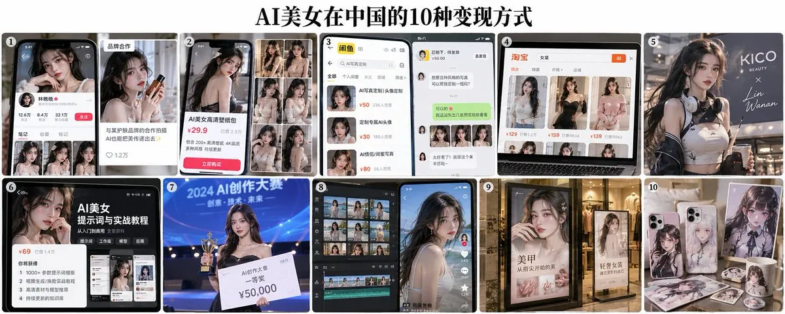

先说明一点：文中涉及的商业数据以公开报道为准，不能把销售额当成净利润，也不代表普通人能获得同样的收入。

另外，使用 AI 生成虚构人物时，不能冒充真实女性骗取钱财，也不能未经授权使用他人的肖像。

下面进入正文。

## 1. 在小红书养 AI 美女账号，接品牌广告

国内已经出现过不少虚拟女性博主。

比如虚拟数字人 AYAYI，曾与 Bose 等品牌合作；虚拟人物翎 LING，也曾与奈雪的茶等品牌联动。

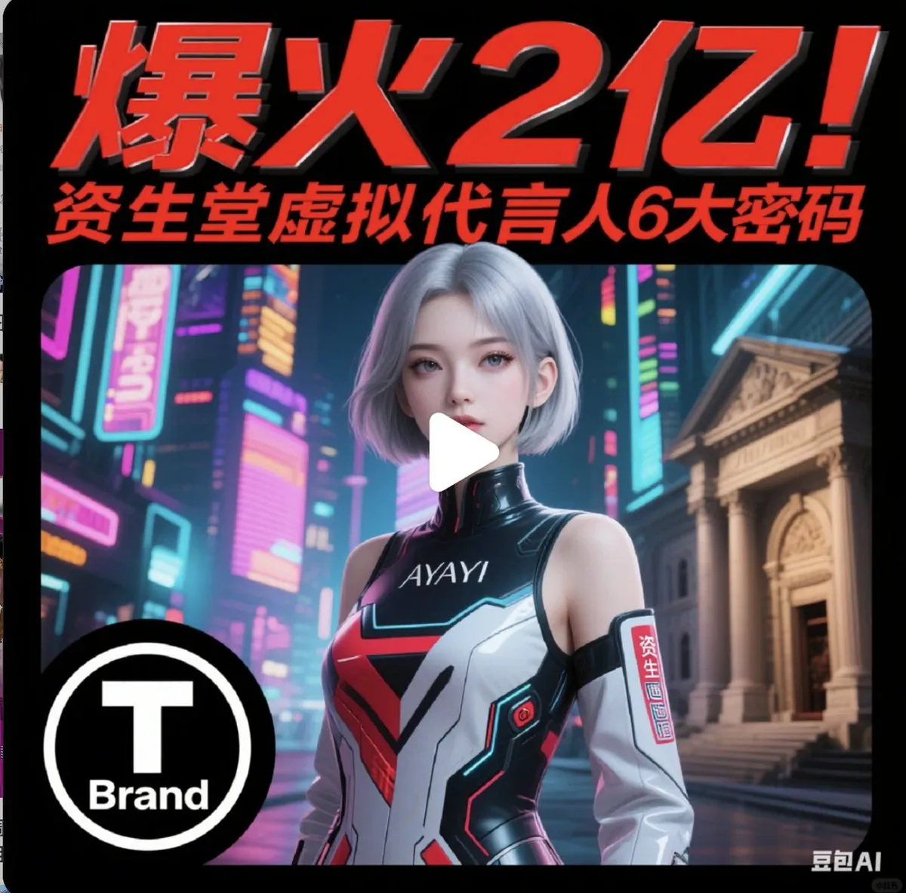

这些角色证明了一件事：品牌愿意为有影响力的虚拟人物付广告费。

出处：投资界《元宇宙炒到短视频，你真的看懂柳夜熙了吗？》

普通人可以从小红书开始，做一个有固定形象的 AI 美女账号。

比如设定成一位喜欢穿搭的女生，日常发布通勤穿搭、妆容分享、生活照片。

当账号积累了一定粉丝，就可以尝试接服装、美妆、配饰等品牌合作。

但这条路的难点不在生成图片，而在持续更新和积累粉丝。

## 2. 做 AI 美女壁纸账号，卖高清壁纸素材

这是更适合国内用户的一种玩法。

在小红书、抖音发布 AI 美女壁纸，比如甜妹风、古风、氛围感写真、手机锁屏壁纸。

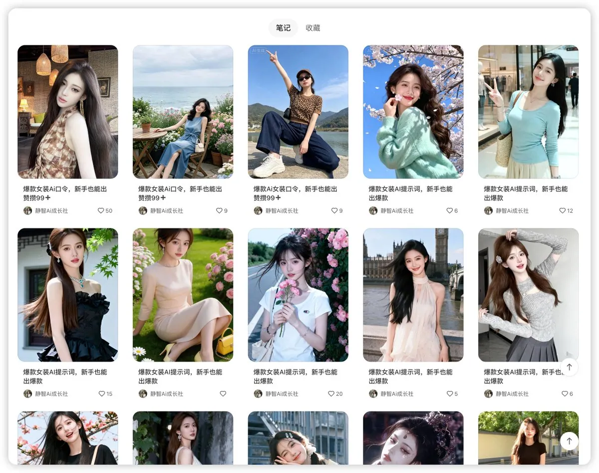

免费内容负责吸引用户，高清壁纸包作为商品出售。

可以把 50 张同主题壁纸整理成一个素材包，在支持数字商品交易的平台上销售。

也可以提供定制服务，让客户选择人物风格、服装、背景和尺寸。

关键不在图片数量，而在风格是否统一、画面是否足够吸引人。

如果只是随便生成几十张普通美女图片，用户未必愿意付费。

## 3. 在闲鱼接 AI 写真、头像定制订单

比起卖虚构美女写真，中国用户更容易理解的付费场景是：

花几块钱，把自己的照片变成不同风格的美女写真。

比如古风汉服、韩系证件照、职场形象照、生日写真。

用户提供本人照片，你负责用 AI 生成指定风格的图片。

交付 5 张、10 张或者 20 张都可以，按套餐收费。

在闲鱼、小红书等平台展示制作前后的效果，吸引有需求的用户下单。

这类服务的优点是需求具体，客户知道自己买的是什么。

但要处理好人物相似度、修图、修改次数以及交付时间。

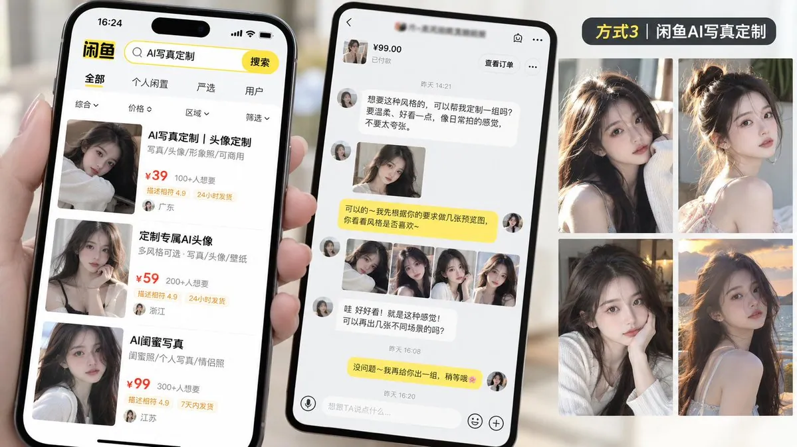

## 4. 帮淘宝、拼多多商家制作 AI 美女模特图

除了运营自己的账号，还有一种更明确的生意：给电商商家做图。

国内电商平台早就在使用 AI 模特技术。

京东技术团队公开介绍过，AI 模特和虚拟试穿技术已经应用到服装品牌的商品展示场景。

出处：腾讯云开发者社区《迈向电商大模型时代，从虚拟试穿聊到电商 AIGC》

普通人可以面向淘宝、拼多多、抖音小店的服装商家提供服务。

比如商家提供一件女装的商品图片，你负责制作不同风格的 AI 美女试穿图。

把收费方式设计成「5 张商品模特图」「10 张不同场景展示图」等套餐。

比起空泛地说自己会 AI 绘画，商家更关心你能不能帮他完成商品上架。

不过，服装颜色、版型、面料和细节必须准确，不能让 AI 把商品本身改掉。

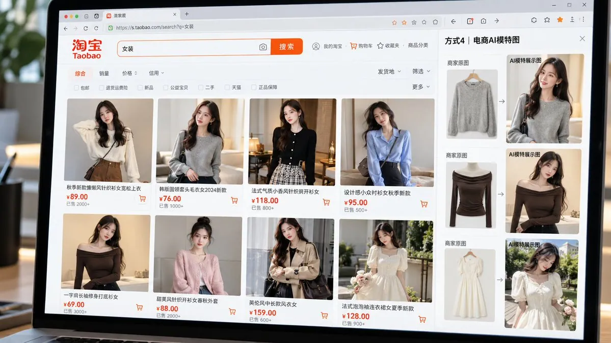

## 5. 把 AI 美女做成虚拟 IP，接企业宣传合作

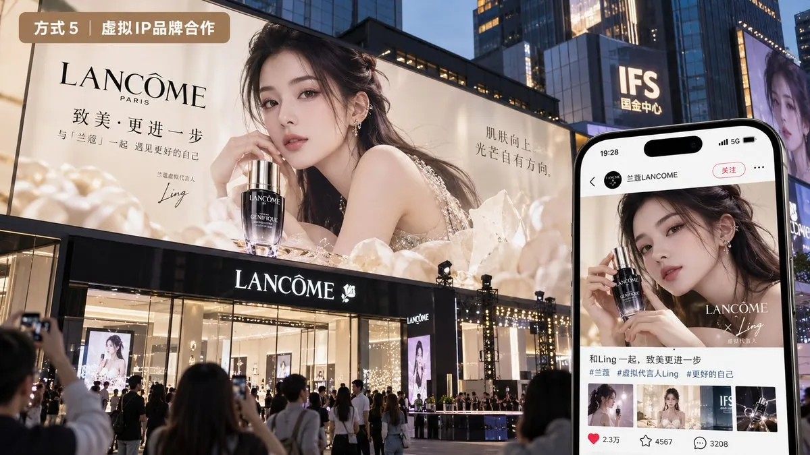

国内的虚拟数字人「柳夜熙」就是一个典型案例。

她以虚拟美妆人物的身份在抖音走红，并吸引了美妆护肤、食品日化等领域品牌的合作关注。

出处：投资界《元宇宙炒到短视频，你真的看懂柳夜熙了吗？》

这条路和普通美女图片账号不同。

你需要给角色固定的外貌、名字、性格和内容定位。

比如做一位科技数码博主，日常分享手机、耳机和智能设备。

当角色形成辨识度，就有机会参与品牌海报、宣传视频、产品推广等商业合作。

但虚拟 IP 需要长期运营，柳夜熙这类专业团队的制作投入，也不是普通 AI 图片账号可以简单复制的。

## 6. 把 AI 美女生成方法，做成提示词和教程出售

还有一个容易被忽略的客户群体：

想自己生成 AI 美女，却不知道怎么做的人。

比如有人看到一组逼真的 AI 美女照片，想知道人物怎么固定、服装怎么更换、背景怎么保持一致。

你可以把制作流程整理成教程。

包括提示词、角色设定方法、常见问题和出图示例。

在小红书发布效果图和免费教学，用合法合规的知识付费渠道销售完整教程或提供教学服务。

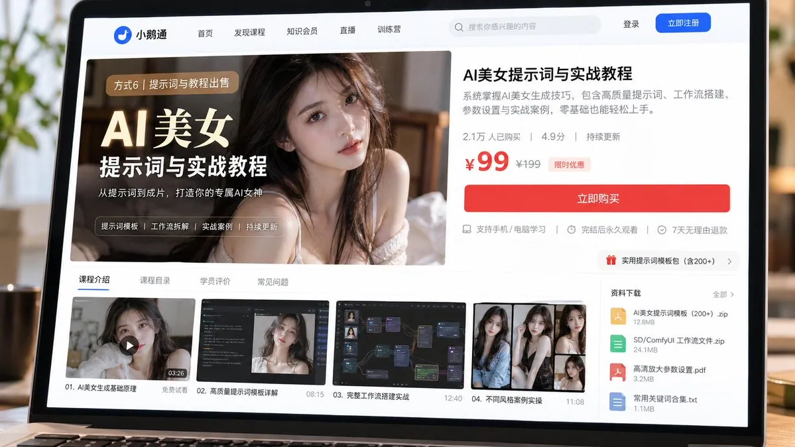

相比单纯出售图片，教程卖的是一套可以重复使用的方法。

但前提是自己把流程跑通，不能把网上随便复制的提示词包装成独家技术。

## 7. 参加国内 AI 创作比赛，争取奖金和曝光

国内一些 AI 工具、内容平台和品牌会举办 AI 图片、AI 短片等创作活动。

比如围绕 AI 人物设计、创意短片、数字艺术等主题征集作品。

获奖作品可能获得奖金、流量曝光或者商业合作机会，具体要看当期活动规则。

如果你已经有一个固定的 AI 美女角色，可以围绕同一个人物制作系列作品参赛。

这类玩法不需要提前积累大量粉丝。

但比赛奖金不能当作稳定收入，也不代表参赛就一定能获奖。

更适合把它当作展示作品、积累履历的机会。

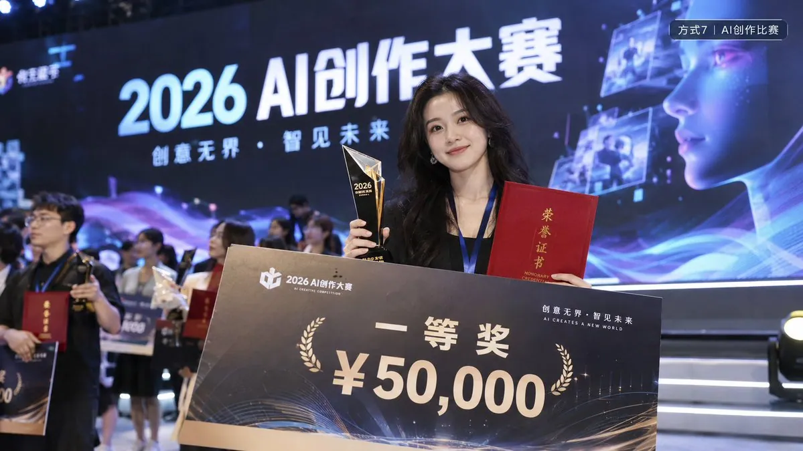

## 8. 帮抖音、小红书博主制作美女视频素材

国内短视频账号对人物素材有实际需求。

比如情感故事、剧情解说、服装展示、虚拟人出镜等内容。

有些博主不想真人露脸，也没有预算长期请演员拍摄。

这时候就可以提供 AI 美女角色和视频素材制作服务。

比如根据客户的脚本，生成统一人物形象，再制作不同表情、动作和场景的短视频片段。

可以按条收费，也可以约定每月固定交付数量。

客户买的不是几张美女照片，而是能放进短视频里使用的内容素材。

这条路比静态图片复杂，因为人物一致性、动作自然度和视频剪辑都会影响交付质量。

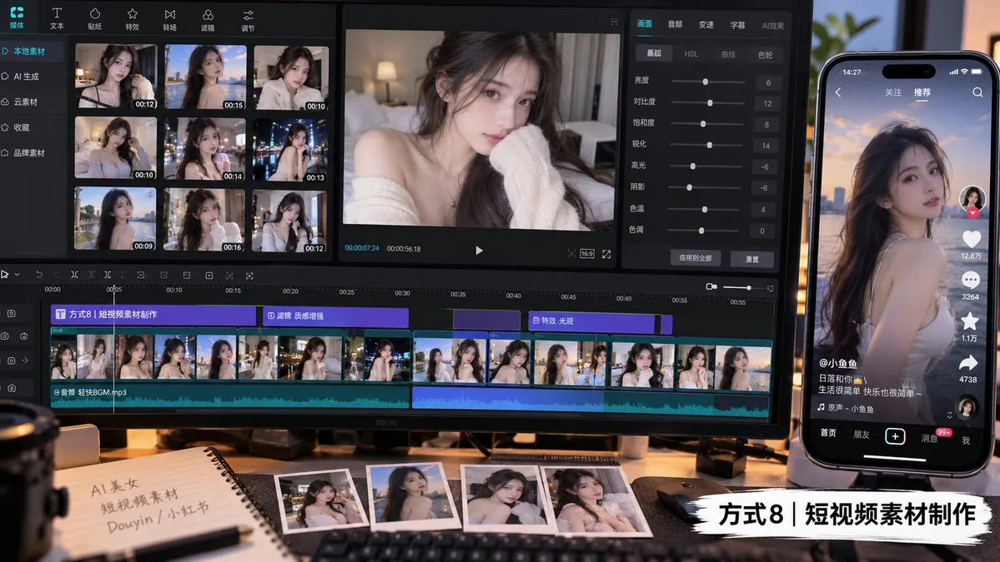

## 9. 给线下商家制作 AI 美女宣传海报

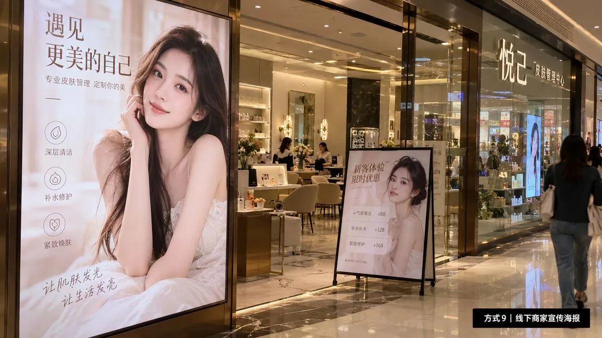

很多本地商家同样需要人物宣传图。

比如服装店、美甲店、美容店、摄影工作室等。

过去做一张宣传海报，可能需要找模特、拍照和后期设计。

现在可以根据商家的实际需求，生成符合品牌风格的 AI 女性形象，再排版成宣传海报。

例如，为一家美甲店制作 3 张不同主题的活动海报，或者为女装店制作换季促销图。

通过本地商家、闲鱼或设计接单渠道寻找客户。

收费时把图片数量、设计尺寸、修改次数和交付格式写清楚。

需要注意的是，商用海报不能展示与实际服务不符的虚假效果。

对于新手，这类按单交付的服务，比长期运营一个虚拟网红账号更容易验证是否有人愿意付钱。

## 10. 做 AI 美女插画、头像和周边设计

不一定要做照片级的 AI 美女。

二次元女性角色、国风少女、Q 版人物，同样可以成为商品。

比如做成手机壳图案、电脑桌面壁纸、头像、明信片或者装饰画。

在淘宝、小红书等渠道展示作品，接受用户定制。

也可以和有打印、制作能力的商家合作，按订单制作实体周边。

这种模式不需要每天运营一个真人风格的账号。

但角色设计、画面质量和商品包装决定了作品能否卖出去。

尤其要注意原创性和商用授权，不能拿现成的动漫角色或者别人的作品直接生成商品出售。

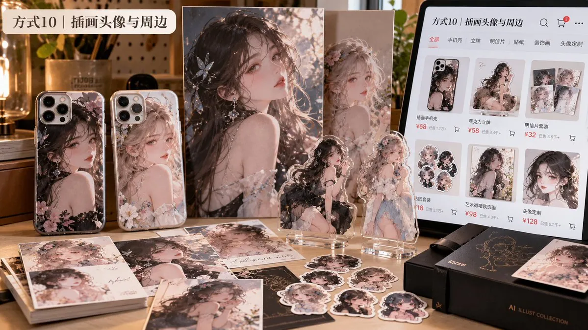

## 普通人最适合从哪里开始？

如果只是刚学会 AI 生成美女图片，不建议一上来就想着做虚拟网红、接大品牌广告。

先尝试能明确交付的小项目：

- 闲鱼 AI 头像、写真定制
- 小红书高清壁纸素材
- 淘宝女装 AI 模特图
- 本地商家宣传海报

先做出几组样图，展示效果、价格和交付内容。

等有人咨询、有人下单，再判断要不要扩大规模。

收入里还要扣掉生成工具、平台服务以及修改返工的成本。

说到底，AI 美女图片本身不一定值钱。

有人需要漂亮的头像，有人需要商品模特，有人需要短视频素材，也有人需要一套完整的制作教程。

找到愿意为这些需求付费的人，才是这 10 种玩法共同的变现逻辑。

## 关于作者

三个三｜AI 工具实测博主｜AI 小白教程｜2 个月靠 AI 赚了 5 位数 ｜全平台粉丝近 10 万粉 ｜[@3three_AI](https://x.com/3three_AI)

## 相关页面

- [[sources/yhslgg-ai-beauty-photo-monetization-sop]]
- [[sources/luffy-19yo-ai-tiktok-dance-girl-7-prompts]]
- [[concepts/selfmedia-compound-model]]
- [[concepts/b2c-conversion]]
