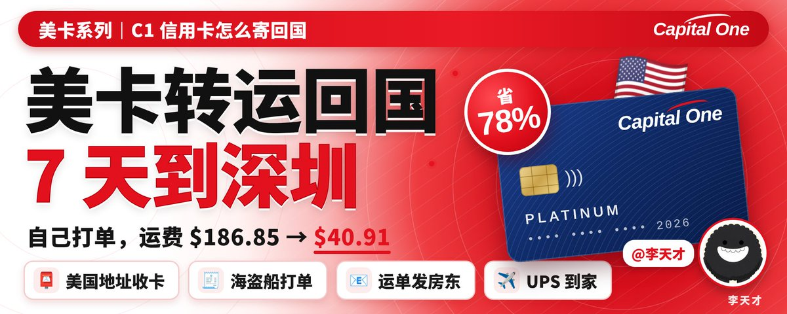
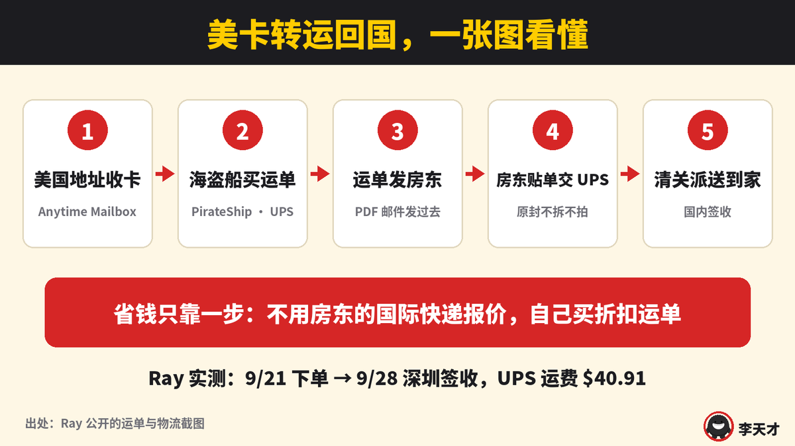
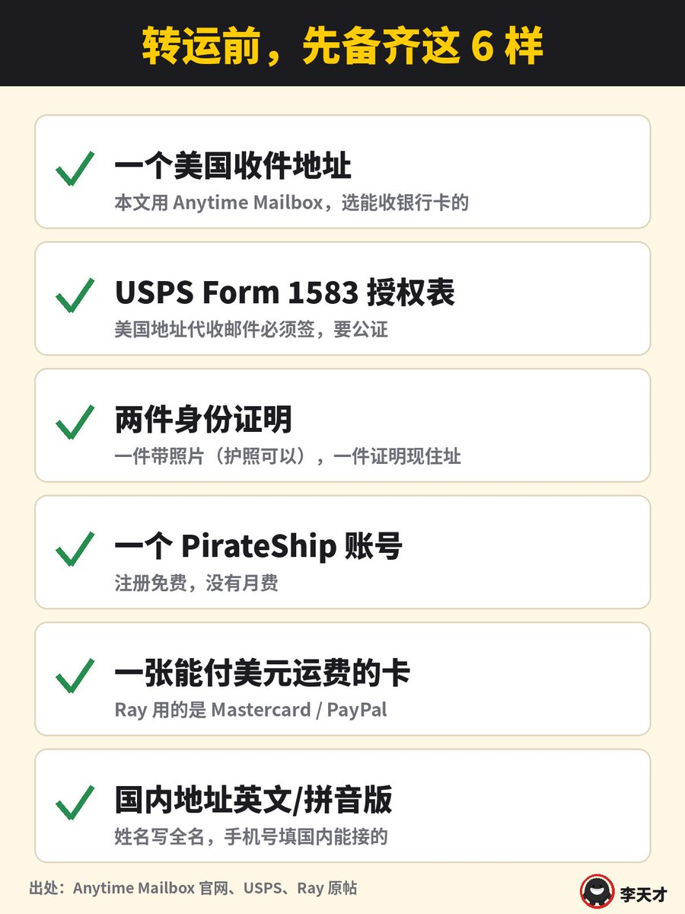
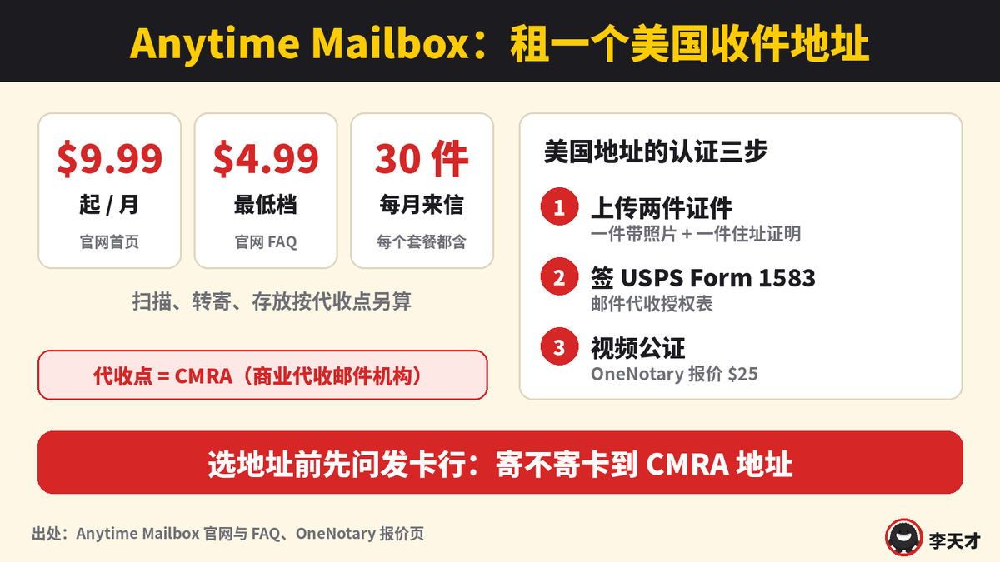
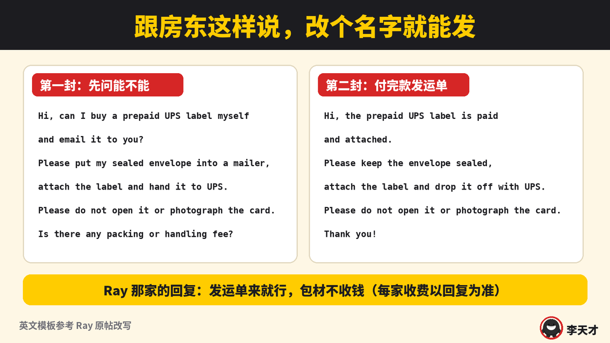
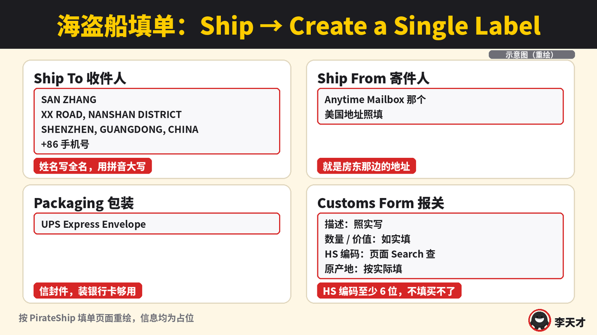
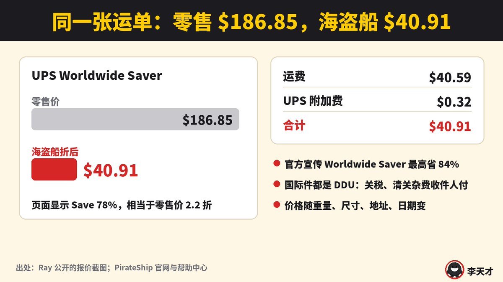
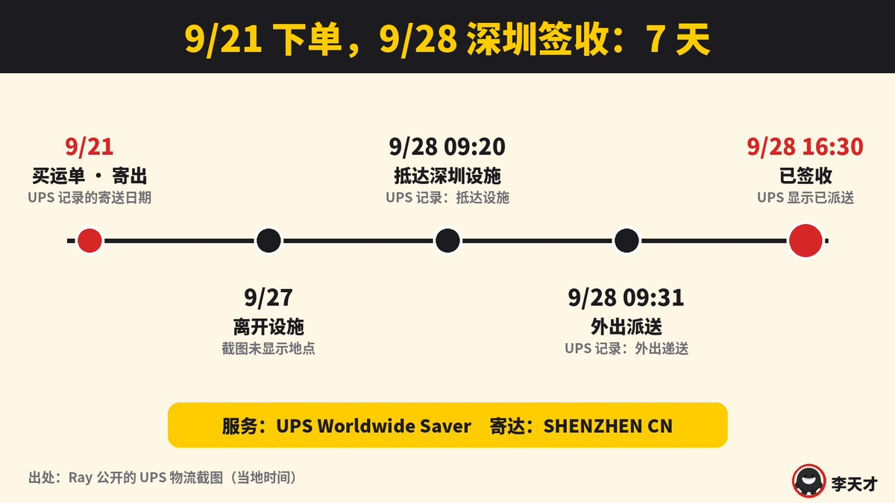
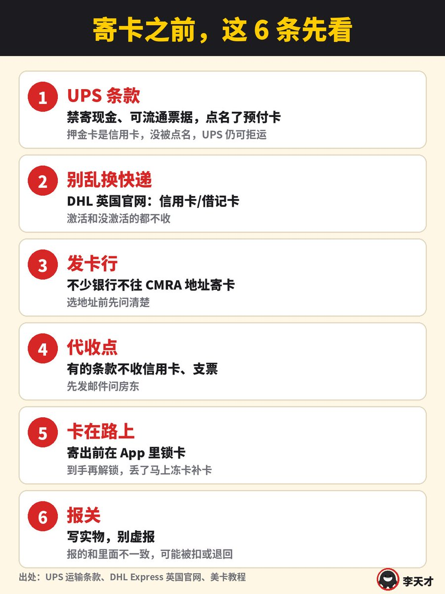

# 李天才（@Lniosytest）：美卡转运回国教程——Anytime Mailbox 虚拟美国地址 + PirateShip 海盗船打单，C1 信用卡 UPS 7 天到国内

> 出海开发者海淘美卡物理实体卡回国的保姆级实操指南：详解租赁 Anytime Mailbox 美国真实商业地址（USPS 1583 公证）、绑定 Capital One (C1) 等高端信用卡；利用 PirateShip 海盗船极低折扣打单，选择 UPS 国际快递无缝转运直邮回国，全流程仅耗时 7 天且全程轨迹可追踪的避坑心得。

<!-- more -->

我那张 9 月激活的 Capital One（C1）押金卡，正好也要弄回国内。

我在 X 上看到 Ray 刚走完一遍：9 月 21 日寄出，9 月 28 日下午深圳签收，UPS 运费 40.91 美元。我把这套流程每一步都对着官方说明核了一遍，整理成照着做就行的版本。

一句话流程：美国银行卡寄到 Anytime Mailbox 的美国地址 → 自己在 PirateShip 海盗船买 UPS 折扣运单 → 运单 PDF 发给代收点店主 → 店主贴单交 UPS → 国内清关、派送。

省钱就靠一步：不用代收点的国际快递报价，自己买折扣运单。

一、开始前准备

- 一个能收银行卡的美国地址，本文用 Anytime Mailbox
- USPS Form 1583（邮件代收授权表），要公证
- 两件身份证明：一件带照片，一件证明现住址
- 一个 PirateShip 账号，注册免费
- 一张能付美元运费的卡
- 国内收件地址的英文/拼音写法，加一个能接电话的国内手机号

二、美国收件地址：Anytime Mailbox（虚拟美国地址）

Anytime Mailbox 是美国的虚拟邮箱平台。你租的是全美各地实体代收点的一个地址，这类代收点在美国邮政叫 CMRA（商业代收邮件机构），圈里习惯把店主叫「房东」。信到了会通知你，可以扫描、存放、安排转寄。

- 月费：官网首页写 9.99 美元起，FAQ 里写最便宜的 4.99 美元，每个套餐都含每月 30 件来信
- 扫描、转寄、存放这些按各家代收点另算
- 认证：美国地址要上传两件证件，再签 USPS Form 1583，并完成公证
- 公证可以在线视频做，OneNotary 给 Anytime Mailbox 用户的报价是 25 美元

最容易踩的坑：不少银行不往 CMRA 地址寄卡。选地址之前，先确认你的发卡行肯寄到这个地址。

三、先跟房东打招呼

Ray 这一步写得很细：先发邮件问，能不能自己买 prepaid label（预付运单）发过去，请对方把原封的信装进快递封、贴单、交给 UPS，再问包材和手续费怎么收。邮件里写明别拆信封、别拍卡。

Ray 那家回的是：发运单来就行，包材不收钱。每家收费不一样，以你那家回复为准。

四、PirateShip 海盗船打单（免费打单平台）

PirateShip 是美国的在线打单平台，UPS 认证合作方。不收月费、不收单张手续费，直接按它谈好的 USPS / UPS 商业折扣价买运单。

填单路径：Ship → Create a Single Label

- Ship To：国内收件人，姓名用全名拼音大写，地址写英文/拼音，手机号填国内能接的
- Ship From：Anytime Mailbox 那个美国地址
- Packaging：信封件选 UPS Express Envelope
- Customs Form：描述、数量、价值、HS 编码（海关商品编码）、原产地都要填。海盗船国际件强制要至少 6 位 HS 编码，不填买不了单

报关我建议写实物：寄的是银行卡就写银行卡，HS 编码用页面里的 Search 查，别随手抄。海关有权开箱，报的和里面不一样，可能被扣或者退回。

五、看报价：Ray 实付 40.91 美元

填完点 Get Rates，海盗船会把各渠道报价排出来。Ray 那一单：

- UPS Worldwide Saver，零售价 186.85 美元
- 折后运费 40.59 美元，加 0.32 美元 UPS 附加费，合计 40.91 美元
- 页面写 Save 78%，相当于零售价的 2.2 折
- 海盗船官方宣传 Worldwide Saver 最高能省 84%

两点说清楚：

- 海盗船国际件都是 DDU（关税未付），如果产生关税、清关杂费，由收件人付
- 价格跟重量、尺寸、地址、日期走，不是固定价。网上流传的「最低 26 刀」，我在 Ray 的正文和截图里没找到出处，预算按 40.91 美元这个实付数来算

付款 Ray 用的是 Mastercard 或 PayPal。

六、运单发给房东

付完款下载 UPS 运单 PDF，邮件发给房东：运单已付、附件是运单，请保持信封原封、装快递封、贴单、交给 UPS，别拆别拍。

七、等 UPS 送到家

拿 UPS 运单号就能查物流：美国揽收 → 国际运输 → 中国海关清关 → 国内派送。

Ray 这一单：9 月 21 日寄出，9 月 28 日 09:20 抵达深圳设施，09:31 外出派送，16:30 签收。

八、寄卡前必看的 6 条

- UPS 运输条款禁寄现金和可流通票据，例子里点名了预付卡（pre-paid credit cards）。押金卡是信用卡，不是预付卡，没被点名，但 UPS 有权拒运
- 别随便换快递：DHL 英国官网的禁寄清单写明信用卡、借记卡，激活和没激活的都不收
- 发卡行：不少银行不往 CMRA 地址寄卡；C1 帮助中心里我没找到能直接寄海外地址的说明
- 代收点：有的转运点条款不收信用卡、支票，先发邮件问
- 卡在路上：寄出前在 C1 App 里用 Card Lock 把卡锁上，到手再解锁；真丢了马上冻卡补卡
- 报关写实物，别虚报

整套下来，花钱的就三块：地址月费、1583 公证、运单。地址和公证是固定成本，运单这块自己买，是最能省的。Ray 还提了一句，C1 和 PayPal 的卡能一起寄，摊下来更划算。

## 相关页面

- [[sources/kk-ai-notes-opc-wanlihui-overseas-address-proof]]
- [[sources/noahduck-stripe-complete-guide-from-beginner-to-advanced]]
- [[concepts/overseas-tool-stack]]
- [[concepts/digital-products-side-income]]
