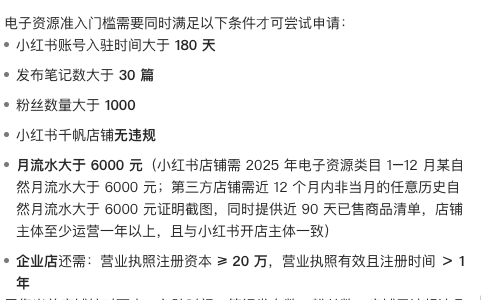
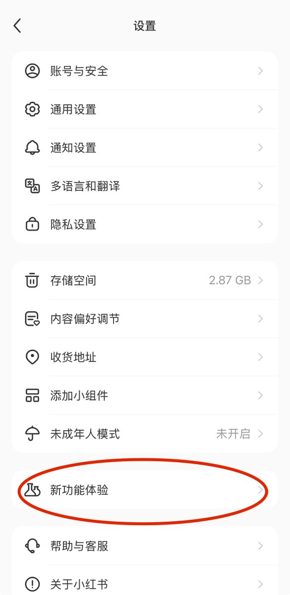
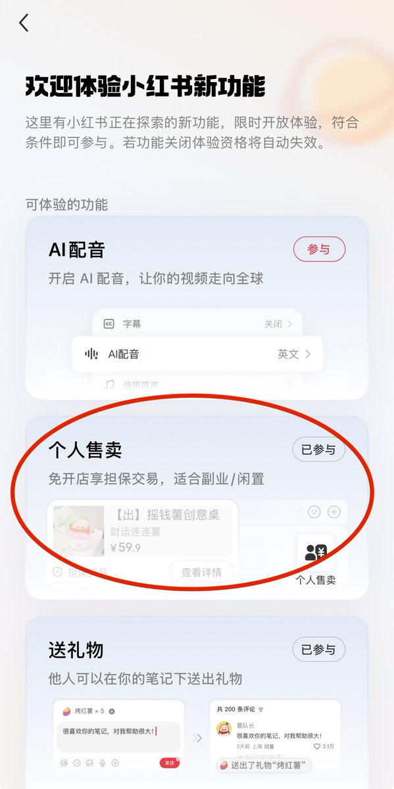
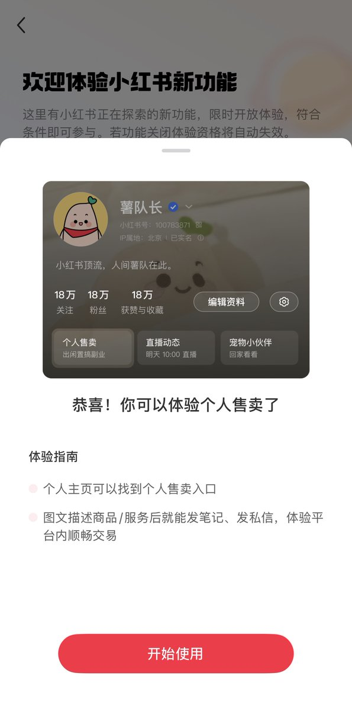
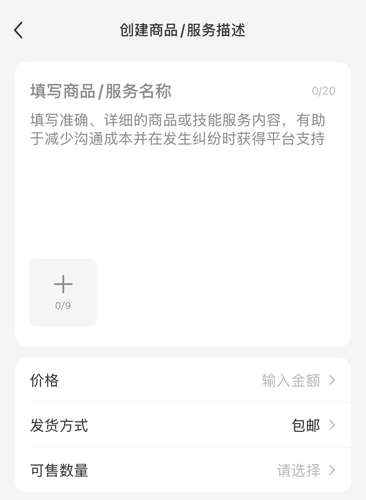
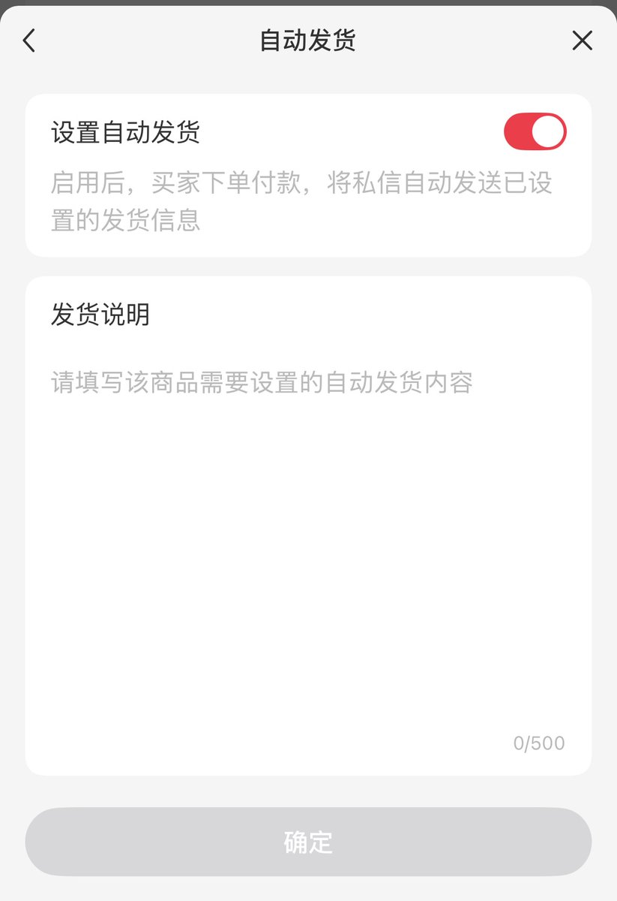
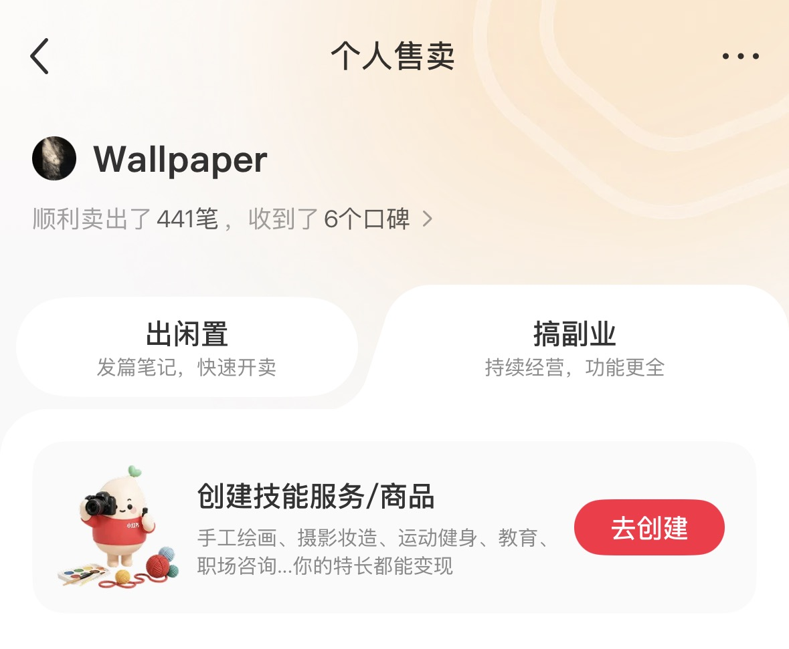

# TodayKan：小红书个人售卖从 0 到第一单保姆级教程——无需运营与开店门槛

> 从 0 摸索「个人售卖」卖壁纸，走出低门槛、免等开店 180 天的变现闭环。选品逻辑（能持续输出、不太耗精力、零成本壁纸）、开通路径（创作者中心→个人售卖→发布虚拟商品）、自动交付配置、主页承接与群聊运营，让普通人也能靠私域与零门槛个人小铺出单。

<!-- more -->

封面那张图，是我消息页的截图：「赞和收藏」「新增关注」「评论和@」全是 99+，陌生人消息还有 22。

很多人第一反应是「哇，火了」。我当时的第一反应其实更慌一点——流量来了，如果账号还接不住变现，这些想问、想买、想来聊的人，过两天就散了。

这篇想写清楚的是：我从今年四月摸索到现在，怎么用「个人售卖」卖壁纸，走出一条相对低门槛、不用死等开店 180 天的变现路。数字都按真实经历保留，能抄的步骤也按截图顺序标好了。

## 1. 探索期：为什么想做这件事？

我是今年四月开始认真想「靠内容变现」的。

当时公司经营不善，工作不太稳。我先想的不是「做多大的号」，是退路：哪怕先有一点收入也好，心里会踏实一点。

之前做过数码博主。说实话，难变现，还常碰到账号风险。也有过单篇几十万浏览的时候——看着热闹，粉留不住，钱变不出来，精力倒是耗得厉害。

那一阵我挺清楚：再走「重运营、拼爆款、再想办法变现」那条老路，我不想了。我想找一个能持续输出、不太耗我、成本几乎为零的东西，先把「能卖出去」这件事跑通。

## 2. 选品：为什么是壁纸？

这是我第二次选壁纸。

选它的原因很朴素，就三条：能持续输出、不太耗精力、几乎零成本。壁纸不需要囤货，也不用物流，内容本身就是货。对我这种刚想找退路的人，这一条特别重要。

制作和文案我不是全自己做。我用 Grok Bot 做壁纸和文案，自己负责方向和审核，让「产出」压到一个能日更、又不把自己熬干的强度。

以前做数码博主时，最怕的就是内容越做越重、账号越做越险。壁纸这条线，至少在「持续输出」这件事上，对我更友好。

## 3. 变现途径弯路：我踩过哪些坑？

一开始并不顺利。

先试过站外引流，很快被封。小红书管得很严，这条我现在基本会直接劝人别试。

后来新号有了稳定涨粉，也出过爆款，才开始认真找站内变现。那时候账号侧已经有一点势头了，缺的是「怎么把流量变成钱」。

我也找过蒲公英。门槛大致是：个人专业号、满 18、满 1000 粉、无违规。对很多人来说，1000 粉这一关就要先熬一阵。

想开店铺卖壁纸，门槛更高。电子资料申请条件里，我看到过类似这些：注册满 180 天、30 篇笔记、1000 粉、千帆店无违规、月流水 6000 等。对我当时来说，等于还要继续运营，还要继续等。

于是我一边运营，一边等那 180 天。运营上我主要就做三件事：

- 日更
- 吸引评论（评论对推流权重很大）
- 引导陌生人变粉

等的过程中，我找到了个人售卖。后面才发现：这条路不用死等开店那套条件，也更适合「先有货、先能卖」的阶段。

## 4. 个人售卖优势：为什么比开店更适合我？

我自己体会到的，主要是这几条：

1. 几乎无门槛：有没有粉都能开。其他常见变现普遍要卡 1000 粉。
2. 省开店手续和费用：不用先扛满 180 天那一套再开卖。
3. 私信直接沟通成交：链路短，买卖双方都在消息里把事办完。
4. 上手快：申请通过后很快就能挂商品。
5. 买家可写口碑，挂在详情页：成交后能积累信任，后面的人更容易下单。

如果封面那种「消息 99+、陌生人 22」再来一次，至少我有地方把「想买原图」接住，而不是只能说「等我开店」「等我满粉」。

对壁纸这种数字货，这一点特别值钱：人来了就能买，买了就能发，发完还能留口碑。

## 5. 实操：怎么开通、怎么挂品、怎么自动发货？

下面按我截图顺序写。你照着点就行。

## 开通路径

1. 打开小红书，点左上角「三」
2. 进入「设置」
3. 找到「新功能体验申请」

条件很简单：账号满 30 天，且无违规，就可以申请。

通过之后，你就有个人售卖入口了。

## 上架商品

通过后，我把商品素材发给 Grok Bot，让它帮写商品信息，再自己改到能上架的程度。标题、说明、怎么交付，尽量写清楚，减少下单后的来回问。

## 自动发货

设置自动发货，把网盘链接配好。客户下单后会自动收到，不用我一条条手动发。

壁纸这种货，最怕的不是不会卖，是卖起来之后客服和发货把人拖垮。自动发货把这一环先稳住，我才敢继续日更内容。

## 结果

9 月 17 日来了第一单。我激动了俩小时——不是因为金额有多大，是因为这条线终于「闭环」了：内容能产出，流量能进来，货能发出去。

到现在已经卖了四百多单。截图上是 441 笔，还有 6 个口碑。

我不会把这个数字说成「谁都能复刻」。我只想说：低门槛开通 + 垂直内容 + 自动发货，至少让「爆一下」有机会变成「成交一下」，而不是只剩浏览和赞藏。

## 6. 注意事项：避免被封号

这些是我现在会反复提醒自己的硬规矩，按「账号 / 发内容 / 互动 / 被限流后」分开写。

## 账号

- 一机一号一卡，别在同一台手机上频繁切换多个号，也别用模拟器或云手机批量登录。
- 新号先养一周左右：正常刷内容、点赞、评论，资料填完整，再开始发笔记。
- 尽量绑定实名，昵称、简介、头像里别放微信号或手机号这类联系方式。

## 发内容

- 坚持原创。搬运、二次剪辑别人的视频，或者直接用没改过的网图，很容易被判搬运。
- 别出现导流信息：微信、二维码、「私我」「vx」这类谐音，以及淘宝、拼多多的链接，都是高危。
- 别用夸大和绝对化的词，比如「最」「第一」「100% 有效」，医疗、减肥、理财类内容尤其要注意。
- AI 生成的图片和文字建议主动加 AI 标识，也别整篇都是模板腔。
- 发帖节奏稳定一点，一天 1 到 2 篇就够了，别短时间内连发很多篇。

## 互动

- 别刷赞、刷粉、互赞群，也别用第三方的涨粉工具。
- 别在别人的评论区批量发同样的话，或者到处留言引流。
- 私信别主动群发广告，别人问起也别直接甩联系方式。

## 被限流后

- 先停止发营销内容，把可能违规的笔记删掉或者改成私密。
- 继续正常发几天原创内容，看看数据能不能恢复。
- 可以在 App 的「创作中心」里查看有没有违规提示，按提示申诉。

## 7. 心态：别再只盯曝光浏览

以前我会盯曝光、盯浏览。数字好看的时候开心一下，掉下去又慌。像又回到做数码博主那几年：热闹过，却变不了现。

现在我更常跟自己说两句：

- 只要不违规、内容垂直，爆款总会有机会来；
- 没有流量是常态；有流量时，把承接做好。

对我来说，个人售卖的意义不只是「又能卖货」，而是让四月以来那条线——想退路、想有收入、又不想再被重运营拖垮——终于接到了一个低门槛出口：不用先等 180 天开店，不用先卡死 1000 粉，壁纸也能一单一单卖出去。

你现在在卖什么？或者卡在哪一步？评论区告诉我，我按自己踩过的坑回你。

## 相关页面

- [[sources/dongqing-xhs-product-selection]]
- [[patterns/wechat-image-post-account-sop]]
- [[sources/jasoncharlie-selfmedia-lead-generation]]
