# Today🦘（@TodayKan）：小红书运营完全指南——起号养号到日常运营保姆教程

> 小红书账号起号到进阶运营完整实操手册：起号前定位、仿真真人养号行为、主页视觉与人设三要素、对标账号拆解与选题矩阵建立、平台违规红线防踩坑，以及数据复盘与流量承接策略。基于单周 6.3 万播放与近 30 天 148 万曝光的实操总结。

<!-- more -->

10. 22–10.28，观看 6.3 万、涨粉 706、主页访客 3376、互动 4359，五项几乎都压过同层 99%；近 30 天曝光 148.5 万、观看 15.3 万。很多人问我怎么运营，这篇按顺序写：起号前、养号、主页、对标与选题、红线、日常、心态。数字和步骤都按我现在的做法来，路径需要截图的地方我标出来了。

1. 起号前先想清楚两件事

第一件：你要做什么内容。这件事得是你擅长、或者至少感兴趣的，不然你撑不到一个月。第二件：这个号以后怎么变现。很多号死在「先火了再说」上，火了也接不住钱。

我自己试过两次。一次做数码博主，前期要砸设备、砸样机，钱还没回来人先累趴了，只好停。一次做热点分享搬运，流量确实大，但看完就划走，留不下粉，更变不了现。后来才定成壁纸这种数字货：内容本身就是商品，成本接近零，我能天天做。

定垂直定位的时候，别把小红书当朋友圈乱发。想清楚赛道是什么、给谁看、能提供什么。前期从「实用干货」或「能引发共鸣、有点治愈感」切入，通常比纯晒生活好涨一点。内容垂直，粉才会准。

早期：近 7 日账号诊断

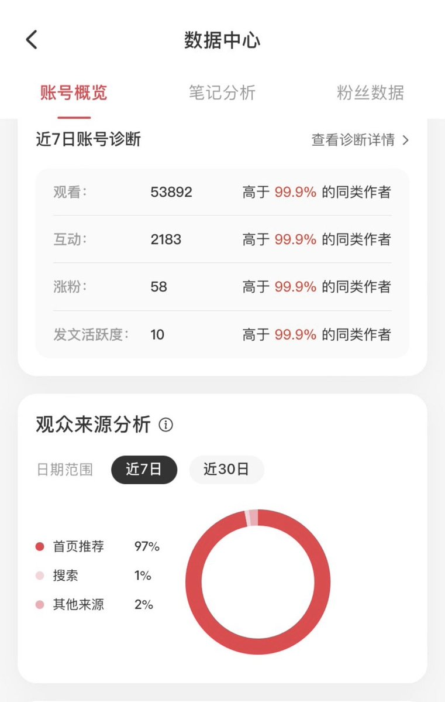

现在：数据中心近 7 日数据

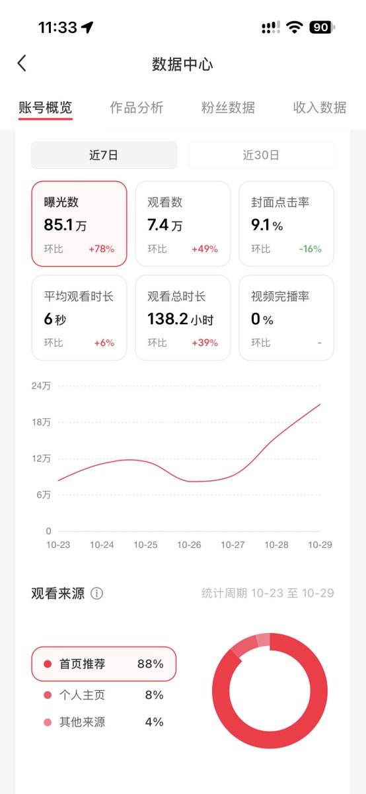

2. 养号：先像真人，再发内容

新号别急着发。认真养 3–7 天，让平台把你认成真人，而不是营销号，后面的推流才靠谱。

养号前的准备

一机一卡一号。一台手机、一个手机号只登一个号，别一台手机切好几个号，也别同一个号在多台手机来回换，容易触发风控。

注册和前期养号尽量用手机流量，别连公共 WiFi，降低被判成批量运营的风险。

注册后先别动昵称、头像、简介。让平台觉得你是个普通用户，养差不多了再一次性定好，之后尽量少改。

可以绑定微博、微信等社交账号，增加一点真实感。

绑定社交账号

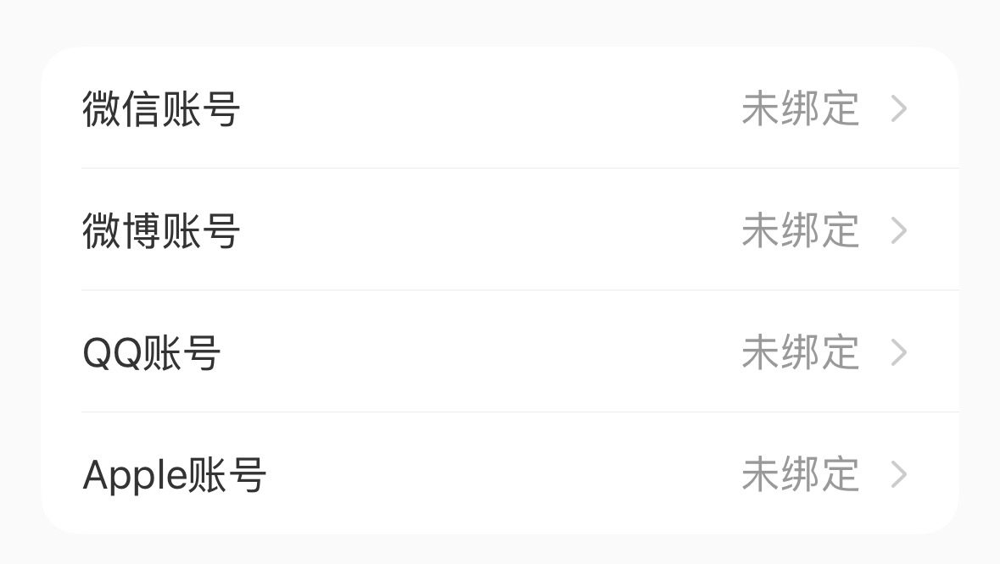

每天要做的事

每天花 30–60 分钟刷同领域内容，坚持做，别断。

前两天像正常用户一样随便刷。之后开始搜你赛道的关键词，认真看完再划走。

看完再点赞、收藏、评论，别秒赞秒评。节奏大概是「看 5 个赞 1 个」。评论写有内容的话，别刷「666」「真棒」。

关注 10–20 个同赛道优质博主，看他们的更新节奏和爆款思路。

手动搜索领域关键词，给平台打上兴趣标签，后面推荐才会准。

怎么判断养好了

打开发现页，如果四篇推荐里有三篇是你赛道的，标签基本养准了，可以开始发笔记。

发笔记后，每篇能跑到 200 以上阅读，说明号养到位了。如果长期只有两位数，回去继续养，别硬推。

养号期的红线

前 3–5 天别发笔记。第 6–7 天再发第一篇像样的内容。别一上来就发广告、二维码、联系方式。

别批量点赞评论，别秒赞秒评，别刷粉互赞。

别频繁改资料，也别频繁切号。

别只看不互动。机械滑动、从不点赞评论，骗不过平台，还会浪费新号扶持期。

养号的核心就一句话：把「像真人」做足。每天稳定刷、真诚互动，标签养准、数据验证过了，再正式发。别指望几天就爆，前期铺垫扎实，后面推流才稳。

3. 搭建主页：让人一眼知道你是谁

主页要像「一个人」，不像「一个发广告的号」。昵称、头像、简介、背景图、标签，全部指向同一个定位。

昵称

公式是「记忆点 + 领域关键词」。做运营可以叫「XX 的运营笔记」，做摄影可以叫「XX 爱拍照」，让人一眼看出方向。简单好记，别用生僻字和长串符号。昵称一般 7 天才能改一次，频繁改会被判账号不稳定，影响推荐。想清楚再定。

头像

清晰、有辨识度。建议用自己常用的头像做个人 IP，别经常换。头像要跟账号调性一致：走乡村生活就别放都市丽人，头像、封面、简介拧成一股绳。

简介

黄金公式是「身份标签 + 差异化价值」。先说自己是谁，再说关注你能得到什么。比如「分享面试经验」「专注棉麻沙发选购避坑」。可以参考同行，但别照抄。有些词放上去会限流，先查清楚再写。

背景图

简单大方就行，用头像同款或同色系。别太花哨抢重点，配色和风格跟头像、封面统一。

标签与整体

加上身份标签，比如大学生、上班族、XX 博主，帮平台和用户快速定位。封面统一配色、字体、排版，主页观感干净，关注率会高一些。

昵称、头像、简介尽量在起号前一次性定好，之后少改。

搜「壁纸」笔记流

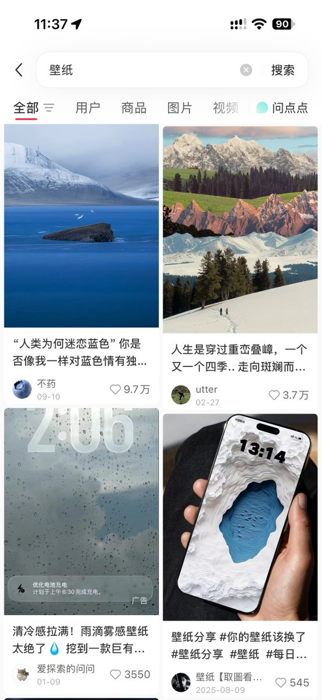

主页展示组件

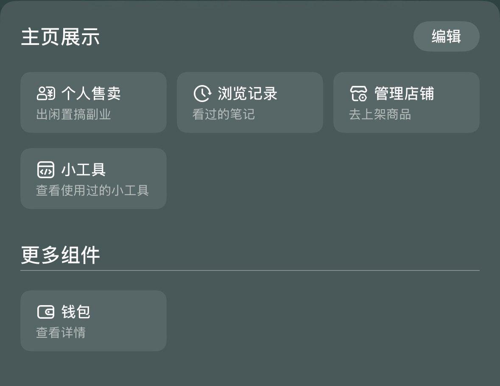

4. 找对标、拆爆款、建选题库

找对标：别盯着大号

别一上来就找百万粉头部。大博主多是团队运营，有粉丝光环，普通人拆不动也学不来。真正值得对标的是 5000–5 万粉、近期实打实起号成功的中腰部账号。

找 3–5 个不同层级：头部看方向，腰部看方法，新号看最近什么在起量。

筛选时看赛道、目标用户、内容形式是否一致（口播对口播、vlog 对 vlog），近 30 天涨粉势头好不好，人设你能不能模仿、能不能做出差异。

怎么找：搜赛道词，按最多点赞，选半年内；点开爆款笔记底部的话题标签；用户栏筛 5000–5 万粉；关注一个精准同行后靠相似推荐批量发现；创作者中心的「创作灵感」也有用。

搜索「最多点赞」筛选

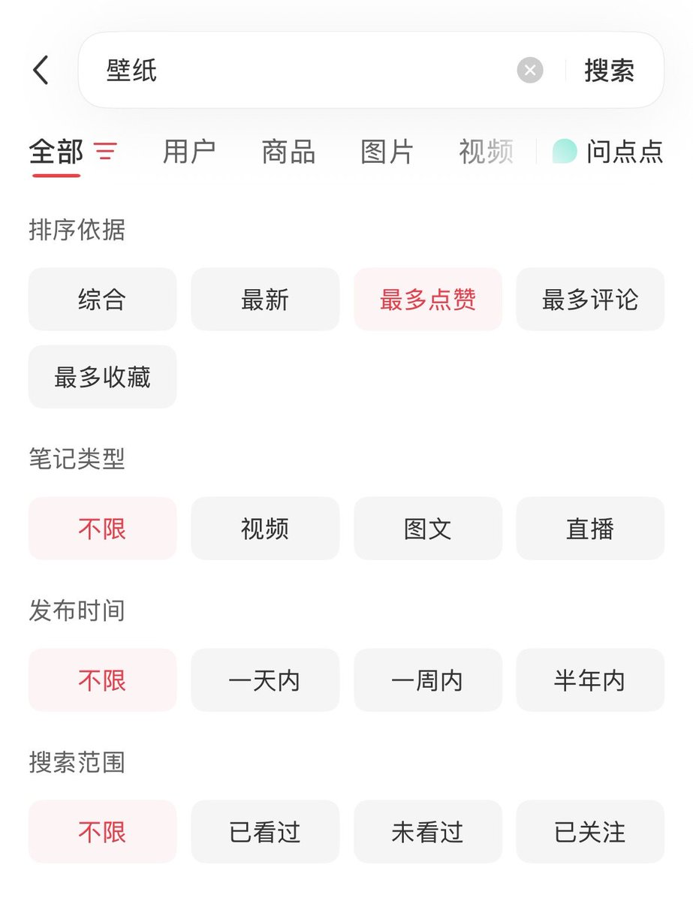

创作者中心入口

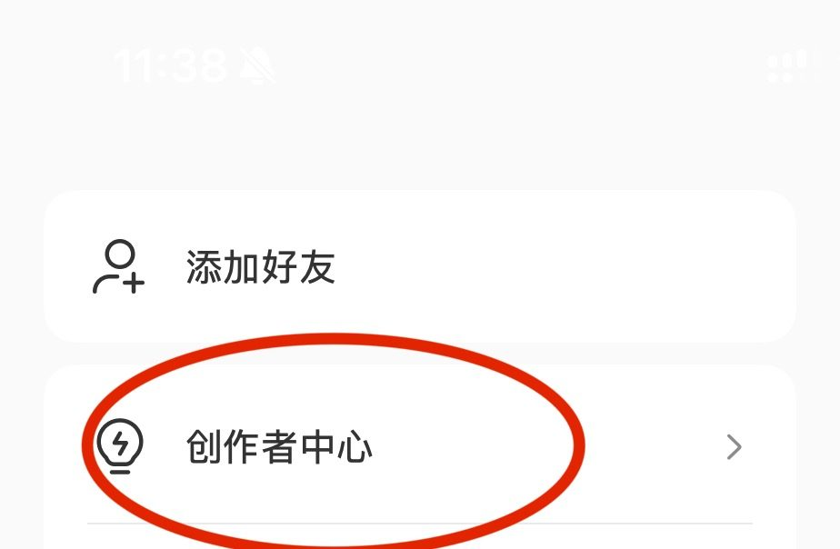

创作灵感·热点

拆爆款：拆逻辑，不抄表面

先选值得拆的：点赞 1000+、收藏 500+、评论活跃，近半年发布，调性和你契合。新手可以放宽到 500+ 点赞。

按五个维度拆：选题（主题、痛点、情绪点）、封面（构图、配色、排版、文字）、标题（关键词、钩子）、文案（开篇怎么留人、节奏、结尾怎么引导互动）、发布（时段、更新规律）。

三步拆解：翻主页看封面、标题、开头 → 找点赞最高的 5 条，逐条拆开头钩子、中间结构、结尾引导 → 把几个账号的拆解放一起，三个以上账号都在用的方法，才是可复用的规律。

拆完要转化，不是照搬。保留框架，换掉案例，改成自己的语气，补上差异化细节。一句话：对标结构 + 你的行业经验 + 你的目标用户 + 你的真实场景 = 你自己的选题。

建选题库：让灵感不枯竭

选题的本质是用户需求 + 解决方案，围绕痛点、疑问、刚需，不是围绕你自己的喜好。建议拆成「需求库」（痛点、评论区在吵什么、大家在搜什么）和「方案库」（观点、案例、方法、素材），像拼图一样组合。

选题来源有五类：关键词搜索（下拉联想和最多点赞是真实需求图谱）；评论区挖需求；官方创作灵感和热门话题；对标账号收藏最高的前 10 条；跨平台热榜翻译成小红书语言。

挑一个下午，按上面来源各找一批，筛到大约 30 条，够发一个月。之后你只负责写，不用天天想选题。

每日维护可以花 30 分钟：看 10 条同赛道内容，记 3 个评论区高频痛点，新增 3–5 条需求和方案，组合出至少 5 条完整选题，最后只挑 1 条最值得发的。

找对标是找「已被验证的方向」，拆爆款是提炼「可复用的结构」，建选题库是把这些沉淀成「永远不缺内容」的系统。三者连起来，你就不用靠灵感硬憋。

5. 了解平台红线

合规是底线。下面这些我按严重程度和常见踩坑写。

站外导流处罚最重。在笔记、评论、私信、简介、直播里留微信号、手机号、二维码、外链，或写「私我」「加 V」「看主页」「后台滴滴」，都算导流。谐音变体（薇、VX、卫星）系统也能识别。检测到导流，直接限制 7–180 天功能，多次封号。合规做法是走官方路径，比如企业号留资组件、私信名片等平台内工具。

极限词和虚假宣传。广告法红线词全禁用：最、第一、顶级、唯一、100%、绝对、永久、根治、万能，以及 yyds、天花板、封神、绝绝子这类网络衍生词。美妆、养生、金融、医疗审核最严，无资质别科普医疗、别宣称治病祛斑。别用谐音、拼音、符号拆分去规避，现在系统全能识别，只会加重违规标签。

AI 内容要标注。用 AI 写文案、做图、剪视频，发布时勾选「AI 辅助创作」；纯 AI 无人工改写的，正文开头注明。不标注被识别，轻则单篇限流扣分，重则账号限流甚至封号。

搬运、同质化、低质。搬运、洗稿、抄袭直接限制推送；自己原创的笔记 3 个月内重复发也会被判低质。短笔记尽量 100 字以上，长笔记大约 600 字，但逻辑混乱的流水账字数再多也照样限流。转载必须提前授权、正文标注、@原作者，缺一项判侵权。

数据造假与刷量。刷粉、刷赞、刷浏览、买水军，算法很容易识别。发完笔记也别一直狂刷数据，推流有延迟，过度刷新反被判定刷量。

不频繁删改笔记。违规笔记优先改成「仅自己可见」，而不是批量删除。一天最多删 2–3 篇，大批量删除容易触发风控。

不频繁切换设备。固定 1–2 台设备登录，别手机平板来回切，也别用公共 WiFi 发笔记。

不乱用无版权素材。网上随便找图、找 BGM 有侵权风险，用免费图库和平台自带音乐。

不制造对立和虚假人设。别刻意放大性别、地域、职业矛盾，也别编造收入、学历、财富。

发布声明（含 AI 合成等）

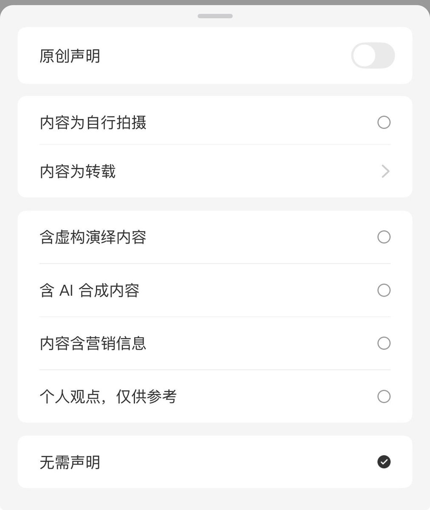

观看来源与观看时段

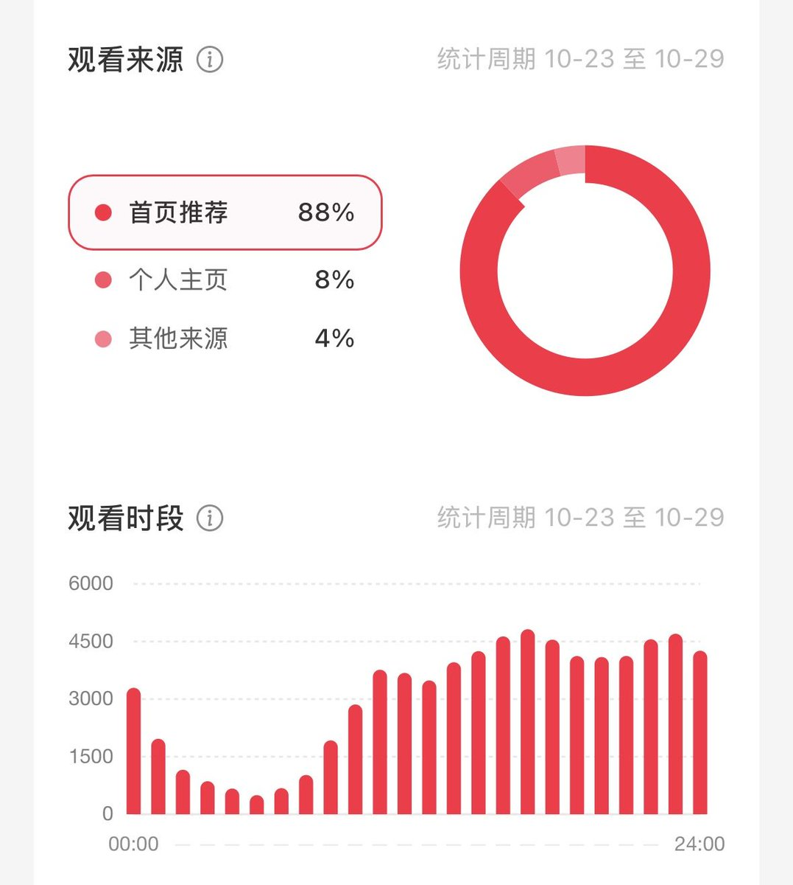

侵权申诉材料说明

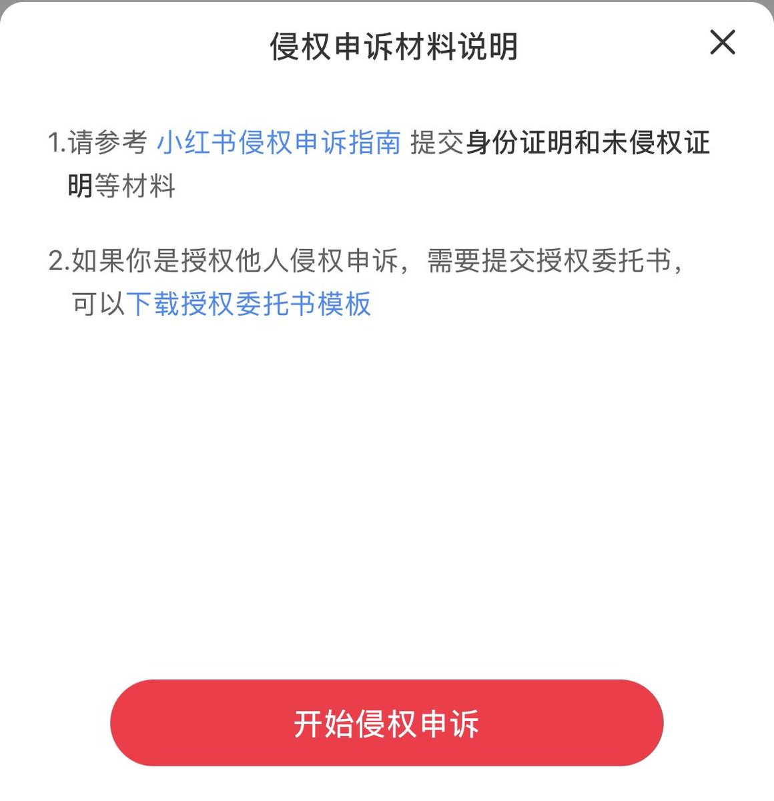

违规后怎么自救

先判断是不是限流：创作中心里推荐占比低于 15%，且 48 小时流量陡降；或者用「账号名+标题」搜不到自己的笔记。

分级处理：单篇违规，删掉或改合规后 1–3 天可能恢复；账号轻度违规，7–15 天限流；多次违规，14–30 天权重下降；严重违规（虚假营销、恶意引流、售假）30 天起步，可能永久封禁。

申诉路径：「我 → 创作权益 → 内容申诉 → 选限流笔记 → 人工复核」。材料带原始素材、真人出镜视频、购买凭证，一次性打包。文案写清笔记 ID 和主题，200 字内更好过。

恢复权重：停更 1–2 天正常互动（别秒赞秒评），再连续发 3–5 篇纯原创干货，慢慢拉回流量。

把「不导流、不极限词、AI 必标注、坚持原创、不刷数据」刻进习惯，再配合发布前自查，能避开大部分坑。

6. 日常运营

日常不是玄学，是固定动作。

每天第一件事：复盘前一天笔记的曝光、点击、点赞、收藏、评论、涨粉，找异常和表现好的内容。

然后找热点和选题：刷发现页、搜索热榜和同行账号，看大家在讨论什么、用户在搜什么，顺手往选题库里塞。

做内容时，标题决定点击率，封面决定第一眼。正文控制在 500–600 字左右，通俗易懂。新手优先做图文，门槛最低。

发布频率：新手建议每周稳定 3–5 篇，质量大于数量。早 7–9 点、午 12–13 点半、晚 18–22 点可以作为测试时段，再根据自己的数据找最佳时间。

发完及时回复评论和私信。评论区里用户问的问题，往往就是下一个选题。

复盘优化：点击低改标题封面；收藏少补干货价值；评论少加互动引导；涨粉少检查定位是否还垂直。表现好的选题换角度多做几版，差的及时放弃。

近 7 日数据中心

官方扶持别浪费

小红书官方扶持大致分三类：给普通内容创作者的、给垂类/活动的、给电商商家的。很多人以为扶持就是「官方送流量」，其实大部分是「完成任务换曝光」或「参与活动拿奖励」。

新手流量扶持：新号发真诚分享、能引发共鸣的内容，平台会给一定曝光倾斜。比如发布后系统提示「再发一篇笔记，有机会获得更多流量扶持」。不用额外申请，认真做内容就能吃到。

创作者中心 → 笔记灵感 / 创作灵感：新人最容易忽略。里面挂着官方正在推的话题和活动，带话题发布能蹭活动流量。很多新人靠这个在起号期拿到额外曝光。

垂类官方薯活动：家居薯、穿搭薯、美食薯等会不定期打卡。带指定话题连续发布，可解锁流量券、实物甚至现金。比如有的装修打卡活动，记录满 30 天有机会拿万元大奖，前两天发笔记就给流量券。对应赛道的博主值得盯一下，既拿扶持又练更新节奏。

待领任务

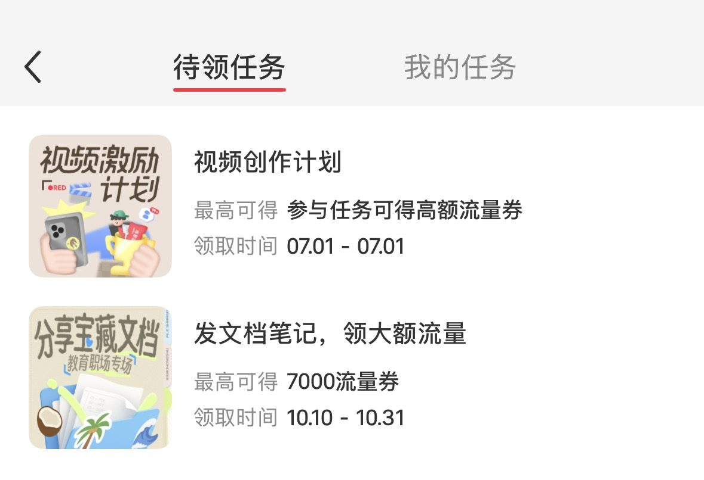

千粉成长任务

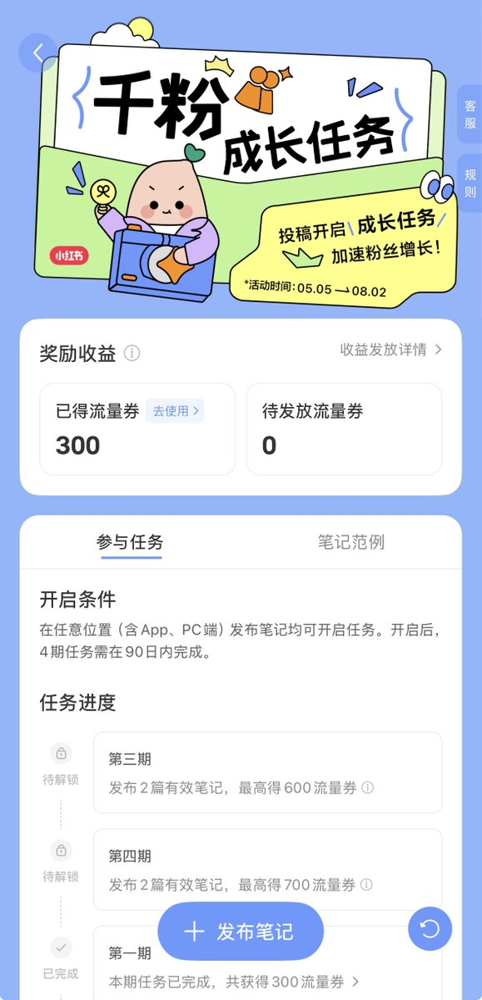

7. 心态：别被流量裹挟

相信自己，找到适合自己创作的方向，一直做下去。保持发笔记的节奏，爆款会来的。没流量是常态，别因为几天数据难看就换赛道、改人设。

爆了之后更要注意承接：把流量尽量转化到粉丝、主页和其他笔记上，别只高兴浏览数字。人来了接不住，跟没来过差不多。

运营没有捷径。起号想清楚、养号像真人、主页立住人设、对标拆结构、红线不碰、日常按节奏跑，再留一点耐心。这篇是方法，下一篇如果你需要，可以单独写选题怎么测、封面怎么改。

## 相关页面

- [[sources/qichen-xiaohongshu-operation-skills]]
- [[sources/lucaspei-ai-xhs-notes-skill-pipeline]]
- [[patterns/wechat-image-post-account-sop]]
