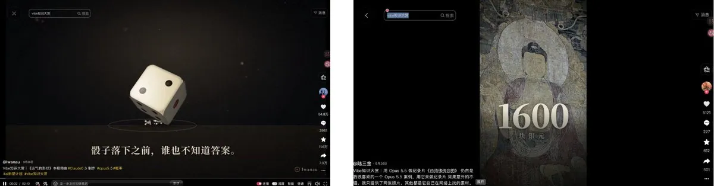
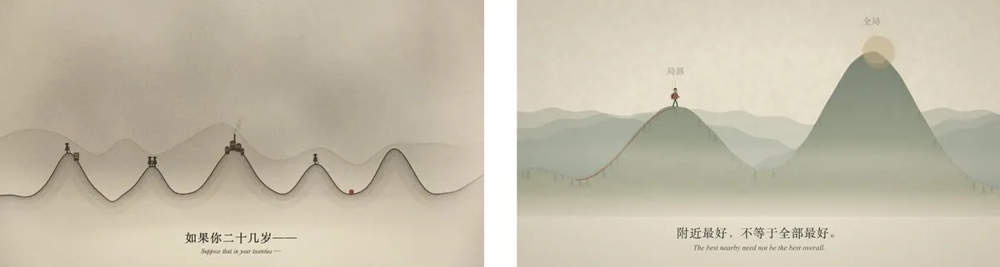
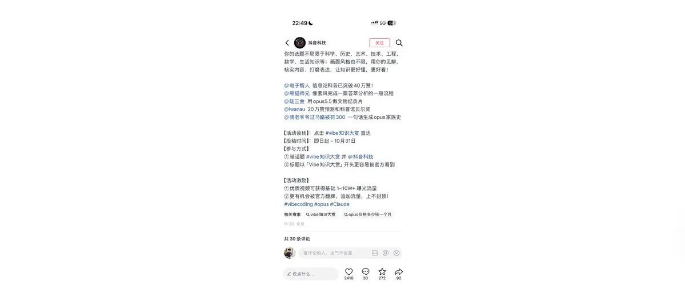
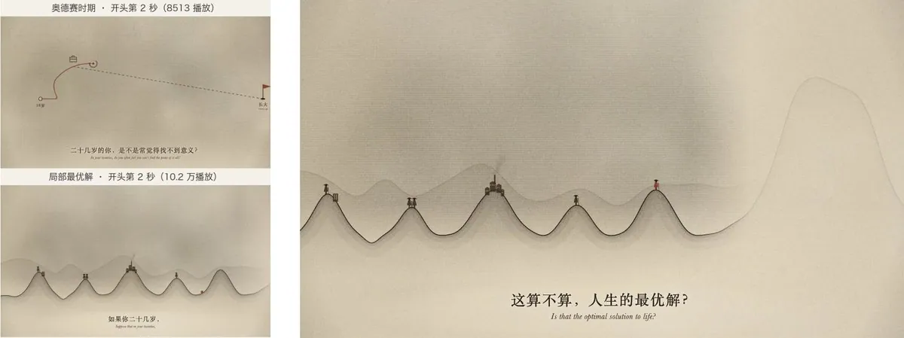
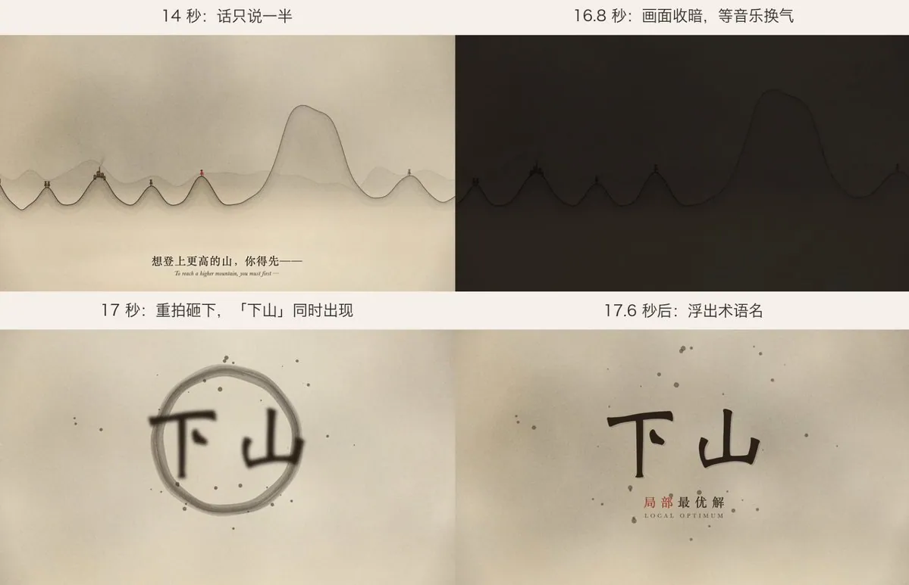

# Tom CC（@Tom_CC_9986）：用 Opus 5.5 起号真的太爽了——高质量内容生产与自媒体冷启动

> 实战拆解如何借助 Claude Opus 5.5 的顶级逻辑推理与人情味叙事能力重构新号起盘流程：通过精确的提示词工程引导模型完成深度选题挖掘、专业见解提炼、去 AI 塑料感行文排版，并在短时间内构建具有极高认知辨识度的个人 IP 内容护城河。

<!-- more -->

两个小时，一段提示词，做出来的科普视频播放 10 万+，涨粉 600 多，后台还收到了好几个付费咨询。最近爆火的 Vibe 知识视频到底是怎么做的？下面把我的做法完整分享出来，提示词全文也附上。

最近 Vibe 知识挺火的，就是让 AI 用代码直接把知识短片做出来。抖音这段时间也在推 #Vibe 知识大赏。以前做这种视频，得会动画、会做特效、会剪辑。现在一个人、一段提示词就能做出来，门槛一下子降下来了。

我自己真上手做了三条发在小号上，数据在下面，三条分别是《奥德赛时期》《局部最优解》《最后相遇定理》，加起来涨粉 600 多。数据不算太好，但里面也出了一条小爆款，主要是测试。

## 具体怎么做？

这类视频看下来主要有两种，一种是纯音乐加动效，一种是旁白、图片加动效。纯音乐那种，画面全是代码画出来的，不用找素材也不用配音，最简单，我选的就是这种。旁白加图片那种信息量大一些，但要配音、要找素材。素材可以让 Claude 自己上网搜，不过最好让它只找能免费商用的，不然容易侵权。

开始之前视频风格最好先定下来。光靠文字很难说清楚，可以直接垫几张你喜欢的图给它，它能照着那个感觉做，比你描述半天准得多。我这三条都是宣纸底加水墨。

流程很简单，就四步。

最重要的就两样东西：一个是模型，一个是选题。

第一步：选题

跟着热点走，起量可能会快一些。比如最近诺贝尔奖刚公布，得主为什么得奖、核心贡献到底是什么，普通人大多看不懂，挺适合用动画讲明白。我翻了一圈那些火起来的视频，很多都是一个路子：借一个硬核的东西，比如某个算法，或者某个冷门又奇特的小知识，最后落到人生道理上。

第二步：让 AI 生成

把下面的提示词丢进 Claude Code，把 {主题} 换成你自己的就行。

【提示词全文】

# 角色

你是一位人文纪录片导演，同时会用代码做动画。

你擅长把抽象的知识讲给普通人听：不堆术语，用画面和故事让人看懂，看完还有一点触动。

# 任务

用代码制作一支 {16:9} 的纪录片风格短片，主题是「{主题}」。

- 背景音乐：{背景音乐}（默认使用桌面上的《千年之后》氛围版）。片长跟随音乐，从第 0 秒开始放，结尾随音乐自然收束。用《千年之后》时约 2 分 38 秒。
- 无口播，画面和字幕承担全部叙事。
- 全片的情绪曲线跟着音乐走：音乐的第一个重拍就是全片的第一个高潮（《千年之后》在第 17 秒）。

# 叙事

## 第一步：先找「锚词」（写任何文案之前完成）

锚词是全片的钉子：2～4 个字，是这个原理落在普通人生活里的那个处境、困惑或反直觉的瞬间，而不是术语本身。

- 好锚词的三个标准：
  ① 观众一看就有代入感，觉得「这说的就是我」；

  ② 同一个词能概括整个原理；

  ③ 结尾时能被重新定义：开头它是困境，结尾它变成理解、释然或力量。

- 示例：红皇后效应的锚词是「原地」（拼命跑，却还在原地）。按同样的思路：沉没成本可以是「舍不得」，幸存者偏差可以是「看不见的人」。
- 用法：
  - 第 17 秒的高潮把它“砸”出

## 原则

先写观众的处境，再讲知识。知识是用来解释「你」的。

开头不讲历史、不出术语；历史、人物、实验放在高潮之后。

## 钩子（0～16.4 秒）

1. 第一句：用第二人称写出观众正在经历的那个悖论或困惑。句式：「你已经……，为什么还……？」
2. 3～4 个快速画面，每个约 3 秒、配一句字幕：让同一个现象在不同尺度上各出现一次（个人 → 自然界 → 群体或社会），让观众意识到“原来到处都是”。
3. 一句收束：「所以，……」把几个画面归到同一个悖论上。
4. 13～16.4 秒：一句经典引语、一个关键数字或一个直击要害的发问，其中要含锚词，为高潮蓄力。

## 高潮（第 17 秒，必须踩准音乐）

《千年之后》在 16.5～16.9 秒有一口“换气”（接近静音），17.0 秒重拍砸下。画面这样对位：

- 16.4～16.9：画面整体收暗，所有元素淡出
- 16.9～17.0：静止约 3 帧
- 17.0 爆发：纸面骤然亮起或墨晕炸开（方式与全片画风一致），巨大的锚词同时出现（约占画宽 1/3），一圈墨痕或光环从中心向外扩散
- 17.6：锚词下方浮出一行小字：术语名（中英）
- 17.6～约 20：保持，只做极轻微的呼吸感
补充：

- 17.0 配一个低沉的冲击音效。
- 这个时间点误差不超过 2 帧。
- 换别的音乐时，先实测它的第一个“换气 + 重拍”在哪一秒，再把高潮放在那里。
- 中段正式给原理命名或揭晓关键结论时，可以再用一次小一号的爆点；全片最多两次。

#画风

- 底色和质感：羊皮纸或米白宣纸；全片叠加胶片颗粒、纸张纹理和暗角。
- 配色由你根据画风决定，整体低饱和、温暖、克制。
- 画面里出现的数字一律用等高数字（lining figures），不要用高低错落的旧式数字。

# 转场

画面之间不要硬切，要有丝滑的过渡。

优先用「同一个元素贯穿前后两个画面」来转场。例如：

- 一个圆从大变小，变成下一个画面里的太阳或烛火；
- 一条线延伸出去，变成下一个画面的地平线或道路；
- 镜头推进到某个细节，这个细节铺满画面，展开成下一个场景。
转场要短而干净，前后两个画面不要长时间叠在一起。淡入淡出、闪白、黑场只作为辅助。

# 动效与节奏

节奏舒缓，有呼吸感：镜头缓慢推进或平移，元素渐显渐隐。

画面的变化和字幕、音效的出现保持同一个节拍。

不要弹跳、旋转、花字、快切。

# 字幕

- 字幕就是旁白。每一屏下方只放一句中文，下面一行英文斜体翻译。
- 句子要短（中文不超过 18 字）、有诗意，可以用破折号制造停顿。
- 每句停留 3～5 秒，全片约 25～30 句。
- 字幕在任何背景上都要看得清：暗背景用浅色字，亮背景用深色字，必要时加柔和阴影。

# 声音

- 背景音乐必须加：{背景音乐}，从第 0 秒开始，结尾随音乐自然淡出。音量压到不刺耳，让少量音效也能听清。
- 音效只加少量：
  - 一层很轻的背景氛围音（风、纸页、环境底噪）；
  - 5～8 处重要音效：第 17 秒高潮、关键转场、关键结论出现、片尾。
  - 音效要轻、短、干净，不抢音乐。

# 交付

1. 先给我分镜表：段落 | 时间码 | 画面 | 转场方式 | 中文字幕 | 英文字幕 | 音效。并写明锚词，以及它在片中出现的所有位置。
2. 正式渲染前先抽几帧预览，自查有没有文字重叠、文字超出画面或纸面、看不清的地方，改好再渲染。单独检查 16.3、16.8、17.0、17.1、17.5、18.0 秒这几帧，确认高潮踩在重拍上。
3. 渲染成片：MP4，1920×1080，30fps，含背景音乐和音效。只交付这一个视频文件。
4. 列出片中用到的年份、人名、数字和引文，方便我发布前核对。

模型最好用 Opus 5.5，我自己用的就是它。我也拿 GPT 的模型跑过，同样的提示词扔进去，出来的效果真是惨不忍睹。但是你自己垫素材，慢慢改也可以，但是总感觉差点意思。

剩下的基本不用管，分镜、动画、渲染、音效、配乐都是它自己弄，最后直接给你一个视频。

第三步：修改完善视频

当然可能生成出来的不是你要的那样，这个时候就需要改。比如你觉得视觉风格不好，你在调风格的时候，别急着出整片，先让它做个 10 秒左右的版本，看看视觉方案是不是你想要的。不然它可能一上来就生成 30 秒甚至更长，挺耗 token，也耗时间。等视觉风格调对了，让它把这套风格提炼成一个通用模板，之后每次换个主题，直接按模板生成对应的视频就行。

第四步：发布

成片导出来直接发。记得带上平台的活动话题，#Vibe 知识大赏 这些标签并且@抖音科技。好作品有机会被推广。

## 为什么有的能火，有的不火？

三条用的是同一套提示词、同一首歌、同一种画风，结果差了十几倍。我自己对比下来，四条小经验。

结论一：开头要把人留住

第一，画面要一上来就抓眼球。我看了一些做得好的作品，第一秒基本都有一个很炫的画面，还有一个让眼睛落脚的视觉锚点。《局部最优解》第一秒就是一整片山，小山头上站着人，其中一个穿红衣服，眼睛自然就落到他身上了。《奥德赛时期》第一秒只有一根红线在纸上慢慢画，像张图表，就太平了，开头没留住人。

第二，文案第一句要跟观众有关。别一上来就讲术语、讲历史，说观众自己可能正在经历的事。

结论二：视频要有节奏

我看了一些点赞少的视频，发现它们基本没什么节奏，背景音乐的情绪是一回事，文案的节奏又是另一回事。最明显的是高潮那一下，音乐已经砸下来了，画面和文案还在慢慢走。

我后来发现一些好的作品是这么做的：

- 字幕切换卡在音乐的小节线上，不随便切
- 重拍前两三秒，字幕故意只说一半。《局部最优解》第 14 秒是“想登上更高的山，你得先——”
- 重拍前半秒，画面整体收暗，等音乐换气
- 重拍那一下，画面、文案、音效一起爆：纸面亮起，“下山”两个大字砸出来补完上一句，同时配一个低沉的冲击音效

这样音乐的高潮、画面的高潮、文案的高潮就重叠在同一帧上。提示词里“高潮”那段写的就是这个，换了歌就让它先分析音频，找到重拍再对位。

结论三：抛一个问题给观众

抛不抛问题，差别很大。《局部最优解》有 397 条评论，另外两条只有 8 条和 11 条。

好问题有个特点：跟观众自己有关，而且每个人都有自己的答案。“安稳算不算人生的最优解”就是这样，觉得算的、觉得不算的都想说两句，评论区就热闹起来了。另外两条讲的是迷茫、走散，看完有感触，但没什么可答的，也就没人开口。

结论四：转场要丝滑

我看了一些做得好的视频，画面之间基本不硬切，都是一个画面自然“长”成下一个。

于是我在提示词里写的：画面之间不要硬切，要有丝滑的过渡。 优先用「同一个元素贯穿前后两个画面」来转场。例如： - 一个圆从大变小，变成下一个画面里的太阳或烛火； - 一条线延伸出去，变成下一个画面的地平线或道路； - 镜头推进到某个细节，这个细节铺满画面，展开成下一个场景。 转场要短而干净，前后两个画面不要长时间叠在一起。淡入淡出、闪白、黑场只作为辅助。

然后生成的视频《局部最优解》的所有转场都是在山水里推近、平移、拉远，看起来像一个连续的长镜头，眼睛不用重新找重点，画面也看着舒服。

## 能不能变现

视频发出去没多久，就有人来问能不能付费学做这些视频，说明大家对这个确实有需求。

但真要靠这个收费教人，其实挺难弄的。有些人确实有需要，但怎么防封 Claude、怎么交付，都是不太好解决的问题。

我倒觉得它更适合给本身有知识储备的人当工具用，比如心理博主、读书博主、知识博主，还有心理咨询师。用一个视频把道理讲透，吸引到同频的人，再去建陪伴群，变现可能会更好做一些。

关键是现在有流量，适合起号！

主要就这些了。有问题欢迎评论区交流呀！

## 相关页面

- [[sources/tw93-leading-vs-being-pushed-forward]]
- [[sources/weiyux-x-account-zero-to-one-guide]]
- [[concepts/selfmedia-compound-model]]
- [[concepts/prompt-engineering]]
