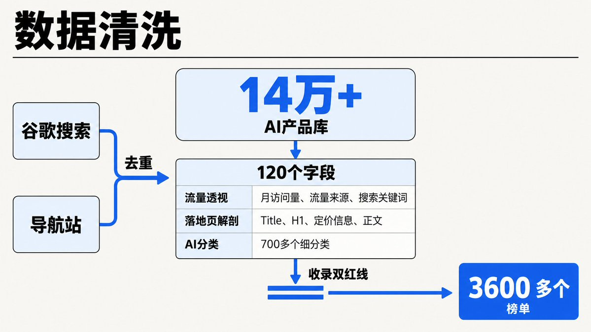
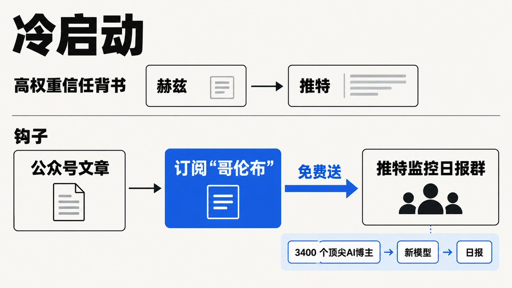

# Traceward（@TraceJie）：连扑 20 个 AI 出海站靠自用「选品外挂」翻身——7 天砸出日入千刀

> Traceward 写爬虫程序员朋友「吕秀才」的绝地反击：过去 5 个月做了 20 多个 AI 出海工具站全部扑空——AI 生成 YouTube 缩略图的工具每天烧 10 美金投 Google Ads、烧两周后台挂着「0 单」，AI 换发型工具花钱买高权重外链、熬一个月只出一单。他转而用老本行做选品工具「哥伦布」：先用 Google Trends 抓 AI 词根下拉词，拿这些词去谷歌搜索扒前 10 页产品，再截流 toolify、creati、producthunt 等导航站，两边去重拿到 14 万+ 个 AI 产品库；数据清洗做 120 个字段，接入 SimilarWeb 接口（作者标注这套数据一个月要 900 多刀），把 Title、H1、定价、正文丢给 LLM 打 700 多个细分类标签；定下两条收录红线——AI 浪潮后注册的新域名（>2025 年）+ 月访问量>1 万，或注册时间>2025 年 + 访问量>3000 + 环比增长>50%，14 万个跑完漏斗只剩 3600 多个。8 月 4 号上线付费，第一天哪怕 700 多 UV 仍是 0 单；第二天把产品发给出海圈大佬「赫兹」，对方发了条推特当晚出 2 单；第七天改成只挂钩子——上线监控推特上 3400 个顶尖 AI 博主的「推特监控日报群」，写一篇公众号干货扒光技术方案，订阅哥伦布就免费送群，大佬把群分享进自己的高端私董会后一群大佬直接秒了年费，当天日入千刀。文末 Q&A 四条实操：新站验证直接每天投 5 美金 Google Ads、拉来 10 几个真实用户后用 Clarity 录屏盯鼠标轨迹；长久做钱要新词站加品牌站两条腿走路；图文素材全权交给生图 API；接老外的钱要么办香港卡、要么花一两千块钱找代理注册美国公司（LLC），不想开公司就用 Creem 这类代收款平台。全文收束成一句：什么人，在什么场景下，愿意花多少钱，解决什么痛点？

<!-- more -->

深圳的夜，凌晨两点。科技园的写字楼里还有星星点点的灯光。

我坐在一家 24 小时营业的便利店里，看着对面的吕秀才大口嚼着关东煮。他是个极其典型的爬虫程序员，眼神里透着长年对着屏幕特有的血丝。

在过去的 5 个月里，他像无数被“AI 出海暴富”神话洗脑的技术男一样，疯狂敲代码，前前后后搞了 20 多个 AI 出海工具站。

结果呢？惨不忍睹。

他做了一个“AI 生成 YouTube 缩略图”的工具，为了获客，甚至硬着头皮去投 Google Ads。每天烧 10 美金，烧了两周——后台挂着一个极其刺眼的“0 单”。

他又做了一个“AI 换发型”的工具，花钱买了高权重的外链。熬了一个月，勉勉强强出了一单，然后就彻底陷入了死寂。

“Trace 姐，那几个月我真的快崩溃了。”秀才苦笑着把竹签扔进垃圾桶，“我技术没问题，产品跑得极其流畅，甚至投放我也试了。为什么老外就是不买单？”

我太懂这种痛了。我看着他，一针见血：“因为你选的根本不是刚需。缩略图大把免费工具能做，换发型纯属伪需求。你只懂写代码，却连自己要卖给谁、解决什么痛点都没搞清楚。”

秀才听进去了。他做了一个极其大胆的决定：既然我不会选品，那我就发挥我老本行（爬虫）的优势，去抓取全网的数据，看看别人到底是怎么选品、怎么搞钱的！

于是，一个名为“哥伦布”的出海选品工具诞生了。

8 月 4 号上线付费，第一天 0 单。第七天，日入千刀。

哈喽，兄弟们好呀，我是 Trace 姐。

今天，我就借着吕秀才这场从“连跪 20 次”到“日入千刀”的绝地反击，带你们彻底撕开 AI 出海圈“盲目做产品”的遮羞布。用最冰冷的操盘手视角，一步步拆解独立开发者如何靠数据截流、靠灰产思维破局。

准备好，这篇几千字的硬核实操，底裤全给你扒光。

## 一、 商业逻辑的底牌：你的失败，就是别人的痛点

做任何工具，最忌讳的就是“技术自嗨”。

秀才为什么前两次会失败？因为他自己根本就不去用那些工具。

而“哥伦布”为什么能成？因为这就是他从自己的失败里长出来的痛点。

谁在掏钱？

那些像曾经的秀才一样，盲目写代码、找不到赚钱赛道、急需“抄袭对标”的出海独立开发者。

为什么买？

市面上的流量榜单太杂，全是头部大厂（如 OpenAI、Midjourney）的数据。小玩家根本没法模仿大厂。他们需要的是一个能“灵活筛选、看到底层小黑马”的透视外挂。

这就叫刚需。如果一个产品连你自己都不愿意天天用，凭什么指望别人掏钱？

## 二、 空手套白狼的数据炼金术：怎么做出来？

“哥伦布”的本质，就是利用强大的爬虫技术，把全网赚钱的 AI 产品扒个底朝天。这部分的实操极其硬核，懂技术的直接抄。

### 动作一：怎么抓到 14 万个竞品？

不要自己瞎想赛道。

#### $1. 谷歌搜索降维打击： 先找到 AI 相关的词根，用 Google Trends 抓取下拉词。然后拿这些词去谷歌搜索，把前 10 页的产品全部扒下来！为什么？因为能被谷歌排在前面的，都是被算法验证过、有真实流量的好产品。
#### $1. 导航站截流： 盯死 toolify、creati、producthunt 等独立开发者经常提交的导航站。别人花真金白银提交的产品，说明人家已经做过一轮选品验证了。你直接抓下来，等于别人花钱帮你做了初筛。

两边数据去重，秀才硬生生拿到了 14 万+ 个 AI 产品库。

### 动作二：120 个字段的数据清洗（过滤死亡项目）

光有名字没用，你必须给这些产品“照 X 光”。

- 流量透视（成本极高）： 接入 SimilarWeb 的接口（这套数据一个月要 900 多刀，门槛极高），抓取每个产品的月访问量、流量来源、搜索关键词。
- 落地页解剖： 抓取竞品的 Title、H1、定价信息、正文。
- AI 分类赋能： 把这些杂乱的信息丢给 LLM 大模型，写提示词让大模型自动给产品打上 700 多个细分类的标签。

最后，定下极其残酷的收录双红线（满足其一才进榜单）：

#### $1. AI 浪潮后注册的新域名（>2025 年） + 月访问量 > 1 万。（已验证的赚钱爆款）
#### $1. 注册时间 > 2025 年 + 访问量 > 3000 + 环比增长 > 50%。（正在起飞的绝对黑马）

14 万个产品跑完这个漏斗，最后只剩下 3600 多个！剩下的全是一堆毫无流量的死尸。这就是出海圈真实的残酷存活率。

## 三、 从 0 单到日入千刀的“邪修”引流法

产品做好了，自己用得很爽，甚至有朋友催着他收费。但真正上线的第一天，哪怕有 700 多 UV，依然是极其刺眼的 0 单。

为什么？因为没有信任。老外凭什么把信用卡交给你一个不知名的工具？

秀才是怎么在 7 天内破局的？

#### $1. 冷启动不靠算法，靠脸皮（高权重信任背书）
   第二天，秀才直接毛遂自荐，把产品厚着脸皮发给了出海圈的大佬“赫兹”。大佬觉得不错，顺手发了条推特。当晚，直接出 2 单。
   这就是破局的关键：一个新产品，第一批信任只能靠大佬的背书借来。 这本质上就是一条极高权重的“人脉外链”。

#### $1. 不卖产品，只挂“钩子”（日入千刀的导火索）
   到了第七天，秀才悟了。他不再去喊“哥伦布上线了快来买”，而是玩了一手极其漂亮的“聚人截流”。

他上线了一个“推特监控日报群”。

做海外市场的人最缺什么？找新词、抢时间差。这个群监控了推特上 3400 个顶尖 AI 博主。一旦有大厂发布新模型，系统自动筛选发日报。只要你能第一时间抢注新词域名，你就能白嫖谷歌的早期流量。

秀才写了一篇极度干货的公众号文章，把这个监控群的技术方案扒光。然后挂出终极钩子：只要订阅“哥伦布”，就免费送这个价值千金的监控群！

文章一发，大佬们被干货吸引，为了进群疯狂订阅哥伦布。甚至有大佬把群分享进了自己的高端私董会，一群大佬上来直接秒了年费。

当天，日入千刀。

## 四、 Trace 姐的硬核实操局解答（价值万金）

在后来的复盘答疑里，有几个极其尖锐的实操问题，秀才的回答简直是把出海的底裤都掀了。

Q1：新站上线，哪种验证动作最快？

别搞虚的，直接投 Google Ads！ 每天就投 5 美金。不要多，只要拉来 10 几个真实用户就行。

关键操作：在网站上装个录屏工具（比如 Clarity）。死死盯着这十几个用户的鼠标轨迹！看他们在哪里犹豫、在哪个定价按钮前跑路了。这比你花几千块买分析报告直观一百倍。

Q2：想长久搞钱，做什么站？ 新词站 + 品牌站，两条腿走路。

新词站（比如刚才说的监控群抢首发），起量极快，今天注册明晚就来流量，吃的是时间差，适合赚快钱。品牌站起量极慢，但一旦养起来，收益稳如老狗。两者互补，才是保命之道。

Q3：一个人怎么搞定庞大的图文素材？ 全权扔给 API 接口！

找一个生图的 API（比如 Midjourney 的某些三方接口），把需求喂给它，让它自己生成、自己填充网站。千万不要像个傻子一样一张张手动去 P 图，一个人干不完的。

Q4：怎么接老外的钱（Stripe 收款）？

别嫌麻烦。要么办香港卡，要么花一两千块钱找代理注册个美国公司（LLC），足不出户就能搞定。不想开公司，就去用 Creem 这种代收款平台。解决收款是出海的第一道门槛。

## 五、 最终的残酷忠告

回顾吕秀才这场从连跪到暴富的实战，最核心的秘诀其实就一句话：

“什么人，在什么场景下，愿意花多少钱，解决什么痛点？”

如果这句话你品不透，你就会像他前 5 个月那样，每天早 9 晚 11 地爆肝写代码，最后收获一堆毫无流量的垃圾代码。

别再问“我能做什么”这种傲慢的问题了。

去问问“我自己做项目的时候最缺什么”、“最痛的那个环节在哪”。你最痛的地方，大概率就是海外那帮老外愿意花美刀来求你解决的地方。

## 相关页面

- [[concepts/app-idea-validation]]
- [[patterns/gray-market-customer-acquisition]]
- [[patterns/competitor-research-four-step]]
