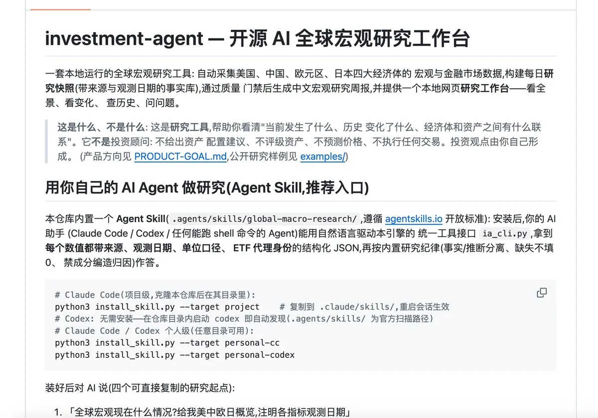

# trader-c（@TradercBTC）：investment-agent——开源全球宏观研究 Skill，装进你自己的 AI Agent

> 把个人使用的宏观研究工具改造为 Skill 开源：支持美国、中国、欧洲、日本等主要经济体的宏观数据观察、金融市场变化、历史查询、跨资产比较与研究档案管理；通过 Claude Code 等 AI Agent 用自然语言调用本地金融研究引擎。工具本身回答「现在各个主要市场与经济体是什么情况、相互之间的作用机制与传导机制是什么、历史上相同结构与背景出现在什么时候、当时结果是什么」——作者强调这是卖方性质的研究学习工具；当前为 Alpha 版本，历史数据覆盖、复杂研究能力与部分 Agent 兼容性仍在完善。

<!-- more -->

哎呀总算 24h 不停轴的转，把第一个项目改造完了

最后改造为 skill 的形式了：

项目地址：「https://t.co/1DkNBCmTjA」

这是我之前个人使用的，包括从 3 月开始，我们群里每周的「全球经济和金融市场变化的报告」就是根据这个写的

在此期间通过两个市场的变化和经济变化，对我们群里面交易原油，黄金，a 股的科技板块，美股的全球市场 ETF 起到了非常重要的作用

简单来说，这个就是告诉你现在的各个主要市场和经济体什么情况，相互之间的作用机制和传导机制是什么，历史上相同的结构和背景是在什么时候，当时的作用机制和传导机制是什么，结果是什么。（⚠️注意，这是一个卖方的工具，是用于研究和学习的）

这是介绍：

investment-agent：开源全球宏观研究 Skill

将全球宏观经济与金融市场研究能力安装到你自己的 AI Agent 中。

支持美国、中国、欧洲、日本等主要经济体的宏观数据观察、金融市场变化、历史查询、跨资产比较及研究档案管理。

通过 Claude Code 等 AI Agent，使用自然语言调用本地金融研究引擎，辅助理解全球金融市场。

当前为 Alpha 版本，历史数据覆盖、复杂研究能力及部分 Agent 兼容性仍在完善

明天：

1：开发贾维斯，再用贾维斯开发其他三个项目，然后开源。

2：研究基础知识，写文章。

3：研究其他开源社区的案例，先做起来

4：进行月度复盘总结+最近市场的研究

## 相关页面

- [[sources/waveking-grok-bot-24h-ai-trading-team-prompts]]
- [[sources/yanliudreamer-10k-usd-us-stocks-investment-blueprint]]
- [[concepts/agent-skill]]
- [[concepts/harness-engineering]]
