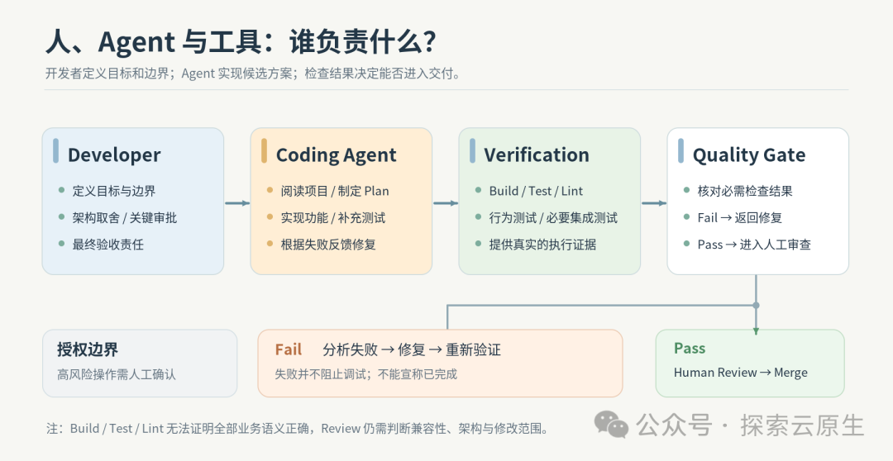
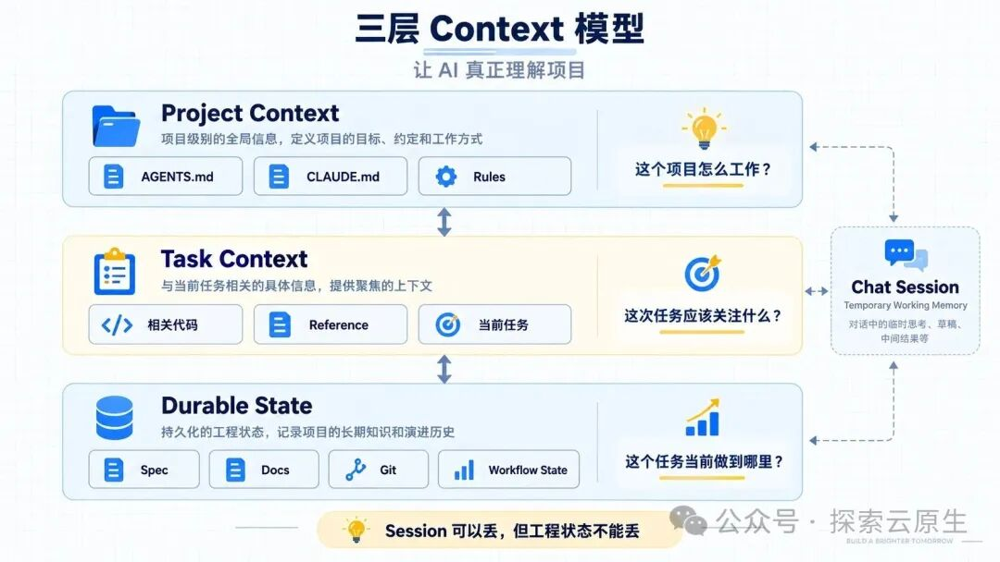
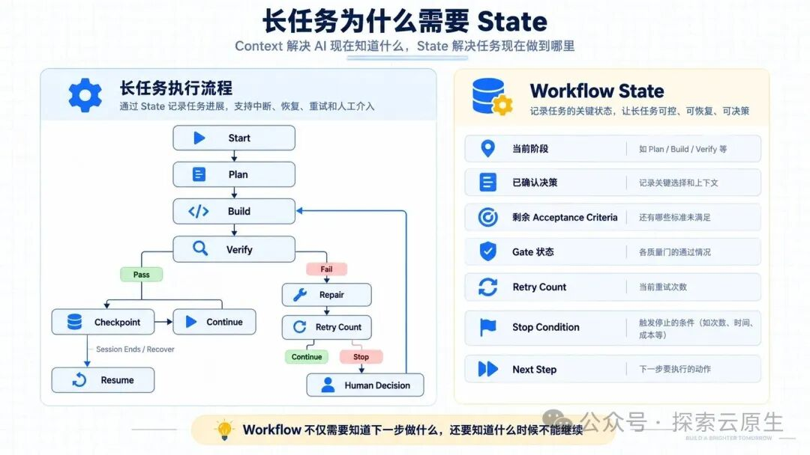

# 从 Vibe Coding 到工程化 AI Coding：如何让 AI 写代码更可靠？

> 让 Agent 修一个 Bug，它可能很快就给出修改，还附上一句"测试通过"。接下来要做的事情却不少：看它改了哪些文件，核对运行过的测试，确认原来的行为有没有受到影响。

## 理解 Vibe Coding

### 什么是 Vibe Coding

Andrej Karpathy 最初提出 Vibe Coding 时，描述的是一种跟着 AI 生成结果不断尝试的开发方式：用自然语言提出要求，运行代码，遇到问题再让 AI 修改，过程中未必逐行审查代码。

本文讨论的范围更具体：在已有项目中使用 Coding Agent，由它阅读仓库、分析问题、修改文件和运行测试，**开发者负责检查方案和结果**。

### 代码写出来以后，还要处理什么

实际使用中，麻烦往往不是 AI 完全写不出代码，而是这些修改很难直接交付：

- 本来只想修一个 Bug，它却顺手重构了几个模块，甚至引入新依赖、改变公共接口
- 测试虽然通过，业务行为却不符合要求
- 早期约束被遗漏，已经否决的方案又被拿出来
- 实际执行失败却被总结成"已完成"

等代码写完才追问这些问题，可能已经需要返工了。所以，任务开始前就要说清楚预期结果和修改范围，提供相关代码；开发过程中检查变更、执行验证，并留下确认过的决策和未完成项。

### 开发者与 Agent 如何分工

- **开发者**：划定范围，决定接口是否可改，检查方案是否合适，最终改了什么
- **Agent**：读代码、找原因，给出方案后完成修改和补测试
- **验收**：项目要求的构建、测试、Lint，以及类型、Schema 等检查，都应留下记录

## 先把 Spec 定义清楚，再让 AI 动手

"增加重试"听起来是个明确的任务。交给 AI 时，可能就只写了这一句：帮我给这个功能增加重试机制。

Agent 接下来仍有不少事情需要确认。是所有错误都重试，还是只处理临时错误？能否加依赖？现有接口能不能动？如果这些要求都没写，它就可能按自己的理解实现。

我会先把任务写成一份简短的 **Spec**：Goal 写要修复的问题，Scope 划定修改范围，Constraints 留下不能违反的约定。最后补上 **Acceptance Criteria** 和 **Verification**，分别写预期结果和检查方法。

### Spec 的五个要素



这最后两项要分开写：

- "API 恢复后，资源最终达到期望状态"是一条验收标准
- "用集成测试复现临时错误和恢复过程"才是验证方法

### 把模糊需求写成可验收的 Spec

假设一个 Controller 遇到临时 Kubernetes API 错误后，资源一直没有恢复。可以把任务写成下面这样：

```
Goal: 修复 Controller 在临时 API 错误后无法正常恢复的问题。

Scope:
- 检查并修改相关 Reconciler
- 补充对应测试

Constraints:
- 不修改 CRD Schema 和现有公共接口
- 优先复用项目已有的错误处理与重试机制
- 不引入新的重试框架
- 保持 Reconcile 幂等

Acceptance Criteria:
- 临时错误不会被误判为调谐成功
- API 恢复后，资源最终达到期望状态
- 重复调谐不会创建重复资源

Verification:
- 单元测试：验证临时错误的处理和返回行为
- 集成测试：运行实际调谐循环，验证临时错误恢复后资源能够收敛
- 幂等性测试：验证重复调谐不会创建重复资源
- 执行项目规定的 Build / Test / Lint 检查
```

这份 Spec 把目标写成了"恢复正常"，没有指定要新增一套重试代码。Agent 应先检查现有实现，找出恢复过程断在了哪里。

### 复杂任务先看 Plan

如果问题牵涉几个模块，我会先让 Agent 读代码，把准备怎么改写出来。这一步就是 Plan：在文件还没变动时，先看它有没有找对问题，确认方案后再动手。

要求 Agent 给出 Plan：

1. 当前逻辑是什么
2. 准备采用什么方案，为什么
3. 需要修改哪些文件
4. 有哪些假设、风险，以及对现有行为的影响
5. 准备如何验证

## 管理 Context：让 AI 读到相关代码和项目约定

### 项目级 Context：把长期规则写下来

每次修 Bug 都重新解释项目怎么构建、接口能不能改，很容易遗漏。可以把这些约定放进工具支持的规则文件，比如 AGENTS.md、CLAUDE.md 或 Project Rules。

```
# Project
This is a Go project based on Kubernetes controller-runtime.

## Commands
- make build
- make test
- make lint

## Conventions
- Follow existing controller/reconciler patterns.
- Keep public APIs backward compatible.
- Add tests for new reconciliation logic.

## Restrictions
- Do not modify CRD APIs unless explicitly requested.
- Do not update dependencies without explicit approval.
```

长文档可以只列路径，并说明什么时候需要阅读。

### 任务级 Context：告诉 AI 这次应该看什么

```
先阅读：internal/controller/foo_controller.go
         internal/controller/foo_controller_test.go

另外参考：internal/controller/bar_controller.go
（其中 bar_controller.go 的错误处理和 Event 记录方式可以作为本次实现参考）
```

### 一个任务尽量保持一个干净的 Context

如果在同一个 Session 中连续处理新功能、Bug 修复和重构等互不相关的任务，之前的临时方案、错误假设和调试记录可能继续留在上下文中，影响后续判断。对于相对独立的任务，更倾向于开启新的 Session。

### 不要让 Session 成为唯一的事实源

任务做到一半换 Session，最容易丢失的是"为什么决定这样改"和"还有哪项没检查"。这些信息需要另有记录。



## Verify + Review：AI 说"完成了"，不代表真的完成了

代码改完，Agent 可能会回复："Implementation completed. All tests passed."

这时可以打开执行记录，把实际运行的命令与项目要求对一下。如果只跑了一个测试文件，"All tests passed"就只能说明这次运行的测试通过了。

接着按 Spec 查看 Diff 和测试内容。缺少执行记录或测试没有覆盖的验收项，先记为未验证，不能靠这句总结补上。

### Quality Gate：让验证结果真正起作用

Quality Gate 要明确的是：哪些检查必须通过，才能进入下一阶段或合并代码。这个条件最好由工具执行，而不只是写在 Prompt 里。

至少应能追溯到实际命令、日志，以及它们对应的代码版本。工具检查之外，还需要人工审查。

## 从 Prompt 到 Workflow：把有效的做法留下来

如果修复 Issue 时总要重复输入"先定位原因，再提出方案，改完补测试"，可以把这段做法保存下来，下次直接调用。

### 为 Workflow 设置阶段检查点

| 阶段 | 完成标准 |
|------|---------|
| Spec | 需求范围和验收标准是否明确 |
| Design | 方案和关键决策是否已经确认 |
| Coding | 约定的变更及对应测试是否已经完成 |
| Verify | 必要检查是否执行，验收结果是否有记录 |

### 长任务还需要 Workflow State

跨 Session 的任务需要保存决策和进度。下面是一份交接模板：

```
当前阶段：验证
当前任务：修复临时 API 错误后无法恢复的问题
已确认的约束与决策：- 不修改 CRD Schema 和现有公共接口
                  - 优先复用现有错误处理与重试机制
代码位置：- 分支与提交：<分支名、提交 ID>
          - 未提交变更：<是否存在>
验证记录：- 已执行：<实际命令、结果>
          - 失败项：<错误摘要>
          - 尚未验证：<剩余验收项>
下一步：<具体操作及预期检查结果>
停止条件：<权限不足、需要改变已确认方案等>
```



## 延伸阅读

1. [OpenAI — Harness engineering: leveraging Codex in an agent-first world](https://openai.com/index/harness-engineering/)
2. [Anthropic — Effective harnesses for long-running agents](https://www.anthropic.com/engineering/effective-harnesses-for-long-running-agents)
3. [Cursor — Best practices for coding with agents](https://cursor.com/blog/agent-best-practices)
4. [Thoughtworks — Context Engineering for Coding Agents](https://martinfowler.com/articles/exploring-gen-ai/context-engineering-coding-agents.html)
5. [Addy Osmani — Agentic Engineering](https://addyosmani.com/blog/agentic-engineering/)
6. [Gloaguen 等 — Evaluating AGENTS.md（v2，2026 年 6 月 23 日）](https://arxiv.org/abs/2602.11988v2)
