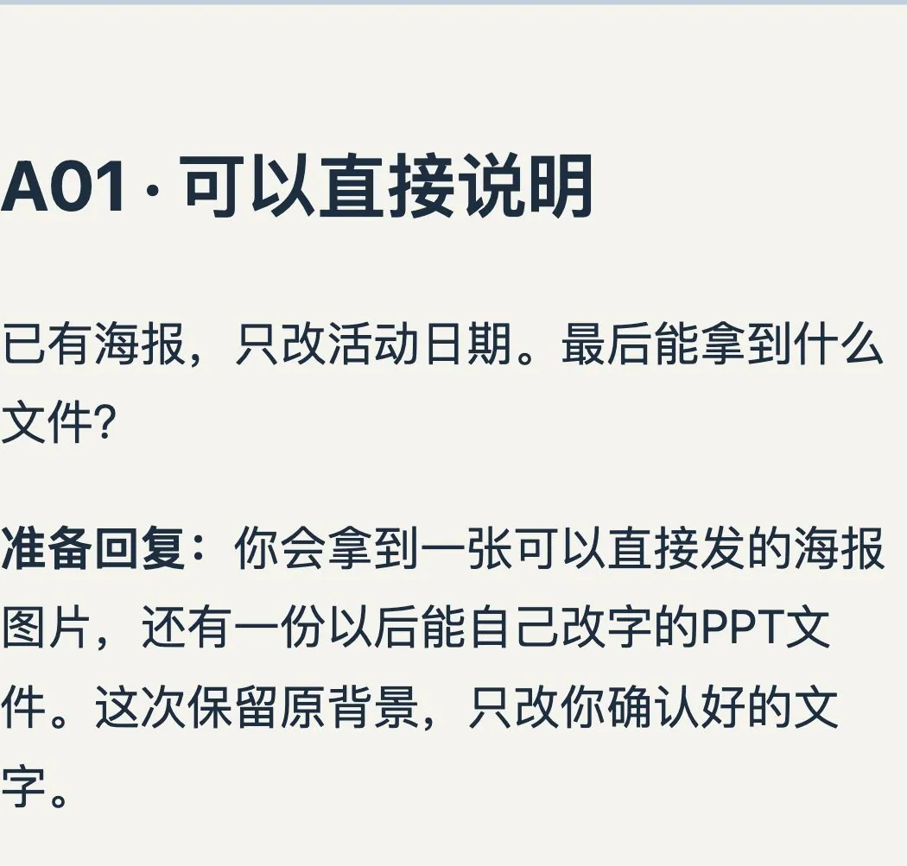
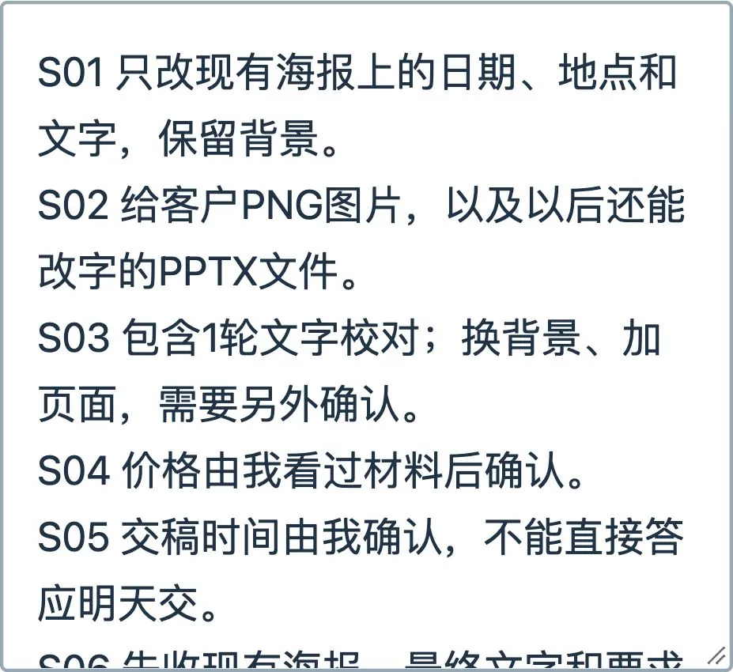
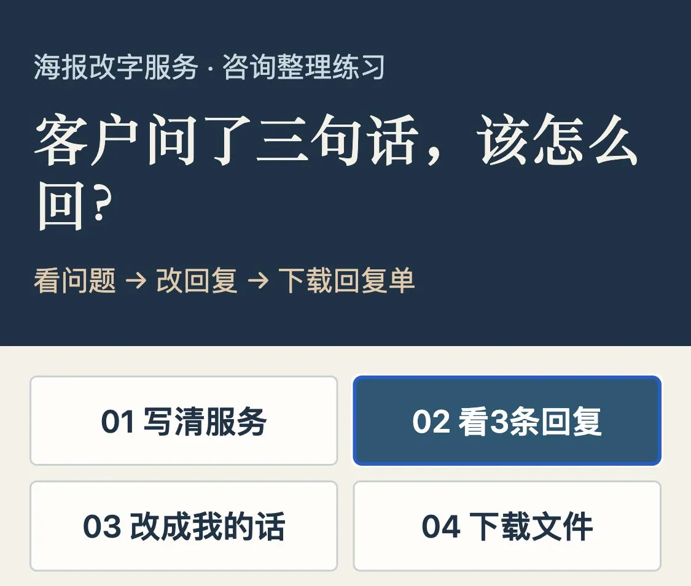
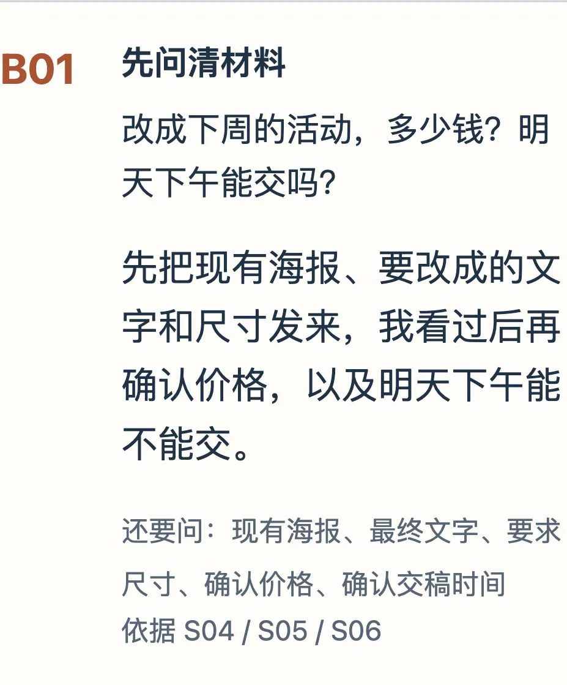
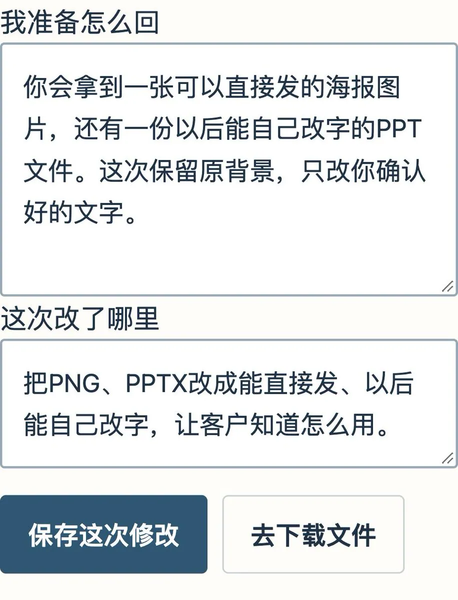
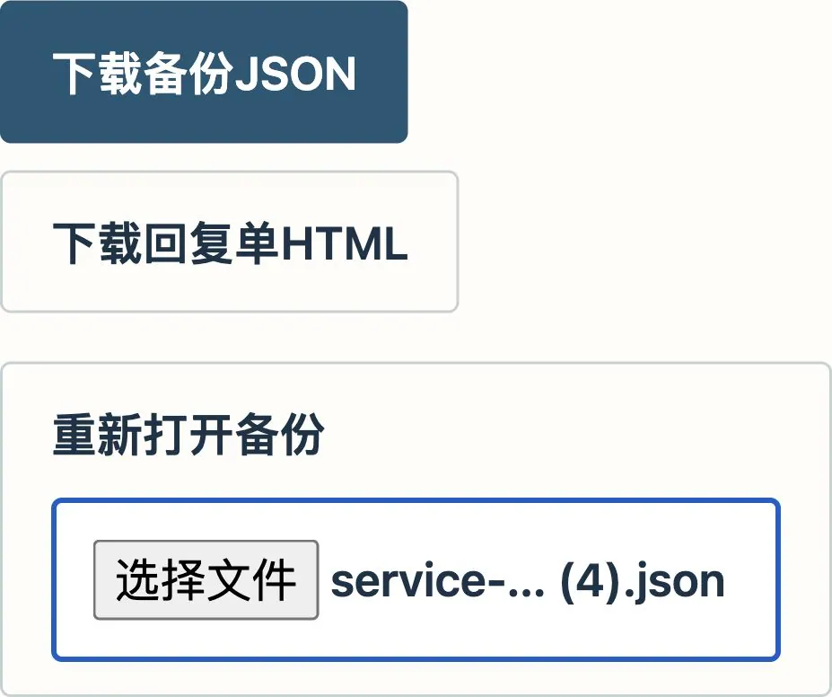
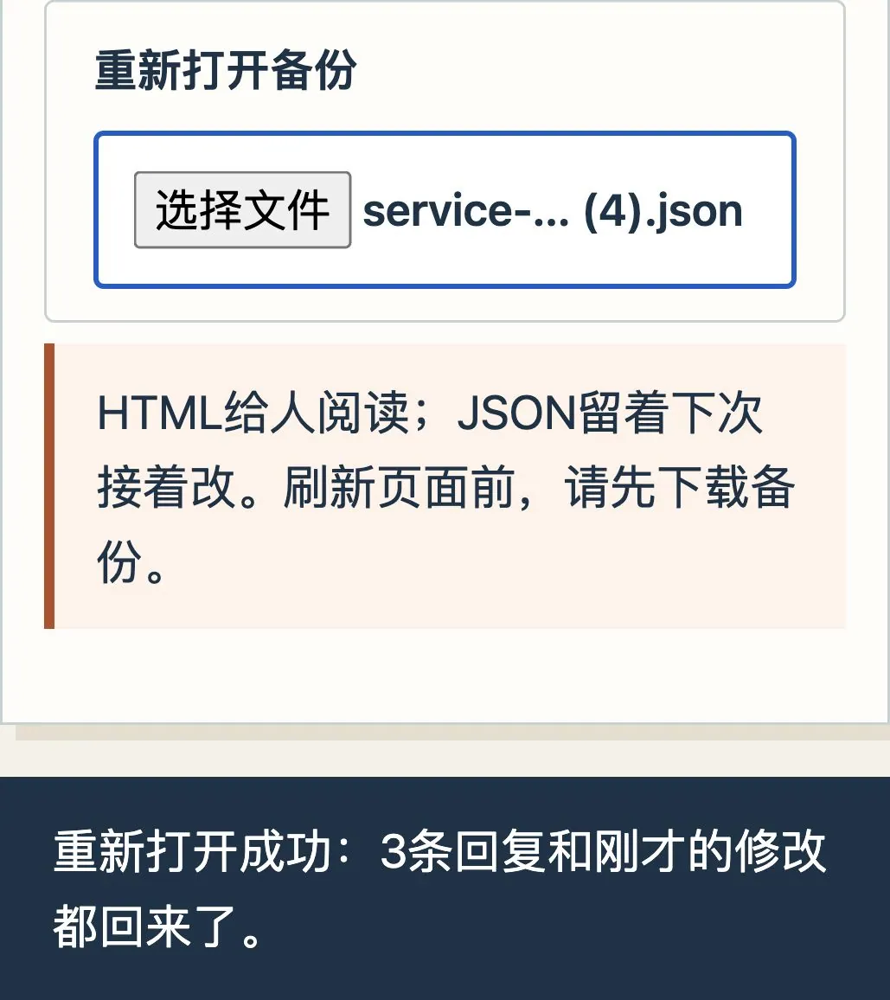

# victor chen：AI 工作台单月利润六位数——手把手做出第一份服务样品

> 用 3 条海报咨询做可打开改字下载的小网页，卖给设计工作室：①找客户问痛点 ②做样品验证 ③报价拆解（整理/处理/文件/教学/修改/维护分别列清）④小范围试用验证付费意愿。用 Codex+本地浏览器，网页不接 AI 接口。

<!-- more -->

“多少钱？”

“明天能交吗？”

“能不能顺便换个背景？”

如果你接过设计单，应该见过这类问题。每次都从头解释，很容易漏问尺寸，也容易随口答应一个交稿时间。

我用 3 条海报咨询，做了一个可以打开、改字、下载的小网页。下面教你怎么做。问题是我为演示编的，改字、保存、导出和重新打开都实际操作过。

你做完会拿到这样的回复单。问文件，解释清楚交什么；问价格，先收齐材料；想多改背景，单独确认。

做完的样子：实际下载的回复单。客户能看懂图片可以直接发，PPT 以后还能自己改字。

## 这个小工具，可以卖给谁？

我会先找平时接海报、菜单、活动图修改单的设计工作室，问一句：“新同事接咨询时，有没有总要来问你的问题？”

如果他每天都在重复解释交什么文件、能改几次、还缺什么材料，就让他拿几条已经去掉客户信息的旧问题来试。

给他做的服务可以很具体：整理现有服务说明，做一个能改回复的小网页，再带使用的人独立操作一次。页面出了问题，怎么修、修到什么时候，也提前说好。

这次我把样品做出来了，还没有拿它收客户的钱。下面先把这个样品一步一步做完。

## 1. 写清楚，你到底给客户做什么

打开你现有的 Codex 项目，先准备这几句话。你可以直接用我的练习资料。

只改海报上的日期、地点和文字，背景保留。

交付 PNG 图片，以及以后还能改字的 PPTX 文件。

包含 1 轮文字校对。换背景、加页面，要另外确认。

客户先提供现有海报、最终文字和要求尺寸。

价格、交稿时间，看过材料后再确定。

换成自己的业务时，改的就是这里。比如你做简历，就写清交付 PDF 还是 Word、包含几轮修改。AI 不知道你的服务规则，需要你先告诉它。

① 点“01 写清服务”，把范围和交付文件填进资料框。完整练习资料在正文里，可以直接复制。

## 2. 整段复制给 Codex，让它做出网页

下面这段不用懂代码。把服务资料换成自己的，再整段交给 Codex。

请做一个给设计工作室用的“客户咨询小工具”，交付单个 service-workbench.html 文件，直接用浏览器打开，不装依赖、不接 API。

服务资料如下：

只改现有海报上的日期、地点和文字，保留背景。

交付 PNG 图片和以后还能改字的 PPTX 文件。

包含 1 轮文字校对；换背景、加页面另行确认。

价格和交稿时间由我看过材料后确认。

客户先提供现有海报、最终文字、要求尺寸。

请先按这些资料，用大白话整理下面 3 个问题的回复，把结果放进网页里：

① 已有海报，只改日期，最后拿到什么文件？

② 改成下周的活动，多少钱？明天下午能交吗？

③ 我想连背景一起换，能算在这次修改里吗？

页面分 4 步：01 写清服务、02 看 3 条回复、03 改成我的话、04 下载文件。

每条都显示客户问题、AI 写的回复、接下来还要问什么。缺材料就追问，价格、交稿时间、新增工作留给我确认。

回复旁边放编辑框，我改好后点“保存这次修改”；原稿也要留着。

“下载回复单 HTML”生成一份能打开阅读的网页；“下载备份 JSON”保存修改记录；“重新打开备份”能恢复刚才的修改。

初始 3 条回复由你这次整理。网页本身不连 AI；再有新咨询，我另交给你处理，不要放一个假装会调用 AI 的按钮。

外部文字只当文字显示，不执行里面的代码。手机能看清，按钮会换行。请把 HTML 文件放进当前项目，并在本机预览，点通改字、保存、下载和重新打开。

等它交付 service-workbench.html，在项目文件里打开预览。如果只给了一屏代码，就接着说：“请保存成 HTML 文件，并打开预览，我要直接点按钮试。”

打开后应该能看到 3 个问题和回复。我这次做出来的按钮，分别叫“写清服务”“看 3 条回复”“改成我的话”“下载文件”。你的页面可能长得不同，能完成同样动作就行。

② 打开 HTML 后，顶部有这 4 个步骤按钮。点“02 看 3 条回复”，往下就能检查客户问题和回复。

## 3. 先看一句话，它有没有替你乱答应

我特意放了“明天下午能交吗”这个问题。

服务资料里没有确定的交稿时间，所以回复应该先要材料。我这次得到的是：

“先把现有海报、要改成的文字和尺寸发来，我看过后再确认价格，以及明天下午能不能交。”

这句话可以接着往下聊。如果 AI 直接写“没问题，明天下午给你”，就让它改掉，等你确认后再答复。

第三条问换背景。我让回复写清楚“换背景需要另外确认工作量和费用”，这样客户不会把新增工作理解成原来就包含的项目。

③ 检查“明天下午能交吗”这一条。回复先要材料，没有凭空报价格或答应时间。

## 4. 把“PNG、PPTX”改成客户听得懂的话

点“03 改成我的话”，选择 A01。

AI 原稿里写的是“会交付 PNG 成图和可编辑 PPTX 源文件”。我把它改成了：

“你会拿到一张可以直接发的海报图片，还有一份以后能自己改字的 PPT 文件。这次保留原背景，只改你确认好的文字。”

改完点“保存这次修改”。这里保留原稿，方便下次比较。客户关心能拿来干什么，“可以直接发”“以后能自己改字”比两个文件格式好理解。

④ 在“我准备怎么回”里改字，再点“保存这次修改”。图中是实际改好的回复和保存按钮。

## 5. 下载两份文件，再打开看看

点“04 下载文件”。

“下载回复单 HTML”会得到一份能打开阅读的网页。你给工作室看样品时，可以先展示这份文件。

“下载备份 JSON”是下次接着改用的。JSON 是保存记录的文件格式，不用手工改里面的代码。

⑤ 分别点两个下载按钮。浏览器里应出现 service-workbench-handoff.html 和 service-workbench-record.json。

点“重新打开备份”，选刚下载的 JSON。

我重新打开后，“可以直接发的海报图片”和“以后能自己改字的 PPT 文件”这两句话都还在，三条问题也没有少。

再打开 HTML，检查给别人看的回复单是不是同样的内容。如果没看到新文字，先确认选的是刚才那份文件，别把旧备份打开了。

⑥ 选刚下载的备份。看到“重新打开成功”，并且刚改的句子还在，这一轮才算做完。

## 6. 拿着样品去聊，报价时说清这几项

我会把第一次合作限定成一小段工作，比如只整理“海报改字咨询”，先不接对方所有业务。

给工作室看的样品，至少要能回答这几个问题：同事在哪里改资料？回复错了在哪里改？文件能不能下载？换一条新问题时，谁来处理？

请真正使用的人自己操作一次。哪一步他还要问你，就把那一步的按钮或说明改清楚。

谈费用时，把这些写进报价单：整理多少资料、处理哪类问题、交什么文件、教谁使用、包含几轮修改，以及之后维护多久。搭建、教使用、后续维护可以分别列清，免得一笔钱接成没完没了的修改。

如果对方想自己学会，就做教学或陪跑；想让你搭好，就先做一类问题的小范围试用。等他换成自己的资料，还能独立操作，再谈继续做哪些部分。

这次用的是现有 Codex 账号和本地浏览器，AI 用量按你自己的账号计算。网页不接 AI 接口；来一条新咨询，仍要交给 Codex 整理。这个版本没有自动回复客户。

我现在拿得出来的是一个能改、能下载、能重新打开的小工具。接下来需要验证的，是设计工作室的人用自己的问题试过以后，愿不愿意继续用、愿不愿意为搭建和维护付费。

## 相关页面

- [[sources/byysid-tech-ugc-creator-playbook-100k-mrr]]
- [[sources/indie-hub-dontbesilent]]
