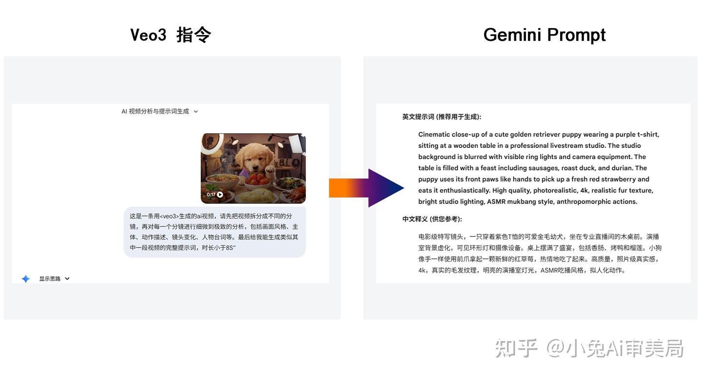
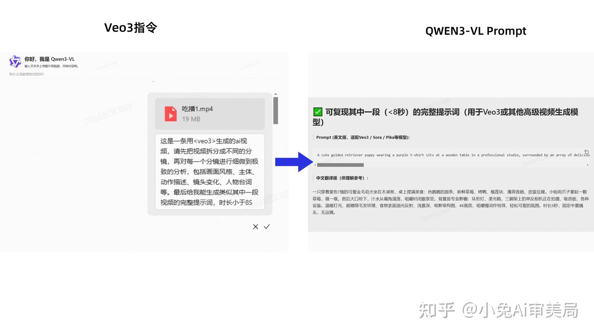

# AI 视频提示词反推技术指南：基于多模态模型的逆向工程

> 将参考视频交给支持视频理解的多模态模型，先拆分镜头并提取主体、动作、镜头、光影和材质，再转换为适配目标视频生成模型的结构化 Prompt，通过重新生成和对比迭代获得近似视觉效果。

<!-- more -->

作者：小兔 AI 审美局

## 核心原理：视觉语义映射

视频提示词反推不是恢复生成原视频时使用的真实 Prompt，而是通过视觉理解获得一个可解释、可修改的近似描述。基本链路分为三层：

1. **输入层**：上传参考视频或截取的关键片段。
2. **理解层**：多模态模型识别分镜、主体、环境、动作、镜头语言、光影、材质和节奏。
3. **输出层**：将视觉特征整理为适配 Veo、Sora、Runway、Kling 等生成模型的结构化 Prompt。


反推结果应被视为“视觉规格初稿”，而不是原始 Prompt 的精确还原。它可以帮助复现构图逻辑和主要动态，但随机种子、模型能力、隐藏参数、参考图和后期处理等信息通常无法从成片中完整恢复。

## 方案一：使用 Gemini 深度分析

该方案适合镜头语言复杂、光影变化明显或需要完整时序分析的视频。

1. 打开支持视频输入的 Gemini 版本。
2. 上传 MP4 等受支持的视频文件。
3. 提交结构化分析指令，并将目标生成模型写入指令。
4. 检查模型输出的分镜分析和最终 Prompt。
5. 将 Prompt 输入目标视频生成模型，生成候选结果。
6. 对照参考视频修订动作、镜头、时长和约束，再次生成。



## 方案二：使用 Qwen-VL 快速分析

该方案适合国内网络环境、快速试验或希望使用开放模型生态的场景。

1. 在 ModelScope 等平台选择支持视频理解的 Qwen-VL 模型或演示空间。
2. 上传视频文件并提交同一套结构化分析指令。
3. 检查输出是否正确识别主体、动作和镜头关系。
4. 将描述转换为可灵、即梦或其他视频生成模型需要的格式。
5. 用生成结果反向校正描述中缺失或错误的视觉要素。



具体模型版本和视频输入能力会持续变化，使用时应以平台当前文档为准。

## 通用逆向提示词

原文提供的提示词可以整理为以下模板：

```text
这是一条使用 <TARGET_MODEL> 生成的 AI 视频。

任务：
1. 按镜头切换、场景变化或动作阶段拆分视频。
2. 对每个分镜分析以下维度：
   - 画面风格与视觉媒介
   - 主体、服装、道具和环境细节
   - 动作、速度、方向和时间关系
   - 景别、机位、焦段感和镜头运动
   - 光源、色彩、材质、景深和氛围
3. 标记镜头之间必须保持一致的主体与场景特征。
4. 输出一段适配 <TARGET_MODEL> 的完整视频生成提示词。

约束：
- 目标时长小于 8 秒。
- 不添加视频中没有证据支持的关键元素。
- 区分确定观察、合理推断和不确定信息。
- 只输出分镜分析和最终 Prompt。
```

`<TARGET_MODEL>` 应替换为实际使用的生成模型。不同模型对时长、镜头指令、负面提示词、参考图和参数的支持不同，最终 Prompt 需要按目标模型的语法和能力调整。

## 提高反推质量的方法

### 先处理视频，再调用模型

- 长视频先截取关键片段，降低时序理解负担。
- 快速混剪按镜头切分后逐段分析。
- 保留足够清晰度，避免压缩造成主体和材质误判。
- 对关键帧另外导出图片，用于检查人物、物体和场景一致性。

### 将分析与生成分开

第一轮只做观察和分镜，不急于生成 Prompt；第二轮把经过人工校正的视觉规格转换为目标模型格式。这样可以减少模型在“看见什么”和“应该怎么写”之间相互污染。

### 用结果建立闭环

至少生成多个候选结果，并按固定维度比较：

- 主体和构图是否一致。
- 动作的起点、终点和节奏是否正确。
- 镜头运动是否与主体运动冲突。
- 光影、材质和色彩是否接近。
- 是否出现 Prompt 没有要求的额外对象或镜头切换。

每轮只修改影响最大的差异，避免同时改动过多变量而无法判断改进来源。

## 适用边界

- 无法保证 100% 还原，反推只能得到近似视觉规格。
- 清晰、单一主体、镜头逻辑连续的视频更容易分析。
- 抽象艺术、快速混剪、长视频和复杂遮挡会显著增加误差。
- 输出风格不仅取决于分析模型，也取决于提示模板、目标生成模型和采样参数，不能简单归因于某个模型的训练语料。
- 复刻他人作品时应注意版权、肖像、商标和平台政策，不应把该方法用于冒充原创或未经许可复制受保护内容。

## 归档说明

原文末尾包含点赞、关注公众号和领取飞书资料的推广内容，归档时已删除；知乎自动生成的实体跳转链接也已清理，保留核心方法和提示词模板。
