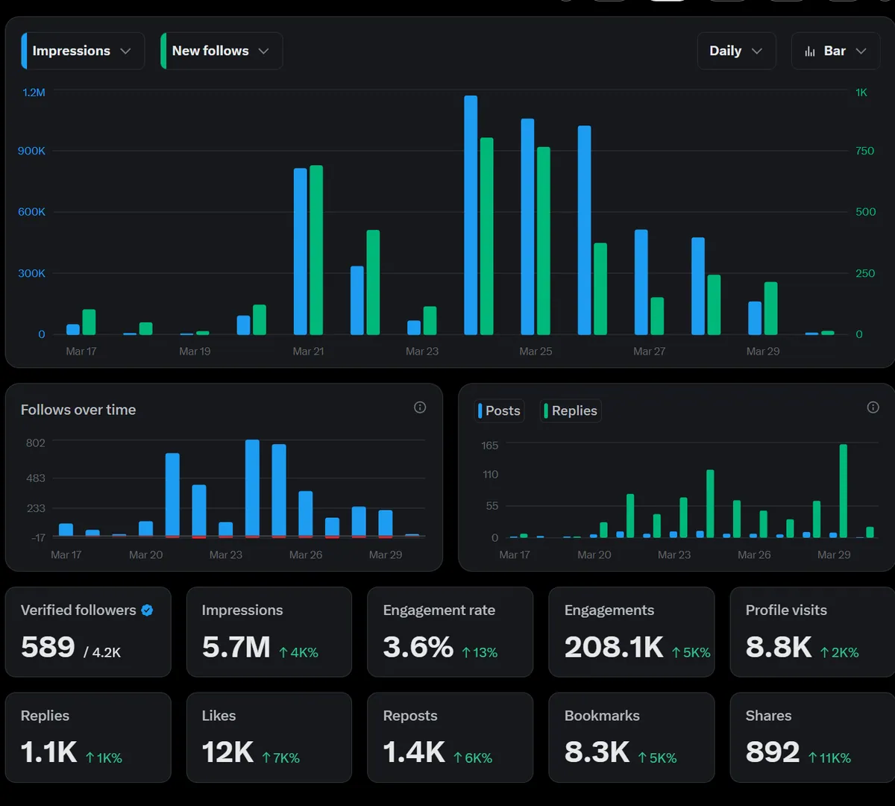
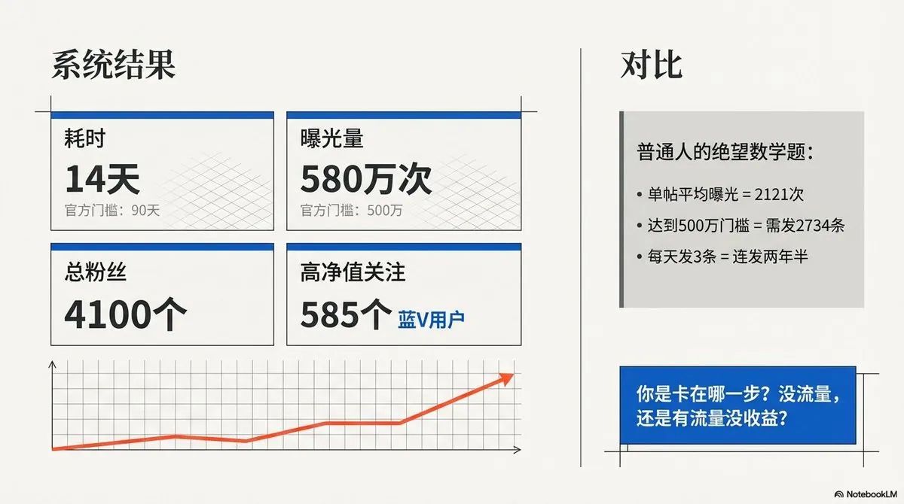
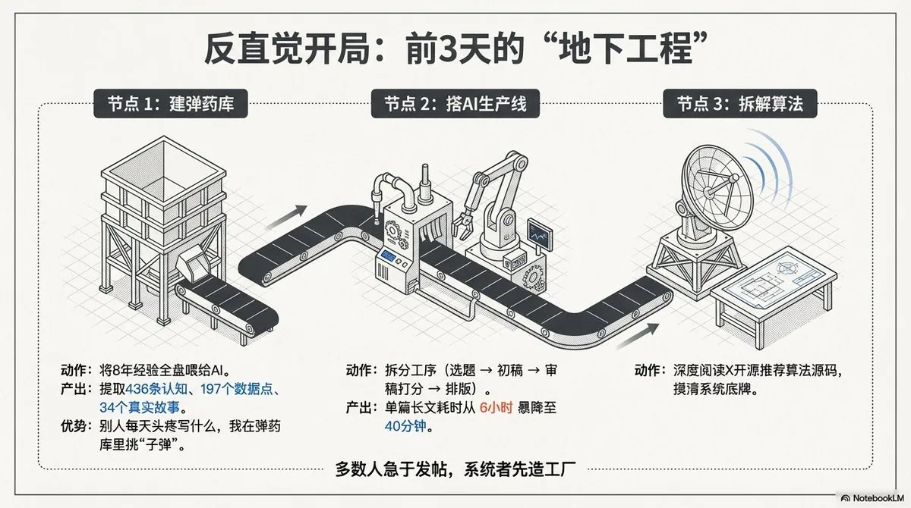
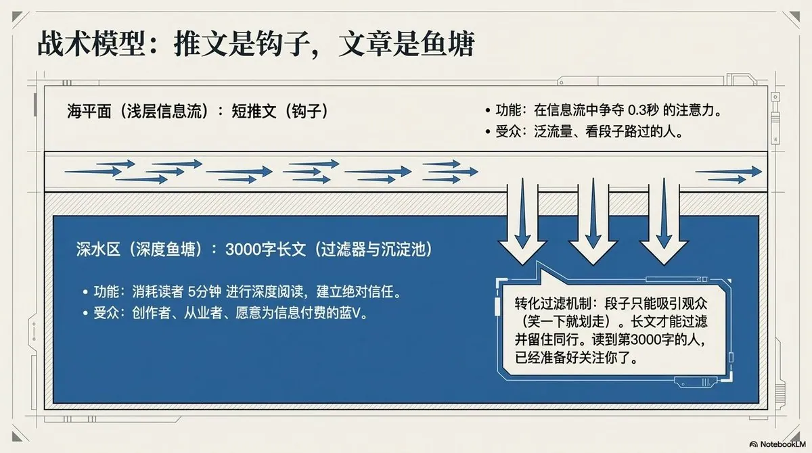
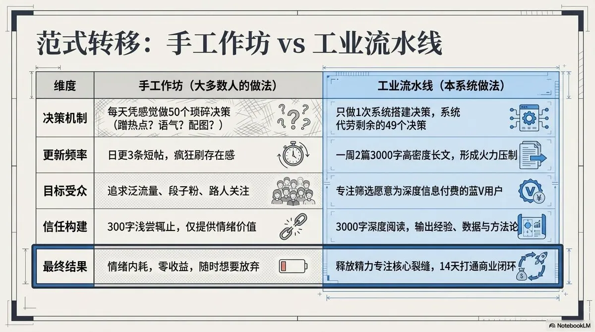
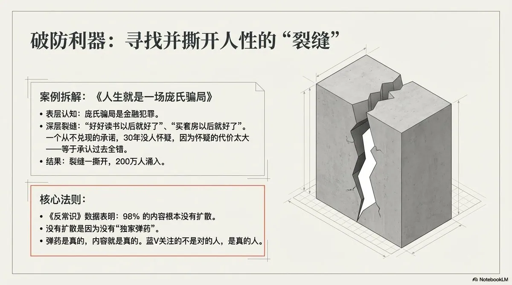

# Koda（@wadezone）：我前 3 天一个字没发，然后 14 天开通了创作者收益

> X（Twitter）创作者收益冷启动 14 天速通路径：前期保持沉默做深度对标与受众画像摸底，通过高质量引用互动、高频借势与垂直干货连更，在 14 天内达成 500 万次展示量并成功开通美金创作者收益分成。

<!-- more -->

14 天。

从第一条帖子到开通创作者收益。

4100 个粉丝。580 万次曝光。585 个蓝 V 关注。

正常情况下这个周期是 9-18 个月，而我只用了 14 天。

但是今天我想分享给你的

不是教程，是系统。

这套系统，让我绕开了一个 99%的人都不知道的坑。

你知道开通 X 创作者收益有多难吗？

两个硬门槛：90 天 500 万次曝光，500 个蓝 V 粉丝。

先说蓝 V。全平台 5.6 亿人，蓝 V 不到 1%。四百个人里挑一个。

再说一个很多人不知道的事——普通粉丝关注你、给你点赞、帮你转发，一分钱收益都不产生。零。只有蓝 V 的互动才算钱。而且蓝 V 在算法里的权重是普通用户的 4 倍。

你辛辛苦苦做了半年，涨了 1 万粉丝。打开收益页面，0.00。你以为是自己内容不好。

不是。你的内容可能很好。但你的 1 万粉丝里只有几十个蓝 V。

你吸引的人群，不对。

X 上一条帖子平均曝光 2121 次。要攒够 500 万，得发 2734 条。一天发 3 条，连着发两年半。

大多数创作者花 6 到 12 个月过这个门槛。

我发了 14 天。

你是卡在哪一步？没流量，还是有流量没收益？评论区说，我来帮你拆。

讲一个跟 X 完全无关的故事。

2017 年，一个程序员辞职做跨境电商。零基础，零资源。

夏天在仓库打包，闷热，汗从额头滴到纸箱上，纸箱角都软了。凌晨一两点才收工。冬天骑电动车送货，雨打在脸上，眼睛睁不开，手冻得握不住刹车。

前 3 个月，每天只出 1 单。算了一下成本，每单还亏钱。不知道下个月房租从哪来。

这个人是我。

熬过来了。

后来 8 年做了两件看起来完全不搭的事。

Facebook 广告投放，累计广告消耗超过 1000 万美金。

这件事教会我一个本事——如何让一个人在划过屏幕的 0.3 秒内停下来。

这个本事有个名字，叫钩子。钩子不行，5 万美金一天烧光，连个水花都没有。你试过花 5 万美金买一个教训吗？我试过不止一次。1000 万美金烧下来，钩子怎么写、图片用什么颜色、第一句话放什么词——这些东西刻进了直觉里。不是看书看出来的，是拿钱喂出来的。

YouTube 频道运营，2 年做到 3 万订阅，收了 1500 个学员，变现超过 300 万。

1500 个学员，每一个都是在前 3 分钟决定信不信我的。信任不是靠“说得对”建立的，是靠“他懂我”建立的。

两件事，一个花钱买流量，一个免费做内容。能有什么关系？

关系大了。

本质是同一件事——内容营销。

Facebook 教会我抓注意力。YouTube 教会我建信任。

抓注意力+建信任——做内容就这两件事。

平台会变，工具会换，但这两个能力不会过期。

我在 X 上 14 天做到的事，不是从 14 天前开始的。

是从仓库里那个凌晨开始的。

但 8 年经验不能直接搬。

格式不一样，算法不一样，用户不一样。107 篇公众号、81 个 YouTube 视频，散在各处，直接搬过来没法用。

所以到了 X，我做了一件反直觉的事。

前 3 天。一个字都没发。

所有人都在喊“赶紧发内容”。我去搭了一条流水线。

第一件：建弹药库。 8 年的内容全喂给 AI。提炼出来 436 条认知、197 个数据点、34 个真实故事。这些东西是投 1000 万美金广告烧出来的直觉，是做 1500 个学员踩出来的坑。网上搜不到。

别人在想今天写什么的时候，我在弹药库里挑今天用哪颗。

第二件：搭 AI 生产线。 找选题的、写初稿的、审稿打分的、排版发布的，各管一段。就说庞氏骗局那篇——以前这种长文我得写 6 个小时。这套系统跑下来，40 分钟出初稿，3 小时发出去，跑了 200 万曝光。

第三件：拆算法。 X 的推荐算法是开源的。我读了源码。

几条关键规则——蓝 V 互动权重 4 倍。回复的算法权重是点赞的 13.5 倍。长内容权重高于短内容。

还有一条——带外链的帖子，几乎零分发。

这条规则害了多少人。你写了一条好帖子，底下放个链接引流，算法直接把你曝光砍到接近零。你以为是内容不行。

不是内容不行。是你给算法喂了一颗毒药。

有个博主写过一篇文章，把 X 文章的底层逻辑扒了个干净。

我看完以后确认了一件事——在 X 上，文章就是 X 的天龙人。

三个特权。

第一，收益权重最高。官方确认的。同样的曝光，文章产生的收益比普通推文高一截。

第二，无限编辑，数据不清零。普通帖子发出去只能改 5 次，超时锁死。Article 没有这个限制。你发出去以后觉得第三段不好？改。一周后找到更好的例子？换上去。所有的赞、转发、曝光全部累加。一篇文章可以像滚雪球一样越改越大。

第三，流量无损传导。你发一条短推文引用自己的长文章，推文拿到多少曝光，文章同步拿到多少。引用别的内容类型？有损耗。

所以我的策略就四个字——

推文是钩子，文章是鱼塘。

短推文在信息流里抓住 0.3 秒的注意力。长文章在 3000 字里一点一点建立信任。

还有一个好处。你想想，愿意花 5 分钟读完 3000 字的人，和刷到一条段子笑一下就划走的人，是同一种人吗？

不是。

前者是创作者、是从业者、是愿意为信息付费的人。

几乎全是蓝 V。

段子吸引观众。长文吸引同行。

你有没有做过这种事——

每天日更。3 个月。粉丝破千了。

兴奋地打开收益页面。

零。

那一刻你心里在想什么？“我是不是不适合做这个？”

不是你不适合。

是你每天在做 50 个决策——今天写什么？用什么语气？蹭不蹭热点？这张图发不发？

50 个决策，每个都可能错。

我一周发 2 篇。

但每篇 3000 字。信息密度顶得上 30 条普通推文。

长文有一个短帖做不到的事——让读者读到第 1000 字的时候，已经对你产生了信任。读到第 3000 字的时候，已经准备关注了。

300 字做不到这件事。300 字只够让人笑一下。

信任只在深度阅读中产生。

你在用手工作坊的方式，跟流水线竞争。

到第 8 天。蓝 V 浓度 14.3%。

什么概念？全平台蓝 V 不到 1%。1 万粉丝里正常只有几十个蓝 V。我每 7 个粉丝里就有 1 个蓝 V。

因为我写的每一篇，都只回答同一类人的问题——已经在做内容、已经在付费订阅、想知道怎么做得更好的人。

这群人不看段子。不看语录。不看“早安打卡”。

他们只看一种东西——你做到了什么，以及你是怎么做到的。

有数据。有经历。有方法。

缺任何一个，蓝 V 划走。

蓝 V 不关注对的人。蓝 V 关注真的人。

8 年跨境电商浓缩成两句话：

粉丝数不值钱，粉丝质量才值钱。

流量不值钱，信任才值钱。

585 个蓝 V。每一个都是愿意为信息付费的人。

这 585 个人，比 10 万个随手刷到你的路人有价值得多。

邓肯·瓦茨在《反常识》里追踪了 160 万用户发起的 7400 万条传播链。结论是——98%的内容，根本没有扩散。零。只有几十条突破了千次转发。

你的内容为什么在那 98%里？

因为大多数人写内容，是在表达自己的观点。

但让内容扩散的，从来不是观点——是裂隙。

裂隙是什么？是读者看完之后，突然发现自己过去信了 30 年的一件事，可能是错的。

我庞氏骗局那篇的裂隙是这个：

「好好读书以后就好了。买套房以后就好了。三十年了，“以后”从来没来过。」

这句话让评论区炸了。不是因为写得好。

是因为有人看完之后，突然想起自己也被这个“以后”骗了 30 年。

他转发，不是在夸我——是在用我的话，说他自己说不出口的话。

、X 上一个转发的算法权重，等于 20 个点赞。

点赞是掌声。转发是炮弹。

你写内容，到底是在要掌声，还是在要炮弹？

在一个完全陌生的平台上，14 天从零建立了信任。

很多人觉得 AI 让内容创作变成红海——人人都能写，竞争更激烈。

但是反过来说，AI 让所有人都能生产内容。

但生产内容和生产让人忍不住转发的内容，是两件完全不同的事。

AI 产出越多，读者越麻木，注意力越稀缺。

这时候有真实积累、有独家弹药的人，反而像黑暗里的火把——被衬托出来了。

X 现在甚至会在 AI 内容转发前弹预警提示。这不是在打压 AI，是在奖励真实。

你有没有发现——你最近忍不住转发的内容，没有一篇是 AI 味的。

AI 降低了生产门槛。但同时抬高了被信任的门槛。

兴一利，必然生一弊。这两个门槛反向运动，中间的空隙，就是你现在的机会窗口。

问题是——窗口不会永远开着。

中文 X 现在竞争对手只有几千人。

你在微博发同样的内容，要跟几百万人竞争。这不是能力的差距，是时机的差距。

时机这种东西，错过了就是错过了。下一篇，我把这套系统的完整流程拆给你看——

从怎么找到一个注定会爆的选题，到怎么让 AI 帮你写出读者闻不出 AI 味的文章。5 步，完整流程。

关注 @wadezone，别错过。

你现在缺的是弹药，还是系统？评论区说，我帮你拆。

## 相关页面

- [[sources/ai-jasonyu-x-creator-revenue-complete-guide]]
- [[sources/wadezone-2026-ordinary-person-1m-guide]]
- [[sources/ai-chuhai-x-viral-writing-engine]]
