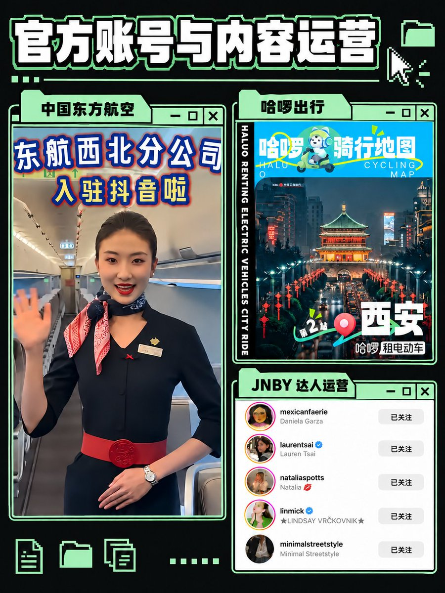

# 汪仔（@wangzaimedia）：为什么你发了那么多内容，还是没有客户？

> 自媒体内容创作者高频输出却无法变现的病根诊断：直击「只有干货自嗨、缺乏信任抓手、没有购买理由与缺少清晰 CTA」等核心痛点，给出从「展示专业度 → 建立人格魅力 → 制造紧迫感 → 引导成交」的后端转化纠偏策略。

<!-- more -->

辞职三周，我赚到了过去三个月的工资。

创业后的第一桶金，几乎都来自私域。

我没有复杂的销售流程，也没有专门投广告。因为做了十年自媒体和三年企业营销，我一直有在朋友圈营销的动作，已经成了我的肌肉记忆。

我一直在告诉别人：我是谁，我在做什么，我能解决什么问题，为什么值得选择。

有人看了我的朋友圈，有人看了我的文章，也有人通过朋友认识我。等他们遇到相关问题时，就会主动来找我。

很多人每天发内容，账号也有流量，最后还是没有客户。

因为内容解决了“让别人看见你”，营销还要继续解决：

- 谁需要你；
- 你能解决什么问题；
- 你的服务有什么价值；
- 对方为什么现在选择你。

内容和成交之间缺少的部分，叫营销。

## 一、营销从研究客户开始

很多人一开始就介绍自己：

我是谁，我学过什么，我做过什么，我会哪些技能。

这些内容可以建立信任，但客户更关心的是自己的问题：

- 我的内容为什么没人看？
- 我怎样通过内容获得客户？
- 我怎么把 AI 接入现有业务？
- 我有专业能力，怎么把它做成服务？
- 我已经开始发了，下一步该怎么调整？

营销要从客户的处境出发。

你需要知道他正在经历什么，已经尝试过什么，为什么迟迟没有解决，以及他愿意为什么结果付费。

## 二、定位让客户知道你能帮他什么

定位不是给自己起一个好听的职业名称。

定位要让客户迅速理解：

你帮助哪一类人，解决哪一个具体问题。

我现在做的是创始人 IP、AI 营销和内容获客咨询。

这句话背后包含了服务对象、工作内容和客户结果。

如果你只说“我做自媒体”“我懂 AI”“我提供咨询”，客户很难判断你和自己有什么关系。

## 三、客户购买的是结果

你写了多少篇文章、研究了多少工具、熬了多少夜，客户不会直接为这些事情付费。

他愿意付费，是因为你可以帮他：

- 节省时间；
- 减少试错；
- 获得客户；
- 增加收入；
- 搭建一套自己做不出来的系统；
- 从混乱的状态进入下一步行动。

我之前帮在加拿大做语言培训的客户下载整理了他以往所有的小红书贴文，有几千张图片以及文案。我用 AI 帮她整理了一个文案智能体出来，大大提升内容获客的效率。

## 四、内容要展示你的判断

客户在购买前，会观察你：

- 怎样理解问题；
- 怎样做判断；
- 服务过什么人；
- 怎样解决问题；
- 有没有真实经验。

所以你可以持续写：

- 一个客户到底卡在哪里；
- 你如何设计一次咨询；
- 你拒绝过什么需求；
- AI 接入业务以后改变了哪个环节；
- 你为什么选择某一类客户；
- 你如何判断一个内容选题值不值得做。

内容让客户看到你的能力，营销让客户理解这项能力和自己有什么关系。

## 五、营销需要把信息说完整

客户需要知道：

- 你是谁；
- 你服务谁；
- 你解决什么问题；
- 你做过哪些类似的事；
- 你提供什么服务；
- 价格是多少；
- 应该怎样联系你。

很多人持续更新内容，却没有服务介绍；文章里讲了很多方法，却没有说明自己能帮谁；朋友圈很热闹，却没有给出下一步。

客户即使产生了兴趣，也不知道如何行动。

## 六、营销也是一种筛选

你不需要让所有人都成为客户。

你需要让真正有需求、愿意付费、认可你工作方式的人找到你。

持续表达自己的判断、案例和服务边界，会自然筛掉一部分人，也会吸引更合适的人。

我创业后发现，商业并不需要你讨好所有人。

你只需要让合适的人清楚地知道：

你是谁，你能解决什么问题，以及为什么值得选择。

最后，你可以检查自己的主页：

一个第一次认识你的陌生人，看完最近三条内容以后，能不能说出你是谁、服务谁、解决什么问题，以及应该怎样向你付费。

如果不能，在继续发内容之前，先把营销这门课补上。

## 相关页面

- [[sources/wangzai-personal-ip-three-word-mantra-copy-surpass-monetize]]
- [[sources/situking-entrepreneurship-100-qa-for-creators-and-solopreneurs]]
- [[concepts/selfmedia-compound-model]]
- [[concepts/b2c-conversion]]
