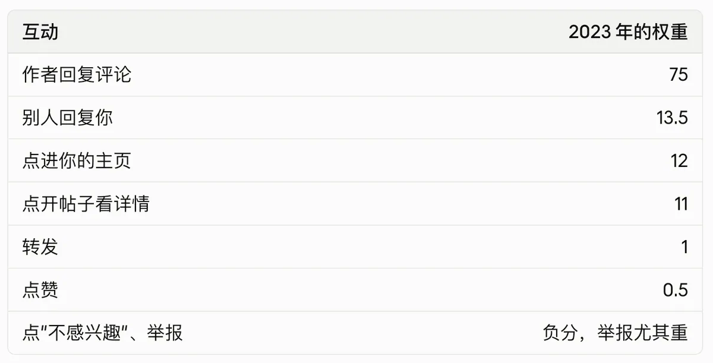

# 汪仔（@wangzaimedia）：从 0 到 1 的 X 入门运营指南

> 面向普通自媒体人的 X（Twitter）冷启动实战拆解：从账号形象设置、推文结构、互动策略、优质内容选题模型，到如何通过高质量 Quote、大 V 评论区借势引流与长文排版建立个人 IP 矩阵，跑通从 0 关注到精准粉丝转化的第一步。

<!-- more -->

我从今年 7 月 11 日开始认真发 X，到现在发了 4854 条帖子，总曝光 560 万，2.7 万个点赞，2500 次转发。

最近很多朋友问我，X 怎么做？

我发现，很多在国内做过自媒体的人，一到 X 就水土不服。原因很简单：他们把小红书和抖音的那一套，原封不动地搬了过来。

可 X 是一个完全不同的平台。

一、先搞清楚，X 和国内平台哪里不一样

1. 界面不一样

打开抖音和视频号，是一条条全屏视频，上滑下滑。打开小红书，是两列封面，挑一个点进去。

打开 X，是一条从上往下滚的文字信息流。每条帖子直接摊开在你面前，不需要点击。

2. 平台看重的东西不一样

- 小红书：最看重点击率。封面和标题好不好，决定了有没有人点进来
- 抖音和视频号：最看重前三五秒的完播率。开头留不住人，后面拍得再好也没用
- X：最看重互动。有没有人回复你、引用你、把你的帖子分享出去

3. 内容形式不一样

X 是文字平台，一条帖子最多只能放 4 张图，或者 1 个视频。它主推的是贴文和长文，想到一个观点，直接写下来就能发。

所以 X 的创作成本很低，对会写字的人特别友好。不用拍视频，不用做封面，也不用剪辑。

4. 转发是公开的

在国内，我们转发一篇内容，大多是私下发给朋友，或者转到群里。

X 鼓励的是公开转发，而且有两种：一种是直接转发，一种是引用转发，也就是转发的同时写上自己的评论。引用转发会变成一条新的帖子，出现在你的粉丝面前，等于帮原帖又曝光了一次，还可能在你这里引出新的讨论。

所以 X 很像早些年的微博，人和人之间的互动特别多。

5. 关系不一样

在国内平台，你发内容，更像是对着一个看不见的观众说话。在 X 上，你发出去很快就会收到回复和讨论，更像在和一群人聊天。我在这里认识了很多创作者和 AI 创业者，还线下见面、谈成了业务。

二、X 的算法，到底奖励什么

我在一个线下课上学到过一张推特的算法权重表，来自 X 在 2023 年公开的推荐算法：

这些分数，乘的是算法预测“这条帖子会引发这种互动”的可能性，不是简单地把实际的点赞、回复数加起来。

2026 年 1 月，X 重新开源了一套用 Grok 驱动的新算法，整个系统都重写了，具体权重没有完全公开。所以这张表里的数字只能当参考，不要当成现在的规则。

不过大方向一直没变，翻译成大白话，就是三件事：

1. 写让人想回复的内容。 回复和讨论，一直比点赞重要得多。能引发讨论、让人想讲自己经历的内容，算法最喜欢
2. 认真回复评论。 你回一条，对方可能再回你，一来一回，帖子下面就有了真正的讨论。X 上活跃的大号，几乎都保留着回复每条评论的习惯
3. 写别人愿意转出去的内容。 别人愿意引用你、把你的帖子分享给别人，说明这条内容对他有用

三、冷启动：可以借力，但别互关

刚开始没人看，很正常。

冷启动的时候，可以请一个认识的大 V 帮你转发一次，帮你突破第一个流量池。

但后面的增长，全部要靠死磕内容。

我不建议互相艾特、开火车这种做法。平台本身不鼓励这种互刷，而且这样换来的互动，不是别人真的对你感兴趣，来的人也不精准。

四、死磕内容

1. 先多发

没形成流量手感之前，唯一的办法就是多发。我刚开始的时候，有时一天要发几十上百条来试错。

发什么？客户和网友问你的问题、你对自己业务的思考、对标账号的选题、让你有触动的一句话。

发得多了，你会很清楚地感觉到：哪些内容有人回复，哪些会被转发，哪些发出去没有一点反应。

2. 选题决定流量上限

写作技巧只能决定你能不能把一件事说清楚，选题才决定有多少人关心这件事。

我流量最好的几条，几乎都和赚钱、销售、创业有关。因为人的核心欲望就那么几个：赚钱、亲密关系、健康。选题只要和很多人的真实欲望有关，流量上限就高。

不要只写“我今天做了什么”，要站在读者的角度想：他为什么要关心这件事？

3. 把经历变成方法

我不只写“我辞职以后赚到了钱”，我会写“我到底做了什么，才在辞职当天完成了第一次成交”。

当你的经历变成了别人也能用的方法，它就不再只是自我表达。内容本身有价值，别人自然会转发，不需要专门去求。

五、进阶

怎么用“抄、超、钞”从模仿走到自己的风格，我之前写过一篇《个人 IP 的三字真经：抄，超，钞》；[https://x.com/wangzaimedia/status/2109485189357306357?s=20](https://x.com/wangzaimedia/status/2109485189357306357?s=20)

怎么用 AI 协作、把一条内容变成一组内容，可以看《一鱼多吃内容生产系统》。这里就不重复了，感兴趣可以直接去看。

https://x.com/wangzaimedia/status/2106230111087518139?s=20

六、蓝 V 会员和创作者收益

1. 蓝 V 是什么

X 上的蓝 V，就是付费会员 X Premium。会员有三档：

档位 大约价格 主要区别 Basic 每月约 3 美元 能编辑帖子、发更长的内容，但没有蓝 V，也不能参与收益 Premium 每月约 8 美元 有蓝 V，回复会被优先展示，能看数据分析，可以参与创作者收益 Premium+ 每月约 40 美元 在 Premium 基础上，回复更靠前、没有广告、AI 用得更多

价格会因为国家、网页和手机端而不同，App 里通常更贵，开通前以官网为准。

想认真做 X，我建议至少开 Premium：一是有了蓝 V，你的回复会排得更靠前，更容易被看到；二是没有它，就拿不到平台的创作者收益。

2. 创作者收益怎么拿

X 现在的创作者收益，叫“原创内容奖励计划”。官方写的申请条件是：

- 过去 90 天内，你的原创帖子在认证用户的首页信息流里，获得 50 万次曝光。回复不算
- 至少有 500 个蓝 V 认证粉丝
- 持续发原创内容
- 保持 Premium 会员

而且，一条帖子至少要在屏幕上露出一半，才算一次有效曝光。同一个人反复看、付费推广和刷出来的曝光，都不算。

满足条件可以申请，3 个工作日内会出结果。符合条件不代表一定通过，没通过可以申诉一次。

3. 这套规则透露了什么

- 只算蓝 V 用户的曝光。 你的内容被普通用户看到，不计入收益。所以 X 后台会单独显示一个“认证曝光”。我的总曝光是 560 万，其中蓝 V 用户的曝光有 440 万
- 回复不算。 靠在大号评论区刷存在感，拿不到收益。平台要的是你自己写的原创帖子
- 叫“原创内容奖励”。 名字已经说明了平台想要什么：原创，不是搬运

最后

增长是指数级的，前面很慢，过了某个点以后会突然加速。

等你在蓝 V 用户里攒够了曝光和粉丝，平台还会给你真金白银的奖励，让创作进入流量、收入、增长的正向循环。

如果你想开始，今天就发第一条吧。

## 相关页面

- [[sources/weiyux-x-account-zero-to-one-guide]]
- [[sources/xiaowan-x-account-startup-strategy-3000-followers]]
- [[concepts/selfmedia-compound-model]]
- [[concepts/b2c-conversion]]
