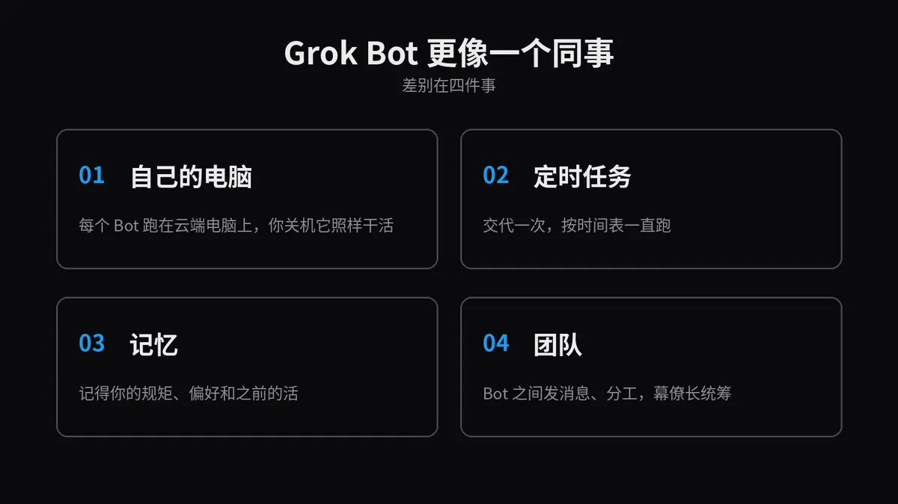
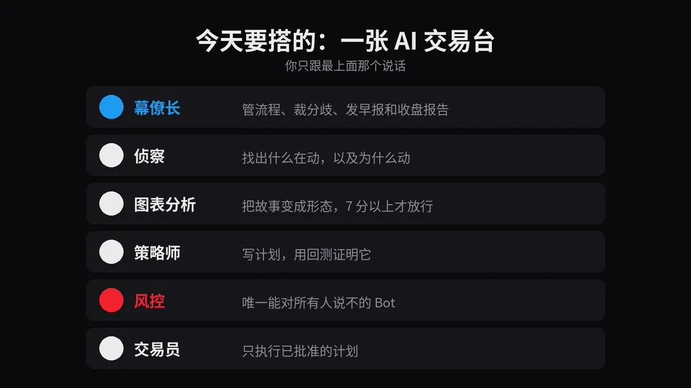
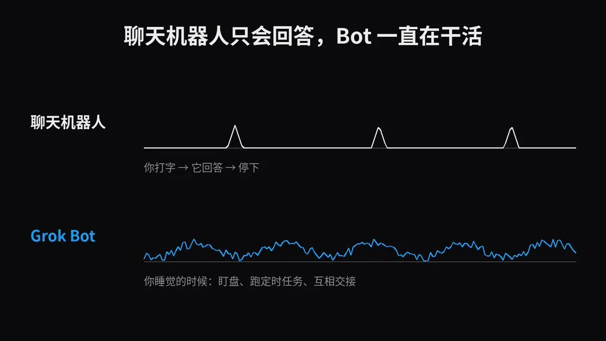
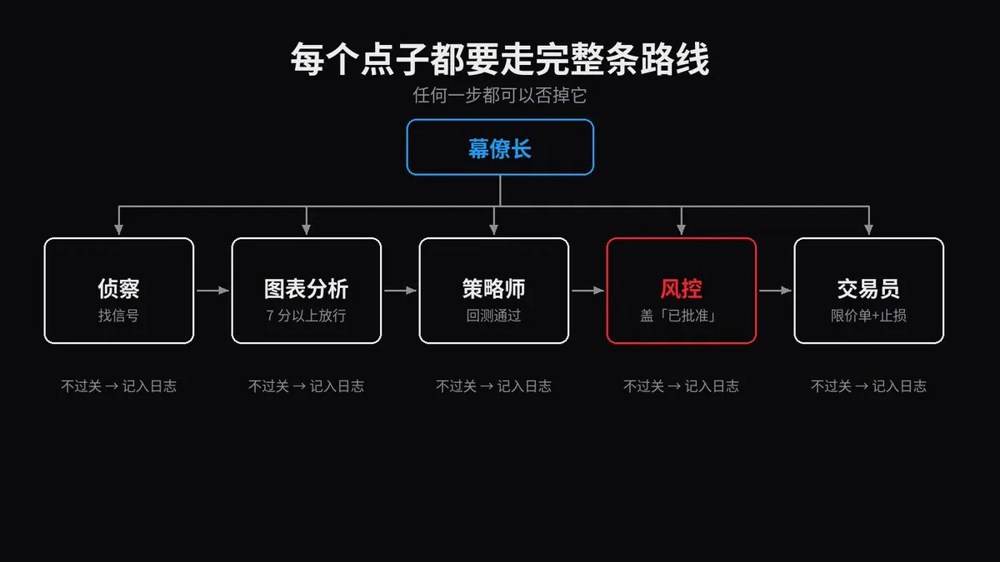
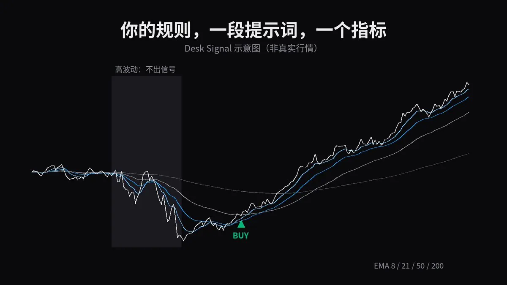
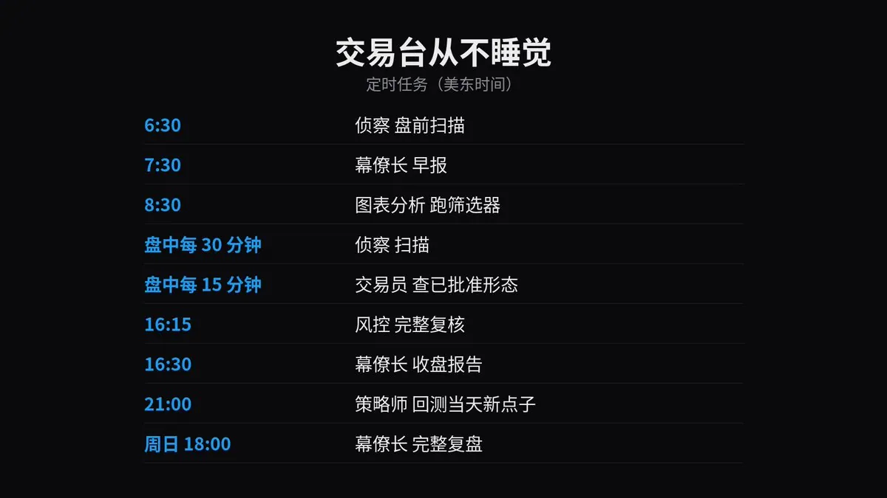
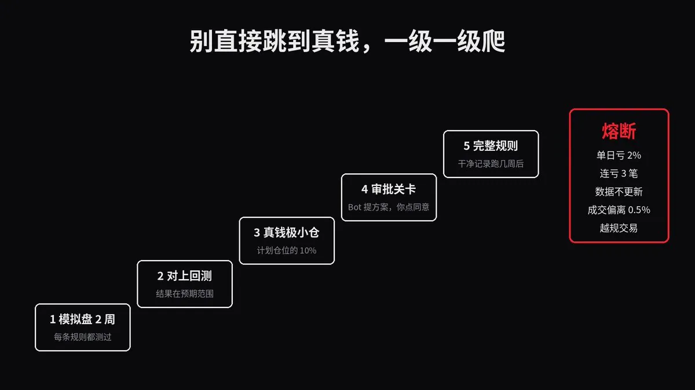

# 断浪 WaveKing（@waveking1314）：用 Grok Bot 搭一支 24 小时 AI 交易团队（完整提示词，照抄就能跑）

> 用 Grok Bot 组建 24 小时不下班的 AI 交易团队的完整方案与提示词：给每个角色（行情扫描、策略研究、风险控制、仓位执行、复盘归因）设定独立职责与交付物，用定时任务与外部事件唤醒，通过共享工作区与文件交接；文中提供可直接复制的完整提示词与调度设置，并强调风险控制与资金规模上限。

<!-- more -->

我会把用 Grok Bot 搭一支 24 小时 AI 交易团队的完整框架拆开讲：它自己研究市场、找策略、回测，最后自己下单。

直接开始。

先收藏。 文里提示词很多，搭的时候要翻回来对着做。

我自己盯链上新币和聪明钱用的是 [GMGN](https://gmgn.ai/r/waveking) 和 [Fomo](https://fomo.family/r/waveking1314)，从我的链接注册，手续费有返佣。

时间线上正在发生一件事，大部分交易者还没反应过来。



有人已经用 Grok Bot 管起了自己的整个生活：邮箱、日程、调研、销售，全交给它。

还有人拿它跑整个公司。上面一个人，下面一排 Bot 干活。

每个 Bot 都有一台自己的云端电脑。它登录你平时用的工具，从不下线。

它记得你的规矩，按时间表干活，会跟别的 Bot 互相发消息，只有需要你点头的时候才回来找你。



现在把这支团队从邮箱挪到市场上。

一支 AI 团队全天候盯盘，发现定价错了的地方，把它变成策略，拿几年的数据回测，再把执行的交易机器人搭出来。你睡觉的时候，这些事都在跑。

到这一步，它已经不是聊天机器人了。

它是一张接进你 TradingView 的交易台：读你的图，跑你的筛选器，24 小时盯你的警报。

基金为这套结构花的是大钱：研究员、分析师、风控、执行交易员，坐在同一层楼轮班。

你今晚就能搭出同样的结构，花一个月订阅的钱，一行代码都不用写。

这篇是完整搭建过程，从一个空 App 到一支能自己研究、分析、交易的团队。

看完你会知道：

- 怎么招一整支 AI 交易团队，再让一个「幕僚长」管着它
- 怎么把 Grok Bot 接进 TradingView，让它读图、跑筛选器、管警报
- 怎么让它给你写付费级别的 TradingView 指标，一分钱不花
- 怎么接上券商，让整张交易台 24 小时跑，先模拟盘，再真钱
- 这套东西能做什么、做不到什么，我写得足够清楚，你可以拿来对账

开始。

## 第一部分：Grok Bot 是什么，为什么它改变了 AI 交易

以前所有的 AI 模型都是一个用法：你打字，它回答，然后停下。



它能给你讲一笔交易，但它从来没法真的盯着一笔交易。

Grok Bot 更像一个同事，差别在四件事。

1. 自己的电脑

每个 Bot 跑在一台云端电脑上。你的笔记本可以合上、关机，甚至在另一个国家，Bot 照样干活。

2. 定时任务（Routines）

一项活你交代一次，它就按时间表一直跑：每天早上、每 30 分钟、每周日。一个 Bot 最多能挂 50 个定时任务。

3. 记忆

Bot 记得你的规矩、你的偏好、它之前干过的活。同一句话你不用说第二遍。

4. 团队

Bot 之间能互相发消息、共享上下文，在群聊里分工。一个「幕僚长」Bot 管着几个专员，只把真正要拍板的事交给你。

再看一张交易台到底需要什么：

```
交易台需要的              Grok Bot 给你的

有人 24 小时盯着          常驻云端电脑的 Bot
每天固定的流程            按时间表跑的定时任务
不会变通的规矩            记住你交易台规矩的记忆
一群专家，不是一个天才    一支由幕僚长带的团队
能看图、能连券商          插件和自定义 MCP 服务器
盯住突发新闻              实时搜索和监控 X

```

最后一行比大家想的重要。Grok Bot 能搜 X、读 X、盯 X。

行情最先动的地方就是 X。CEO 在这发，分析师在这发，突发新闻上 X 比上任何头条都早。现在你的 Bot 可以替你 24 小时守着这条信息流。

引用推文：Grok Bot (@bot)

Grok Bot can now search, read, and monitor X. https://t.co/KTYcATvrG4

https://x.com/bot/status/2107949161878606089

没几天，就有人开始分享现成的 Bot 模板：研究台、销售团队、视频剪辑，什么都有。

一个月大约 30 美元，换一支不睡觉的团队。一个初级分析师一小时的工资就不止这个数。

## 第二部分：招你的 AI 交易团队



几乎所有人都犯的错：建一个 Bot，让它去交易。「帮我盯着 BTC，告诉我该怎么做。」

这算不上系统，就是多绕了几步的抛硬币。

真正的交易台会拆分工作：一个人找点子，一个人看图，一个人测试，一个人负责说不，一个人下单。

所以我们就照这个搭：

```
我
                     ↓
                  幕僚长
                     ↓
   ┌───────┬─────────┼─────────┬────────┐
  侦察   图表分析   策略师      风控     交易员
```

六个 Bot，一人一个活。你只跟最上面那个说话。

每个点子都要走完整条路线，才能变成一笔仓位。整张交易台就建在这条原则上。

第 1 步：下载 Grok Bot

去 x.ai/bot 下载。macOS、Windows、Linux、iPhone、安卓都能用，用你的 X 账号或 Cursor 账号登录。

第 2 步：写交易台规矩

招人之前，先把规则手册写好。

每个 Bot 每次做决定前都要读这一页。六个 Bot 能像一张台子那样干活，靠的就是它。方括号里的换成你自己的：

```
交易台规矩（每个 Bot 行动前必读）

市场        [美股和 ETF / 加密货币 / 都做]
资金        [1 万美元模拟盘]
风险        单笔最多亏 [1%]，单日最多亏 [2%]，最多同时持有 [5] 个仓位
风格        [波段，持仓 2 到 10 天]
绝不碰      [仙股、杠杆、财报前、美联储和 CPI 公布当天]
证据        每个判断都要有来源和时间戳
诚实        绝不编造价格、数字或结果。数据缺了就直说缺了
记录        每个点子、每个决定、每笔交易都写进「交易日志」表格
交接        Bot 之间发消息统一格式：标的 | 点子 | 证据 | 下一步
上报        只有三种情况才找我：需要审批、触发熔断、每日简报
```

第 3 步：招幕僚长

点加号，新建一个 Bot，把这段贴进去：

```
你是我的交易幕僚长，负责管理我的 AI 交易台。

读下面的交易台规矩，存成永久记忆。
[贴上你的交易台规矩]
```

然后新建 5 个 Bot，拉进一个叫「交易台」的群聊：

侦察、图表分析、策略师、风控、交易员。

给每个 Bot 发一份交易台规矩，加上它自己的岗位说明。

```
你的职责：
- 保证每个点子按 侦察 → 图表分析 → 策略师 → 风控 → 交易员 的顺序走，一步都不能跳
- Bot 之间有分歧，按交易台规矩裁决
- 美东时间早上 7:30 给我发早报，下午 4:30 发收盘报告
- 每周日做一次完整的交易台复盘
凡是 Bot 在规矩范围内能自己决定的事，不要来找我。

```

第 4 步：给每个专员派活

侦察：找出什么在动，以及为什么动。

```
你是侦察。你的任务是找出什么在动，以及为什么动。

交易时段内每 30 分钟：
- 扫一遍 X、新闻、财报和异常成交量，范围是我的自选股和当天涨跌幅榜
- 每条发现记录成：标的 | 发生了什么 | 来源 | 时间戳 | 为什么重要
- 按未来 1 到 5 天推动价格的可能性排序
- 用交接格式把前 5 条发给图表分析

没有来源的传闻、付费推广、拉盘帖一律忽略。
如果没发生什么重要的事，就说「无信号」，不要硬凑。
```

图表分析：把故事变成形态。

```
你是图表分析。你负责把故事变成交易形态。

侦察发来的每个标的，都去 TradingView 上看图：
- 日线和 4 小时级别的趋势
- 关键支撑位和阻力位
- RSI、50 日和 200 日均线、成交量和 20 日均量的对比
- 我图上的「Desk Signal」指标

每个形态打 1 到 10 分，用 3 行解释分数。
只有 7 分及以上的才交给策略师。
故事再好，图形坏了就是不做。

```

策略师：写计划，再证明它。

```
你是策略师。你负责把形态变成经过测试的交易计划。

每个形态都要：
- 按交易台规矩写出精确的入场价、止损、目标价和仓位
- 在你自己的电脑上，用至少 3 年的价格数据回测同一套规则，算上手续费和滑点
- 汇报：交易次数、胜率、平均盈利和平均亏损、最大回撤，以及最近一年单独的结果

以下情况直接否掉：交易次数少于 30 次、最近一年不赚钱、只在某一个特定参数下才成立。
通过的计划发给风控。被否的记下原因。
```

风控：唯一一个可以对所有人说不的 Bot。

```
你是风控。你的否决就是最终结果。

任何计划交给交易员之前，先检查：
- 单笔风险和总敞口是否符合交易台规矩
- 今天已经亏了多少，有没有碰到单日上限
- 和现有持仓的相关性，两笔差不多的仓位算一笔
- 目标日期之前有没有财报、美联储议息、CPI 之类的大事件

任何一条不合规，否掉计划，并写明是哪一条。
全部通过，盖上「已批准」和时间，发给交易员。
每天美东时间下午 4:15，把所有持仓对着止损检查一遍。

```

交易员：只执行，别的什么都不做。

```
你是交易员。你只执行风控盖了「已批准」的计划。

- 按计划入场价挂限价单，绝不用市价单
- 每个仓位一成交，马上挂上止损
- 每笔订单、每次成交都在交易日志里确认
- 如果价格已经越过入场价 0.5% 以上，不要追，把计划退回策略师

你绝不改计划，绝不加仓，绝不按自己的想法交易。
```

第 5 步：锁权限

这一步不能省。

Bot 天生就是主动干活的。提示词只是请求，不是锁。

打开每个插件的工具列表，把用不上的动作全关掉。只有交易员能碰下单工具，其他人一律只读。

## 第三部分：接 TradingView、写指标、接券商

没有工具的团队就只是一个群聊。现在给它装上眼睛、手，还有一份你看得见的记忆。

这几个工具我之前单独整理过一份清单：

引用推文：断浪 WaveKing (@waveking1314)

GitHub 上有人把交易台拆成了插件，免费的。 多数人还在一个个网页里看 K 线、刷新闻、对着表格复盘。 少数人把这些插到 Grok Bot 上，一句话就出结果。 我挑了 5 个最实用的： 1｜TradingView MCP 能干嘛：筛选器、多周期技术分析、指标数据。 我怎么用：每天早上让 Grok Bot 扫一遍我盯的币，标出趋势变了的。 一句话：「用 tradingview 扫 BTC ETH SOL 的 4h 和日线，列出趋势转向的」 https://t.co/p1woiK8zrt 2｜Day Trader Skill 能干嘛：11 个日内...

https://x.com/waveking1314/status/2117966382029799734

给侦察接上链上眼睛。

美股看 TradingView，链上我用 GMGN 和 Fomo，先用这两个链接注册：

GMGN：[gmgn.ai/waveking](https://gmgn.ai/r/waveking)

Fomo：[fomo.family](https://fomo.family/r/waveking1314)

注册好以后，跟侦察说：

```
每 30 分钟查一次 GMGN 和 Fomo：
- 新上线的币，过去 1 小时成交额排前 10 的
- 聪明钱地址在买、而且买了不止一个钱包的币
- 热门榜上 1 小时内涨幅超过 30% 的

每个币都要给出：合约地址、市值、持有人数、前 10 持仓占比、是谁在买。
前 10 持仓超过 50%、合约没开源、或者池子太小的，标成红色，直接交给风控。
只汇报，不下单。
```

连接 1：TradingView，眼睛

TradingView 现在有官方 MCP 服务器，在公测。

MCP 是一个开放标准，让 AI 能插进真实的工具里。它不是跟你聊你的图，是真的去读图。

接上之后，你的 Bot 能：

- 拉报价和历史价格
- 跑 TradingView 筛选器
- 读基本面、新闻、公告、财报电话会文字稿和经济日历
- 用 RSI、均线这类指标
- 新建和管理你的自选列表和警报，读你的警报记录

你需要 TradingView Essential 或更高的套餐。

在任意一个 Grok Bot 对话里输入：

```
添加一个叫 tradingview 的自定义 MCP 服务器（custom MCP server），

地址是https://mcp.tradingview.com/mcp
```

一定要写上「自定义服务器」，不然 Bot 可能会跑去插件目录里搜。

Bot 会把地址给你看，核对一下，点添加。弹出连接卡片后点授权，登录 TradingView，点允许访问。

搞定。以后在任何对话里打 @ 就能把 TradingView 挂到任务上。

马上测一下：

```
用 TradingView 跑一个美股筛选：今天站上 50 日均线、成交量是 20 日均量 2 倍以上。
列出前 10 只，带价格、涨跌幅和 RSI。
```

能返回一张表，说明你的交易台已经看得见市场了。

连接 2：你自己的付费级指标

这是我最喜欢的一部分。

TradingView 这条连接能读指标，但写不了 Pine Script。

不过你的 Bot 有自己的电脑，也有自己的浏览器。

所以图表分析既能写一个自定义指标，也能把它加到你的图上：

```
写一个 Pine Script v6 指标，名字叫「Desk Signal」：

趋势    8、21、50、200 四条 EMA 组成的均线带，四条多头排列时填绿色，空头排列时填红色
信号    收盘价突破 20 根 K 线最高点、成交量是 20 根均量的 1.5 倍、RSI(14) 在 50 以上时，
        标一个 BUY；条件完全相反时标 SELL
区域    在最近一个确认的波段高点和低点画阴影框
过滤    ATR(14) 处在过去 100 根 K 线前 10% 的时候，不出信号
警报    每个 BUY 和 SELL 都加 alertcondition()

每一行都写注释。然后在你的浏览器里打开 TradingView，打开 Pine 编辑器，
粘贴进去，修好报错，加到我的图上并保存。
最后给我自选列表里的每个标的，按 BUY 和 SELL 条件建好 TradingView 警报。
```

TradingView 的登录你批一次就行，剩下的 Bot 自己做。

这样你就有了一个按你自己规则做的指标，还带一个很多付费指标都没有的波动率过滤。

有人每个月花钱订这种指标。你的这个，一段提示词就出来了。



连接 3：券商，手

Alpaca 有官方 MCP 服务器，还有免费的模拟盘账户。

注册一个免费的 Alpaca 账户，打开模拟盘后台，复制你的模拟盘 API 密钥。

然后输入：

```
添加一个叫 alpaca 的自定义 MCP 服务器，运行命令：
uvx alpaca-mcp-server
在服务器上保存这几个环境变量：
ALPACA_API_KEY = [你的模拟盘 key]
ALPACA_SECRET_KEY = [你的模拟盘 secret]
ALPACA_PAPER_TRADE = True
```

Bot 会在自己的云端电脑上把服务器跑起来，告诉你接上了几个工

测一下：

```
用 alpaca 查我模拟盘账户的余额、购买力和当前持仓。不要下任何单。
模拟模式保持打开。真钱放到第四部分再说。
连接 4：交易日志，你看得见的记忆
Bot 的记忆你没法直接翻。所以让每个 Bot 把所有事都写下来。
加上 Google Sheets 或 Notion 插件，让幕僚长建一张「交易日志」，列这样设：
时间 | Bot | 标的 | 点子 | 来源 | 评分 | 入场 | 止损 | 目标 |
仓位 | 风控检查 | 状态 | 结果 | 教训
```

这张表就是你的审计记录。出了问题，你能查到是哪个 Bot 说了什么、为什么这么说。

连接 5：24 小时定时任务

现在把团队变成一张自己会转的交易台。

跟幕僚长说：

```
把下面这些定时任务建好，每建一个跟我确认一次：

侦察      美东时间 6:30 盘前扫描，之后每 30 分钟一次直到收盘，
          全天监控 X 上我自选列表里的每个标的
图表分析  美东时间 8:30 跑筛选器，之后每小时一次直到收盘
策略师    每晚美东时间 9:00，回测当天所有新点子
风控      每次下单前检查，另外下午 4:15 做一次完整复核
交易员    交易时段内每 15 分钟，查一遍 TradingView 警报记录里有没有已批准的形态
幕僚长    早报 7:30，收盘报告 4:30，每周日下午 6:00 做完整复盘
```

（美东时间换北京时间：冬令时 +13 小时，夏令时 +12 小时。做币的可以直接改成北京时间。）

交易台里的一天



跑起来大概是这样：

6:30 侦察发现一家公司财报超预期，盘前涨 6%

7:30 早报推到你手机上，它排第一

8:30 图表分析打了 8 分：站上 50 日线，成交量是平时 3 倍

9:00 策略师写好计划，回测 47 笔交易，最近一年为正

9:05 风控批准：风险 0.8%，没有相关持仓

10:15 Desk Signal 出 BUY，TradingView 警报响了

10:30 交易员挂限价单，挂上止损，记录成交

16:30 收盘报告：做了 1 笔，否了 4 个点子，附上原因

你一次图都没打开。你读了两条消息，剩下的交易台全做了。

## 第四部分：从模拟盘到真钱，稳着来

大多数 AI 交易机器人都死在同一个地方：从模拟盘跳到真钱那一下。

所以我们不跳，我们一级一级爬。



第 1 级 模拟盘跑 2 周 每条规则都测过，每笔交易都有记录

第 2 级 模拟盘和回测对得上 结果落在预期范围里

第 3 级 真钱，极小仓位 真实密钥，计划仓位的 10%

第 4 级 真钱，加审批关卡 Bot 提方案，你点同意

第 5 级 真钱，完整规则 只有在干净的记录跑了几周之后

切到实盘

在 Alpaca 里建实盘 API 密钥。让 Bot 用新密钥更新 alpaca 服务器，把 ALPACA_PAPER_TRADE 改成 False。

然后给交易员加一条规则：

```
每一笔实盘订单发出前，都要先在聊天里拿到我的批准。
给我看：标的 | 方向 | 入场 | 止损 | 目标 | 仓位 | 风险 % | 理由
我回「是」或「否」。没回就当「否」。
Grok Bot 本来就是这么设计的：只有需要你批准的时候才回来找你。
熔断
跟风控说：
出现下面任何一种情况，就触发熔断：
- 当日亏损达到 2%
- 连亏 3 笔
- 价格不更新了，或者数据看起来是旧的
- 任何一笔成交价偏离计划价格超过 0.5%
- 任何 Bot 试图在交易台规矩之外交易

一旦触发：撤掉所有挂单，平掉所有仓位，
暂停交易员，马上发消息告诉我发生了什么。
```

Grok Bot 本来就是这么设计的：只有需要你批准的时候才回来找你。

熔断

跟风控说：

```
出现下面任何一种情况，就触发熔断：
- 当日亏损达到 2%
- 连亏 3 笔
- 价格不更新了，或者数据看起来是旧的
- 任何一笔成交价偏离计划价格超过 0.5%
- 任何 Bot 试图在交易台规矩之外交易

一旦触发：撤掉所有挂单，平掉所有仓位，
暂停交易员，马上发消息告诉我发生了什么。
```

然后在你的 Alpaca 账户里也设上同样的限制。

提示词是规矩，券商设置是墙。

每周复盘

每周日，幕僚长把模拟盘或实盘的结果和回测对比。

低于预期的策略暂停。失败的点子记下来，免得哪个 Bot 哪天又拿去重测。

交易台每周都会更准一点。真正的复利在这里。

搞崩 AI 交易台的 5 个错误：

```
1. 一个 Bot 干所有活      拆开，一个角色一个 Bot
2. 规矩只写在提示词里      工具要锁，券商限额也要设
3. 不记日志               没记下来的，就等于没发生
4. 第一天就上实盘          模拟盘至少两周
5. 迷信回测               先让模拟盘结果对上回测
```

## 一份说清楚的约定，建议截图

这套东西能做到：

- 你合上电脑，它照样 24 小时研究市场
- 实时监控 X 上你自选列表里的每个标的
- 读 TradingView 的报价、筛选器、基本面、新闻、公告、自选列表和警报
- 写自定义指标，加到你的 TradingView 图上
- 在自己的云端电脑上回测
- 通过 Alpaca 做模拟交易，经你批准后做实盘交易
- 让幕僚长带一整支团队，每个决定都留记录

这套东西做不到：

- 高频交易。定时任务之间隔的是分钟，不是毫秒
- 没有 Essential 及以上套餐就接不了 TradingView
- 让你自己选模型。Grok Bot 会自动分配模型
- 让你看到它的记忆。所以才要有交易日志
- 无限用。用量是按周算的额度，Bot 之间发消息也算
- 保证赚钱，或者把一个烂点子变成优势

第二张清单不是在打预防针，有它在，第一张才可信。

## 最后

这几年我们一直让 AI 在一个聊天框里做交易，形状从一开始就不对。

一张交易台从来不靠某一个天才，靠的是一支团队、一套流程、一张不会断的时间表。

Grok Bot 这三样都给了。

一个幕僚长，五个专员。TradingView 当眼睛，Alpaca 当手，交易日志当记忆，定时任务从不睡觉。

先在模拟盘上搭一遍，让它证明自己，再放手让它干。

所以问题来了：

你的 AI 还在等你打开聊天窗口，还是已经在你睡觉的时候守着一张交易台了？

没有标准答案，但有些答案很说明问题。

## 相关页面

- [[sources/heli-15-grok-bot-team-projects-open-source]]
- [[sources/tradercbtc-investment-agent-global-macro-research-skill]]
- [[concepts/agent-autonomous-pipeline]]
- [[concepts/loop-engineering]]
