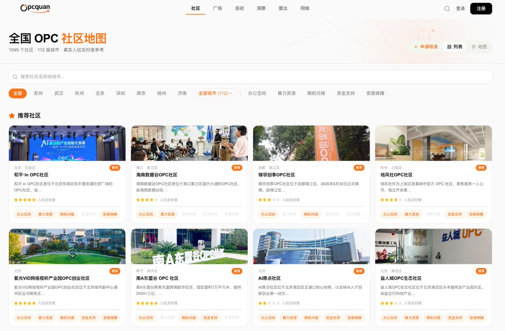
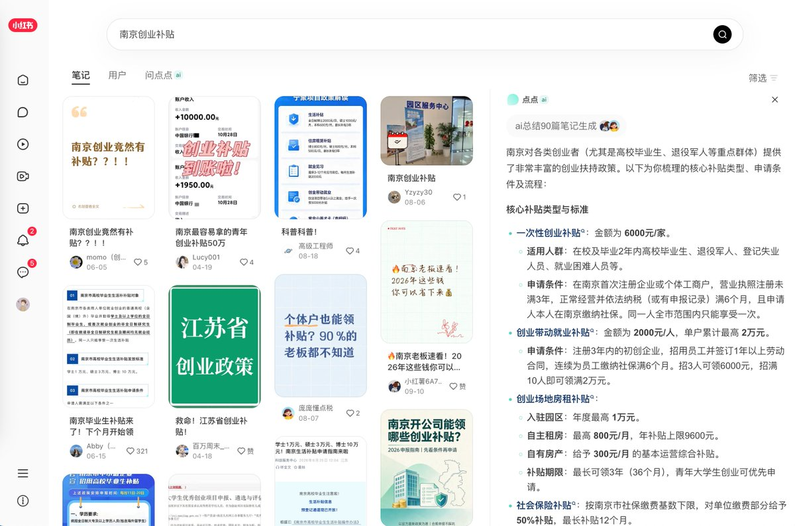
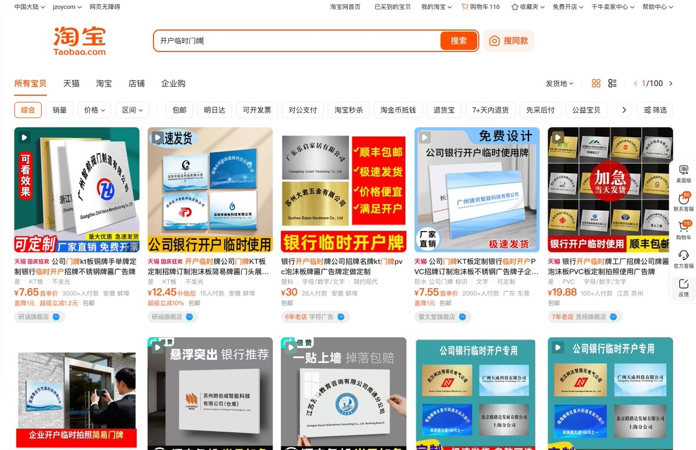
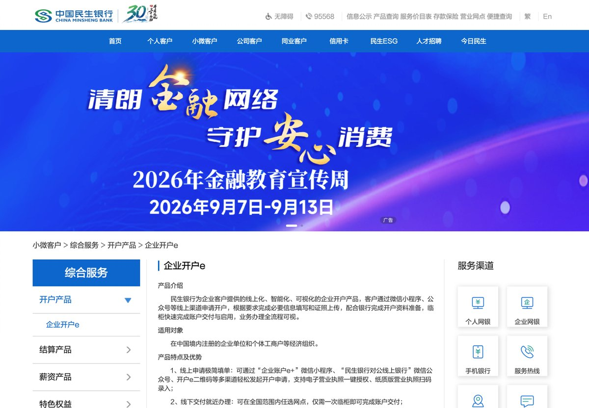

# 微尘印记（@weichen_ink）：为什么我建议自媒体和独立开发者，都去办个个体工商户？

> 自媒体人与独立开发者的低成本合规底座构建指南：系统梳理开办个体工商户的核心优势——开具增值税合规发票接商单、开通微信/支付宝官方商户号避免个人码频繁风控、享受小微企业税费减免政策；对比有限责任公司说明其记账报税成本极低、注销简便的特点，是打造一人公司的绝佳组织外壳。

<!-- more -->

昨天写了一篇只要 270 块：为什么我建议自媒体和独立开发者尽早注册商标，收到了很多小伙伴的关注，私信里也有很多人问我：普通人到底怎么注册个体工商户？注册了平时到底有没有用？

引用推文：微尘印记 (@weichen_ink)

https://t.co/8RFfW6iHIj

https://x.com/weichen_ink/status/2105268155342012734

说实话，我是强烈推荐自媒体创作者和正在单打独斗创业（OPC）的小伙伴去办一个的。它不仅是申请商标的门槛，本身更是一个低成本撬动各种资源和福利的超级工具。

## 一、办个体工商户有什么好处？

1. 申请执照完全免费且手续极简：全程官方不收一分钱，有些沿海和营商环境好的城市，线上提交 1 天就能直接办结
2. 维护成本极低：无需像正规公司那样搞复杂的做账报税，更不用每月花几百块找代账公司，选择定额征收即可
3. 可以正常合规开票：和公司一样具备开票资质，税点很低，很多地区每个月还有几万到十几万的免税额度
4. 享受完整的企业职工社保公积金待遇：可以给自己缴纳五险一金，比个人灵活就业社保多了失业保险和生育保险，待遇和在大公司上班完全一致
5. 政策红利与创业补贴极多：比如江苏很多城市针对初创团队有一万块的一次性创业补贴、每年好几万的房租补贴，以及长达 24 个月的社保补贴，虽然需要满足一定条件，但对刚起步的创作者来说绝对是一大笔真金白银
6. 申请商标的必备前提：自然人想要在国内低成本申请商标，必须绑定一个个体工商户执照
7. 解锁第二身份与账号额度：很多平台对个人身份证限制极严，比如微信公众号个人只能注册 1 个，用个体工商户就能名正言顺拿下第 2 个
8. 免费薅各大平台的企业级资源：国内很多云服务商针对企业账号有大量的免费额度、试用服务器和开发者扶持资源

## 二、办理个体工商户的 3 种路径

目前主流的办理方式有以下 3 种，大家可以根据自己的需求来选：

1. 对接当地创业园区

信息可以在 BetterOPC（[https://betteropc.com/opc-communities）](https://betteropc.com/opc-communities%EF%BC%89) 或者 OPC 圈（[https://www.opcquan.com/）](https://www.opcquan.com/%EF%BC%89) 上寻找。

这些园区每年都有招商引资的指标，非常欢迎真实创作者和开发者落户。而且园区普遍配有专业的企业服务部门，不仅可以免费帮你代办营业执照、代记账，很多还会免费提供共享办公工位、会议室、法律咨询，甚至对接投融资。一二线城市和东部沿海地区的园区基本上都有这类扶持政策，其他地区我不熟悉，不过也可以主动去了解一下。

2. 小红书找本地补贴中介

直接在小红书搜城市名加上创业补贴，会有一大批专门做本地企业服务的机构。

他们不仅会帮你代办注册，更核心的是熟悉本地各项政策，能帮你把创业补贴、社保补贴的申请材料全部整理好。我之前接触过几家，普遍模式是先签合同，等补贴真正到账后抽 10% 左右的服务费，完全不用前期垫钱，也是非常省心的路线。

3. 自己线上直办

直接搜本地的工商局网站或者政务服务网，找到法人服务里的企业开办或登记入口。个体工商户可以使用自家的住宅作为经营地址，足不出户就能办下来。

## 三、自己动手的实操全流程

这里要先说明一下：去工商系统申请营业执照本身是完全零成本的，官方不收一分钱。后续真正需要花钱的只有 2 个硬性成本：做招牌和刻章。

1. 线上申请执照（完全免费）

直接在当地政务服务网填报资料，经营场所直接填自己的住宅地址。提交后审核非常快，通过后会收到短信通知，带上身份证直接去所在街道的政务服务中心领取纸质营业执照。

2. 准备门头招牌与刻章

拿到执照后，需要掏腰包的 2 个硬性成本就在这里：

- 制作门头招牌：去淘宝/拼多多搜“开户临时门牌”，花 20 块钱定制一块亚克力小招牌，写上你的个体户名字，后面银行上门拍照要用

- 刻公章三件套：每个街道都有公安指定的刻章点，随便选一家把执照发给他们，刻公章、财务章和法人章三件套，费用在 300 块左右

3. 银行对公账户开户

拿到执照和印章后，必须开立企业对公账户。这一步是很多人踩坑的地方：

- 极度不推荐四大行以及招商银行：开户门槛高，每年还有几百块的账户管理费和网银年费，对微型个体户非常不划算
- 尤其避雷兴业银行：我打电话咨询过，对方态度非常差，甚至直接劝退说小微企业没人处理，极其嫌弃个体户
- 优先看本地银行或农商行，比如南京银行、苏州银行、常熟银行之类的地方性银行和农商行，他们大多有针对小微企业的优惠政策，免费开户，但是每年可能收几百块钱的费用，也有可能是免费的，一定要多家对比。
- 最后，强烈推荐民生银行：企业开户完全免费，免收账户管理费和年费，对个体户非常友好（当然这个也是在长三角地区，其他地区建议提前电话确认）

民生银行开户时有两个细节注意一下：

- 建议直接去线下网点预约：我在网上填预约没人搭理，直接跑一趟网点最快
- 上门拍照核实场地：预约后工作人员会上门核实经营场所，此时拼多多买的门头招牌就派上用场了，在自家门口举着招牌配合拍张合影，然后书房再拍一张即可
- 现场开户需留足时间：核实完场地就可以带上执照、身份证和三件套印章去网点办开户，现场要核对的材料较多，反复签字大概需要一个小时以上这里要额外说一下，财务需要有 2 个人负责，相当于是员工负责填写申请，领导负责审批，所以需要再带一张身份证，用家人的也可以，然后会给你 2 个企业 U 顿，后期可以在手机上设置电子的 U 顿，也很方便的。

4. 开设社保与公积金账户

银行账户办妥后，再去一趟政务服务中心的社保和公积金窗口开通企业户。

后续只要在对公账户里存足够的钱，每月就会自动扣缴五险一金。有些城市的社保需要每月登录政务系统手动点一次申报，公积金则大多全自动扣缴。部分地区社保后期也可以直接绑定个人银行卡自动代扣，具体看当地系统的支持情况。

## 四、真实花费与后续维护

算一下总账：

- 申请营业执照：0 元
- 淘宝/拼多多定制门头：20 元
- 刻章三件套：约 300 元
- 银行开户与年费：0 元（选民生银行等免年费银行）

也就是说，自己办的话，除了刻章和招牌这 300 多块钱硬性支出，其他环节完全是零费用的。

如果你暂时不需要对外开票，平时的运营维护几乎是零成本的，也不需要找代账公司做账报税。唯一记住一件事：每年年初在国家企业信用信息公示系统上填报一次企业年报即可，花 5 分钟在手机上就能填完，千万别忘了导致地址异常就行。

## 五、几个常见疑问

- 不想用了注销难不难个体户有专门的简易注销流程，没有欠税和债务的话，线上或者去窗口几天就能办结，完全免费，没有后顾之忧

- 还在上班的打工人能不能办普通私企员工完全可以办（体制内除外），主业公司交着社保的话，个体户这边就不用再开社保账户了，单纯用来申请商标、开公众号和做副业即可

- 住宅地址需要房产证或物业同意吗现在的政务系统基本都推行住所承诺制，不需要物业盖章，自己的房子或者租房合同地址填上去在线签个承诺书就能过（不过也要看所在街道的政策）

- 个体户承担无限责任要不要怕自媒体和做独立开发卖的是代码、数字产品或咨询服务，几乎没有实体债务或安全生产风险，完全不用自己吓自己

花 300 多块钱刻套章，换来的是一整套合法的商业主体身份、正规的企业社保通道和政策补贴资格，这绝对是自媒体人和独立开发者迈向正规化最划算的一笔基建投资。

## 相关页面

- [[sources/xiaoer-global-payout-without-hk-company]]
- [[sources/kk-ai-notes-opc-wanlihui-overseas-address-proof]]
- [[concepts/ai-oneperson-company]]
- [[concepts/b2c-conversion]]
