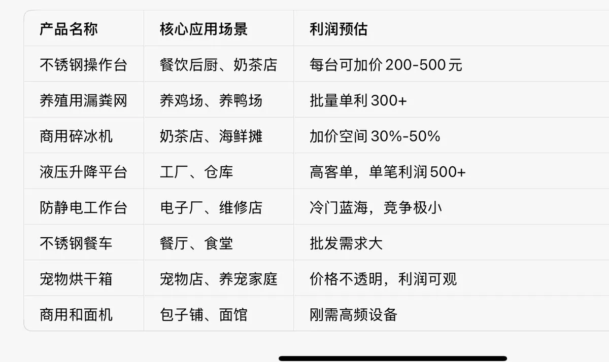
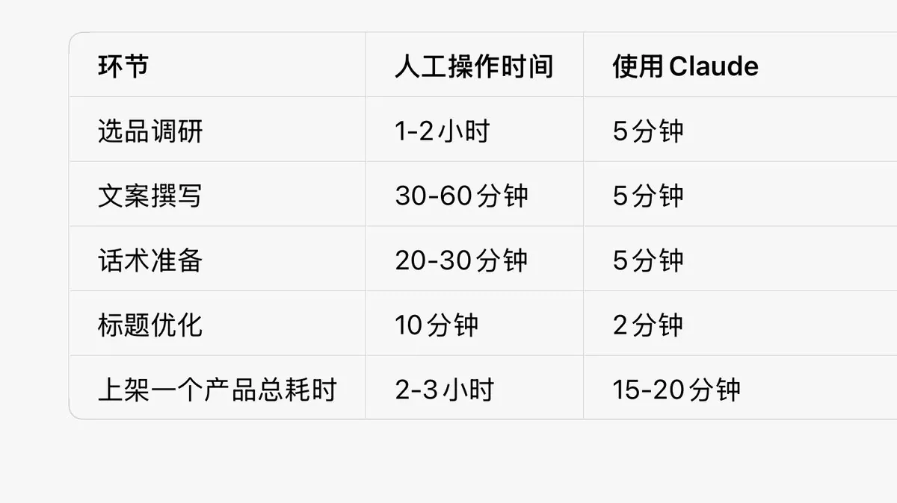

# 动物园园长（@weiyux2021）：用 Claude 跑通闲鱼电商全流程——选品、文案、话术与运营

> 利用 Claude 的分析与文本能力搭建闲鱼电商系统：选品四维漏斗、黄金排版商品文案生成、四类客户沟通话术库，以及从测试到放量的阶段运营方法。核心思路是人做判断、AI 做执行与草稿生产。

<!-- more -->

新手做闲鱼最怕的就是：选品靠感觉，文案憋半天，结果半个月没开单。

今天带大家拆解一下，如何利用 Claude 强大的逻辑分析和文本生成能力，把闲鱼做成一个思路清晰、执行高效的赚钱系统。

新手别再盲目试错，这套基于 Claude 的保姆级 AI 协作流程，建议直接收藏！

一、为什么是 Claude？

很多人问我：那么多 AI 工具，为什么偏偏推荐 Claude？

答案很简单：Claude 极其擅长理解和执行复杂的、多步骤的指令。

你丢给它一个模糊的问题，它不会随便糊弄你，而是会系统性地拆解任务，给你一套完整的、可落地的方案。

这种“结构化思维”恰恰是做闲鱼最需要的——选品需要逻辑、文案需要框架、话术需要场景化。

所以，Claude 不是普通的 AI 助手，它是你的闲鱼运营参谋长。

二、选品：让 Claude 帮你打破思维局限，发现冷门蓝海

选品是闲鱼最难的一关，没有之一。很多新手卡在这一步——不知道自己该卖什么，对着拼多多和闲鱼刷了半天，脑袋还是一片空白。

而 Claude 不一样。它能基于庞大的知识库，系统地帮你展开思路，发现你认知以外的冷门蓝海产品。

具体怎么操作？

你不需要自己去苦思冥想“卖什么”，直接给 Claude 下达一个结构化的指令即可：

“你现在是一位闲鱼选品专家，擅长发现高利润、非标、有批发潜力的产品。请根据以下思路，为我推荐 10 个具体的产品：

1. 原材料发散法： 从‘不锈钢’、‘实木’、‘加厚铝合金’等原材料出发，列举由它们制成的、适合在闲鱼销售的产品。

2. 场景解决方案法： 围绕‘开一家奶茶店’、‘搭建家庭养殖场’、‘布置露营装备’等场景，列出该场景下必需的、客单价较高的设备清单。

3. 排除红海： 请避开服装、化妆品、普通数码产品等竞争激烈的类目。输出格式： 产品名称 + 核心应用场景 + 利润预估空间说明。”

Claude 会给你什么？

它会生成像这样的一套推荐：

我按这个清单去闲鱼搜，发现很多品“想要数”都超高，竞争却很小。 像不锈钢操作台、养殖网、防静电工作台这些，拼多多拿货价和闲鱼售价有几百甚至上千的价差。

为什么这个方法有效？

大多数新手选品的思路是：“我想卖什么”——然后去搜一个品类。

这其实掉进了大数据推荐的陷阱。

平台只会不断给你推相关产品，你看到的永远是那几个品类，认知被锁死在一个小圈子里。

而 Claude 帮你做的，是从原材料和场景出发，跳出信息茧房。它不会受限于你过去的搜索记录，而是基于全面的知识库给你推荐那些你根本想不到的产品。

比如说“不锈钢”这个原材料，它能衍生出：工作台、操作台、货架、水池、置物架、搁板、桶……你平时的搜索习惯很难跳出“微波炉”“冰箱”这些常见品，但 Claude 可以。

这些品，很多同行根本想不到去卖，竞争自然小，利润反而高。

三、文案：让 Claude 写出既有套路又有“人味儿”的爆款文案

选好品后，文案是第二道坎。

很多新手喜欢自己做文案——憋了一两个小时写出来的东西，干巴巴的像说明书，发出去三天没一个咨询。

其实这是浪费了时间。

把最头疼的文案交给 Claude，它几分钟就能出一篇比你憋三个小时还好的文案。

给 Claude 的指令框架

让它写文案不是简单说“写个文案”，而是给它一个符合闲鱼调性的结构化指令：

“请为[商品名称，例如：商用平冷操作台]撰写一篇闲鱼售卖文案。

要求与框架：

1. 标题： 包含核心关键词、尺寸/规格，以及‘工厂清仓’、‘门店转让’等吸引点击的营销词。

2. 人设与原因： 以‘实体店倒闭’、‘工厂尾单’或‘项目剩余’为背景，写一段真实可信的转手理由。

3. 产品卖点： 从耐用性（如加厚材质）、功能性（如双温制冷）、使用场景（如餐饮后厨必备）等角度，提炼 3-5 个核心优势。

4. 规格与价格： 清晰地列出不同规格（如 1.5 米/1.8 米）对应的价格，可以采用阶梯报价。

5. 信任构建： 加入‘全新未使用’、‘包邮送货上门’、‘质保一年’等承诺。

6. 语言风格： 口语化，真诚，略带急切感（如‘清完即止’），避免过度夸张的营销词汇。”

看看 Claude 的实际输出

我拿“商用平冷操作台”试了一下，Claude 给出了这样的文案：

【工厂倒闭清仓】商用平冷操作台 冷藏冷冻双温工作台 餐饮后厨必备实体店经营不善，剩下最后 8 台全新平冷操作台，低价处理回血！✅ 全铜管制冷，-18℃低温速冻，制冷效果杠杠的

✅ 加厚不锈钢层架，承重强不易变形

✅ 节能省电，每天低至 1 度电，比同行省一半

✅ 全国联保一年，售后无忧规格与价格：- 1.2 米单温冷藏：¥899（现货 3 台）

- 1.5 米双温（冷藏+冷冻）：¥1299（现货 4 台）

- 1.8 米双温（冷藏+冷冻）：¥1599（现货 1 台）

全新未使用，包邮送货上门，仓库就在成都，欢迎自提。数量有限，清完即止，感兴趣点“我想要”私聊！»

这个文案结构清晰、卖点突出，并且能模仿出真实个人卖家或小商家的语气，可信度极高。它不是那种“全网最低价”“不买后悔”的套话，而是有具体场景、有真实感、有信任感的陈述。

这种文案能有效过滤比价党，吸引精准客户。 那些只想要最低价的买家会自动离开，真正有需求、注重质量的买家反而会来咨询。

文案优化的三个关键点

Claude 生成的文案是初版，你可以在此基础上做三个优化：

1. 主图：主图要突出产品，最好是正方形高清实拍图，可以在上面加字——“一件也是批发价”“清仓最后 X 台”

2. 人设包装：如果卖的是工业设备，那就包装成工厂背景；如果是家居用品，就包装成实体店倒闭处理

3. 售后承诺：加上具体的承诺，比如“质保一年”“包邮上门”“破损包赔”，消除买家顾虑

记住公式：吸引人的主图 + 清晰的人设 + 突出的产品卖点 + 明确的售后 = 高转化文案

四、话术与运营：让 Claude 成为你的 24 小时销售教练

遇到客户咨询不会回？这是很多新手最头疼的事。

客户问一句，你答一句，像个被动的客服机器。这样基本上成交不了——因为大多数买家都是抱着“先问问看”的心态，你就算回答了价格和尺寸，他们还是会继续比价，或者直接消失。

你需要的是有策略的回复话术，而不是干巴巴的答案。 而 Claude 恰好可以帮你解决这个问题。

模拟销售场景，生成三段专业话术

你可以让 Claude 模拟各种销售场景：

“假设我是一名闲鱼卖家，主营[你的品类，如：餐饮设备]。

现在有一位客户咨询‘这个冷柜质量怎么样？保修多久？’。

请生成三段不同风格（专业严谨型、热情服务型、简洁干脆型）的回复话术，每段话术需包含：产品优势确认、售后保障说明、以及一个引导下单的结尾。”

Claude 的实战输出

来看看我让 Claude 生成的话术：

风格一：专业严谨型（适合理性买家）

“您好，这款冷柜采用全铜管制冷，-18℃低温速冻，加厚不锈钢层架，节能省电每天低至 1 度电。

我们提供全国联保一年，质保期内非人为问题免费维修，人为损坏也可有偿维修。需要可以直接拍下，今天下单明天发货。”

风格二：热情服务型（适合感性买家）

“哥/姐，这款冷柜质量您放心！全铜管制冷，-18℃低温速冻，加厚不锈钢层架，节能省电每天低至 1 度电。

我们提供全国联保一年，质保期内非人为问题免费维修。如果您需要，可以直接拍下，我会尽快安排发货哦~有任何问题随时问我，我在的~”

风格三：简洁干脆型（适合赶时间买家）

“全铜管制冷，-18℃低温速冻，加厚不锈钢层架，节能省电每天低至 1 度电。全国联保一年。需要直接拍，今天下单明天发货。”»

三种风格覆盖了不同类型买家的心理偏好。你可以根据买家的聊天风格，选择最匹配的话术回复，大幅提升成交率。

更多运营场景的 AI 辅助

Claude 不只是帮你回消息，还能帮你做很多运营工作：

优化商品标题：

“请帮我优化这个标题：‘不锈钢工作台工厂价’。要求：加入尺寸关键词和营销词，字数不超过 30 字。”

Claude 可能会帮你改成：“工厂直发！1.5 米不锈钢工作台 厨房操作台 商用饭店必备”

编写售后须知：

“亲，收到货后请先检查外观是否完好，如有破损请及时联系我。非质量问题退货需买家承担运费。质保期内非人为问题免费维修。感谢您的支持！”

制定每日店铺优化计划：

Claude 可以帮你生成一个每日运营清单，包括什么时间换城市发布、什么时间擦亮、什么时间回复消息优先级最高。

一句话总结：Claude 就是你的 24 小时销售教练，随时待命。

五、供应链与执行：轻装上阵，快速验证

有了 Claude 的选品清单和文案支持，接下来就是轻装上阵快速验证。这部分不需要 Claude 太多参与，但它是整个流程最后闭环的关键。

第一步：一键找货

拿着 Claude 推荐的产品名，直接去拼多多搜索，找销量高、支持一件代发的店铺作为货源。

比如 Claude 推荐了“不锈钢操作台”，就直接去拼多多搜，找月销高、评价不错、支持一件代发的那几家。把价格做个对比，选性价比最高的。

第二步：高效上架

上架有三个关键动作：

1. 文案：直接使用 Claude 生成的文案，稍作调整（比如把价格改成你的定价）

2. 主图：去拼多多买家秀找高清实拍图，或者去 1688 找产品图，简单裁剪或加字做差异化。注意：千万不要直接复制同行图片，容易被判重复

3. 标题：保留 Claude 推荐的核心关键词，把产品词和属性词组合好

第三步：闭环跑通

出单后的操作流程：

1. 跟买家确认好款式、尺寸、收货信息

2. 复制买家信息去拼多多下单：买家电话填自己的（如果单子多，可以把买家电话中间四位改一个数字）

3. 告诉商家：“不要放好评返现卡，无痕发货，不要发短信”

4. 商家发货后，复制快递单号填回闲鱼后台

5. 物流信息不更新的话，主动去官网查截图发买家，说一句：“闲鱼后台更新慢，我帮你盯着”

这样，整个无货源代发的闭环就完成了。 你不需要囤货、不需要自己发货、不需要承担库存风险，只需要做好选品和文案就行。

第四步：持续优化

出单后还要做三件事：

1. 出单立刻重新上架：此时链接权重最高，平台会给第二波流量，很容易连环出单

2. 回复要及时：咨询量大的时候，回复速度直接影响系统给你的后续流量

3. 每天优化：把曝光不好的链接改几个字换城市发布，下掉三天没曝光的链接，留下能出单的

六、完整流程总结：Claude 如何帮你一站式搞定闲鱼

如果你还不太清楚怎么把上面流程串起来，这里给你一张完整的操作地图：

完整指令示例

你可以一次性给 Claude 下达这个全链条指令：

“你现在是一位闲鱼运营专家。请帮我完成以下任务：

1. 选品推荐：推荐 5 个适合在闲鱼销售的冷门蓝海产品（避开服装、化妆品、数码产品），要求从‘塑料’和‘铁’两种原材料出发，列出产品名+应用场景+利润预估。

2. 文案生成：针对其中推荐的一个产品‘商用不锈钢操作台’，写一篇闲鱼售卖文案，按照‘标题→人设原因→产品卖点→规格价格→信任构建’的框架输出。

3. 话术生成：买家常问的问题‘这个操作台和拼多多比怎么样？’，请生成三段不同风格的话术（温和型、专业型、简洁型）。”

整个流程的效率对比

效率提升 10 倍以上。

以前觉得电商既要选品又要写文案，门槛太高。现在有了 Claude 作为你的 “全能副手” ，它负责提供清晰的思路和优质的文案，你负责最终的判断和执行，门槛真的被无限拉低。

七、写在最后

网上有很多人在教闲鱼，但他们告诉你的往往是：要熬夜上架、要死磕文案、要问亲戚朋友借钱才能起步……这些方法太累太慢了。

真正的效率提升，来自于工具的使用。 Claude 就是那个能帮你把效率提升 5 倍、10 倍的工具。

你可以把它当成：

- 选品顾问：帮你发现冷门蓝海产品

- 文案撰稿人：快速生成爆款文案

- 话术教练：生成不同风格的回复话术

- 运营助手：输出店铺优化计划

Claude 负责提供清晰的思路和优质的文案，你负责最终的判断和执行。

别再空想了，用 Claude 把想法变成一个个具体的商品链接，才是赚钱的开始。

## 相关页面

- [[sources/xiaohongshu-ecommerce-product-selection]]
- [[patterns/cross-platform-information-arbitrage]]
- [[patterns/gray-market-customer-acquisition]]
