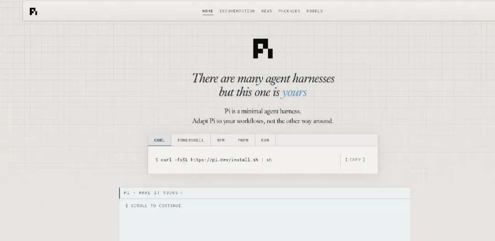
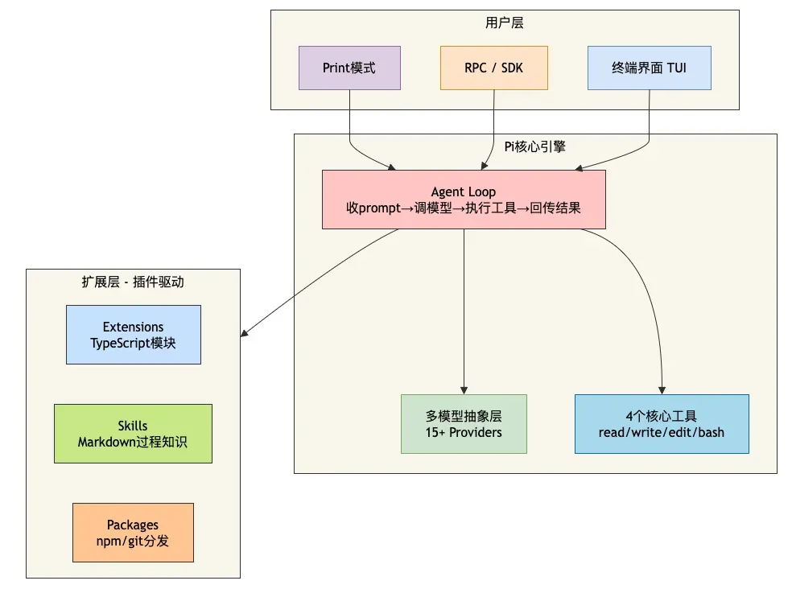

# 为什么越来越多人用 Pi ？

来源丨经授权转自苏三说技术（ID：susanSayJava）作者丨苏三前言系统提示词只有 200 Token，GitHub 狂揽 8.6 万 Star，它凭什么成了 Claude Code 最强平替？最近这段时间，我的技术群几乎被同一个名字刷屏了——Pi。第一次听说 Pi 的时候，我以为又是什么新的 AI 编程工具。毕竟这个赛道已经挤满了 Claude Code、Codex、Cursor……再多一个也不稀奇。但深入研究之后，我发现 Pi 跟其他工具完全不是一路子。当别人都在疯狂堆功能的时候，Pi 在玩命做减法。Claude Code 的系统提示词有 14000 Token，内置十几个工具。Cursor、Windsurf 也在不停地往里面塞新功能——子代理、计划模式、MCP、权限弹窗、后台 Bash、TODO 管理。而 Pi 呢？系统提示词只有 200 Token。核心工具就 4 个——Read、Write、Edit、Bash。一个把功能做到极致复杂，一个把功能做到极致简单。结果呢？Pi 在 GitHub 上狂揽 8.6 万 Star。被开发者评为“目前唯一能真正平替 Claude Code 的 Agent 架构”。今天这篇文章，我就把 Pi 为什么越来越多人用的原因，从头到尾给你拆解一遍。一、Pi 到底是什么？Pi 是由 libGDX 创始人 Mario Zechner 创建的开源终端 AI 编程 Agent。核心思想可以用一句话概括：给你原语（Primitives），而不是预烹饪好的功能（Features）。它在设计上做了一件非常反直觉的事：刻意删掉了其他工具拼命添加的功能。不支持 MCP 不支持内置子代理不支持内置计划模式没有权限弹窗没有内置 TODO 管理甚至没有绑定任何特定模型但 Pi 留下了四个“原语级别”的工具：工具说明 read 读取文件内容（支持文本和图片）write 写入/创建文件 edit 精确替换文件内容 bash 执行 bash 命令这套组合拳打出来的效果非常惊人：Pi 的系统提示词+工具定义加起来不到 1000 Token。而 Claude Code 光系统提示词就占了 14000 Token。Mario Zechner 在解释 Pi 的设计理念时说了一段非常扎心的话：“这一代最先进的大模型其实已经非常擅长几件事：读文件、写文件、改文件，以及调用 bash。很多情况下，bash 本身就是最通用的工具接口。你不需要教模型怎么做，只需要告诉它有什么工具可用。”这句话点出了 Pi 的核心逻辑：当今的前沿模型已经被 RL 训练得足够好了，它们本身就理解编码 Agent 是什么、该怎么做。不需要 10000 Token 的长篇大论来教它们工作。二、一张图看懂 Pi 的核心架构在深入代码之前，我们先建立一个整体认知。Pi 的核心架构极其简单——本质上就是一个 while 循环：调用 LLM，给它配上 4 个工具，再根据模型返回的结果决定是否继续调用。这种极简设计带来的直接好处是：它的复杂度是可控的、可理解的、可扩展的。三、为什么越来越多人用 Pi？3.1 原因一：便宜到离谱 99.93%的缓存命中率。这是 Pi 最让人震惊的数据。有开发者把 DeepSeek 接入 Pi 后，约 99.93%的输入 Token 都成功命中缓存。换句话说，**缓存不命中率只有 0.07%**——绝大部分重复上下文无需重新计算。为什么 Pi 能做到这么离谱的缓存命中率？因为 Pi 的系统提示词只有 200 Token。其他 Coding Agent 的系统提示词动不动就上万 Token，每次调用都要把这些 Token 重新发给模型。而 Pi 只有 200 Token，加上工具定义也不到 1000 Token。系统提示词越短，能命中缓存的 Token 比例就越高，调用成本就越低。Composio 团队横向测试了 8 款主流 Agent Harness，把 DeepSeek V4 Flash 塞进去跑真实任务。结果 Pi 完成一次成功任务的平均成本最低，只需要约 0.028 美元。而 Claude Code 直接干到了 Pi 的 7 倍价格。DeepSeek 的 Token 已经卖得很便宜了，Pi 还能让用户花得更少。3.2 原因二：不锁模型告别“平台依赖症”。2026 年 6 月底，Claude Code 搞了一波大规模封号。它通过读取用户本机时区（如果是 Asia/Shanghai 就把日期格式改掉）、检查是否使用中转域名等方式，把系统提示词里的字符替换成不同的 Unicode 编码。这些信息被回传到 Anthropic 服务器，后端直接判断你是不是中国用户。换 IP、换节点、换中转，都没用。因为它检测的不是你的网络环境，是你的设备环境。这件事让很多开发者意识到了一个问题：把生产资料绑定在任何单一工具上都是危险的。而 Pi 从一开始就不绑定任何特定模型。它可以接：Claude 的 APIKimiDeepSeekOpenAIGooglexAI、Groq 等 15 个以上的供应商你今天用 Claude 的 API 跑 Pi，模型能力本身不打折。但你不再依赖 Claude Code 这个客户端。账号被封了，模型还在，换个供应商接上就能继续干活。3.3 原因三：兼容已有积累 Skill 和 AGENTS.md 无缝迁移。如果你已经在 Claude Code 里积累了一堆 Skill，Pi 装完之后会自动读取~/.agents/skills 这个目录——不用做任何迁移，Pi 直接识别，开箱即用。同样的，Pi 也支持 AGENTS.md。你之前在项目根目录里写好的项目上下文文件，Pi 打开项目的时候会自动加载。你积累下来的那套项目规范、约束、边界，换到 Pi 里一行不用改。3.4 原因四：可扩展想要什么功能，自己装。Pi 默认只给了 4 个工具。但如果你需要计划模式、子 Agent、MCP、Git 检查点或权限控制，可以通过扩展和 Skills 逐件装上去。打个比方：其他工具是精装房，交房的时候什么都有，但你不能自己改格局。Pi 是毛坯房，水电齐全、四面墙盖好，最后装修成工作室、电竞房还是三室一厅，全看你自己折腾。一个真实的案例：有开发者基于 Pi 搭建了一套配置，包含了 17 个插件、18 个全局 Skill、2 个 MCP 服务器。用一键安装脚本，把 Pi 打造成了一个能多代理协作、能省 Token、能跑浏览器的全能终端编码 Agent。四、三步跑通 Pi 光说理论不够，我们来看怎么快速上手 Pi。4.1 第一步：安装 PiPi 通过 npm 安装，需要 Node.js 环境：npm install -g @earendil-works/pi-coding-agentPi 官方文档推荐使用--ignore-scripts 标志：npm install -g --ignore-scripts @earendil-works/pi-coding-agent4.2 第二步：配置 API KeyPi 支持多种认证方式：方式一：环境变量（推荐）# 以 DeepSeek 为例 exportDEEPSEEK_API_KEY=“你的 API Key"# 或者 AnthropicexportANTHROPIC_API_KEY=”你的 API Key"# 启动 Pipi 方式二：OAuth 登录（订阅账号）pi /login# 选择供应商并完成 OAuth 认证支持的订阅服务包括：Claude Pro/Max、ChatGPT Plus/Pro、GitHub Copilot、Google Gemini CLI 等。4.3 第三步：进入 Pi 的交互界面安装并配置好 API Key 之后，直接在终端输入 pi 即可进入交互模式：pi 启动后，终端界面从上到下依次是：启动头部：显示快捷键提示、已加载的 AGENTS.md、模板、技能、扩展消息区域：用户消息、AI 回复、工具调用结果编辑器：输入区域，边框颜色表示 thinking 级别底部状态栏：工作目录、会话名称、Token 用量、费用、当前模型常用快捷键：快捷键功能 Ctrl+C 清空编辑器 Ctrl+C × 2 退出 piEscape 取消/中止当前操作 Ctrl+L 打开模型选择器 Shift+Tab 循环切换 thinking 级别常用命令：命令功能/loginOAuth 认证/model 切换模型/resume 恢复之前的会话/new 开始新会话/session 显示会话信息/tree 浏览会话树/compact 手动压缩上下文/exit 退出 4.4 实战：在 Java 项目中使用 Pi 假设你有一个 Spring Boot 项目，想要 Pi 帮你修复一个单元测试。直接在终端里输入：pi 然后输入任务描述：帮我把这个 Spring Boot 项目里所有失效的单元测试修好 Pi 会自动：用 read 读取测试文件用 bash 执行测试命令（如 mvn test）分析错误输出用 edit 修改有问题的测试代码再次运行测试验证整个过程都在终端里完成，你不需要切换任何工具。五、Pi vs Claude Code 的差异我把 Pi 和 Claude Code 放在一起做了个对比：对比维度 PiClaude Code 系统提示词~200 Token~14000 Token 核心工具 4 个（read/write/edit/bash）10+个模型绑定不绑定，支持 15+供应商仅 Claude 开源协议 MIT 闭源扩展方式插件/Skills/TypeScript 有限（Skill）设计哲学做减法做加法 MCP 支持不支持，用 CLI 工具替代原生支持权限管理默认 YOLO 模式弹窗确认成本极低（~0.028 美元/任务）高（7 倍于 Pi）GitHub Stars8.6 万+12.4 万+六、优缺点优点 1. 极致省钱系统提示词只有 200 Token，配合 DeepSeek 的缓存机制能达到 99.93%的缓存命中率。完成任务的平均成本仅 0.028 美元，是 Claude Code 的七分之一。2. 不锁模型支持 15+个模型供应商。Claude 封了换 Kimi，Kimi 不行换 DeepSeek，永远不用担心被单一平台绑架。3. 完全开源 MIT 协议，可以自由使用、修改、商用。4. 兼容已有积累自动读取~/.agents/skills 和 AGENTS.md。你在 Claude Code 里积累的 Skill 和项目规范，换到 Pi 里一行不用改。5. 可无限扩展默认只有 4 个工具，但通过 Extensions、Skills、Packages 可以按需添加任何功能。从毛坯房到精装房，你自己决定。6. 极简设计，完全可控 Pi 本质上就是一个 while 循环，你能完全理解它在做什么。不像其他工具那样像个黑箱。缺点 1. 默认功能太少刚装上 Pi 的时候，你会觉得“这也太简陋了”。没有计划模式、没有子 Agent、没有 MCP、没有权限弹窗。想要这些功能，得自己装扩展。2. 需要一定的动手能力 Pi 的理念是“给你造 AI 助手的工厂”，不是“给你一个 AI 助手”。你需要自己去配置、去扩展、去折腾。3. 终端门槛 Pi 是纯终端工具，没有图形界面。对不习惯命令行的开发者不太友好。4. 生态相对年轻虽然发展很快，但相比 Claude Code 的生态，Pi 的插件和扩展数量还在快速增长中。七、适用场景场景推荐程度理由追求极致性价比✅✅✅ 强烈推荐成本是 Claude Code 的七分之一不想被单一平台绑定✅✅✅ 强烈推荐支持 15+模型供应商已积累 Claude Code Skill✅✅✅ 强烈推荐无缝迁移，一行不改喜欢折腾和定制✅✅✅ 强烈推荐毛坯房设计，想怎么装就怎么装日常编码辅助✅✅✅ 强烈推荐轻量高效，响应快团队共享工作流✅✅✅ 强烈推荐配置可复制、可分享想要开箱即用的体验⚠️ 需评估默认功能太少，需要自己折腾不熟悉终端的开发者⚠️ 需评估纯终端操作，有学习成本八、写在最后回到最初的问题：为什么越来越多人用 Pi？答案其实不复杂——当其他工具都在疯狂堆功能的时候，Pi 选择了做减法。Claude Code 的系统提示词 14000 Token，Pi 只有 200 Token。这个差距意味着什么？每一轮对话，Claude Code 都要把 14000 Token 塞进上下文，Pi 只需要 200 Token。再加上 DeepSeek 的缓存机制，Pi 能把输入 Token 的缓存命中率做到**99.93%**。而真正打动我的，是 Pi 背后的设计哲学：“对 Agent 来说，你刻意不做什么，比你做什么更重要。”当一个 Agent 变成你无法理解、无法预测的黑箱时，问题也许不是能力不够，而是复杂度本身。Pi 的答案，是把系统收敛到一个最小内核：简单到你可以理解它、控制它，再通过扩展去生长。结果反而是——越简单，越可控。Claude Code 是“给你一个 AI 助手”，Pi 是“给你造 AI 助手的工厂”。你会发现——AI 编程工具，可以这么轻、这么省、这么自由。开源地址 GitHub：https://github.com/earendil-works/pi（8.6万+ Star）官方文档：https://pi.dev

来源丨经授权转自苏三说技术（ID：susanSayJava）作者丨苏三前言系统提示词只有 200 Token，GitHub 狂揽 8.6 万 Star，它凭什么成了 Claude Code 最强平替？最近这段时间，我的技术群几乎被同一个名字刷屏了——Pi。第一次听说 Pi 的时候，我以为又是什么新的 AI 编程工具。毕竟这个赛道已经挤满了 Claude Code、Codex、Cursor……再多一个也不稀奇。但深入研究之后，我发现 Pi 跟其他工具完全不是一路子。当别人都在疯狂堆功能的时候，Pi 在玩命做减法。Claude Code 的系统提示词有 14000 Token，内置十几个工具。Cursor、Windsurf 也在不停地往里面塞新功能——子代理、计划模式、MCP、权限弹窗、后台 Bash、TODO 管理。而 Pi 呢？系统提示词只有 200 Token。核心工具就 4 个——Read、Write、Edit、Bash。一个把功能做到极致复杂，一个把功能做到极致简单。结果呢？Pi 在 GitHub 上狂揽 8.6 万 Star。被开发者评为“目前唯一能真正平替 Claude Code 的 Agent 架构”。今天这篇文章，我就把 Pi 为什么越来越多人用的原因，从头到尾给你拆解一遍。一、Pi 到底是什么？Pi 是由 libGDX 创始人 Mario Zechner 创建的开源终端 AI 编程 Agent。核心思想可以用一句话概括：给你原语（Primitives），而不是预烹饪好的功能（Features）。它在设计上做了一件非常反直觉的事：刻意删掉了其他工具拼命添加的功能。不支持 MCP 不支持内置子代理不支持内置计划模式没有权限弹窗没有内置 TODO 管理甚至没有绑定任何特定模型但 Pi 留下了四个“原语级别”的工具：工具说明 read 读取文件内容（支持文本和图片）write 写入/创建文件 edit 精确替换文件内容 bash 执行 bash 命令这套组合拳打出来的效果非常惊人：Pi 的系统提示词+工具定义加起来不到 1000 Token。而 Claude Code 光系统提示词就占了 14000 Token。Mario Zechner 在解释 Pi 的设计理念时说了一段非常扎心的话：“这一代最先进的大模型其实已经非常擅长几件事：读文件、写文件、改文件，以及调用 bash。很多情况下，bash 本身就是最通用的工具接口。你不需要教模型怎么做，只需要告诉它有什么工具可用。”这句话点出了 Pi 的核心逻辑：当今的前沿模型已经被 RL 训练得足够好了，它们本身就理解编码 Agent 是什么、该怎么做。不需要 10000 Token 的长篇大论来教它们工作。二、一张图看懂 Pi 的核心架构在深入代码之前，我们先建立一个整体认知。Pi 的核心架构极其简单——本质上就是一个 while 循环：调用 LLM，给它配上 4 个工具，再根据模型返回的结果决定是否继续调用。这种极简设计带来的直接好处是：它的复杂度是可控的、可理解的、可扩展的。三、为什么越来越多人用 Pi？3.1 原因一：便宜到离谱 99.93%的缓存命中率。这是 Pi 最让人震惊的数据。有开发者把 DeepSeek 接入 Pi 后，约 99.93%的输入 Token 都成功命中缓存。换句话说，**缓存不命中率只有 0.07%**——绝大部分重复上下文无需重新计算。为什么 Pi 能做到这么离谱的缓存命中率？因为 Pi 的系统提示词只有 200 Token。其他 Coding Agent 的系统提示词动不动就上万 Token，每次调用都要把这些 Token 重新发给模型。而 Pi 只有 200 Token，加上工具定义也不到 1000 Token。系统提示词越短，能命中缓存的 Token 比例就越高，调用成本就越低。Composio 团队横向测试了 8 款主流 Agent Harness，把 DeepSeek V4 Flash 塞进去跑真实任务。结果 Pi 完成一次成功任务的平均成本最低，只需要约 0.028 美元。而 Claude Code 直接干到了 Pi 的 7 倍价格。DeepSeek 的 Token 已经卖得很便宜了，Pi 还能让用户花得更少。3.2 原因二：不锁模型告别“平台依赖症”。2026 年 6 月底，Claude Code 搞了一波大规模封号。它通过读取用户本机时区（如果是 Asia/Shanghai 就把日期格式改掉）、检查是否使用中转域名等方式，把系统提示词里的字符替换成不同的 Unicode 编码。这些信息被回传到 Anthropic 服务器，后端直接判断你是不是中国用户。换 IP、换节点、换中转，都没用。因为它检测的不是你的网络环境，是你的设备环境。这件事让很多开发者意识到了一个问题：把生产资料绑定在任何单一工具上都是危险的。而 Pi 从一开始就不绑定任何特定模型。它可以接：Claude 的 APIKimiDeepSeekOpenAIGooglexAI、Groq 等 15 个以上的供应商你今天用 Claude 的 API 跑 Pi，模型能力本身不打折。但你不再依赖 Claude Code 这个客户端。账号被封了，模型还在，换个供应商接上就能继续干活。3.3 原因三：兼容已有积累 Skill 和 AGENTS.md 无缝迁移。如果你已经在 Claude Code 里积累了一堆 Skill，Pi 装完之后会自动读取~/.agents/skills 这个目录——不用做任何迁移，Pi 直接识别，开箱即用。同样的，Pi 也支持 AGENTS.md。你之前在项目根目录里写好的项目上下文文件，Pi 打开项目的时候会自动加载。你积累下来的那套项目规范、约束、边界，换到 Pi 里一行不用改。3.4 原因四：可扩展想要什么功能，自己装。Pi 默认只给了 4 个工具。但如果你需要计划模式、子 Agent、MCP、Git 检查点或权限控制，可以通过扩展和 Skills 逐件装上去。打个比方：其他工具是精装房，交房的时候什么都有，但你不能自己改格局。Pi 是毛坯房，水电齐全、四面墙盖好，最后装修成工作室、电竞房还是三室一厅，全看你自己折腾。一个真实的案例：有开发者基于 Pi 搭建了一套配置，包含了 17 个插件、18 个全局 Skill、2 个 MCP 服务器。用一键安装脚本，把 Pi 打造成了一个能多代理协作、能省 Token、能跑浏览器的全能终端编码 Agent。四、三步跑通 Pi 光说理论不够，我们来看怎么快速上手 Pi。4.1 第一步：安装 PiPi 通过 npm 安装，需要 Node.js 环境：npm install -g @earendil-works/pi-coding-agentPi 官方文档推荐使用--ignore-scripts 标志：npm install -g --ignore-scripts @earendil-works/pi-coding-agent4.2 第二步：配置 API KeyPi 支持多种认证方式：方式一：环境变量（推荐）# 以 DeepSeek 为例 exportDEEPSEEK_API_KEY=“你的 API Key"# 或者 AnthropicexportANTHROPIC_API_KEY=”你的 API Key"# 启动 Pipi 方式二：OAuth 登录（订阅账号）pi /login# 选择供应商并完成 OAuth 认证支持的订阅服务包括：Claude Pro/Max、ChatGPT Plus/Pro、GitHub Copilot、Google Gemini CLI 等。4.3 第三步：进入 Pi 的交互界面安装并配置好 API Key 之后，直接在终端输入 pi 即可进入交互模式：pi 启动后，终端界面从上到下依次是：启动头部：显示快捷键提示、已加载的 AGENTS.md、模板、技能、扩展消息区域：用户消息、AI 回复、工具调用结果编辑器：输入区域，边框颜色表示 thinking 级别底部状态栏：工作目录、会话名称、Token 用量、费用、当前模型常用快捷键：快捷键功能 Ctrl+C 清空编辑器 Ctrl+C × 2 退出 piEscape 取消/中止当前操作 Ctrl+L 打开模型选择器 Shift+Tab 循环切换 thinking 级别常用命令：命令功能/loginOAuth 认证/model 切换模型/resume 恢复之前的会话/new 开始新会话/session 显示会话信息/tree 浏览会话树/compact 手动压缩上下文/exit 退出 4.4 实战：在 Java 项目中使用 Pi 假设你有一个 Spring Boot 项目，想要 Pi 帮你修复一个单元测试。直接在终端里输入：pi 然后输入任务描述：帮我把这个 Spring Boot 项目里所有失效的单元测试修好 Pi 会自动：用 read 读取测试文件用 bash 执行测试命令（如 mvn test）分析错误输出用 edit 修改有问题的测试代码再次运行测试验证整个过程都在终端里完成，你不需要切换任何工具。五、Pi vs Claude Code 的差异我把 Pi 和 Claude Code 放在一起做了个对比：对比维度 PiClaude Code 系统提示词~200 Token~14000 Token 核心工具 4 个（read/write/edit/bash）10+个模型绑定不绑定，支持 15+供应商仅 Claude 开源协议 MIT 闭源扩展方式插件/Skills/TypeScript 有限（Skill）设计哲学做减法做加法 MCP 支持不支持，用 CLI 工具替代原生支持权限管理默认 YOLO 模式弹窗确认成本极低（~0.028 美元/任务）高（7 倍于 Pi）GitHub Stars8.6 万+12.4 万+六、优缺点优点 1. 极致省钱系统提示词只有 200 Token，配合 DeepSeek 的缓存机制能达到 99.93%的缓存命中率。完成任务的平均成本仅 0.028 美元，是 Claude Code 的七分之一。2. 不锁模型支持 15+个模型供应商。Claude 封了换 Kimi，Kimi 不行换 DeepSeek，永远不用担心被单一平台绑架。3. 完全开源 MIT 协议，可以自由使用、修改、商用。4. 兼容已有积累自动读取~/.agents/skills 和 AGENTS.md。你在 Claude Code 里积累的 Skill 和项目规范，换到 Pi 里一行不用改。5. 可无限扩展默认只有 4 个工具，但通过 Extensions、Skills、Packages 可以按需添加任何功能。从毛坯房到精装房，你自己决定。6. 极简设计，完全可控 Pi 本质上就是一个 while 循环，你能完全理解它在做什么。不像其他工具那样像个黑箱。缺点 1. 默认功能太少刚装上 Pi 的时候，你会觉得“这也太简陋了”。没有计划模式、没有子 Agent、没有 MCP、没有权限弹窗。想要这些功能，得自己装扩展。2. 需要一定的动手能力 Pi 的理念是“给你造 AI 助手的工厂”，不是“给你一个 AI 助手”。你需要自己去配置、去扩展、去折腾。3. 终端门槛 Pi 是纯终端工具，没有图形界面。对不习惯命令行的开发者不太友好。4. 生态相对年轻虽然发展很快，但相比 Claude Code 的生态，Pi 的插件和扩展数量还在快速增长中。七、适用场景场景推荐程度理由追求极致性价比✅✅✅ 强烈推荐成本是 Claude Code 的七分之一不想被单一平台绑定✅✅✅ 强烈推荐支持 15+模型供应商已积累 Claude Code Skill✅✅✅ 强烈推荐无缝迁移，一行不改喜欢折腾和定制✅✅✅ 强烈推荐毛坯房设计，想怎么装就怎么装日常编码辅助✅✅✅ 强烈推荐轻量高效，响应快团队共享工作流✅✅✅ 强烈推荐配置可复制、可分享想要开箱即用的体验⚠️ 需评估默认功能太少，需要自己折腾不熟悉终端的开发者⚠️ 需评估纯终端操作，有学习成本八、写在最后回到最初的问题：为什么越来越多人用 Pi？答案其实不复杂——当其他工具都在疯狂堆功能的时候，Pi 选择了做减法。Claude Code 的系统提示词 14000 Token，Pi 只有 200 Token。这个差距意味着什么？每一轮对话，Claude Code 都要把 14000 Token 塞进上下文，Pi 只需要 200 Token。再加上 DeepSeek 的缓存机制，Pi 能把输入 Token 的缓存命中率做到**99.93%**。而真正打动我的，是 Pi 背后的设计哲学：“对 Agent 来说，你刻意不做什么，比你做什么更重要。”当一个 Agent 变成你无法理解、无法预测的黑箱时，问题也许不是能力不够，而是复杂度本身。Pi 的答案，是把系统收敛到一个最小内核：简单到你可以理解它、控制它，再通过扩展去生长。结果反而是——越简单，越可控。Claude Code 是“给你一个 AI 助手”，Pi 是“给你造 AI 助手的工厂”。你会发现——AI 编程工具，可以这么轻、这么省、这么自由。开源地址 GitHub：https://github.com/earendil-works/pi（8.6万+ Star）官方文档：https://pi.dev

来源丨经授权转自苏三说技术（ID：susanSayJava）作者丨苏三前言系统提示词只有 200 Token，GitHub 狂揽 8.6 万 Star，它凭什么成了 Claude Code 最强平替？最近这段时间，我的技术群几乎被同一个名字刷屏了——Pi。第一次听说 Pi 的时候，我以为又是什么新的 AI 编程工具。毕竟这个赛道已经挤满了 Claude Code、Codex、Cursor……再多一个也不稀奇。但深入研究之后，我发现 Pi 跟其他工具完全不是一路子。当别人都在疯狂堆功能的时候，Pi 在玩命做减法。Claude Code 的系统提示词有 14000 Token，内置十几个工具。Cursor、Windsurf 也在不停地往里面塞新功能——子代理、计划模式、MCP、权限弹窗、后台 Bash、TODO 管理。而 Pi 呢？系统提示词只有 200 Token。核心工具就 4 个——Read、Write、Edit、Bash。一个把功能做到极致复杂，一个把功能做到极致简单。结果呢？Pi 在 GitHub 上狂揽 8.6 万 Star。被开发者评为“目前唯一能真正平替 Claude Code 的 Agent 架构”。今天这篇文章，我就把 Pi 为什么越来越多人用的原因，从头到尾给你拆解一遍。一、Pi 到底是什么？Pi 是由 libGDX 创始人 Mario Zechner 创建的开源终端 AI 编程 Agent。核心思想可以用一句话概括：给你原语（Primitives），而不是预烹饪好的功能（Features）。它在设计上做了一件非常反直觉的事：刻意删掉了其他工具拼命添加的功能。不支持 MCP 不支持内置子代理不支持内置计划模式没有权限弹窗没有内置 TODO 管理甚至没有绑定任何特定模型但 Pi 留下了四个“原语级别”的工具：工具说明 read 读取文件内容（支持文本和图片）write 写入/创建文件 edit 精确替换文件内容 bash 执行 bash 命令这套组合拳打出来的效果非常惊人：Pi 的系统提示词+工具定义加起来不到 1000 Token。而 Claude Code 光系统提示词就占了 14000 Token。Mario Zechner 在解释 Pi 的设计理念时说了一段非常扎心的话：“这一代最先进的大模型其实已经非常擅长几件事：读文件、写文件、改文件，以及调用 bash。很多情况下，bash 本身就是最通用的工具接口。你不需要教模型怎么做，只需要告诉它有什么工具可用。”这句话点出了 Pi 的核心逻辑：当今的前沿模型已经被 RL 训练得足够好了，它们本身就理解编码 Agent 是什么、该怎么做。不需要 10000 Token 的长篇大论来教它们工作。二、一张图看懂 Pi 的核心架构在深入代码之前，我们先建立一个整体认知。Pi 的核心架构极其简单——本质上就是一个 while 循环：调用 LLM，给它配上 4 个工具，再根据模型返回的结果决定是否继续调用。这种极简设计带来的直接好处是：它的复杂度是可控的、可理解的、可扩展的。三、为什么越来越多人用 Pi？3.1 原因一：便宜到离谱 99.93%的缓存命中率。这是 Pi 最让人震惊的数据。有开发者把 DeepSeek 接入 Pi 后，约 99.93%的输入 Token 都成功命中缓存。换句话说，**缓存不命中率只有 0.07%**——绝大部分重复上下文无需重新计算。为什么 Pi 能做到这么离谱的缓存命中率？因为 Pi 的系统提示词只有 200 Token。其他 Coding Agent 的系统提示词动不动就上万 Token，每次调用都要把这些 Token 重新发给模型。而 Pi 只有 200 Token，加上工具定义也不到 1000 Token。系统提示词越短，能命中缓存的 Token 比例就越高，调用成本就越低。Composio 团队横向测试了 8 款主流 Agent Harness，把 DeepSeek V4 Flash 塞进去跑真实任务。结果 Pi 完成一次成功任务的平均成本最低，只需要约 0.028 美元。而 Claude Code 直接干到了 Pi 的 7 倍价格。DeepSeek 的 Token 已经卖得很便宜了，Pi 还能让用户花得更少。3.2 原因二：不锁模型告别“平台依赖症”。2026 年 6 月底，Claude Code 搞了一波大规模封号。它通过读取用户本机时区（如果是 Asia/Shanghai 就把日期格式改掉）、检查是否使用中转域名等方式，把系统提示词里的字符替换成不同的 Unicode 编码。这些信息被回传到 Anthropic 服务器，后端直接判断你是不是中国用户。换 IP、换节点、换中转，都没用。因为它检测的不是你的网络环境，是你的设备环境。这件事让很多开发者意识到了一个问题：把生产资料绑定在任何单一工具上都是危险的。而 Pi 从一开始就不绑定任何特定模型。它可以接：Claude 的 APIKimiDeepSeekOpenAIGooglexAI、Groq 等 15 个以上的供应商你今天用 Claude 的 API 跑 Pi，模型能力本身不打折。但你不再依赖 Claude Code 这个客户端。账号被封了，模型还在，换个供应商接上就能继续干活。3.3 原因三：兼容已有积累 Skill 和 AGENTS.md 无缝迁移。如果你已经在 Claude Code 里积累了一堆 Skill，Pi 装完之后会自动读取~/.agents/skills 这个目录——不用做任何迁移，Pi 直接识别，开箱即用。同样的，Pi 也支持 AGENTS.md。你之前在项目根目录里写好的项目上下文文件，Pi 打开项目的时候会自动加载。你积累下来的那套项目规范、约束、边界，换到 Pi 里一行不用改。3.4 原因四：可扩展想要什么功能，自己装。Pi 默认只给了 4 个工具。但如果你需要计划模式、子 Agent、MCP、Git 检查点或权限控制，可以通过扩展和 Skills 逐件装上去。打个比方：其他工具是精装房，交房的时候什么都有，但你不能自己改格局。Pi 是毛坯房，水电齐全、四面墙盖好，最后装修成工作室、电竞房还是三室一厅，全看你自己折腾。一个真实的案例：有开发者基于 Pi 搭建了一套配置，包含了 17 个插件、18 个全局 Skill、2 个 MCP 服务器。用一键安装脚本，把 Pi 打造成了一个能多代理协作、能省 Token、能跑浏览器的全能终端编码 Agent。四、三步跑通 Pi 光说理论不够，我们来看怎么快速上手 Pi。4.1 第一步：安装 PiPi 通过 npm 安装，需要 Node.js 环境：npm install -g @earendil-works/pi-coding-agentPi 官方文档推荐使用--ignore-scripts 标志：npm install -g --ignore-scripts @earendil-works/pi-coding-agent4.2 第二步：配置 API KeyPi 支持多种认证方式：方式一：环境变量（推荐）# 以 DeepSeek 为例 exportDEEPSEEK_API_KEY=“你的 API Key"# 或者 AnthropicexportANTHROPIC_API_KEY=”你的 API Key"# 启动 Pipi 方式二：OAuth 登录（订阅账号）pi /login# 选择供应商并完成 OAuth 认证支持的订阅服务包括：Claude Pro/Max、ChatGPT Plus/Pro、GitHub Copilot、Google Gemini CLI 等。4.3 第三步：进入 Pi 的交互界面安装并配置好 API Key 之后，直接在终端输入 pi 即可进入交互模式：pi 启动后，终端界面从上到下依次是：启动头部：显示快捷键提示、已加载的 AGENTS.md、模板、技能、扩展消息区域：用户消息、AI 回复、工具调用结果编辑器：输入区域，边框颜色表示 thinking 级别底部状态栏：工作目录、会话名称、Token 用量、费用、当前模型常用快捷键：快捷键功能 Ctrl+C 清空编辑器 Ctrl+C × 2 退出 piEscape 取消/中止当前操作 Ctrl+L 打开模型选择器 Shift+Tab 循环切换 thinking 级别常用命令：命令功能/loginOAuth 认证/model 切换模型/resume 恢复之前的会话/new 开始新会话/session 显示会话信息/tree 浏览会话树/compact 手动压缩上下文/exit 退出 4.4 实战：在 Java 项目中使用 Pi 假设你有一个 Spring Boot 项目，想要 Pi 帮你修复一个单元测试。直接在终端里输入：pi 然后输入任务描述：帮我把这个 Spring Boot 项目里所有失效的单元测试修好 Pi 会自动：用 read 读取测试文件用 bash 执行测试命令（如 mvn test）分析错误输出用 edit 修改有问题的测试代码再次运行测试验证整个过程都在终端里完成，你不需要切换任何工具。五、Pi vs Claude Code 的差异我把 Pi 和 Claude Code 放在一起做了个对比：对比维度 PiClaude Code 系统提示词~200 Token~14000 Token 核心工具 4 个（read/write/edit/bash）10+个模型绑定不绑定，支持 15+供应商仅 Claude 开源协议 MIT 闭源扩展方式插件/Skills/TypeScript 有限（Skill）设计哲学做减法做加法 MCP 支持不支持，用 CLI 工具替代原生支持权限管理默认 YOLO 模式弹窗确认成本极低（~0.028 美元/任务）高（7 倍于 Pi）GitHub Stars8.6 万+12.4 万+六、优缺点优点 1. 极致省钱系统提示词只有 200 Token，配合 DeepSeek 的缓存机制能达到 99.93%的缓存命中率。完成任务的平均成本仅 0.028 美元，是 Claude Code 的七分之一。2. 不锁模型支持 15+个模型供应商。Claude 封了换 Kimi，Kimi 不行换 DeepSeek，永远不用担心被单一平台绑架。3. 完全开源 MIT 协议，可以自由使用、修改、商用。4. 兼容已有积累自动读取~/.agents/skills 和 AGENTS.md。你在 Claude Code 里积累的 Skill 和项目规范，换到 Pi 里一行不用改。5. 可无限扩展默认只有 4 个工具，但通过 Extensions、Skills、Packages 可以按需添加任何功能。从毛坯房到精装房，你自己决定。6. 极简设计，完全可控 Pi 本质上就是一个 while 循环，你能完全理解它在做什么。不像其他工具那样像个黑箱。缺点 1. 默认功能太少刚装上 Pi 的时候，你会觉得“这也太简陋了”。没有计划模式、没有子 Agent、没有 MCP、没有权限弹窗。想要这些功能，得自己装扩展。2. 需要一定的动手能力 Pi 的理念是“给你造 AI 助手的工厂”，不是“给你一个 AI 助手”。你需要自己去配置、去扩展、去折腾。3. 终端门槛 Pi 是纯终端工具，没有图形界面。对不习惯命令行的开发者不太友好。4. 生态相对年轻虽然发展很快，但相比 Claude Code 的生态，Pi 的插件和扩展数量还在快速增长中。七、适用场景场景推荐程度理由追求极致性价比✅✅✅ 强烈推荐成本是 Claude Code 的七分之一不想被单一平台绑定✅✅✅ 强烈推荐支持 15+模型供应商已积累 Claude Code Skill✅✅✅ 强烈推荐无缝迁移，一行不改喜欢折腾和定制✅✅✅ 强烈推荐毛坯房设计，想怎么装就怎么装日常编码辅助✅✅✅ 强烈推荐轻量高效，响应快团队共享工作流✅✅✅ 强烈推荐配置可复制、可分享想要开箱即用的体验⚠️ 需评估默认功能太少，需要自己折腾不熟悉终端的开发者⚠️ 需评估纯终端操作，有学习成本八、写在最后回到最初的问题：为什么越来越多人用 Pi？答案其实不复杂——当其他工具都在疯狂堆功能的时候，Pi 选择了做减法。Claude Code 的系统提示词 14000 Token，Pi 只有 200 Token。这个差距意味着什么？每一轮对话，Claude Code 都要把 14000 Token 塞进上下文，Pi 只需要 200 Token。再加上 DeepSeek 的缓存机制，Pi 能把输入 Token 的缓存命中率做到**99.93%**。而真正打动我的，是 Pi 背后的设计哲学：“对 Agent 来说，你刻意不做什么，比你做什么更重要。”当一个 Agent 变成你无法理解、无法预测的黑箱时，问题也许不是能力不够，而是复杂度本身。Pi 的答案，是把系统收敛到一个最小内核：简单到你可以理解它、控制它，再通过扩展去生长。结果反而是——越简单，越可控。Claude Code 是“给你一个 AI 助手”，Pi 是“给你造 AI 助手的工厂”。你会发现——AI 编程工具，可以这么轻、这么省、这么自由。开源地址 GitHub：https://github.com/earendil-works/pi（8.6万+ Star）官方文档：https://pi.dev

来源丨经授权转自苏三说技术（ID：susanSayJava）作者丨苏三前言系统提示词只有 200 Token，GitHub 狂揽 8.6 万 Star，它凭什么成了 Claude Code 最强平替？最近这段时间，我的技术群几乎被同一个名字刷屏了——Pi。第一次听说 Pi 的时候，我以为又是什么新的 AI 编程工具。毕竟这个赛道已经挤满了 Claude Code、Codex、Cursor……再多一个也不稀奇。但深入研究之后，我发现 Pi 跟其他工具完全不是一路子。当别人都在疯狂堆功能的时候，Pi 在玩命做减法。Claude Code 的系统提示词有 14000 Token，内置十几个工具。Cursor、Windsurf 也在不停地往里面塞新功能——子代理、计划模式、MCP、权限弹窗、后台 Bash、TODO 管理。而 Pi 呢？系统提示词只有 200 Token。核心工具就 4 个——Read、Write、Edit、Bash。一个把功能做到极致复杂，一个把功能做到极致简单。结果呢？Pi 在 GitHub 上狂揽 8.6 万 Star。被开发者评为“目前唯一能真正平替 Claude Code 的 Agent 架构”。今天这篇文章，我就把 Pi 为什么越来越多人用的原因，从头到尾给你拆解一遍。一、Pi 到底是什么？Pi 是由 libGDX 创始人 Mario Zechner 创建的开源终端 AI 编程 Agent。核心思想可以用一句话概括：给你原语（Primitives），而不是预烹饪好的功能（Features）。它在设计上做了一件非常反直觉的事：刻意删掉了其他工具拼命添加的功能。不支持 MCP 不支持内置子代理不支持内置计划模式没有权限弹窗没有内置 TODO 管理甚至没有绑定任何特定模型但 Pi 留下了四个“原语级别”的工具：工具说明 read 读取文件内容（支持文本和图片）write 写入/创建文件 edit 精确替换文件内容 bash 执行 bash 命令这套组合拳打出来的效果非常惊人：Pi 的系统提示词+工具定义加起来不到 1000 Token。而 Claude Code 光系统提示词就占了 14000 Token。Mario Zechner 在解释 Pi 的设计理念时说了一段非常扎心的话：“这一代最先进的大模型其实已经非常擅长几件事：读文件、写文件、改文件，以及调用 bash。很多情况下，bash 本身就是最通用的工具接口。你不需要教模型怎么做，只需要告诉它有什么工具可用。”这句话点出了 Pi 的核心逻辑：当今的前沿模型已经被 RL 训练得足够好了，它们本身就理解编码 Agent 是什么、该怎么做。不需要 10000 Token 的长篇大论来教它们工作。二、一张图看懂 Pi 的核心架构在深入代码之前，我们先建立一个整体认知。Pi 的核心架构极其简单——本质上就是一个 while 循环：调用 LLM，给它配上 4 个工具，再根据模型返回的结果决定是否继续调用。这种极简设计带来的直接好处是：它的复杂度是可控的、可理解的、可扩展的。三、为什么越来越多人用 Pi？3.1 原因一：便宜到离谱 99.93%的缓存命中率。这是 Pi 最让人震惊的数据。有开发者把 DeepSeek 接入 Pi 后，约 99.93%的输入 Token 都成功命中缓存。换句话说，**缓存不命中率只有 0.07%**——绝大部分重复上下文无需重新计算。为什么 Pi 能做到这么离谱的缓存命中率？因为 Pi 的系统提示词只有 200 Token。其他 Coding Agent 的系统提示词动不动就上万 Token，每次调用都要把这些 Token 重新发给模型。而 Pi 只有 200 Token，加上工具定义也不到 1000 Token。系统提示词越短，能命中缓存的 Token 比例就越高，调用成本就越低。Composio 团队横向测试了 8 款主流 Agent Harness，把 DeepSeek V4 Flash 塞进去跑真实任务。结果 Pi 完成一次成功任务的平均成本最低，只需要约 0.028 美元。而 Claude Code 直接干到了 Pi 的 7 倍价格。DeepSeek 的 Token 已经卖得很便宜了，Pi 还能让用户花得更少。3.2 原因二：不锁模型告别“平台依赖症”。2026 年 6 月底，Claude Code 搞了一波大规模封号。它通过读取用户本机时区（如果是 Asia/Shanghai 就把日期格式改掉）、检查是否使用中转域名等方式，把系统提示词里的字符替换成不同的 Unicode 编码。这些信息被回传到 Anthropic 服务器，后端直接判断你是不是中国用户。换 IP、换节点、换中转，都没用。因为它检测的不是你的网络环境，是你的设备环境。这件事让很多开发者意识到了一个问题：把生产资料绑定在任何单一工具上都是危险的。而 Pi 从一开始就不绑定任何特定模型。它可以接：Claude 的 APIKimiDeepSeekOpenAIGooglexAI、Groq 等 15 个以上的供应商你今天用 Claude 的 API 跑 Pi，模型能力本身不打折。但你不再依赖 Claude Code 这个客户端。账号被封了，模型还在，换个供应商接上就能继续干活。3.3 原因三：兼容已有积累 Skill 和 AGENTS.md 无缝迁移。如果你已经在 Claude Code 里积累了一堆 Skill，Pi 装完之后会自动读取~/.agents/skills 这个目录——不用做任何迁移，Pi 直接识别，开箱即用。同样的，Pi 也支持 AGENTS.md。你之前在项目根目录里写好的项目上下文文件，Pi 打开项目的时候会自动加载。你积累下来的那套项目规范、约束、边界，换到 Pi 里一行不用改。3.4 原因四：可扩展想要什么功能，自己装。Pi 默认只给了 4 个工具。但如果你需要计划模式、子 Agent、MCP、Git 检查点或权限控制，可以通过扩展和 Skills 逐件装上去。打个比方：其他工具是精装房，交房的时候什么都有，但你不能自己改格局。Pi 是毛坯房，水电齐全、四面墙盖好，最后装修成工作室、电竞房还是三室一厅，全看你自己折腾。一个真实的案例：有开发者基于 Pi 搭建了一套配置，包含了 17 个插件、18 个全局 Skill、2 个 MCP 服务器。用一键安装脚本，把 Pi 打造成了一个能多代理协作、能省 Token、能跑浏览器的全能终端编码 Agent。四、三步跑通 Pi 光说理论不够，我们来看怎么快速上手 Pi。4.1 第一步：安装 PiPi 通过 npm 安装，需要 Node.js 环境：npm install -g @earendil-works/pi-coding-agentPi 官方文档推荐使用--ignore-scripts 标志：npm install -g --ignore-scripts @earendil-works/pi-coding-agent4.2 第二步：配置 API KeyPi 支持多种认证方式：方式一：环境变量（推荐）# 以 DeepSeek 为例 exportDEEPSEEK_API_KEY=“你的 API Key"# 或者 AnthropicexportANTHROPIC_API_KEY=”你的 API Key"# 启动 Pipi 方式二：OAuth 登录（订阅账号）pi /login# 选择供应商并完成 OAuth 认证支持的订阅服务包括：Claude Pro/Max、ChatGPT Plus/Pro、GitHub Copilot、Google Gemini CLI 等。4.3 第三步：进入 Pi 的交互界面安装并配置好 API Key 之后，直接在终端输入 pi 即可进入交互模式：pi 启动后，终端界面从上到下依次是：启动头部：显示快捷键提示、已加载的 AGENTS.md、模板、技能、扩展消息区域：用户消息、AI 回复、工具调用结果编辑器：输入区域，边框颜色表示 thinking 级别底部状态栏：工作目录、会话名称、Token 用量、费用、当前模型常用快捷键：快捷键功能 Ctrl+C 清空编辑器 Ctrl+C × 2 退出 piEscape 取消/中止当前操作 Ctrl+L 打开模型选择器 Shift+Tab 循环切换 thinking 级别常用命令：命令功能/loginOAuth 认证/model 切换模型/resume 恢复之前的会话/new 开始新会话/session 显示会话信息/tree 浏览会话树/compact 手动压缩上下文/exit 退出 4.4 实战：在 Java 项目中使用 Pi 假设你有一个 Spring Boot 项目，想要 Pi 帮你修复一个单元测试。直接在终端里输入：pi 然后输入任务描述：帮我把这个 Spring Boot 项目里所有失效的单元测试修好 Pi 会自动：用 read 读取测试文件用 bash 执行测试命令（如 mvn test）分析错误输出用 edit 修改有问题的测试代码再次运行测试验证整个过程都在终端里完成，你不需要切换任何工具。五、Pi vs Claude Code 的差异我把 Pi 和 Claude Code 放在一起做了个对比：对比维度 PiClaude Code 系统提示词~200 Token~14000 Token 核心工具 4 个（read/write/edit/bash）10+个模型绑定不绑定，支持 15+供应商仅 Claude 开源协议 MIT 闭源扩展方式插件/Skills/TypeScript 有限（Skill）设计哲学做减法做加法 MCP 支持不支持，用 CLI 工具替代原生支持权限管理默认 YOLO 模式弹窗确认成本极低（~0.028 美元/任务）高（7 倍于 Pi）GitHub Stars8.6 万+12.4 万+六、优缺点优点 1. 极致省钱系统提示词只有 200 Token，配合 DeepSeek 的缓存机制能达到 99.93%的缓存命中率。完成任务的平均成本仅 0.028 美元，是 Claude Code 的七分之一。2. 不锁模型支持 15+个模型供应商。Claude 封了换 Kimi，Kimi 不行换 DeepSeek，永远不用担心被单一平台绑架。3. 完全开源 MIT 协议，可以自由使用、修改、商用。4. 兼容已有积累自动读取~/.agents/skills 和 AGENTS.md。你在 Claude Code 里积累的 Skill 和项目规范，换到 Pi 里一行不用改。5. 可无限扩展默认只有 4 个工具，但通过 Extensions、Skills、Packages 可以按需添加任何功能。从毛坯房到精装房，你自己决定。6. 极简设计，完全可控 Pi 本质上就是一个 while 循环，你能完全理解它在做什么。不像其他工具那样像个黑箱。缺点 1. 默认功能太少刚装上 Pi 的时候，你会觉得“这也太简陋了”。没有计划模式、没有子 Agent、没有 MCP、没有权限弹窗。想要这些功能，得自己装扩展。2. 需要一定的动手能力 Pi 的理念是“给你造 AI 助手的工厂”，不是“给你一个 AI 助手”。你需要自己去配置、去扩展、去折腾。3. 终端门槛 Pi 是纯终端工具，没有图形界面。对不习惯命令行的开发者不太友好。4. 生态相对年轻虽然发展很快，但相比 Claude Code 的生态，Pi 的插件和扩展数量还在快速增长中。七、适用场景场景推荐程度理由追求极致性价比✅✅✅ 强烈推荐成本是 Claude Code 的七分之一不想被单一平台绑定✅✅✅ 强烈推荐支持 15+模型供应商已积累 Claude Code Skill✅✅✅ 强烈推荐无缝迁移，一行不改喜欢折腾和定制✅✅✅ 强烈推荐毛坯房设计，想怎么装就怎么装日常编码辅助✅✅✅ 强烈推荐轻量高效，响应快团队共享工作流✅✅✅ 强烈推荐配置可复制、可分享想要开箱即用的体验⚠️ 需评估默认功能太少，需要自己折腾不熟悉终端的开发者⚠️ 需评估纯终端操作，有学习成本八、写在最后回到最初的问题：为什么越来越多人用 Pi？答案其实不复杂——当其他工具都在疯狂堆功能的时候，Pi 选择了做减法。Claude Code 的系统提示词 14000 Token，Pi 只有 200 Token。这个差距意味着什么？每一轮对话，Claude Code 都要把 14000 Token 塞进上下文，Pi 只需要 200 Token。再加上 DeepSeek 的缓存机制，Pi 能把输入 Token 的缓存命中率做到**99.93%**。而真正打动我的，是 Pi 背后的设计哲学：“对 Agent 来说，你刻意不做什么，比你做什么更重要。”当一个 Agent 变成你无法理解、无法预测的黑箱时，问题也许不是能力不够，而是复杂度本身。Pi 的答案，是把系统收敛到一个最小内核：简单到你可以理解它、控制它，再通过扩展去生长。结果反而是——越简单，越可控。Claude Code 是“给你一个 AI 助手”，Pi 是“给你造 AI 助手的工厂”。你会发现——AI 编程工具，可以这么轻、这么省、这么自由。开源地址 GitHub：https://github.com/earendil-works/pi（8.6万+ Star）官方文档：https://pi.dev

来源丨经授权转自苏三说技术（ID：susanSayJava）作者丨苏三前言系统提示词只有 200 Token，GitHub 狂揽 8.6 万 Star，它凭什么成了 Claude Code 最强平替？最近这段时间，我的技术群几乎被同一个名字刷屏了——Pi。第一次听说 Pi 的时候，我以为又是什么新的 AI 编程工具。毕竟这个赛道已经挤满了 Claude Code、Codex、Cursor……再多一个也不稀奇。但深入研究之后，我发现 Pi 跟其他工具完全不是一路子。当别人都在疯狂堆功能的时候，Pi 在玩命做减法。Claude Code 的系统提示词有 14000 Token，内置十几个工具。Cursor、Windsurf 也在不停地往里面塞新功能——子代理、计划模式、MCP、权限弹窗、后台 Bash、TODO 管理。而 Pi 呢？系统提示词只有 200 Token。核心工具就 4 个——Read、Write、Edit、Bash。一个把功能做到极致复杂，一个把功能做到极致简单。结果呢？Pi 在 GitHub 上狂揽 8.6 万 Star。被开发者评为“目前唯一能真正平替 Claude Code 的 Agent 架构”。今天这篇文章，我就把 Pi 为什么越来越多人用的原因，从头到尾给你拆解一遍。一、Pi 到底是什么？Pi 是由 libGDX 创始人 Mario Zechner 创建的开源终端 AI 编程 Agent。核心思想可以用一句话概括：给你原语（Primitives），而不是预烹饪好的功能（Features）。它在设计上做了一件非常反直觉的事：刻意删掉了其他工具拼命添加的功能。不支持 MCP 不支持内置子代理不支持内置计划模式没有权限弹窗没有内置 TODO 管理甚至没有绑定任何特定模型但 Pi 留下了四个“原语级别”的工具：工具说明 read 读取文件内容（支持文本和图片）write 写入/创建文件 edit 精确替换文件内容 bash 执行 bash 命令这套组合拳打出来的效果非常惊人：Pi 的系统提示词+工具定义加起来不到 1000 Token。而 Claude Code 光系统提示词就占了 14000 Token。Mario Zechner 在解释 Pi 的设计理念时说了一段非常扎心的话：“这一代最先进的大模型其实已经非常擅长几件事：读文件、写文件、改文件，以及调用 bash。很多情况下，bash 本身就是最通用的工具接口。你不需要教模型怎么做，只需要告诉它有什么工具可用。”这句话点出了 Pi 的核心逻辑：当今的前沿模型已经被 RL 训练得足够好了，它们本身就理解编码 Agent 是什么、该怎么做。不需要 10000 Token 的长篇大论来教它们工作。二、一张图看懂 Pi 的核心架构在深入代码之前，我们先建立一个整体认知。Pi 的核心架构极其简单——本质上就是一个 while 循环：调用 LLM，给它配上 4 个工具，再根据模型返回的结果决定是否继续调用。这种极简设计带来的直接好处是：它的复杂度是可控的、可理解的、可扩展的。三、为什么越来越多人用 Pi？3.1 原因一：便宜到离谱 99.93%的缓存命中率。这是 Pi 最让人震惊的数据。有开发者把 DeepSeek 接入 Pi 后，约 99.93%的输入 Token 都成功命中缓存。换句话说，**缓存不命中率只有 0.07%**——绝大部分重复上下文无需重新计算。为什么 Pi 能做到这么离谱的缓存命中率？因为 Pi 的系统提示词只有 200 Token。其他 Coding Agent 的系统提示词动不动就上万 Token，每次调用都要把这些 Token 重新发给模型。而 Pi 只有 200 Token，加上工具定义也不到 1000 Token。系统提示词越短，能命中缓存的 Token 比例就越高，调用成本就越低。Composio 团队横向测试了 8 款主流 Agent Harness，把 DeepSeek V4 Flash 塞进去跑真实任务。结果 Pi 完成一次成功任务的平均成本最低，只需要约 0.028 美元。而 Claude Code 直接干到了 Pi 的 7 倍价格。DeepSeek 的 Token 已经卖得很便宜了，Pi 还能让用户花得更少。3.2 原因二：不锁模型告别“平台依赖症”。2026 年 6 月底，Claude Code 搞了一波大规模封号。它通过读取用户本机时区（如果是 Asia/Shanghai 就把日期格式改掉）、检查是否使用中转域名等方式，把系统提示词里的字符替换成不同的 Unicode 编码。这些信息被回传到 Anthropic 服务器，后端直接判断你是不是中国用户。换 IP、换节点、换中转，都没用。因为它检测的不是你的网络环境，是你的设备环境。这件事让很多开发者意识到了一个问题：把生产资料绑定在任何单一工具上都是危险的。而 Pi 从一开始就不绑定任何特定模型。它可以接：Claude 的 APIKimiDeepSeekOpenAIGooglexAI、Groq 等 15 个以上的供应商你今天用 Claude 的 API 跑 Pi，模型能力本身不打折。但你不再依赖 Claude Code 这个客户端。账号被封了，模型还在，换个供应商接上就能继续干活。3.3 原因三：兼容已有积累 Skill 和 AGENTS.md 无缝迁移。如果你已经在 Claude Code 里积累了一堆 Skill，Pi 装完之后会自动读取~/.agents/skills 这个目录——不用做任何迁移，Pi 直接识别，开箱即用。同样的，Pi 也支持 AGENTS.md。你之前在项目根目录里写好的项目上下文文件，Pi 打开项目的时候会自动加载。你积累下来的那套项目规范、约束、边界，换到 Pi 里一行不用改。3.4 原因四：可扩展想要什么功能，自己装。Pi 默认只给了 4 个工具。但如果你需要计划模式、子 Agent、MCP、Git 检查点或权限控制，可以通过扩展和 Skills 逐件装上去。打个比方：其他工具是精装房，交房的时候什么都有，但你不能自己改格局。Pi 是毛坯房，水电齐全、四面墙盖好，最后装修成工作室、电竞房还是三室一厅，全看你自己折腾。一个真实的案例：有开发者基于 Pi 搭建了一套配置，包含了 17 个插件、18 个全局 Skill、2 个 MCP 服务器。用一键安装脚本，把 Pi 打造成了一个能多代理协作、能省 Token、能跑浏览器的全能终端编码 Agent。四、三步跑通 Pi 光说理论不够，我们来看怎么快速上手 Pi。4.1 第一步：安装 PiPi 通过 npm 安装，需要 Node.js 环境：npm install -g @earendil-works/pi-coding-agentPi 官方文档推荐使用--ignore-scripts 标志：npm install -g --ignore-scripts @earendil-works/pi-coding-agent4.2 第二步：配置 API KeyPi 支持多种认证方式：方式一：环境变量（推荐）# 以 DeepSeek 为例 exportDEEPSEEK_API_KEY=“你的 API Key"# 或者 AnthropicexportANTHROPIC_API_KEY=”你的 API Key"# 启动 Pipi 方式二：OAuth 登录（订阅账号）pi /login# 选择供应商并完成 OAuth 认证支持的订阅服务包括：Claude Pro/Max、ChatGPT Plus/Pro、GitHub Copilot、Google Gemini CLI 等。4.3 第三步：进入 Pi 的交互界面安装并配置好 API Key 之后，直接在终端输入 pi 即可进入交互模式：pi 启动后，终端界面从上到下依次是：启动头部：显示快捷键提示、已加载的 AGENTS.md、模板、技能、扩展消息区域：用户消息、AI 回复、工具调用结果编辑器：输入区域，边框颜色表示 thinking 级别底部状态栏：工作目录、会话名称、Token 用量、费用、当前模型常用快捷键：快捷键功能 Ctrl+C 清空编辑器 Ctrl+C × 2 退出 piEscape 取消/中止当前操作 Ctrl+L 打开模型选择器 Shift+Tab 循环切换 thinking 级别常用命令：命令功能/loginOAuth 认证/model 切换模型/resume 恢复之前的会话/new 开始新会话/session 显示会话信息/tree 浏览会话树/compact 手动压缩上下文/exit 退出 4.4 实战：在 Java 项目中使用 Pi 假设你有一个 Spring Boot 项目，想要 Pi 帮你修复一个单元测试。直接在终端里输入：pi 然后输入任务描述：帮我把这个 Spring Boot 项目里所有失效的单元测试修好 Pi 会自动：用 read 读取测试文件用 bash 执行测试命令（如 mvn test）分析错误输出用 edit 修改有问题的测试代码再次运行测试验证整个过程都在终端里完成，你不需要切换任何工具。五、Pi vs Claude Code 的差异我把 Pi 和 Claude Code 放在一起做了个对比：对比维度 PiClaude Code 系统提示词~200 Token~14000 Token 核心工具 4 个（read/write/edit/bash）10+个模型绑定不绑定，支持 15+供应商仅 Claude 开源协议 MIT 闭源扩展方式插件/Skills/TypeScript 有限（Skill）设计哲学做减法做加法 MCP 支持不支持，用 CLI 工具替代原生支持权限管理默认 YOLO 模式弹窗确认成本极低（~0.028 美元/任务）高（7 倍于 Pi）GitHub Stars8.6 万+12.4 万+六、优缺点优点 1. 极致省钱系统提示词只有 200 Token，配合 DeepSeek 的缓存机制能达到 99.93%的缓存命中率。完成任务的平均成本仅 0.028 美元，是 Claude Code 的七分之一。2. 不锁模型支持 15+个模型供应商。Claude 封了换 Kimi，Kimi 不行换 DeepSeek，永远不用担心被单一平台绑架。3. 完全开源 MIT 协议，可以自由使用、修改、商用。4. 兼容已有积累自动读取~/.agents/skills 和 AGENTS.md。你在 Claude Code 里积累的 Skill 和项目规范，换到 Pi 里一行不用改。5. 可无限扩展默认只有 4 个工具，但通过 Extensions、Skills、Packages 可以按需添加任何功能。从毛坯房到精装房，你自己决定。6. 极简设计，完全可控 Pi 本质上就是一个 while 循环，你能完全理解它在做什么。不像其他工具那样像个黑箱。缺点 1. 默认功能太少刚装上 Pi 的时候，你会觉得“这也太简陋了”。没有计划模式、没有子 Agent、没有 MCP、没有权限弹窗。想要这些功能，得自己装扩展。2. 需要一定的动手能力 Pi 的理念是“给你造 AI 助手的工厂”，不是“给你一个 AI 助手”。你需要自己去配置、去扩展、去折腾。3. 终端门槛 Pi 是纯终端工具，没有图形界面。对不习惯命令行的开发者不太友好。4. 生态相对年轻虽然发展很快，但相比 Claude Code 的生态，Pi 的插件和扩展数量还在快速增长中。七、适用场景场景推荐程度理由追求极致性价比✅✅✅ 强烈推荐成本是 Claude Code 的七分之一不想被单一平台绑定✅✅✅ 强烈推荐支持 15+模型供应商已积累 Claude Code Skill✅✅✅ 强烈推荐无缝迁移，一行不改喜欢折腾和定制✅✅✅ 强烈推荐毛坯房设计，想怎么装就怎么装日常编码辅助✅✅✅ 强烈推荐轻量高效，响应快团队共享工作流✅✅✅ 强烈推荐配置可复制、可分享想要开箱即用的体验⚠️ 需评估默认功能太少，需要自己折腾不熟悉终端的开发者⚠️ 需评估纯终端操作，有学习成本八、写在最后回到最初的问题：为什么越来越多人用 Pi？答案其实不复杂——当其他工具都在疯狂堆功能的时候，Pi 选择了做减法。Claude Code 的系统提示词 14000 Token，Pi 只有 200 Token。这个差距意味着什么？每一轮对话，Claude Code 都要把 14000 Token 塞进上下文，Pi 只需要 200 Token。再加上 DeepSeek 的缓存机制，Pi 能把输入 Token 的缓存命中率做到**99.93%**。而真正打动我的，是 Pi 背后的设计哲学：“对 Agent 来说，你刻意不做什么，比你做什么更重要。”当一个 Agent 变成你无法理解、无法预测的黑箱时，问题也许不是能力不够，而是复杂度本身。Pi 的答案，是把系统收敛到一个最小内核：简单到你可以理解它、控制它，再通过扩展去生长。结果反而是——越简单，越可控。Claude Code 是“给你一个 AI 助手”，Pi 是“给你造 AI 助手的工厂”。你会发现——AI 编程工具，可以这么轻、这么省、这么自由。开源地址 GitHub：https://github.com/earendil-works/pi（8.6万+ Star）官方文档：https://pi.dev

来源丨经授权转自苏三说技术（ID：susanSayJava）作者丨苏三前言系统提示词只有 200 Token，GitHub 狂揽 8.6 万 Star，它凭什么成了 Claude Code 最强平替？最近这段时间，我的技术群几乎被同一个名字刷屏了——Pi。第一次听说 Pi 的时候，我以为又是什么新的 AI 编程工具。毕竟这个赛道已经挤满了 Claude Code、Codex、Cursor……再多一个也不稀奇。但深入研究之后，我发现 Pi 跟其他工具完全不是一路子。当别人都在疯狂堆功能的时候，Pi 在玩命做减法。Claude Code 的系统提示词有 14000 Token，内置十几个工具。Cursor、Windsurf 也在不停地往里面塞新功能——子代理、计划模式、MCP、权限弹窗、后台 Bash、TODO 管理。而 Pi 呢？系统提示词只有 200 Token。核心工具就 4 个——Read、Write、Edit、Bash。一个把功能做到极致复杂，一个把功能做到极致简单。结果呢？Pi 在 GitHub 上狂揽 8.6 万 Star。被开发者评为“目前唯一能真正平替 Claude Code 的 Agent 架构”。今天这篇文章，我就把 Pi 为什么越来越多人用的原因，从头到尾给你拆解一遍。一、Pi 到底是什么？Pi 是由 libGDX 创始人 Mario Zechner 创建的开源终端 AI 编程 Agent。核心思想可以用一句话概括：给你原语（Primitives），而不是预烹饪好的功能（Features）。它在设计上做了一件非常反直觉的事：刻意删掉了其他工具拼命添加的功能。不支持 MCP 不支持内置子代理不支持内置计划模式没有权限弹窗没有内置 TODO 管理甚至没有绑定任何特定模型但 Pi 留下了四个“原语级别”的工具：工具说明 read 读取文件内容（支持文本和图片）write 写入/创建文件 edit 精确替换文件内容 bash 执行 bash 命令这套组合拳打出来的效果非常惊人：Pi 的系统提示词+工具定义加起来不到 1000 Token。而 Claude Code 光系统提示词就占了 14000 Token。Mario Zechner 在解释 Pi 的设计理念时说了一段非常扎心的话：“这一代最先进的大模型其实已经非常擅长几件事：读文件、写文件、改文件，以及调用 bash。很多情况下，bash 本身就是最通用的工具接口。你不需要教模型怎么做，只需要告诉它有什么工具可用。”这句话点出了 Pi 的核心逻辑：当今的前沿模型已经被 RL 训练得足够好了，它们本身就理解编码 Agent 是什么、该怎么做。不需要 10000 Token 的长篇大论来教它们工作。二、一张图看懂 Pi 的核心架构在深入代码之前，我们先建立一个整体认知。Pi 的核心架构极其简单——本质上就是一个 while 循环：调用 LLM，给它配上 4 个工具，再根据模型返回的结果决定是否继续调用。这种极简设计带来的直接好处是：它的复杂度是可控的、可理解的、可扩展的。三、为什么越来越多人用 Pi？3.1 原因一：便宜到离谱 99.93%的缓存命中率。这是 Pi 最让人震惊的数据。有开发者把 DeepSeek 接入 Pi 后，约 99.93%的输入 Token 都成功命中缓存。换句话说，**缓存不命中率只有 0.07%**——绝大部分重复上下文无需重新计算。为什么 Pi 能做到这么离谱的缓存命中率？因为 Pi 的系统提示词只有 200 Token。其他 Coding Agent 的系统提示词动不动就上万 Token，每次调用都要把这些 Token 重新发给模型。而 Pi 只有 200 Token，加上工具定义也不到 1000 Token。系统提示词越短，能命中缓存的 Token 比例就越高，调用成本就越低。Composio 团队横向测试了 8 款主流 Agent Harness，把 DeepSeek V4 Flash 塞进去跑真实任务。结果 Pi 完成一次成功任务的平均成本最低，只需要约 0.028 美元。而 Claude Code 直接干到了 Pi 的 7 倍价格。DeepSeek 的 Token 已经卖得很便宜了，Pi 还能让用户花得更少。3.2 原因二：不锁模型告别“平台依赖症”。2026 年 6 月底，Claude Code 搞了一波大规模封号。它通过读取用户本机时区（如果是 Asia/Shanghai 就把日期格式改掉）、检查是否使用中转域名等方式，把系统提示词里的字符替换成不同的 Unicode 编码。这些信息被回传到 Anthropic 服务器，后端直接判断你是不是中国用户。换 IP、换节点、换中转，都没用。因为它检测的不是你的网络环境，是你的设备环境。这件事让很多开发者意识到了一个问题：把生产资料绑定在任何单一工具上都是危险的。而 Pi 从一开始就不绑定任何特定模型。它可以接：Claude 的 APIKimiDeepSeekOpenAIGooglexAI、Groq 等 15 个以上的供应商你今天用 Claude 的 API 跑 Pi，模型能力本身不打折。但你不再依赖 Claude Code 这个客户端。账号被封了，模型还在，换个供应商接上就能继续干活。3.3 原因三：兼容已有积累 Skill 和 AGENTS.md 无缝迁移。如果你已经在 Claude Code 里积累了一堆 Skill，Pi 装完之后会自动读取~/.agents/skills 这个目录——不用做任何迁移，Pi 直接识别，开箱即用。同样的，Pi 也支持 AGENTS.md。你之前在项目根目录里写好的项目上下文文件，Pi 打开项目的时候会自动加载。你积累下来的那套项目规范、约束、边界，换到 Pi 里一行不用改。3.4 原因四：可扩展想要什么功能，自己装。Pi 默认只给了 4 个工具。但如果你需要计划模式、子 Agent、MCP、Git 检查点或权限控制，可以通过扩展和 Skills 逐件装上去。打个比方：其他工具是精装房，交房的时候什么都有，但你不能自己改格局。Pi 是毛坯房，水电齐全、四面墙盖好，最后装修成工作室、电竞房还是三室一厅，全看你自己折腾。一个真实的案例：有开发者基于 Pi 搭建了一套配置，包含了 17 个插件、18 个全局 Skill、2 个 MCP 服务器。用一键安装脚本，把 Pi 打造成了一个能多代理协作、能省 Token、能跑浏览器的全能终端编码 Agent。四、三步跑通 Pi 光说理论不够，我们来看怎么快速上手 Pi。4.1 第一步：安装 PiPi 通过 npm 安装，需要 Node.js 环境：npm install -g @earendil-works/pi-coding-agentPi 官方文档推荐使用--ignore-scripts 标志：npm install -g --ignore-scripts @earendil-works/pi-coding-agent4.2 第二步：配置 API KeyPi 支持多种认证方式：方式一：环境变量（推荐）# 以 DeepSeek 为例 exportDEEPSEEK_API_KEY=“你的 API Key"# 或者 AnthropicexportANTHROPIC_API_KEY=”你的 API Key"# 启动 Pipi 方式二：OAuth 登录（订阅账号）pi /login# 选择供应商并完成 OAuth 认证支持的订阅服务包括：Claude Pro/Max、ChatGPT Plus/Pro、GitHub Copilot、Google Gemini CLI 等。4.3 第三步：进入 Pi 的交互界面安装并配置好 API Key 之后，直接在终端输入 pi 即可进入交互模式：pi 启动后，终端界面从上到下依次是：启动头部：显示快捷键提示、已加载的 AGENTS.md、模板、技能、扩展消息区域：用户消息、AI 回复、工具调用结果编辑器：输入区域，边框颜色表示 thinking 级别底部状态栏：工作目录、会话名称、Token 用量、费用、当前模型常用快捷键：快捷键功能 Ctrl+C 清空编辑器 Ctrl+C × 2 退出 piEscape 取消/中止当前操作 Ctrl+L 打开模型选择器 Shift+Tab 循环切换 thinking 级别常用命令：命令功能/loginOAuth 认证/model 切换模型/resume 恢复之前的会话/new 开始新会话/session 显示会话信息/tree 浏览会话树/compact 手动压缩上下文/exit 退出 4.4 实战：在 Java 项目中使用 Pi 假设你有一个 Spring Boot 项目，想要 Pi 帮你修复一个单元测试。直接在终端里输入：pi 然后输入任务描述：帮我把这个 Spring Boot 项目里所有失效的单元测试修好 Pi 会自动：用 read 读取测试文件用 bash 执行测试命令（如 mvn test）分析错误输出用 edit 修改有问题的测试代码再次运行测试验证整个过程都在终端里完成，你不需要切换任何工具。五、Pi vs Claude Code 的差异我把 Pi 和 Claude Code 放在一起做了个对比：对比维度 PiClaude Code 系统提示词~200 Token~14000 Token 核心工具 4 个（read/write/edit/bash）10+个模型绑定不绑定，支持 15+供应商仅 Claude 开源协议 MIT 闭源扩展方式插件/Skills/TypeScript 有限（Skill）设计哲学做减法做加法 MCP 支持不支持，用 CLI 工具替代原生支持权限管理默认 YOLO 模式弹窗确认成本极低（~0.028 美元/任务）高（7 倍于 Pi）GitHub Stars8.6 万+12.4 万+六、优缺点优点 1. 极致省钱系统提示词只有 200 Token，配合 DeepSeek 的缓存机制能达到 99.93%的缓存命中率。完成任务的平均成本仅 0.028 美元，是 Claude Code 的七分之一。2. 不锁模型支持 15+个模型供应商。Claude 封了换 Kimi，Kimi 不行换 DeepSeek，永远不用担心被单一平台绑架。3. 完全开源 MIT 协议，可以自由使用、修改、商用。4. 兼容已有积累自动读取~/.agents/skills 和 AGENTS.md。你在 Claude Code 里积累的 Skill 和项目规范，换到 Pi 里一行不用改。5. 可无限扩展默认只有 4 个工具，但通过 Extensions、Skills、Packages 可以按需添加任何功能。从毛坯房到精装房，你自己决定。6. 极简设计，完全可控 Pi 本质上就是一个 while 循环，你能完全理解它在做什么。不像其他工具那样像个黑箱。缺点 1. 默认功能太少刚装上 Pi 的时候，你会觉得“这也太简陋了”。没有计划模式、没有子 Agent、没有 MCP、没有权限弹窗。想要这些功能，得自己装扩展。2. 需要一定的动手能力 Pi 的理念是“给你造 AI 助手的工厂”，不是“给你一个 AI 助手”。你需要自己去配置、去扩展、去折腾。3. 终端门槛 Pi 是纯终端工具，没有图形界面。对不习惯命令行的开发者不太友好。4. 生态相对年轻虽然发展很快，但相比 Claude Code 的生态，Pi 的插件和扩展数量还在快速增长中。七、适用场景场景推荐程度理由追求极致性价比✅✅✅ 强烈推荐成本是 Claude Code 的七分之一不想被单一平台绑定✅✅✅ 强烈推荐支持 15+模型供应商已积累 Claude Code Skill✅✅✅ 强烈推荐无缝迁移，一行不改喜欢折腾和定制✅✅✅ 强烈推荐毛坯房设计，想怎么装就怎么装日常编码辅助✅✅✅ 强烈推荐轻量高效，响应快团队共享工作流✅✅✅ 强烈推荐配置可复制、可分享想要开箱即用的体验⚠️ 需评估默认功能太少，需要自己折腾不熟悉终端的开发者⚠️ 需评估纯终端操作，有学习成本八、写在最后回到最初的问题：为什么越来越多人用 Pi？答案其实不复杂——当其他工具都在疯狂堆功能的时候，Pi 选择了做减法。Claude Code 的系统提示词 14000 Token，Pi 只有 200 Token。这个差距意味着什么？每一轮对话，Claude Code 都要把 14000 Token 塞进上下文，Pi 只需要 200 Token。再加上 DeepSeek 的缓存机制，Pi 能把输入 Token 的缓存命中率做到**99.93%**。而真正打动我的，是 Pi 背后的设计哲学：“对 Agent 来说，你刻意不做什么，比你做什么更重要。”当一个 Agent 变成你无法理解、无法预测的黑箱时，问题也许不是能力不够，而是复杂度本身。Pi 的答案，是把系统收敛到一个最小内核：简单到你可以理解它、控制它，再通过扩展去生长。结果反而是——越简单，越可控。Claude Code 是“给你一个 AI 助手”，Pi 是“给你造 AI 助手的工厂”。你会发现——AI 编程工具，可以这么轻、这么省、这么自由。开源地址 GitHub：https://github.com/earendil-works/pi（8.6万+ Star）官方文档：https://pi.dev

来源丨经授权转自苏三说技术（ID：susanSayJava）

作者丨苏三

## 前言

> 系统提示词只有 200 Token，GitHub 狂揽 8.6 万 Star，它凭什么成了 Claude Code 最强平替？

系统提示词只有 200 Token，GitHub 狂揽 8.6 万 Star，它凭什么成了 Claude Code 最强平替？

最近这段时间，我的技术群几乎被同一个名字刷屏了——Pi。

第一次听说 Pi 的时候，我以为又是什么新的 AI 编程工具。

毕竟这个赛道已经挤满了 Claude Code、Codex、Cursor……再多一个也不稀奇。

但深入研究之后，我发现 Pi 跟其他工具完全不是一路子。

当别人都在疯狂堆功能的时候，Pi 在玩命做减法。

Claude Code 的系统提示词有 14000 Token，内置十几个工具。

Cursor、Windsurf 也在不停地往里面塞新功能——子代理、计划模式、MCP、权限弹窗、后台 Bash、TODO 管理。

而 Pi 呢？

系统提示词只有 200 Token。

核心工具就 4 个——Read、Write、Edit、Bash。

一个把功能做到极致复杂，一个把功能做到极致简单。

结果呢？

Pi 在 GitHub 上狂揽 8.6 万 Star。

被开发者评为“目前唯一能真正平替 Claude Code 的 Agent 架构”。

今天这篇文章，我就把 Pi 为什么越来越多人用的原因，从头到尾给你拆解一遍。

## 一、Pi 到底是什么？

Pi 是由 libGDX 创始人 Mario Zechner 创建的开源终端 AI 编程 Agent。核心思想可以用一句话概括：

给你原语（Primitives），而不是预烹饪好的功能（Features）。

它在设计上做了一件非常反直觉的事：刻意删掉了其他工具拼命添加的功能。

不支持 MCP

不支持内置子代理

不支持内置计划模式

没有权限弹窗

没有内置 TODO 管理

甚至没有绑定任何特定模型

但 Pi 留下了四个“原语级别”的工具：

工具说明 read 读取文件内容（支持文本和图片）write 写入/创建文件 edit 精确替换文件内容 bash 执行 bash 命令

工具

说明

读取文件内容（支持文本和图片）

写入/创建文件

精确替换文件内容

执行 bash 命令

这套组合拳打出来的效果非常惊人：Pi 的系统提示词+工具定义加起来不到 1000 Token。

而 Claude Code 光系统提示词就占了 14000 Token。

Mario Zechner 在解释 Pi 的设计理念时说了一段非常扎心的话：

> “这一代最先进的大模型其实已经非常擅长几件事：读文件、写文件、改文件，以及调用 bash。很多情况下，bash 本身就是最通用的工具接口。你不需要教模型怎么做，只需要告诉它有什么工具可用。”

“这一代最先进的大模型其实已经非常擅长几件事：读文件、写文件、改文件，以及调用 bash。很多情况下，bash 本身就是最通用的工具接口。你不需要教模型怎么做，只需要告诉它有什么工具可用。”

这句话点出了 Pi 的核心逻辑：当今的前沿模型已经被 RL 训练得足够好了，它们本身就理解编码 Agent 是什么、该怎么做。不需要 10000 Token 的长篇大论来教它们工作。

## 二、一张图看懂 Pi 的核心架构

在深入代码之前，我们先建立一个整体认知。

Pi 的核心架构极其简单——本质上就是一个 while 循环：调用 LLM，给它配上 4 个工具，再根据模型返回的结果决定是否继续调用。

这种极简设计带来的直接好处是：它的复杂度是可控的、可理解的、可扩展的。

## 三、为什么越来越多人用 Pi？

### 3.1 原因一：便宜到离谱

99.93%的缓存命中率。

这是 Pi 最让人震惊的数据。

有开发者把 DeepSeek 接入 Pi 后，约 99.93%的输入 Token 都成功命中缓存。

换句话说，**缓存不命中率只有 0.07%**——绝大部分重复上下文无需重新计算。

为什么 Pi 能做到这么离谱的缓存命中率？

因为 Pi 的系统提示词只有 200 Token。

其他 Coding Agent 的系统提示词动不动就上万 Token，每次调用都要把这些 Token 重新发给模型。

而 Pi 只有 200 Token，加上工具定义也不到 1000 Token。

系统提示词越短，能命中缓存的 Token 比例就越高，调用成本就越低。

Composio 团队横向测试了 8 款主流 Agent Harness，把 DeepSeek V4 Flash 塞进去跑真实任务。

结果 Pi 完成一次成功任务的平均成本最低，只需要约 0.028 美元。

而 Claude Code 直接干到了 Pi 的 7 倍价格。

DeepSeek 的 Token 已经卖得很便宜了，Pi 还能让用户花得更少。

### 3.2 原因二：不锁模型

告别“平台依赖症”。

2026 年 6 月底，Claude Code 搞了一波大规模封号。

它通过读取用户本机时区（如果是 Asia/Shanghai 就把日期格式改掉）、检查是否使用中转域名等方式，把系统提示词里的字符替换成不同的 Unicode 编码。

这些信息被回传到 Anthropic 服务器，后端直接判断你是不是中国用户。

换 IP、换节点、换中转，都没用。因为它检测的不是你的网络环境，是你的设备环境。

这件事让很多开发者意识到了一个问题：把生产资料绑定在任何单一工具上都是危险的。

而 Pi 从一开始就不绑定任何特定模型。它可以接：

Claude 的 API

Kimi

DeepSeek

OpenAI

Google

xAI、Groq 等 15 个以上的供应商

你今天用 Claude 的 API 跑 Pi，模型能力本身不打折。但你不再依赖 Claude Code 这个客户端。

账号被封了，模型还在，换个供应商接上就能继续干活。

### 3.3 原因三：兼容已有积累

Skill 和 AGENTS.md 无缝迁移。

如果你已经在 Claude Code 里积累了一堆 Skill，Pi 装完之后会自动读取~/.agents/skills 这个目录——不用做任何迁移，Pi 直接识别，开箱即用。

同样的，Pi 也支持 AGENTS.md。

你之前在项目根目录里写好的项目上下文文件，Pi 打开项目的时候会自动加载。

你积累下来的那套项目规范、约束、边界，换到 Pi 里一行不用改。

### 3.4 原因四：可扩展

想要什么功能，自己装。

Pi 默认只给了 4 个工具。但如果你需要计划模式、子 Agent、MCP、Git 检查点或权限控制，可以通过扩展和 Skills 逐件装上去。

打个比方：其他工具是精装房，交房的时候什么都有，但你不能自己改格局。Pi 是毛坯房，水电齐全、四面墙盖好，最后装修成工作室、电竞房还是三室一厅，全看你自己折腾。

一个真实的案例：有开发者基于 Pi 搭建了一套配置，包含了 17 个插件、18 个全局 Skill、2 个 MCP 服务器。

用一键安装脚本，把 Pi 打造成了一个能多代理协作、能省 Token、能跑浏览器的全能终端编码 Agent。

## 四、三步跑通 Pi

光说理论不够，我们来看怎么快速上手 Pi。

### 4.1 第一步：安装 Pi

Pi 通过 npm 安装，需要 Node.js 环境：

Pi 官方文档推荐使用--ignore-scripts 标志：

### 4.2 第二步：配置 API Key

Pi 支持多种认证方式：

方式一：环境变量（推荐）

方式二：OAuth 登录（订阅账号）

支持的订阅服务包括：Claude Pro/Max、ChatGPT Plus/Pro、GitHub Copilot、Google Gemini CLI 等。

### 4.3 第三步：进入 Pi 的交互界面

安装并配置好 API Key 之后，直接在终端输入 pi 即可进入交互模式：

启动后，终端界面从上到下依次是：

启动头部：显示快捷键提示、已加载的 AGENTS.md、模板、技能、扩展

消息区域：用户消息、AI 回复、工具调用结果

编辑器：输入区域，边框颜色表示 thinking 级别

底部状态栏：工作目录、会话名称、Token 用量、费用、当前模型

常用快捷键：

快捷键功能 Ctrl+C 清空编辑器 Ctrl+C × 2 退出 piEscape 取消/中止当前操作 Ctrl+L 打开模型选择器 Shift+Tab 循环切换 thinking 级别

快捷键

功能

清空编辑器

退出 pi

取消/中止当前操作

打开模型选择器

循环切换 thinking 级别

常用命令：

命令功能/loginOAuth 认证/model 切换模型/resume 恢复之前的会话/new 开始新会话/session 显示会话信息/tree 浏览会话树/compact 手动压缩上下文/exit 退出

命令

功能

OAuth 认证

切换模型

恢复之前的会话

开始新会话

显示会话信息

浏览会话树

手动压缩上下文

退出

### 4.4 实战：在 Java 项目中使用 Pi

假设你有一个 Spring Boot 项目，想要 Pi 帮你修复一个单元测试。直接在终端里输入：

然后输入任务描述：

Pi 会自动：

用 read 读取测试文件

用 bash 执行测试命令（如 mvn test）

分析错误输出

用 edit 修改有问题的测试代码

再次运行测试验证

整个过程都在终端里完成，你不需要切换任何工具。

## 五、Pi vs Claude Code 的差异

我把 Pi 和 Claude Code 放在一起做了个对比：

对比维度 PiClaude Code 系统提示词~200 Token~14000 Token 核心工具 4 个（read/write/edit/bash）10+个模型绑定不绑定，支持 15+供应商仅 Claude 开源协议 MIT 闭源扩展方式插件/Skills/TypeScript 有限（Skill）设计哲学做减法做加法 MCP 支持不支持，用 CLI 工具替代原生支持权限管理默认 YOLO 模式弹窗确认成本极低（~0.028 美元/任务）高（7 倍于 Pi）GitHub Stars8.6 万+12.4 万+

对比维度

Pi

Claude Code

（read/write/edit/bash）

10+个

，支持 15+供应商

仅 Claude

闭源

插件/Skills/TypeScript

有限（Skill）

，用 CLI 工具替代

原生支持

默认 YOLO 模式

弹窗确认

（~0.028 美元/任务）

高（7 倍于 Pi）

12.4 万+

## 六、优缺点

### 优点

1. 极致省钱系统提示词只有 200 Token，配合 DeepSeek 的缓存机制能达到 99.93%的缓存命中率。完成任务的平均成本仅 0.028 美元，是 Claude Code 的七分之一。

2. 不锁模型支持 15+个模型供应商。Claude 封了换 Kimi，Kimi 不行换 DeepSeek，永远不用担心被单一平台绑架。

3. 完全开源 MIT 协议，可以自由使用、修改、商用。

4. 兼容已有积累自动读取~/.agents/skills 和 AGENTS.md。你在 Claude Code 里积累的 Skill 和项目规范，换到 Pi 里一行不用改。

5. 可无限扩展默认只有 4 个工具，但通过 Extensions、Skills、Packages 可以按需添加任何功能。从毛坯房到精装房，你自己决定。

6. 极简设计，完全可控 Pi 本质上就是一个 while 循环，你能完全理解它在做什么。不像其他工具那样像个黑箱。

### 缺点

1. 默认功能太少刚装上 Pi 的时候，你会觉得“这也太简陋了”。没有计划模式、没有子 Agent、没有 MCP、没有权限弹窗。想要这些功能，得自己装扩展。

2. 需要一定的动手能力 Pi 的理念是“给你造 AI 助手的工厂”，不是“给你一个 AI 助手”。你需要自己去配置、去扩展、去折腾。

3. 终端门槛 Pi 是纯终端工具，没有图形界面。对不习惯命令行的开发者不太友好。

4. 生态相对年轻虽然发展很快，但相比 Claude Code 的生态，Pi 的插件和扩展数量还在快速增长中。

## 七、适用场景

场景推荐程度理由追求极致性价比✅✅✅ 强烈推荐成本是 Claude Code 的七分之一不想被单一平台绑定✅✅✅ 强烈推荐支持 15+模型供应商已积累 Claude Code Skill✅✅✅ 强烈推荐无缝迁移，一行不改喜欢折腾和定制✅✅✅ 强烈推荐毛坯房设计，想怎么装就怎么装日常编码辅助✅✅✅ 强烈推荐轻量高效，响应快团队共享工作流✅✅✅ 强烈推荐配置可复制、可分享想要开箱即用的体验⚠️ 需评估默认功能太少，需要自己折腾不熟悉终端的开发者⚠️ 需评估纯终端操作，有学习成本

场景

推荐程度

理由

✅✅✅ 强烈推荐

成本是 Claude Code 的七分之一

✅✅✅ 强烈推荐

支持 15+模型供应商

✅✅✅ 强烈推荐

无缝迁移，一行不改

✅✅✅ 强烈推荐

毛坯房设计，想怎么装就怎么装

✅✅✅ 强烈推荐

轻量高效，响应快

✅✅✅ 强烈推荐

配置可复制、可分享

⚠️ 需评估

默认功能太少，需要自己折腾

⚠️ 需评估

纯终端操作，有学习成本

## 八、写在最后

回到最初的问题：为什么越来越多人用 Pi？

答案其实不复杂——当其他工具都在疯狂堆功能的时候，Pi 选择了做减法。

Claude Code 的系统提示词 14000 Token，Pi 只有 200 Token。

这个差距意味着什么？

每一轮对话，Claude Code 都要把 14000 Token 塞进上下文，Pi 只需要 200 Token。

再加上 DeepSeek 的缓存机制，Pi 能把输入 Token 的缓存命中率做到**99.93%**。

而真正打动我的，是 Pi 背后的设计哲学：

> “对 Agent 来说，你刻意不做什么，比你做什么更重要。”

“对 Agent 来说，你刻意不做什么，比你做什么更重要。”

当一个 Agent 变成你无法理解、无法预测的黑箱时，问题也许不是能力不够，而是复杂度本身。

Pi 的答案，是把系统收敛到一个最小内核：简单到你可以理解它、控制它，再通过扩展去生长。结果反而是——越简单，越可控。

> Claude Code 是“给你一个 AI 助手”，Pi 是“给你造 AI 助手的工厂”。

Claude Code 是“给你一个 AI 助手”，Pi 是“给你造 AI 助手的工厂”。

你会发现——AI 编程工具，可以这么轻、这么省、这么自由。

开源地址

GitHub：https://github.com/earendil-works/pi（8.6万+ Star）

官方文档：https://pi.dev

