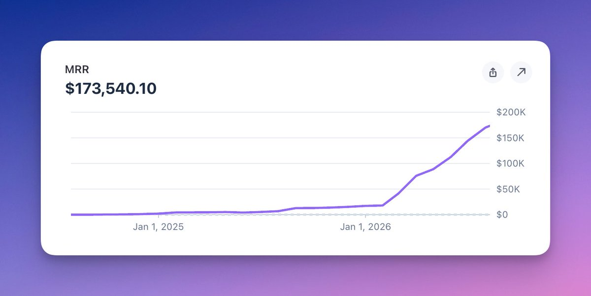

# Nevo David（@wickedguro）：Postiz 突破 $2M ARR，而所有人都在说 SaaS 已死——从卖软件转向卖结果

> 作者运营 agentic 社媒排期工具 Postiz（可自动发帖到 30+ 平台），称其刚跨过 200 万美元 ARR，并公开 Stripe 证据链接，目标是 3 月做到 300 万美元 ARR。核心判断是 SaaS 没死、只是变难：vibe coding 让人人都能造软件，软件本身不再稀缺，所以不该卖 solution 而该卖 result（金钱、播放、客户）。他把付费广告（CAC $50 vs $9/月、B2C churn 撑不回本）、传统 SEO（流量涨但收入不跟）、公司日常更新式社媒、building in public 归为不再加注的老渠道。新渠道加注六个：authority（几乎每天贴 MRR / TrustMRR / DataFast / Plausible 仪表盘）、X articles（saves 与 read time 才是当下被算法放大的信号，用 65 万播放的视频与一篇低互动高 saves 的文章对比验证）、tutorials、AEO（ChatGPT / Perplexity / Claude 的引用来源，内容不必待在自己站上，可铺 Reddit 真回答、LinkedIn 文章、GitHub awesome-list 与 agent 仓库；靠 all-in agents 这个细分绕开 Buffer、Sprout Social）、lead magnets（评论领资料，X 上禁止、LinkedIn 可以、主战场是 Instagram，会被封号就重开）、UGC 与 AI UGC（单条约 $20-30、一个创作者一天 1-2 条、可同时跑 10 个账号，一条爆款播放百万比投放便宜得多）。最后给出一套可复制起步动作，并明确一旦某个东西有效就别再创新，重复到它失效为止。

<!-- more -->

TL;DR - SaaS is not dead, it just became harder. Everybody can vibe code an app now, so software by itself doesn’t sell anymore. If you stop selling software and start selling results, and you move your budget from the old channels to the new ones, you can grow much faster than everyone else. This is exactly what I’m doing to get Postiz from $2M → $3M ARR.

I run [Postiz](https://postiz.com), it’s an agentic social media scheduling tool. It allows you to automate posts to 30+ social media platforms. I share my MRR screenshots almost every day, and Postiz just crossed $2 million in ARR. Stripe proof link (cannot be spoofed):

https://profile.stripe.com/wickedguro/mogMNwGq

In this article, I will show you exactly which channels I am doubling down on to get there, and which channels I stopped believing in.

You should read this article if you have:

- A B2B / B2C app
- A service-based business / Consulting
- An e-commerce store
- Any product that needs distribution

You should not read this article if:

- You think one viral video will save your startup
- You want a magic trick with zero work

You can also watch it as a video here:

> 引用推文：Nevo David (@wickedguro)

> Postiz passed $2,000,000 in ARR! There’s a claim on X that SaaS is dead. Obviously, if that were true, Postiz would die and not have month-over-month growth. I think the main problem today is that SaaS is being flooded, like everything in the open market - the more supply, the...

https://x.com/wickedguro/status/2084249797418996000

### Stop selling software, start selling results

Today vibe coding is everywhere. When I vibe code, somebody else is also vibe coding. We can all build software now, so software by itself isn’t interesting anymore.

In the past, I could sell Postiz as “a tool that schedules your posts”, because scheduling was the problem. Today there are millions of tools that can do this. The real problem people have is distribution. People don’t know how to promote their SaaS.

So here is the difference:

- Problem -> “I can’t schedule my social media posts”
- Solution -> “A platform that schedules all your posts”
- Result -> money, views, customers

You should never sell the solution. Sell the result.

And this is not something new. It just became a lot easier during the arbitrage season, when you could sell a lot of software straight from the LLM hype, and there were not a lot of competitors. That season is ending, so now you need to try a little bit harder.

This is why the creators writing articles about Postiz don’t write “how to schedule posts”. They write how they promoted their B2C app and got millions of views, and Postiz is just one tool inside the process. They might be running UGC or AI UGC, but at the end they need to schedule it all on social media. That’s the content that converts.

> 引用推文：Nevo David (@wickedguro)

> You should talk less about what you have done and talk more about how to do stuff. If you talk about what you have done, you will get a lot of likes and comments. If you talk about how to do something, you will get a lot of saves. X prefers saves and will push your posts more.

https://x.com/wickedguro/status/2085210321296445914

If I kept going on every platform saying “here is how I solve your scheduling”, people would not see a bright future in that. They would say “ok, I’ll schedule a few posts, get 100 views, and bail”. That’s one of the biggest problems in how people promote today.

Now let’s talk about distribution. I’m going to go over the old channels and the new channels.

### The old channels (I would not double down on these)

Ads - There used to be 10 startups launching per day, now there are thousands. They all run ads, so ad prices keep going up. And the math is hard, especially for B2C: if a customer acquisition cost is $50 and they pay you $9 per month, you need them to stay a very long time just to break even. Check your churn - most B2C users don’t stay that long, so you are minus in the bank on every purchase. Some people are smarter and sell only yearly plans ($100 upfront covers the $50 ad); that still works. But everybody will tell you the same thing: ads are becoming harder.

SEO - I pushed hard on SEO with Postiz. Traffic went up and up and up; revenue didn’t follow. People don’t really read blog posts anymore; they ask ChatGPT. I have a free Reddit comment generator tool that gets tons of traffic and barely converts, and I tried a lot of stuff on that page. Maybe others can do it better, but I feel traditional SEO is starting to die. AEO is the replacement; more on that below.

Normal social media - Company updates that you push all the time. Not a lot of people are doing it anymore, and for a good reason.

Building in public - This was interesting a few years ago. Now you can see the biggest indie hackers building in public, getting hundreds of thousands of views, and their MRR is not growing that much. I still post building-in-public content all the time, but it’s not a direct channel for customers anymore.

There are a few more like outreach, press, sponsorships - they fit more VC-backed startups or companies past $100k MRR, so I’m not going to touch those.

## The new channels (this is where I put my money)

### 1. Authority

Almost every day I post my MRR. Some people probably started to hate me for it. I’m not doing it to say “look how much money I make, love me”. Maybe a little bit to inspire people, but my main goal is authority.

If I show real proof - TrustMRR, my Stripe link - people start to believe everything I say, because I have the proof for everything I said. And once people believe you, everything else you do works better.

You don’t need revenue to do this. Have a lot of SEO views? Post them. Share a public analytics dashboard (DataFast / Plausible) and keep posting it. You want people to understand you are one of the strongest people in your niche.

> 引用推文：Nevo David (@wickedguro)

> I just reached 15k followers, and I don’t care for it that much. The whole followers thing doesn’t make as much sense as it did before. I see accounts with 100k followers getting fewer views than me, and smaller ones getting more. Just because somebody is following you doesn’t...

https://x.com/wickedguro/status/2085016054322045394

### 2. X articles

This is one of the biggest growth hacks you can find on X right now. Like every growth hack, it will not last forever. Over time more people will do it and it will become less effective. You should at least experiment with it right now.

X introduced articles at the beginning of the year, and they even ran a competition where the article with the most views wins a million dollars. One person won, it looked totally fake, but it doesn’t matter. What matters is WHY they push articles: every social media platform wants to keep people inside the platform, and articles are basically the only long-form content on X.

When you write an article, two things matter:

- Saves - X is favoring saves over likes and comments right now
- Read time - how long people spend reading your article

I compared it myself: I had a video that got around 650k views with a lot of likes and comments, and an article with a lot fewer likes and comments but a lot more saves, and X kept pushing it. Articles are a growth hack for pushing your stuff.

Some tricks that work:

- Quote-repost your own article with a short ~30-second video. There was an article not long ago that proved they amplify each other: the video is short, the article is long and readable, and together you get a lot more views. Make sure the video and the article are about the same thing; otherwise, the quote repost gets views, and the article itself doesn’t.
- Repurpose everything. A tweet or a video you already made can become an article. If you don’t have a video, go to YouTube and find one that matches the article topic.
- I collaborate with Postiz customers who actually make money (mostly B2C apps) and write articles about how they did it. If you don’t have this proof yet, tell the story of somebody else, as long as it’s really related to your product. It will not have the same social proof, but it can still be very, very sellable.
- I don’t want to take any risk. If I’m paying a collaborator to write an article, I want to make sure it gets a lot of views. So I pay influencers to quote-repost the article (with the paid promotion tag, of course) to amplify it with the algorithm and their followers. Not everybody can do this, and that’s fine: people without the budget just repost their own article many, many, many times.

### 3. Tutorials

I’ve made a few videos that went viral, and each one got me a lot of Postiz subscriptions. The trick is that the content has to be very close to the product: Postiz is about making money on social media, so my videos are about making money on social media.

It works really well because I also have the authority. I know it’s hard when you are starting; I had to grind for years before I could post revenue every day. Find success in a small niche first, then write about it.

### 4. AEO

AEO is how ChatGPT / Perplexity / Claude see you when somebody queries something and they bring out citations.

A lot of people think it’s the same as SEO. It’s actually much, much easier, and here is why: with SEO, the content has to live on YOUR website, because that’s where the visitor lands - they search on Google, click the first result, and register from there. With AEO you don’t need your content on your website at all. ChatGPT searches many, many pages at the same time, so you can plant your content everywhere:

- Reddit - find people asking questions in your niche and write a really good answer. Not LLM slop, a real answer. Here is the interesting part: people used to write Reddit comments to sell to that one person in the conversation. I never did that, it felt like a waste of time, I do viral marketing and I want many people to see everything I do. But now that one Reddit conversation becomes a source for LLMs, so one good comment sells forever.
- LinkedIn articles work really well, and X articles, after some people complained, became searchable by LLMs too. Target those and you can get a lot of traffic.
- GitHub - I list Postiz in a lot of awesome-lists and agent repositories (OpenClaw / Hermes agent / etc.). ChatGPT looks at very high authority websites, and GitHub is one of them.

One important thing: LLMs rank you against your competitors’ content. If there is a lot more content from your competitor, you might not be in the citation. If I compete as “a social media scheduler”, I’m against Buffer, Sprout Social and all the big ones, which is much, much harder. But I went all-in on agents, so if you search “what is the best social media tool for agents”, Postiz comes up, because I have an advantage: all the content I produce is around that niche. The more niche you are, the more specific the queries people make, the easier AEO gets.

### 5. Lead magnets

“Comment X to get Y”. For example: comment AI and I’ll send you my full tutorial.

Don’t do this on X, it’s not allowed (it’s tricking the algorithm). LinkedIn is fine, and the main platform everybody is doing it on right now is Instagram. You can even automate the comment + DM flow with Postiz, starting with Instagram.

What the smart people do: post many videos, find the ONE video that works really well, then reuse the same video on their page non-stop. They just change the cover, the music, and a little bit of the text. Same video, same comment trick, tons of views every time.

You will get banned on Instagram doing this. Don’t be afraid, it’s part of the game, just open a new account. Social media became interest-based - TikTok and Instagram will push accounts with zero followers if the content matches what people want. Warm the account up first: like and comment on content in your niche so the algorithm knows who to show you to. THIS IS A MUST.

The main problem with lead magnets is fatigue, you can’t send the same lead magnet forever. So build one source of truth: one big video / article, and every new lead magnet just points to it. That way you don’t have to create new lead magnets all the time.

### 6. UGC and AI UGC

UGC is people talking about your app on camera. AI UGC is the same but with AI people, which you can create with agent-media, my second startup.

I can’t say I’m amazing at this one, but I work with many people who are. Here is the math: one video will usually not get a lot of views, but you run it at scale. A UGC video costs around $20-30, a creator can produce 1-2 videos per day, and you can run 10 accounts at the same time. It becomes a money game - you keep spending until one video goes viral, then you understand what made it viral and you repeat it many times.

People are reporting that even with all this spend, getting to one viral video is much, much cheaper than ads. One video can get a million views. A million views from ads is extremely pricey. This is why I’m going to double down on this one.

### So what should you do?

If you want to copy this playbook, here is where I would start:

Pick your ONE authority metric - revenue, views, users, a public dashboard (DataFast / Plausible) - and start posting it consistently. This is the foundation, everything else works better on top of it.

Take your best performing tweet or video and turn it into an X article this week. Quote repost it with a short video.

Go to ChatGPT and search for your product category the way a customer would. See who gets cited, then go plant answers in those places: Reddit threads, LinkedIn articles, GitHub awesome-lists.

Open an Instagram account for lead magnets and start warming it up today (like and comment in your niche). It takes time, so start now.

Register for a free 7-day trial for Postiz or an equivalent to schedule everything at scale. Install the CLI with npm install -g postiz and login with postiz auth:login.

Once something works, don’t get creative. Repeat it many, many times until it stops working.

### So what am I doing next?

My goal is $3 million ARR by March, so I’m doubling down on all of it:

- Hiring agencies for UGC and AI UGC
- More lead magnet accounts (I already have two warming up)
- Hiring people for AEO - real, valuable Reddit answers, not bots doing self-promotion
- More tutorials like this one
- 10x on X articles - more creators, more paid reposts
- And of course, keep posting MRR

## 相关页面

- [[concepts/vibe-coding]]
- [[concepts/seo-basics]]
- [[patterns/overseas-website-conversion-loop]]
