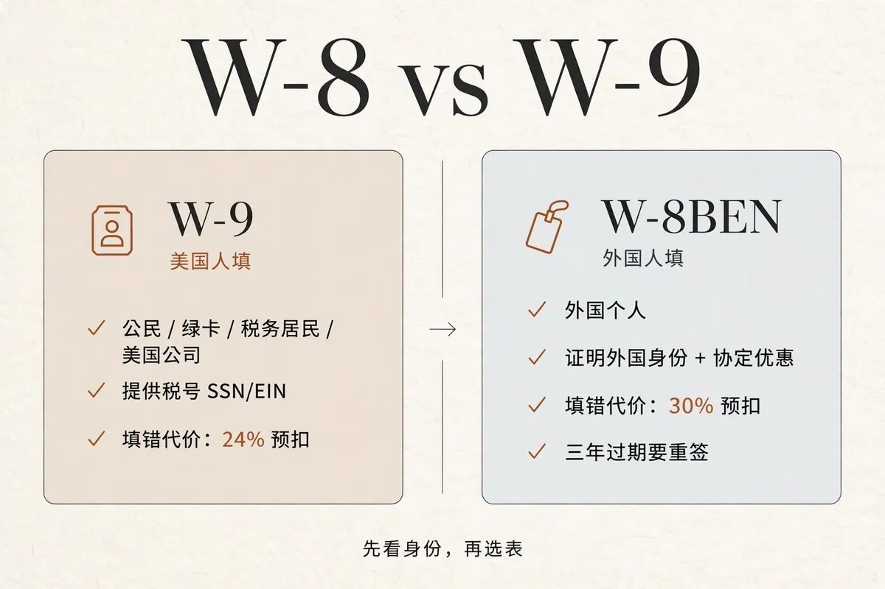
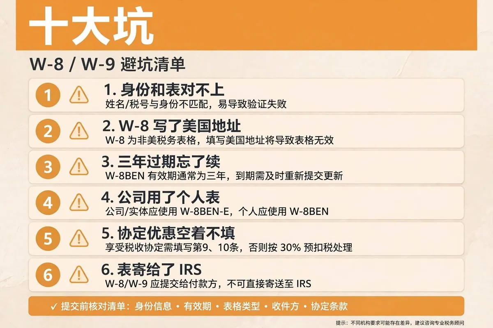
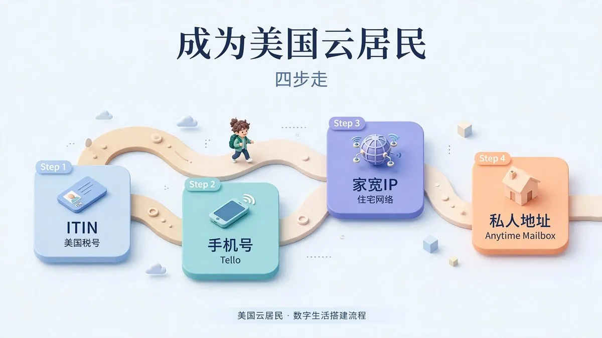

# M.（@wlzh）：人 precious 在国内，却有美国税号、美国地址和美国手机号——美国云居民扫盲

> 出海数字游民与跨境创业者认知升级干货：系统拆解如何人不出境在国内成为「美国云居民」——由浅入深解析美国手机实体卡（Ultra Mobile PayGo）、商业虚拟地址（CMRA 地址租赁与 1583 认证）、个人 ITIN / 公司 EIN 美国税号申请、以及最终合规激活美国银行账户与 Stripe 的完整链路。

<!-- more -->

说实话，我第一次听到“美国云居民”这个词，愣了三秒。

云居民？人都不在美国，算哪门子居民？

但转念一想，这词起得还真准。你的肉身在国内，你的数字身份住在美国——有美国税号、美国手机号、美国私人地址，甚至美国银行账户。办事的时候，系统看的是你那套“美国身份”，不是你人在哪。

这篇我把知道的全倒出来：云居民到底是什么、W-8 和 W-9 到底什么关系、有哪些坑。看完你自己判断要不要上车。

## 一、美国云居民，到底是个啥

你可以这么理解：云居民就是在美国开了个号，但人没过去。

不是移民，不是绿卡，不用肉身去美国。你攒的是一套“美国数字身份四件套”：ITIN 税号、美国手机号、美国私人地址、美国家宽 IP。集齐这四件，你在很多美国网站眼里，就是个“住在美国的人”。

那攒这套有啥用？我给你数数：申请美国信用卡、开美股券商、注册美国公司（LLC）、接美国的 freelance 单子收款……这些场景里，“你是不是美国人”往往是第一道门。

我自己之前把这四件套的教程一期一期做成了视频：ITIN 申请、Tello 手机号、家宽 IP、Anytime Mailbox 租地址。算是踩过一遍了，所以这篇里的坑，都是真金白银换来的。

## 二、四件套逐个讲

1. ITIN：外国人的美国税号

ITIN，全称 Individual Taxpayer Identification Number。你可以把它理解成“给没资格拿 SSN 的人的税号”。

SSN（社安号）是给能在美国工作的人的；ITIN 是给需要在美国报税、但没 SSN 的外国人的。长得都像 xxx-xx-xxxx，ITIN 以 9 开头。

我给自己定的规矩是：ITIN 只干税号该干的事——报税、开户、填表。别拿它去冒充工作许可，那是另一回事。

注意：ITIN 会过期。连续三年没在税表上出现过，它就失效了，用之前先确认还活着。

2. 美国手机号：Tello

很多美国服务注册要收短信验证码，虚拟号经常被拒。所以得搞个实体运营商的号。

我用的是 Tello，5 美元一个月，eSIM，不用换卡，WiFi 通话，长期保号没压力。属于“花小钱办大事”的典型。

3. 美国家宽 IP

简单说：数据中心 IP 一眼就被认出来是机房，家宽 IP 看起来像普通美国家庭。某些风控严的场景，家宽 IP 能省不少麻烦。

4. 美国私人地址：Anytime Mailbox

无论申请美卡还是注册美国公司，有个美国地址能省不少事。

但这里有个坑：地址分私人地址和商用地址。有些验证只认私人地址，商用地址直接不过。所以租的时候要一个一个甄别——美国邮政官网的 zip lookup、firstlogic、smarty 这三个工具能查地址属性，免费版够用。

## 三、W-8 和 W-9：云居民绕不开的两张表

好，四件套讲完了。现在上硬菜。

你成为云居民之后，早晚会遇到一个场景：美国公司/平台要给你打钱，打钱之前让你填一张税表。二选一：W-8，还是 W-9。

选错了，真金白银地疼。所以先把这俩的关系一次讲透。

你可以这么理解：付款方就像个门卫，W-9 是美国人的工牌，W-8 是外国访客的登记证。你掏哪种证件，决定了他怎么对你。

一句话：W-9 是美国人填的，W-8 是外国人填的。先看身份，再选表。

W-9W-8BEN 谁填美国人（公民、绿卡、税务居民、美国公司）外国个人给谁付款方（不寄给 IRS）付款方/券商（不寄给 IRS）干啥提供税号，证明“我是美国人”证明“我是外国人”，顺便申请税收协定优惠税号 SSN/EIN 外国税号或 ITIN 有效期信息不变就一直有效签署后到第三年年底过期不填/填错的代价 24% backup withholding（预扣）30% 预扣

W-8 还有几个兄弟，提一嘴：W-8BEN-E 是给外国公司/实体填的（你注册了 LLC 就用它，不用 BEN）；W-8ECI、W-8IMY 是特殊场景，一般人碰不到。

举个我自己的例子吧：云居民最常见的场景——人在国内，接美国公司的活，对方打钱前让你填表。你是中国人、无美国身份，填 W-8BEN。中美有税收协定，表上把协定优惠主张了，股息这类收入的预扣能从 30% 降到 10%。这 20 个点的差，就是这张表值钱的地方。

## 四、十大坑，一个一个说

前面是知识，下面是学费。我把最常见的坑列出来，每一个背后都是真钱。

坑 1：身份和表对不上

外国人填了 W-9，或者美国人填了 W-8。这是最贵的一课——付款方按错误身份预扣，24% 或 30% 直接扣走。记住：先看身份，再选表，顺序别反。

坑 2：W-8BEN 上写了美国地址

W-8BEN 的永久地址栏，永远不能写美国地址。哪怕你真在美国住过、哪怕你有个美国地址能收信——写了，这张表就废了。这是 IRS 的硬性规定，没有例外。

坑 3：拿 PO Box 当永久地址

邮政信箱、转交地址（C/O），一律不行。永久地址必须是真实居住地址。

坑 4：没签名、没日期

听起来离谱，但真有人交了没签名的表。没签名=没认证=废纸。

坑 5：三年过期忘了续

W-8BEN 签署后，到第三年年底过期。比如 2026 年签的，2029 年 12 月 31 日到期。长期合作的单子，表比合作先过期是常事。设个提醒，过期前重签一张。

坑 6：公司用了个人表

你注册了 LLC，对方让你填表，你填了 W-8BEN——错了。公司/实体用 W-8BEN-E。个人和实体，表不一样。

坑 7：税收协定优惠空着不填

很多人 W-8BEN 交了，但协定优惠那栏空着。等于主动放弃减税：本来能按协定 10% 预扣的，乖乖交了 30%。该主张的主张，这是你的权利。

坑 8：表寄给了 IRS

W-8 和 W-9 都是交给付款方的，不是寄给 IRS 的。IRS 不收这个。

坑 9：身份变了，表没更新

搬到美国了、拿绿卡了、变成税务居民了——之前的 W-8BEN 自动失效，30 天内得重交。还拿旧表当护身符，迟早出事。

坑 10：名字和税号对不上

W-9 上的名字和 SSN/EIN 对不上，付款方会收到 IRS 的不匹配通知，直接上 24% backup withholding。填表前先核对一遍，拼写、连字符都别错。

## 五、其他注意点

云居民 ≠ 美国税务居民。 这是两码事。攒齐四件套，不代表你在美国有纳税义务；反过来，也别因为有了 ITIN 就把自己当 US person 填表。身份认定看的是税法（公民/绿卡/实际居留天数），不是你有几张美国的卡。

远程开美国个人银行账户，基本别想。 主流银行开个人户要求本人到场，ITIN 也救不了。公司户（LLC + EIN）倒是有远程路径，但那是另一个话题了。

地址甄别别偷懒。 租地址时花十分钟查一下是私人还是商用，能省掉后面一堆验证失败的麻烦。

所有信息，如实填。 税表是法律文件，伪造身份信息不是“小聪明”，是联邦重罪。云居民玩的是“合法拥有美国数字身份”，不是“假装美国人”。

## 写在最后

说实话，云居民这套东西，门槛不在技术，在信息差。ITIN 怎么申、手机号哪家好、地址怎么甄别、税表怎么填——每一步都有人踩过坑，也都有人写过教程。

我把之前做的“成为美国云居民”系列视频整理成了一个专辑，从 ITIN、手机号、家宽 IP 到私人地址，一期一期手把手来的：

美国云居民专辑：[https://www.youtube.com/playlist?list=PLZ3bI9CowsE8](https://www.youtube.com/playlist?list=PLZ3bI9CowsE8)

W-8 和 W-9 这篇算是给专辑补了个“税表篇”。如果你正在走这条路，建议把专辑从头看一遍，再回来对照这篇把表填了。

我们一起，把这条路走稳。

## 相关页面

- [[sources/tiancai-us-credit-card-forwarding-anytime-mailbox-pirateship]]
- [[sources/noahduck-stripe-complete-guide-from-beginner-to-advanced]]
- [[concepts/overseas-tool-stack]]
- [[concepts/digital-products-side-income]]
