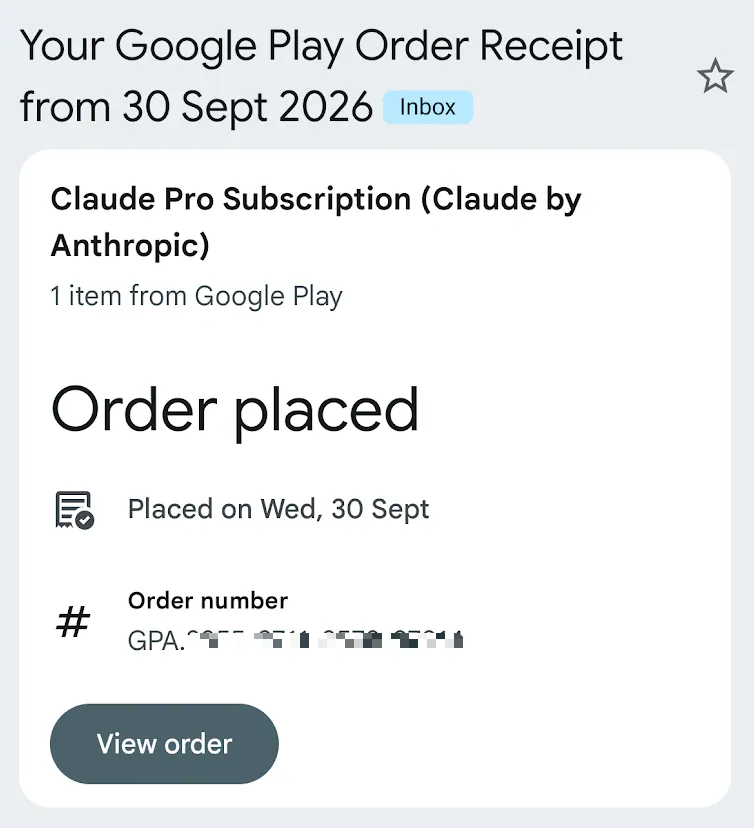
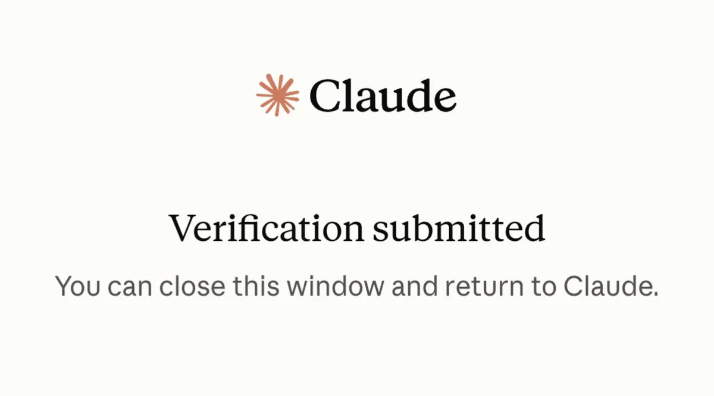

# WquGuru（@wquguru）：普通人的 Claude 订阅方案（从 0 到 1 完整版，含支付和身份认证）

> 解决国内用户订阅 Claude Pro / Max / Team 核心堵点的全流程指南：从原生洁净 IP 节点选择、国外虚拟卡及 Apple ID 礼品卡充值路径、海外手机号短信接码平台选择，到规避 Anthropic 严格地域与支付风控的常见错误操作清单，帮助新手开发者顺利开通并稳定持有 Claude 会员。

<!-- more -->

几个月前写的一篇[Claude 订阅教程](https://x.com/wquguru/status/2040351401243824244?s=20)获得了30万次阅读、上千点赞收藏，这个方案已经过数次大规模封锁的实战检验，这篇文章将介绍从 0 到 1 的全流程，含信用卡申请+实名认证方案。

开门见山，先说本文重点：

1. Claude：使用 Gmail 注册登录
2. 支付：新加坡万事达 + Google Pay 付款（要有支持 Google Pay 的安卓手机）
3. 身份验证：大陆护照即可（原因参见https://x.com/wquguru/status/2106269312088699206?s=20）
4. IP：Webshare 的新加坡固定住宅 IP 做出口
5. 本地代理：Mac 用 Clash Party，iPhone 用 Shadowrocket，安卓用 FlClash

配置完成后，Claude、Gmail、Google Pay 看到的将是同一落地 IP。

风险提示：1. 本文虽然经过测试验证，但不保证所有人都能正常 work；2. 整个流程需要一些额外开支（申请信用卡、以及落地 IP）和动手能力，并非 0 成本 0 门槛。



引用推文：WquGuru (@wquguru)

Claude 今天赠送“十一国庆大礼包”，身边好多朋友一大早起来就收到封号邮件。这轮封号有一个很明显的特征，就是同设备上登陆多个 Claude 账号，这里就引出了几个规避风控的重点，我总结为五大隔离： 1. 设备隔离：同一台设备不登陆多个 Claude 账号，如果确实有需要一定要完整删除 Claude 配置信息后再登陆新账号 2. IP 隔离：不用动不动就万人共享的 IP 连 Claude，有条件上精品住宅 IP，越少人用越安全 3. 支付隔离：原则上越难获取的支付方式越安全，亲自体会是欧美个人实体信用卡>有门槛的虚拟信用卡>无门槛虚拟信用卡>=礼品卡 4. 身份隔离：一...

https://x.com/wquguru/status/2105574312568852764

## 前置

重点：Claude 账号不在这一步注册开通

Gmail 账号：

- 付款资料如果还是大陆地址，需要修改为新加坡
- 新加坡地址去去哪儿 App 找家酒店即可，用英文

新加坡万事达信用卡：

- 用身份证和护照注册 [Starryblu](https://sg.starryblu.com/x/6RrBGwYM)（填写MHQK058邀请码）
- 发送注册 ID（App 顶部可以拷贝 ID）到 hello@wqu.guru 加白名单
- 开通会员（最低等级的 9.9 美元的星空卡即可，只需首月），然后申请虚拟信用卡（挂🇸🇬梯子）
- 重点：加白名单+开通会员缺一不可，官方已经关闭了免费账户的信用卡申请渠道；同时需要挂新加坡梯子；两者皆达到了，可以当天下卡

落地 IP：

- 登录 [Webshare](https://www.webshare.io/?referral_code=zz3uzn04mtkn)
- 购买一个静态 IP（注意选择 250 GB/月的独享 IP，位置选新加坡，仅$1.5/月，如果买贵了或者便宜了，说明选的配置不对）

## 配落地 IP、时区、语言

买 IP 的时候注意这三个选项：

- 国家新加坡
- 独占选 Private
- 类型是静态住宅，不要 Rotating

买完把地址、端口、用户名、密码记下来，Mac/iOS/Android 配置都需要。

完整配置文件放在 [https://github.com/wquguru/one-exit](https://github.com/wquguru/one-exit)

Mac：Clash Party

配置详见：https://github.com/wquguru/one-exit/blob/main/clash-party/override.yaml

1. 左侧「覆写」粘贴下面的链接导入，然后在本地把尖括号里的占位符改成你的 webshare 代理信息：https://raw.githubusercontent.com/wquguru/one-exit/main/clash-party/override.yaml
2. 注意改完不要再更新这份覆写，更新会把账号盖回占位符
3. 改完后打开面板上内核设置（Core Settings），点旋转按钮重启服务

Claude Code 不读系统代理。用之前务必在 ~/.zshrc 或者 ~/.bashrc 里让终端走 7890：

```
export http_proxy=http://127.0.0.1:7890
export https_proxy=http://127.0.0.1:7890
export all_proxy=socks5://127.0.0.1:7890
```

iPhone：Shadowrocket

规则列表参见：https://github.com/wquguru/one-exit/blob/main/shadowrocket/one-exit.module

1. 首页添加节点，类型 HTTP。备注必须是 SG_Residential，和模块里的策略名一致，同时填写 webshare IP 的地址、端口、用户名、密码
2. 点这个节点后面的 ⓘ，设置「代理通过」。选一个固定节点，或选一个测速分组。这一项写不进配置文件，留空就是从手机直连住宅端口
3. 底部「配置」→「模块」→ 右上角 ＋，粘贴下面的链接再下载：https://raw.githubusercontent.com/wquguru/one-exit/main/shadowrocket/one-exit.module
4. 重要：首页全局路由选「配置」，选「代理」时这些规则不生效

安卓：FlClash

覆写脚本参见：https://github.com/wquguru/one-exit/blob/main/flclash/claude-google.js

FlClash 的覆写规则是 js 脚本，具体做法是把上述脚本拷贝到覆写规则里：

1. 工具 → 进阶配置 → 脚本 → 添加，选择通过 URL 导入：https://raw.githubusercontent.com/wquguru/one-exit/main/flclash/claude-google.js
2. 配置->选择机场配置，点击右边的配置按钮，然后覆写->脚本->选中刚刚加入的脚本
3. 在仪表盘，重启连接

时区和语言

- 时区改为新加坡时区（虽然也是东八区，但是有不同名字）
- 系统语言建议改成英语

## 验证落地 IP 有效性

每台设备各做一次，都要看到我们的新加坡 IP：

1. MacOS：终端中输入 curl [https://ipv4.webshare.io/](https://ipv4.webshare.io/)
2. MacOS/Android/iOS：浏览器中访问 [https://ipv4.webshare.io/](https://ipv4.webshare.io/)

预期都能展示新加坡 IP，表示落地节点配置正常。

## 开通 Claude 账号

重点：Claude 的安卓手机 App 会检测 SIM 卡所在国家，务必拔出卡再操作，建议用一台独立手机操作

IP 验证正常后：

1. 把万事达卡加进 Google Pay。这里对一下付款资料：国家和账单地址要是新加坡
2. 浏览器打开 [https://claude.ai/login](https://claude.ai/login)，用 Gmail 登录，先养一阵免费账户

## 养账号并开通会员

1. 先只用 App，每天正常用，仿照新加坡用户习惯，最好用英文，大约 5 到 15 天，至少 5 天（在安卓机上进行）
2. 5 天过后，在 Claude App 中点击升级套餐，只升级到 Pro（$20/月级别），继续正常用 3-5 天 Claude App（在安卓机上进行）
3. 如果升级后提示实名认证并跳转到 withpersona.com，使用中国护照实名即可（在安卓机上进行）
4. 开始使用 Claude Code，注意先删除原来的 ~/.claude 和 ~/.claude.json，不要和别的号混用，轻度用 3 到 15 天
5. 之后按正常用量用，从 Pro 用起，稳定后再考虑升级，用量在 50% 到 80% 之间，不要打满



## 彩蛋：五大隔离

最后附上几个规避风控的重点，我总结为五大隔离：

1. 设备隔离：同一台设备不登陆多个 Claude 账号，如果确实有需要一定要完整删除 Claude 配置信息后再登陆新账号
2. IP 隔离：不用动不动就万人共享的 IP 连 Claude，有条件上精品住宅 IP，越少人用越安全
3. 支付隔离：原则上越难获取的支付方式越安全，亲自体会是欧美个人实体信用卡>有门槛的虚拟信用卡>无门槛虚拟信用卡>=礼品卡
4. 身份隔离：一人多号是风控重点，tb 找的代认证，很可能是一人绑多号，一查一个准
5. 场景隔离：生物技术研究、网络安全研究场景，尽量不要用 Claude 来做，触发次数过多也容易被风控

## 更多系列文章

1. 无需信用卡，五分钟搞定 Muse 注册和使用（附永久有效 310 亿 token 教程） [https://x.com/wquguru/status/2104154913001599080](https://x.com/wquguru/status/2104154913001599080%EF%BC%88%E5%AF%B9%E5%BA%94)
2. 图解 KV Cache——DS V4.1-Flash 的制胜秘密 https://x.com/wquguru/article/2099119760248389730
3. 图解 ASR 和 TTS：HuggingFace 开源模型测评 https://x.com/wquguru/status/2096013016429211791
4. 图解大语言模型部署 https://x.com/wquguru/status/2093634146082152683
5. Agent Memory 架构全景：从规则文件、会话检索到反思与技能沉淀 https://x.com/wquguru/status/2069641926752780384
6. 成瘾者：色情、赌博与 Vibe Coding https://x.com/wquguru/status/2022173077329871138

如果这篇教程对你有帮助，欢迎 关注 + 收藏 + 转发 👏🏻

持续分享新手友好的 AI Agent 教程和 AI 工具使用心得，关注 [@wquguru](https://x.com/intent/follow?screen_name=wquguru)

## 相关页面

- [[sources/ryan-muse-x-account-dedicated-proxy-ip-guide]]
- [[sources/xaiwind-telegram-from-beginner-to-master-developer-guide]]
- [[concepts/ai-free-quota-rotation]]
- [[concepts/overseas-tool-stack]]
