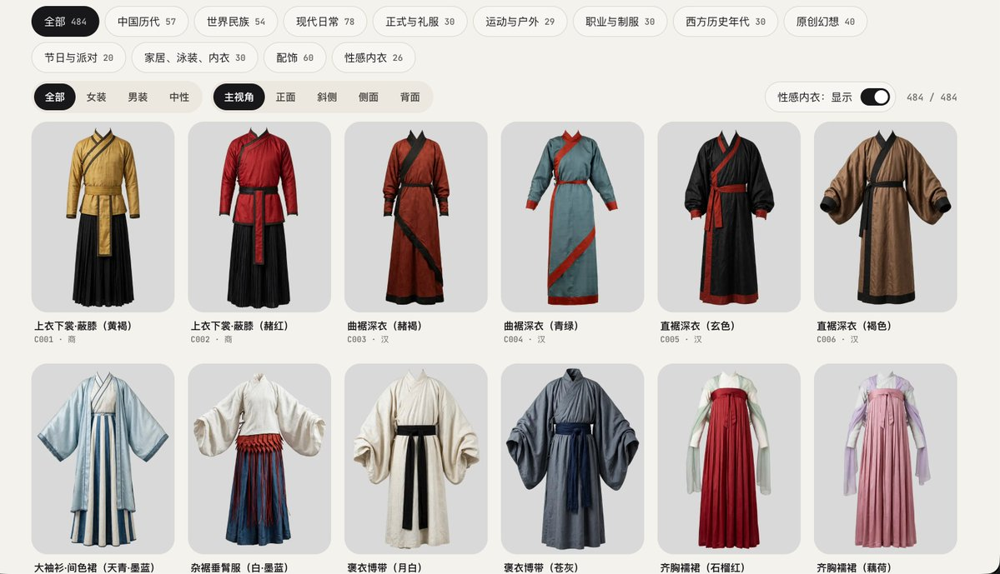

# WquGuru（@wquguru）：Shisei 开源中国历代四视角服装库——从商朝到民国 227 张 CC0 资产

> 为 Midjourney 垫图、古风短剧角色换装与画师参考整理的中国历代立体服装库：涵盖商朝到民国 57 套典型服饰及婚服，每款配备正面、斜侧、正侧、背面 4 个视角及多配色方案，全部以 CC0 协议开源分发。

<!-- more -->

227 张中国历代四视角立体服装图，CC0 协议，从商朝一路到民国。

这是 https://github.com/wquguru/shisei 刚上线的服装库重头戏，专门整理了从商到民国的 57 件服饰，外加婚服。

衣服保持穿着时的立体轮廓，每件给足正面、斜侧、侧面、背面四个角度：

汉代深衣、魏晋大袖衫、宋代褙子、元代质孙服、明代道袍和补服、民国旗袍与长衫都在里面，大多数款式有两种配色。

不管是给 Midjourney 垫图、做古风短剧角色换装，还是画师查背面衣褶结构，直接打包拿走就行。

代码开源，链接在评论区。下一个中国传统题材，你们希望补哪类服饰？

1000+ 个姿势机位的线稿、白模、深度和法线图，免费拿走。

我给开源姿势库 Shisei（免费商用，自由分发）更新了这批图，包含正面、斜侧、侧面、俯视、仰视最多五个机位，和线稿逐像素对齐，可以直接喂给 ControlNet、视频模型来控制动作。

想自己跑的，我也把这套环境打成了免费镜像。让 Agent 调优云智算/UCloud 的命令行，就能自主完成 GPU 机器查价->租用->运行->释放全流程：

npx skills add compshare-cn/compshare-cli --skill compshare-cli

链接和用法见评论区，你控制姿势最常用哪种类型的图，或者你平时租用 GPU 需要人去界面上点击吗？

[演示视频](https://video.twimg.com/amplify_video/2117255868291145728/vid/avc1/1080x1620/lCUW9h9voW0oUirC.mp4?tag=29)

400+ 服装完整四个角度直达链接：https://shisei.indaloop.app/costume/

GitHub 全开源：https://github.com/wquguru/shisei

## 相关页面

- [[sources/zone-ai-ref-library-and-char-db-cn]]
- [[concepts/openai-image-models]]
- [[concepts/ai-content-pipeline]]
