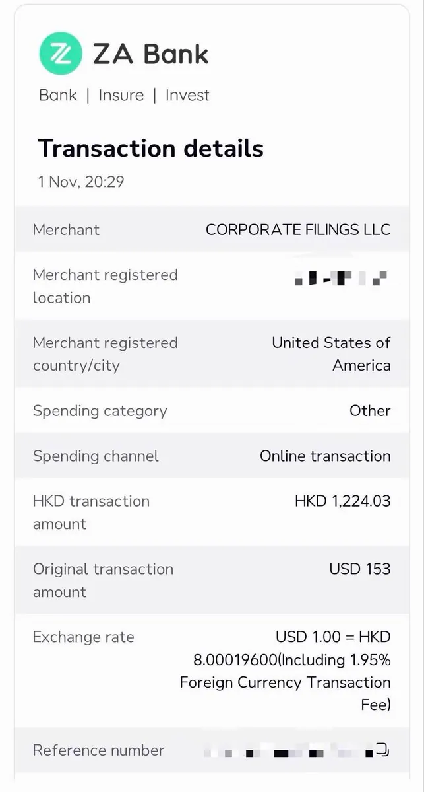

# WquGuru（@wquguru）：独立开发者出海注册与维护美国公司指南（成本/避坑/报税/苹果开发者）

> 独立开发者出海成立美国公司（怀俄明州 LLC）实战手册：首年约 1800 元、后续约 1300 元/年的低成本架构，无需实体地址并保护个人隐私；详解每年必须按时申报避免 2.5 万美元罚款的合规底线、穿透实体税务机制、苹果开发者组织账号开通，以及对比香港/新加坡公司的维护成本优势。

<!-- more -->

没想到，注册和维护一家美国公司，比在国内开公司方便太多，费用甚至还更低。

完整教程 + 给 Muse / Grok 的一键提示词，放评论区了。

先说重点：

1. 注册成本：首年全下来约 1800 元（公司注册 $153 + 苹果开发者组织账号 $99）
2. 维护成本：约 1300 元/年，但有个大坑：每年必须按时提交信息申报，漏一次罚款 25000 美金起
3. 实体地址：不需要，注册代理提供美国地址
4. 国内手机号、国内住址：都能用，住址只填在私密材料里
5. 隐私性：姓名、地址、电话都不进美国政府公开记录
6. 税费：公司在美国层面 0 所得税，只有申报义务；利润转回国内，正常交 20% 个税

适合做 App 出海、要美元收款、想用英文公司名当卖家的人。

完整教程（附提示词，丢给 Grokbot 或 Muse 即可）：https://muse.ai/s/llc-apple-muse-mxk63xappa4w0/1fv8TJIG5qqKTBn8by7qL-Y0AeJ_utnNUKBU6xYSmsI

同样安利一下 @GoSailGlobal 的教程，有详细踩坑经验 https://x.com/GoSailGlobal/status/2116385939148947601

https://t.co/2VaKW2aXLN

为什么一定要是美国公司（怀俄明最好）https://x.com/fiapp_pro/status/2117259908756521322

个体户一定要注册美国公司，

常见的香港公司维持费用 1k usd 起步，新加坡更吓人，还要招一个新加坡本地名义董事吃白饭，

如果是 Stripe atlas 注册的公司，记得去减少股份数，这样维持成本可以从五百降到二百五，大省钱

## 相关页面

- [[concepts/b2c-conversion]]
- [[concepts/digital-products-side-income]]
- [[sources/victor-uwer-tool-site-vertical-niche-for-profession-strategy]]
