# Rebuilding the global town square from scratch

> X 工程团队用 AI 编码代理在 6 个月内重写 x.com Web 应用：三个渲染服务器（rweb / rweb SSR / Jetfuel SSR）合并为一个，React + Relay + Fastify（Platformatic Watt），慢速连接下首帖展示从 22+ 秒降到 2.7 秒；先服务登出流量与爬虫，再按国家逐步放量登录用户。原站被 Cloudflare 拦截，正文存档取自 Wayback Machine（2026-11-10 快照）。

<!-- more -->

Open a profile on X.com over a slow connection. On the old web app, you'd stare at the X logo for more than 22 seconds before the first post appeared. On the new one, it shows up in 2.7.

That new web app replaces the three servers we used to run for people, search crawlers, and link previews with one. It already serves logged-out X.com and the pages search engines crawl. Signed-in X.com is next. We tested it with employees and testers on lite.x.com, and now we're moving signed-in people over slowly, one country at a time.

X.com is the sixth most visited website in the world, according to [Similarweb](https://www.similarweb.com/top-websites/). Five engineers, working with AI coding agents, built the first version of its new web app in under six months. The team has grown as signed-in pages move over, and more than 20 people have committed to the app since the end of September.

This post covers why we rebuilt X.com, how we're rolling it out country by country, and how the old and new apps compare today. It also covers the performance work we've done since logged-out traffic moved over.

## A brief backstory

x.com has been rebuilt before. In 2017 we launched [Twitter Lite](https://blog.x.com/engineering/en_us/topics/open-source/2017/how-we-built-twitter-lite) (capitalized terms used in this section defined therein), a Progressive Web App at mobile.twitter.com built for people on slow connections. It was a client-side React application with a small Node.js server that rendered an HTML application shell. Once the shell loaded, the browser fetched data directly from our APIs. Keep that detail in mind, because it's at the root of the slow-connection problem we'll get to later. In 2019, the same codebase became [the new Twitter.com](https://blog.x.com/engineering/en_us/topics/infrastructure/2019/buildingthenewtwitter) on desktop, built around "one codebase - one website" for every device.

That app, which we call rweb (short for responsive web), has served x.com for most of the last decade. Over the years, we added more servers alongside it, each with its own purpose:

- **rweb** rendered the app in the browser for both logged-in and logged-out users.

- **rweb SSR** rendered the same app on the server for search crawlers, with its own rules for cleaning up URLs.

- **Jetfuel SSR** was a separate server-rendered site for logged-out pages that search engines index, including events, Spaces, Communities, Trends, search, and news articles.

Each server did its job well. The trouble was that there were three of them: a single page on x.com could be built in three different ways.

## Three servers became one

Which server answers each kind of visitor, before the rewrite and today.

## The problem

One URL on x.com has three very different audiences. Take x.com/elonmusk.

A person on a phone or a laptop wants to see the profile and the latest posts as quickly as possible, then scroll and maybe sign up.

A search crawler such as Googlebot or Bingbot wants complete HTML: the posts, structured data that describes them, links to every language version of the page, and the right status code when an account doesn't exist.

A link-preview bot, like the ones behind iMessage, Slack, or Discord, wants the page's title, description, and image. Everything else on the page is wasted work for it.

Serving all three is hard because of how x.com's data is shaped: it's a graph. A post has an author, the author has a profile, and the post may quote another post with its own author and media. The browser discovers most of that graph only after it has downloaded and ran the code that asks for it. Remember the application shell from Twitter Lite? This is where it hurts. On rweb, a logged-out visitor's browser downloaded the shell, then the JavaScript, then ran it, then requested data from our GraphQL API, and only then rendered the profile. On a fast connection, you barely notice that chain. On a slow one, every step is another round trip, and the visitor spends all of that time staring at a splash screen.

## Work before the first post appears

Steps in order, not to scale.

rweb SSR and Jetfuel SSR solved the crawler half of this problem by rendering HTML on the server. The catch was that they solved it separately, from each other and from the app people used. A fix to a page's meta description, structured data, or 404 behavior could need to land in three codebases.

Some problems don't show up in a design doc. You only find them after years of running the system.

**Three servers drift.** Every SEO fix could land in one server and miss the others. Keeping them aligned was a constant, mostly invisible tax.

**Logged-out visitors got the slowest path.** Crawlers got finished HTML from rweb SSR or Jetfuel SSR. People who weren't logged in got rweb's application shell and had to wait for JavaScript to render the page. The bots got the better deal.

**The stack aged unevenly.** rweb combined a normalized Redux store with Relay, styled components through React Native for Web, type-checked with Flow, and shipped separate modern and legacy bundles. Each choice made sense when it was made. Together they made everyday changes slower than they needed to be. We call the result death by a thousand cuts: each problem was small on its own, and together they made the app hard to maintain and hard to keep fast.

## The decision

At this point, we had three options.

The first was to keep improving rweb in place. We'd done a lot of that over the years, and it kept the site healthy. But it also kept all three servers, and giving logged-out visitors server-rendered HTML would have meant building a fourth rendering path. A fourth.

The second was to go a step further and replace rweb's toolchain while keeping its architecture: Webpack and Babel with Vite, Flow with TypeScript, and our Express server with Fastify. Each of those changes touches nearly every file in the codebase, and at the end of it, the architecture that caused the problems would still be there.

The third was to build a new application that serves every audience from one server, move traffic to it gradually while rweb keeps serving everyone else, and fold both SSR servers into it along the way. That's the one we chose.

In 2019 we wrote that "big migrations like this are risky and difficult to pitch." That's still true. What made this one possible is that it happens gradually: logged-out visitors first, then signed-in people one country at a time, and the old servers keep running until everyone has moved.

There are two fair objections to a rewrite like this.

**"Never rewrite from scratch."** Joel Spolsky's [advice](https://www.joelonsoftware.com/2000/04/06/things-you-should-never-do-part-i/) is well earned: big rewrites tend to stall while the old product keeps moving. We kept rweb shipping the whole time, moved traffic over gradually, and tested the new app against the old servers as specifications. With agents doing much of the implementation, the rewrite took months, which left the old product little time to pull ahead.

**"Why not just upgrade Webpack?"** Faster builds would help the people building x.com. They wouldn't give the visitor on a slow connection server-rendered HTML, and they wouldn't turn three servers into one. Those were the problems worth a new app.

## What we kept

Rewrites have a way of making the old code sound worse than it was. A lot of what worked in the old stack made it into the new app.

**rweb got the product model right.** One responsive codebase that adapts to screen size, input method, and network conditions is still how we build for the web. rweb also moved x.com to GraphQL and Relay, which the new app builds on directly.

**rweb SSR knew how x.com URLs break in the wild.** Over the years, rweb SSR collected rules for URLs that arrive mangled: search queries with trailing punctuation, language parameters glued onto queries, and intent links that chat apps wrap in extra characters.

**Jetfuel SSR took search seriously.** Jetful SSR pages carried detailed structured data, linked every language version of each page, and returned real 404s for content that doesn't exist.

A rewrite is a chance to throw things away, and it's tempting to throw away too much. We kept:

- The same URLs, including the redirects and aliases that people and crawlers already depend on.

- rweb SSR's URL cleanup rules, ported to the new server.

- Jetfuel SSR's structured data, language alternates, and 404 pages, rebuilt as shared components.

- Jetfuel's link-preview card images, redrawn pixel for pixel by a new Rust service.

- One responsive codebase for every device.

## The new stack

The new app is built on Vite, React, Fastify, Platformatic Watt, Relay with GraphQL, and XDS, our new component library. A server package of our own ties them together.

- ****[Vite](https://vite.dev/) builds the client and server bundles with Rolldown and powers local development. Logged-out and signed-in visitors get separate client entry points, so logged-out pages only download logged-out code.

- ****[React](https://react.dev/) renders on the server and in the browser, with streaming server rendering and Suspense.

- ****[Fastify](https://fastify.dev/) handles every request, from middleware to the final HTML stream. Our `@x-clients/server` package assembles it from configuration: security headers, cookies, metrics, streaming rendering, and graceful shutdown.

- ****[Platformatic Watt](https://docs.platformatic.dev/docs/overview/what-is-watt) runs the server on Node.js v26 as several worker threads in one process. It replaces any worker whose event loop or memory stays over its limit, so one stuck render only affects that worker's requests.

- **[Relay](https://relay.dev/) and [GraphQL](https://graphql.org/)** fetch and cache data, with each component declaring the data it needs.

- **XDS**, our new component library, gives the app more than 40 components, from buttons and menus to dialogs, tooltips, and toasts, built on Base UI and Tailwind CSS. Five other X web apps use it too, and the features we share with rweb bring its styles there.

- ****[TypeScript](https://www.typescriptlang.org/) and ****[Tailwind CSS](https://tailwindcss.com/) cover types and styling. Type checks run on tsrs, a Rust port of the TypeScript compiler.

## One server for every audience

The new server decides how to render each request based on who's asking.

**People get streaming HTML.** The server sends the page shell as soon as it's ready and streams in each part of the page as its data arrives. Each GraphQL response the server received travels in the page once, so the browser can reuse it without asking the API again.

**Verified search crawlers get complete documents.** For search engines, the server waits until every part of the page has been rendered and sends the whole document at once, with structured data and every Suspense boundary resolved in place. We make that call based on our edge's verification of the crawler's IP address. Why not check the User-Agent header, which is the common approach? Two reasons. First, it would buffer performance tools like Lighthouse along with real crawlers. Second, it would let anyone request the more expensive path by changing a header. With verified IP addresses, our Lighthouse runs measure the same streamed page people get.

Crawler documents never hydrate, so they carry no client bundle, no router state, and no placeholders that only our JavaScript would replace. Size matters here more than you'd think. Googlebot reads only the first 2 MB of a response, and the HTML of a long thread can run past that. We'll get to how we brought those documents back under the limit in the performance section.

**Link-preview bots get only what they read.** These are the bots that unfurl links, such as Slack, iMessage, Discord, WhatsApp, Signal, Facebook, LinkedIn, Telegram, and Snapchat, to name several. For them, the server runs the route's data loading and head tags and skips rendering the page body, and the loaders skip the timeline and conversation requests that only the body needs. The response carries the title, description, and card image that the bot reads. Any other crawler that our edge hasn't verified gets exactly what a logged-out visitor gets. That includes a request that claims to be a search engine but comes from an unverified IP address.

**Card images come from a Rust service.** The image in a post's link preview is a PNG drawn on demand. Jetfuel used to draw those cards with a JavaScript service. It could only use more cores by running more instances, which share no memory, and during incidents it had taken about two minutes to respond. So we rewrote it in Rust. The new service lives in the same monorepo as the new app and answers the same routes: posts, media previews, subscriptions, cashtag charts and Money. A record-and-replay test harness checks every card against committed baselines, and a second harness compares the new cards with the old service's, pixel for pixel.

## Data and navigation

Every route declares its data up front. When a request comes in, route loaders start the GraphQL requests the page needs while the server is still rendering. The page carries each GraphQL response the server received, once, as JSON text. The browser starts with an empty Relay store and replays those responses into it, so a component that asks for data the server already fetched gets the server's response without a network request. The browser holds responses that nothing has read yet for 30 seconds after the stream ends, so a tab or dialog opened soon after still finds them.

Client-side navigation works the same way. Links preload a route's code and data when someone shows intent to visit it, by hovering over or focusing the link. Posts in a timeline aren't plain links, so a post preloads when the mouse moves onto it and rests there for 100 milliseconds, or presses it. A post that scrolls under a still pointer doesn't preload. Since September, 21 more routes start their main query from the route loader, so a hover preload fetches their data along with their code.

rweb still has one advantage we're catching up on. It kept so much data in a client-side cache that moving between screens often felt instant. Intent-based preloading is how we're closing that gap.

## How a small team built it

So how did fewer than five engineers build the first version in under six months? The short answer is AI coding agents.

The engineers set the architecture, decided what to build, and reviewed every change. Agents did much of the implementation: porting behavior from the old servers, converting pages, writing tests, and fixing what CI and reviewers flagged. That only works if you can trust what the agents produce. Three things got us there.

**Shared instructions.** One file at the root of the repository, `AGENTS.md`, tells every agent how we write code: named exports, no barrel files, validation of external data at trust boundaries, which tests are worth writing, and that nothing gets committed until lint, typecheck, and the relevant tests pass. Every agent, and every new engineer, starts from the same rules.

**Skills in the repository.** Recurring workflows live next to the code as skills that agents follow step by step, more than 25 of them: writing commits, opening and stacking pull requests, reviewing code, shepherding a pull request through CI, changing dependencies, adding translations, and working with Relay and our router. When a workflow changes, we update its skill once, and every agent picks it up.

**Guardrails on every commit.** We turned our conventions into lint rules. Custom oxlint plugins check Relay usage, Tailwind classes, tests, and translations. And yes, we have an "anti-slop" plugin. It rejects patterns agents tend to produce, such as chained type assertions, parameters typed as `unknown`, and conditional spreads of empty objects. A pre-commit hook formats, lints, and type-checks every change before it lands, and a pre-push hook lints the packages that import it.

The migration itself suited agents well, because rweb SSR and Jetfuel SSR were working specifications. An agent could read how an old server handled a URL or a page type, port the behavior, and write a test that pins it down, and a reviewer could check the result against the original.

For the engineers, the job shifted. We spent less time writing code and more time deciding what the system should do, then checking in a real browser that it actually does.

## Moving the traffic

### Search crawlers first

Moving crawler traffic is the riskiest part of any web migration, because search engines notice everything: a missing structured-data field, a changed canonical URL, a 404 that used to be a redirect.

We treated both SSR servers as specifications. For each page type, we compared what Jetfuel SSR or rweb SSR returned with what the new app returned, and closed the gaps one by one: structured-data annotations, meta descriptions, language alternates, 404 pages, redirects, and URL cleanup. Many of those behaviors now live in shared components, next to tests that name the server they came from.

A small parity script made that comparison repeatable. It requests the same path from two servers as a verified Googlebot and compares what search engines read: the status code and redirect, title, description, canonical URL, robots tags, Open Graph and X card tags, the number of language alternates, and the types of structured data.

Crawler traffic moved to the new app gradually:

- **August 1, 2026:** we retired Jetfuel SSR.

- **Early September:** the new app served all the crawler traffic that rweb SSR used to handle, and we shut down rweb SSR. Removing its deploy and build deleted almost 36,000 lines from rweb.

- **Mid-September:** Jetfuel's server-rendering and image services were deleted from its repository too.

### Then people, one country at a time

We're moving signed-in x.com one country at a time. For every request, our edge decides which server answers, based on the path and on who's asking, so we can move a group of people to the new app and move them back if something goes wrong.

The paths come from the app itself. A configuration file next to the app (ngroutes) discovers the routes in the app's file-based route tree and publishes them to the edge on every deploy. A path the new app doesn't have goes to rweb.

A feature switch decides who gets the new app, so we can change who's in without deploying the app, and anyone we take out goes straight back to rweb.

Logged-out pages went first. While they were in progress, the new app was also available at lite.x.com, which let us compare it with x.com side by side. Today, the new app serves logged-out x.com, and signed-in x.com is rolling out. Signed-in pages are rebuilt and tested on lite.x.com first, where employees and testers use the signed-in app. Recent examples are the NFL, MLB, and college football hubs. In the first country, signed-in people are split into an experiment: some get the new app, and the rest stay on rweb, so we can compare the two apps on real traffic.

Some features are built once and shared across the migration. X Chat is the clearest example: both rweb and the new app load X Chat at runtime from chat.x.com through Module Federation, so both sides run the chat that chat.x.com ships. The new app loads X Calls and Money the same way. It also lends Money the page's own copy of React and other shared libraries, which cut the code downloaded for the first Money page from 590 KB to 509 KB gzipped. A shared features package still carries code that both apps import, such as analytics and Grok Imagine.

## Results

The easiest way to see the difference is to watch both apps load side by side.

We recorded this on November 3, 2026, signed in to the same account on both sides: rweb on x.com and the new app on lite.x.com. The network was throttled to Lighthouse's default Slow 4G profile, a 150 ms round trip, 1.6 Mbps down, and 750 Kbps up, with no CPU slowdown, an empty cache, and service workers turned off. We recorded each app three times on its own and used each app's median run. The timers under each side come from the browser's own timing APIs.

- **New app:** the page appears at 2.4 seconds, and the first post at 2.7.

- **rweb:** the splash screen appears at 1.0 seconds and stays up until the first post appears at 23.9 seconds.

That's more than 22 seconds of splash screen. This is a lab recording, so treat it as an illustration of the gap; real devices and networks will vary. But the shape of the difference comes straight from the architecture: the new app sends content in the first response, and rweb has to download and run its JavaScript before it can even ask for any.

The other results are structural. x.com's logged-out web runs on one server where there used to be three. The crawler traffic that rweb SSR and Jetfuel SSR used to handle is served by the new app. An SEO fix now lands once. As traffic moved, we halved rweb's logged-out fleet from 1,400 to 700 instances per data center, and halved rweb SSR's fleet from 2,400 to 1,200 before shutting it down.

## Making it fast

That 2.7 seconds didn't come for free. The June recording in Figure 2 shows where the new app started: already about six times faster than rweb on a slow connection, with plenty left to fix. Since then, performance has been a big part of the work: more than 80 commits labeled `perf` have touched the app since September 1. Here are the changes that mattered most, on the server and in the browser. Every number below comes from the pull request that made the change, except the stylesheet change, which we measured again for this post. Each one says where it was measured: on production builds in a lab, on a development server, or on the production fleet before the change.

### On the server

**More rendering workers.** Logged-out rendering was limited by the workers' event loops. In October, measured on the production fleet, each worker's event loop was busy about 67% of the time at the median and 84% at p95. At peak, its longest stall was about 1.9 seconds at the median and 3.7 seconds at p95. Here's the sneaky part: a stalled event loop can fire a timer before it handles a response that has already arrived. So a 1-second timeout on one upstream request fired on 1–9% of logged-out renders, even though the service behind it answered in about 25 ms. Each worker renders on one thread, so we spread the same traffic across more workers, which cuts each event loop's share of it.

**No waiting on a guest token.** A logged-out render needs a guest token and the visitor's feature flags. The server used to request the feature flags only after the guest-token request returned, even though the feature-switch request doesn't use the token. Now both requests start together. That removes a serial round trip from logged-out renders, and a slow or rate-limited guest-token request no longer delays the feature flags.

**GraphQL responses in the page, instead of store records.** The server used to serialize its Relay store into the page, then stream every update to it. Those normalized records were four to five times the size of the GraphQL responses they came from. Now the page carries each response once, as JSON text, and the browser parses it with `JSON.parse` when it replays the response into its own store.

**Crawler documents under Google's 2 MB limit.** Remember Googlebot's 2 MB limit? The HTML of a long thread ran to 2.2–3.5 MB, so Google lost the replies past the cut, and our structured data pointed at posts it never saw. Three changes brought those documents down. Each was measured on local renders, with the request marked as a verified crawler.

- Every post used to inline the full drawing of seven action icons, about 2 KB, plus 775 bytes for a verified badge. A build-time plugin now puts each icon once in a hidden sprite at the top of the page, and posts reference it. This saved 165 KB on @elonmusk's profile (14.2%) and 340 KB on a long thread (13.6%).

- Each photo's structured data repeated the post's text twice and the photo's URL three times. It now keeps one URL, the one Google reads for images, and describes the photo only with its own alt text. That saved 450 KB (13.0%) on a photo-heavy thread.

- Crawler documents no longer carry output that only matters once our JavaScript runs: timestamp scripts, router state, skeleton posts, and sign-in buttons. That saved another 54 KB on a 137-post thread.

### In the browser

**Hydrating the shell right away.** The entry script used to be a deferred module, which the browser runs only after it has parsed the whole document. A streamed document is fully parsed only when its last Suspense boundary arrives, so hydration waited for the slowest part of the page. The entry is now an async module. It runs as soon as it loads, React hydrates the shell, and each boundary hydrates when its HTML lands. In a test with a 5-second server-side delay on the conversation query, React attached to the page at 589 ms, long before the document finished parsing at 6,017 ms.

**Fewer files at startup.** A page can't hydrate until every file in its entry's static import graph has arrived. With Rolldown's default chunking, that was 754 files for the signed-in entry and 582 for the logged-out one, and most signed-in startup files held a single module. Chrome runs at most about 100 requests at once on one HTTP/2 connection, and our asset CDN allows 100 concurrent streams. So those files took about eight round trips, even when the browser requested them all at once. A build plugin now packs the modules that every entry loads at startup into three chunks: dependencies, our own code, and the code that names lazily loaded chunks, whose file names change on almost every deploy. The signed-in entry went from 754 startup files to 182, and the logged-out entry from 582 to just 10. Every page still loads exactly the modules it loaded before. In a lab test that delayed every JavaScript response by 275 ms, about the p90 round trip for x.com users, the signed-in home timeline appeared at 4.95 seconds instead of 6.63.

**The stylesheet first.** On a slow connection, every download in flight shares bandwidth with the render-blocking stylesheet. The page's JavaScript used to start downloading at the same time, so first paint waited for code the page didn't need yet. A small inline script now adds the entry script, and the preloads for the chunks the server rendered, once the stylesheet has loaded. In lab runs on a slow profile (4× CPU slowdown, 150 ms round trip, 1.6 Mbps), first contentful paint for a logged-out profile went from 3,064 ms to 1,984 ms. For a logged-out post it went from 7,216 ms to 1,804 ms. There's a cost: scripts start later, and on two of the five slow pages, hydration finished slightly later, by 0.3% and 0.6%.

## First contentful paint on a slow profile

Lab medians before and after JavaScript started waiting for the stylesheet. Lower is better.

**Fewer bytes.** Several changes cut what pages download:

- English pages now render each message from its key, because our English catalogs map every key to itself. Logged-out English pages no longer wait for five catalog files, 49.5 KB gzipped, before they hydrate.

- A small message parser that reads only what our catalogs use replaced the full ICU message parser in the browser. That cut about 8 KB gzipped from each entry's startup code.

- The Sentry build plugin used to add the release ID to every chunk, even though nothing read it there. On the logged-out @elonmusk profile, that was 211 chunks and 12.4 KB gzipped.

- Post photos, video posters, and card images are now requested as WebP. Our image CDN already served those URLs as WebP at roughly half the size of JPEG.

**How we measure.** Lighthouse CI runs on pull requests that can affect the app, against [@jack](https://x.com/jack)'s profile and [his first post](https://x.com/jack/status/20), with desktop and mobile settings. The pull requests behind the changes above measured them on production builds, often behind an HTTP/2 proxy that adds latency, and reported regressions next to gains. For this post, we measured the stylesheet change again the same way: 11 interleaved pairs of runs per page, marking a change only when its 95% bootstrap interval excluded zero. In the field, the app reports Core Web Vitals (LCP, INP, and CLS), plus FCP and TTFB, to perftown, our client performance pipeline, under the same product namespace as rweb.

## How the two apps compare today

For this post, we also benchmarked both apps on November 3, 2026. Signed in, we could compare them directly, because rweb still serves most of signed-in x.com and lite.x.com serves the signed-in version of the new app. Logged out, x.com already runs the new app, so there we measured it on its own.

Every load started a fresh headless Chromium with an empty cache and service workers turned off, so neither app got help from a warm cache or a service worker. We loaded each page seven times per app and setting, alternating between the apps. There were two settings: unthrottled, and a slow profile with 150 ms of added latency, 1.6 Mbps down, 750 Kbps up, and the CPU slowed down four times. Our main metric is time to first post, the moment the first post is on screen. First contentful paint alone would flatter rweb, because its first paint is the splash screen.

## Time to first post, signed in

Median time until the first post is on screen. Lower is better.

**Signed in, profiles and posts show up 8 to 13 times sooner on a slow connection.** On the slow profile, rweb showed its first post after about 22 to 25 seconds on every page we tried. The new app showed the @SpaceX post in 1.7 seconds and the @SpaceX profile in 3.0 seconds, 12.8 and 8.2 times faster. Unthrottled, the new app was 3.2 times faster on the post and 2.3 times faster on the profile.

**Home gains the least.** The new app renders the signed-in Home timeline only in the browser, so Home waits for JavaScript in both apps. On the slow profile the new app showed Home's first post at 14.1 seconds against rweb's 24.6, 1.7 times faster. Unthrottled it was 1.2 times faster, at 1.8 seconds against 2.2. Home is where the new app has the most left to gain.

**The server does more work before it answers.** Signed in, the new app's first byte arrived at a median of 430 to 560 ms on the profile and the post, against under 300 ms for rweb, because the server fetches the data and renders the page before it responds. rweb answers sooner with an empty shell and then asks for everything from the browser.

## JavaScript downloaded before the first post

Compressed bytes of script that finished downloading before the first post appeared.

**Most pages show a post before any JavaScript arrives.** On the slow profile, rweb downloaded 3.0 to 3.6 MB of compressed JavaScript before its first post on every page. The new app downloaded none before showing a profile or a post, because the post is already in the HTML. On Home it downloaded 1.9 MB first. Over a whole page load, the new app downloaded 1.3 to 2.3 MB of compressed JavaScript per signed-in page, against 4.1 to 4.8 MB for rweb.

## Time to first post, logged out

The new app on x.com. Median time until the first post is on screen.

**Logged out, x.com shows a post in about 2 seconds on the slow profile.** On the slow profile, the logged-out new app showed the first post in 1.7 seconds on an @SpaceX post and in 2.2 seconds on the @SpaceX profile. Unthrottled, it took 442 and 792 ms. With the June recording's network throttling and no CPU slowdown, the @SpaceX profile showed its first post at a median of 2.1 seconds. In the June recording (Figure 2), a logged-out profile showed its first post at about 3 seconds on the new app and about 18 on rweb. A screen recording and the browser's timing APIs don't mark exactly the same moment, so treat that comparison as rough.

These are lab numbers from one laptop, and real devices and networks will vary. Signed in, we used the same account on both apps.

## What we learned

Looking back, three lessons stand out.

**The old servers were the best specification we had.** Much of what rweb SSR and Jetfuel SSR had collected over the years became tests in the new app, and a parity script checked the result against the originals. That's also what made the work such a good fit for agents.

**Moving gradually is what made a rewrite safe.** Crawlers and logged-out pages went first, and signed-in people are moving one country at a time while rweb serves everyone else. Any group we move can go straight back.

**Lab numbers need field numbers next to them.** Most numbers in this post come from a lab. The app also reports Core Web Vitals from real visits, because real devices and networks will always vary.

## What's next?

Signed-in x.com is rolling out now, one country at a time, through the same edge routes and feature switch that serve logged-out pages. When the rollout completes, rweb retires, after serving x.com for most of the last decade. It's been a year of rebuilding at X: in July, we also [rebuilt the Android app from the ground up](https://x.com/Engineering/status/2079276059250270240).

Twitter Lite set out in 2017 to be the best way to use Twitter on a slow, unreliable, or expensive connection. Nine years later, that's still the goal. The new x.com carries it to all three audiences: people, search engines, and link previews.

## Thank you

This wouldn't have been possible without these people: Alex Abraham, Jonas Badalic, Robert Balicki, Louis Barthonet, Vinayak Bector, Tom Blacknell, Lachlan Geoffrey Bradford, Nicolas Duc-Dodon, Benjamin Erichsen, Klara Jemelik, Ray Li, Yagiz Nizipli, Saurin Patel, Darshan Raju, Jainam Chirag Shah, Mridul Singhai, Hugo Striedinger, Benji Taylor, and Zachary Warunek. Thank you.

— Yagiz Nizipli, Principal Engineer
