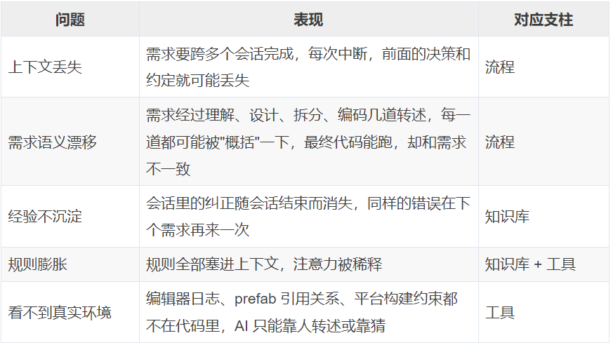
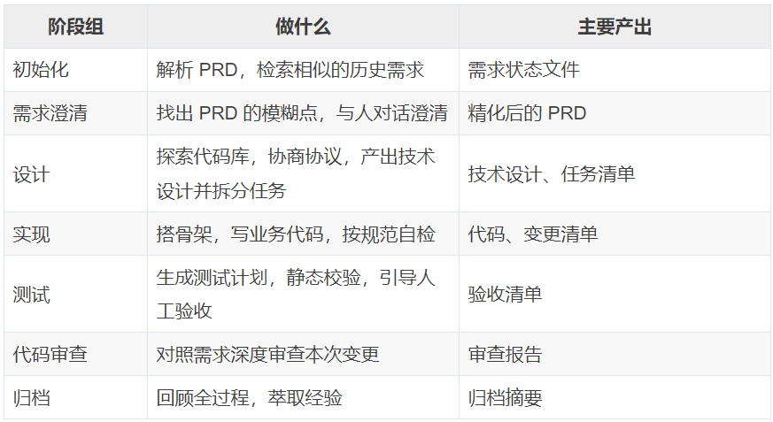
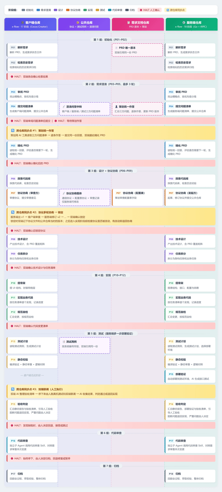
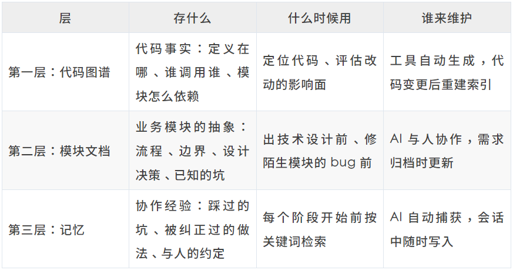
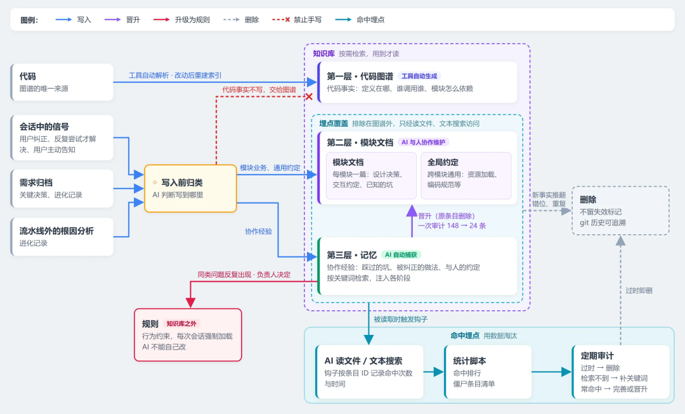

# 给 AI 写了 800 行规则，它反而更不听话了

> 让 AI 听话，靠的不是更多规则，而是让它在每一步只看到该看的东西。**流程让 AI 可控，知识库让 AI 能积累，工具让 AI 能接触真实环境。**

<!-- more -->

作者：刘俊毅  
原文发布日期：2026-10-21

一个中等复杂度的业务需求，过去从评审到出可体验版本大约要一个月。现在多数需求一到两周完成，其中编码环节从以天计压缩到一两个小时。

这个变化并不来自换了一个更强的模型。用 AI 写过业务代码的人，大概都经历过这些时刻：

- 会话一长，AI 就忘了前面的约定；换个会话，上周踩过的坑又踩一次
- 需求在 AI 手里转述几次就走了样，写出来「差不多，但不对」
- 报错日志、编辑器状态，得人一段段复制给 AI 看

这些问题都不是因为 AI 不会写代码，而是出在代码之外：它不知道自己处在流程的哪一步，记不住过去的教训，也看不到真实的开发环境。**AI 会写代码，不等于 AI 能交付。**

## 01 背景

### 仓库与分工

按团队分工，代码和文档分布在四个仓库：客户端、服务端、存放协议与配置表结构的公共仓库，以及策划的需求文档仓库。一个业务需求通常会同时牵动这四方。

### 直接让 AI 写代码的问题

| 问题 | 表现 | 对应支柱 |
|------|------|----------|
| 上下文丢失 | 需求要跨多个会话完成，每次中断，前面的决策和约定就可能丢失 | 流程 |
| 需求语义漂移 | 需求经过理解、设计、拆分、编码几道转述，每一道都可能被「概括」一下，最终代码能跑，却和需求不一致 | 流程 |
| 经验不沉淀 | 会话里的纠正随会话结束而消失，同样的错误在下一个需求再来一次 | 知识库 |
| 规则膨胀 | 规则全部塞进上下文，注意力被稀释 | 知识库 + 工具 |
| 看不到真实环境 | 编辑器日志、prefab 引用关系、平台构建约束都不在代码里，AI 只能靠人转述或靠猜 | 工具 |

最初解法很直接：写一个流程 Skill，把开发步骤列成清单，让 AI 照着走。可跑起来 AI 总是忘了这步、漏了那步，只好不断往里加限制和规则。

不到一个月，这份 Skill 从五百多行涨到八百多行，开头还多了五条「铁律」，标题写着「违反任何一条即为失败」，第一条就是「逐步执行，禁止跳步」。

结果规则越写越多，AI 反而越不听话：**上下文里塞进的东西越多，每条规则分到的注意力就越少，最要紧的那几条反而被埋掉了。**

后来换了思路：不再往上下文里堆规则，而是给 AI 搭一套工程化体系。从第一个业务需求开始，边做需求边完善，**至今三个多月**。回头总结，它可以归结为一句话：

> 流程让 AI 可控，知识库让 AI 能积累，工具让 AI 能接触真实环境。

流程、知识库、工具是这套体系的三根支柱。

## 02 流程：x-flow 让 AI 可控

### 一条流水线，两个仓库

x-flow 是为 AI 搭建的开发流水线，起点是公司内部 Knot 平台上一套开源 harness 框架，提供了阶段化流水线和子 Agent 分工的通用骨架。

但通用骨架没法直接套用：它面向单仓库开发，没有协议协商的概念，也没有代码审查环节。所以在真实需求中边用边改，**三个多月迭代了 15 个版本**：删减了不适合项目的内容，按多仓库协作重写了需求澄清和测试阶段，新增了协议协商与锁定、PRD 覆盖矩阵、防漂移「三道闸」、代码审查等机制，并接入了知识库和项目工具链。

**17 个阶段分为 7 组，每组由一个专职的子 Agent 负责。**

负责调度的编排器本身**不分析需求、不写代码**。每个阶段的产出都写成编号固定的文档，下游阶段只读上游的文档；整个需求的进度记录在一个状态文件里。

规则也不再挤在一个文件里。17 个阶段各有一份规则片段，**进入哪个阶段才加载哪一份**。早期那份八百多行的 Skill，AI 每一步都要背着全部规则走；现在，它每一步只看到当前阶段要守的那几条。

### HALT：人工确认节点

流水线上设有多处需要人确认的节点，称为 HALT：

- 除归档外，每组阶段结束时都会停下来，等人确认后才进入下一组
- 多仓库需求在协议锁定前还要再停一次
- 另有一些按条件触发的确认点，比如覆盖矩阵自检不通过、上下文即将用满

### 多仓库协同：人是消息总线

团队按端分工，客户端和服务端由不同的人负责，各自在自己的仓库里驱动 AI。因此一个需求会同时跑着两条流水线，它们需要对齐对需求的理解和通信协议。

这块没想做多 Agent 通信那套复杂方案，就用最省事的办法：

- 每个仓库有自己的 x-flow 和状态文件，两边的 AI 互不感知、互不调用
- 需要共享的内容（澄清问答、协议定义、测试用例）都以文件形式提交到公共仓库
- **人是消息总线**：人决定何时唤醒哪一端，HALT 节点就是同步点；流程恢复时，AI 会重新核对公共仓库里的事实
- 每一次协同都留在 git 记录里，可追溯、可审计

### 一个需求的完整旅程

以经济系统需求为例，看它如何走完这条流水线。

**澄清：三方提问，策划统一作答。** PRD 进入流水线后，客户端、服务端、测试三方的 AI 各自审阅，把模糊点按优先级写成问题清单，提交到公共仓库。策划用自己的 AI 工具汇总三方问题、逐条作答并更新 PRD 版本，双端再基于同一份回答生成精化后的 PRD。澄清最多三轮，经济系统一轮就完成了。歧义在写代码之前就暴露出来，而且两端拿到的是同一份答案。

**设计：先锁协议，再出方案。** 设计阶段先借助知识库摸清现状：检索相关的历史经验和踩坑记录，读相关模块的设计文档，再用代码图谱查清涉及的代码和改动的影响面。随后进入协议协商——协议只能由服务端修改，客户端 AI 负责审查，往复直到双方确认锁定。锁定时两端都会记下协议文件和公共仓库当时的版本；此后每进入一个关键阶段，都会检查协议是否被改动，一旦发现改动就强制退回协商阶段。

经济系统的协议第一版被客户端要求修订，第二版通过并锁定。之后服务端主干又先后合入了两次协议变更，两次都被检查出来，流程退回重新锁定：一次重新生成了协议代码，另一次确认业务代码不受影响。如果没有这道检查，这类变更往往要到联调时才会暴露，那时代码早已写完。

协议锁定后，AI 产出技术设计。设计里有一张必填的「PRD 覆盖矩阵」：AI 先把 PRD 拆成一个个功能点，每个功能点都标注它出自 PRD 的哪一节，再写明它在设计中的落点（接口、类、字段）。

矩阵生成后有两项自检：

- PRD 的每一节都要有功能点覆盖，不能漏
- 设计中出现的每个接口、字段、事件都要能在矩阵里找到对应的功能点，不能多

漏了，说明需求没做全；多了，就是 AI 自己加戏，必须退回澄清。经济系统的矩阵共拆出 28 个功能点，归档时逐条核对，全部实现一致。

**拆分与实现：每道关口回到原文。** 覆盖矩阵拦住了「AI 自己加戏」，却拦不住另一种走样。装饰摆放系统有一个批量收回功能，PRD 规定批量收回「上限 20」，也就是一次最多选 20 个，技术设计也写对了。到任务拆分时，任务描述被概括成「一键全部收回」，实现阶段照着任务描述做了。**每一步单看都合理，结果却和需求不一致。**

为此加了「三道闸」：

| 关口 | 约束 |
|------|------|
| 设计出口 | 对数字上限、多选与互斥、禁止项这类细则，逐条核对设计与 PRD 原文的语义，有冲突就停下来等人 |
| 拆分出口 | 任务描述必须引用技术设计的对应章节，不允许凭印象概括 |
| 实现入口 | 写代码前必须回读技术设计原文，任务描述只作索引；两者不一致时以设计为准，并上报 |

每次转述都可能失真，所以每道关口都回到原文核对，而不是相信上一手的概括。

实现阶段先搭骨架，包括 UI 结构和网络层封装，再按任务清单逐个实现业务代码，最后按规范自检。一个需求的实现往往要跨好几个会话，但每完成一个任务都会更新状态文件，中断后可以从具体任务续上。AI 每完成一个任务还会评估上下文消耗，**超过七成就主动暂停并保存进度**，避免在上下文将满时写出质量下降的代码。

**测试：由人验收。** 双端 AI 根据公共仓库里的同一份测试用例，各自生成测试计划，先做编译和静态校验，再整理出验收清单，然后停下来，由人跑真机测试和双端联调。AI 收集结果，判定通过还是退回实现阶段。服务端在这里多一步：自动部署到测试环境，由 AI 生成接口测试。

**审查：对照需求审代码。** 验收通过后、归档之前，一个独立上下文的子 Agent 调用代码审查 Skill，对本次变更做深度审查。审查者没有参与编码，也不占用主流程的上下文。经济系统的审查发现了一个测试没有覆盖到的问题：初始化失败重试时，推送监听会被重复注册。审查只出报告、不改代码，修不修、怎么修，由人在确认节点决定。

**归档：留下经验。** 最后，AI 回顾全过程，整理关键决策、风险预判的准确度和踩过的坑，生成归档摘要和进化记录，需求目录整体归档。

### x-flow 带来了什么

**问题前移。** 歧义在澄清阶段暴露，协议变更在动代码之前被拦下，需求走样在每道关口被核对。问题发现得越早，修正的代价越小。

**全程可追溯。** AI 每一步的产出都是落盘的文档，而不是散落在会话里的对话。从 PRD 的某一条出发，可以顺着覆盖矩阵找到设计落点、对应任务和最终代码；审查时也能反过来逐条核对。

**可中断、可恢复。** 进度只记在状态文件里，下游只读上游的文档，不靠会话记忆。一个需求跨多天、多个会话，甚至换一台电脑，都能从断点续上。

**人的精力花在判断上。** AI 负责把每一步做完、把结论摆出来，人只在确认节点上做方向性决策。改文案、调颜色这类简单需求，还可以走「快速通道」：阶段一个不少，只是压缩执行、跳过中间的确认；是否启用，必须由人决定。

## 03 知识库：让 AI 能积累

x-flow 解决的是「这一次怎么做对」。但每个需求开始时，AI 对项目的了解几乎都要从头建立：改这个函数会影响到谁，这个模块为什么这样设计，上次在哪儿踩过坑。需求做完后，产生的决策和经验又散落在归档文档和会话记录里，下一个需求很难再找到。

AI 需要一个知识库：需求结束时，把值得留下的东西沉淀进去；下一个需求开始时，能快速找到它。

### 三层知识，各管各的

三层合起来就是 AI 的知识库。**规则则被划在知识库之外**：规则约束 AI 的行为，每次会话强制加载；知识供 AI 按需检索，用到才读。分清「要守的规则」和「要查的知识」，规则清单才不会越写越长。

### 第一层 · 代码图谱：事实交给工具

「这个函数定义在哪」「改了它会影响谁」，这类问题的答案就在代码里，**代码本身就是真相**。难点在于怎么高效地找到它：AI 默认的办法是全文搜索，搜到一堆匹配行，再一个个打开文件、自己拼出调用关系，既费上下文，也容易漏。

接入了开源工具 `codebase-memory-mcp`。它在本地用语法解析器把整个仓库解析成一张图谱：函数、类、模块是节点，调用、引用、依赖是边。它以 MCP 服务的形式提供给 AI，查询一般在毫秒级完成，也不依赖外部数据库或云服务。有了它，AI 可以直接问「这个函数被谁调用」，一次拿到完整的调用链；改代码前，也能先查出改动会波及哪些地方。

用一条规则要求 AI 搜索代码时优先查图谱，只有图谱覆盖不到的内容才回退到文本搜索。

围绕这一层定了一条原则：**代码事实绝不手写进文档。** 文档里一旦写了「某个函数在某个文件里」，代码一重构它就过期了，AI 读到过时信息，比没读到还糟。代码事实只由图谱回答，不抄进文档，也不写进记忆。

图谱也有自己的维护成本：代码变更后要重建索引，否则 AI 会查到旧结构。刷新操作被封装成一个 Skill，在大批改动之后执行。

### 第二层 · 模块文档：只写「为什么」

图谱能回答代码是什么，却回答不了为什么。为什么这里用推送而不是轮询，一次登录按什么时序调用哪些模块，状态在什么条件下切换——这些要么藏在代码背后，要么散落在十几个文件里，只能靠文档提炼出来。

模块文档是对代码的抽象。每个代码模块对应一篇，固定分为几部分：

- 职责范围，包括「不负责什么」
- 设计决策和背后的原因
- 模块之间的交互约定
- 关键的调用时序和状态流转，用时序图、状态图这类 UML 图画出来，只画容易理解错的那几条
- 已知的坑

原则是**写语义保证，不写函数签名；写约定，不写文件清单**。跨模块通用的约定，比如资源加载方式、编码规范，则单独写成几篇全局约定。文档本身就是 markdown，和代码放在同一个仓库里，随代码一起提交和审阅。

文档最怕的是写完就没人管，所以更新纪律交给了 x-flow：出技术设计前、修模块的 bug 前，AI 先读相关模块的文档，避免和已有决策冲突；真正写代码时反而不读，实现细节直接看代码。需求归档时，AI 把本次的关键决策写回受影响的模块文档。文档不再依赖某个人记得去更新，而是每个需求都会经过一次。

### 第三层 · 记忆：AI 自己记

记忆这一层，不靠人整理，靠 AI 自己捕获。

给 AI 设了一条始终生效的规则，让它在会话中留意三类信号：用户的纠正，比如「不对」「应该是」；反复尝试才解决的问题；用户主动告知的关键信息。捕捉到信号后，AI 把它整理成一条结构化的记忆：**原来怎么做，正确做法是什么，为什么**。记忆同样以 markdown 文件存在仓库里，人可以随时翻看、修正。

流水线是记忆的另一个来源。每个需求归档时，AI 回顾整个过程：哪里被纠正过，哪里回退过，风险预判准不准。值得沉淀的内容整理成一份进化记录，写清现象、根因和改进建议。流水线之外修 bug 时，也可以单独发起一次根因分析，产出同样格式的记录。

记下来只是一半，还要在需要的时候被想起来。记忆不会每次全量加载，而是按关键词检索，只取出相关的条目。x-flow 的设计、实现、测试阶段开始前，编排器会把相关记忆注入当前阶段，阶段自己也会再检索一次，两者取并集。即使跨了会话、编排器漏了注入，经验也不会丢。

协作经验过时得快，也容易被推翻。借鉴了时序知识图谱 Graphiti 的思路：新事实推翻旧事实时，旧事实必须退出当前视图。但没有保留失效标记，而是直接删除，需要追溯时交给 git 历史。AI 写入一条纠正之前，会先检索同主题的旧记忆，命中就一并删掉，保证同一件事只有一个当前答案。

### 层与层之间：晋升、升级与淘汰

三层不是三个孤立的仓库。知识写进来要先归类，在层与层之间晋升，必要时升级为规则，没用了就淘汰。

**写入前先归类。** AI 写下一条知识前，要先判断它属于哪里：

- 专属于某个模块业务的知识（设计决策、交互约定）写进对应的模块文档
- 跨模块通用的约定写进全局约定
- 协作相关的内容（踩坑过程、被纠正的做法、与人的约定）写进记忆
- 必须遵守的行为约束是规则，不属于知识库
- 代码的定义和调用关系哪里都不写，交给图谱

**记忆晋升为文档。** 一条记忆被反复验证、成为稳定的约定后，就晋升进模块文档或全局约定，原条目随即删除。一次全量审计中，**记忆从 148 条精简到 24 条**。大部分内容不是被丢弃，而是找到了更合适的位置：几十条业务口径蒸馏进了各模块文档，通用的引擎经验晋升为全局约定，真正删掉的只是错位和重复的条目。

**少升级为规则。** 沉淀下来的经验，并不都会变成规则。问题第一次出现，先写进记忆；同类问题反复出现，说明记忆没能防住，才考虑升级为规则。规则每次会话都加载，每多一条，其他规则就被稀释一点；记忆按关键词检索，命中时效果与规则相同，没命中时不占用任何注意力。

**而且 AI 只能提建议。** 进化记录先进入待审阅区，由负责人逐条决定：升级为规则、沉淀为记忆，还是拒绝。**AI 不能自己改规则。** 到目前为止，已落地的 13 条进化记录里，10 条沉淀为记忆，只有 3 条升级成了规则。

**用数据淘汰。** 一条知识到底有没有用？给知识库加了命中埋点，借助 AI 编程工具自带的钩子机制：在配置里注册一个「工具调用后」触发的钩子。AI 每次读取文件或做文本搜索，都会自动跑一个 Python 脚本。

脚本拿到这次调用的参数和返回内容后，先判断访问的是不是记忆或模块文档目录，不是就直接跳过。如果是，就从返回内容里提取条目锚点。每条记忆和文档的关键小节都带有一个唯一 ID，脚本据此知道这次读到了哪几条，再把命中次数、最近命中时间和检索用的关键词，汇总进一个统计文件。同一条目一分钟内只计一次，避免一次搜索被重复计数。脚本出了任何异常都会静默退出，绝不影响 AI 正常读文件。另一个统计脚本读取这份文件，输出命中排行，并列出从未被读到的「僵尸条目」。

这里有个小技巧：**图谱工具的调用不会触发这个钩子**，所以特意把这两层排除在代码图谱之外，迫使 AI 只能通过读文件和文本搜索来访问它们，埋点才能生效。

有了这份数据，淘汰就有了依据。定期审计时，僵尸条目会被逐条复核：内容已经过时或没有价值的，直接删除；内容有用、只是检索不到的，补上关键词。常被命中的条目则说明它确实有用，值得补充完善，甚至晋升。**知识值不值得留，不再全凭感觉。**

### 一条知识的旅程

分包约束是一个完整的例子。微信小游戏的主包不能静态引用分包里的代码，违反了，编辑器预览一切正常，打包到真机后首次启动就会崩溃。这条约束就是从一次真机崩溃开始进入知识库的。

出事之后，AI 把根因整理成一份进化记录，同时写下一条记忆，此后的设计阶段都能检索到它。进化记录建议把这条约束升级为规则。在等待审阅的这段时间，先把它写进了代码审查的检查脚本，每次审查都会自动扫描主包是否引用了分包。负责人审阅时，既然脚本已经兜底，就决定保留记忆、不再升级为规则。后来全量审计时，它被重新归类：这不是某一次协作的经验，而是所有模块都要遵守的通用约定，于是晋升进了全局约定，原来那条记忆随之删除。

有了这些机制，AI 积累下来的不是一份越写越长的规则清单，而是一套**分了层、会晋升、会淘汰**的知识：代码事实永远以代码为准，设计原因有处可查，踩过的坑能在下一次被想起来。每做完一个需求，AI 对项目就更熟悉一点，规则却不必因此变多。

## 04 工具：让 AI 能接触真实环境

前两章讲的流程和知识库，跟技术栈关系不大，换个项目基本可以直接复用。工具层则不同，它必须贴着技术栈来做。客户端是用 Cocos Creator 和 TypeScript 开发的微信小游戏，所以接入的是 Cocos 编辑器、prefab、微信分包这类工具。

具体来说，工具层要做两件事：把 AI 看不到、却影响交付的信息接进来，比如编辑器的日志、资源之间的引用；把 AI 做不稳、又必须一次做对的工作交给脚本，比如生成 prefab、检查分包约束。

### Cocos MCP：一个通用工具，接通整个编辑器

游戏开发里，很多关键事实并不在代码里。运行时的报错打在编辑器的控制台上，资源要由编辑器导入后才有身份标识，界面结构记录在 prefab 文件里。AI 读得懂代码，却看不到这些，只能靠人截图、复制日志、描述现象。

为此自己开发了一个 Cocos MCP 服务。它一端以 MCP 协议连接 AI，另一端通过 WebSocket 连接安装在 Cocos Creator 里的插件，把编辑器的能力开放给 AI：读取编辑器主进程和场景进程的日志，并可按级别过滤；调用编辑器的内部接口；以及一个探活工具，用来确认整条链路是否连通。

有了它，调试变成了 AI 自己就能走完的循环：读取报错日志，分析堆栈，定位并修改代码，等编辑器重新编译后再读一次日志，确认问题是否消失。人不必再充当日志的搬运工。

开放编辑器接口时遇到一个很实际的问题。Cocos Creator 的编辑器内部有**上百个消息接口**，覆盖资源数据库、场景、构建、项目设置等各个模块。如果每个接口都包装成一个 MCP 工具，AI 的工具列表会变得非常庞大。**每个工具的名字、说明和参数都会进入上下文，工具越多，占用越大，AI 选错工具的概率也越高。**

做法是反过来：MCP 端只暴露一个通用工具，参数只有三个，即消息属于哪个模块、调用哪个接口、传什么参数；「该调哪个、怎么调、哪些不能调」全部写进一份配套的 Skill，里面有接口速查表、按风险分级的调用规则，以及常用操作的标准步骤。AI 需要操作编辑器时，先加载这份 Skill，再通过这个通用工具间接调用具体接口。

这样一来，工具列表里只多了一个工具，AI 却能用上编辑器的全部能力。约束也都放在手册里，需要新增或收紧时，改一份 markdown 就够了，不必改代码、重新发布 MCP 服务。

> 接口多的时候，与其把每个接口都做成工具，不如提供一个通用工具，再配一份手册告诉 AI 怎么用。这个思路不只适用于 Cocos，任何接口众多的引擎和平台都可以借鉴。

### 索引刷新 Skill 与 prefab 引用索引

**什么时候刷、怎么刷。** 代码图谱要靠刷新保持最新。这个刷新 Skill 由事件触发，不定时跑：合并大分支、批量重构之后，或者人主动要求时执行。AI 如果在图谱里查不到一个明知是最近才加的函数，也会先提示「索引可能滞后了」并建议刷新，而不是把「查不到」当成「不存在」。一次刷新会先增量重建代码图谱，再顺带重建 prefab 引用索引；刷完从最近一周的提交里挑一个新增的符号查一遍，查得到才算成功。

**prefab 引用为什么要单独做。** 代码图谱只解析代码，不认识 prefab。而 prefab 里引用脚本用的不是类名，是一串压缩过的资源 ID，藏在几百 KB 的 JSON 里。想知道一个脚本被哪些界面用到，原本要先查出脚本的资源 ID，换算成压缩格式，再到 JSON 里逐个搜索，搜到了也看不出挂在哪个节点上。最初想把这些引用关系注入图谱，但图谱工具不支持自定义节点和边，只好在 Cocos MCP 里单独做了一组查询工具。

**怎么查。** 这组工具不依赖编辑器在线，直接读取资源文件建立索引，支持双向查询：一个脚本或资源被哪些 prefab 和场景引用、挂在哪个节点上；一个 prefab 上挂了哪些脚本。

索引还自带新鲜度保障：**每次查询前先比对文件的修改时间，发现变化就当场重建，绝不返回过期的结果。** 所以日常查询不需要等刷新，刷新 Skill 对它只做例行对齐。

### 设计稿转界面 Skill：从 PSD 生成 prefab 和界面代码

这是迭代次数最多的一条链路。最初，让 AI 直接生成 prefab 文件。但 prefab 是一种结构复杂、由编辑器维护的 JSON，节点层级、组件挂载和各项属性互相关联，AI 很难保证生成的结构正确、每个节点的属性都对。

后来把生成 prefab 的工作全部交给了工具脚本，AI 只留在真正需要理解的环节：

1. **审查脚本**检查设计稿的图层树，找出重复图层、状态分组和不规范的命名
2. **AI** 结合审查结果和需求文档，提出语义重组方案：节点怎么命名，哪些状态应当归并，哪些节点可以抽成公共部分
3. 方案经人确认后，由**重组脚本**生成一份新的设计稿，人在 Photoshop 里再确认一次结构
4. **导出脚本**从设计稿导出切图和一份界面清单，**生成脚本**再根据清单生成 prefab
5. **AI** 编写界面的业务代码，也就是这个界面的 TypeScript 组件
6. 借助编辑器接口让编辑器导入它，再由**挂载脚本**把它挂到 prefab 的根节点上，自动绑定所有界面元素，不需要人在编辑器里一个个拖拽

这条链路里，分工很明确：**结构复杂、必须精确的产物，不要让 AI 直接生成；AI 只做判断，生成交给脚本。**

### 代码审查 Skill：对照需求和项目知识审查变更

每个需求在归档前都要经过代码审查，由一个独立上下文的子 Agent 调用代码审查 Skill 完成。这个 Skill 原本是一个通用的审查工具，覆盖安全、并发、性能、资源管理等常见维度，支持多种语言。在它的基础上做了几处改造，让它从「懂代码」变成「懂项目」。

**对照需求审查。** 通用的审查工具只看代码本身，判断写得规不规范。改造后，它会先读取本次需求在 x-flow 里的产物：精化后的 PRD、技术设计、测试报告和缺陷记录。其中技术设计里的 PRD 覆盖矩阵会被直接拿来当基线：每个功能点的设计落点都要在本次变更里找到对应实现，有设计没实现的报缺失，有实现没设计的报超纲。如果归档摘要里记录了某些功能这期砍掉不做，它还会反过来检查，砍掉的功能有没有被偷偷实现。

**带着项目知识审查。** 审查前，它会从需求标题、变更文件名、新增的类名和提交信息里提取关键词，到知识库里检索相关的约定、踩坑记录和历史缺陷。报告里的每条结论，都尽量指明违反了哪条约定、重现了哪个历史问题。**Skill 本身不内置任何项目经验，全部来自知识库，知识库一更新，下次审查立刻生效。**

**AI 协作产物也要审。** 规则、Skill、记忆这些文件一旦合入主分支，会被所有人的 AI 自动加载。所以它们和业务代码一样要审：新增的规则有没有和代码现状矛盾，Skill 的改动有没有破坏流水线的调用约定，记忆里有没有把一次性的经验写成了通用约定，有没有混入个人调试信息。

**项目专属的检查交给脚本。** 分包检查脚本只扫描本次变更涉及的文件，检查主包有没有静态引用分包、文件有没有放对位置、分包配置对不对；行数统计脚本按文件类型统计有效代码行，判断是否超出规范上限。AI 再结合项目知识复核脚本的结论，排除误报。

**审查范围要诚实，复审只看增量。** 审查范围用分支相对主干的变更来确定，避免把主干合并进来的他人改动混进审查。问题修复后，复审只看新的修复提交，逐条核对上一轮的待办清单是否已经解决，再检查修复本身有没有引入新问题。

回头看这几个工具，背后是同一个设计哲学：

> **能用工具确定性检查的，交给工具；需要理解和判断的，交给 AI；只有反复出现、又无法工具化的行为约束，才写成规则。**

## 05 总结与展望

流程、知识库、工具并不是三套独立的机制：流程决定每一步做什么、在哪里停下等人，知识库让每一步用上过去的经验，工具让每一步基于真实环境而不是猜。分包约束是三者闭环最完整的一次：流程把根因整理成进化记录，知识库承接经验，审查脚本让它每次自动生效，最终不必再多写一条规则。

三者背后还有同一个约束：**AI 的注意力有限，上下文里每多塞一样东西，别的东西就被稀释一点。** 规则按阶段加载，阶段只读上游产物，知识按需检索，一个通用工具代替上百个接口，确定性的检查交给脚本，都是在省着用这份注意力。这也是开头那个教训的答案：

> 让 AI 听话，靠的不是更多规则，而是让它在每一步只看到该看的东西。

回到开头的数字，编码已经从以天计压缩到一两个小时，但这并不是期望的终点。今天 x-flow 里的不少设计，是被两个现实条件逼出来的：一是 AI 还不足以独立理解需求、判断方案，所以流程里设了许多停下来等人的节点；二是团队沿用按端分工的体系，一个需求要拆成两条流水线，靠公共仓库和协议协商来对齐。

这两个条件都在变化。当 AI 能独立把需求理解透、把方案定准，当一个人、一个 AI 会话就能贯通客户端和服务端，这些过渡期的脚手架就能一步步拆掉：理解需求、判断方案都交给 AI，人只负责审核和最终验收。x-flow 本来就是在三个多月、15 个版本里边用边长出来的，拆掉脚手架，也会是它接下来的演进方向。

---

归档已删除关注引导、开发者社群二维码与代金券促销内容，技术内容完整保留。

## 相关页面

- [[concepts/ai-coding-delivery]] — 相近主张的另一套表述：分层知识库 + 文件化流程 + 前置质量门禁。
- [[concepts/harness-engineering]] — Harness 工程化的一般原理。
- [[patterns/harness-engineering-practice]] — 四阶段演进与评测维度。
- [[patterns/ai-knowledge-workflow]] — 知识工作流的组织方式。
- [[patterns/agent-runtime-safety-guardrails]] — Agent 运行时的纵深防御。
- [[concepts/agentic-architectures]] — Agent 架构形态谱系。
- [[concepts/tencentdb-agent-memory]] — 团队级 Agent 记忆中枢的分层资产。
- [[patterns/four-layer-workflow]] — 四层工作流分层。
- [[concepts/ai-asset-map]] — AI 资产地图与治理盲区。
- [[patterns/evaluation-pipeline]] — 评测流水线。
