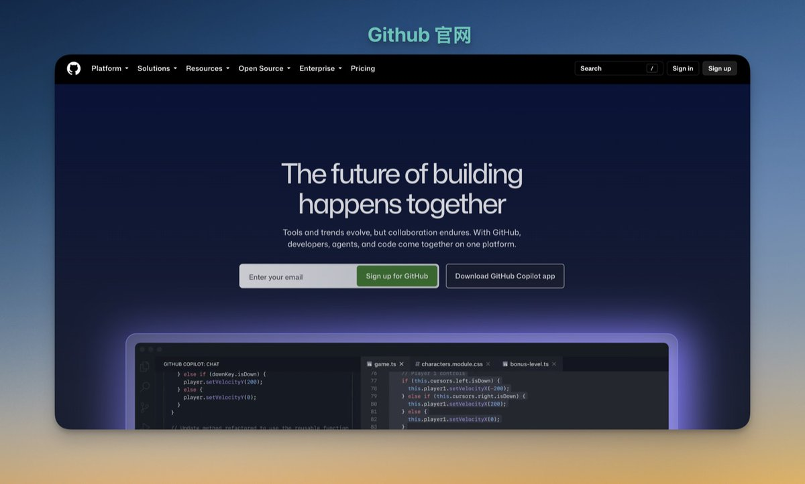
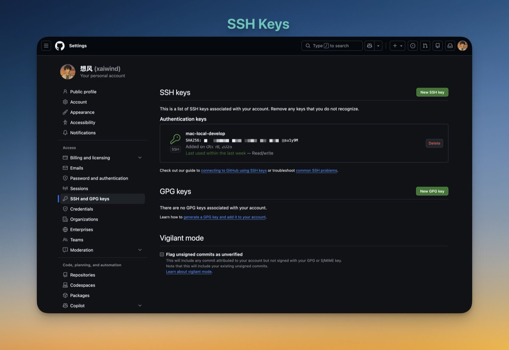
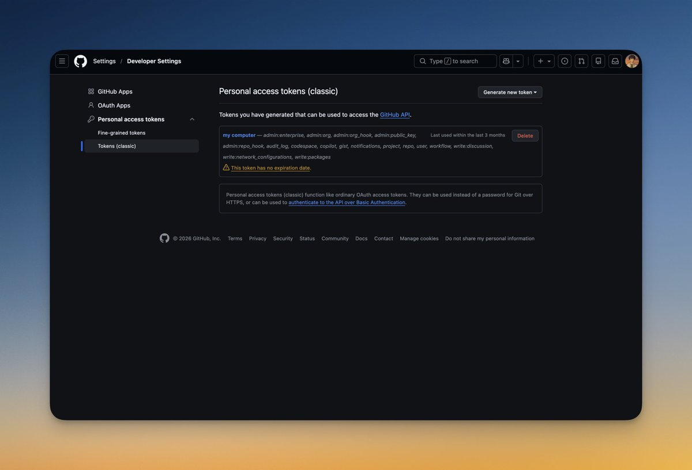
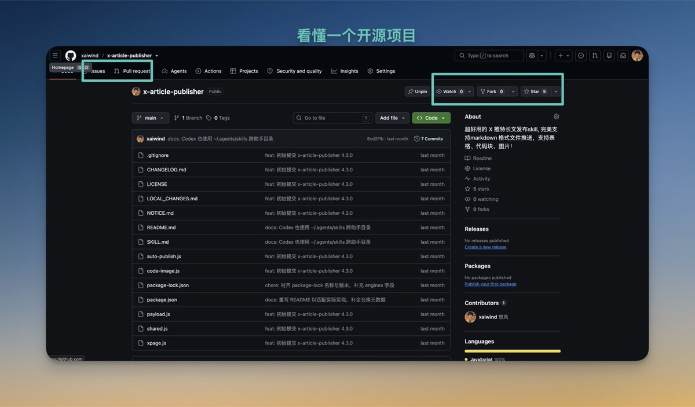
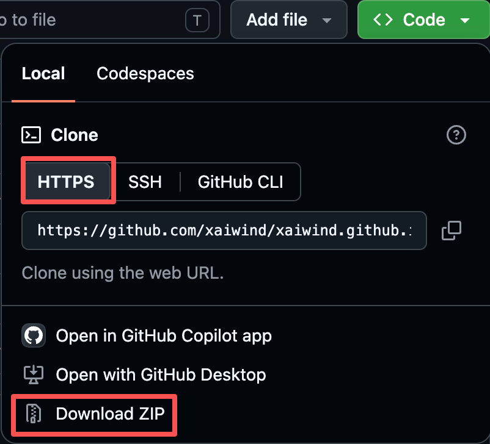
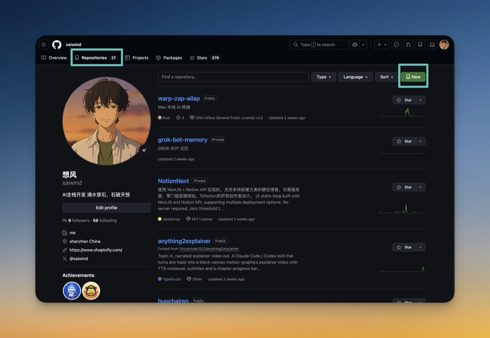

# 想风（@xaiwind）：万字长文｜超详细的 GitHub 教程，从入门到精通

> 面向非编程背景出海者与独立开发者的 GitHub 终极实战手册：从账号注册、Git 基础工作流、SSH Key 配置与防掉线，到 README 排版美化、开源协议选择、Issues/PR 协作机制、GitHub Actions 自动化流水线与 GitHub Pages / Releases 出海软件分发全景实操。

<!-- more -->

各位看官今天来看 GitHub，学完你就是源码的神！

GitHub 是全世界程序员放代码的地方，也是你能白嫖别人代码的地方。

先说清楚一件事，不然后面很多话会读不懂：Git 和 GitHub 是两个东西。

很多新手把它们当同一个词用。然后在第一次提交代码的时候，卡在一个我根本没想到的地方——他以为装完 Git 就能直接 push 了。

这篇按顺序讲，跟着走完，你能建仓库、能提 PR、能看懂一个陌生项目的源码、还能白嫖一个网站和一台服务器！

### 目录

- 一、Git ≠ GitHub —— 这两个不分清，后面每一步都拧巴
- 二、注册账号·把 Git 装上 —— 用户名、邮箱、两步验证，三个一错就麻烦的地方
- 三、四个概念就够 —— 仓库、提交、分支、远程，外加 PAT 和 SSH Key 怎么选
- 四、看懂一个开源项目 —— Star、Watch、Fork、Issue、PR 挨个说
- 五、搜索：怎么找到你要的东西 —— 限定符、搜代码、按 topic 逛
- 六、读懂源码：从哪一行开始看 —— 五步走完一个陌生项目
- 七、提第一个 PR —— 从 fork 到被合并的完整流程
- 八、GitHub Actions —— 让机器人替你干活，以及免费额度怎么算
- 九、GitHub Pages —— 白嫖一个带 HTTPS 的网站
- 十、常见错误 —— 七个代价最高的
- 十一、白嫖清单 —— GitHub 上不要钱的东西
- 十二、把主页变成简历 —— 同名仓库的用法
- 十三、多人协作：分支策略 —— 两个人以上就得有规矩
- 十四、速查表 —— 每天真正会用到的那几条
- 十五、GIT、SVN、GitLab、Gitee 对比 —— 几个容易混的概念

## 一、Git ≠ GitHub


两者说明：Git 是装在你电脑上的版本管理工具，GitHub 是托管 Git 仓库的网站。

这个区别很关键。搞混了，后面每一步都会拧巴。

| | Git | GitHub |
| :--- | :--- | :--- |
| 是什么 | 一个命令行工具 | 一个网站、大型代码平台 |
| 装在哪 | 你的电脑上 | 官方服务器上 |
| 断网能用吗 | 能。全部操作都在本地 | 不能 |
| 谁做的 | Linus Torvalds，2005 年 | 微软，2018 年花 75 亿美元买的 |
| 要钱吗 | 免费，开源 | 免费档够个人用 |

把 Git 想成记账本，GitHub 想成银行。 记账本在你自己抽屉里，银行帮你保管和共享。

没有 GitHub 仓库，Git 命令工具照样用。没有 GitGit 命令工具，GitHub 仓库就是个空壳。

开始学的时候，不要有想法在 github 网页上或者 github app 上 点来点去“提交”一个文件，在本地用 git 命令就行，github 网页和 app 百分九十九就都是用来浏览或者 star !

### 三个必学理由

第一，代码需要备份，而且是带历史的备份。吃过的亏——本地一个项目文件夹被我误删过，回收站里也没有，因为我是用命令行删的。三天的工作没了。Git 就是防这个的。

第二，找工作和找人合作，GitHub 就是简历。招聘的人会点进你的主页看提交记录。空白的账号，比没有账号还尴尬。

第三，也是最重要的：全世界最好的代码都在这儿。你想学的任何东西——从一个小工具到一个完整的框架——源码都摊开放在那里，免费看。

这一篇的重点其实是第三条，前面那些是门票。

## 二、注册账号·把 Git 装上

### 注册



官网 [github.com](https://github.com/)，右上角 Sign up。

三件事值得注意：

1. 用户名会被永久绑定。 它会出现在你所有仓库的网址里，也会印在你的简历上。别用 xiaoming123。用你的网名或真名。
2. 邮箱别用国内邮箱。我踩过这个坑——验证邮件收不到，重发了四次，最后是换 Gmail 才过的。国内邮箱是发信深渊，这不是 GitHub 一家的问题。
3. 免费档够用。无限个公开仓库，无限个私有仓库，只是私有仓库的协作者最多 3 个人（含你自己）。
4. 把两步验证开上。GitHub 对账号安全卡得越来越紧，早晚都得开。用手机上的验证器 App，别只用短信。 或者手机安卓和 IOS 都可以下载 APP。

### 安装 Git

macOS：

```bash
brew install git        #装了 Homebrew 的话
git --version           #验证，能看到版本号就成
```

Windows：去 git-scm.com 下载安装包，一路下一步。

装完打开「Git Bash」——后面所有命令都在这个窗口里敲，不建议在 cmd 或 PowerShell 里敲。

装完第一件事，配置身份：

```bash
git config --global user.name "你的名字"      #这会出现在每条提交记录上
git config --global user.email "你的邮箱"     #建议和 GitHub 注册邮箱一致
```

配完验证一下：

```bash
git config --list      #能看到刚配的两行就对了
```

注意：邮箱一定要和 GitHub 账号对得上。对不上，你的提交记录在 GitHub 上就不算你的，头像是个灰方块，贡献的绿格子也不亮。

## 三、四个概念就够

Git 的命令有几十个。入门只要四个。剩下的用到再查。

### 3.1 仓库（Repository）

初始化项目：一个被 Git 管起来的文件夹。

本地建一个：

```bash
mkdir my-project       #建文件夹
cd my-project          #进去
git init               #把这个文件夹变成 Git 仓库
```

跑完 git init，文件夹里会多一个隐藏的 .git 目录。

这个目录就是记账本本身。 所有历史都在里面。删了它，你的项目就退回成普通文件夹，历史全没。

有人干过骚操作：为了“清理项目”，把 .git 当缓存目录删了。那个项目 200 多次提交，一次没剩。 如果其他分支也没有记录 ，项目记录就没了！

### 3.2 提交（Commit）

记录项目：给当前的文件状态拍一张快照，附一句说明。

流程固定三步：

```bash
git status                      #先看现在什么情况
git add .                       #把所有改动放进暂存区
git add  /xxx/ok.text           #把某个文件提交
git commit -m "说明这次改了什么"   #拍快照
```

git add 和 git commit 分开，是新手最容易烦的地方。为什么要两步？

因为你可以只提交一部分改动。比如你同时改了三个文件，其中两个还没写完，那就 git add 只加写完的那个。

提交说明怎么写？我的规矩是当成给三个月后的自己留纸条。

反例：更新、修改、fix。 过于简洁，回头看不知所以。

正例：修复登录页在 Safari 下按钮点不动的问题。

做细点就是一条提交只做一件事，别把“改样式 + 加功能 + 升依赖”塞进一条。vibe conding 时代急着上线，可能也不会管那么多！

### 3.3 分支（Branch）

项目分支：从主线分出去的一条平行时间线，用来试错。

```bash
git branch                    #看有哪些分支
git checkout -b feature-x     #新建并切到 feature-x
git checkout main             #切回主线
git merge feature-x           #把 feature-x 合进当前分支
```

主分支和新分支在 在最初新分支创建那一刻是一模一样的！ 类比一下：main 分支是正式出版的版本，分支是你的草稿纸。草稿写废了，撕掉就行，书不受影响。

还有个细节值得知道：Git 的分支不是拷贝文件，是一个指针。建一个新分支瞬间完成，不占空间，你改的始终是同一份文件，Git 只记录差异。

我一开始不敢建分支，以为每建一个就复制一份代码，硬盘要炸。知道是指针之后，我建分支就再没犹豫过。

分支真正的价值是“可以推倒重来”。在 main 上改，改崩了只能硬着头皮往前修；在分支上改，删掉重建，两秒钟的事。

新手常见的错误是在 main 上直接改。改崩了没有退路。

### 3.4 远程（Remote）

远程仓库：把本地的仓库和 GitHub 上的仓库接起来。

```bash
git remote add origin https://github.com/你的用户名/仓库名.git
git push -u origin main      #第一次推，-u 记住这个对应关系
```

之后每次就三行：

```bash
git add .
git commit -m "说明"
git push
```

记住这三行，你就已经能干活了。下面都是在这三行上加东西。

### 3.5 推送验证配置

推送这里的配置很重要。具体流程如下：

```plain text
本地 ssh-keygen  →  ~/.ssh/id_ed25519.pub  →  复制内容  →  GitHub Settings 粘贴  →  ssh -T git@github.com 验证
```

SSH key 生成

选 ed25519 算法 （默认选这个）

```plain text
ssh-keygen -t ed25519 -C "you@example.com"
```

选 rsa 算法 常规个人项目选这个 本人用的这个 ，下面接着以这个为演示：

```shell
ssh-keygen -t rsa -b 3072 -C "你的邮箱"
```

明确不推荐使用 ECDSA 算法

执行命令，一路回车生成密钥后，找到下面这个公钥文件

```plaintext
~/.ssh/id_rsa.pub  # ～ 用户家目录｜用户根目录    .ssh目录  id_rsa.pub
```

打开文件 id_rsa.pub 黏贴到下图 SSH keys 所在位置



验证配置使用是否成功 在终端执行命令 ssh -T git@github.com 如下所示则为成功

```plaintext
~ ssh -T git@github.com
Hi xaiwind! You've successfully authenticated, but GitHub does not provide shell access.
```

个人使用经验回顾，有二：

第一，第一次 push 让你输密码，但密码是错的。GitHub 早就不让用账号密码推代码了，我有次卡在这儿，输了 好几遍密码，一直以为自己记错了。它不会提示“不能用密码”，它只说认证失败。这个报错信息把我坑了一晚上。

第二，`origin` 只是个名字，不是关键字。叫它 github、backup、随便什么都行，origin 只是约定俗成的默认叫法。同一份本地仓库可以接好几个远程——这也是坑 ，也是 upstream 能存在的原因。

### 3.6 可选验证方式 PAT （Personal Access Token 个人访问令牌）

这一步可选跳过学习直接到第四节， 小白可能会晕，后期用到再学！

同时 github 还是支持 PAT 验证， 如何设置获取： Personal Access Token → Settings → Developer settings → Personal access tokens 生成一个，勾上 repo 权限，点击生成。

两者全程、长相

| 全称 | 页面位置 | 前缀长相 |
| :--- | :--- | :--- |
| Personal Access Token (**classic**) | Tokens (classic) | `ghp_xxxxxxxx` |
| **Fine-grained** personal access token | Fine-grained tokens | `github_pat_xxxxxxxx` |

关键点：token 只显示一次，GitHub 只存它的哈希，没法再查看，丢了只能删掉重建。

所以正确顺序是：

```plaintext
填名字 → 设有效期 → 勾权限 → Generate → 【立刻复制】→ 离开页面
```



PAT 复制之后怎么用

方式一：push 时当密码输入（最省事）

```plaintext
git push
Username: xaiwind
Password: <粘贴 token>
```

macOS 上因为有 osxkeychain（你刚确认过生效的那个），粘一次就会自动存进钥匙串，之后永不提示。这就是“复制一次”的全部成本。

方式二：直接写进 remote URL（脚本/CI 常用）

```plaintext
git remote set-url origin https://xaiwind:<token>@github.com/xaiwind/仓库.git
```

⚠️ 这种写法会让 token 明文躺在 `.git/config` 里，别在共享机器上用，也别让这个仓库被 push 出去。

两个容易踩的坑

1. Username 不能空着。只填 token 会认证失败。常见错误就是把 token 粘到了 Username 那一栏。
2. token 不要进 git 历史。如果误把带 token 的 URL 提交了，光删文件没用，历史里还在——直接去 GitHub 吊销重发最快。

Classic vs Fine-grained 都一样是只显示一次。区别只在权限怎么勾：

| TOKEN | 勾什么 |
| :--- | :--- |
| Classic | 勾顶层 **`repo`** 一整个 |
| Fine-grained | 不用找 `repo`，勾 **Contents: Read and write** + **Metadata: Read**，并选仓库范围 |

### 3.7 总结 SSH Key 与 PAT 的区别

- 两者都可以获得 github 仓库权限 ，如果只为了推送到仓库可以选 SSH key
- 已有 SSH key → 直接用 git@github.com: 地址，永久免密，无有效期烦恼
- 需要调 API、写脚本、CI 自动化、需设有效期、想随时吊销 → 才必须用 PAT
- SSH key 本地生成，填到 github 线上 SSH keys 存储
- PAT github 线上生成，推送的时候填一次，或者手动填一次，存储到本地

## 四、看懂一个开源项目

打开任何一个知名项目的首页，你会看到五个东西，挨个说。



### Star（收藏）

别人点了收藏。数字大不代表代码好，只代表知道的人多。拿它选项目的参考价值有限。一个 3 万星的项目可能已经两年没人维护了。

不过 Star 有一个角度看是对的：看趋势，不看绝对值。半年涨了 5000 星的，说明它正被人需要；3 万星但曲线平了两年的，多半是吃过一波红利、现在没什么人推了。

看趋势不用装工具，star-history.com 能把几个项目的星数曲线叠在一张图上，免费。我选技术方案之前会去瞄一眼。

### Watch（关注）

点了之后，这个项目的所有动态会推给你。

建议只对你在用的项目开。开多了，通知栏会变成垃圾场，择优 watch

### Fork（复刻）

复刻仓库：把别人的仓库整个复制一份到你自己的账号下。

之后你改的是你那份，原项目不受影响。想给原项目贡献代码时，先 fork。

新手最容易混的就是这个——fork 完在自己那份上改了，然后找不到怎么让原作者看到。答案是提 PR，第七节讲。

### Issue（问题单）

别人提的 bug、需求、讨论。一个项目的 Issue 区就是它的病历本。

对新手来说，Issue 区是最好的学习材料。看别人怎么描述问题，看维护者怎么排查。比读教程真实得多。

顺便说：提 Issue 前先搜有没有人提过。重复提不太友好。

Issue 区还有一层用法：看 Label（标签）。维护者会给 Issue 打标签，其中两个对新手特别重要——good first issue 是专门标出来留给新人的，help wanted 是欢迎外部帮忙的。

用第五节学的语法直接搜：

```plaintext
is:open label:"good first issue" language:markdown
```

**这个搜索把 “想给开源做点事但不知道从哪下手” 变成了一个下拉列表。

### Pull Request（PR）

推送请求：「我改了东西，请你看看要不要合进去」的正式请求。

这是 GitHub 的核心动作。所有对开源项目的贡献，都是通过 PR 完成的。

PR 区还是个学写代码的地方，这个用法知道的人不多。

点进一个已经合并的 PR，切到 Files changed 标签页。能看到一次真实改动长什么样：动了几个文件、加了多少行删了多少行、review 里维护者提了什么意见。

这比读最终代码有用，最终代码是结果，PR 是过程——看别人怎么被 review，就知道维护者真正在乎什么。

## 五、搜索：怎么找到你要的东西

这节是最具价值的学习，大部分人用 GitHub 只用搜索框打一个词，然后在一堆结果里翻。

GitHub 的搜索有语法，会几个就够了。

### 5.1 常用限定符

| 语法 | 作用 | 例子 |
| :--- | :--- | :--- |
| `in:name` | 只搜仓库名 | `blog in:name` |
| `in:readme` | 只搜 README 内容 | `obsidian in:readme` |
| `language:` | 限定语言 | `language:go` |
| `stars:>1000` | 星数大于 | `stars:>1000` |
| `pushed:>2026-01-01` | 最近还在更新 | `pushed:>2026-01-01` |
| `topic:` | 按标签搜 | `topic:self-hosted` |
| `user:` | 搜某人的仓库 | `user:torvalds` |
| `is:issue` | 搜 Issue 而不是仓库 | `is:issue is:open` |


组合起来威力很大，比如我想找一个 还在维护的 Go 写的自建聊天室：

```plaintext
chat language:go stars:>500 pushed:>2026-01-01
```

`pushed:` 这个限定符是我用得最多的。它直接过滤掉死项目。GitHub 上大部分搜索结果都是坟，这个能帮你绕过去。

### 5.2 搜代码，不是搜仓库

切到 Code 标签页，搜的是代码本身。这个更强。

比如我想看别人怎么用 cloudflared 做隧道，直接搜代码：

```plaintext
cloudflared language:yaml
```

出来的每一条都是真实项目的实际配置。这比看文档快。

不过要注意：代码搜索需要登录。没登录只能用仓库搜索。

### 5.3 找“我该用什么”

按 topic 逛比搜索更适合这个场景：

```plaintext
topic:self-hosted        #自建服务
topic:awesome            #各种 awesome 合集
```

`awesome` 系列是宝藏。awesome-python、awesome-selfhosted 这类仓库，是有人替你整理好的清单。想学什么先搜 awesome 关键词。

## 六、读懂源码：从哪一行开始看


好，标题的正题来了。一个小提醒 ，AI 时代可选不读源代码或不死磕源码，毕竟 vibe coding, 可选跳过直接第七节，了解基本架构亦可！

把一个陌生项目的源码看懂，固定走五步。不是从第一行开始读——那是新手最容易死的做法，一个项目几万行，读到天亮也读不出东西。

### 第一步：只读 README

五分钟，不写代码。

搞清楚三件事：这东西解决什么问题、怎么跑起来、有没有 Quick Start。

README 写得烂的项目，直接放弃。这不是偏见，这是止损。文档烂的项目，代码通常也烂，而你没有义务替作者考古。

### 第二步：跑起来

这一步不能跳。静态读代码的效率，比跑起来调试低十倍。

按 README 装依赖、起服务，然后随便点几下。

目的是建立手感：这东西跑起来长什么样，点这个按钮会发生什么。

### 第三步：找入口

任何程序都有一个“从头开始执行”的地方。找到它：

| 语言 | 入口通常是 |
| :--- | :--- |
| Go | `main.go` 里的 `func main()` |
| Python | `__main__.py`、`app.py`、`manage.py` |
| Node | `package.json` 里的 `“main”` 或 `“scripts”` |
| PHP | `public/index.php` |
| Rust | `src/main.rs` |

在 GitHub 网页上按 t 键，会打开文件跳转器。这个快捷键很多人不知道，用一次就回不去了。

### 第四步：顺着一个功能走完整条链路

不要按文件读，按功能读。

选一个最小的功能——比如“点登录按钮”。然后从入口一路跟下去：路由在哪、处理函数在哪、数据库怎么查的、返回什么。

链路走通一次，整个项目的骨架你就摸到了，剩下的都是在这个骨架上挂东西。

目标定小，才走得远。看懂源码不等于看懂全部代码。如果一开始给自己定的目标是“读完整个项目”，然后每每都在坚持几次放弃就没劲。先“只搞懂我要改的那一个功能”，效率完全不一样。

### 第五步：看提交历史和 PR

这一步最容易被忽略，但信息量最大。

点开 Commits，看最近改了什么。点开 Blame（在文件页面右上角），能看到每一行是谁、什么时候、因为哪次提交写的。

Blame 是用得最多的功能。一行看不懂的代码，点开 Blame，往往能看到提交说明里写着“临时方案，等 XX 上线后删掉”。

这一下就把“这段代码为什么这么怪”变成“这段代码是欠债”。读代码最怕的就是猜作者的意图，Blame 直接给你答案。

网页上读代码的几个快捷键

读代码不一定用编辑器。GitHub 网页本身就是个阅读器，我大部分时间是在浏览器里读完的。

| 按键 | 作用 |
| :--- | :--- |
| `t` | 打开文件跳转器，输入文件名直接跳 |
| `.` | 把当前仓库变成网页版 VS Code |
| `s` | 在仓库内搜索 |
| `b` | 看某一行是谁写的，等同于点 Blame |
| `y` | 把当前文件地址变成永久链接 |

`t` 和 `.` 这两个是我用得最多的。t 跳文件；. 直接进网页编辑器——进去之后按 Cmd+P 还能继续跳文件，跟本地开发没差别，而且不用克隆到本地。

大项目一般先按 . 逛十分钟，摸清目录结构，更新记录，star 数，编写语言，再决定要不要 clone 下来。

读源码时可能踩的三个坑

坑一：想一次读懂。可能第一次读一个 Go 框架，给自己排了五天的计划，第一天读了 800 行就放弃了。后来才知道那个项目一共 4 万行。读懂一个项目的正确目标，是读懂我要改的那 500 行。

坑二：跳过测试用例。测试文件通常最枯燥，但它其实是作者写得最认真的文档。一个函数该传什么、会返回什么、边界在哪，测试里全写着。我现在读陌生项目，先翻 _test.go 或者 test/ 目录。

坑三：只读不跑。可能花一个下午静态推演一个异步流程，越推越乱。后来起了本地服务，在关键函数里加了一行 print，三分钟就清楚了。调试器一分钟，胜过读代码一小时。

## 七、提第一个 PR


流程走一遍。以给别人的项目修一个错别字为例——这是新手最合适的第一个 PR。

### 7.1 Fork

在项目首页右上角点 Fork。你账号下会多一份一模一样的仓库。

fork 完，你仓库名下面会多出一行小字 forked from 原作者/项目名。这行字就是标记，告诉所有人这是复刻来的。它也决定了后面 PR 往哪儿提。

### 7.2 克隆到本地

用 git clone 加 https 方式 或者直接下载，自己下载的方式，如果没有 fork，需建仓库推送储存



```bash
git clone https://github.com/你的用户名/项目名.git   #注意这里是你自己的
cd 项目名
```

注意是克隆你 fork 的那份，不是原项目。这一步新手经常搞错，然后在原项目上改，推不上去。

大仓库 clone 会等很久。如果只是想把代码弄下来看，不打算推东西，加 `--depth 1`：

```bash
git clone --depth 1 https://github.com/你的用户名/项目名.git   #只拉最新一次提交
```

这个参数只下载最新快照，不要完整历史，快好几倍，我读源码时基本都用它。但要提 PR 的仓库别用——历史不全，后面同步原项目容易出岔子。

### 7.3 建分支

```bash
git checkout -b fix-typo      #分支名说明你要干什么
```

不要在 main 上直接改。这是规矩，也是给自己留后路。

分支名有惯例，不强制，但跟着写维护者看着舒服：

| 写法 | 什么时候用 | 例子 |
| :--- | :--- | :--- |
| `fix/xxx` | 修 bug | `fix/safari-button` |
| `feat/xxx` | 加功能 | `feat/dark-mode` |
| `docs/xxx` | 改文档 | `docs/fix-dead-link` |

别用 `patch-1`、`update`、`test` 这种名字。在 GitHub 网页上直接编辑文件时，它会自动给生成 patch-1。一看到这个分支名，维护者就知道没在本地建分支。

### 7.4 改完，提交

```bash
git add .
git commit -m "修正 README 中的拼写错误"
git push origin fix-typo      #推到你自己 fork 的那份
```

提交说明只写“改了什么”，不用写“为什么”。为什么放在 PR 描述里讲。提交说明是留给以后 git log 翻的，越短越好。

### 7.5 回到 GitHub 提 PR

推完之后回到你 fork 的仓库页面，会看到一条黄色提示条，点 Compare & pull request。

标题写清楚改了什么，正文里说清楚为什么改。如果是修 Issue，在正文里写 `Closes #123`，PR 被合并后那个 Issue 会自动关闭。

不熟悉怎么写的话，直接套这个：

```markdown
## 改了什么
把 README 里指向 xxx 的链接更正为 yyy。

## 为什么
原链接已经 404，点进去会跳到 GitHub 首页。

## 怎么验证
点开新链接能正常打开，本地跑了一遍没报错。

Closes #123
```

三段就够，别写长。维护者每天要看几十个 PR，短文比长文更容易被读完。

最后提交，等维护者 review。

### 7.6 维护者让你改怎么办

直接在同一个分支上继续改，再 push 一次。PR 会自动更新，不用重新提。

```bash
git add .
git commit -m "按 review 意见调整"
git push origin fix-typo
```

不要重开一个新 PR。这是新手常犯的错——以为原来那个废了，重新提一个，结果维护者面前多出一份重复的，观感很差。

还有两种结果，提前有心理准备：

维护者可能一直不理你，开源是免费义务劳动。一个 PR 挂几周很正常，两周后可以在 PR 下面礼貌留一句。

PR 被直接关掉，常见原因是改动超出了那个 Issue 的范围，或者已经有人在做同一件事。被关掉之后我会去读 review 里写了什么——大部分时候理由写得很清楚，那是一次免费的代码评审。

### 7.7 全流程连着敲一遍

上面是一步步讲的，这里压缩成一条序列。真提 PR 的时候照着走就行：

```bash
# 1. 克隆你自己 fork 的那份
git clone https://github.com/你的用户名/项目名.git
cd 项目名

# 2. 把原项目加为上游，方便以后同步。这步最多人漏，它当下不产生任何效果，
# 但等你提第二个 PR 的时候，没有它就得重新 clone 一遍。
git remote add upstream https://github.com/原作者/项目名.git

# 3. 建分支
git checkout -b docs/fix-dead-link

# 4. 改文件（用编辑器改，这步没有命令） vscode 或者 vim

# 5. 提交
git add .
git commit -m "修正 README 中的死链"

# 6. 推到自己那份
git push origin docs/fix-dead-link
```

推完回网页点 Compare & pull request，填描述，提交。

### 三个让 PR 更容易被合并的习惯

1. 一次 PR 只做一件事。改了错别字就别顺手重构代码。维护者看到大 diff 会直接关掉。
2. 先看 CONTRIBUTING.md。大部分正经项目根目录都有这个文件，写着他们的提交规范和分支命名规范。
3. 别催。维护者是义务劳动。有人 24 小时内催了三次，结果 PR 被直接关了。

## 八、GitHub Actions：让机器人替你干活


仓库自动化：你在仓库里放一个配置文件，GitHub 就会在你指定的时机自动跑命令。

这是 GitHub 最值钱的免费功能。 但配置需要经验，有门槛，小白或者个人项目可先不用或用来测试！

### 最小例子

在仓库里建一个文件，路径必须是 .github/workflows/xxx.yml：

```yaml
name: 每次推送就跑测试

on:
  push:                    #触发条件：推代码的时候
    branches: [main]

jobs:
  test:
    runs-on: ubuntu-latest #跑在 GitHub 提供的虚拟机上
    steps:
      - uses: actions/checkout@v4     #第一步：把代码拉下来
      - uses: actions/setup-node@v4   #第二步：装 Node
        with:
          node-version: '20'
      - run: npm install              #第三步：装依赖
      - run: npm test                 #第四步：跑测试
```

推上去，去仓库的 Actions 标签页，就能看到它在跑。

### 免费额度

这部分要算账，不然会烧钱。

| 类型 | 免费额度 |
| :--- | :--- |
| 公开仓库 | 基本不限量 |
| 私有仓库 | 每月 2000 分钟 |

计费倍率是最坑的地方：

| 系统 | 倍率 | 实际消耗 |
| :--- | :--- | :--- |
| Linux | 1x | 跑 10 分钟算 10 分钟 |
| Windows | 2x | 跑 10 分钟算 20 分钟 |
| macOS | 10x | 跑 10 分钟算 **100 分钟** |

我吃过亏——给一个 iOS 项目配了 macOS runner，每次构建 8 分钟。跑了 23 次，2300 分钟，当月额度直接爆了。收到邮件才知道 macOS 是 10 倍。

新手建议：能用 ubuntu-latest 就别用别的。

### 什么值得自动化

- 每次推送跑测试
- 每次推送检查代码格式
- 打 tag 时自动打包发布
- 定时跑爬虫或备份

### 怎么读 Actions 的报错

Actions 挂了，报错不在最显眼的地方。

点进那次运行，左边是流程树，红色叉号那一步点开，才有真正的日志。新手经常只看最上面那句摘要，而那一行通常只有 Process completed with exit code 1，等于什么都没说。

`exit code 1` 不是错误信息，是“某条命令返回了失败”。真正的原因在上面几十行，往上翻。

使用经验：本地跑得好好的，Actions 里就是不过。翻了半天日志才看明白——本地有 .env，仓库里没有（也不该有，见坑 1）。Actions 里要用密钥，得去 `Settings` → `Secrets and variables` 配，然后在 yml 里用 `${{ secrets.你的名字 }}` 引用。

绕回来还是那句话：密钥只能放 Secrets，不能放仓库。这两件事是同一件事。

## 九、GitHub Pages：白嫖一个网站


仓库静态页面：把仓库里的静态文件直接变成网站，免费，还送 HTTPS。

### 三种做法，从快到慢

最快：新建仓库时名字写成 你的用户名.github.io，往里放一个 index.html，访问 https://你的用户名.github.io。

我的案例：https://xaiwind.github.io/

仓库：https://github.com/xaiwind/xaiwind.github.io

最常用：随便一个仓库，进 Settings → Pages，Source 选 Deploy from a branch，分支选 main，目录选 /root 或 /docs。

最灵活：用 Actions 构建后再发布，适合 Hexo、Hugo、VitePress 这类需要编译的。

### 三个坑

1. 别放敏感信息。Pages 是纯静态的，所有文件都能被直接下载。API key 放上去等于公开发布。我用 Pages 部署过一个 demo，配置里带了一个测试用的 key，第二天就收到了额度超标的提醒。
2. 仓库必须是 public（免费档）。私有仓库要用 Pages 得升级。
3. 构建要等。第一次部署通常 1-3 分钟，改完不是立刻生效。别改一次刷一次，会以为自己配错了。

想绑自己的域名，在 Settings → Pages → Custom domain 里填。填完还得去域名服务商那边加一条 CNAME 记录，指向你的用户名.github.io。

加完别急着高兴——勾上 `Enforce HTTPS` 之后，证书签发要等几分钟到几小时。改完域名当天访问一直是“不安全”提示，以为配错了，来回改了三遍 CNAME，第二天自己好了。

国内访问 *.github.io 的速度看运气。给国内用户看的话，套一层 Cloudflare 会稳一些。

## 十、常见错误


### 坑 1：把 .env 提交上去了

这是最严重的一个，也是最常见的。

.env 里是密钥、数据库密码、API key。提交上去，等于公开发布。

而且删掉文件再提交是没用的，历史里还在。别人 git log 一翻就有。

正确做法：在项目根目录建 .gitignore，第一行就写：

```plaintext
.env
node_modules/
.DS_Store
*.log
```

如果已经提交了，光删文件不够，得清历史（git filter-repo 或 BFG）。更省事的做法是直接把那个 key 作废重申请。我选后者——改历史的成本比换 key 高。

### 坑 2：文件超过 100MB 推不上去

GitHub 单文件上限 100MB，仓库建议不超过 1GB。

推的时候报错，而且报错信息不告诉你是哪个文件，只给一串 hash。

查哪个文件超标：

```bash
git rev-list --objects --all | \
  git cat-file --batch-check='%(objecttype) %(objectname) %(objectsize) %(rest)' | \
  sort -k3 -n | tail -5      #列出最大的 5 个文件
```

真要放大文件，用 Git LFS：

```bash
git lfs install
git lfs track "*.psd"
```

### 坑 3：提交时邮箱和账号对不上

第二节提过，这里再说一次，因为这个坑不自查发现不了。

```bash
git config user.email        #看看现在配的是什么
```

和 GitHub 账号邮箱不一致的话，贡献格子不会亮。

### 坑 4：在 main 上改崩了

```bash
git checkout -- .            #丢弃所有未提交的改动
git reset --hard HEAD~1      #退回上一个提交（危险，改动会没）
```

git reset --hard 之前先 git stash 存一下，后悔了还能捞回来。

### 坑 5：fork 之后原项目更新了，自己那份是旧的

```bash
git remote add upstream https://github.com/原作者/项目名.git   #把原项目加为上游
git fetch upstream
git checkout main
git merge upstream/main
git push origin main
```

Fork 完过了两周才动手，原项目早就变了，PR 里全是无关的 diff，被维护者关掉了。

### 坑 6：两步验证的恢复码没存

开 2FA 的时候，GitHub 会给你一组恢复码。那组码只显示一次，关掉页面就再也看不到了。

我没存。然后换了手机，账号锁了两天，最后是走邮箱验证加等 24 小时才找回来的。

存哪儿？密码管理器里，或者打印出来夹本子里。别截图放相册——相册会跟着手机一起丢。

可以选择用 Github 安卓和 IOS APP ，常用来验证操作！

### 坑 7：原仓库转私有，你的 fork 会脱离

一个公开仓库被你 fork 之后，如果原作者把它改成私有，你的 fork 会被独立出来，和原项目的关联断掉。

之后你 git fetch upstream 会报 404，怎么试都不对。

处理办法：重新 fork 一份，或者把 upstream 指向原仓库的新地址。

## 十一、白嫖清单：GitHub 上不要钱的东西


免费清单：GitHub 免费档给的东西，比大部分人以为的多。

| 东西 | 免费额度 | 用来干什么 |
| :--- | :--- | :--- |
| 仓库 | 公开、私有都不限量 | 放代码 |
| 私有仓库协作者 | 3 人（含自己） | 两三个人的小项目 |
| Actions | 公开仓库基本不限；私有仓库 2000 分钟/月 | 跑测试、构建、部署 |
| Pages | 静态站点，送 HTTPS | 博客、文档、demo |
| Codespaces | 120 核心小时/月 + 15 GB 存储 | 云端开发环境 |
| Copilot | 每月 2000 次代码补全 | 写代码 |

三句提醒：

- Codespaces 的坑在存储。停掉只停止算力计费，存储照样算钱。不用了要删掉，不是停掉。
- Copilot 免费档只有补全够用。聊天和大段生成耗得很快，耗完自动降级成小模型。
- Actions 的分钟数不累积。这个月没用完，下个月不补。

常用用法：Actions 跑测试，Pages 放文档，Codespaces 只在换电脑应急时开——它太容易忘记删了。

## 十二、把主页变成简历


主页简历：建一个和用户名同名的仓库，里面的 README 会显示在你主页顶部。


我的案例仓库：https://github.com/xaiwind/xaiwind

这个功能知道的人不多，但性价比极高。别人点进主页第一眼看到的就是它。

建仓库，名字必须完全等于你的用户名。比如用户名是 xaiwind，仓库名就叫 xaiwind。

在仓库根目录建 README.md，内容会直接渲染在你主页最上面。

一个最小可用的模板：

```markdown
## Hi there 👋

### 你好，我是XaiWind 想风

后端工程师，写 PHP 和 Go，最近在做 AI Agent 和 AIGC 方向的东西。

**正在做**
- 一个出海 SaaS 工具（Go + Postgres）
- 用 Claude Code / Codex 重做我的内容工作流

**技术栈**
PHP、Go、Python、MySQL、Redis、Docker

**找我**
- 博客：https://shoptofly.com/doc
- X：https://x.com/xaiwind
```

三条经验：

1. 少写“热爱技术”“拥抱变化”这种词，写你手上正在做的具体的东西。
2. 建议要放链接，主页的意义是把人导去别处，不是自娱自乐。
3. 半年更新一次，写着“正在做 A”，结果 A 早黄了，比不写还尴尬。

## 十三、多人协作：分支策略


团队协作：约定好谁往哪个分支推代码，比用什么工具重要。

一个人写代码，怎么都行。两个人以上，就要有规矩。

最常见的三层：

| 分支 | 作用 | 谁能推 |
| :--- | :--- | :--- |
| `main` | 随时可发布的稳定版 | 谁都不能直接推 |
| `dev` | 集成测试 | 只能通过 PR 合入 |
| `feature/xxx` | 单个功能 | 开发者自己 |

流程：从 dev 切出 feature/xxx → 开发 → 提 PR 合回 dev → 测试通过后 dev 合进 main → 打 tag 发布。

保护分支是必须开的。在 Settings → Branches 里给 main 加规则：禁止直接推送、必须走 PR、必须有人 review 通过才能合。

```plaintext
github.com → 进你的仓库
→ 顶部 Settings（最右那个齿轮）
→ 左侧栏 "Code and automation" 分组 → Branches
→ 右侧 "Branch protection rules" → Add branch protection rule
   （如果是第一次，按钮可能是 "Add rule"）
```

或可以这样配置

```plaintext
仓库 → Settings → 左侧 "Rules" → Rulesets → New ruleset → New branch ruleset

Ruleset Name：protect-main
Enforcement status：Active （务必选 Active，默认可能是 Disabled）
Target branches|Add target → Include by pattern → `main`
```

接着在 Rules 里勾

```plaintext
☑ Require a pull request before merging
    → Required approvals: 1
    → ☑ Dismiss stale approvals when new commits are pushed
    → ☑ Require approval of the most recent reviewable push
☑ Block force pushes
☑ Restrict deletions
```

一个团队合作的三人项目如果没开保护分支，在 main 上直接推了一个没测的改动，可能就会把线上打挂。开保护分支只花两分钟，挡住的就是这种故障问题。

## 十四、速查表


每天真正会用到的那几条，抄下来贴在手边。

```bash
# 日常三行
git add .                      #把改动放进暂存区
git commit -m "说明"            #提交
git push                       #推到 GitHub
git push origin 分支名          #推送到某个分支

# 看状态
git status                     #现在什么情况
git log --oneline -10          #最近 10 条提交
git diff                       #还没 add 的改动

# 分支
git branch                     #列出分支
git checkout -b 新分支名         #新建并切过去
git checkout 分支名             #切分支
#merge 保留真相，rebase 制造整洁，rebase 是"重写历史"，merge 是"记录历史"。
#分支合并技巧： 先子分支合并主分支 再用主分支合并子分支
git merge  分支名               #常用命令 把某分支合进当前分支，适用公共分支、已推送的分支
git rebase  分支名              #进阶命令、慎重使用，适用本地未推送的私有分支
#以下参与开源、Fork 场景 用到
git push origin main           #推到我的 fork
git fetch upstream             #拉原版最新（只读，不能 push）
git rebase upstream/main       #把我的分支接到原版最新上

# 撤销
git checkout -- 文件名          #丢弃某个文件的未提交改动
git stash                      #把改动暂存起来，工作区变干净
git stash pop                  #把暂存的改动拿回来
git reset --hard HEAD~1        #退回上一个提交（危险）

# 和远端打交道
git clone 地址                  #克隆
git fetch upstream             #拉原项目的更新
git remote -v                  #看远端配了哪些
```

`git status` 是你最好的朋友。不知道下一步干什么的时候，先敲它。

## 十五、GIT、SVN、GitLab、Gitee 对比


SVN 不用学了，中心式版本管理工具 。GitLab、Gitee 都是 Github 类的商业化探索版本，使用上都是用 GIT 工具，你会 Github 就会他们

| 平台 | Git | SVN | GitLab | Gitee |
| :--- | :--- | :--- | :--- | :--- |
| 是什么 | 版本控制工具 | 版本控制工具 | 托管平台 | 托管平台 |
| 装在哪 | 本地 | 本地+服务端 | 云 / 自建 | 云 / 私有部署 |
| 底层版本控制 | — | — | **Git** | **Git** |
| 开源 | ✅ | ✅ | ✅（CE 版） | 部分 |
| 免费 | ✅ | ✅ | ✅ 有免费层 | ✅ 有免费层 |
| 核心卖点 | 分布式、分支 | 简单、目录级权限 | CI/CD + 自建 | 国内速度 + 合规 |

## 最后

新建仓库位置， 添加 Repository name、Description ，接着配置 public 或者 private 权限、README.md 说明文件、.gitignore 忽视文件、开源协议（通常 MIT），最后点击创建仓库！



好在现在有 AI 了，用 claude、codex 等智能体，github 安装好，配置好 key, 新建好仓库，基本上都不用你手动敲命令了。

直接用大白话和智能体说就好了，智能体会帮你创建分支，提交修改，推送到远程仓库，门槛降低了很多。

AI 时代无程序员，只有 vibe coding ，但需要了解一点原理，然后大白话实践！

以下几条，记下来就够：

- Git 在本地，GitHub 在云上。搞混这两个，前面每一步都会拧巴。
- 日常就三行：`git add .` → `git commit -m` → `git push`。其余的用到再查。
- 看懂源码不是从头读，是从入口顺着一个功能走一遍。 AI 时代不看也可以，起步有嘴就可以了
- Actions 私有仓库每月 2000 分钟，macOS 是 10 倍计费。这条不知道，会真金白银地烧。
- 用一个好一点的科学上网工具，Github 访问速度会好很多，有时 clone 不下来 是网络问题

GitHub 不是一个需要“学完”的东西，是一个你用得越多、发现越多的地方。 比如这个新功能，上周才发现， Blame 可以点某一行看那次提交的完整 diff——用了多年才知道。篇幅有限，还有很多没有讲到的地方，有任何问题，可以评论区或者私聊我！～ #GitHub

如果要进阶学习，可以继续看进阶篇！

引用推文：想风 (@xaiwind)

https://t.co/DzkcQvlvDJ

https://x.com/xaiwind/status/2112359583440326896

往期优质文章：

[超详细 Codex 上手教程，从入门到精通](https://x.com/xaiwind/status/2102738292580225350)

[超简单 Grok Bot ，入门到一键构建机器人团](https://x.com/xaiwind/status/2100027951618416963)

[从 0 到 1 构建 AI 知识工作流，Obsidian 笔记入门](https://x.com/xaiwind/status/2105453277643211214)

[超简单剪映使用，从小白到用 Skill，剪辑第一个爆款视频](https://x.com/xaiwind/status/2106324762347880468)

[Codex 自媒体运营 Skill 大全｜20 个装完，一个人顶一个团队](https://x.com/xaiwind/status/2108205644033806837)

本人文章持续维护、欢迎联系或者评论区见，每天进步一点，我们终会到达目的地！

我是想风 [@xaiwind](https://x.com/@xaiwind)，一个关注出海与 AI 、AIGC 的创作者。如果文章对你有帮助，欢迎点赞、收藏、关注。每天进步一点，我们终会到达目的地！


## 相关页面

- [[sources/xaiwind-telegram-from-beginner-to-master-developer-guide]]
- [[sources/fred-new-github-information-arbitrage-8-methods]]
- [[concepts/open-source-seo-tooling]]
- [[concepts/engineering-skills]]
