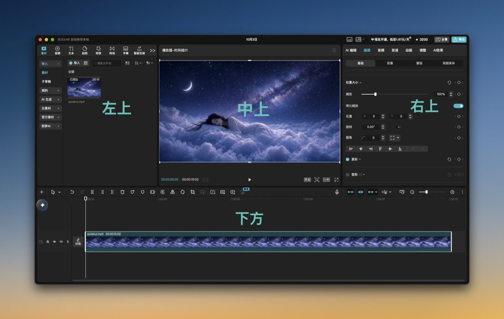
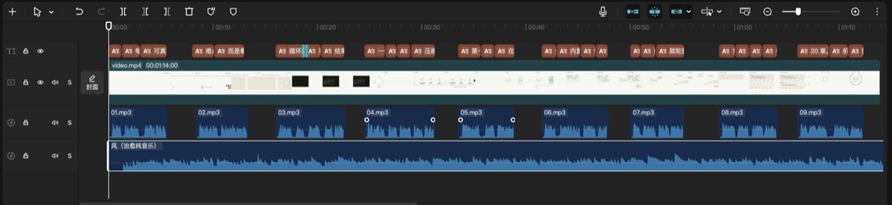
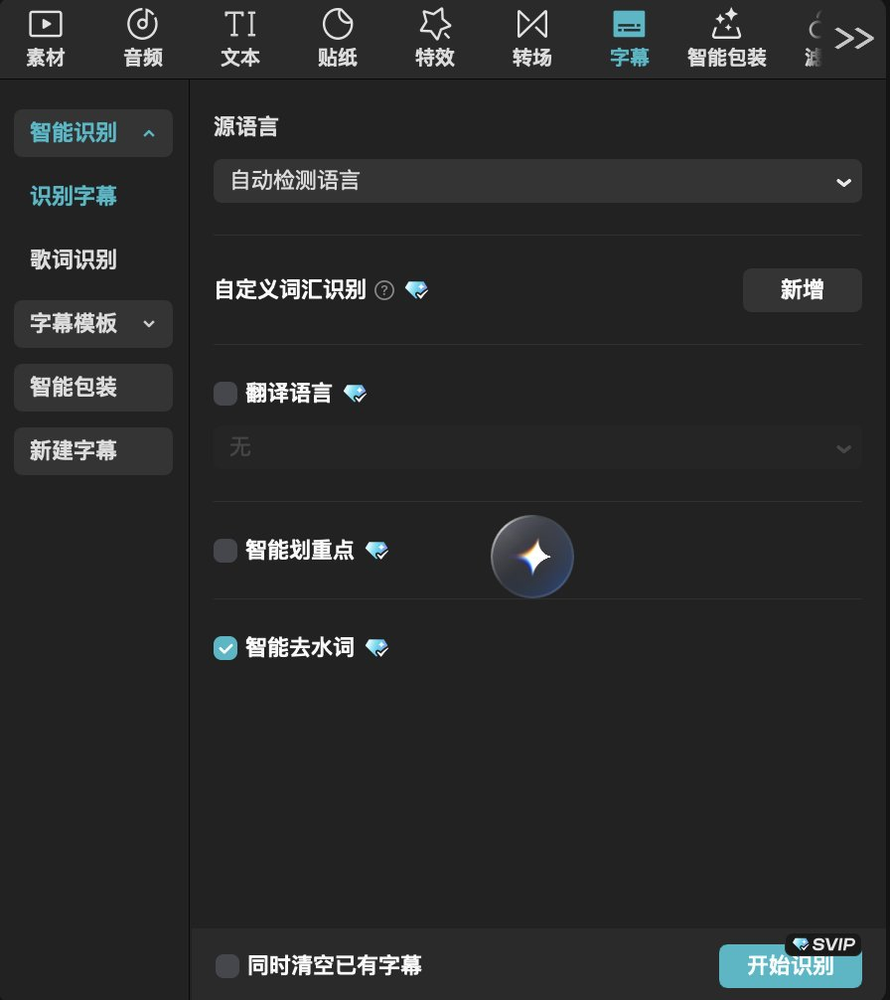
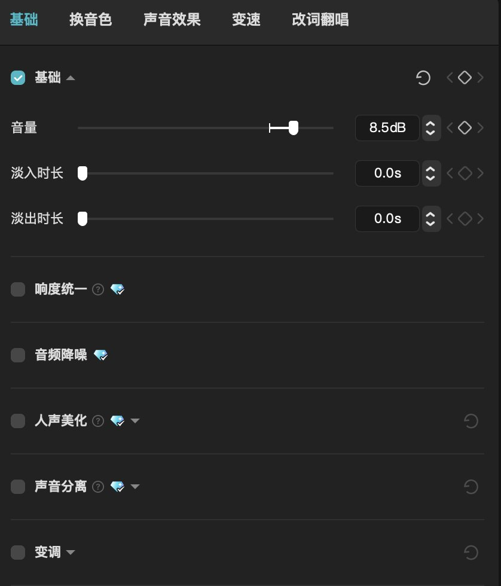
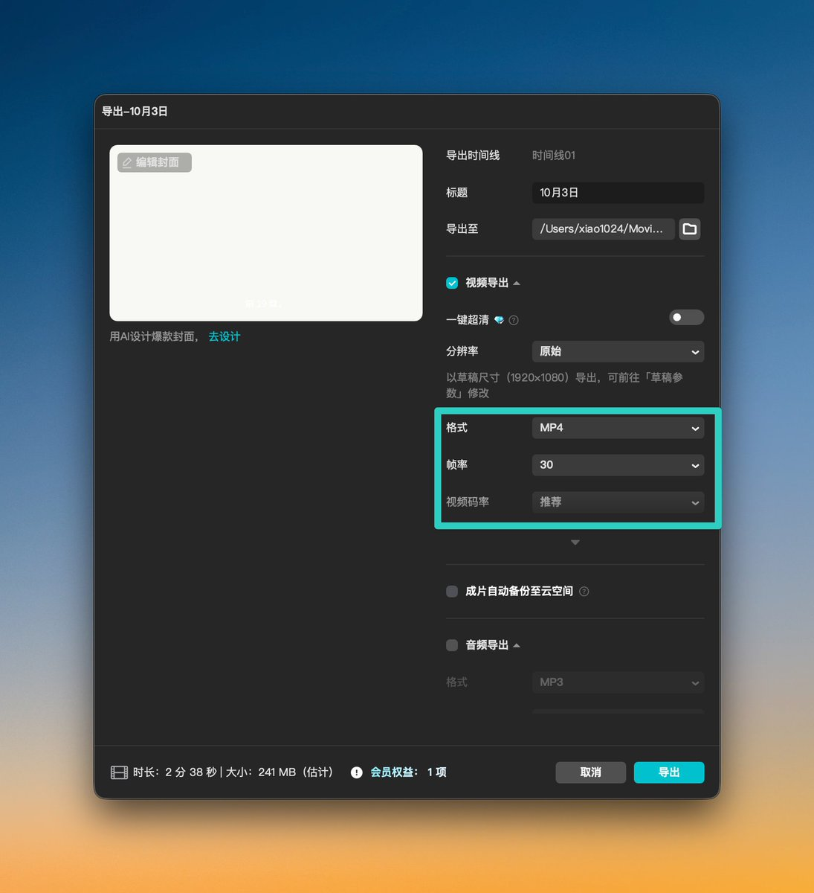

# 超简单剪映使用，从小白到用 Skill，剪辑第一个爆款视频

剪映是字节出的免费剪辑软件，新人上手剪辑，非专业剪辑师用这个就好。

桌面版 Windows 和 macOS 都有，手机版、网页版跟桌面版的草稿能互通。

免费、中文界面、模板多，做第一条视频，这个门槛最低。

但它有个说不出口的问题——软件本身不难，难的是打开之后不知道该先点哪。

这篇分两半。

上篇讲剪映本身怎么用。从安装到导出，全程手动，剪出一个能发出去的视频。

下篇讲一个开源 skill。把需求用大白话讲给 AI，它直接把剪映草稿搭好，字幕、配音、音乐一并配齐。

两半是递进关系。上篇走一遍，才知道下篇替你省掉的到底是什么。

## 目录

上篇·剪映手动操作

- 一、装哪个·装在哪 —— 三个版本怎么选，草稿目录为什么必须先记下来
- 二、认清四块区域 —— 素材区、预览窗口、时间线、参数面板
- 三、第一刀：素材进时间线 —— 导入、分割、删除、调顺序
- 四、配音：文本朗读 —— 打字生成旁白，改起来不心疼
- 五、字幕：识别字幕 —— 识别、改错字、调断句、方言
- 六、音乐与音量 —— 人声和音乐别抢
- 七、导出 —— 分辨率、帧率、码率怎么定

下篇·让 AI 直接操作剪映

- 八、这个 skill 是什么 —— 不是替代品，是坐在剪映前面的操作员
- 九、装 —— 一键脚本，和四种编辑器的目录
- 十、跑通第一个视频 —— 验环境、跑测试、草稿不显示怎么办
- 十一、能做什么 —— 六个场景，每条带能直接抄的指令
- 十二、做不了什么 —— 哪些活它碰不到
- 常见坑 —— 六个会卡住的地方
- 速查表 —— 十句能直接用的话

## 上篇 剪映本身：手动剪出第一个视频

## 一、装哪个·装在哪

剪映有三个版本：手机版、网页版（2024 年下线）、桌面专业版。

两个版本的云草稿互通，手机上剪一半，电脑上接着剪。


这篇要用的是桌面专业版。两个理由：一是多轨道、字幕、导出参数这些细活，桌面版才顺手。二是下篇那个 skill 只认桌面版。

下载认准官网：https://www.jianying.com/，桌面版叫剪映专业版，英文名 JianyingPro。

海外版剪映是 CapCut。CapCut 是同一个团队做的国际版，界面长得像，草稿格式不通用——下篇那个 skill 完全不支持。

装完先做一件事：把草稿目录的默认位置记下来。

```plaintext
Windows：
C:\Users\Administrator\AppData\Local\JianyingPro\User Data\Projects\com.lveditor.draft

macOS：
/Users/<用户名>/Movies/JianyingPro/User Data/Projects/com.lveditor.draft
```

工程、素材、字幕缓存全在这个目录里。手动找草稿要靠它，让 AI 生成草稿也要靠它。

装的时候如果改过安装位置，这个路径要重新对一遍——下篇环境检查那一步，出错最多的地方就是这儿。

剪映最简单的剪辑方式呢就是 套模板，把图片或者文字等素材替换，导出就能出片了！

## 二、认清四块区域

打开剪映专业版，点击首页 开始创作  进入创作模块，界面就四块。




- 左上：素材区。媒体、音频、文本、贴纸、特效、转场、滤镜、调节都在这一列
- 中上：预览窗口。右下角有播放控制，可以全屏
- 下方：时间线。所有剪辑动作都在这里完成
- 右上：参数面板。选中什么，这里就显示什么的可调项

时间线是主战场。

轨道分两类。

视频轨可以叠好几条，上面一条会盖住下面一条——画中画、字幕底衬就靠这个。

音频轨也是多条的，音乐、旁白、音效各占一条，互不打架。

剪辑就是三件事：把素材放上轨道、把不要的部分切掉、把剩下的排好顺序。

## 三、第一刀：素材进时间线

1. 打开剪映，点「开始创作」新建草稿
2. 素材区点「导入」，把视频、图片、音频拖进来
3. 把素材从素材区拖到时间线的主视频轨（添加到轨道）

素材进了轨道，接下来就是切。



白线是播放头，把它拖到要切的位置，选中片段，按 Ctrl + B 分割。Mac 上是 Command + B。

切完选中不要的那段，Delete 删掉。切错了 Ctrl + Z 撤回。

调整顺序靠拖。想改时长，拖片段的两端。

剪映是自动保存的，不用惦记存盘。

新手最容易犯的错，是切得太碎。三秒一切、五秒一切，观众还没看清画面就跳走了。整条视频先粗剪一遍，把废镜头去掉，再回头看节奏。

## 四、配音：文本朗读

这是剪映最值钱的功能之一。你把字打进去，它念出来。

1. 顶部点「文本」→「新建文本」
2. 把旁白一句一句粘进去
3. 选中文本，右侧参数面板找到「文本朗读」
4. 挑音色，点生成

朗读生成的音频会单独落在音频轨上，跟文字块位置对应。


音色库里常用的几个：

| 音色 | 适合 |
| :--- | :--- |
| 温柔男声 | 成长类、陪伴类内容 |
| 故事男声 | 有叙事感的解说 |
| 温暖青年声 | 轻松的口播 |

AI 配音真正省事的地方，不是快，是改起来不心疼。

念错一个字、语气不对，改掉那行字重新生成就行。真人录音遇上这种情况，得重新坐回麦克风前。

六十秒的旁白，打字加生成，通勤路上就能弄完。

## 五、字幕：识别字幕

顶部「文本」→「智能字幕」→「开始识别」。

选好语言，联网跑一会，字幕落到字幕轨上，一句一块，跟声音对齐。



识别完你要做两件事。

一是通读一遍改错别字。双击某一块直接改。整段错得多，右键那块「重新识别」。

最容易认错的集中在三类：人名、专业词、中英夹杂。这三类手动过一遍，剩下的基本能用。

二是调断句。识别按钮旁边有下拉，可以关掉「智能断句」，改成按语音停顿断句。口播视频用后者更自然。

方言也认。目前支持闽南话、上海话、中原官话、西南官话。普通话不标准的内容，走对应的方言模型反而更准。

版本差异要留意：较新的版本把识别字幕放进了会员权益，入口位置和权限以当前装的版本为准。

## 六、音乐与音量

素材区点「音频」→「音乐素材」，库里按场景、心情、乐器分好类，试听合适直接拖到音频轨。



选中音乐块，右侧面板调音量、加淡入淡出。

一条经验：旁白是主角，音乐压到听得清人声就够。

新手最常见的毛病，就是人声和音乐抢音量。

省事的做法是把音乐块音量拉到 20% 上下，开口说话那几秒再往下压一档。

## 七、导出

右上角「导出」。

三个参数：分辨率、帧率、码率。

分辨率最高 4K，帧率最高 60fps，码率分三档。



发抖音、视频号、B 站，1080P 加 30fps，码率选推荐档就够。文件小，上传快，平台本身还会再压一遍，导出 4K 是白费。

需要单独发一段的时候，导出时可以限定范围，只导其中一段。

到这里，上篇走完了。第一条视频你能发出去了。


## 下篇 让 AI 直接操作剪映

## 八、这个 skill 是什么


一句话：它不是剪映的替代品，是坐在剪映前面的一个操作员。

你把想要什么用大白话写出来，AI 把草稿搭好——素材排列、字幕、配音、音乐、转场，一次性配齐。最后打开剪映，草稿已经躺在那儿。

项目叫 jianying-editor-skill，MIT 协议开源，3.7k 星、481 个 fork、117 次提交。最近一版 v1.7，更新在 2026 年 9 月 11 日。

底层用的开源库叫 pyJianYingDraft。这个 skill 在它上面做了两件事：适配剪映 5.9 以后的新草稿结构，再包一层面向 AI 的调用接口。

适配 Antigravity、Trae、Claude Code、Cursor 这四类 AI 编辑器。

## 九、安装


三样前提：剪映专业版桌面版已经装好、有一个能跑 skill 的 AI 编辑器、机器上有 Python。

最简单的安装 扔给智能体

```plain text

帮忙安装这个skill  https://github.com/luoluoluo22/jianying-editor-skill.git

```

Windows 有一键脚本，在 PowerShell 里跑：

```powershell
irm is.gd/rpb65M | iex
```

手动装就是 git clone，按用的编辑器选目录：

```bash
git clone https://github.com/luoluoluo22/jianying-editor-skill.git 


```

再补环境依赖：

```bash
pip install -r requirements.txt
playwright install chromium

#可选
brew install python ffmpeg

python3 -m venv .venv
source .venv/bin/activate

python -m pip install edge-tts pillow

python --version
ffmpeg -version
python -c "import edge_tts, PIL; print('Edge TTS 和 Pillow 安装成功')"
```

playwright 那条是给录屏和网页转视频用的。

以后更新，在 skill 目录里 git pull 就行。所以剪辑脚本别写在 skill 目录里——写在项目根目录下，git pull 才不会跟本地改动打架。

## 十、跑通第一个视频

装完先验一遍环境。对着 AI 说：

> 检查一下剪映自动化的环境是否正常

它会去跑环境校验，检查三样东西：FFmpeg 有没有、Python 依赖齐不齐、剪映草稿目录找没找到。

第三样最容易出错。草稿目录探测不到，就把上篇记下的那个实际路径告诉 AI。

环境通了，跑一条测试：

> 随便剪一个测试视频给我看看

它会新建一个草稿，放进演示素材和测试字幕。

跑完打开剪映——看不到新草稿是正常的。

剪映不会实时刷新草稿列表。重启剪映，或者随便进一个旧草稿再退出来，列表就更新了。这是问得最多的一个坑。

> 装好 skill 后的实操效果视频

效果很简约只为简单测通 skill


[video](https://video.twimg.com/amplify_video/2106321029157265408/vid/avc1/1920x1080/hRkhEtR0K8UB3xbY.mp4?tag=29)

视频提示词如下：

```plaintext
使用 jianying-editor skill，制作一条约 30 秒的古诗诵读视频：

作品：纳兰性德《木兰花·拟古决绝词柬友》
正文：
人生若只如初见，何事秋风悲画扇。
等闲变却故人心，却道故人心易变。
骊山语罢清宵半，泪雨霖铃终不怨。
何如薄幸锦衣郎，比翼连枝当日愿。

制作要求：
1. 1920×1080 横屏，30fps，总时长约 30 秒。
2. 使用温柔、舒缓、略带伤感的中文女声，朗读自然，句间适当停顿。只朗读正文，不读标题、作者或异文说明。
3. 自动生成逐句同步字幕，使用清晰的宋体，避免遮挡画面主体。
4. 添加轻柔的古琴或古筝风格纯音乐，音量低于旁白，首尾淡入淡出。
5. 采用淡雅宣纸、水墨古风画面，每句更换对应意境：初见、秋风画扇、故人离散、人心易变、骊山月夜、雨中铃声、锦衣离人、双鸟连枝。画面之间柔和转场，并加入轻微动态。
6. 标题和作者以简洁小字显示，正文字幕突出。
7. 使用我提供的正文版本，不加入“一作”等说明。参考：https://www.guwendao.net/mingju/juv_43f5bfba7229.aspx
8. 直接完成制作，不必逐项确认；素材不可用时采用合理替代，并在交付时说明。
9. 交付可直接播放的 MP4、SRT 字幕和可编辑剪映草稿。即使 Mac 无法自动从剪映导出，也请通过其他可用方式生成最终 MP4。
10. 最终视频按我的 B 站兼容规范导出，文件名包含 bilibili，交付前用 ffprobe 检查并完成完整解码验证。

文件保存到 /Users/用户名/Documents/Codex/当天日期/ 下的独立目录，完成后给出视频和字幕的可点击链接。
```

## 十一、能做什么


按场景列，每条后面是你能直接照着说的指令。

Vlog 和基础剪辑

> 把 D:\素材\成都旅游 里的所有视频剪成一个 Vlog，加个轻快的 BGM，标题叫「成都漫步」
> 帮我把刚才录的几个片段拼在一起，每段之间加个淡入淡出转场
> 在这个视频的开头加一个 3 秒钟的标题文字，用那种「复古打字机」的动画效果

文案转视频

> 帮我写一段关于「如何熬夜不伤身」的科普文案，配上温柔女声旁白，自动生成字幕

这一条走的是它的一键流程：写稿、配音、对齐字幕轨，一次做完。

> 有一段录好的旁白 narrator.mp3，识别字幕，再从素材库里自动挑画面配上去

这条用的是语义素材匹配。它把画面、旁白音频、字幕放在一起分析，按内容挑镜头，不是按文件名顺序堆。

> 做一个双人对话视频：男声说「你好」，女声回「早安」，字幕根据说话的人自动切换样式

录屏和软件教程

> 我要录一段 Excel 操作教程，录完后自动加智能缩放动画
> 帮我录一段 http://localhost:3000 网页的演示，持续 10 秒，然后导入到新草稿里

录屏会按点击的位置自动插缩放关键帧。教程类视频里，观众视线跟着光标走，靠的就是这个。

素材检索

> 搜一下剪映里有没有「水彩」风格的滤镜，给我列出来
> 给这个视频的所有片段都加上「电影感」滤镜

剪映里的滤镜、特效、转场能按名字搜。想用什么效果，说描述就行，它去找最接近的那个。

工程管理

> 列出最近 10 个剪映草稿
> 草稿「未命名项目」好像坏了，打不开，帮忙修复一下

草稿损坏、版本对不上，它会用覆盖模式重建一份合规的工程文件。

导出

> 把「最终版视频」这个项目导出成 4K 60 帧的 MP4，保存到桌面

## 十二、做不了什么


这部分比上面那部分重要。

它管的只是时间线和草稿这一层。渲染和预览还是剪映自己在跑，它负责把草稿搭好，再替你去点导出。

具体做不了的有这些：

- 靠 GPU 实时算的功能调不动。智能抠图、美颜、语音识别字幕，它都碰不到
- 剪映内置的 AI 按钮点不了。「一键成片」「图文成片」需要手动去点
- CapCut 国际版不支持。只认国内版剪映专业版
- 手机端不支持。只管桌面版的草稿工程
- macOS 不能自动导出

平台支持对照：

| 平台 | 状态 | 说明 |
| :--- | :--- | :--- |
| Windows | 推荐 | 草稿生成、素材导入、字幕、配音、云端素材下载、录屏、自动导出 |
| macOS | 支持草稿生成 | 草稿能生成，导出要在剪映里手动点 |
| CapCut 国际版 | 不支持 | 只适配国内版剪映专业版 |
| 手机端 | 不支持 | 只面向桌面版草稿工程 |

自动导出是 Windows 独有的。它靠 Windows 的 UI 自动化模拟鼠标点击，所以只有 Windows 上有。

而且剪映 5.9 或更低的版本上最稳。新版界面一变，控件位置跟着动，自动点击就可能点偏。

Mac 上退一步——草稿生成照常，最后导出那一下手动点。这不是缺陷，是 UI 自动化能覆盖的范围本来就到这儿。

## 常见坑


草稿不显示 剪映不刷新草稿列表。重启剪映，或者进一个旧草稿再退出来。

导出跑到一半失败 导出期间不要碰鼠标键盘。脚本在模拟操作，人手一动就乱。

Mac 上导出命令没反应 设计如此。Mac 不支持自动导出，得手动点。

导入素材后报「检测到媒体丢失，请重新链接后再剪辑」 剪映 5.9 以后版本的问题，v1.7 已经修了。先 git pull 更新到最新版。

剪辑脚本写进了 skill 目录 写在项目根目录下另建 scripts/。写在 skill 里，下次 git pull 会冲突。

自动导出分辨率不对 导出的分辨率、帧率跟着剪映里的导出设置走，不是脚本里写什么就是什么。先确认剪映那边的默认档位。

## 速查表


| 想干什么 | 对着 AI 说 |
| :--- | :--- |
| 检查环境 | 检查一下剪映自动化的环境是否正常 |
| 跑测试 | 随便剪一个测试视频给我看看 |
| 批量成片 | 把某文件夹里的视频剪成 Vlog，加 BGM，起个标题 |
| 写稿配音字幕 | 写一段关于某主题的文案，配旁白，自动生成字幕 |
| 配画面 | 有一段旁白音频，识别字幕，自动挑画面配上去 |
| 录屏教程 | 录一段某某操作教程，自动加智能缩放 |
| 搜素材 | 搜一下剪映里有没有某某风格的滤镜 |
| 列草稿 | 列出最近 10 个剪映草稿 |
| 修草稿 | 草稿某某打不开了，帮忙修复 |
| 导出 | 把某某项目导出成 4K 60 帧的 MP4 |

## 最后


手动剪和 AI 剪，不是二选一。

第一条视频建议你先手动走一遍。知道字幕落在哪条轨、配音是怎么生成的、导出参数在哪调，出了问题你才找得到地方。

这一遍走完，再交给 AI，省下的是排列和重复配置的时间，不是理解成本。

剪映本身免费，那个 skill 也是 MIT 开源。两样加起来，零成本起步。

## 附录·本文参考

- jianying-editor-skill（MIT 开源）：https://github.com/luoluoluo22/jianying-editor-skill
- 项目底层依赖 pyJianYingDraft，Apache License 2.0
- 剪映专业版官方站及各版本更新说明

## 往期优秀文章：

- [录屏剪辑软件推荐](https://x.com/xaiwind/status/2097594816616116417)
- [超简单的火柴人视频，5 步教会你用 ChatGPT 和 Grok 制作](https://x.com/xaiwind/status/2097984612198760469)
- [超简单 Grok Bot，入门到一键构建机器人团队](https://x.com/xaiwind/status/2100027951618416963)
- [超详细 Codex 上手教程，从入门到精通](https://x.com/xaiwind/status/2102738292580225350)
- [Codex 自媒体运营 Skill 大全｜20 个装完，一个人顶一个团队](https://x.com/xaiwind/status/2108205644033806837)
- [从 0 到 1 构建 AI 知识工作流，Obsidian 笔记入门](https://x.com/xaiwind/status/2105453277643211214)
- [万字长文｜超详细的 GitHub 教程，从入门到精通](https://x.com/xaiwind/status/2104039563719262546)

## 关于作者

我是想风 [@xaiwind](https://x.com/@xaiwind)，一个关注出海与 AI 的创作者。


## 相关页面

- [[patterns/story-studio-video-pipeline]] — Audio-First 短视频流水线（另一条路线：直接生成剪映草稿）
- [[sources/story-studio-video-account-pipeline]] — Story Studio 开源 Skill 全流程
- [[sources/jedeeai-ai-video-top10-bookmarks]] — X 收藏量 Top 10 的 AI 视频实操神贴
- [[sources/huangbai-guoshen-review-skill]] — 「过审」Skill：发布前审核风险检查
- [[sources/codex-video-production-skills]] — Codex 视频制作 6 个必装 GitHub Skills

