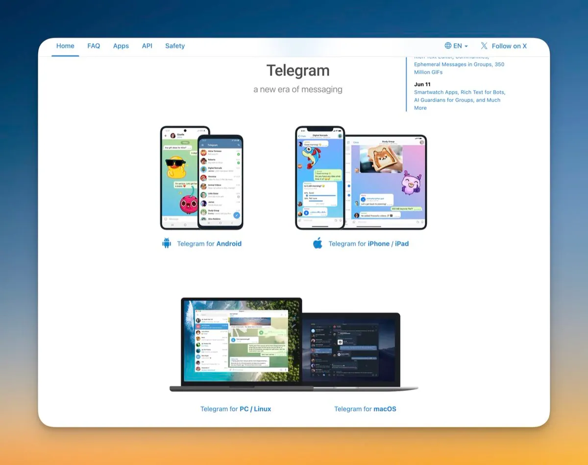
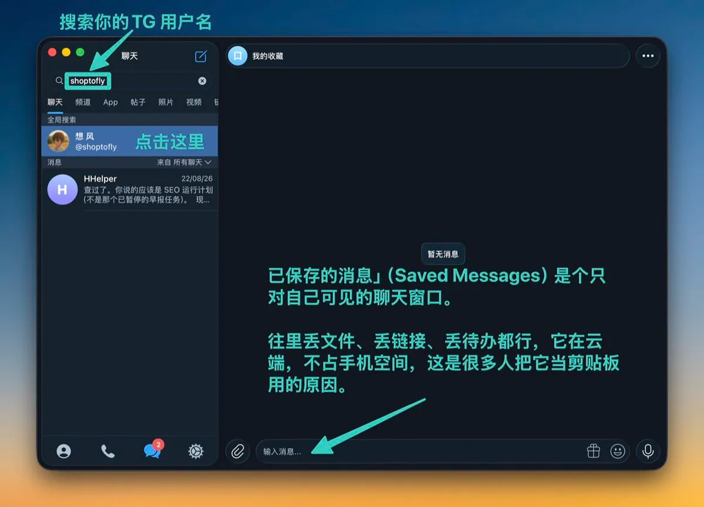
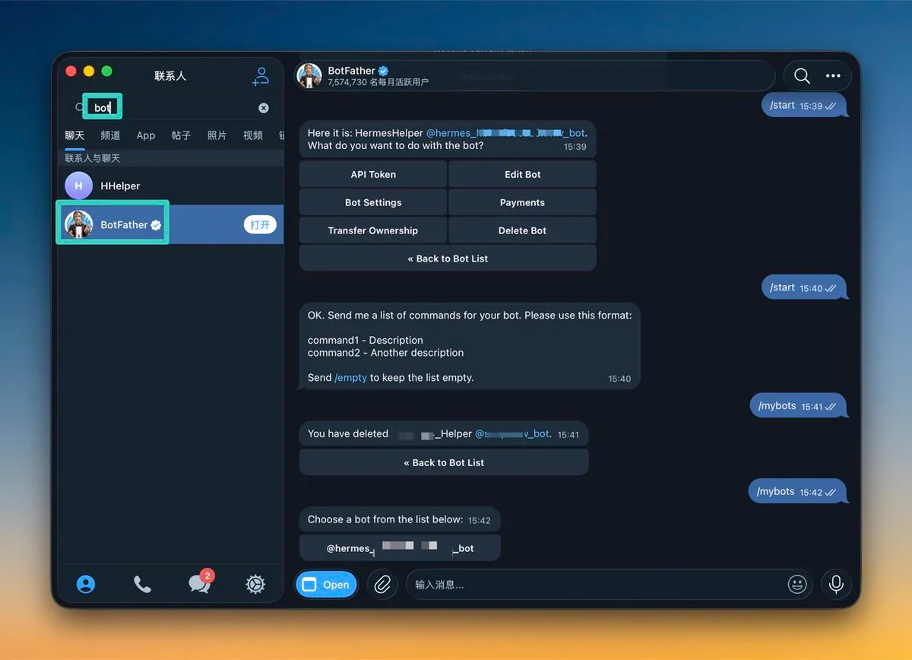

# 想风（@xaiwind）：超简单 Telegram 从入门到精通——客户端装配、Bot 机器人开发、MTProto 接口与广告投放指南

> 出海开发者必读的 Telegram 终极实战手册：从客户端安装换中文、两步验证安全加固、Saved Messages 云端剪贴板，到 20 万人超级群组与无限订阅频道管理；深入解析 Telegram Bot 机器人申请、Bot API 与 TDLib 客户端协议区别、登录验证码开发与 Webhook 部署，以及官方 Fragment TON 广告投放与代理避坑技巧。

<!-- more -->

大家好，我是想风！

今天来看 Telegram，本篇写给新手小白，新手也能学会！

它和微信最大的差别有三条。

消息存在云端，不在设备上。 换手机不用搬家，登上去记录全在。电脑、平板、网页同时在线，无所谓「主设备」。

群组能装 20 万人，频道是单向广播。 微信群里 500 人算大群，Telegram 的超级群组能到 20 万；频道更放开，订阅人数不设上限，但只有管理员能发。

接口对个人开放。 谁都能申请开发者接口，写机器人、做第三方客户端、把它接进自己的自动化流程。微信不给个人做这件事，Telegram 给。

出海的人用它，大多冲第三条。

这篇从小白视角走一遍：装、认界面、日常用、群组频道、机器人、开发者接口、广告投放、网络，最后是坑。

## 目录

- 一、下载和装 —— 含「装完先改的三件事」
- 二、界面认一遍
- 三、日常使用
- 四、群组和频道
- 五、把聊天列表收拾干净
- 六、机器人：能干什么
- 七、开发者接口：三样东西要分清
- 八、广告投放：两条路
- 九、网络与代理
- 十、常见坑
- 十一、速查表

## 一、下载和装

官网 telegram.org，首页就能下，认这个域名。应用商店里搜 Telegram 也行——商店里同名的高仿不少，看清楚开发者是 Telegram FZ-LLC。

四个平台都有客户端：

- 手机：iOS、Android
- 桌面：macOS、Windows、Linux，都是原生程序
- 网页：web.telegram.org，不装也能用

注册只用手机号（不支持大陆与香港号码），输国际格式（带 + 和国家码），验证码发到 App 里，不是短信——第一次装的时候短信那条路多半收不到。

装完先改的三件事

一、换成中文。 Telegram 官方界面没有中文。社区做过语言包，点一个语言包链接，界面就切过来了，搜索里能找到。不换也能用，就是菜单全英。

二、开两步验证。 路径是「设置 → 隐私与安全 → 两步验证」，设一个密码。

这一步不做，风险是实打实的：手机号被回收或者被补卡，账号就跟着走了，谁也拦不住。开了两步验证，光有手机号登不进去。

三、收一收隐私和流量。 同一个「隐私与安全」页里，把「手机号」改成「没有人」，「谁能拉我进群」改成「我的联系人」。再去「数据与存储」，关掉自动下载——不然群里发的高清视频会自动存进手机。

## 二、界面认一遍

桌面端是左右两栏。

左栏从上往下：搜索框、聊天列表、左下角的汉堡菜单。菜单里是设置、新建群组、已保存的消息、联系人。

右栏是对话区。点开一个聊天，上面是标题和成员入口，中间是消息，下面是输入框和附件按钮。

手机端底下有三到四个标签页——聊天、联系人、设置，还有通话。

有一处值得单独说：「已保存的消息」（Saved Messages）是个只对自己可见的聊天窗口。 往里丢文件、丢链接、丢待办都行，它在云端，不占手机空间，这是很多人把它当剪贴板用的原因。

## 三、日常使用

发消息：输入框里回车就发。发出去的消息可以编辑，也可以撤回——撤回不区分对方看没看过，两边一起消失。

发文件：点附件。免费账号单个文件上限 2GB，Premium 是 4GB。这是它被拿来传大文件的原因，比网盘顺手。

回复和转发：长按或右键一条消息，「回复」会带上引用；「转发」可以勾选「隐藏转发来源」，转出去之后对方看不到出自哪个群。截图发出去之前，这一项值得停一秒。

多设备：「设置 → 设备」里能看到所有登录过的机器，能一键踢掉。手机上「设置 → 设备 → 扫描二维码」，桌面上扫一下就登进去了，比输验证码快。

## 四、群组和频道

这是最容易搞混的一对。

| | 群组 | 频道 |
| :--- | :--- | :--- |
| 谁能发 | 所有成员（可设限制） | 只有管理员 |
| 人数上限 | 20 万 | 不设上限 |
| 用途 | 讨论、社群 | 广播、推送 |

群组里人一多就要开「超级群组」，权限管理会细出一大截：谁能发链接、谁能置顶、谁能改群信息，都能单独设。新成员进群前可以要求答题或者管理员审核。

频道是单向的，订阅者只能看。它更像公众号，区别是没有发言额度限制，也不用排队等推送。

有一件事先说清楚：频道不等于官方。 Telegram 上搜官方名，出来一排同名频道，认证的才有那个蓝勾。让输助记词、让连钱包的，一律按骗子处理。

## 五、把聊天列表收拾干净

不加文件夹之前，列表很快就不能看了。

文件夹：设置里找「文件夹」，建几条，每条设规则——比如「只显示未读的群组」「只显示两个同事的私聊」。建完之后聊天列表顶上会多出一排标签。

归档：不重要的聊天往左划或者右键归档，列表清爽，消息照样收。

置顶：最重要的几个钉在最上面。

静音：吵的群直接静音，不用退群。

这四样配齐，列表基本能长期保持可用。

## 六、机器人：能干什么

Telegram 上的机器人（Bot）就是一个自动应答的账号，行为由背后的程序决定。

建一个：搜索 @BotFather，发 /newbot，按提示起名，它会给你一串 Bot Token。这串东西就是机器人的钥匙，泄露等于把这个号交出去。

机器人能做的事，常见的几类：

- 通知：服务器报警、订单提醒、监控推送到私聊
- 翻译、下载、RSS：搜索里现成的机器人一大把
- 表单和客服：Mini App 能在 Telegram 里开一个小程序界面

有一条限制得知道：机器人不能主动私聊没先跟它说话的人。 所以「买个机器人自动加粉群发」这条路在官方接口下走不通。

## 七、开发者接口：三样东西要分清

到了这一步，凭证特别容易混。

| 凭证 | 去哪拿 | 它代表什么 |
| :--- | :--- | :--- |
| `api_id` / `api_hash` | `my.telegram.org` | 你的**应用** |
| Bot Token | @BotFather | 你的**机器人** |

api_id 和 api_hash 的申请路径：打开 my.telegram.org，填手机号，验证码发到 App 里；登进去点 API development tools，填一个 App title 和一个短名，提交就出来了。api_id 是一串数字，api_hash 是一串十六进制字符。

`api_hash` 按密码对待。 别写进代码、别提交到 GitHub、别贴群里。

机器人收消息有两种方式：

- `getUpdates`：客户端主动去拉，写起来简单，本地调试基本都用这个
- `setWebhook`：Telegram 把消息推到你指定的地址

云端接口对 webhook 有硬要求——必须是 HTTPS，端口也限定在几个。想用 HTTP 或者自定义端口，得自己架一台 Bot API Server。官方那个 Docker 镜像跑起来，API 端口默认 8081，统计端口 8082。

自建之前有个坑要先知道：同一个 Bot Token 不能同时挂在云端和本地服务器上。 切过去之前要调一次 logOut，登出后云端有大约十分钟不可用。

## 八、广告投放：两条路

一条是官方自助后台，一条是找频道主直接谈。

官方后台在 ads.telegram.org，自助开户。广告以赞助消息的形式出现在频道的帖子里，按 CPM 计费——按千次展示付费。

门槛不是一口价，看你走哪条通道开户：

- 官方直开：入金门槛最高，公开说法在两千欧元的量级
- 走代理商：门槛降下来，两三百欧元起，代价是佣金和增值税加在上面
- TON / Stars 这类加密通道：门槛最低，几十到几百美元就能试

2026 年有几处放开：最低 CPM 下调了，横幅和视频广告取消了大预算限制，向所有广告主开放。具体数字各家代理商报价不一样，开户前跟对方确认当前口径。

找频道主直接买更常见：私聊管理员，按条或者按天谈价格。好处是便宜、灵活，坏处是没后台、没数据、频道数据可能是刷的。判断办法很土——看历史帖子的互动，看评论是不是真人。

## 九、网络与代理

Telegram 内置代理设置，路径是「设置 → 数据与存储 → 代理」。

它走的是 MTProto 代理，和浏览器的 HTTP 代理不是一回事——这个代理只在 Telegram 内部生效，不影响其他应用。

常见的做法是自己搭一个 MTProto 代理，拿到 server、port、secret 三个值，在代理页里手动加进去。搭好之后可以生成一个 t.me/proxy?... 链接，发给别人一点就配好了。

有一条容易忽略：代理设置不跟着账号走，换一台设备要重新配一次。

## 十、常见坑

坑一：没开两步验证。 手机号丢了账号就没了，两步验证是唯一的兜底，十秒钟的事。记得半年登录一次，长期不登录很容易丢账号！

坑二：把 `api_hash` 或 Bot Token 传上 GitHub。 爬虫专门扫这个，几分钟内就会被拿去用。发出去才发现的话，第一时间去 @BotFather 里 /revoke 重发 token。

坑三：在假客户端里输验证码。 搜索结果里排前面的可能不是官方版。认 telegram.org 和商店里的 Telegram FZ-LLC。

坑四：以为频道是官方。 同名频道一大堆，认证的才有蓝勾。

坑五：转发的时候没注意来源。 截图和内部消息转出去之前，看一眼「隐藏转发来源」这一项。

坑六：聊天记录删了以为没了。 云端的东西，别的登录设备上还在。要彻底删，得在所有设备上删。

坑七：以为机器人能加好友群发。 官方接口不允许，能这么干的都是灰产工具，号迟早没。

## 十一、速查表

| 要做的事 | 去哪 |
| :--- | :--- |
| 登录 | 手机号 + App 内验证码 |
| 两步验证 | 设置 → 隐私与安全 → 两步验证 |
| 代理设置 | 设置 → 数据与存储 → 代理 |
| 已保存消息 | 左侧菜单 → Saved Messages |
| 建机器人 | 搜 @BotFather，发 `/newbot` |
| 申请开发者接口 | `my.telegram.org` → API development tools |
| 官方广告后台 | `ads.telegram.org` |
| 网页版 | `web.telegram.org` |

## 最后

Telegram 的门槛不在「会不会用」，在「知不知道它开放了什么」。

聊天谁都会，真正拉开差距的是后面三节——机器人、开发者接口、广告投放。这三样是微信不给的，也是出海的人把它当基础设施的原因。

先把账号和两步验证弄扎实，再往后面走。

## 附录·本文参考

- Telegram 官方站点 telegram.org、开发者接口入口 my.telegram.org
- Telegram Ads 官方后台 ads.telegram.org，门槛口径参考多方代理商公开报价（2026 年）
- Bot API Server 部署参考官方 Docker 镜像文档

往期优秀文章：

[超简单 Grok Bot ，入门到一键构建机器人团队](https://x.com/xaiwind/status/2100027951618416963)

[超详细 Codex 上手教程，从入门到精通](https://x.com/xaiwind/status/2102738292580225350)

[万字长文 ｜超详细的 GitHub 教程，从入门到精通](https://x.com/xaiwind/status/2104039563719262546)

[从 0 到 1 构建 AI 知识工作流，Obsidian 笔记入门](https://x.com/xaiwind/status/2105453277643211214)

[超简单剪映使用，从小白到用 Skill，剪辑第一个爆款视频](https://x.com/xaiwind/status/2106324762347880468)

[Codex 自媒体运营 Skill 大全｜20 个装完，一个人顶一个团队](https://x.com/xaiwind/status/2108205644033806837)

我是想风@xaiwind，一个关注出海与 AI、AIGC 的创作者。

本文基于 AI 辅助与个人实践融合创作，如果文章对你有帮助，欢迎点赞、收藏、关注，

本人文章持续维护，欢迎联系或者评论区见，每天进步一点，我们终会到达目的地！

## 相关页面

- [[sources/aichuhai-mika-phone-agent-cross-border-station]]
- [[sources/sopilot-400-directories-submission-platform]]
- [[concepts/overseas-tool-stack]]
- [[concepts/b2c-conversion]]
