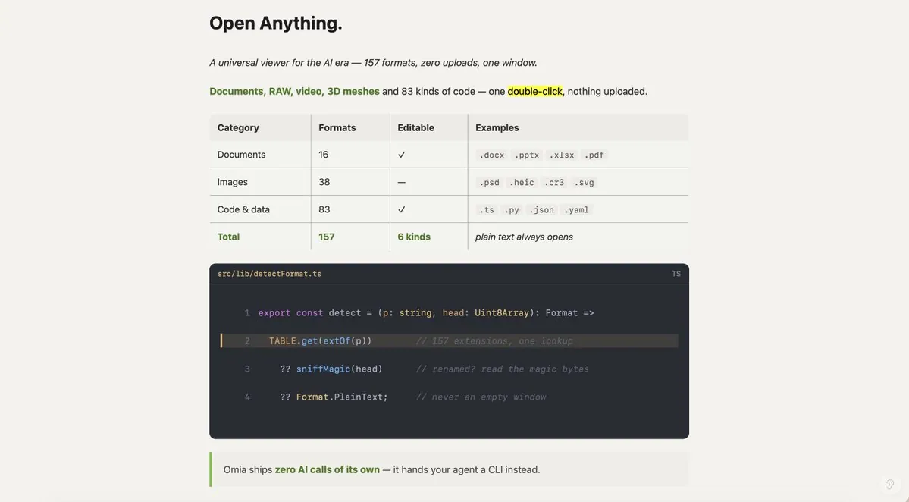
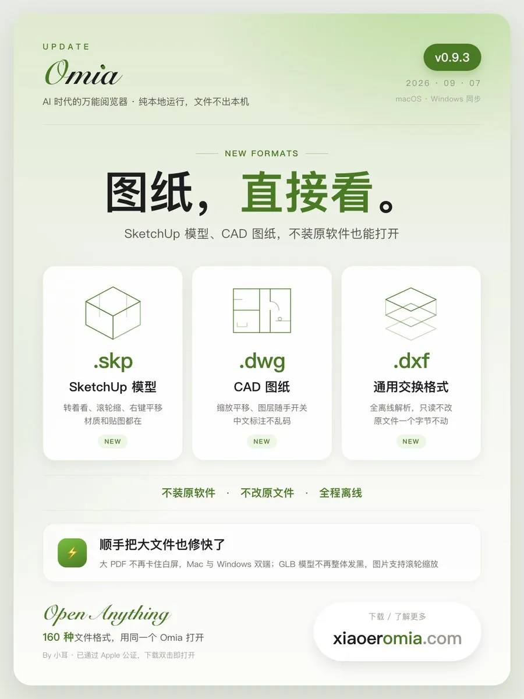

# 小耳👂Jane｜Xiaoer（@xiaoerzhan）：如何不出境、不开香港公司，给自己的产品接上全球收款

> 面向独立开发者的全球收款方案实操指南：详解在不办理香港公司、不需要出境的前提下如何为自己的产品接通全球收款渠道——主流聚合支付与 SaaS 建站平台的接入门槛与费率对比、实名与合规材料准备、资金结算周期与提现路径，以及规避账号风控与跨境资金合规风险的关键细节。

<!-- more -->

我做了个 Mac 工具 Omia，做了大半年，157 种格式能打开，DMG 过了苹果公证，Windows 版也出了。然后和很多人一样：最终还是想能够实现出海，毕竟国人不爱付费。




在国内做开发者，想把东西卖到国外，最难的从来不是把产品做出来。是你做完了，站在门口，发现门上挂着一把你打不开的锁。这几天我把这条轨修通了，完整流程、每一步的地址、我踩的坑，全写在下面。

## 卡了我最久的第一件事：Stripe 那道门

所有人都会告诉你用 Stripe。但它不接中国大陆主体——不能人民币结算、不能打款到大陆银行账户、大陆公司不能当它的商户。

所以标准做法是：注册一家香港公司，开一个香港银行账户，用香港主体去申请 Stripe。我卡在中间那步——香港银行开户基本要本人到场，我得专门跑一趟香港，为了一个还没赚到第一块钱的产品。犹豫很久没去，这事就一直拖着。

后来才知道，这一步根本不是必须的。有一类平台叫 MoR（Merchant of Record，记录商户），它自己就是商户，你只是它的供应商，全球几十套税制是它的法律责任。所以不需要香港公司、不需要境外银行卡、不需要出境，钱还能直接打到大陆。我这次用的是 Waffo Pancake：费率 3.9% + $0.50，无开户费无月费，个人和公司主体都能接，结算走银行卡或支付宝，$19.90 一单到手约 $18.6。我从注册到提交审核，全程在家，没出过门。

## 卡了我最久的第二件事：我第一次就搜错了站

搜「waffo」很容易落到 waffo.com。那个站叫 Global Payment & Monetization Platform，看着挺正经——但它是同一家公司的企业站，卖订阅开票那套，不是你要接的开发者产品。我在上面翻了半天找不到接入文档，一度以为自己没看懂。这个正确地址是锐钦告诉我的，一句话把我从死胡同里拽出来，谢谢他 🙏 认准「Pancake」这个词就不会走错：

```
产品站    waffo.ai
中文文档  docs.waffo.ai/zh
控制台    pancake.waffo.ai
```

## 整个流程：先分清这是两条独立的线

我一开始以为是一条流水线，走了一半才发现不是。官方文档原话：「打款所需的身份信息不属于本次审核范围，也没有单独的审批环节。」

| 线 | 决定什么 | 要审吗 |

| 门店业务审核（KYB） | 你能不能开始卖 | 要，1–3 个工作日 |

| 身份认证 + 提款账户 | 收到的钱怎么拿出来 | 不用审，即时生效 |

两条互不依赖，可以同时做。建议先做第二条，10 分钟能完，做完就不挡路。下面 STO_xxx 换成你自己的店铺 ID，登录后地址栏里就有：

```
身份 + 提款账户  pancake.waffo.ai/merchant/dashboard/payout-accounts
店铺资料        pancake.waffo.ai/merchant/dashboard/STO_xxx/settings/general
提交 KYB 审核   pancake.waffo.ai/merchant/dashboard/STO_xxx/settings/business-details
Webhooks       pancake.waffo.ai/merchant/dashboard/STO_xxx/settings/webhooks
财务 / 提款     pancake.waffo.ai/merchant/dashboard/finance
API 密钥        pancake.waffo.ai/merchant/dashboard/integration
```

身份表单内嵌在 payout-accounts 页上，点「Fill now」。填完 5 项（拉丁名、拉丁姓、法定姓名、国家、证件号）下面的「添加账户」才解锁。支付宝有限额：单笔 ≤ ¥5 万，每人每年累计 ≤ ¥30 万，金额大要用银行卡。控制台首页有个 Getting Started 面板，会自己算你还差几项，比任何清单都准。

## 我踩的四个坑

1. 选个人还是企业？我有公司但支付宝是个人的

不冲突。对公提款认证「即将上线」，现阶段所有提款都按个人身份处理。判断依据是你网站上署的是谁——网站写公司却申报个人，直接撞「信息不准确」

2. 让填拉丁名，可我支付宝户名是中文

这个拉丁名就是拼音，是两打款户名取自「法定姓名」（中文），拉丁名只是 KYB 合规记录。证据：拉丁名填着的情况下支付宝已经绑成功了

3. DNS TXT 加完，dig 一直 SERVFAIL

本机 DNS 被 Clash 劫持了。破绽是它给一个未签名的域回了 ad（DNSSEC 已验证）标志。用 DoH 绕开：dns.google/resolve?name=xxx&type=TXT，Status 为 0 就是全球已生效

4. 第一次提交被打回

两条：条款列了禁止行为却没写违反会怎样；网站没有清晰定价

补一句身份那条：没有提款记录之前，法定姓名和证件号还能自己改，一旦有成功提款就锁死，要改得找客服。提交前逐字对一遍。

## 写定价时差点又踩两个雷

想写「原价 ¥98 现价 ¥58」——不行。国内《明码标价和禁止价格欺诈规定》里「原价」有法定定义：促销前 7 日内的最低成交价。没卖过就是虚构原价。改成前瞻性预告「推广期结束后将上调至 ¥98」，每个字都真，而且等真涨上去之后，¥58 就成了真实历史价，那时再促销划线才有依据。

审核让我说明「免费版与付费解锁」。写之前我去翻了自己 app 的代码——试用到期根本不拦人，30 天后只弹一句提示，文件照开。那写「付费解锁」就是假的，而「无虚假信息」正好是审核清单里的一条。改成如实说：试用和授权功能完全一样，继续使用请购买永久授权。不改产品，每个字都经得起查。

## 审核到底在审什么

九条清单里真正会挂人的就那么几条：产品真的上线了（URL 能打开、没有登录墙、没有「即将上线」占位页）、产品清晰可见、定价可见（在进入结账之前就能找到）、隐私政策和服务条款都在且无需登录可访问、客服邮箱真实且与提交的一致、无虚假信息、无商标冲突。

说白了它审的是一件事：你是不是一个真实存在、说话算数的生意。不是审你技术多好，是审你写在网上的东西经不经得起点开。而且这不是 Waffo 独有的形状——Paddle、Creem、Lemon Squeezy、以后申请 App Store、申请广告主资质，审的东西高度重合。法律三页写一次、定价页做一次，以后所有平台申请都能用。

## 最后

最后说的要等待 1-3 个工作日，我好像等了不到 1 小时就审核完毕了。

这个还是蛮好的。

但我想说的是另一件事。以前我看别人做出海产品，总觉得那是另一个世界的事——要开公司、要办卡、要懂税、要有人带。这次自己从头走一遍才发现，真正卡住我的从来不是技术，是「我以为很难所以没去试」。

真难的那部分——全球税务合规——早就有人做成了服务，3.9% 就能买到。剩下的那些「难」，无非是把自己的网站认真收拾一遍：价格写清楚、条款写完整、邮箱写真的。这些事本来就该做，只是没人逼的时候我一直往后拖。

最后，Omia 正在尝试打开更多的工程类文件，陆陆续续增加有痛点的可以关注一下：



祝大家都大麦～～

## 相关页面

- [[sources/payment-channel-management-system]]
- [[sources/pengpai-wanghou-psychological-accounts-to-b-monetization]]
- [[concepts/overseas-tool-stack]]
- [[concepts/b2c-conversion]]
